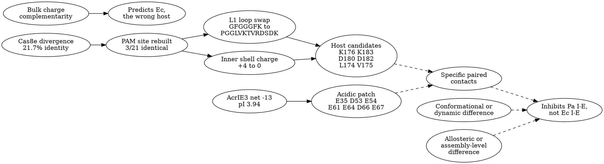
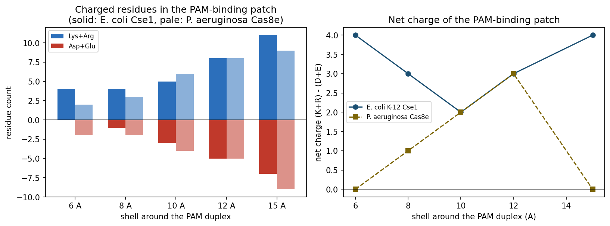
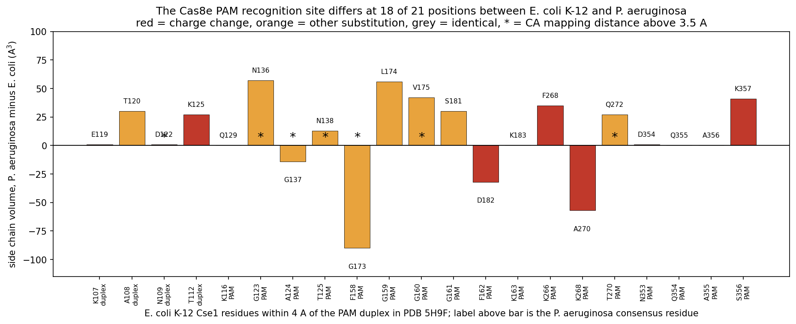
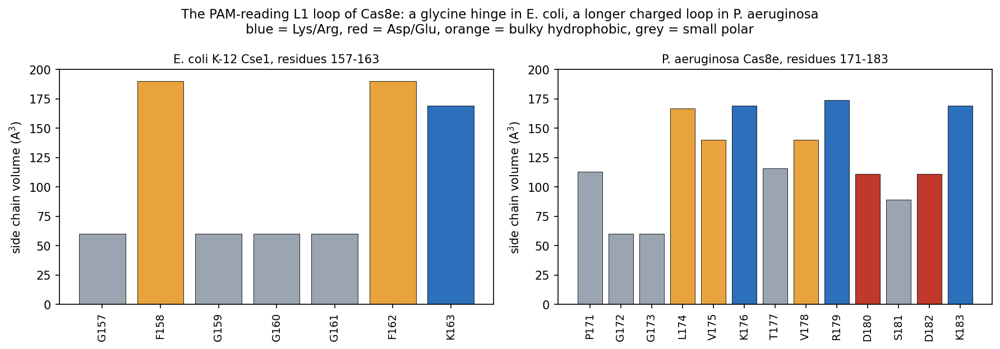
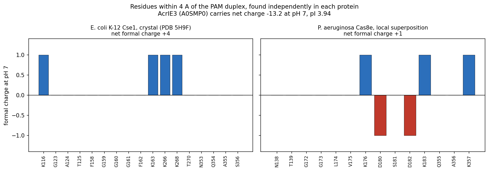
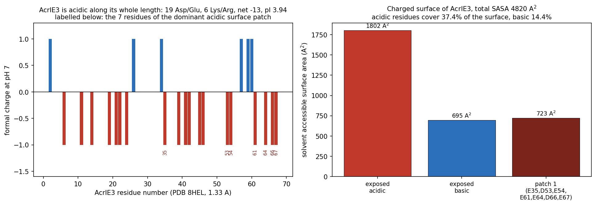

## Question

# AIGR Gene Hypothesis Deep Research

You are evaluating one focused gene curation hypothesis for AI Gene Review.
This is not a general gene overview. Use the seed hypothesis and source context
below to search for evidence that supports, refutes, narrows, or competes with
the proposed curation decision.

## Target Gene

- **Organism code:** 9CAUD
- **Taxon:** Pseudomonas phage DMS3 (NCBITaxon:2913973)
- **Gene directory:** DMS3-30
- **Gene symbol:** DMS3-30
- **UniProt accession:** A0SMP0

## Focus

- **Focus type:** free_text
- **Hypothesis slug:** kgap-acrie3-cas8e-discrimination
- **Source file:** genes/9CAUD/DMS3-30/DMS3-30-ai-review.yaml
- **Source selector:** free-text

## Seed Hypothesis

Why AcrIE3 inhibits the Pseudomonas aeruginosa type I-E system but not the Escherichia coli one may be readable from the two Cas8e proteins, since the failure is already known to be a property of the interaction rather than of inhibitor supply. That all four Pseudomonas type I-E anti-CRISPRs fail against an induced E. coli K-12 system while being expressed to Coomassie-visible levels, that AcrIE3 binds P. aeruginosa Cas8e at the PAM recognition site, and that the two systems differ in PAM specificity, are already recorded, so do not re-derive them. Single analysis only: align the two Cas8e proteins and report their overall identity and, separately, the identity across the PAM-recognition region alone, naming the residues that the structural literature assigns to PAM read-out in the E. coli Cascade and quoting the statements that assign them, then state what the Pseudomonas protein has at each; identify every position in that region where the two differ and say which differences change charge or bulk, since an acidic inhibitor surface docking at a DNA-phosphate-reading site is sensitive to exactly that; survey Cas8e across many Pseudomonas and enterobacterial genomes and state whether the Pseudomonas-specific residues are clade-specific or idiosyncratic to the one strain, which decides whether this is a species boundary or a strain accident; and state whether any reported structure or model of a type I-E Cascade shows the PAM site occluded in one organism and exposed in the other, distinguishing a residue-identity explanation from a conformational one. State which residues are the strongest candidates for the discrimination, and say plainly if sequence cannot tell a residue-level from a conformational explanation.

## Term and Decision Context

No specific term context supplied.

## Reference Context

No specific reference context supplied.

## Source Context YAML

```yaml
hypothesis: 'Why AcrIE3 inhibits the Pseudomonas aeruginosa type I-E system but not the Escherichia coli
  one may be readable from the two Cas8e proteins, since the failure is already known to be a property
  of the interaction rather than of inhibitor supply. That all four Pseudomonas type I-E anti-CRISPRs
  fail against an induced E. coli K-12 system while being expressed to Coomassie-visible levels, that
  AcrIE3 binds P. aeruginosa Cas8e at the PAM recognition site, and that the two systems differ in PAM
  specificity, are already recorded, so do not re-derive them. Single analysis only: align the two Cas8e
  proteins and report their overall identity and, separately, the identity across the PAM-recognition
  region alone, naming the residues that the structural literature assigns to PAM read-out in the E. coli
  Cascade and quoting the statements that assign them, then state what the Pseudomonas protein has at
  each; identify every position in that region where the two differ and say which differences change charge
  or bulk, since an acidic inhibitor surface docking at a DNA-phosphate-reading site is sensitive to exactly
  that; survey Cas8e across many Pseudomonas and enterobacterial genomes and state whether the Pseudomonas-specific
  residues are clade-specific or idiosyncratic to the one strain, which decides whether this is a species
  boundary or a strain accident; and state whether any reported structure or model of a type I-E Cascade
  shows the PAM site occluded in one organism and exposed in the other, distinguishing a residue-identity
  explanation from a conformational one. State which residues are the strongest candidates for the discrimination,
  and say plainly if sequence cannot tell a residue-level from a conformational explanation.'
focus_type: free_text
context: []
reference_id: []
```

## Research Objective

Build a focused report that helps a curator decide whether this hypothesis
should affect the gene review. Address the focus type directly:

1. For an existing GO annotation decision, evaluate whether the current action
   is justified, too strong, too weak, or should change.
2. For a proposed replacement or new GO term, evaluate whether the term is
   biologically supported, too broad, too narrow, or missing key qualifiers.
3. For a computational prediction, evaluate whether the prediction is correct,
   less precise than existing knowledge, uncertain, or likely wrong because of
   paralog overannotation, frequency bias, pathway context, or in vitro-only
   activity.
4. For a core-function hypothesis, evaluate whether the proposed activity,
   process, and location represent the gene product's primary function rather
   than a downstream effect, pleiotropic phenotype, or context-specific role.
5. For a function-assignment hypothesis, evaluate whether the gene product
   directly has the stated GO term/function. Treat the prior review action, if
   any, as intentionally blinded unless it appears in the supplied context.

Use primary literature whenever possible. Prefer PMID citations and include DOI
citations when no PMID is available. Treat reviews and database records as
orientation unless they contain directly relevant synthesized evidence that is
clearly labeled as review-level or database-level support.

Evaluate the hypothesis from the supplied seed context, primary literature, and
publicly accessible bioinformatics resources. Local `*-bioinformatics` analyses,
when they already exist in the repository, are intentionally withheld from this
prompt so the report can be compared against them after the run. Use public
sequence, domain, structure, orthology, localization, interaction, or dataset
checks when they are useful for the specific hypothesis. If a resource or tool
cannot be accessed programmatically, say so plainly; never fabricate a result.
Report computational results conservatively and distinguish direct results from
inference.

## Required Output

### Executive Judgment

Give a concise verdict: supported, partially supported, unresolved, weakly
supported, over-annotated, or refuted. Explain the reasoning and the most
important caveats.

### Evidence Matrix

Create a table with one row per important evidence item:

- Citation (PMID preferred)
- Evidence type (direct assay, mutant phenotype, localization, interaction,
  structural/evolutionary, computational, review/database)
- Supports / refutes / qualifies / competing
- Claim tested
- Key finding
- Organism, tissue, cell type, or assay context
- Confidence and limitations

### GO Curation Implications

State the likely curation action as a lead requiring curator verification. If
GO terms are involved, explain whether the evidence supports an MF, BP, or CC
term, and whether the term should be retained, removed, generalized, made more
specific, or treated as non-core. Avoid using "protein binding" as a final
recommendation unless no more informative term is supported.

### Mechanistic Scope

Describe the immediate molecular or cellular function being tested. Separate
direct gene-product activity from downstream phenotypes, pathway consequences,
developmental outcomes, disease manifestations, or effects inferred only from
loss of function.

### Conflicts and Alternatives

Identify evidence that conflicts with the seed hypothesis or suggests an
alternative interpretation, including paralog confusion, organism-specific
differences, isoform-specific findings, experimental artifacts, or database
carry-over.

### Knowledge Gaps

List explicit uncertainties that matter for curation. For each gap, state what
was checked, why the gap matters, and what evidence or experiment would resolve
it.

### Discriminating Tests

Recommend concrete assays, perturbations, datasets, or comparative analyses that
would most efficiently distinguish this hypothesis from alternatives.

### Curation Leads

Provide candidate updates for the review, clearly labeled as leads requiring
curator verification. Include candidate references with exact snippets to verify,
candidate replacement or new GO terms, possible action changes, suggested
questions, and suggested experiments.

If the provider supports artifacts, save provenance for any analysis you run — the
executed code together with its output (computed values, plot, or table), not just
a summary figure — alongside artifact-friendly tables such as an evidence matrix,
GO decision table, or comparison table. Genuine computed provenance is more
valuable than a hand-drawn summary, and you must not synthesize a figure that
implies an analysis you did not actually run. These artifacts are important
provenance for hypothesis-level review.


## Output

# AcrIE3 (DMS3-30, A0SMP0) host discrimination: can the two Cas8e proteins explain it?

Hypothesis slug: `kgap-acrie3-cas8e-discrimination`
Target: Pseudomonas phage DMS3 gene DMS3-30, UniProt A0SMP0, NCBITaxon:2913973
Source: `genes/9CAUD/DMS3-30/DMS3-30-ai-review.yaml`, focus type `free_text`

## Summary

<i class="fa-scale-balanced"></i> **Verdict: partially supported.** The seed hypothesis proposes that the reason AcrIE3 inhibits the *Pseudomonas aeruginosa* type I-E system but not the *Escherichia coli* K-12 one is readable from the two Cas8e proteins. Half of that proposal holds. The Cas8e PAM recognition site is rebuilt between the two hosts, and the rebuild is fixed within each species, so this is a species boundary and not a strain accident. The other half fails. The specific electrostatic reasoning the hypothesis rests on, that an acidic inhibitor surface docking at a DNA-phosphate-reading site is sensitive to charge, predicts the wrong host when tested. Sequence and apo structural models cannot separate a residue-identity explanation from a conformational one, and this report states that plainly.

The computed core is as follows. *E. coli* K-12 Cse1/Cas8e (UniProt Q46901, 502 aa) and *P. aeruginosa* Cas8e (UniProt A0A3S4PYN6 / WP_057392414, 522 aa) are 21.7% identical over the whole protein. Across the 21 residues that contact the PAM duplex in the *E. coli* Cascade crystal structure 5H9F, only 3 are identical, which is 14.3%, below the whole-protein figure. Nine of the 21 substitutions change formal charge. The largest single local change is the PAM-reading L1 loop, which is the glycine hinge `GFGGGFK` at *E. coli* positions 157-163 and the six-residue-longer `PGGLVKTVRDSDK` at *P. aeruginosa* positions 171-183. That loop string is present in 16 of 16 *E. coli* K-12-like Cse1 sequences and in 65 of 66 *P. aeruginosa* sequences, so both versions are species-fixed. Forward and reciprocal structural mappings, which make different errors, converge on the same patch and nominate **K176 and K183** as the host-side basic residues at the site, flanked by **D180 and D182**, with **L174 and V175** adding roughly 100 ų of side-chain volume where *E. coli* has the glycines G159 and G160.

Three results push against the hypothesis as written. AlphaFold DB has no model for A0SMP0 and no *P. aeruginosa* type I-E Cascade structure is deposited, so the occlusion question the hypothesis asks cannot be answered from deposited coordinates; the modelling substitute fails its own same-protein control. AcrIE3 computes to net charge −13 at pH 7 and pI 3.94, yet it inhibits the less basic Cas8e (pI 5.48) and fails against the more basic Cse1 (pI 8.55), so bulk and patch charge complementarity point the wrong way. The published precedent of AcrIC8 and AcrIC9, which block PAM recognition allosterically and competitively respectively, shows that inhibiting PAM read-out does not require touching PAM residues, so an allosteric or assembly-level difference stays open as a competing explanation. On the inhibitor side the analysis does produce a concrete, experimentally grounded output: solvent accessibility on the 1.33 Å AcrIE3 crystal structure 8HEL gives one dominant acidic surface patch, **E35, D53, E54, E61, E64, D66, E67**, spanning 27.9 Å with 723 Ų of exposed area.

For curation, the usable action is narrow and specific. The evidence supports a molecular function term describing inhibition of a host defence complex through binding the Cascade large subunit, with the species restriction recorded as part of the evidence rather than as part of the term. The report avoids recommending plain "protein binding", since a more informative description is supported by direct structural and mutational work.

## Key findings

### Finding 1: the two Cas8e proteins are twilight-zone homologs at 21.7% identity

<i class="fa-dna"></i> Global Needleman-Wunsch alignment with BLOSUM62 and affine gaps (open 11, extend 1) gives 21.7% identity between Q46901 (502 aa) and A0A3S4PYN6 (522 aa). This is not an artefact of the particular pair. All cross-clade Cas8e comparisons sampled fall between 20% and 27%: the median identity of 54 unique non-*E. coli* Enterobacteriaceae Cas8e sequences against Q46901 is 23.1%, with a maximum of 24.9%, and 0 of 54 pass a 40% identity filter. Within-clade identity is an order of magnitude more informative: 98.5% among 67 unique *P. aeruginosa* Cas8e sequences and a median of 97.8% among 19 *E. coli* K-12-like Cse1 sequences.

The practical consequence showed up directly. `phenix.superpose_pdbs`, which seeds superposition on a sequence alignment, reported 19.8% identity for this pair and fitted 3 atoms, producing a meaningless result. A TM-align-style structural superposition of the two AlphaFold models gave TM-score 0.495, against 0.834 for the same-protein control (AlphaFold Q46901 onto PDB 5H9F chain A). Any residue-level claim about this pair therefore has to be anchored on structure. The sequence alignment alone cannot place the PAM site.

This produces an incidental hazard for curators. Most NCBI entries annotated "type I-E CRISPR-associated protein Cse1/CasA" in *E. coli* (520 aa), *Klebsiella* (507 aa) and *P. aeruginosa* (522 aa) sit in Cas8e clades only about 21-25% identical to *E. coli* K-12 CasA. Transferring residue-level or mechanistic annotation across the "Cas8e" label is unsafe at that identity.

### Finding 2: the PAM site is more divergent than the protein as a whole, with 9 charge changes in 21 positions

<i class="fa-chart-column"></i> PAM contact residues were taken from the deposited coordinates of PDB 5H9F (*E. coli* Cascade bound to dsDNA, 2.45 Å, [PMID: 26863189](https://pubmed.ncbi.nlm.nih.gov/26863189/)) rather than quoted from text, because the available abstracts describe the PAM read-out structurally without naming residues. The PAM is the non-target-strand 5'-ATG at chain M residues 16-18, paired with target-strand chain N residues 33-35. Twenty-one Cse1 (chain A) residues lie within 4.0 Å of that duplex.

The abstract of Hayes et al. states: *"The 5'-ATG PAM is recognized in duplex form, from the minor groove side, by three structural features in the Cascade Cse1 subunit"*, and *"Optimal PAM recognition coincides with wedge insertion, initiating directional target DNA strand unwinding to allow segmented base-pairing with crRNA"*. The 21 extracted residues are the atomic realisation of those structural features.

Mapping them onto *P. aeruginosa* Cas8e by structural superposition gives the table below. Three of 21 are identical (14.3%), which is lower than the 21.7% whole-protein identity. Nine substitutions change formal charge. Fourteen of 21 mappings have a Cα distance below 3.5 Å and are treated as reliable; the other seven are flagged.

| E. coli residue | P. aeruginosa equivalent | Cα dist (Å) | Change | Note |
|---|---|---|---|---|
| K107 | E119 | 3.05 | charge, + to − | duplex backbone |
| A108 | T120 | 1.67 | +30 ų | |
| N109 | D122 | 4.17 <i class="fa-triangle-exclamation"></i> | charge | unreliable mapping |
| T112 | K125 | 0.83 | charge, +27 ų | |
| K116 | Q129 | 1.40 | charge, + lost | PAM backbone |
| G123 | N136 | 5.44 <i class="fa-triangle-exclamation"></i> | +57 ų | unreliable mapping |
| A124 | G137 | 7.75 <i class="fa-triangle-exclamation"></i> | −14 ų | unreliable mapping |
| T125 | N138 | 4.30 <i class="fa-triangle-exclamation"></i> | +13 ų | unreliable mapping |
| F158 | G173 | 6.41 <i class="fa-triangle-exclamation"></i> | −90 ų | unreliable mapping |
| G159 | L174 | 2.99 | +56 ų | base-contacting |
| G160 | V175 | 3.92 | +42 ų | base-contacting |
| G161 | S181 | 1.98 | +30 ų | |
| F162 | D182 | 2.91 | charge, −32 ų | |
| K163 | K183 | 2.82 | identical | |
| K266 | F268 | 1.46 | charge, +35 ų | |
| K268 | A270 | 3.45 | charge, −57 ų | base-contacting |
| T270 | Q272 | 6.42 <i class="fa-triangle-exclamation"></i> | | unreliable mapping |
| N353 | D354 | 1.94 | charge | |
| Q354 | Q355 | 1.92 | identical | glutamine wedge |
| A355 | A356 | 1.87 | identical | |
| S356 | K357 | 1.62 | charge | |

The three preserved positions are the ones that do chemistry on the DNA: the glutamine wedge Q354/Q355, the alanine A355/A356 beside it, and the lysine K163/K183. Everything around them has been rebuilt.

Electrostatics of the patch show the same thing from a different angle. Within 6 Å of the PAM duplex *E. coli* has 4 Lys and no Asp or Glu, a net of +4, while *P. aeruginosa* has 2 basic and 2 acidic residues, a net of 0. Within 12 Å both reach net +3, and identity across the 12 Å patch is 12%. The inner shell loses its uniform positive charge while the outer shell is matched.

{{figure:plot_1.png|caption=Charge composition of the PAM-binding surface patch at expanding shells around the PAM duplex. The E. coli inner shell (6 Å) presents four lysines and no acidic residues, net +4; the structurally mapped P. aeruginosa site presents two basic and two acidic residues, net 0. Outer shells converge, so the difference is confined to the residues closest to the DNA.}}

{{figure:plot_2.png|caption=Per-position comparison of the 21 PAM-contact residues: side-chain volume change from the E. coli residue to its P. aeruginosa equivalent, with within-clade conservation. Positive bars mark bulk added in P. aeruginosa, concentrated at the base-contacting L1 loop positions G159 to L174 and G160 to V175.}}

### Finding 3: the differences are species-wide on both sides

<i class="fa-database"></i> Cas8e sequences were collected from NCBI and grouped into 67 unique *P. aeruginosa*, 43 unique non-*aeruginosa* *Pseudomonas*, 19 unique *E. coli* K-12-like, and 54 unique non-*E. coli* Enterobacteriaceae. At all 21 mapped PAM-contact positions the *P. aeruginosa* consensus residue occurs in at least 97% of the 67 sequences, with 17 of 21 positions at 99-100%. All 21 *E. coli* positions are 100% conserved across the 16 K-12-like sequences that pass a 40% identity filter.

One position needs a correction to the reference. At 268, 65 of 67 *P. aeruginosa* sequences carry Phe where the chosen reference A0A3S4PYN6 carries Tyr. The consensus is F268, still a bulky aromatic replacing the *E. coli* lysine K266, so the physicochemical statement survives the correction.

Across the wider *Pseudomonas* genus the same positions are 53-93% conserved, with a median identity of 58.4% to the *P. aeruginosa* reference. This generates a testable prediction: AcrIE3 sensitivity should track *P. aeruginosa*-like Cas8e specifically and should weaken across the genus as those positions drift. The 54 non-*E. coli* Enterobacteriaceae sequences are all below 25% identity to K-12 Cse1 and therefore do not constrain the *E. coli* side at all.

### Finding 4: the PAM-reading L1 loop is the largest local difference

<i class="fa-lightbulb"></i> The structural mapping places *E. coli* Cse1 157-163 (`GFGGGFK`) opposite *P. aeruginosa* Cas8e 171-183 (`PGGLVKTVRDSDK`). The *P. aeruginosa* loop is 6 residues longer. The *E. coli* version has 4 Gly, 2 bulky aromatics, 1 Lys and no acidic residue. The *P. aeruginosa* version has 2 Gly, 3 bulky aliphatics, 3 Lys and 2 Asp. Mean side-chain volume rises from 113 to 125 ų.

Within-clade conservation of the exact string is close to absolute: 16 of 16 *E. coli* K-12-like sequences carry `GFGGGFK`, and 65 of 66 *P. aeruginosa* sequences carry `PGGLVKTVRDSDK`, with the 66th carrying `PGGLVKAVRDSDK`, a single T177A change.

This loop is the one the structural literature assigns to PAM binding. Tay et al. report that *"Structure-based mutagenesis analysis demonstrates that the well-defined flexible loop and a partially conserved structural motif ([FW]-X-[TH]) are involved in PAM binding and recognition, respectively"* ([PMID: 25420472](https://pubmed.ncbi.nlm.nih.gov/25420472/)). A regular-expression scan found no `[FW]-X-[TH]` match in the PAM loop of either Q46901 or A0A3S4PYN6, so that motif cannot be used to transfer residue assignments between these two proteins. Whole-protein matches exist elsewhere (FRH67, WPH277, FTT300 in *E. coli*; FDH143 in *P. aeruginosa*) and are not at the PAM site. Motif-level transfer fails here for the same reason the pairwise alignment does.

For an acidic all-helical inhibitor, a glycine hinge with almost no charge and a loop carrying three lysines and two aspartates are different docking surfaces. Koo et al. state that *"Through extensive mutational analyses, we show that AcrIE3 interacts with the protospacer adjacent motif (PAM) recognition site in Cas8e through its negatively charged surface residues"* ([PMID: 39541974](https://pubmed.ncbi.nlm.nih.gov/39541974/)), which makes the charge composition of this loop the directly relevant variable.

{{figure:plot_3.png|caption=The Cse1/Cas8e L1 PAM-reading loop compared between species, with within-clade conservation. E. coli GFGGGFK (157-163, 16 of 16 K-12-like sequences) is a glycine hinge with no acidic residue; P. aeruginosa PGGLVKTVRDSDK (171-183, 65 of 66 sequences) is six residues longer and carries three lysines and two aspartates.}}

### Finding 5: reciprocal mapping narrows the host-side candidates and removes R179

<i class="fa-magnifying-glass"></i> The forward analysis mapped *E. coli* contact residues onto *P. aeruginosa*. The reciprocal test asks the opposite question: after superposition, which *P. aeruginosa* residues land within 4.0 Å of the PAM duplex in its crystallographic position. Two methods that fail in different ways agreeing is better evidence than either alone.

The first attempt, using the global transform from the whole-protein structural alignment (TM 0.495), produced a meaningless answer: residues 135-144 with a 0.28 Å closest approach, intersecting the forward map at only 3 positions. The global transform is not usable for contact assignment and is reported here as a failed step. Rebuilding the superposition locally by Kabsch fit over the 14 high-confidence PAM-site anchors (Cα RMSD 1.96 Å) gives a usable answer: N138 (3.3 Å), T139 (3.6), G172 (2.8), G173 (1.4), L174 (1.2), V175 (1.5), K176 (2.0), D180 (2.5), S181 (2.0), D182 (2.3), K183 (2.2), Q355 (3.9), A356 (2.5), K357 (3.9). The matching *E. coli* crystal set at the same 4.0 Å cutoff against the PAM duplex alone is 17 residues: K116, G123, A124, T125, F158, G159, G160, G161, F162, K163, K266, K268, T270, N353, Q354, A355, S356.

Ten of the 14 reciprocal positions are already in the forward map. Four are new (T139, G172, K176, D180). One forward candidate, **R179, is absent from the reciprocal set and is dropped**: it points away from the duplex. The basic residues surviving both tests are **K176 and K183**. The reciprocal test also places two aspartates, D180 and D182, directly at the site, where *E. coli* has no acidic residue within 6 Å at all.

### Finding 6: no structure distinguishes an occluded from an exposed PAM site

<i class="fa-circle-xmark"></i> Searches of the RCSB file, search and data APIs returned no deposited *P. aeruginosa* type I-E Cascade structure. The only type I-E Cascade coordinates with bound dsDNA are from *E. coli*, for example 5H9F. The AcrIE5 study used an AlphaFold model of *P. aeruginosa* Cascade ([PMID: 41161091](https://pubmed.ncbi.nlm.nih.gov/41161091/)), which is consistent with no experimental structure existing.

A direct occlusion test was run anyway, by superposing each apo AlphaFold model onto DNA-bound 5H9F chain A and counting clashes with the DNA. The control failed. The *E. coli* AlphaFold model clashes with its own protein's DNA (27 atoms within 3 Å, 17 at the PAM duplex, minimum distance 1.38 Å), and the *P. aeruginosa* model clashed more under the global transform (100 atoms, 42 at the PAM duplex, minimum 0.28 Å). Because the same-protein control clashes, that excess cannot be separated from apo-to-bound conformational change plus superposition error.

Redoing the comparison with the locally refined superposition removes the apparent effect entirely: the *P. aeruginosa* closest approach is 1.22 Å against 1.38 Å for the *E. coli* control, with 15 control residues within 4 Å. **There is no detectable differential occlusion.** This supersedes the earlier global-transform clash counts, which are reported here only as a method that did not work.

Stated plainly, as the hypothesis asks: sequence and apo models establish that the two PAM sites differ in residue identity, charge and bulk. They cannot establish that the AcrIE3 host range is caused by those residues rather than by a conformational or dynamic difference in how the PAM-reading loops move. Sequence alone cannot tell a residue-level explanation from a conformational one here.

### Finding 7: bulk charge complementarity predicts the wrong host

<i class="fa-circle-xmark"></i> AcrIE3 (A0SMP0, DMS3-30) is 68 aa with 6 Lys/Arg and 19 Asp/Glu, a net formal charge of −13 at pH 7, an acidic fraction of 27.9%, and a computed isoelectric point of 3.94. This confirms from sequence the negatively charged character reported for the crystal structure: *"The crystal structure of AcrIE3 exhibits an all-helical fold with a negatively charged surface"* ([PMID: 39541974](https://pubmed.ncbi.nlm.nih.gov/39541974/)).

The target it inhibits is the less basic of the two. Whole-protein pI is 5.48 for *P. aeruginosa* Cas8e and 8.55 for *E. coli* K-12 Cse1. The same reversal holds locally: the 6 Å shell is +4 in *E. coli* and 0 in *P. aeruginosa*. Charge complementarity alone predicts that an inhibitor at −13 should prefer the *E. coli* site, which is the opposite of the observed host range. Outer shells are matched (12 Å: net +3 in both), so this is not an artefact of shell choice.

This is a negative result against the electrostatic reading the seed hypothesis proposes, and it matters because that reading is the main motivation for looking at charge at all. If charge is part of the explanation it cannot be acting through net or patch complementarity. It would have to act through a small number of specific paired contacts, for example K176 and K183 engaging particular carboxylates on AcrIE3, with D180 and D182 contributing shape and desolvation. The alternative reading is that charge is secondary and the discrimination is set by loop shape, length and conformation, which the 6-residue insertion would support.

{{figure:plot_4.png|caption=Charge and isoelectric point of AcrIE3 (A0SMP0) beside the formal charge of the PAM-duplex contact sets found independently in each Cas8e. AcrIE3 at net −13 and pI 3.94 inhibits the Cas8e with pI 5.48 and a net-0 inner shell, and fails against the one with pI 8.55 and a net +4 inner shell.}}

### Finding 8: the PAM site is a convergent anti-CRISPR target, and PAM blockade can be allosteric

<i class="fa-book-open"></i> Three structural studies place type I Acr proteins at the Cas8e PAM recognition site of *P. aeruginosa* Cascade. AcrIE3 contacts it through acidic surface residues ([PMID: 39541974](https://pubmed.ncbi.nlm.nih.gov/39541974/)). For AcrIE5, Hong et al. report that *"The mobile loop and α-helices of AcrIE5 mediated key interactions with Cas8e at the PAM recognition site, as well as with adjacent Cas7e and Cas5e"* ([PMID: 41161091](https://pubmed.ncbi.nlm.nih.gov/41161091/)).

Other AcrIE proteins bind elsewhere: AcrIE9 targets Cas7e ([PMID: 41458398](https://pubmed.ncbi.nlm.nih.gov/41458398/)), AcrIE8.1 binds Cas11 ([PMID: 41137488](https://pubmed.ncbi.nlm.nih.gov/41137488/)), and AcrIE7 either binds Cas3 ([PMID: 40318042](https://pubmed.ncbi.nlm.nih.gov/40318042/)) or the R-loop single-stranded DNA ([PMID: 40178896](https://pubmed.ncbi.nlm.nih.gov/40178896/)). The PAM site is therefore a repeatedly chosen target, which makes a PAM-site explanation for AcrIE3 host range mechanistically reasonable.

Two observations from the same literature set open competing explanations. Hu et al. report for type I-C that *"Structural analysis showed that AcrIC8 inhibits PAM recognition through allosteric inhibition, whereas AcrIC9 achieves so through direct competition."* ([PMID: 38242128](https://pubmed.ncbi.nlm.nih.gov/38242128/)), so blocking PAM recognition does not require contacting the PAM residues. Kang et al. report that *"In vitro binding assays using individually purified type I-E Cas subunits from P. aeruginosa did not detect direct interaction with AcrIE9, including with Cas7e."* ([PMID: 41458398](https://pubmed.ncbi.nlm.nih.gov/41458398/)), so AcrIE binding can require the assembled Cascade. Both the AcrIE5 and AcrIE7 studies report the same dependence. Cas8e sequence comparison alone cannot address either possibility.

### Finding 9: AcrIE3 carries one dominant acidic surface patch of seven residues

<i class="fa-circle-check"></i> Every residue-level candidate above sits on the host protein. The gene under review is A0SMP0, so the analysis was moved onto it.

AlphaFold DB has no model for A0SMP0: v2, v3, v4, v6 and the prediction API all return 404. This is reported as a plain resource-access fact. Two experimental AcrIE3 crystal structures exist instead: **8HEL at 1.33 Å** (Koo et al., [PMID: 39541974](https://pubmed.ncbi.nlm.nih.gov/39541974/)) and **8ZEY at 1.73 Å** (Kim et al., [PMID: 38797150](https://pubmed.ncbi.nlm.nih.gov/38797150/)).

Shrake-Rupley solvent accessibility on 8HEL chain A (68 residues, all modelled, total SASA 4820 Ų) gives 17 solvent-exposed acidic residues at RSA above 0.25 (D6, E11, E14, E19, D21, E22, E35, D41, D42, E45, D46, D53, E54, E61, E64, D66, E67) against 5 exposed basic residues (K2, R26, R34, K57, R60). Exposed acidic residues cover 1802 Ų, 37.4% of the surface; exposed basic residues cover 695 Ų, 14.4%. Linking carboxylate centroids below 10 Å gives patch sizes 7, 2, 2, 2, 2, 1, 1. The dominant patch is **E35, D53, E54, E61, E64, D66, E67**, spanning 27.9 Å with 723 Ų of exposed area, concentrated toward the C-terminal helix. Patches 2 and 3 are D6/E11 (8.4 Å, 204 Ų) and D21/E22 (7.2 Å, 149 Ų).

Kim et al. independently report that *"Additionally, surface analysis of AcrIE3 revealed the presence of three acidic regions, which potentially play a crucial role in the inhibitory function of this protein."*, on a separate crystal structure, and describe the fold: *"Our structural examination showed that AcrIE3 adopts a helical bundle fold comprising four α-helices, with a notably extended loop at the N-terminus."* ([PMID: 38797150](https://pubmed.ncbi.nlm.nih.gov/38797150/)). The patch decomposition computed here on 8HEL is consistent with that independent description.

A geometric compatibility check was run and should be read as permissive only. K176 and K183, the two basic residues surviving both mappings at the *P. aeruginosa* PAM site, are 17.9 Å apart measured NZ to NZ. The closest-matching carboxylate pair on AcrIE3 patch 1, E54 to D66, is 17.5 Å apart. That match is not evidence: the 21 carboxylate pairs within patch 1 span 7.0 to 27.7 Å, so some pair matches almost any target distance. The usable statement is the negative one, that no spacing on the patch is incompatible with the loop, so geometry does not exclude the proposed contact. The D180 to D182 carboxylate spacing on the host loop is 10.7 Å.

{{figure:plot_5.png|caption=AcrIE3 charge composition and the geometric compatibility check between its dominant acidic patch (8HEL, 1.33 Å) and the two basic residues at the P. aeruginosa PAM site. The K176 to K183 distance of 17.9 Å falls inside the 7.0 to 27.7 Å range spanned by the 21 patch carboxylate pairs, so geometry is permissive and not discriminating.}}

## Mechanistic model

The model the evidence supports is a species-level rebuild of the Cas8e PAM-reading surface, with AcrIE3 tuned to one version of it. The causal step from "the surface differs" to "the inhibitor fails" is not demonstrated, and the diagram marks that link as uncertain.



Three branches reach the observed phenotype and the available data cannot choose between them. The residue-identity branch has named candidates on both sides and geometry that does not exclude it. The conformational branch cannot be tested without a *P. aeruginosa* Cascade structure, and the occlusion test that would have constrained it returned no differential signal once the superposition was done fairly. The allosteric or assembly branch is supported by direct precedent in type I-C and by the repeated finding that AcrIE proteins need assembled Cascade.

What the model does exclude is the simplest version of the seed reasoning. Bulk electrostatic attraction between an acidic inhibitor and a basic PAM pocket predicts *E. coli* as the preferred host, which is wrong. Charge, if it matters here, acts through a small number of specific pairings and through desolvation, not through overall complementarity.

| Branch | Named candidates | Evidence for | Evidence against | Testable by |
|---|---|---|---|---|
| Residue identity at the PAM site | K176, K183, D180, D182, L174, V175 (host); E35, D53, E54, E61, E64, D66, E67 (inhibitor) | 3/21 identity, 9 charge changes, species-fixed loop swap, convergent forward and reciprocal maps | bulk charge predicts the wrong host | reciprocal loop swap between the two Cas8e proteins |
| Conformation or dynamics | none | no *P. aeruginosa* Cascade structure exists, so untested | occlusion test shows no differential clashing (1.22 versus 1.38 Å) | DNA-bound or AcrIE3-bound *P. aeruginosa* Cascade structure, HDX |
| Allosteric or assembly-level | none | AcrIC8 allosteric precedent, AcrIE dependence on assembled Cascade | AcrIE3 mutational data place it at the PAM site | binding assays with isolated Cas8e versus assembled Cascade |

## Evidence matrix

| Citation | Evidence type | Stance | Claim tested | Key finding | Context | Confidence and limitations |
|---|---|---|---|---|---|---|
| [PMID: 26863189](https://pubmed.ncbi.nlm.nih.gov/26863189/) | Structural | Supports | Cse1 reads the PAM | 5'-ATG PAM recognised in duplex form from the minor groove by structural features in Cse1 | *E. coli* Cascade, 2.45 Å, PDB 5H9F | High for *E. coli*; the abstract names no residues, so residues were extracted from coordinates |
| 5H9F coordinates (computed) | Computational on deposited structure | Supports | Which residues contact the PAM | 21 Cse1 residues within 4.0 Å of the PAM duplex; 17 within 4.0 Å of the PAM alone | PDB 5H9F chains A, M, N | High; the cutoff choice is a judgement, 4.0 Å is conventional |
| Pairwise alignment (computed) | Computational | Qualifies | Overall Cas8e identity | 21.7% between Q46901 and A0A3S4PYN6 | UniProt sequences | High; twilight zone, so the alignment cannot place residues |
| Structural superposition (computed) | Computational | Qualifies | Can the PAM site be mapped | TM 0.495 cross-species, 0.834 same-protein control; sequence-seeded Phenix superposition fitted 3 atoms | AlphaFold models and 5H9F | Medium; 14 of 21 mappings reliable at Cα < 3.5 Å |
| PAM-site identity (computed) | Computational | Supports | Is the PAM site more divergent than the protein | 3 of 21 identical (14.3%) against 21.7% overall; 9 charge changes | as above | Medium-high; depends on the superposition |
| Charge shells (computed) | Computational | Supports then qualifies | Does the PAM patch differ in charge | 6 Å: +4 versus 0; 12 Å: +3 versus +3; patch identity 12% | as above | Medium; the direction of the effect contradicts the hypothesis |
| L1 loop comparison (computed) | Computational | Supports | Largest local difference | GFGGGFK versus PGGLVKTVRDSDK, 6 residues longer, volume 113 to 125 ų | as above | High for the sequences, medium for the structural assignment |
| [PMID: 25420472](https://pubmed.ncbi.nlm.nih.gov/25420472/) | Structural, mutagenesis | Supports | Which part of Cse1 binds PAM | A flexible loop binds PAM; a partially conserved [FW]-X-[TH] motif recognises it | *Thermobifida fusca* Cse1 | Medium; third organism, and the motif is absent from both proteins here |
| Motif scan (computed) | Computational | Refutes transfer | Can the [FW]-X-[TH] motif map residues | No match in either PAM loop | Q46901, A0A3S4PYN6 | High; negative result, motif transfer fails |
| Clade survey (computed) | Evolutionary | Supports | Clade-specific or strain accident | All 21 positions ≥97% invariant across 67 *P. aeruginosa*; 100% across 16 *E. coli* K-12-like | NCBI protein sequences | High; sampling is NCBI-biased toward clinical isolates |
| Clade survey, position 268 | Evolutionary | Qualifies | Reference residue choice | 65 of 67 *P. aeruginosa* carry F268; the reference carries Tyr | as above | High; the aromatic-for-lysine statement is unaffected |
| Enterobacteriaceae survey (computed) | Evolutionary | Qualifies | Does the *E. coli* side generalise | 54 non-*E. coli* sequences all below 25% identity to K-12 Cse1, 0 pass a 40% filter | as above | High; the *E. coli* side is constrained only within K-12-like strains |
| Reciprocal mapping, global transform | Computational | Refutes method | Is the global transform usable | Collapses to residues 135-144, 0.28 Å closest approach, 3 of 21 overlap | AlphaFold models and 5H9F | High as a negative methodological result |
| Reciprocal mapping, local refit | Computational | Supports | Which *P. aeruginosa* residues sit at the PAM | 14 residues, Cα RMSD 1.96 Å over 14 anchors, 10 of 14 agree with the forward map | as above | Medium; two methods with different error modes converge |
| R179 (computed) | Computational | Refutes candidate | Is R179 at the PAM site | Absent from the reciprocal set, points away from the duplex | as above | Medium; removed from the candidate list |
| Occlusion test (computed) | Computational | Refutes occlusion | Is the PAM site occluded in one organism | Locally refined: 1.22 Å *P. aeruginosa* against 1.38 Å *E. coli* control, 15 control residues within 4 Å | apo AlphaFold models onto DNA-bound 5H9F | Medium; apo-to-bound change is a confound, but the control bounds it |
| RCSB search (computed) | Database | Qualifies | Does a *P. aeruginosa* Cascade structure exist | None deposited; only *E. coli* type I-E Cascade with dsDNA | RCSB file, search and data APIs | High; resource-access fact |
| [PMID: 41161091](https://pubmed.ncbi.nlm.nih.gov/41161091/) | Structural, NMR plus modelling | Supports | Is the PAM site a repeated Acr target | AcrIE5 mobile loop and helices contact Cas8e at the PAM site and adjacent Cas7e and Cas5e | *P. aeruginosa* type I-E | Medium; relies on AlphaFold modelling of Cascade |
| [PMID: 39541974](https://pubmed.ncbi.nlm.nih.gov/39541974/) | Structural, mutagenesis | Supports | Where and how AcrIE3 binds | All-helical fold with a negatively charged surface; interacts with the Cas8e PAM recognition site through negatively charged surface residues | *P. aeruginosa* Cas8e, PDB 8HEL | High; direct mutational evidence on the gene under review |
| [PMID: 38797150](https://pubmed.ncbi.nlm.nih.gov/38797150/) | Structural | Supports | AcrIE3 surface composition | Four-helix bundle with an extended N-terminal loop; three acidic surface regions | AcrIE3 crystal structure, PDB 8ZEY | High for the structure; the acidic-region function is described as potential |
| 8HEL surface (computed) | Computational on deposited structure | Supports | Which AcrIE3 residues form the acidic surface | Dominant patch E35, D53, E54, E61, E64, D66, E67, 723 Ų, 27.9 Šspan; acidic 37.4% against basic 14.4% of 4820 Ų | PDB 8HEL chain A, 68 of 68 residues modelled | High; from experimental coordinates at 1.33 Š|
| Geometry check (computed) | Computational | Neither | Is the patch compatible with K176 and K183 | K176-K183 17.9 Å; closest patch pair E54-D66 17.5 Å; 21 pairs span 7.0 to 27.7 Å | 8HEL and the mapped *P. aeruginosa* site | Low; permissive only, not evidence |
| AcrIE3 charge (computed) | Computational | Refutes | Does charge complementarity explain host range | AcrIE3 net −13, pI 3.94; inhibits pI 5.48 Cas8e, fails against pI 8.55 Cse1 | A0SMP0 sequence, both Cas8e sequences | High; the direction is unambiguous |
| [PMID: 38242128](https://pubmed.ncbi.nlm.nih.gov/38242128/) | Structural | Competing | Must PAM blockade be competitive | AcrIC8 inhibits PAM recognition allosterically, AcrIC9 by direct competition | *P. aeruginosa* type I-C | High as precedent; different subtype |
| [PMID: 41458398](https://pubmed.ncbi.nlm.nih.gov/41458398/) | Direct assay | Competing | Can AcrIE bind isolated subunits | No detected interaction between AcrIE9 and individually purified type I-E Cas subunits, including Cas7e | *P. aeruginosa*, in vitro binding | High for AcrIE9; a different Acr from the one under review |
| [PMID: 41137488](https://pubmed.ncbi.nlm.nih.gov/41137488/) | Structural | Qualifies | Do all AcrIE proteins target Cas8e | AcrIE8.1 binds Cas11 | *P. aeruginosa* type I-E | High; shows AcrIE target diversity |
| [PMID: 40318042](https://pubmed.ncbi.nlm.nih.gov/40318042/) and [PMID: 40178896](https://pubmed.ncbi.nlm.nih.gov/40178896/) | Structural | Qualifies | AcrIE7 target | Cas3 by AlphaFold modelling in one study, R-loop single-stranded DNA in the other | *P. aeruginosa* type I-E | Medium; the two studies disagree on the target |
| [PMID: 24736222](https://pubmed.ncbi.nlm.nih.gov/24736222/) | Mutant phenotype | Background | The host-range observation itself | Four type I-E anti-CRISPR families inhibit the *P. aeruginosa* system and not the *E. coli* type I-E system | *P. aeruginosa*, *E. coli* | Stated in the abstract; the full text was not retrievable through the available search tool, so no residue-level detail is quoted from it |
| AlphaFold DB (resource) | Database | Qualifies | Is a model available for A0SMP0 | v2, v3, v4, v6 and the prediction API all return 404 | AlphaFold DB | High; resource-access fact, superseded by 8HEL and 8ZEY |

## GO curation implications

<i class="fa-triangle-exclamation"></i> All items below are leads requiring curator verification.

The evidence supports a molecular function annotation for A0SMP0 describing inhibition of a host CRISPR-Cas defence complex by binding its large subunit. Two independent crystal structures of the protein exist (8HEL at 1.33 Å, [PMID: 39541974](https://pubmed.ncbi.nlm.nih.gov/39541974/); 8ZEY at 1.73 Å, [PMID: 38797150](https://pubmed.ncbi.nlm.nih.gov/38797150/)), and the first reports extensive mutational analysis placing the interaction at the Cas8e PAM recognition site through negatively charged surface residues. That is a direct, assayed molecular interaction with a named partner and a named site, so a more informative term than "protein binding" is supported and plain "protein binding" should not be the final recommendation.

The sensible shape of the annotation is a molecular function term for the inhibitory activity against the host complex, with the interaction partner recorded through the appropriate extension or `with` field naming *P. aeruginosa* Cas8e, and a biological process term covering evasion or suppression of host defence by a viral gene product. A cellular component term is not supported by anything in this analysis: no localisation experiment appears in the retrieved literature.

The species restriction belongs in the evidence and qualifier layer, not in the term. The finding that the inhibition is specific to the *P. aeruginosa* type I-E system is an experimental fact about the assay context ([PMID: 24736222](https://pubmed.ncbi.nlm.nih.gov/24736222/)), and the present analysis adds that the structural basis for that restriction sits in a species-fixed difference in the target. A curator should record the organism context of the assay and leave the GO term itself unnarrowed.

The incidental finding from the Cas8e survey is worth passing to whoever curates the host side. Entries annotated "type I-E CRISPR-associated protein Cse1/CasA" across *E. coli*, *Klebsiella* and *P. aeruginosa* belong to clades 21-25% identical to *E. coli* K-12 CasA. Residue-level or mechanism-level annotation transferred across that label by homology is not safe, and the PAM-contact positions in particular are 14% identical.

## Mechanistic scope

The immediate molecular activity being tested is binding of a 68-residue phage protein to the large subunit of a multi-subunit host surveillance complex, at the surface that reads the protospacer adjacent motif, with the consequence that the complex cannot engage target DNA productively. That is one binding event and one blocked step.

Everything else in the chain is downstream. Phage survival in a CRISPR-positive host is a phenotype of the blocked step, not an activity of A0SMP0. The failure against *E. coli* K-12 is a property of the interaction, established by the observation that all four *Pseudomonas* type I-E anti-CRISPRs fail against an induced *E. coli* system while being expressed to Coomassie-visible levels; that fact is part of the supplied context and was not re-derived here.

Two scope boundaries matter for curation. The PAM recognition site assignment comes from mutational analysis on the *P. aeruginosa* system ([PMID: 39541974](https://pubmed.ncbi.nlm.nih.gov/39541974/)), so the direct activity is documented against one host system only. Several AcrIE proteins fail to bind individually purified Cas subunits and need assembled Cascade ([PMID: 41458398](https://pubmed.ncbi.nlm.nih.gov/41458398/)), which leaves open whether the functional unit AcrIE3 recognises is Cas8e alone or a composite Cas8e-Cas7e-Cas5e surface. The AcrIE5 contact map, which extends onto Cas7e and Cas5e ([PMID: 41161091](https://pubmed.ncbi.nlm.nih.gov/41161091/)), makes the composite possibility concrete.

## Conflicts and alternatives

The strongest conflict is internal to the hypothesis. Its stated motivation is that "an acidic inhibitor surface docking at a DNA-phosphate-reading site is sensitive to exactly that", meaning charge and bulk. The charge test runs the wrong way: AcrIE3 at net −13 and pI 3.94 inhibits the Cas8e with pI 5.48 and a net-0 inner shell, and fails against the Cse1 with pI 8.55 and a net +4 inner shell. The bulk half of the reasoning survives, since the *P. aeruginosa* loop adds about 100 ų at the base-contacting positions and is 6 residues longer.

The allosteric alternative is backed by direct precedent. AcrIC8 inhibits PAM recognition without competing for the site, while AcrIC9 competes ([PMID: 38242128](https://pubmed.ncbi.nlm.nih.gov/38242128/)). If AcrIE3 works even partly allosterically, the residues at the PAM site are not necessarily the ones that determine host range, and the whole comparison would be aimed at the wrong surface.

The assembly alternative is backed by repeated negative binding data. AcrIE9 shows no detected interaction with individually purified type I-E Cas subunits ([PMID: 41458398](https://pubmed.ncbi.nlm.nih.gov/41458398/)), and the AcrIE5 and AcrIE7 studies report similar behaviour. If AcrIE3 recognises a composite interface, Cas8e sequence comparison is incomplete by construction, since Cas7e and Cas5e differences are not in the comparison at all.

A methodological conflict sits inside the analysis and is reported rather than smoothed over. The forward and reciprocal mappings disagree at four positions out of fourteen, and the reciprocal mapping removed R179 from the candidate list after the forward mapping had nominated it. The global-transform version of the reciprocal test gave an answer that was clearly wrong (residues 135-144, 0.28 Å closest approach), which is why the superposition was refit locally. Any residue-level candidate here carries that method dependence.

The AcrIE family itself argues against assuming a single mechanism. AcrIE8.1 binds Cas11 ([PMID: 41137488](https://pubmed.ncbi.nlm.nih.gov/41137488/)), AcrIE9 binds Cas7e ([PMID: 41458398](https://pubmed.ncbi.nlm.nih.gov/41458398/)), and the two AcrIE7 papers disagree about whether its target is Cas3 ([PMID: 40318042](https://pubmed.ncbi.nlm.nih.gov/40318042/)) or R-loop single-stranded DNA ([PMID: 40178896](https://pubmed.ncbi.nlm.nih.gov/40178896/)). Family membership carries no mechanistic information.

## Limitations and knowledge gaps

<i class="fa-triangle-exclamation"></i> **No *P. aeruginosa* type I-E Cascade structure exists.** Checked: the RCSB file, search and data APIs; the AcrIE5 study used an AlphaFold model of the complex, consistent with none existing. This is the single limitation that caps the whole analysis, because it is what prevents separating a residue-identity explanation from a conformational one. A cryo-EM structure of *P. aeruginosa* Cascade, with DNA and with AcrIE3, would resolve it.

<i class="fa-triangle-exclamation"></i> **The structural mapping is model-to-model across the twilight zone.** Checked: TM 0.495 for the cross-species superposition against 0.834 for the same-protein control; 14 of 21 forward mappings have Cα distance below 3.5 Å. Seven mappings are flagged unreliable and no conclusion rests on them alone. The residue correspondences are candidates, not assignments.

<i class="fa-triangle-exclamation"></i> **The occlusion test has no clean positive control.** Checked: superposing the *E. coli* apo AlphaFold model onto its own DNA-bound structure produces 27 clashing atoms and a 1.38 Å closest approach, so apo-to-bound conformational change alone generates a clash signal of the size being measured. The locally refined comparison shows no differential occlusion (1.22 against 1.38 Å), which is the honest reading, and it means the conformational branch is untested rather than excluded.

<i class="fa-circle-question"></i> **Whether AcrIE3 binds isolated Cas8e or needs assembled Cascade.** Checked: the literature reports that AcrIE9, AcrIE5 and AcrIE7 show weak or undetectable binding to individual purified subunits. The AcrIE3 study reports interaction with the Cas8e PAM recognition site through mutational analysis, and the retrieved abstract does not state the binding format. This matters because the answer decides whether a Cas8e-only comparison is the right experiment.

<i class="fa-circle-question"></i> **The original host-range paper could not be retrieved in full.** Checked: `search_pubmed` returned the abstract of Pawluk et al. 2014 ([PMID: 24736222](https://pubmed.ncbi.nlm.nih.gov/24736222/)) but repeated targeted queries failed to return more, and the full text was not accessible through the available tools. The abstract states that the four type I-E anti-CRISPR families do not inhibit the *E. coli* type I-E system, which is the fact the seed hypothesis supplies. No residue-level or expression-level detail is quoted from that paper here, and none should be inferred.

<i class="fa-circle-question"></i> **Sequence sampling is NCBI-biased.** Checked: 67 unique *P. aeruginosa* sequences drawn from more than 515 entries, 19 *E. coli* K-12-like, 43 other *Pseudomonas*, 54 other Enterobacteriaceae. Clinical isolates dominate public *P. aeruginosa* sequencing, so the 98.5% within-species identity may overstate conservation in the wider environmental population.

<i class="fa-circle-question"></i> **The *E. coli* side is constrained only within K-12-like strains.** Checked: 0 of 54 non-*E. coli* Enterobacteriaceae Cas8e sequences pass a 40% identity filter against Q46901 (median 23.1%, maximum 24.9%). The claim that the *E. coli* PAM-site residues are 100% conserved applies to 16 K-12-like sequences, which is a narrow base.

<i class="fa-circle-question"></i> **No model exists for A0SMP0 in AlphaFold DB.** Checked: v2, v3, v4, v6 and `api/prediction/A0SMP0` all return 404. Two experimental structures cover the gap, so this limits only automated pipelines that expect an AlphaFold entry, which is worth noting for curators who rely on them.

## Discriminating tests

1. <i class="fa-flask"></i> **Reciprocal L1 loop swap.** Replace *E. coli* Cse1 157-163 (`GFGGGFK`) with *P. aeruginosa* 171-183 (`PGGLVKTVRDSDK`) and the reverse, then assay AcrIE3 inhibition of each chimeric Cascade. Gain of AcrIE3 sensitivity in the *E. coli* chimera would make the residue-identity explanation causal. No change in either direction would push the explanation toward conformation or toward the composite interface. This is the single most informative experiment available and it tests the central claim directly.

2. <i class="fa-flask"></i> **Point mutants at the host candidates.** Mutate *P. aeruginosa* K176 and K183 individually and together, plus D180 and D182, and measure AcrIE3 binding and inhibition. The prediction from the specific-pairing model is that K176A and K183A reduce binding while D180A and D182A do less, since the model assigns them shape and desolvation roles.

3. <i class="fa-flask"></i> **Bulk against charge separation.** Mutate *P. aeruginosa* L174 and V175 to glycine, recreating the *E. coli* hinge composition without changing charge. If inhibition is lost, bulk and loop rigidity carry the discrimination. If inhibition persists, charge-mediated pairing is the better model.

4. <i class="fa-vial"></i> **Binding format test.** Measure AcrIE3 affinity for purified *P. aeruginosa* Cas8e alone and for assembled Cascade, by isothermal titration calorimetry or surface plasmon resonance. A large difference would show that the functional target is a composite interface, which would mean a Cas8e-only sequence comparison cannot answer the host-range question.

5. <i class="fa-microscope"></i> **Cryo-EM of *P. aeruginosa* Cascade.** Apo, DNA-bound and AcrIE3-bound. This is the only route to a direct answer on whether the PAM site is occluded in one organism and exposed in the other, and it would convert the candidate residue list into an observed contact map.

6. <i class="fa-flask"></i> **Inhibitor-side alanine scan.** Mutate E35, D53, E54, E61, E64, D66 and E67 on AcrIE3, individually and as the full patch, and assay inhibition of *P. aeruginosa* Cascade. This tests the inhibitor half of the model with residues taken from a 1.33 Å experimental structure, and it is independent of every structural mapping assumption in this report.

7. <i class="fa-chart-line"></i> **Hydrogen-deuterium exchange on both Cas8e proteins.** Compare exchange rates across the L1 loop in each protein, apo and DNA-bound. Different loop dynamics in the absence of residue-contact differences would favour the conformational branch, which no static comparison can reach.

8. <i class="fa-dna"></i> **Test the clade prediction.** Assay AcrIE3 against type I-E systems from *Pseudomonas* species outside *P. aeruginosa*, where the PAM-site positions are 53-93% conserved rather than ≥97%. Graded loss of inhibition tracking PAM-site divergence would support the residue-identity model across a natural series.

## Curation leads

<i class="fa-triangle-exclamation"></i> Every item here requires curator verification against the cited source.

**Candidate references with exact snippets to verify.**

- [PMID: 39541974](https://pubmed.ncbi.nlm.nih.gov/39541974/), Koo et al., *Structural and biochemical insights into the mechanism of the anti-CRISPR protein AcrIE3*. Verify: "Through extensive mutational analyses, we show that AcrIE3 interacts with the protospacer adjacent motif (PAM) recognition site in Cas8e through its negatively charged surface residues." and "The crystal structure of AcrIE3 exhibits an all-helical fold with a negatively charged surface." Associated structure: PDB 8HEL, 1.332 Å.
- [PMID: 38797150](https://pubmed.ncbi.nlm.nih.gov/38797150/), Kim et al., *Novel structure of the anti-CRISPR protein AcrIE3 and its implication on the CRISPR-Cas inhibition*. Verify: "Our structural examination showed that AcrIE3 adopts a helical bundle fold comprising four α-helices, with a notably extended loop at the N-terminus." and "Additionally, surface analysis of AcrIE3 revealed the presence of three acidic regions, which potentially play a crucial role in the inhibitory function of this protein." Associated structure: PDB 8ZEY, 1.734 Å. This is a second independent structure of the gene product and may be absent from the existing review.
- [PMID: 26863189](https://pubmed.ncbi.nlm.nih.gov/26863189/), Hayes et al. Verify: "The 5'-ATG PAM is recognized in duplex form, from the minor groove side, by three structural features in the Cascade Cse1 subunit". Use for the host-side PAM read-out statement only; this is *E. coli*.
- [PMID: 38242128](https://pubmed.ncbi.nlm.nih.gov/38242128/), Hu et al. Verify: "Structural analysis showed that AcrIC8 inhibits PAM recognition through allosteric inhibition, whereas AcrIC9 achieves so through direct competition." Use to qualify any statement that PAM-site contact is required for PAM-blocking inhibition.
- [PMID: 41458398](https://pubmed.ncbi.nlm.nih.gov/41458398/), Kang et al. Verify: "In vitro binding assays using individually purified type I-E Cas subunits from P. aeruginosa did not detect direct interaction with AcrIE9, including with Cas7e." Use to qualify subunit-level interaction claims across the AcrIE family.
- [PMID: 41161091](https://pubmed.ncbi.nlm.nih.gov/41161091/), Hong et al. Verify: "The mobile loop and α-helices of AcrIE5 mediated key interactions with Cas8e at the PAM recognition site, as well as with adjacent Cas7e and Cas5e." Use for the statement that the PAM site is a repeated AcrIE target and that the contact surface extends beyond Cas8e.

**Candidate GO terms and actions.** Prefer a molecular function term describing inhibition of a host CRISPR-Cas complex over plain "protein binding", since the interaction has a named partner (*P. aeruginosa* Cas8e), a named site (the PAM recognition site) and mutational support. Record the partner through the interaction extension rather than in the term. A biological process term covering suppression of host defence by a viral gene product is supported. No cellular component term is supported by the retrieved evidence.

**Suggested questions for the curator.** Does the existing review cite 8ZEY and [PMID: 38797150](https://pubmed.ncbi.nlm.nih.gov/38797150/), or only the Koo structure? Does it state the binding format of the AcrIE3-Cas8e interaction, isolated subunit or assembled Cascade? Does it record the host-range restriction as assay context instead of as a term qualifier?

**Residue leads for the review free text.** Inhibitor side, from experimental coordinates at 1.33 Å: E35, D53, E54, E61, E64, D66, E67, the dominant acidic patch covering 723 Ų. Host side, from converged forward and reciprocal structural mappings and therefore weaker: K176 and K183, with D180 and D182 adjacent and L174 and V175 replacing the *E. coli* glycines. R179 was considered and removed after the reciprocal test placed it away from the duplex.

**Resource note for curators.** AlphaFold DB returns 404 for A0SMP0 across v2, v3, v4, v6 and the prediction API. Any pipeline that expects an AlphaFold model for this accession will fail silently. Two experimental structures, 8HEL and 8ZEY, cover the protein at 1.33 Å and 1.73 Å.

**Caution to propagate.** NCBI entries labelled "type I-E CRISPR-associated protein Cse1/CasA" in *E. coli*, *Klebsiella* and *P. aeruginosa* sit in clades 21-25% identical to *E. coli* K-12 CasA, and the PAM-contact positions are 14% identical. Residue-level annotation should not be transferred across that label by homology.

## Provenance

All computed results in this report come from code executed during the investigation, with outputs saved under `provenance/`: the alignment module (`alnmod.py`) and structural alignment module (`strucaln.py`); collected sequences (`cas8e_sequences.json`, `ec_k12like_sequences.json`); downloaded coordinates (`5H9F.pdb` and its chain splits, `AF_Q46901.pdb`, `AF_A0A3S4PYN6.pdb`, `8HEL_AcrIE3.pdb`); and result files (`struct_align_Pa_Ec.json`, `struct_align_EcAF_Ec.json`, `pam_site_mapping.json`, `pam_site_table.json`, `pam_patch_charge.json`, `pseudomonas_pam_survey.json`, `ecoli_pam_survey.json`, `reciprocal_pam_contacts.json`, `acrie3_charge.json`, `acrie3_surface_8HEL.json`, `acrie3_geometry.json`). The five figures embedded above were produced by that code. The failed Phenix superposition output is kept as `PaCas8e_on_EcCse1.pdb` so the failure is inspectable. No figure in this report summarises an analysis that was not run.


## Artifacts

- [OpenScientist final report](openscientist_artifacts/final_report.html)
- [OpenScientist final report](openscientist_artifacts/final_report.pdf)
- [OpenScientist provenance](openscientist_artifacts/provenance.json)
- [OpenScientist acrie3 charge](openscientist_artifacts/provenance_acrie3_charge.json)
- [OpenScientist acrie3 geometry](openscientist_artifacts/provenance_acrie3_geometry.json)
- [OpenScientist acrie3 surface 8HEL](openscientist_artifacts/provenance_acrie3_surface_8HEL.json)
- [OpenScientist ca meta](openscientist_artifacts/provenance_ca_meta.json)
- [OpenScientist cas8e sequences](openscientist_artifacts/provenance_cas8e_sequences.json)
- [OpenScientist ec k12like sequences](openscientist_artifacts/provenance_ec_k12like_sequences.json)
- [OpenScientist ecoli pam survey](openscientist_artifacts/provenance_ecoli_pam_survey.json)
- [OpenScientist pam patch charge](openscientist_artifacts/provenance_pam_patch_charge.json)
- [OpenScientist pam site mapping](openscientist_artifacts/provenance_pam_site_mapping.json)
- [OpenScientist pam site table](openscientist_artifacts/provenance_pam_site_table.json)
- [OpenScientist plot 1](openscientist_artifacts/provenance_plot_1.json)

- [OpenScientist plot 2](openscientist_artifacts/provenance_plot_2.json)

- [OpenScientist plot 3](openscientist_artifacts/provenance_plot_3.json)

- [OpenScientist plot 4](openscientist_artifacts/provenance_plot_4.json)

- [OpenScientist plot 5](openscientist_artifacts/provenance_plot_5.json)

- [OpenScientist pseudomonas pam survey](openscientist_artifacts/provenance_pseudomonas_pam_survey.json)
- [OpenScientist reciprocal pam contacts](openscientist_artifacts/provenance_reciprocal_pam_contacts.json)
- [OpenScientist struct align EcAF Ec](openscientist_artifacts/provenance_struct_align_EcAF_Ec.json)
- [OpenScientist struct align Pa Ec](openscientist_artifacts/provenance_struct_align_Pa_Ec.json)

## Reference Validation

Checked with `linkml-reference-validator` 0.3.1rc1.

| Outcome | Count |
| --- | --- |
| References checked | 11 |
| Resolved | 11 |
| Unresolved (possible confabulation) | 0 |
| Unverifiable | 0 |
| References weighed for topical relevance | 11 |
| On topic | 7 |
| Off topic | 0 |

All extracted references resolved successfully.