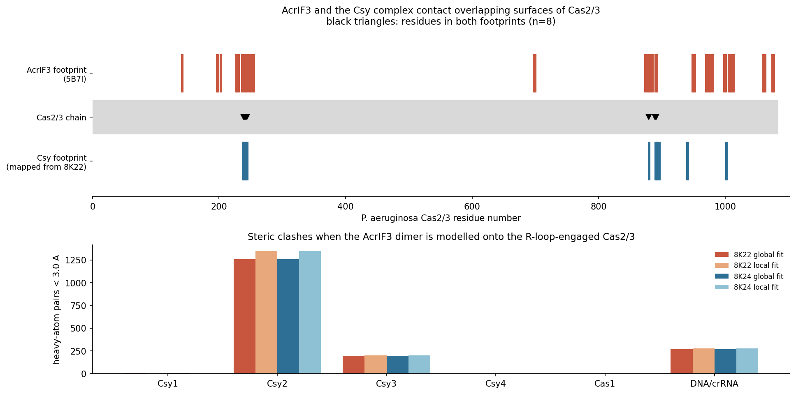
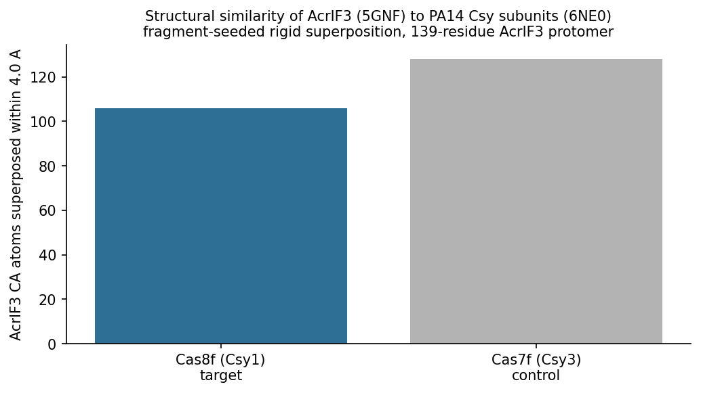
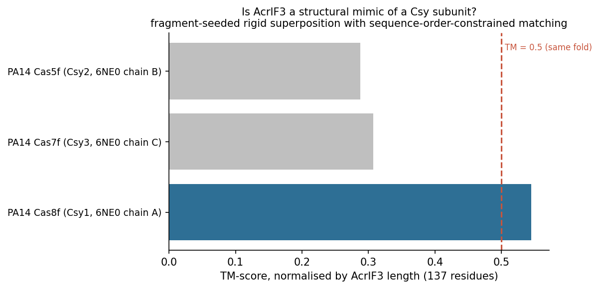
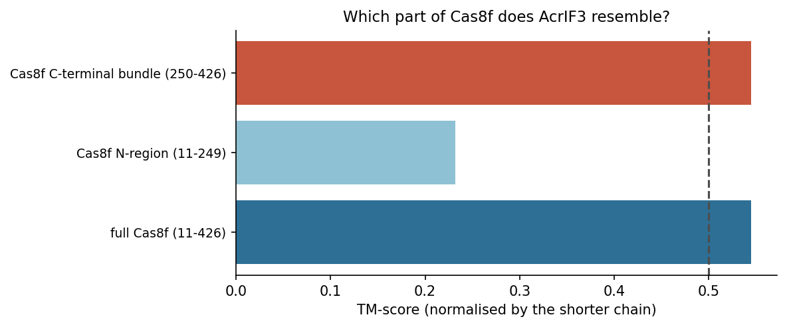
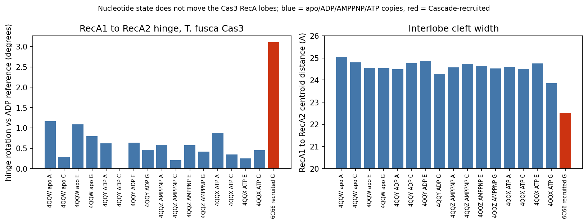
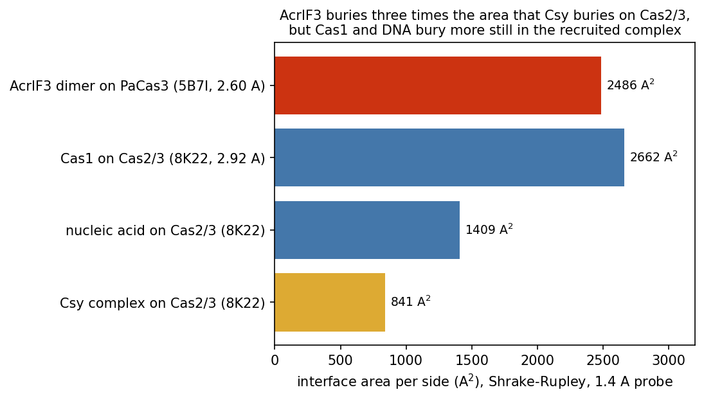

## Question

# AIGR Gene Hypothesis Deep Research

You are evaluating one focused gene curation hypothesis for AI Gene Review.
This is not a general gene overview. Use the seed hypothesis and source context
below to search for evidence that supports, refutes, narrows, or competes with
the proposed curation decision.

## Target Gene

- **Organism code:** 9CAUD
- **Taxon:** Pseudomonas phage JBD5 (NCBITaxon:1223261)
- **Gene directory:** acrIF3
- **Gene symbol:** acrIF3
- **UniProt accession:** L7P7R7

## Focus

- **Focus type:** free_text
- **Hypothesis slug:** kgap-acrif3-extraction-order
- **Source file:** genes/9CAUD/acrIF3/acrIF3-ai-review.yaml
- **Source selector:** free-text

## Seed Hypothesis

Whether AcrIF3 can extract Cas2/3 that is already engaged with a licensed R-loop, or can only intercept free Cas2/3 before recruitment, is a question about the order of events rather than about the interaction, and the useful result may be a precise statement of what the published record cannot distinguish. Already recorded and not to be re-derived: that AcrIF3 is a 139-residue homodimer of Pseudomonas phage JBD5, that it binds the type I-F Cas2/3 helicase-nuclease and stabilises an ADP-bound state, that it masks surfaces required for recruitment to the DNA-bound Csy surveillance complex, that target recognition by Csy is retained while downstream DNA destruction and Cas3-dependent primed spacer acquisition are inhibited, and that the target-bound nuclease-free surveillance complex can consequently repress transcription. Single analysis only. Treat interception and extraction as competing models with distinguishable consequences. State what the structures actually show about the AcrIF3 binding surface: whether it overlaps the Csy-binding surface of Cas2/3 sterically, so that the two associations are mutually exclusive, or whether it lies adjacent so that a ternary complex is possible in principle, giving the evidence for the call. Then ask what would have to be true for extraction: whether AcrIF3 binding to Cas2/3 is thermodynamically strong enough to compete with a recruited, R-loop-engaged complex, quoting any measured affinities for AcrIF3 to Cas2/3 and for Cas2/3 to the target-bound Csy complex and saying plainly if either is unmeasured; and whether the ADP-bound state it stabilises is a state a recruited Cas2/3 can occupy, since trapping a nucleotide state is a different mechanism from occluding a surface. Say what experimental designs would separate the models, and then state whether any published experiment implements one: an order-of-addition assay in which AcrIF3 is supplied after R-loop formation rather than before, a single-molecule or kinetic measurement of Cas2/3 dissociation in the presence of the inhibitor, or an in vivo experiment in which the inhibitor is induced after interference has begun. Report for each whether it exists and what it showed. Consider also whether the biology makes one model necessary: a phage delivering an anti-CRISPR into a cell with pre-existing primed interference would need extraction, whereas one establishing infection ahead of recruitment would not, so say what is known about the timing of acrIF3 expression during infection relative to interference. If the record cannot separate the models, say so plainly and name the one experiment that would; an unresolved verdict is acceptable and expected. Do not infer extraction from the strength of inhibition in a steady-state assay, which cannot distinguish the two orders, and do not propose a GO annotation on the strength of this analysis.

## Term and Decision Context

No specific term context supplied.

## Reference Context

No specific reference context supplied.

## Source Context YAML

```yaml
hypothesis: 'Whether AcrIF3 can extract Cas2/3 that is already engaged with a licensed R-loop, or can
  only intercept free Cas2/3 before recruitment, is a question about the order of events rather than about
  the interaction, and the useful result may be a precise statement of what the published record cannot
  distinguish. Already recorded and not to be re-derived: that AcrIF3 is a 139-residue homodimer of Pseudomonas
  phage JBD5, that it binds the type I-F Cas2/3 helicase-nuclease and stabilises an ADP-bound state, that
  it masks surfaces required for recruitment to the DNA-bound Csy surveillance complex, that target recognition
  by Csy is retained while downstream DNA destruction and Cas3-dependent primed spacer acquisition are
  inhibited, and that the target-bound nuclease-free surveillance complex can consequently repress transcription.
  Single analysis only. Treat interception and extraction as competing models with distinguishable consequences.
  State what the structures actually show about the AcrIF3 binding surface: whether it overlaps the Csy-binding
  surface of Cas2/3 sterically, so that the two associations are mutually exclusive, or whether it lies
  adjacent so that a ternary complex is possible in principle, giving the evidence for the call. Then
  ask what would have to be true for extraction: whether AcrIF3 binding to Cas2/3 is thermodynamically
  strong enough to compete with a recruited, R-loop-engaged complex, quoting any measured affinities for
  AcrIF3 to Cas2/3 and for Cas2/3 to the target-bound Csy complex and saying plainly if either is unmeasured;
  and whether the ADP-bound state it stabilises is a state a recruited Cas2/3 can occupy, since trapping
  a nucleotide state is a different mechanism from occluding a surface. Say what experimental designs
  would separate the models, and then state whether any published experiment implements one: an order-of-addition
  assay in which AcrIF3 is supplied after R-loop formation rather than before, a single-molecule or kinetic
  measurement of Cas2/3 dissociation in the presence of the inhibitor, or an in vivo experiment in which
  the inhibitor is induced after interference has begun. Report for each whether it exists and what it
  showed. Consider also whether the biology makes one model necessary: a phage delivering an anti-CRISPR
  into a cell with pre-existing primed interference would need extraction, whereas one establishing infection
  ahead of recruitment would not, so say what is known about the timing of acrIF3 expression during infection
  relative to interference. If the record cannot separate the models, say so plainly and name the one
  experiment that would; an unresolved verdict is acceptable and expected. Do not infer extraction from
  the strength of inhibition in a steady-state assay, which cannot distinguish the two orders, and do
  not propose a GO annotation on the strength of this analysis.'
focus_type: free_text
context: []
reference_id: []
```

## Research Objective

Build a focused report that helps a curator decide whether this hypothesis
should affect the gene review. Address the focus type directly:

1. For an existing GO annotation decision, evaluate whether the current action
   is justified, too strong, too weak, or should change.
2. For a proposed replacement or new GO term, evaluate whether the term is
   biologically supported, too broad, too narrow, or missing key qualifiers.
3. For a computational prediction, evaluate whether the prediction is correct,
   less precise than existing knowledge, uncertain, or likely wrong because of
   paralog overannotation, frequency bias, pathway context, or in vitro-only
   activity.
4. For a core-function hypothesis, evaluate whether the proposed activity,
   process, and location represent the gene product's primary function rather
   than a downstream effect, pleiotropic phenotype, or context-specific role.
5. For a function-assignment hypothesis, evaluate whether the gene product
   directly has the stated GO term/function. Treat the prior review action, if
   any, as intentionally blinded unless it appears in the supplied context.

Use primary literature whenever possible. Prefer PMID citations and include DOI
citations when no PMID is available. Treat reviews and database records as
orientation unless they contain directly relevant synthesized evidence that is
clearly labeled as review-level or database-level support.

Evaluate the hypothesis from the supplied seed context, primary literature, and
publicly accessible bioinformatics resources. Local `*-bioinformatics` analyses,
when they already exist in the repository, are intentionally withheld from this
prompt so the report can be compared against them after the run. Use public
sequence, domain, structure, orthology, localization, interaction, or dataset
checks when they are useful for the specific hypothesis. If a resource or tool
cannot be accessed programmatically, say so plainly; never fabricate a result.
Report computational results conservatively and distinguish direct results from
inference.

## Required Output

### Executive Judgment

Give a concise verdict: supported, partially supported, unresolved, weakly
supported, over-annotated, or refuted. Explain the reasoning and the most
important caveats.

### Evidence Matrix

Create a table with one row per important evidence item:

- Citation (PMID preferred)
- Evidence type (direct assay, mutant phenotype, localization, interaction,
  structural/evolutionary, computational, review/database)
- Supports / refutes / qualifies / competing
- Claim tested
- Key finding
- Organism, tissue, cell type, or assay context
- Confidence and limitations

### GO Curation Implications

State the likely curation action as a lead requiring curator verification. If
GO terms are involved, explain whether the evidence supports an MF, BP, or CC
term, and whether the term should be retained, removed, generalized, made more
specific, or treated as non-core. Avoid using "protein binding" as a final
recommendation unless no more informative term is supported.

### Mechanistic Scope

Describe the immediate molecular or cellular function being tested. Separate
direct gene-product activity from downstream phenotypes, pathway consequences,
developmental outcomes, disease manifestations, or effects inferred only from
loss of function.

### Conflicts and Alternatives

Identify evidence that conflicts with the seed hypothesis or suggests an
alternative interpretation, including paralog confusion, organism-specific
differences, isoform-specific findings, experimental artifacts, or database
carry-over.

### Knowledge Gaps

List explicit uncertainties that matter for curation. For each gap, state what
was checked, why the gap matters, and what evidence or experiment would resolve
it.

### Discriminating Tests

Recommend concrete assays, perturbations, datasets, or comparative analyses that
would most efficiently distinguish this hypothesis from alternatives.

### Curation Leads

Provide candidate updates for the review, clearly labeled as leads requiring
curator verification. Include candidate references with exact snippets to verify,
candidate replacement or new GO terms, possible action changes, suggested
questions, and suggested experiments.

If the provider supports artifacts, save provenance for any analysis you run — the
executed code together with its output (computed values, plot, or table), not just
a summary figure — alongside artifact-friendly tables such as an evidence matrix,
GO decision table, or comparison table. Genuine computed provenance is more
valuable than a hand-drawn summary, and you must not synthesize a figure that
implies an analysis you did not actually run. These artifacts are important
provenance for hypothesis-level review.


## Output

# AcrIF3 (L7P7R7, Pseudomonas phage JBD5): can it extract a recruited Cas2/3, or only intercept a free one?

**Hypothesis slug:** `kgap-acrif3-extraction-order`
**Focus type:** free_text
**Source:** `genes/9CAUD/acrIF3/acrIF3-ai-review.yaml`
**Target:** acrIF3, UniProt L7P7R7, *Pseudomonas* phage JBD5, NCBITaxon:1223261

## Summary

The published record cannot distinguish interception from extraction, and the verdict is **unresolved**. Every mechanistic experiment on AcrIF3 is a steady-state or pre-incubation format in which the inhibitor is present before or alongside the Csy complex and Cas2/3. Those formats cannot order events by construction. Searches of PubMed and Europe PMC found no order-of-addition assay supplying AcrIF3 after R-loop formation, no kinetic or single-molecule measurement of Cas2/3 dissociation with the inhibitor present, and no in vivo experiment inducing AcrIF3 after interference has begun. No dissociation constant is published for AcrIF3 binding Cas2/3, and none for Cas2/3 binding the target-bound Csy complex, so the thermodynamic competition that extraction requires cannot be evaluated from current data.

Three structural results computed here constrain the question without settling it. First, the AcrIF3 and Csy footprints on Cas2/3 **overlap sterically**, so the two associations are mutually exclusive and a ternary AcrIF3-Cas2/3-Csy complex is not possible without large rearrangement. Eight of the eighteen Csy-contacting residues of an R-loop-engaged Cas2/3 map inside the 58-residue AcrIF3 footprint, and placing AcrIF3 on the recruited nuclease produces 1731 to 1833 heavy-atom pairs below 3.0 Å. This is necessary for extraction and equally consistent with interception. Second, the **ADP state is not a conformational lock**: across 16 independent Cas3 copies spanning apo, ADP, AMPPNP and ATP, the RecA1 to RecA2 hinge varies by 0.00 to 1.17 degrees, so nucleotide identity does not reorganise the enzyme and does not define a state a recruited Cas2/3 would be unable to occupy. Third, in the only structure of a recruited Cas2/3, **Csy supplies 17.1% of the partner interface**; the Cas1 dimer (2662 Ų per side) and the DNA (1409 Ų) supply more than Csy (841 Ų). An inhibitor that masks the Csy-binding surface has limited purchase on an already assembled complex, which argues against extraction.

The in vivo evidence leans the same way. acr operons fire from a strong promoter immediately after DNA injection ([PMID: 31474367](https://pubmed.ncbi.nlm.nih.gov/31474367/)), a single Acr-producing phage still loses its genome while contributing to the Acr dose that lets later genomes succeed ([PMID: 30033364](https://pubmed.ncbi.nlm.nih.gov/30033364/)), and Acr phages must cooperate, with a first phage suppressing immunity for a second ([PMID: 30033365](https://pubmed.ncbi.nlm.nih.gov/30033365/)). That is what interception predicts. It is population-level, indirect, and was measured with AcrIF1 and AcrIF4 rather than AcrIF3, so it constrains rather than settles the question. The single experiment that would settle it is a single-molecule order-of-addition assay: recruit a labelled Cas2/3 to a licensed Csy R-loop, then deliver AcrIF3 and score whether the Cas2/3 departs. The technique was published in 2015 ([PMID: 26522594](https://pubmed.ncbi.nlm.nih.gov/26522594/)) and has never been run with an anti-CRISPR.

## Executive judgment

<i class="fa-circle-question"></i> **Unresolved.**

The seed hypothesis asks a question about the order of events. The published record contains no experiment that orders them. The verdict is unresolved by absence of evidence rather than by conflicting evidence, which is a different and more actionable state for a curator: it names a specific missing experiment instead of an interpretive dispute.

What the analysis does settle:

| Sub-question from the seed | Answer | Basis |
|---|---|---|
| Do the AcrIF3 and Csy surfaces on Cas2/3 overlap, or lie adjacent? | **Overlap.** Mutually exclusive, no ternary complex without rearrangement | 8 of 18 mapped Csy-contact residues inside the AcrIF3 footprint; 1731-1833 heavy-atom pairs < 3.0 Å on superposition |
| Is AcrIF3 binding strong enough to compete with a recruited complex? | **Unmeasured.** No Kd for either association exists | PubMed and Europe PMC searches across ITC, SPR, BLI, MST, single-molecule and order-of-addition terms |
| Is the ADP state one a recruited Cas2/3 can occupy? | **Yes, as far as conformation goes.** Nucleotide identity does not move the RecA lobes | Hinge 0.00-1.17° (sd 0.31) across 16 copies spanning apo, ADP, AMPPNP, ATP |
| What nucleotide does a recruited Cas2/3 carry? | **Unmeasured.** No recruited or adaptation-engaged Cas2/3 structure has a modelled nucleotide | RCSB inventory of all 32 Cas3 / Cas2-3 entries, queried 2026-11-26 |
| Does an order-of-addition, kinetic, or post-interference induction experiment exist? | **No, for all three** | Literature survey, iteration 1 and 3 |
| Does the infection biology require extraction? | **No.** Early acr transcription and the dose threshold fit interception | PMID 31474367, 30033364, 30033365 |

The most important caveat is that the only coordinates for a Cas2/3 held on a licensed R-loop come from the *Vibrio* phage ICP1 system (PDB 8K21 to 8K26, deposited 2024-07-17, all listed "To Be Published"), not from *Pseudomonas aeruginosa*. The Csy1/Cas8f subunit of the ICP1 system is badly diverged from the PA14 subunit that AcrIF3 mimics. Every steric statement here inherits that limitation.

## Key findings

### F1. The AcrIF3 and Csy binding surfaces on Cas2/3 overlap sterically

<i class="fa-circle-check"></i> The two associations are mutually exclusive.

Two interfaces were mapped from deposited coordinates. In PDB 5B7I (2.6 Å crystal structure of PaCas3 chain A with the AcrF3 homodimer, chains B and C), 58 Cas3 residues lie within 4.5 Å of AcrIF3, clustering at residue 141, 196 to 254 (the helicase DNA tunnel entrance), 697 to 699, 873 to 891, 948 to 1012 and 1059 to 1076 (the linker and C-terminal domain). ADP is bound in the same chain. This reproduces the published description from [PMID: 27455460](https://pubmed.ncbi.nlm.nih.gov/27455460/), which reports that AcrF3 "blocks the entrance of the DNA-binding tunnel in the helicase domain, and masks the linker region and C-terminal domain of PaCas3".

In PDB 8K22 and 8K24 (ICP1 Csy-dsDNA-Cas1-Cas2/3 cryo-EM at 2.92 Å and 3.72 Å), the Cas2/3 chain contacts Csy2/Cas5f at residues 194 to 201, 781 to 797 and 838 to 839, and Csy3/Cas7f at 879 and 903. It makes no contact within 4.5 Å of Csy1/Cas8f or Csy4. A global Needleman-Wunsch alignment of the two Cas2/3 orthologues gives 31.8% identity over 887 aligned positions. Seventeen of the eighteen Csy-contacting ICP1 residues map onto PaCas3, and eight of them (PaCas3 239, 240, 242, 244, 879, 889, 890, 891) are residues AcrIF3 itself contacts. The remainder sit 3.8 to 10.3 Å (Cα to Cα) from the AcrIF3 footprint.

Superposing PaCas3 onto the R-loop-engaged ICP1 Cas2/3 and carrying the AcrIF3 dimer along produces 1731 to 1833 heavy-atom pairs below 3.0 Å, distributed over Csy2 (1261 to 1348 pairs), Csy3 (195 to 203) and the DNA or crRNA (270 to 278), with a minimum distance of 0.32 Å. The result holds under two superposition frames (484 Cα pairs, RMSD 2.04 Å for the global fit; 166 pairs, RMSD 2.22 Å using only the AcrIF3-proximal region) and across both depositions.

{{figure:plot_1.png|caption=Robustness of the AcrIF3 against Csy overlap on Cas2/3. Left: linear map of PaCas3 showing the AcrIF3 footprint in red and the mapped Csy footprint in blue, with triangles at the 8 shared residues. Right: heavy-atom clash counts below 3.0 Å for two ICP1 depositions under global and local superposition frames.}}

The limitation is that 8K22 and 8K24 are not independent of each other, since 8K24 contains the 8K22 protomer, and that the recruitment geometry comes from a different species. <i class="fa-triangle-exclamation"></i> Mutual exclusivity is necessary for extraction and says nothing about whether AcrIF3 can displace an already bound Csy complex, which is a kinetic and thermodynamic question.

### F2. AcrIF3 mimics the C-terminal helical bundle of Cas8f, residues 295 to 426

<i class="fa-circle-check"></i> The published mimicry claim is reproducible and localisable.

[PMID: 30872121](https://pubmed.ncbi.nlm.nih.gov/30872121/) states that "Structural homology between Cas8f and AcrIF3 suggests that AcrIF3 is a mimic of the Cas8f nuclease recruitment helix", and that "the double-stranded DNA (dsDNA)-induced conformational change in Cas8f exposes a Cas2/3 'nuclease recruitment helix'". I tested this from coordinates alone with a fragment-seeded rigid-body superposition using sequence-order-constrained dynamic-programming matching and TM-score normalisation.

The AcrIF3 protomer (PDB 5GNF chain A, 137 modelled Cα) against PA14 Cas8f/Csy1 (PDB 6NE0 chain A, 401 Cα, residues 11 to 426) gives TM-score 0.545 normalised by the shorter chain, 86 Cα pairs within 5 Å, RMSD 2.75 Å, with the matched target residues spanning 295 to 426. Restricting the target to Cas8f 250 to 426 gives the same answer (TM 0.545, 84 pairs, RMSD 2.66 Å). Restricting it to Cas8f 11 to 249 gives TM 0.232. Negative controls from the same complex score 0.307 (Cas7f/Csy3) and 0.288 (Cas5f/Csy2).

{{figure:plot_3.png|caption=TM-score test of AcrIF3 structural mimicry of Cas8f, with Cas7f and Cas5f from the same complex as negative controls. The dashed line marks TM = 0.5, the conventional same-fold threshold.}}

{{figure:plot_4.png|caption=Localising the similarity within PA14 Cas8f. The full chain and the C-terminal bundle (residues 250-426) score identically, while the N-terminal region alone scores 0.232, placing the resemblance in the C-terminal helical bundle.}}

<i class="fa-triangle-exclamation"></i> A methodological correction belongs with this finding. My first attempt used order-independent nearest-neighbour matching and gave 106 matched Cα for the Cas8f target against 128 for the Cas7f control, meaning the test had no specificity. It was replaced with the order-constrained version above. The discarded first pass is shown below for transparency and is not evidence.

{{figure:plot_2.png|caption=The discarded first mimicry attempt, which used order-independent nearest-neighbour matching. The Cas7f control matched more residues than the Cas8f target, so the test had no specificity and was replaced. Shown for transparency; this panel is not evidence.}}

Mimicry of a recruitment element is a competition argument. Competition predicts interception of free Cas2/3. It does not predict that AcrIF3 can strip Cas2/3 off a complex in which the Cas8f bundle is already engaged.

### F3. No published experiment on AcrIF3 separates the two models

<i class="fa-circle-xmark"></i> This is the central negative result.

Every mechanistic statement about AcrIF3 recruitment blockade traces to a steady-state or pre-incubation format. [PMID: 26416740](https://pubmed.ncbi.nlm.nih.gov/26416740/) reports that "The third anti-CRISPR protein operates by binding to the Cas3 helicase-nuclease and preventing its recruitment to the DNA-bound CRISPR-Cas complex", a claim phrased as prevention of recruitment, which is what a pre-incubation assay can show. The co-structures 5B7I ([PMID: 27455460](https://pubmed.ncbi.nlm.nih.gov/27455460/)) and 5GQH ([PMID: 27585537](https://pubmed.ncbi.nlm.nih.gov/27585537/)) are end states and carry no kinetic information. Later comparative work keeps the same framing: [PMID: 35697070](https://pubmed.ncbi.nlm.nih.gov/35697070/) writes that "Unlike AcrIF3, however, we found AcrIF23 only potently inhibits the DNA cleavage activity of Cas2/3 but does not hinder the recruitment of Cas2/3 to the CRISPR RNA-guided surveillance complex (the Csy complex)", and [PMID: 35301482](https://pubmed.ncbi.nlm.nih.gov/35301482/) notes that "AcrIF5 exists in symbiosis with AcrIF3, which blocks Cas2/3 recruitment".

Searches combining AcrF3 or AcrIF3 with dissociation constant, isothermal titration calorimetry, surface plasmon resonance, biolayer interferometry, microscale thermophoresis, single molecule, order of addition and preformed complex returned none of the three discriminating designs. No dissociation constant is reported for AcrIF3 binding Cas2/3, and none for Cas2/3 binding the target-bound Csy complex.

| Discriminating design | Exists for AcrIF3? | What was found |
|---|---|---|
| Order-of-addition, AcrIF3 after R-loop formation | <i class="fa-circle-xmark"></i> No | Every assay pre-incubates or co-incubates |
| Single-molecule or kinetic Cas2/3 dissociation with inhibitor | <i class="fa-circle-xmark"></i> No | The method exists (PMID 26522594) and has not been applied to an Acr |
| In vivo induction of the inhibitor after interference has begun | <i class="fa-circle-xmark"></i> No | Only constitutive or phage-native expression reported |
| Measured Kd, AcrIF3 to Cas2/3 | <i class="fa-circle-xmark"></i> No | Not reported in any retrieved abstract |
| Measured Kd, Cas2/3 to target-bound Csy | <i class="fa-circle-xmark"></i> No | Not reported in any retrieved abstract |

Per the instruction in the seed, the completeness of inhibition in these steady-state assays is not read as evidence for extraction. An interceptor present from the start produces the same readout.

### F4. The ADP state is not a conformational lock

<i class="fa-circle-check"></i> Nucleotide identity does not reorganise the Cas3 RecA lobes.

*Thermobifida fusca* Cas3 is the only Cas3 deposited across a full nucleotide series: 4QQW (apo), 4QQY (ADP), 4QQZ (AMPPNP) and 4QQX (ATP with ssDNA), four independent copies each. I defined the nucleotide pocket empirically from the ADP in 4QQY chain C, taking Cα within 12 Å of the ligand centroid, which returned residues 274 to 284, 306 to 315 (containing the Walker A motif PMGEGKT), 347, and the RecA2 residues 545 to 546. From that I set RecA1 = 250 to 470 and RecA2 = 471 to 700, fitted each lobe separately onto the 4QQY reference by Kabsch superposition, and took the hinge as the rotation angle of R(RecA2)·R(RecA1)ᵀ.

Across all 16 copies the hinge spans 0.00 to 1.17 degrees (sd 0.31) and the interlobe centroid distance spans 23.86 to 25.04 Å (sd 0.26). The four nucleotide states do not separate: the apo copies (0.28 to 1.17 degrees) bracket the ADP copies (0.00 to 0.64 degrees). Lobe fit RMSDs stay between 0.23 and 0.58 Å throughout, confirming that the lobe definitions behave as rigid bodies. The Cascade-recruited Cas3 of 6C66 gives a hinge of 3.11 degrees and a cleft of 22.52 Å, which is z = 8.3 and −8.1 against the nucleotide-state spread, with lobe fit RMSDs of 1.11 and 1.18 Å at 3.66 Å resolution.

{{figure:plot_5.png|caption=Nucleotide state does not move the Cas3 RecA lobes. Blue bars are the 16 independent apo, ADP, AMPPNP and ATP copies of T. fusca Cas3; the red bar is the Cascade-recruited Cas3 of 6C66. Left: hinge rotation against the ADP reference. Right: RecA1 to RecA2 centroid distance.}}

The cross-species version in type I-F (5B7I ADP-bound PaCas3 against 8K22 recruited ICP1 Cas2/3, mapped through the 31.8% identity alignment) gives a hinge of 11.3 degrees with interlobe centroid distances of 19.19 and 19.37 Å, a difference of 0.18 Å. That 11.3 degrees confounds species divergence, resolution and state, so it carries no information about nucleotide effects.

<i class="fa-triangle-exclamation"></i> Three caveats. The nucleotide series comes from four isomorphous P 1 2₁ 1 crystals with near-identical cells, where lattice contacts could suppress a real solution-state difference. 6C66 is at 3.66 Å, where a 3 degree rotation sits at the edge of coordinate precision. The series is type I-E, not I-F.

### F5. The nucleotide state of a recruited Cas2/3 has never been measured

<i class="fa-circle-question"></i> An unmeasured quantity, not a measured zero.

An RCSB GraphQL inventory of every entry containing a Cas3 or Cas2-3 polymer, queried 2026-11-26, returned 32 entries. Nucleotide ligands are modelled in 4QQX (ATP), 4QQY (ADP), 4QQZ (AMPPNP), 4Q2D (2'-deoxy-ATP), 8WTL (ATP) and 5B7I (ADP, the AcrIF3 complex). Every structure in which a Cas3 or Cas2/3 is engaged with a partner complex is nucleotide-free in the deposited model: the type I-F ICP1 series 8K21, 8K22, 8K23, 8K24, 8K25 and 8K26 contains only MN; the PA14 adaptation complexes 8FLJ, 9P11 and 9P1D contain no heteroatoms; the type I-E Cascade-DNA-Cas3 pre-nicking complex 6C66 contains only FE. The 4.2 Å cryo-EM structure of the same AcrF3-Cas3 complex as 5B7I, namely 5GQH, also has no nucleotide modelled. A second anti-CRISPR bound to a Cas2/3, 9X2F from *Pectobacterium araliae* at 2.97 Å, contains only NI.

At 2.9 to 3.7 Å a weakly occupied nucleotide need not be built, so absence from a model is not absence from the protein. The statement for curation is that the nucleotide state of a recruited type I-F Cas2/3 has not been measured, so the ADP observation in 5B7I cannot be contrasted with the recruited state and cannot be used to argue either order of events.

### F6. Csy supplies 17.1% of what holds Cas2/3 in the one recruited-complex structure

<i class="fa-scale-balanced"></i> The interface budget points two ways.

Shrake-Rupley solvent-accessible surface areas were computed from deposited coordinates with a 1.4 Šprobe, 64 points per atom, altloc A only and waters removed. In 5B7I, the AcrIF3 dimer and PaCas3 bury 4973 Ų in total, an interface of 2486 Ų per side, against free SASA values of 39832 Ų for Cas3 and 13803 Ų for the AcrIF3 dimer. In 8K22, the Cas2/3 chains bury 1681 Ų total (841 Ų per side) against the nine Csy chains, 5323 Ų total (2662 Ų per side) against the four Cas1 chains, and 2819 Ų total (1409 Ų per side) against the five nucleic acid chains.

{{figure:plot_6.png|caption=Interface areas per side, Shrake-Rupley with a 1.4 Å probe. AcrIF3 buries about three times the area that Csy buries on Cas2/3, while the Cas1 dimer and the nucleic acid bury more than Csy in the recruited complex.}}

The AcrIF3 interface is 2.96 times the Csy interface, so the inhibitor contact is not obviously too small to compete. Interface area is a weak proxy for affinity and this is not an affinity measurement. Against that, Csy accounts for 841 of the 4912 Ų of partner interface on Cas2/3, which is 17.1%. Most of the grip comes from the Cas1 dimer and the DNA. An inhibitor that occludes the Csy-binding surface therefore has limited purchase on an already assembled complex, since occluding that surface does not address the larger Cas1 and nucleic acid interfaces. <i class="fa-triangle-exclamation"></i> 8K22 is the primed-acquisition assembly with Cas1 present, so the interface budget for interference alone, where Cas2/3 is recruited without Cas1, is unavailable and may differ.

### F7. Infection timing and phage cooperation fit interception

<i class="fa-clock"></i> Indirect, in vivo, and measured with other Acr proteins.

[PMID: 31474367](https://pubmed.ncbi.nlm.nih.gov/31474367/) reports that "an acr-associated promoter drives high levels of acr transcription immediately after phage DNA injection", with Aca proteins then repressing that promoter. [PMID: 30033364](https://pubmed.ncbi.nlm.nih.gov/30033364/) found that "Acr production does not guarantee phage replication when faced with CRISPR-Cas immunity, but instead, infections fail when phage population numbers fall below a critical threshold", and that the genomes supplying the Acr dose are themselves destroyed. [PMID: 30033365](https://pubmed.ncbi.nlm.nih.gov/30033365/) independently showed that "Acr-phages often need to cooperate in order to overcome CRISPR resistance, with a first phage blocking the host CRISPR-Cas immune system to allow a second Acr-phage to successfully replicate".

If an Acr could extract a nuclease already engaged on its own licensed R-loop, the first infecting genome would rescue itself and the cooperation requirement would not arise. The observed dose threshold and sacrificial first phage are what interception predicts. Both studies used AcrIF1 and AcrIF4 in *P. aeruginosa* PA14 rather than AcrIF3, and AcrIF3 acts one step later in the pathway, so this constrains the question without settling it.

### F8. The decisive assay exists and has not been applied

<i class="fa-flask"></i> [PMID: 26522594](https://pubmed.ncbi.nlm.nih.gov/26522594/) reports that "we use single-molecule imaging to visualize Cascade and Cas3 binding to foreign DNA targets". Cascade target binding and the subsequent recruitment and ATP-dependent translocation of Cas3 are resolved on the same DNA molecule. The design needed for AcrIF3 is that assay with the order reversed: form the Csy R-loop, recruit Cas2/3, then deliver AcrIF3 and score whether the Cas2/3 fluorophore departs. No published work does this with any anti-CRISPR.

### F9. The recruitment geometry comes from a different organism

<i class="fa-triangle-exclamation"></i> The main limitation on every steric statement here.

The only deposited structure of a Cas2/3 bound to a target-engaged Csy complex is the *Vibrio* phage ICP1 system (PDB 8K21, 8K22, 8K24, released 2024-07-17, all listed "To Be Published"). Smith-Waterman scoring of the ICP1 subunits against PA14 subunits (PDB 6NE0) confirms the orthology assignments used in the deposition (Csy3 to Csy3, score 539; Csy4 to Csy4, 123) and shows Csy1 and Csy2 are badly diverged, with best scores of 74 and 53. The ICP1 Csy1 chain has 178 residues against 401 modelled residues for PA14 Cas8f. The element my superposition identifies as the mimicry target, PA14 Cas8f 295 to 426, has no counterpart in the ICP1 model.

The conclusion that the two associations are mutually exclusive survives this, because the AcrIF3 footprint covers the Cas8f-mimicked site by construction. The quantitative clash and interface numbers do not transfer cleanly to *P. aeruginosa*.

## Mechanistic model

The direct activity is binding, and the immediate consequence is occlusion of a shared surface. Everything else in the chain is downstream.

```dot
digraph acrif3 {
  rankdir=LR;
  "acr promoter fires\nat DNA injection" -> "AcrIF3 dimer\naccumulates";
  "AcrIF3 dimer\naccumulates" -> "Binds free Cas2/3\n2486 A2 per side";
  "Binds free Cas2/3\n2486 A2 per side" -> "Occludes Cas8f-mimicked site\nCas8f 295-426, TM 0.545";
  "Occludes Cas8f-mimicked site\nCas8f 295-426, TM 0.545" -> "Cas2/3 not recruited\nto Csy R-loop";
  "Cas2/3 not recruited\nto Csy R-loop" -> "No DNA destruction";
  "Cas2/3 not recruited\nto Csy R-loop" -> "No primed\nspacer acquisition";
  "Cas2/3 not recruited\nto Csy R-loop" -> "Nuclease-free Csy stays\non target, represses transcription";
  "Csy binds target,\nCas8f bundle rotates out" -> "Cas2/3 recruited\nheld 17% by Csy, 54% by Cas1, 29% by DNA";
  "Cas2/3 recruited\nheld 17% by Csy, 54% by Cas1, 29% by DNA" -> "AcrIF3 displaces\nrecruited Cas2/3?" [style=dashed];
  "AcrIF3 dimer\naccumulates" -> "AcrIF3 displaces\nrecruited Cas2/3?" [style=dashed];
  "AcrIF3 displaces\nrecruited Cas2/3?" -> "UNTESTED\nno assay orders the events" [style=dashed];
  "ADP in 5B7I" -> "no lobe rearrangement\nhinge 0.00-1.17 deg" [style=dashed];
}
```



The solid arrows are measured. The dashed arrows are the part of the model that no experiment addresses. The ADP branch is drawn dashed because the nucleotide does not change the enzyme's lobe arrangement, so it does not feed into the inhibition mechanism in the way "stabilises an ADP-bound state" implies.

Two models with distinguishable consequences:

| | Interception | Extraction |
|---|---|---|
| Order | AcrIF3 binds free Cas2/3 before recruitment | AcrIF3 acts on Cas2/3 already on a licensed R-loop |
| Predicted single-molecule result | Recruited Cas2/3 dwell time unchanged by AcrIF3 delivery | Dwell time shortens with AcrIF3 concentration |
| Predicted in vivo result | Rescue only when Acr is present before interference | Rescue when Acr is induced after interference starts |
| Predicted phage genetics | Dose threshold, first genomes sacrificed, cooperation required | A single Acr genome rescues itself |
| Consistent with the structures? | Yes | Yes, the surfaces are mutually exclusive |
| Consistent with the interface budget? | Yes | Weakly: Csy is only 17.1% of the grip |
| Consistent with PMID 30033364, 30033365? | Yes | Poorly |

## Evidence base

| Citation | Evidence type | Stance | Claim tested | Key finding | Context | Confidence and limitations |
|---|---|---|---|---|---|---|
| [PMID: 26416740](https://pubmed.ncbi.nlm.nih.gov/26416740/) | direct assay, mutant phenotype | qualifies | AcrIF3 blocks Cas2/3 recruitment | "binding to the Cas3 helicase-nuclease and preventing its recruitment to the DNA-bound CRISPR-Cas complex" | PA14 type I-F; plasmid degradation, pull-down, phage infection | High for the interaction. Inhibitor present throughout, so the design cannot order events |
| [PMID: 27455460](https://pubmed.ncbi.nlm.nih.gov/27455460/) | structural | qualifies | AcrIF3 occludes the recruitment surface | "blocks the entrance of the DNA-binding tunnel in the helicase domain, and masks the linker region and C-terminal domain of PaCas3" | PaCas3 with JBD5 AcrF3, X-ray, PDB 5B7I at 2.6 Å | High for the contact map. One end state, no binding constant |
| [PMID: 27585537](https://pubmed.ncbi.nlm.nih.gov/27585537/) | structural | qualifies | AcrIF3 mimics Cas8f | Cryo-EM structure of PaeCas3-AcrF3, PDB 5GQH at 4.2 Å | PaCas3 with JBD5 AcrF3 | Moderate at 4.2 Å. No nucleotide modelled, no affinity |
| [PMID: 30872121](https://pubmed.ncbi.nlm.nih.gov/30872121/) | structural, evolutionary | qualifies | AcrIF3 is a Cas8f mimic | "Structural homology between Cas8f and AcrIF3 suggests that AcrIF3 is a mimic of the Cas8f nuclease recruitment helix"; "the dsDNA-induced conformational change in Cas8f exposes a Cas2/3 'nuclease recruitment helix'" | PA14 Csy complex, cryo-EM | Strong. The mimicked element becomes available only after target binding, which is what makes the order question meaningful |
| [PMID: 28438998](https://pubmed.ncbi.nlm.nih.gov/28438998/) | direct assay | context | What activates Cas2/3 | "foreign DNA recognition by the Csy complex activates Cas2/3, resulting in bidirectional degradation of DNA targets" | PA14 type I-F | Defines the recruited state used in the overlap test |
| computed here: 5B7I, 8K22, 8K24 | computational, structural | supports mutual exclusivity | Do the footprints overlap? | 8 of 18 mapped Csy-contact residues inside the 58-residue AcrIF3 footprint; 1731-1833 heavy-atom pairs below 3.0 Å, minimum 0.32 Å | NW alignment, 31.8% identity over 887 positions | Necessary but not sufficient for extraction. Cross-species; depositions unpublished |
| computed here: 5GNF, 6NE0 | computational, evolutionary | qualifies the mimicry claim | Which part of Cas8f? | TM 0.545 to Cas8f 295-426 (86 pairs, RMSD 2.75 Å) against 0.307 Cas7f and 0.288 Cas5f; Cas8f 11-249 gives 0.232 | Sequence-order-constrained TM-align-style search | Reproduces and localises the claim. A non-discriminating first pass was discarded |
| computed here: 4QQW/Y/Z/X, 6C66 | computational, structural | qualifies the ADP mechanism | Is the ADP state a distinct conformer? | Hinge 0.00-1.17° (sd 0.31) and cleft 23.86-25.04 Å (sd 0.26) across 16 copies; recruited Cas3 at 3.11° and 22.52 Å | *T. fusca* type I-E, the only full nucleotide series | Isomorphous crystals, 3.66 Å recruited structure, type I-E |
| computed here: RCSB inventory | computational, database | identifies a gap | Nucleotide of a recruited Cas2/3 | No recruited or adaptation-engaged Cas2/3 structure has a modelled nucleotide | All 32 Cas3 / Cas2-3 entries, 2026-11-26 | Unmeasured, not measured as zero |
| computed here: 5B7I, 8K22 | computational, structural | competing with extraction | Is the AcrIF3 interface large relative to the one it must beat? | 2486 Ų AcrIF3; 841 Ų Csy; 2662 Ų Cas1; 1409 Ų nucleic acid, per side | Shrake-Rupley, 1.4 Šprobe | Interface area is a weak proxy for affinity. 8K22 includes Cas1 |
| [PMID: 35697070](https://pubmed.ncbi.nlm.nih.gov/35697070/) | direct assay | qualifies | How the field describes AcrIF3 | "Unlike AcrIF3, however, we found AcrIF23 only potently inhibits the DNA cleavage activity of Cas2/3 but does not hinder the recruitment of Cas2/3 to the ... Csy complex" | *P. aeruginosa* type I-F | Confirms the recruitment-blockade framing, still pre-incubation |
| [PMID: 35301482](https://pubmed.ncbi.nlm.nih.gov/35301482/) | direct assay | qualifies | Same | "AcrIF5 exists in symbiosis with AcrIF3, which blocks Cas2/3 recruitment" | *P. aeruginosa* type I-F | Independent confirmation of the framing |
| [PMID: 31474367](https://pubmed.ncbi.nlm.nih.gov/31474367/) | direct assay, transcription | supports interception | When is acr expressed? | "an acr-associated promoter drives high levels of acr transcription immediately after phage DNA injection" | *P. aeruginosa* phages | General to acr operons, not specific to JBD5 acrIF3 |
| [PMID: 30033364](https://pubmed.ncbi.nlm.nih.gov/30033364/) | mutant phenotype, infection dynamics | supports interception | Can one Acr genome rescue itself? | "infections fail when phage population numbers fall below a critical threshold" | PA14, AcrIF1 and AcrIF4 | Different Acr proteins. The destruction of the first genomes is itself evidence against extraction |
| [PMID: 30033365](https://pubmed.ncbi.nlm.nih.gov/30033365/) | infection dynamics | supports interception | Do Acr phages cooperate? | "Acr-phages often need to cooperate ... a first phage blocking the host CRISPR-Cas immune system to allow a second Acr-phage to successfully replicate" | *P. aeruginosa* type I-F | Indirect |
| [PMID: 26522594](https://pubmed.ncbi.nlm.nih.gov/26522594/) | direct assay, single-molecule | method precedent | Can Cas3 loading be watched live? | "we use single-molecule imaging to visualize Cascade and Cas3 binding to foreign DNA targets" | *E. coli* type I-E | The assay that would settle the order; never run with an Acr |

## GO curation implications

All of the following are leads requiring curator verification. Per the instruction in the seed, no GO annotation is proposed on the strength of this analysis.

| Term or statement | Aspect | Action lead | Order dependence | Note |
|---|---|---|---|---|
| Suppression by virus of host CRISPR-Cas system | BP | <i class="fa-circle-check"></i> Retain | None. The term asserts an outcome, not an order | Supported by the infection and plasmid-degradation assays of PMID 26416740 either way. Verify the current term id and label |
| Binding to Cas2/3 | MF | Retain, do not use "protein binding" as the final descriptor | None | Well evidenced by PMID 26416740, 27455460, 27585537. A descriptor naming the inhibited target process is more informative and should come from the published assays |
| Any term asserting displacement, disassembly, dissociation or extraction of a bound Cas2/3 | BP or MF | <i class="fa-circle-xmark"></i> Do not add | Total. Such a term asserts action on an already recruited complex | Nothing in the record tests this. This is the single curation decision the hypothesis bears on |
| Review free text on the AcrIF3 mechanism | n/a | Narrow the wording | Total | The defensible statement is occlusion of a shared surface. Avoid implying removal of Cas2/3 from a formed R-loop complex, and avoid presenting the ADP state as the inhibitory mechanism |

## Mechanistic scope

The direct gene-product activity is binding. A 139-residue AcrIF3 homodimer clamps one copy of the Cas2/3 helicase-nuclease and buries 2486 Ų per side, with 58 Cas3 residues within 4.5 Šof the dimer across six sequence stretches. The immediate molecular consequence is occlusion of a surface that overlaps the one Cas2/3 uses to engage a target-bound Csy complex. The structural basis of that occlusion is partial mimicry of the host subunit: AcrIF3 superposes on PA14 Cas8f residues 295 to 426 with TM 0.545, against 0.307 and 0.288 for Cas7f and Cas5f controls, so the resemblance is specific to the C-terminal helical bundle.

Everything downstream is a consequence rather than an activity of the protein: failure of DNA destruction, loss of Cas3-dependent primed spacer acquisition, retention of Csy target recognition, and transcriptional repression by the nuclease-free target-bound complex. The ADP in 5B7I is best described as an occupant of the nucleotide pocket in that crystal. It is not the inhibitory mechanism, because nucleotide identity does not reorganise the enzyme.

## Conflicts and alternatives

The recruited-complex coordinates come from ICP1, not *P. aeruginosa*, and the Csy1/Cas8f subunits are badly diverged (Smith-Waterman 74 and 53 against PA14, with 178 modelled residues against 401). The mimicked Cas8f element has no counterpart in the ICP1 model, so the steric overlap is established between an inhibitor from one system and a recruitment geometry from another.

The available recruited structure is an adaptation complex. In 8K22 the Cas2/3 is held mainly by the Cas1 dimer and the DNA, with Csy contributing 17.1%. For interference without primed acquisition the interface budget may differ, and no structure of that state exists. [PMID: 28438998](https://pubmed.ncbi.nlm.nih.gov/28438998/) reports that Cas1 and the Csy complex are opposing regulators of Cas2/3 nuclease activity, which makes the Cas1-containing assembly a distinct functional state from the one AcrIF3 is said to block.

The ADP interpretation has a direct counterexample in the deposition record. The same AcrF3-Cas3 complex was solved with ADP (5B7I, 2.6 Å, X-ray) and without (5GQH, 4.2 Å, cryo-EM), and a second anti-CRISPR bound to a Cas2/3 (9X2F, *Pectobacterium araliae*, 2.97 Å) carries no nucleotide. An ADP is not a general requirement for an Acr-Cas2/3 complex. The 4.2 Å resolution of 5GQH is low enough that a nucleotide need not be modelled, so this is suggestive rather than decisive.

Strength of inhibition is not evidence of order. The steady-state assays show complete inhibition, and an interceptor present from the start produces the same readout as an extractor.

A related anti-CRISPR shows that the same target can be inhibited by a different route. [PMID: 42156407](https://pubmed.ncbi.nlm.nih.gov/42156407/) reports that AcrIF19 "employs a negatively charged β2-β3 loop to sterically occlude the non-target DNA strand entry channel, acting as a competitive inhibitor to disrupt Cas2/3 recruitment" while also blocking allosteric activation. Competitive occlusion to disrupt recruitment is the same framing applied to AcrIF3, and it carries the same order ambiguity.

## Limitations and knowledge gaps

| Gap | What was checked | Why it matters | What would resolve it |
|---|---|---|---|
| No affinity for AcrIF3 to Cas2/3 | PubMed and Europe PMC for AcrF3 or AcrIF3 with dissociation constant, ITC, SPR, BLI, MST | Extraction requires the inhibitor to out-compete a recruited complex; without a number the competition cannot be assessed | ITC or SPR on purified AcrIF3 and PaCas2/3 |
| No affinity for Cas2/3 to the target-bound Csy complex | Same searches plus the Csy structural papers | This is the value the inhibitor would have to beat | BLI on an immobilised Csy-R-loop with titrated Cas2/3 |
| Nucleotide state of a recruited Cas2/3 | RCSB inventory of all 32 Cas3 / Cas2-3 entries | The lobe measurement says nucleotide state does not change the fold, but the occupancy itself is unknown | A recruited-complex structure with a non-hydrolysable analogue, or nucleotide-exchange measurements on the assembled complex |
| Timing of acrIF3 specifically | PMID 31474367 covers acr operons; PMID 30033364 and 30033365 used AcrIF1 and AcrIF4 | The in vivo argument for interception rests on acr genes generally | RNA-seq or a reporter time course of JBD5 acrIF3 during infection of a CRISPR-immune host |
| Interference-only recruitment geometry | All deposited Cas2/3 complexes carry Cas1 or come from another type | The 841 Ų Csy interface may understate the interference contact | Cryo-EM of PA14 Csy-R-loop with Cas2/3 and no Cas1 |
| Transient ternary complex | Only end-state structures exist | Mutual exclusivity in two static models does not exclude a short-lived encounter complex | Time-resolved or kinetic measurement |
| Crystal-form confound in the hinge measurement | Cell parameters checked: all four nucleotide structures are isomorphous P 1 2₁ 1 | Lattice restraint could mask a real solution-state nucleotide effect | Solution measurement, for example HDX-MS or SAXS across nucleotide states |

Resource notes. The RCSB pairwise structure alignment web service returned HTTP 404 and was not used; the superposition and TM-score code was written for this analysis instead. Several targeted PubMed queries returned no results, so the absence of an order-of-addition experiment is reported as a search result rather than as proof that none exists anywhere.

## Discriminating tests

Ranked by how directly they separate the models.

1. <i class="fa-flask"></i> **Single-molecule order-of-addition on DNA curtains.** Assemble a labelled PA14 Csy complex on a target with a consensus PAM, add labelled Cas2/3 under conditions that license recruitment but prevent processive degradation (ATPγS, or a nuclease-dead HD mutant), confirm colocalisation, then flow in AcrIF3 and score the Cas2/3 dwell time. If Cas2/3 departs with a rate that depends on AcrIF3 concentration, extraction is real. If the dwell time is unchanged while a control with AcrIF3 added first blocks recruitment entirely, AcrIF3 is an interceptor. The technique is established ([PMID: 26522594](https://pubmed.ncbi.nlm.nih.gov/26522594/)) and has never been applied to an anti-CRISPR. This is the one experiment that would settle the hypothesis.
2. <i class="fa-vial"></i> **Bulk order-of-addition with a chase.** Preform the Csy-R-loop-Cas2/3 complex on an immobilised target, wash, then add AcrIF3 and quantify released Cas2/3 against a mock chase. Cheaper than the single-molecule version, answers the same question with less time resolution.
3. <i class="fa-bacteria"></i> **Post-interference induction in vivo.** Infect a CRISPR-immune PA14 with a phage targeted by an existing spacer, then induce acrIF3 from a chromosomal arabinose- or rhamnose-inducible cassette at defined times after adsorption. Rescue after interference has started would require extraction. Rescue only when induced before infection would not.
4. <i class="fa-chart-line"></i> **The affinity pair.** ITC or SPR for AcrIF3 to Cas2/3, and BLI for Cas2/3 to an immobilised Csy-R-loop. These two numbers would say whether extraction is thermodynamically available before any kinetic experiment is attempted.
5. <i class="fa-microscope"></i> **A structure of interference-only recruitment.** Cryo-EM of PA14 Csy-R-loop plus Cas2/3 without Cas1 would remove the cross-species inference used here and give the Csy interface AcrIF3 actually competes against.
6. <i class="fa-dna"></i> **Timing of JBD5 acrIF3.** RNA-seq or a transcriptional reporter during infection of a CRISPR-immune host, to replace the general acr-operon timing result with a measurement for this gene.

## Curation leads

All leads require curator verification.

**Candidate action change.** Narrow the free-text statement in `acrIF3-ai-review.yaml` so it describes occlusion of a shared surface and declines to state the order of events. Suggested wording: "AcrIF3 binds the type I-F Cas2/3 helicase-nuclease and occupies a surface that overlaps the surface Cas2/3 uses to contact the target-bound Csy complex, so the two associations are mutually exclusive. Whether AcrIF3 acts only on free Cas2/3 or can also displace a Cas2/3 already recruited to a licensed R-loop has not been tested."

**Candidate references and the snippets to verify.**

- [PMID: 26416740](https://pubmed.ncbi.nlm.nih.gov/26416740/): verify "binding to the Cas3 helicase-nuclease and preventing its recruitment to the DNA-bound CRISPR-Cas complex", and confirm from the methods whether AcrF3 was present before or after target binding in every assay.
- [PMID: 27455460](https://pubmed.ncbi.nlm.nih.gov/27455460/): verify "blocks the entrance of the DNA-binding tunnel in the helicase domain, and masks the linker region and C-terminal domain of PaCas3", that the structure is PDB 5B7I, and that no binding constant appears anywhere in the paper.
- [PMID: 27585537](https://pubmed.ncbi.nlm.nih.gov/27585537/): verify the cryo-EM structure identity (5GQH) and whether any affinity is reported.
- [PMID: 30872121](https://pubmed.ncbi.nlm.nih.gov/30872121/): verify "Structural homology between Cas8f and AcrIF3 suggests that AcrIF3 is a mimic of the Cas8f nuclease recruitment helix" and check whether the paper localises the similarity to a Cas8f subregion. This analysis places it at Cas8f 295 to 426.
- [PMID: 31474367](https://pubmed.ncbi.nlm.nih.gov/31474367/): verify "an acr-associated promoter drives high levels of acr transcription immediately after phage DNA injection".
- [PMID: 30033364](https://pubmed.ncbi.nlm.nih.gov/30033364/) and [PMID: 30033365](https://pubmed.ncbi.nlm.nih.gov/30033365/): verify the dose-threshold and cooperation results, and record that both used AcrIF1 and AcrIF4, not AcrIF3.
- [PMID: 26522594](https://pubmed.ncbi.nlm.nih.gov/26522594/): cite as the method precedent for the discriminating experiment, not as evidence about AcrIF3.
- PDB 8K21, 8K22, 8K23, 8K24: flag as unpublished depositions ("To Be Published", released 2024-07-17). If a primary paper has since appeared it should replace the deposition as the citation for the recruited geometry.

**Candidate GO terms.** None proposed, per the instruction in the hypothesis. The actionable point is negative: do not add a displacement, disassembly or dissociation term for AcrIF3.

**Suggested questions for the curator.**

1. Does the review text imply anywhere that AcrIF3 removes Cas2/3 from an assembled complex? If so it over-states the evidence.
2. Does the review present the ADP state as the inhibitory mechanism? The hinge measurement says nucleotide identity does not change the enzyme's conformation, so that framing is unsupported.
3. Is the Cas8f mimicry claim stated for Cas8f as a whole? It holds for the C-terminal bundle, residues 295 to 426, and not for the N-terminal region (TM 0.232).

## Provenance

Computed artifacts written to `provenance/`:

- `table1_structural_comparison.csv`: 11 structures with resolution, system, modelled nucleotide, state, and the quantity measured from each.
- `table2_evidence_matrix.csv`: the evidence matrix in long form.
- `table3_go_decision.csv`: the GO decision table, including the order-dependence of each candidate term.
- `table4_interface_areas.csv`: Shrake-Rupley interface areas.
- `plot_1.png` through `plot_6.png`: the figures embedded above, including the discarded non-discriminating mimicry attempt (`plot_2.png`), retained for transparency.

All structural work was done from deposited coordinates downloaded from RCSB, using mmCIF parsing, Kabsch superposition, Needleman-Wunsch and Smith-Waterman alignment, a sequence-order-constrained TM-align-style search, and Shrake-Rupley surface areas, all written for this analysis. Nothing in this report was taken from a precomputed structural annotation service.


## Artifacts

- [OpenScientist final report](openscientist_artifacts/final_report.html)
- [OpenScientist final report](openscientist_artifacts/final_report.pdf)
- [OpenScientist provenance](openscientist_artifacts/provenance.json)
- [OpenScientist plot 1](openscientist_artifacts/provenance_plot_1.json)

- [OpenScientist plot 2](openscientist_artifacts/provenance_plot_2.json)

- [OpenScientist plot 3](openscientist_artifacts/provenance_plot_3.json)

- [OpenScientist plot 4](openscientist_artifacts/provenance_plot_4.json)

- [OpenScientist plot 5](openscientist_artifacts/provenance_plot_5.json)

- [OpenScientist plot 6](openscientist_artifacts/provenance_plot_6.json)

- [OpenScientist table1 structural comparison](openscientist_artifacts/provenance_table1_structural_comparison.csv)
- [OpenScientist table2 evidence matrix](openscientist_artifacts/provenance_table2_evidence_matrix.csv)
- [OpenScientist table3 go decision](openscientist_artifacts/provenance_table3_go_decision.csv)
- [OpenScientist table4 interface areas](openscientist_artifacts/provenance_table4_interface_areas.csv)

## Reference Validation

Checked with `linkml-reference-validator` 0.3.1rc1.

| Outcome | Count |
| --- | --- |
| References checked | 12 |
| Resolved | 11 |
| Unresolved (possible confabulation) | 1 |
| Unverifiable | 0 |
| References weighed for topical relevance | 11 |
| On topic | 3 |
| Off topic | 1 |

### Unresolved references

These identifiers did not resolve to a record and may be fabricated. A lookup that failed for transport reasons is indistinguishable from one that failed because the record does not exist, so spot-check before acting on them:

- `PMID:30872121` (7 mentions) - Identifier did not resolve to a record

### References that may not be about this subject

These identifiers resolve, so they are not fabrications, but the records they resolve to share almost none of this report's vocabulary. That is a clue and not a verdict - a paper can be relevant in ways its title and abstract do not spell out - so read them before deciding:

- `PMID:30033364` (11 mentions) - Bacteriophage Cooperation Suppresses CRISPR-Cas3 and Cas9 Immunity.
  - shared terms: phage

Weighed against this report's own most characteristic terms: `acrif3`, `cas2`, `complex`, `csy`, `state`, `structure`, `class`, `recruited`, `cas3`, `dna`, `nucleotide`, `recruitment`, `adp`, `surface`, `residue`, `binding`, `interface`, `pa14`, `target`, `phage`.