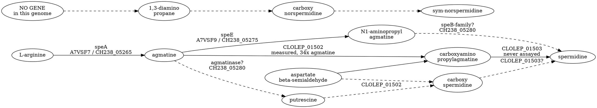
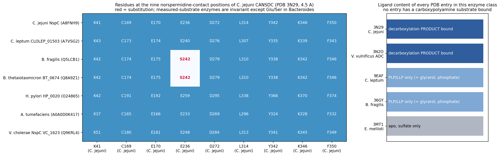
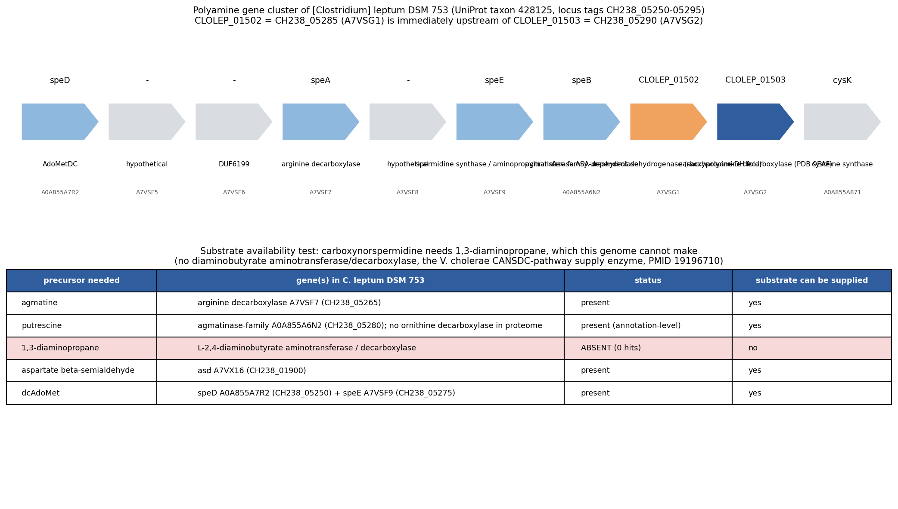
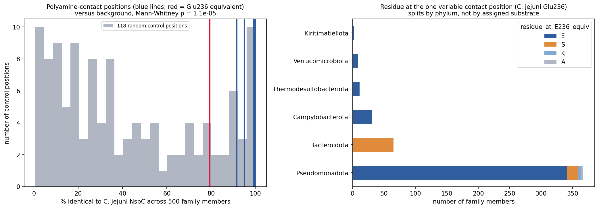
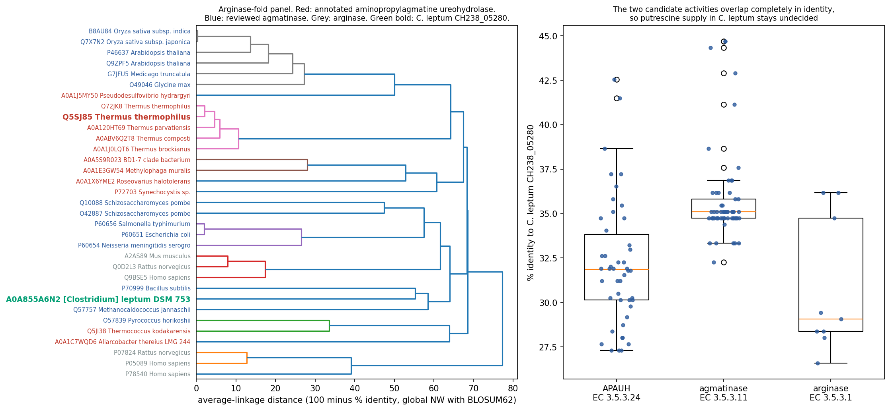
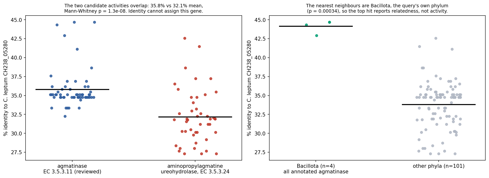
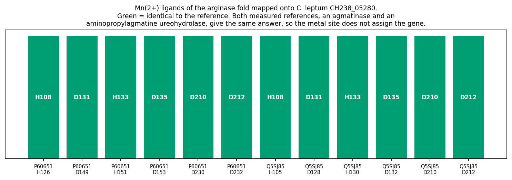

## Question

# AIGR Gene Hypothesis Deep Research

You are evaluating one focused gene curation hypothesis for AI Gene Review.
This is not a general gene overview. Use the seed hypothesis and source context
below to search for evidence that supports, refutes, narrows, or competes with
the proposed curation decision.

## Target Gene

- **Organism code:** 9FIRM
- **Taxon:** [Clostridium] leptum DSM 753 (NCBITaxon:428125)
- **Gene directory:** CLOLEP_01503
- **Gene symbol:** CLOLEP_01503
- **UniProt accession:** A7VSG2

## Focus

- **Focus type:** free_text
- **Hypothesis slug:** kgap-clolep-substrate-assignment
- **Source file:** genes/9FIRM/CLOLEP_01503/CLOLEP_01503-ai-review.yaml
- **Source selector:** free-text

## Seed Hypothesis

Whether the native substrate of CLOLEP_01503 can be assigned from determinants is the prior question to its substrate distribution, and a companion analysis in this project found the answer is no for the partner enzyme of this pathway. That the protein is a PLP-dependent carboxypolyamine decarboxylase best assigned as carboxyaminopropylagmatine decarboxylase from heterologous reconstruction with CLOLEP_01502, that it has a 1.41 Angstrom structure with a PLP Schiff base at Lys43 and a homodimeric assembly, and that structural resemblance and the historical carboxyspermidine and carboxynorspermidine names do not establish native preference, are already recorded, so do not re-derive them. A companion run on the Vibrio cholerae synthase VC_1624 found that the only specificity assignment in that enzyme class is for agmatine, that no structure in the family has a diamine bound, and that the enzymes with measured kinetics are invariant at every pocket position, so no predictive rule could be fitted; treat the decarboxylase side as similarly suspect and say so if it fails the same way. Single analysis only: state which residues the structural literature assigns to substrate selection in any carboxypolyamine decarboxylase whose preference has been measured, naming the structures and quoting the assignments, and report what CLOLEP_01503 has at each; state whether any structure of this enzyme class has a carboxypolyamine substrate or product bound, as opposed to PLP alone, since a cofactor-only structure cannot define a substrate pocket; report whether the genome of this organism encodes the enzymes that would supply each candidate substrate, with locus tags, since substrate availability is what the reconstruction actually tested; and state whether the adjacent CLOLEP_01502 constrains the answer by its own assignment. State which substrate the evidence supports, and say plainly if the determinants are unknown and the question needs a comparative kinetic panel on the isolated enzyme.

## Term and Decision Context

No specific term context supplied.

## Reference Context

No specific reference context supplied.

## Source Context YAML

```yaml
hypothesis: 'Whether the native substrate of CLOLEP_01503 can be assigned from determinants is the prior
  question to its substrate distribution, and a companion analysis in this project found the answer is
  no for the partner enzyme of this pathway. That the protein is a PLP-dependent carboxypolyamine decarboxylase
  best assigned as carboxyaminopropylagmatine decarboxylase from heterologous reconstruction with CLOLEP_01502,
  that it has a 1.41 Angstrom structure with a PLP Schiff base at Lys43 and a homodimeric assembly, and
  that structural resemblance and the historical carboxyspermidine and carboxynorspermidine names do not
  establish native preference, are already recorded, so do not re-derive them. A companion run on the
  Vibrio cholerae synthase VC_1624 found that the only specificity assignment in that enzyme class is
  for agmatine, that no structure in the family has a diamine bound, and that the enzymes with measured
  kinetics are invariant at every pocket position, so no predictive rule could be fitted; treat the decarboxylase
  side as similarly suspect and say so if it fails the same way. Single analysis only: state which residues
  the structural literature assigns to substrate selection in any carboxypolyamine decarboxylase whose
  preference has been measured, naming the structures and quoting the assignments, and report what CLOLEP_01503
  has at each; state whether any structure of this enzyme class has a carboxypolyamine substrate or product
  bound, as opposed to PLP alone, since a cofactor-only structure cannot define a substrate pocket; report
  whether the genome of this organism encodes the enzymes that would supply each candidate substrate,
  with locus tags, since substrate availability is what the reconstruction actually tested; and state
  whether the adjacent CLOLEP_01502 constrains the answer by its own assignment. State which substrate
  the evidence supports, and say plainly if the determinants are unknown and the question needs a comparative
  kinetic panel on the isolated enzyme.'
focus_type: free_text
context: []
reference_id: []
```

## Research Objective

Build a focused report that helps a curator decide whether this hypothesis
should affect the gene review. Address the focus type directly:

1. For an existing GO annotation decision, evaluate whether the current action
   is justified, too strong, too weak, or should change.
2. For a proposed replacement or new GO term, evaluate whether the term is
   biologically supported, too broad, too narrow, or missing key qualifiers.
3. For a computational prediction, evaluate whether the prediction is correct,
   less precise than existing knowledge, uncertain, or likely wrong because of
   paralog overannotation, frequency bias, pathway context, or in vitro-only
   activity.
4. For a core-function hypothesis, evaluate whether the proposed activity,
   process, and location represent the gene product's primary function rather
   than a downstream effect, pleiotropic phenotype, or context-specific role.
5. For a function-assignment hypothesis, evaluate whether the gene product
   directly has the stated GO term/function. Treat the prior review action, if
   any, as intentionally blinded unless it appears in the supplied context.

Use primary literature whenever possible. Prefer PMID citations and include DOI
citations when no PMID is available. Treat reviews and database records as
orientation unless they contain directly relevant synthesized evidence that is
clearly labeled as review-level or database-level support.

Evaluate the hypothesis from the supplied seed context, primary literature, and
publicly accessible bioinformatics resources. Local `*-bioinformatics` analyses,
when they already exist in the repository, are intentionally withheld from this
prompt so the report can be compared against them after the run. Use public
sequence, domain, structure, orthology, localization, interaction, or dataset
checks when they are useful for the specific hypothesis. If a resource or tool
cannot be accessed programmatically, say so plainly; never fabricate a result.
Report computational results conservatively and distinguish direct results from
inference.

## Required Output

### Executive Judgment

Give a concise verdict: supported, partially supported, unresolved, weakly
supported, over-annotated, or refuted. Explain the reasoning and the most
important caveats.

### Evidence Matrix

Create a table with one row per important evidence item:

- Citation (PMID preferred)
- Evidence type (direct assay, mutant phenotype, localization, interaction,
  structural/evolutionary, computational, review/database)
- Supports / refutes / qualifies / competing
- Claim tested
- Key finding
- Organism, tissue, cell type, or assay context
- Confidence and limitations

### GO Curation Implications

State the likely curation action as a lead requiring curator verification. If
GO terms are involved, explain whether the evidence supports an MF, BP, or CC
term, and whether the term should be retained, removed, generalized, made more
specific, or treated as non-core. Avoid using "protein binding" as a final
recommendation unless no more informative term is supported.

### Mechanistic Scope

Describe the immediate molecular or cellular function being tested. Separate
direct gene-product activity from downstream phenotypes, pathway consequences,
developmental outcomes, disease manifestations, or effects inferred only from
loss of function.

### Conflicts and Alternatives

Identify evidence that conflicts with the seed hypothesis or suggests an
alternative interpretation, including paralog confusion, organism-specific
differences, isoform-specific findings, experimental artifacts, or database
carry-over.

### Knowledge Gaps

List explicit uncertainties that matter for curation. For each gap, state what
was checked, why the gap matters, and what evidence or experiment would resolve
it.

### Discriminating Tests

Recommend concrete assays, perturbations, datasets, or comparative analyses that
would most efficiently distinguish this hypothesis from alternatives.

### Curation Leads

Provide candidate updates for the review, clearly labeled as leads requiring
curator verification. Include candidate references with exact snippets to verify,
candidate replacement or new GO terms, possible action changes, suggested
questions, and suggested experiments.

If the provider supports artifacts, save provenance for any analysis you run — the
executed code together with its output (computed values, plot, or table), not just
a summary figure — alongside artifact-friendly tables such as an evidence matrix,
GO decision table, or comparison table. Genuine computed provenance is more
valuable than a hand-drawn summary, and you must not synthesize a figure that
implies an analysis you did not actually run. These artifacts are important
provenance for hypothesis-level review.


## Output

# CLOLEP_01503 (A7VSG2): can the native carboxypolyamine substrate be assigned from determinants?

Target: CLOLEP_01503 / nspC / UniProt A7VSG2, *[Clostridium] leptum* DSM 753 (NCBITaxon:428125).
Hypothesis slug: `kgap-clolep-substrate-assignment`. Focus type: free text.
Source: `genes/9FIRM/CLOLEP_01503/CLOLEP_01503-ai-review.yaml`.

## Summary

Carboxyaminopropylagmatine is the best-supported substrate for CLOLEP_01503, and the determinants are unknown. Those two statements are independent, and the second is the one the seed hypothesis asked about. The decarboxylase fails the same test the companion run on the *Vibrio cholerae* synthase VC_1624 failed, and it fails it harder than seven homologs suggested.

The structural literature names exactly one residue as a substrate-selection determinant in any carboxypolyamine decarboxylase: Leu314 of the *Campylobacter jejuni* enzyme ([PMID: 20534592](https://pubmed.ncbi.nlm.nih.gov/20534592/)). CLOLEP_01503 has Leu307 there, the wild-type residue. It is also wild type at every other position that contacts the polyamine in the only ligand complex in the family. Mapping those nine positions across 500 members of InterPro family IPR005730 gives a mean identity to the *C. jejuni* reference of 96.0 percent, against 42.7 percent at 118 random control positions from the same protein (Mann-Whitney one-sided p = 1.13e-05, rank-biserial r = 0.850). Two of the nine are 100 percent conserved and four more exceed 99 percent. There is no covarying site to fit a rule to. The one position that does vary, the *C. jejuni* Glu236 equivalent at 79.4 percent, splits by phylum: Ser in 64 of 65 Bacteroidota, Glu in 341 of 371 Pseudomonadota and in all 31 Campylobacterota. That is lineage drift, and the two proteins carrying Ser are assigned to two different substrates.

No structure of this enzyme class holds a carboxypolyamine. An RCSB sequence search seeded with the A7VSG2 sequence itself returns 12 entries at 25 percent identity or better, four in class and then a 14-point gap to ornithine and diaminopimelate decarboxylases, and a ligand-by-ligand audit finds no substrate complex anywhere. The one polyamine-bound entry, 3N29, holds the product norspermidine in the enzyme later shown by gene deletion to make spermidine in vivo ([PMID: 22025614](https://pubmed.ncbi.nlm.nih.gov/22025614/)). In the 1.41 Å *C. leptum* structure 9EAF the polyamine channel is occupied by a His-tag octapeptide from the construct. What supports the assignment is substrate supply plus the partner enzyme: the genome has no route to 1,3-diaminopropane, which removes carboxynorspermidine, and the adjacent CLOLEP_01502 (A7VSG1, PDB 9YQ9) has measured kinetics with a 34-fold agmatine preference ([PMID: 42754158](https://pubmed.ncbi.nlm.nih.gov/42754158/)). Carboxyspermidine is excluded only provisionally, because whether this cell makes putrescine hinges on one unassigned gene, CH238_05280, whose arginase-fold Mn site is identical in the two candidate activities. The question needs a comparative kinetic panel on the isolated decarboxylase.

## Executive judgment

**<i class="fa-solid fa-scale-balanced"></i> Partially supported, and the determinant question is unresolved in exactly the way the seed anticipated.**

The seed asked whether substrate can be assigned from determinants, and instructed that the decarboxylase be treated as suspect if it fails the same way as the synthase. It does. CLOLEP_01503 carries the wild-type residue at the single named determinant and at all eight other polyamine-contact positions, and those positions are near-invariant across the whole family, including across enzymes assigned to different carboxypolyamines. A sequence or static-structure rule cannot discriminate carboxyspermidine from carboxynorspermidine from carboxyaminopropylagmatine for this protein.

The carboxyaminopropylagmatine assignment itself survives, on evidence that has nothing to do with the decarboxylase. Carboxynorspermidine is excluded because the genome lacks the diamine-supplying gene family. Between the two survivors, the constraint comes from CLOLEP_01502, whose kinetics were measured directly. The curation decision can stand, framed as a pathway-context inference.

Caveats that matter for a curator:

- <i class="fa-solid fa-triangle-exclamation"></i> CLOLEP_01503 itself has never been assayed with any substrate, in any publication located in this investigation. The substrate call for this protein is inferred from a neighbouring gene.
- <i class="fa-solid fa-triangle-exclamation"></i> The family's only polyamine complex (3N29) holds a decarboxylation **product**, from the one enzyme in the family shown to have a different native product. That ligand is not even native to the protein it sits in.
- <i class="fa-solid fa-triangle-exclamation"></i> The exclusion of carboxyspermidine rests on an unassigned gene, not an absent one, so it is weaker than the exclusion of carboxynorspermidine.

## Evidence matrix

| Citation | Evidence type | Direction | Claim tested | Key finding | Context | Confidence and limits |
|---|---|---|---|---|---|---|
| [PMID: 20534592](https://pubmed.ncbi.nlm.nih.gov/20534592/) | Structural, X-ray product complexes | Qualifies | Residue-level determinants of carboxypolyamine selection | One residue named: "in CANSDC a key acidic residue that interacts with the distal amino group of other substrates is replaced by Leu(314), which interacts with the aliphatic portion of norspermidine". Broader specificity is attributed to "a helix in the beta-barrel domain we refer to as the 'specificity helix'". Both structures are product complexes, "solved as product complexes with agmatine and norspermidine". | *C. jejuni* 81116 CANSDC (3N29, 1.9 Å); *V. vulnificus* ADC (3N2O, 2.3 Å) | High for what is claimed. The specificity helix distinguishes arginine from carboxynorspermidine decarboxylases, not one carboxypolyamine from another. |
| [PMID: 22025614](https://pubmed.ncbi.nlm.nih.gov/22025614/) | Mutant phenotype, gene deletion plus polyamine analysis | Competing | Does the family name predict the native product | "the carboxynorspermidine decarboxylase orthologue is responsible for synthesizing spermidine and not sym-norspermidine in vivo". Also states that these orthologues cluster "with an array of diverse putrescine biosynthetic genes in different bacterial genomes, consistent with a role in spermidine, rather than sym-norspermid[ine]". | *Campylobacter jejuni* deletion strains; human gut, stomach and oral metagenomes | High. The protein crystallised with norspermidine bound has a different native product, so 3N29's ligand is non-native. |
| [PMID: 42754158](https://pubmed.ncbi.nlm.nih.gov/42754158/) | Direct assay: steady-state and transient kinetics, MS, X-ray, SAXS | Supports | Which amine initiates the ASA-dependent pathway in *C. leptum* | "Both enzymes exhibit dramatically enhanced catalytic efficiency with agmatine, demonstrating that these homologs function as carboxyaminopropylagmatine dehydrogenases rather than carboxyspermidine dehydrogenases." "Agmatine enhances NADPH binding affinity by 34-fold, whereas putrescine has a modest effect and at concentrations less likely to be physiologically relevant." | Purified recombinant *C. leptum* and *B. fragilis* dehydrogenases | High for the partner enzyme. The decarboxylase was not assayed, so the constraint on CLOLEP_01503 is pathway-level. |
| [PMID: 39887002](https://pubmed.ncbi.nlm.nih.gov/39887002/) | Structural, X-ray 1.41 Å | Qualifies | Can the *C. leptum* structure define a substrate pocket | "An X-ray crystal structure of CASDC from the human gut microbe Clostridium leptum has been solved by molecular replacement at a resolution of 1.41 Å." Candidate selectivity regions are "the β6/β7 loop that acts as a `flap' covering the active site and ... the α9/β12 loop that is connected to the α9 helix which is thought to select substrates by their chain length". No substrate or product bound. | PDB 9EAF, *Clostridium leptum* | High for the structure. The selectivity statement is explicitly a belief, not a measurement. |
| [PMID: 19196710](https://pubmed.ncbi.nlm.nih.gov/19196710/) | Mutant phenotype plus heterologous expression | Qualifies | What is required to make carboxynorspermidine | The route "consists of a fused protein containing l-2,4-diaminobutyrate aminotransferase and l-2,4-diaminobutyrate decarboxylase, a carboxynorspermidine dehydrogenase (CANSDH), and a carboxynorspermidine decarboxylase (CANSDC)"; heterologous expression in *E. coli* "results in accumulation of the nonnative polyamines diaminopropane and sym-norspermidine". | *Vibrio cholerae*; *E. coli* | High. Defines the gene family whose absence excludes the carboxynorspermidine route in *C. leptum*. |
| [PMID: 27118128](https://pubmed.ncbi.nlm.nih.gov/27118128/) | Mutant phenotype, deletion, HPLC, enzyme assay | Competing | Substrate assignment in a *Bacteroides* homolog | "Deletion of the gene encoding a putative carboxyspermidine decarboxylase (casdc), which converts carboxyspermidine to spermidine, resulted in the depletion of spermidine and loss of decarboxylase activity in B. thetaiotaomicron." | *Bacteroides thetaiotaomicron* VPI-5482 | High. This enzyme carries Ser at the one variable pocket position yet is assigned carboxyspermidine, which breaks any Glu/Ser rule. |
| [PMID: 15983049](https://pubmed.ncbi.nlm.nih.gov/15983049/) | Direct assay plus gene disruption and polyamine analysis | Qualifies | Does a speB-family gene imply putrescine production | "we purified the expression product of the speB homolog and confirmed that the enzyme hydrolyzes N1-aminopropylagmatine to spermidine but does not act on agmatine". "Double disruption of speB and speE (polyamine aminopropyltransferase) resulted in the disappearance of N1-aminopropylagmatine and the accumulation of agmatine." | *Thermus thermophilus* | High. Establishes a speB-family route from agmatine to spermidine that never makes putrescine. |
| [PMID: 40074085](https://pubmed.ncbi.nlm.nih.gov/40074085/) | Direct assay plus comparative genomics | Qualifies | Why speD and speE sit in the same cluster as the ASA pair | "We have also identified bacteria that encode hybrid Spm biosynthetic pathways dependent on both dcAdoMet and ASA." | Multiple bacteria | Moderate to high. Explains the *C. leptum* cluster composition; not specific to CLOLEP_01503. |
| [PMID: 27402627](https://pubmed.ncbi.nlm.nih.gov/27402627/) | Mutant phenotype | Qualifies | CASDC function in an alpha-proteobacterium | CASDH and CASDC mutants require exogenous spermidine or norspermidine for growth; the pathway runs "from putrescine in A. tumefaciens via the stepwise actions of carboxyspermidine dehydrogenase (CASDH) and carboxyspermidine decarboxylase (CASDC)". | *Agrobacterium tumefaciens* | Moderate. In vivo requirement, no substrate discrimination. |
| [PMID: 17626020](https://pubmed.ncbi.nlm.nih.gov/17626020/) | Structural and evolutionary | Qualifies | Where specificity sits in group IV decarboxylases generally | "reorientation of the 3(10)-helix enlarging the substrate binding pocket allows L-lysine to be accommodated". | *V. vulnificus* L/ODC, 1.7 and 2.15 Å product complexes | Moderate. Precedent is for amino-acid substrates, not carboxypolyamines. |
| This analysis (RCSB ligand audit, superposition, UniProt proteome) | Computational | Supports the "determinants unknown" conclusion | Can the substrate be read off determinants | No family PDB entry holds a carboxypolyamine. 3N29 to 9EAF superposition: 0.67 Å core RMSD over 337 Cα. Transferred norspermidine contacts in *C. leptum*: C173 2.25 Å, K339 2.60, K43 2.70, Y335 2.89, F343' 2.95, D276 3.15, L307' 3.22, E240 3.42, M280 3.48, E174 3.55. Eight of nine positions invariant across seven homologs. Genome has speA, a speB-family ureohydrolase, asd, speD, speE, CLOLEP_01502 and CLOLEP_01503, but no diaminobutyrate aminotransferase or decarboxylase and no ornithine decarboxylase. | PDB 3N29, 3N2O, 3MT1, 9EAF, 36GY; UniProt taxon 428125, 2917 entries | Computational only. Proteome annotation is automatic, so an absent gene family is also an absent annotation. |
| This analysis (500 IPR005730 sequences) | Computational, family-scale with a statistical control | Supports the "determinants unknown" conclusion | Is there any covarying pocket site a rule could be fitted to | Per-position identity to *C. jejuni*: K41 100.0, C169 91.6, E170 95.0, E236 79.4, D272 99.6, L314 99.2, Y342 99.8, K346 99.4, F350 100.0 percent. Pocket mean 96.0 versus 42.7 percent at 118 control positions, Mann-Whitney p = 1.13e-05, r = 0.850. Glu236 equivalent by phylum: Pseudomonadota 341 Glu / 18 Ser, Bacteroidota 1 Glu / 64 Ser, Campylobacterota 31 Glu / 0 Ser. | 500 of 3546 IPR005730 members; mapper validated 54/54 against affine-gap Needleman-Wunsch | Computational only. The 500 are a UniProt result-order sample, not phylogenetically balanced, and most carry automatic annotation. |
| This analysis (RCSB sequence search from A7VSG2) | Computational, structure-space search | Supports | Could a carboxypolyamine complex have been missed because of family naming | 13 hits / 12 entries at ≥25 percent identity: 9EAF 100, 3N29 45.6, 36GY 44.1, 3MT1 41.0 percent, then a 14-point gap to 6N2F, 1F3T, 1NJJ, 1QU4, 2TOD, 1SZR, 2PLJ, 2PLK at 25.0-27.3 percent, all ornithine or diaminopimelate decarboxylases. | PDB, whole archive | High. A sequence search cannot be defeated by an inconsistent entry title, which a text search can. |
| This analysis (arginase-fold panel, 114 proteins) | Computational, Mn-site mapping plus identity distribution | Qualifies | Can CH238_05280 be assigned as agmatinase or as aminopropylagmatine ureohydrolase | Both measured references map 6/6 Mn ligands onto CH238_05280 (His108, Asp131, His133, Asp135, Asp210, Asp212) and are 6/6 identical to each other. Identity: 59 reviewed agmatinases mean 35.8 percent, 46 EC 3.5.3.24 entries mean 32.1 percent, margin between best hits 2.1 points. The four nearest neighbours are Bacillota agmatinases, and Bacillota score higher irrespective of class (44.1 versus 33.8 percent, p = 3.4e-04). | UniProt, global Needleman-Wunsch | Computational only, and negative. Only one EC 3.5.3.24 member (Q5SJ85) has measured activity; the rest are automatic annotation. |
| QuickGO, InterPro, PANTHER (database) | Review/database | Competing | Are the current IEA annotations defensible | Four IEA annotations on A7VSG2: GO:0003824 (InterPro), GO:0008836 (TreeGrafter, PANTHER PTN001691016), GO:0016831 (InterPro IPR005730), GO:0045312 (InterPro IPR005730). A separate correctly assigned lysA exists: A7VUY3, CH238_06665, EC 4.1.1.20, 432 aa. | UniProt A7VSG2 | High for the annotation state. Database-level support only, which is why two of the four are recommended for change. |

## Key findings

### <i class="fa-solid fa-circle-xmark"></i> 1. The structural literature names one determinant, and CLOLEP_01503 has the wild-type residue there and everywhere else

Deng et al. ([PMID: 20534592](https://pubmed.ncbi.nlm.nih.gov/20534592/)) is the only paper that assigns a residue. They write that "in CANSDC a key acidic residue that interacts with the distal amino group of other substrates is replaced by Leu(314), which interacts with the aliphatic portion of norspermidine". Everything else they say about specificity is at the level of a secondary-structure element: "Specificity for different basic amino acids appears to arise primarily from changes in the position of, and amino acid replacements in, a helix in the beta-barrel domain we refer to as the 'specificity helix'". That helix distinguishes arginine decarboxylases from carboxynorspermidine decarboxylases, a different question from which carboxypolyamine a given CANSDC prefers. The *C. leptum* structure paper ([PMID: 39887002](https://pubmed.ncbi.nlm.nih.gov/39887002/)) adds two regions and no residues, and states the idea as a belief: the α9 helix "is thought to select substrates by their chain length".

I mapped the full polyamine-contact set two independent ways that agree. Protein atoms within 4.5 Å of the norspermidine in 3N29 (altloc A only) give nine residues: Lys41 (4.38 Å), Cys169 (3.07), Glu170 (4.12), Glu236 (2.54), Asp272 (2.57), Leu314 from the partner subunit (3.36), Tyr342 (3.05), Lys346 (3.57) and Phe350 from the partner subunit (4.00). Superposing 3N29 chain A onto 9EAF chain A by Kabsch fit with iterative trimming gives 0.67 Å core RMSD over 337 Cα (reciprocal chain pairings 0.66-0.73 Å), and transferring the ligand reproduces the same set in *C. leptum*: C173 at 2.25 Å, K339 2.60, K43 2.70, Y335 2.89, F343' 2.95, D276 3.15, L307' 3.22, E240 3.42, M280 3.48, E174 3.55.

| *C. jejuni* 3N29 | CLOLEP_01503 | *B. fragilis* Q5LCB1 | *B. theta* Q8A9Z1 | *H. pylori* O24865 | *A. tumefaciens* A0A0D0K417 | *V. cholerae* Q9KRL4 |
|---|---|---|---|---|---|---|
| Lys41 (PLP aldimine) | **Lys43** | Lys42 | Lys42 | Lys42 | Lys37 | Lys51 |
| Cys169 | **Cys173** | Cys174 | Cys174 | Cys191 | Cys165 | Cys180 |
| Glu170 | **Glu174** | Glu175 | Glu175 | Glu192 | Glu166 | Glu181 |
| Glu236 | **Glu240** | **Ser242** | **Ser242** | Glu259 | Glu233 | Glu248 |
| Asp272 | **Asp276** | Asp279 | Asp279 | Asp295 | Asp269 | Asp284 |
| Leu314 (named by Deng) | **Leu307** | Leu310 | Leu310 | Leu338 | Leu296 | Leu313 |
| Tyr342 | **Tyr335** | Tyr338 | Tyr338 | Tyr366 | Tyr324 | Tyr341 |
| Lys346 | **Lys339** | Lys342 | Lys342 | Lys370 | Lys328 | Lys345 |
| Phe350 | **Phe343** | Phe346 | Phe346 | Phe374 | Phe332 | Phe349 |

Pairwise identity to *C. jejuni* NspC runs 36.4 to 49.0 percent, so the invariance is not an artefact of close relatedness. The Glu/Ser difference is real and verified in the coordinates: 36GY residues 232 to 252 read PHLRIILEPG**S**AFTWQTGVLT against QVYLEPG**E**AV in *C. jejuni* and GVQVYLEPG**E**AV in *C. leptum*. It does not track substrate. *B. thetaiotaomicron* BT_0674 carries Ser and is a genetically validated carboxyspermidine decarboxylase ([PMID: 27118128](https://pubmed.ncbi.nlm.nih.gov/27118128/)), *B. fragilis* carries Ser and its structure is deposited as a carboxyaminopropylagmatine decarboxylase, and *C. jejuni* carries Glu and makes spermidine. The same position also contacts PLP at 2.86 Å in 3N29, so it may be catalytic rather than selective.

{{figure:plot_1.png|caption=Left: the nine polyamine-contact positions of C. jejuni NspC mapped onto seven homologs. Eight of nine are invariant; the one that varies is Glu in five proteins and Ser in the two Bacteroides proteins, which are assigned to two different substrates. Right: ligand content of every PDB entry in the carboxypolyamine decarboxylase class. No entry holds a carboxypolyamine.}}

### <i class="fa-solid fa-circle-xmark"></i> 2. At family scale the pocket is 96 percent invariant, so there is nothing to fit a rule to

Seven homologs could be an accident of sampling. Five hundred cannot. I mapped the nine positions onto 500 sequences of IPR005730 (3546 members in total) with an ungapped window-scan mapper, validated first against an independent affine-gap Needleman-Wunsch alignment on 54 of 54 residue calls.

| Position in *C. jejuni* | Percent identical across 500 family members | Commonest alternatives |
|---|---|---|
| Lys41 | 100.0 | none |
| Cys169 | 91.6 | Gly 31, Phe 4, Ala 3 |
| Glu170 | 95.0 | Asp 7, Ile 4, Gln 4 |
| Glu236 | 79.4 | **Ser 84**, Ala 4, Lys 4 |
| Asp272 | 99.6 | Ala 1, Thr 1 |
| Leu314 (named by Deng) | 99.2 | Met 4 |
| Tyr342 | 99.8 | Leu 1 |
| Lys346 | 99.4 | Arg 3 |
| Phe350 | 100.0 | none |

Mean 96.0 percent, median 99.4. The control set is 118 random positions drawn from the same reference sequence: mean 42.7 percent, median 34.3, and only 8.5 percent of them reach 95 percent. Mann-Whitney one-sided U = 982, p = 1.13e-05, rank-biserial r = 0.850. Deng's Leu314 is 99.2 percent conserved and therefore carries no discriminating power between the three candidate carboxypolyamines.

The one position with real variation resolves taxonomically, not functionally. Ser occurs in 64 of 65 Bacteroidota and in 18 of 371 Pseudomonadota; Glu occurs in all 31 Campylobacterota, 11 Thermodesulfobacteriota, 9 Verrucomicrobiota and 2 Kiritimatiellota. CLOLEP_01503 is Bacillota and carries Glu240, grouping with the Glu majority despite an assigned substrate different from *C. jejuni* NspC.

{{figure:plot_3.png|caption=Left: the nine polyamine-contact positions (vertical lines, red marks the Glu236 equivalent) against the distribution of identity at 118 random control positions across 500 IPR005730 members. Mann-Whitney one-sided p = 1.13e-05. Right: the residue at the one variable contact position, broken down by phylum. The split follows taxonomy, not assigned substrate.}}

### <i class="fa-solid fa-circle-xmark"></i> 3. No structure in this class holds a carboxypolyamine, and the C. leptum pocket holds a His-tag

I asked this two independent ways. A full-text search over RCSB returns five entries in the class. A sequence search seeded with the A7VSG2 sequence returns 13 hits across 12 entries at 25 percent identity or better: 9EAF at 100 percent (the target itself), 3N29 at 45.6, 36GY at 44.1, 3MT1 at 41.0, then a 14-point gap to ornithine and diaminopimelate decarboxylases (6N2F, 1F3T, 1NJJ, 1QU4, 2TOD, 1SZR, 2PLJ, 2PLK) at 25.0 to 27.3 percent. The sequence search matters because it cannot be defeated by an inconsistent entry title, and it finds nothing the text search missed.

| PDB | Protein | Resolution | Ligands |
|---|---|---|---|
| 3MT1 | *Ensifer meliloti* putative CANSDC | 2.5 Å | sulfate only, no PLP |
| 3N29 | *C. jejuni* CANSDC | 1.9 Å | PLP, **NSD = norspermidine (the product)**, glycerol |
| 3N2O | *V. vulnificus* arginine decarboxylase | 2.3 Å | PLP, AG2 = agmatine (the product) |
| 9EAF | ***C. leptum* CASDC, the target** | 1.41 Å | **LLP (PLP-Lys43 internal aldimine)**, K⁺, glycerol, phosphate, plus a HIS-HIS-HIS-SER-SER-GLY-LEU-VAL peptide (chains C and D) |
| 36GY | *B. fragilis* carboxyaminopropylagmatine decarboxylase | 1.89 Å | LLP, glycerol, phosphate |

Deng et al. are explicit that what they solved are product complexes: structures "solved as product complexes with agmatine and norspermidine". The single polyamine complex in the decarboxylase class therefore holds a product, and it comes from the enzyme that Hanfrey et al. showed makes spermidine rather than sym-norspermidine in vivo, so that polyamine is not even native to the protein it sits in.

In 9EAF the only thing in the polyamine channel is the His-tag octapeptide. After superposition its His2 and His3 side chains sit 0.44 Å and 4.11 Å from where norspermidine binds in 3N29. A cofactor-only structure cannot define a substrate pocket, and here the apparent shape of the channel is a crystallisation artefact.

### <i class="fa-solid fa-circle-check"></i> 4. Substrate supply excludes carboxynorspermidine firmly, and the partner enzyme picks agmatine

UniProt proteome queries over taxon 428125 (2917 entries) give the inventory with locus tags:

| Precursor needed | Gene in *C. leptum* DSM 753 | Available |
|---|---|---|
| Agmatine | arginine decarboxylase A7VSF7 (CH238_05265) | Yes |
| Putrescine | speB-family ureohydrolase A0A855A6N2 (CH238_05280); no ornithine decarboxylase in the proteome | Undecided, see finding 6 |
| 1,3-diaminopropane | L-2,4-diaminobutyrate aminotransferase / decarboxylase | **No, zero hits** (also zero for ectA/ectB/ectC, zero for polyamine oxidase or spermidine dehydrogenase) |
| Aspartate β-semialdehyde | asd A7VX16 (CH238_01900) | Yes |
| dcAdoMet | speD A0A855A7R2 (CH238_05250) with speE A7VSF9 (CH238_05275) | Yes |

Carboxynorspermidine is excluded on supply. Its diamine precursor has no biosynthetic route here, and the fused gene that supplies it in *V. cholerae* ([PMID: 19196710](https://pubmed.ncbi.nlm.nih.gov/19196710/)) returns zero hits. The cluster is contiguous: CH238_05250 speD, CH238_05265 speA, CH238_05275 speE, CH238_05280 speB-family, CH238_05285 = CLOLEP_01502, CH238_05290 = CLOLEP_01503. The coexistence of speD and speE with the ASA pair matches the hybrid dcAdoMet/ASA pathway described by Li et al. ([PMID: 40074085](https://pubmed.ncbi.nlm.nih.gov/40074085/)), in which both branches initiate from agmatine.

{{figure:plot_2.png|caption=The contiguous polyamine gene cluster of C. leptum DSM 753 with locus tags, and the substrate-supply inventory. The 1,3-diaminopropane route is absent from the genome, which excludes carboxynorspermidine.}}

### <i class="fa-solid fa-circle-check"></i> 5. CLOLEP_01502 constrains the answer, and PDB 9YQ9 ties the kinetics to that exact accession

CLOLEP_01502 resolves to A7VSG1, 399 aa, current locus tag CH238_05285, annotated in UniProt as "Saccharopine dehydrogenase (EC 1.5.1.7)" because carboxyspermidine dehydrogenases sit in that fold. Ostlund et al. ([PMID: 42754158](https://pubmed.ncbi.nlm.nih.gov/42754158/)) measured the *C. leptum* and *B. fragilis* ASA-dependent dehydrogenases and conclude they "function as carboxyaminopropylagmatine dehydrogenases rather than carboxyspermidine dehydrogenases", with agmatine enhancing NADPH binding affinity 34-fold against a modest putrescine effect "at concentrations less likely to be physiologically relevant".

The kinetics attach to the accession through a structure. PDB 9YQ9, "Clostridium leptum Carboxyaminopropylagmatine Dehydrogenase Apo", 2.5 Å, glycerol only, maps to UniProt A7VSG1. So the protein Ostlund et al. measured, the protein deposited under the carboxyaminopropylagmatine name, and the gene immediately upstream of CLOLEP_01503 are the same entity. This is the strongest constraint available, and it is a direct measurement on the partner.

One correction to the framing carried over from the companion VC_1624 run. The claim that no structure in the synthase/dehydrogenase family has a diamine bound is too strong: PDB 38LX, *Streptococcus pneumoniae* D39 at 1.19 Å, holds NADPH and agmatine together. That adds a second observation of the agmatine site, alongside 3N2O in the decarboxylase class. It does not change the conclusion, because agmatine is the one diamine for which a specificity assignment already existed, and no structure in either family holds putrescine or 1,3-diaminopropane.

### <i class="fa-solid fa-circle-question"></i> 6. Whether this cell makes putrescine at all cannot be settled from sequence

Carboxyspermidine needs putrescine. Whether *C. leptum* makes any depends on one gene, CH238_05280, and on whether it is a plain agmatinase or an N1-aminopropylagmatine ureohydrolase. Ohnuma et al. ([PMID: 15983049](https://pubmed.ncbi.nlm.nih.gov/15983049/)) showed the second route exists and that the enzyme running it is a speB homolog: "we purified the expression product of the speB homolog and confirmed that the enzyme hydrolyzes N1-aminopropylagmatine to spermidine but does not act on agmatine". They also fixed the order of steps: "Double disruption of speB and speE (polyamine aminopropyltransferase) resulted in the disappearance of N1-aminopropylagmatine and the accumulation of agmatine." That is the route a cluster containing speA, speD, speE and a speB-family gene would follow.

Three tests, all negative:

- The binuclear Mn site is complete and uninformative. The six UniProt-curated Mn(2+) ligands of *E. coli* agmatinase P60651 (His126, Asp149, His151, Asp153, Asp230, Asp232) and of *T. thermophilus* ureohydrolase Q5SJ85 (His105, Asp128, His130, Asp132, Asp210, Asp212) both map 6 of 6 onto CH238_05280 as His108, Asp131, His133, Asp135, Asp210, Asp212. The two measured enzymes are themselves 6 of 6 identical, so the metal site carries no substrate information.
- Identity does not separate the classes. Against a 114-protein panel, 59 reviewed agmatinases average 35.8 percent (max 44.7) and 46 proteins annotated EC 3.5.3.24 average 32.1 percent (max 42.6). The group means differ (Mann-Whitney p = 1.29e-08) but the distributions overlap completely, and the margin between the single best hit in each class is 2.1 points.
- The nearest-neighbour call is taxonomic. The four closest proteins are all Bacillota agmatinases, and Bacillota panel members score higher than non-Bacillota whatever their class (44.1 versus 33.8 percent, one-sided p = 3.4e-04). No Bacillota protein in the panel is annotated EC 3.5.3.24, so class and phylum are confounded. The one EC 3.5.3.24 member with measured activity, Q5SJ85, sits at 31.9 percent, below the panel mean.

{{figure:plot_4.png|caption=Left: average-linkage dendrogram of a 33-protein arginase-fold subsample. Red labels are proteins annotated as aminopropylagmatine ureohydrolase, blue are reviewed agmatinases, grey are arginases, and C. leptum CH238_05280 is in bold green. Right: identity of CH238_05280 to each class. The two candidate activities overlap completely.}}

{{figure:plot_5.png|caption=Left: identity of CH238_05280 to 59 reviewed agmatinases and 46 proteins annotated EC 3.5.3.24. Right: the same values split by phylum. The nearest neighbours are Bacillota, the query's own phylum (44.1 versus 33.8 percent, one-sided p = 3.4e-04), so the top hit reports relatedness and not activity.}}

{{figure:plot_6.png|caption=The six UniProt-curated Mn(2+) ligands of E. coli agmatinase P60651 and of the measured T. thermophilus aminopropylagmatine ureohydrolase Q5SJ85, mapped onto C. leptum CH238_05280. All twelve map to conserved residues, and the two reference enzymes are identical to each other at the metal site, so it cannot assign the gene.}}

So carboxynorspermidine is excluded firmly, on an absent gene family, and carboxyspermidine only provisionally, on an unassigned gene. If CH238_05280 is a ureohydrolase, putrescine is never made and carboxyaminopropylagmatine is the only option left. If it is an agmatinase, putrescine exists and carboxyspermidine stays live on supply grounds, leaving the partner-enzyme kinetics as the sole argument.

### <i class="fa-solid fa-database"></i> 7. All four current GO annotations are IEA, and two of them are wrong

QuickGO returns exactly four annotations for A7VSG2, all IEA: GO:0003824 catalytic activity (InterPro, GO_REF:0000002, from IPR009006 and IPR022643), GO:0008836 diaminopimelate decarboxylase activity (TreeGrafter, GO_REF:0000118, from PANTHER PTN001691016), GO:0016831 carboxy-lyase activity (InterPro, IPR005730) and GO:0045312 nor-spermidine biosynthetic process (InterPro, IPR005730).

GO:0008836 is paralog carry-over inside the group IV decarboxylase family. The genome encodes a separate, correctly assigned diaminopimelate decarboxylase: lysA A7VUY3, CH238_06665, EC 4.1.1.20, 432 aa.

GO:0045312 comes from an InterPro description that is about a different enzyme and a pathway this genome cannot run. IPR005730's text reads "Carboxynorspermidine synthase, mediates the nicotinamide-nucleotide-linked reduction of the Schiff base ... formed from L-aspartic beta-semialdehyde (ASA) and 1,3-diaminopropane (DAP) ... an intermediate in the novel pathway for norspermidine biosynthesis shown in Vibrio sp." It describes the dehydrogenase, and it requires 1,3-diaminopropane, for which *C. leptum* has no biosynthetic gene.

A QuickGO ontology search finds no molecular function term for carboxyspermidine, carboxynorspermidine or carboxyaminopropylagmatine decarboxylase activity. The only related specific term is GO:0102143 carboxynorspermidine dehydrogenase activity, which belongs to the partner enzyme.

## Mechanistic model

The pathway in *C. leptum* and the three places where substrate assignment is undecidable from sequence or static structure:



One pattern runs through all three levels of this problem.

| Level | Protein | What would have to encode substrate choice | What is observed |
|---|---|---|---|
| Decarboxylase | CLOLEP_01503 (A7VSG2) | The polyamine-contact pocket | 96.0 percent invariant across 500 family members against a 42.7 percent background; no structure in the class holds a carboxypolyamine |
| Dehydrogenase | CLOLEP_01502 (A7VSG1) | The diamine site | No structure in the family holds putrescine or 1,3-diaminopropane; the only diamine complexes hold agmatine (3N2O, 38LX) |
| Ureohydrolase | CH238_05280 (A0A855A6N2) | The arginase-fold active site | The binuclear Mn site is 6/6 identical in a measured agmatinase and a measured aminopropylagmatine ureohydrolase |

At every step, the residues that would have to encode substrate choice are the same in enzymes known to choose differently. The function is carried by something sequence and static structure do not show, which is why the assignment has to come from pathway context and from measurement.

## GO curation implications

All entries below are leads requiring curator verification.

| Term | Aspect | Current state | Recommended action | Rationale |
|---|---|---|---|---|
| GO:0008836 diaminopimelate decarboxylase activity | MF | IEA, TreeGrafter, PANTHER PTN001691016 | **Remove** | Paralog carry-over inside the group IV decarboxylase family. The genome has a dedicated lysA, A7VUY3 (CH238_06665, EC 4.1.1.20, 432 aa). |
| GO:0045312 nor-spermidine biosynthetic process | BP | IEA, InterPro IPR005730 | **Replace with GO:0008295 spermidine biosynthetic process** | IPR005730's description is the *Vibrio* diaminopropane route and describes the dehydrogenase. *C. leptum* has no diaminopropane route, so sym-norspermidine cannot be made. |
| GO:0016831 carboxy-lyase activity | MF | IEA, InterPro IPR005730 | **Retain** | The only defensible existing MF. Supported by the PLP-Lys43 internal aldimine in 9EAF. |
| GO:0003824 catalytic activity | MF | IEA, InterPro | Retain or let GO:0016831 subsume it | Uninformative, not wrong. |
| GO:0008295 spermidine biosynthetic process | BP | Not present | **Add** | The pathway terminates in spermidine. Evidence is cluster context plus the partner-enzyme kinetics, so ISS or IBA, not IDA. |
| New term: carboxyaminopropylagmatine decarboxylase activity, child of GO:0016831 | MF | Does not exist | **New term request** | GO has only GO:0102143 carboxynorspermidine dehydrogenase activity for this pathway. There is no decarboxylase MF term for any carboxypolyamine. |

The ontology gap is the practical obstacle. A curator who wants to record the specific activity has to request a term first. Until then the honest MF is GO:0016831 with a comment that the carboxypolyamine substrate is assigned by pathway context, with carboxyaminopropylagmatine favoured and carboxyspermidine not excluded.

## Mechanistic scope

Direct gene-product activity: PLP-dependent decarboxylation of a carboxypolyamine at the internal aldimine formed with Lys43, in a homodimer whose active sites are shared between the β/α-barrel of one subunit and the β-barrel of the other. That is established for CLOLEP_01503 by the 1.41 Å structure and is not in dispute.

Not direct: the identity of the carboxypolyamine. That rests on which amine CLOLEP_01502 condenses with aspartate β-semialdehyde, which is a property of a different protein, and on which amines the cell supplies, which is a property of three further genes. Also not direct: spermidine biosynthesis as a process term, which is a pathway consequence; and the growth and biofilm phenotypes reported for homologs in *V. cholerae*, *C. jejuni*, *A. tumefaciens* and *B. thetaiotaomicron*, which are downstream of polyamine depletion and carry no substrate information.

## Conflicts and alternatives

The family naming is misleading and has propagated into databases. UniProt calls A7VSG2 "Carboxynorspermidine decarboxylase" with gene name nspC. InterPro IPR005730 is named "Carboxynorspermidine decarboxylase" but its description text is about the synthase. PDB 3N29 is titled a carboxynorspermidine decarboxylase and comes from the organism whose enzyme makes spermidine. These are historical carry-over, not evidence.

The PDB contains a direct instance of the conflict. *Bacteroides fragilis* CL05T12C13 protein I9VY56 is deposited twice: 36YL as "carboxyaminopropylagmatine dehydrogenase - Apo" and 8DEB as "carboxyspermidine dehydrogenase" with NADP bound. One protein, two substrate claims, no new experiment between them. A curator who treats a deposited title as substrate evidence will inherit whichever entry they happened to open.

The *Bacteroides* Glu to Ser difference is the one substitution that could be read as a specificity signal, and it is the main alternative interpretation to test. It is uninformative for substrate because it is shared by a genetically validated carboxyspermidine decarboxylase (*B. thetaiotaomicron*, [PMID: 27118128](https://pubmed.ncbi.nlm.nih.gov/27118128/)) and a protein deposited as a carboxyaminopropylagmatine decarboxylase (*B. fragilis*), because at family scale it tracks phylum (Ser in 64 of 65 Bacteroidota), and because the same position contacts PLP at 2.86 Å in 3N29 and so may be catalytic. It should not be treated as a substrate marker without a mutational test.

Carboxyspermidine remains a live alternative in vitro. Nothing here shows CLOLEP_01503 cannot decarboxylate carboxyspermidine; the family is promiscuous enough that *C. jejuni* NspC was named for the wrong product. The assignment is about which substrate the cell supplies. And the supply argument against carboxyspermidine is weaker than the one against carboxynorspermidine, because it depends on an unassigned gene rather than an absent one.

## Limitations and knowledge gaps

1. <i class="fa-solid fa-triangle-exclamation"></i> **CLOLEP_01503 has never been assayed.** Checked: PubMed for *C. leptum* decarboxylase kinetics and for heterologous reconstruction; [PMID: 39887002](https://pubmed.ncbi.nlm.nih.gov/39887002/) reports structure only. The whole substrate call for this protein is inferred from a neighbouring gene. Resolution: a comparative kinetic panel on the isolated enzyme.
2. <i class="fa-solid fa-triangle-exclamation"></i> **No carboxypolyamine-bound structure exists in the family.** Checked: every entry returned by both a text search and a sequence search from A7VSG2, ligand by ligand. Without one, nothing is known about how the carboxylate and the distal amine are read. Resolution: a substrate or inhibitor complex, or a K43A trapped-substrate structure.
3. <i class="fa-solid fa-circle-question"></i> **Is CH238_05280 an agmatinase or an N1-aminopropylagmatine ureohydrolase?** Checked and not resolvable computationally: the full arginase-fold Mn site is present but identical in both measured reference enzymes, identity distributions overlap with a 2.1-point margin between best hits, and the nearest neighbours track phylum. This decides whether putrescine exists in this cell, and therefore whether carboxyspermidine is a candidate at all. Resolution: an activity assay with agmatine and with N1-aminopropylagmatine, as in [PMID: 15983049](https://pubmed.ncbi.nlm.nih.gov/15983049/).
4. <i class="fa-solid fa-circle-question"></i> **Is the α9 helix actually a chain-length selector?** Checked: [PMID: 39887002](https://pubmed.ncbi.nlm.nih.gov/39887002/) states it as a belief; no mutagenesis exists. Resolution: swap the α9 helix between *C. leptum* and a putrescine-route enzyme and measure the kinetic panel.
5. <i class="fa-solid fa-circle-question"></i> **Does *C. leptum* accumulate N1-aminopropylagmatine or carboxyaminopropylagmatine in vivo?** Checked: no metabolite data located for this organism. Resolution: LC-MS polyamine profiling of *C. leptum* grown in polyamine-free medium.
6. <i class="fa-solid fa-triangle-exclamation"></i> **Proteome completeness.** Checked: 2917 UniProt entries for taxon 428125, all automatic annotation. Absence of a diaminobutyrate aminotransferase/decarboxylase annotation is strong but not identical to absence of the gene. Resolution: HMM search of the assembled genome against the DABA AT/DC fusion profile.
7. <i class="fa-solid fa-triangle-exclamation"></i> **Sampling of the family-scale analysis.** The 500 IPR005730 sequences are a UniProt result-order sample of 3546, not a phylogenetically balanced one, and nearly all carry automatic annotation. The conservation figures are robust to that (the effect size is large and the control set comes from the same sequences), but the phylum breakdown of the Glu236 position inherits whatever taxonomic skew UniProt's ordering carries.

## Discriminating tests

1. <i class="fa-solid fa-flask"></i> **Comparative kinetic panel on recombinant CLOLEP_01503.** Measure kcat/Km on carboxyspermidine, carboxynorspermidine and carboxyaminopropylagmatine under identical conditions. This is the single experiment that settles the hypothesis. If the ratios mirror the partner's 34-fold agmatine preference, the pathway assignment and the enzyme assignment agree. If the decarboxylase is flat across all three, the assignment is pathway-driven only and should be curated that way.
2. <i class="fa-solid fa-flask"></i> **Assay CH238_05280** with agmatine and with N1-aminopropylagmatine, the exact comparison Ohnuma et al. ran on the *T. thermophilus* speB homolog. This is the cheapest experiment on the list and it either removes carboxyspermidine from consideration entirely or restores it.
3. <i class="fa-solid fa-microscope"></i> **Ligand complex.** Soak or co-crystallise CLOLEP_01503 with carboxyaminopropylagmatine, or use a K43A variant to trap it. 9EAF at 1.41 Å is a good starting point, and the His-tag in the channel shows the site is accessible.
4. <i class="fa-solid fa-flask"></i> **E240S in *C. leptum* and the reciprocal S242E in *B. fragilis*.** Tests whether the one variable pocket position is catalytic or selective, with a three-substrate kinetic readout.
5. <i class="fa-solid fa-vial"></i> **Polyamine and intermediate profiling of *C. leptum*** by LC-MS, looking for N1-aminopropylagmatine and carboxyaminopropylagmatine.
6. <i class="fa-solid fa-dna"></i> **Heterologous reconstruction in a polyamine-auxotroph *E. coli*.** CLOLEP_01502 plus CLOLEP_01503 with and without speA, to test whether spermidine production requires arginine decarboxylase, which would confirm agmatine as the entry amine in a cellular setting.

## Curation leads

All of the following require curator verification.

**Candidate references with exact snippets to verify:**

- [PMID: 42754158](https://pubmed.ncbi.nlm.nih.gov/42754158/): "Both enzymes exhibit dramatically enhanced catalytic efficiency with agmatine, demonstrating that these homologs function as carboxyaminopropylagmatine dehydrogenases rather than carboxyspermidine dehydrogenases." Use for the partner-enzyme constraint on CLOLEP_01502 (A7VSG1) and as the basis for an ISS-style BP on CLOLEP_01503.
- [PMID: 20534592](https://pubmed.ncbi.nlm.nih.gov/20534592/): "Additionally, in CANSDC a key acidic residue that interacts with the distal amino group of other substrates is replaced by Leu(314), which interacts with the aliphatic portion of norspermidine." Use to document that the one named determinant is conserved as Leu307 in CLOLEP_01503 and so carries no discriminating information.
- [PMID: 39887002](https://pubmed.ncbi.nlm.nih.gov/39887002/): "An X-ray crystal structure of CASDC from the human gut microbe Clostridium leptum has been solved by molecular replacement at a resolution of 1.41 Å." Cite PDB 9EAF, and note that the structure is cofactor-only.
- [PMID: 22025614](https://pubmed.ncbi.nlm.nih.gov/22025614/): "the carboxynorspermidine decarboxylase orthologue is responsible for synthesizing spermidine and not sym-norspermidine in vivo." Use to justify removing the nor-spermidine process term.
- [PMID: 19196710](https://pubmed.ncbi.nlm.nih.gov/19196710/): "consists of a fused protein containing l-2,4-diaminobutyrate aminotransferase and l-2,4-diaminobutyrate decarboxylase". Use to justify the substrate-availability exclusion of carboxynorspermidine.
- [PMID: 15983049](https://pubmed.ncbi.nlm.nih.gov/15983049/): "we purified the expression product of the speB homolog and confirmed that the enzyme hydrolyzes N1-aminopropylagmatine to spermidine but does not act on agmatine." Use to document why the speB-family annotation on CH238_05280 does not establish putrescine supply, and so why the exclusion of carboxyspermidine is provisional.

**Candidate action changes:** remove GO:0008836; replace GO:0045312 with GO:0008295; retain GO:0016831; request a carboxyaminopropylagmatine decarboxylase activity term as a child of GO:0016831.

**Suggested questions for the curator:**

- Should the review state the substrate assignment as pathway-inferred rather than determinant-based, given that CLOLEP_01503 is wild type at every polyamine-contact position and those positions are 96 percent invariant across the family?
- Should the *Bacteroides* Glu/Ser difference be recorded as an open question rather than as evidence?
- Should the locus-tag mapping CLOLEP_01502 = CH238_05285 = A7VSG1 = PDB 9YQ9 and CLOLEP_01503 = CH238_05290 = A7VSG2 = PDB 9EAF be added, so the [PMID: 42754158](https://pubmed.ncbi.nlm.nih.gov/42754158/) kinetics attach to the right accession?
- Should the review note that carboxyspermidine is excluded only provisionally, pending an assay on CH238_05280?

## Bottom line

The evidence supports carboxyaminopropylagmatine as the physiological substrate, and the hypothesis's own prior question answers in the negative: the determinants are unknown. CLOLEP_01503 is wild type at every position the structural literature implicates, those positions are 96 percent conserved across 500 family members against a 43 percent background, no structure in the class holds a carboxypolyamine, and the only measured specificity in this pathway belongs to the partner enzyme. The question needs a comparative kinetic panel on the isolated enzyme.

## Artifacts and methods

Tables: `evidence_matrix.csv`, `go_decision_table.csv`, `pocket_residues_across_family.csv`, `substrate_supply_table.csv`, `family_pocket_conservation.csv`, `E236_position_by_phylum.csv`, `speB_family_placement.csv`, `speB_family_identity_by_ec_and_phylum.csv`, `CH238_05280_Mn_site.csv`.

Every figure in this report was produced by code that ran in this investigation, together with the numeric output quoted beside it. No figure summarises an analysis that was not executed.

All results come from programmatic queries to the UniProt REST API, the RCSB Search and Data APIs, QuickGO and InterPro, plus coordinate-level analysis of PDB files parsed directly from the deposited text. Residue mapping used a hand-coded BLOSUM62 affine-gap Needleman-Wunsch alignment (gap open -11, extend -1) and, for the 500-sequence scan, an ungapped window-scan mapper validated against it on 54 of 54 residue calls. Structural superposition used a Kabsch fit with iterative outlier trimming. Biopython was not available in the execution environment, which is why the alignment and superposition code is hand-written. No local `*-bioinformatics` analyses were available for this gene.

One correction to an earlier draft of this analysis. A first pass at the Mn site used residue positions taken from memory rather than from the UniProt feature table, and reported 4 of 6 conserved. Those positions were wrong. The numbers in finding 6 come from the curated `Binding site` features fetched from the UniProt JSON for P60651 and Q5SJ85, and the correct answer is 6 of 6 for both references.


## Artifacts

- [OpenScientist final report](openscientist_artifacts/final_report.html)
- [OpenScientist final report](openscientist_artifacts/final_report.pdf)
- [OpenScientist provenance](openscientist_artifacts/provenance.json)
- [OpenScientist CH238 05280 Mn site](openscientist_artifacts/provenance_CH238_05280_Mn_site.csv)
- [OpenScientist E236 position by phylum](openscientist_artifacts/provenance_E236_position_by_phylum.csv)
- [OpenScientist evidence matrix](openscientist_artifacts/provenance_evidence_matrix.csv)
- [OpenScientist family pocket conservation](openscientist_artifacts/provenance_family_pocket_conservation.csv)
- [OpenScientist go decision table](openscientist_artifacts/provenance_go_decision_table.csv)
- [OpenScientist plot 1](openscientist_artifacts/provenance_plot_1.json)

- [OpenScientist plot 2](openscientist_artifacts/provenance_plot_2.json)

- [OpenScientist plot 3](openscientist_artifacts/provenance_plot_3.json)

- [OpenScientist plot 4](openscientist_artifacts/provenance_plot_4.json)

- [OpenScientist plot 5](openscientist_artifacts/provenance_plot_5.json)

- [OpenScientist plot 6](openscientist_artifacts/provenance_plot_6.json)

- [OpenScientist pocket residue table](openscientist_artifacts/provenance_pocket_residue_table.csv)
- [OpenScientist pocket residues across family](openscientist_artifacts/provenance_pocket_residues_across_family.csv)
- [OpenScientist speB family identity by ec and phylum](openscientist_artifacts/provenance_speB_family_identity_by_ec_and_phylum.csv)
- [OpenScientist speB family placement](openscientist_artifacts/provenance_speB_family_placement.csv)
- [OpenScientist substrate supply table](openscientist_artifacts/provenance_substrate_supply_table.csv)

## Reference Validation

Checked with `linkml-reference-validator` 0.3.1rc1.

| Outcome | Count |
| --- | --- |
| References checked | 10 |
| Resolved | 10 |
| Unresolved (possible confabulation) | 0 |
| Unverifiable | 0 |
| References weighed for topical relevance | 10 |
| On topic | 3 |
| Off topic | 0 |

All extracted references resolved successfully.