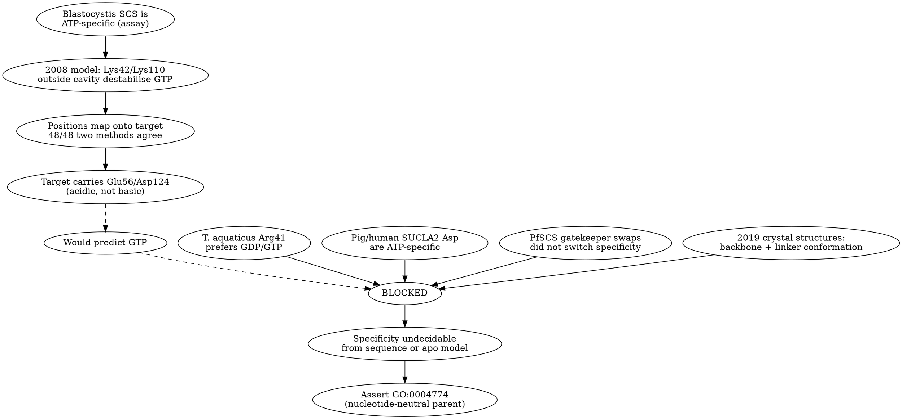
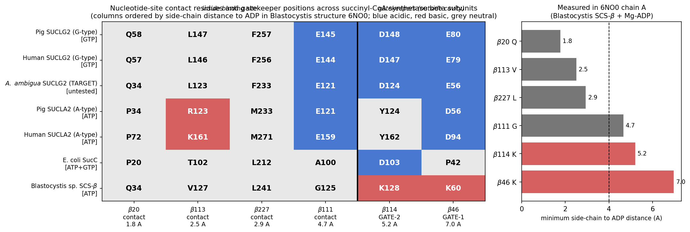
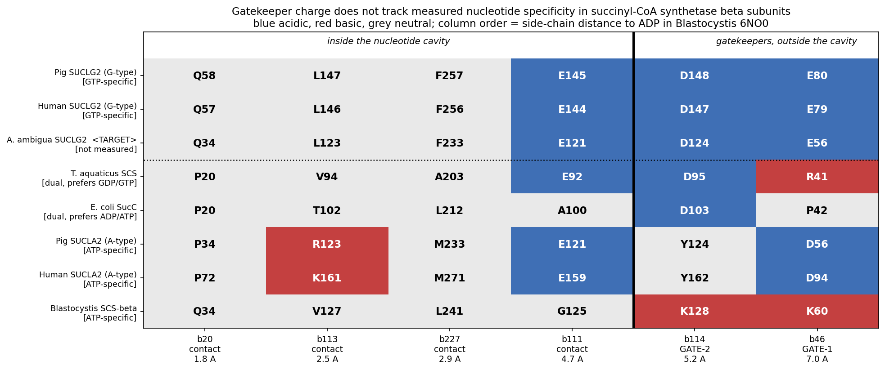
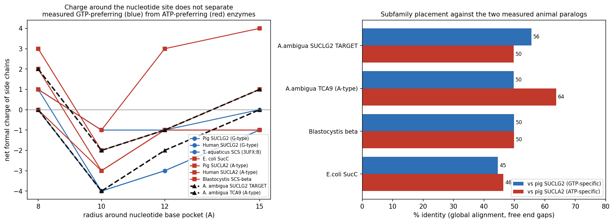
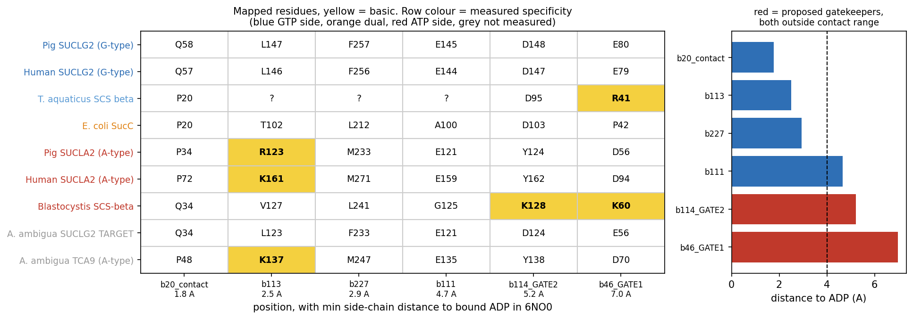

## Question

# AIGR Gene Hypothesis Deep Research

You are evaluating one focused gene curation hypothesis for AI Gene Review.
This is not a general gene overview. Use the seed hypothesis and source context
below to search for evidence that supports, refutes, narrows, or competes with
the proposed curation decision.

## Target Gene

- **Organism code:** 9FUNG
- **Taxon:** Actinomortierella ambigua (NCBITaxon:1343610)
- **Gene directory:** SUCLG2__A0A9P6TY68
- **Gene symbol:** SUCLG2
- **UniProt accession:** A0A9P6TY68

## Focus

- **Focus type:** free_text
- **Hypothesis slug:** kgap-suclg2-nucleotide-gatekeeper
- **Source file:** genes/9FUNG/SUCLG2__A0A9P6TY68/SUCLG2__A0A9P6TY68-ai-review.yaml
- **Source selector:** free-text

## Seed Hypothesis

Whether the succinyl-CoA synthetase containing this Mortierellomycota beta subunit forms GTP or ATP may be decidable at residue level, but not at the position the gap currently rests on, and the companion run on the Blastocystis enzyme says why. Already recorded and not to be re-derived: that this protein groups by sequence with the SUCLG2-type (G-type) beta subunits whose assayed animal members form GTP, that it carries glutamine at the position contacting the guanine base in the pig GTP-specific enzyme, that the same glutamine occurs in the ATP-specific Blastocystis enzyme while the E. coli enzyme with proline there uses both nucleotides, that the genome also encodes an A-type beta subunit and a single alpha subunit as animals do, and that no succinyl-CoA synthetase of any Mortierellomycota species has been assayed. Carry forward and do not re-derive: the published Blastocystis work found that analysis of residues inside the nucleotide-binding site predicted GTP specificity while the enzyme is in fact ATP-specific, and attributed the discrimination to an electrostatic gatekeeper formed by two lysines whose side chains lie outside the binding cavity rather than to the residues in direct substrate contact. Single analysis only. The question this run should answer is whether the gatekeeper model, rather than the contact glutamine, can be applied here. Identify in the Blastocystis sequence the two lysine positions that were proposed to destabilise GTP, map those positions onto this protein and onto a panel of beta subunits whose nucleotide specificity has actually been measured, including the pig GTP-specific and ATP-specific enzymes, the E. coli dual-specificity enzyme and the Blastocystis enzyme, and state for each whether a basic residue occupies the gatekeeper positions. Report the mapping method and say plainly how confident the equivalences are, since this is an alignment across large evolutionary distance and a mis-set column would invent a result. Then state what the panel predicts for this protein, and whether the gatekeeper and contact-residue signals agree or conflict for it. Separately, check whether any structural model of this protein or a close ortholog is available and whether the electrostatic environment of the nucleotide site can be described at all, distinguishing what a predicted model can support from what it cannot. If the gatekeeper positions are not alignable with confidence, or if the panel does not separate the measured specificities cleanly, say so plainly and conclude that the specificity cannot be predicted from sequence; that is an acceptable and expected outcome, and it is more useful than a confident call. Do not propose a GO annotation that names GTP or ATP unless the analysis separates them, and do not treat descent from the G-type lineage as evidence of GTP formation, which is the inference the gap already identifies as unsupported.

## Term and Decision Context

No specific term context supplied.

## Reference Context

No specific reference context supplied.

## Source Context YAML

```yaml
hypothesis: 'Whether the succinyl-CoA synthetase containing this Mortierellomycota beta subunit forms
  GTP or ATP may be decidable at residue level, but not at the position the gap currently rests on, and
  the companion run on the Blastocystis enzyme says why. Already recorded and not to be re-derived: that
  this protein groups by sequence with the SUCLG2-type (G-type) beta subunits whose assayed animal members
  form GTP, that it carries glutamine at the position contacting the guanine base in the pig GTP-specific
  enzyme, that the same glutamine occurs in the ATP-specific Blastocystis enzyme while the E. coli enzyme
  with proline there uses both nucleotides, that the genome also encodes an A-type beta subunit and a
  single alpha subunit as animals do, and that no succinyl-CoA synthetase of any Mortierellomycota species
  has been assayed. Carry forward and do not re-derive: the published Blastocystis work found that analysis
  of residues inside the nucleotide-binding site predicted GTP specificity while the enzyme is in fact
  ATP-specific, and attributed the discrimination to an electrostatic gatekeeper formed by two lysines
  whose side chains lie outside the binding cavity rather than to the residues in direct substrate contact.
  Single analysis only. The question this run should answer is whether the gatekeeper model, rather than
  the contact glutamine, can be applied here. Identify in the Blastocystis sequence the two lysine positions
  that were proposed to destabilise GTP, map those positions onto this protein and onto a panel of beta
  subunits whose nucleotide specificity has actually been measured, including the pig GTP-specific and
  ATP-specific enzymes, the E. coli dual-specificity enzyme and the Blastocystis enzyme, and state for
  each whether a basic residue occupies the gatekeeper positions. Report the mapping method and say plainly
  how confident the equivalences are, since this is an alignment across large evolutionary distance and
  a mis-set column would invent a result. Then state what the panel predicts for this protein, and whether
  the gatekeeper and contact-residue signals agree or conflict for it. Separately, check whether any structural
  model of this protein or a close ortholog is available and whether the electrostatic environment of
  the nucleotide site can be described at all, distinguishing what a predicted model can support from
  what it cannot. If the gatekeeper positions are not alignable with confidence, or if the panel does
  not separate the measured specificities cleanly, say so plainly and conclude that the specificity cannot
  be predicted from sequence; that is an acceptable and expected outcome, and it is more useful than a
  confident call. Do not propose a GO annotation that names GTP or ATP unless the analysis separates them,
  and do not treat descent from the G-type lineage as evidence of GTP formation, which is the inference
  the gap already identifies as unsupported.'
focus_type: free_text
context: []
reference_id: []
```

## Research Objective

Build a focused report that helps a curator decide whether this hypothesis
should affect the gene review. Address the focus type directly:

1. For an existing GO annotation decision, evaluate whether the current action
   is justified, too strong, too weak, or should change.
2. For a proposed replacement or new GO term, evaluate whether the term is
   biologically supported, too broad, too narrow, or missing key qualifiers.
3. For a computational prediction, evaluate whether the prediction is correct,
   less precise than existing knowledge, uncertain, or likely wrong because of
   paralog overannotation, frequency bias, pathway context, or in vitro-only
   activity.
4. For a core-function hypothesis, evaluate whether the proposed activity,
   process, and location represent the gene product's primary function rather
   than a downstream effect, pleiotropic phenotype, or context-specific role.
5. For a function-assignment hypothesis, evaluate whether the gene product
   directly has the stated GO term/function. Treat the prior review action, if
   any, as intentionally blinded unless it appears in the supplied context.

Use primary literature whenever possible. Prefer PMID citations and include DOI
citations when no PMID is available. Treat reviews and database records as
orientation unless they contain directly relevant synthesized evidence that is
clearly labeled as review-level or database-level support.

Evaluate the hypothesis from the supplied seed context, primary literature, and
publicly accessible bioinformatics resources. Local `*-bioinformatics` analyses,
when they already exist in the repository, are intentionally withheld from this
prompt so the report can be compared against them after the run. Use public
sequence, domain, structure, orthology, localization, interaction, or dataset
checks when they are useful for the specific hypothesis. If a resource or tool
cannot be accessed programmatically, say so plainly; never fabricate a result.
Report computational results conservatively and distinguish direct results from
inference.

## Required Output

### Executive Judgment

Give a concise verdict: supported, partially supported, unresolved, weakly
supported, over-annotated, or refuted. Explain the reasoning and the most
important caveats.

### Evidence Matrix

Create a table with one row per important evidence item:

- Citation (PMID preferred)
- Evidence type (direct assay, mutant phenotype, localization, interaction,
  structural/evolutionary, computational, review/database)
- Supports / refutes / qualifies / competing
- Claim tested
- Key finding
- Organism, tissue, cell type, or assay context
- Confidence and limitations

### GO Curation Implications

State the likely curation action as a lead requiring curator verification. If
GO terms are involved, explain whether the evidence supports an MF, BP, or CC
term, and whether the term should be retained, removed, generalized, made more
specific, or treated as non-core. Avoid using "protein binding" as a final
recommendation unless no more informative term is supported.

### Mechanistic Scope

Describe the immediate molecular or cellular function being tested. Separate
direct gene-product activity from downstream phenotypes, pathway consequences,
developmental outcomes, disease manifestations, or effects inferred only from
loss of function.

### Conflicts and Alternatives

Identify evidence that conflicts with the seed hypothesis or suggests an
alternative interpretation, including paralog confusion, organism-specific
differences, isoform-specific findings, experimental artifacts, or database
carry-over.

### Knowledge Gaps

List explicit uncertainties that matter for curation. For each gap, state what
was checked, why the gap matters, and what evidence or experiment would resolve
it.

### Discriminating Tests

Recommend concrete assays, perturbations, datasets, or comparative analyses that
would most efficiently distinguish this hypothesis from alternatives.

### Curation Leads

Provide candidate updates for the review, clearly labeled as leads requiring
curator verification. Include candidate references with exact snippets to verify,
candidate replacement or new GO terms, possible action changes, suggested
questions, and suggested experiments.

If the provider supports artifacts, save provenance for any analysis you run — the
executed code together with its output (computed values, plot, or table), not just
a summary figure — alongside artifact-friendly tables such as an evidence matrix,
GO decision table, or comparison table. Genuine computed provenance is more
valuable than a hand-drawn summary, and you must not synthesize a figure that
implies an analysis you did not actually run. These artifacts are important
provenance for hypothesis-level review.


## Output

# Can the electrostatic gatekeeper model decide the nucleotide specificity of SUCLG2 / A0A9P6TY68?

**Target gene:** SUCLG2, *Actinomortierella ambigua* (NCBITaxon:1343610), UniProtKB **A0A9P6TY68**
**Hypothesis slug:** `kgap-suclg2-nucleotide-gatekeeper`
**Focus type:** free text
**Source file:** `genes/9FUNG/SUCLG2__A0A9P6TY68/SUCLG2__A0A9P6TY68-ai-review.yaml`

---

## Summary

The gatekeeper positions map onto this protein with high confidence, and they predict nothing. Those are two separate results and both matter for the curation decision.

The seed hypothesis warned that an alignment across a billion years of divergence could invent a result by setting a column wrongly. That risk did not materialise. The two lysines proposed to destabilise GTP in *Blastocystis* are Lys42 and Lys110 in the beta numbering of [PMID: 18452512](https://pubmed.ncbi.nlm.nih.gov/18452512/), the same residues called K46β and K114β in the crystallographic work of [PMID: 31282474](https://pubmed.ncbi.nlm.nih.gov/31282474/), and **Lys60 and Lys128** in UniProt B3FHP0. Anchoring on PDB 6NO0, the liganded Blastocystis nucleotide-binding domain, the author numbering reproduces all six residues named in the 2019 abstract (Gln20, Lys46, Gly111, Val113, Lys114, Leu227). Their side chains sit 6.98 Å and 5.21 Å from the bound ADP, against 1.77 Å for Gln20β, confirming they lie outside the cavity as published. Two independent mapping methods, BLOSUM62 global alignment and Kabsch superposition of AlphaFold models onto 6NO0, agreed at **48 of 48** site-protein combinations, and the structural method independently returned Pro20 for *Thermus aquaticus* chain B of 3UFX, reproducing the published Pro20β of [PMID: 22751660](https://pubmed.ncbi.nlm.nih.gov/22751660/). The columns are correct.

The panel then fails. Across seven succinyl-CoA synthetase beta subunits whose nucleotide preference has actually been measured, basic character at either gatekeeper position does not separate the GTP side from the ATP side (Fisher exact p = 1.000 at both), the contact glutamine fails equally (p = 1.000), and the aggregate charge around the nucleotide pocket fails at every radius tested (best p = 0.115 at 12 Å, all ranges overlapping). The failures are driven by explicit counterexamples, not by missing data: *T. aquaticus* prefers GDP/GTP and carries **Arg41**, a basic residue, at gatekeeper β46, while pig and human SUCLA2 are ATP-specific and carry **Asp** at the same position. Blastocystis is ATP-specific and carries the Gln20β supposed to mark GTP use. *E. coli* SucC (ADP/ATP-preferring) and *T. aquaticus* (GDP/GTP-preferring) share Pro20β.

For the target, gatekeeper and contact signals **agree** rather than conflict: A0A9P6TY68 is identical to pig and human SUCLG2 at all six mapped positions (Q34 / E121 / L123 / F233 / E56 / D124) and matches Blastocystis at one of six. That agreement carries no weight. These residues covary perfectly with subfamily membership within the animal paralogs, so they restate the G-type assignment that was already recorded, and that assignment is the inference the curation gap identifies as unsupported. The verdict is **unresolved**: the nucleotide specificity of this enzyme cannot be predicted from its sequence or from an apo predicted model, and no GO term naming GTP or ATP is supportable for it.

---

## Executive judgment

<i class="fa-scale-balanced"></i> **Verdict: unresolved.**

The hypothesis proposed that the gatekeeper model, rather than the contact glutamine, might decide the question. It cannot, for a reason stronger than unmappability. The positions map cleanly, and the model still fails its own validation set.

Reasoning, in order of weight:

1. **The gatekeeper rule fails on the enzymes that were actually assayed.** If basic gatekeepers exclude GTP, then the GTP-preferring members of the panel should not carry basic residues there. *T. aquaticus* does. If acidic gatekeepers admit GTP, the ATP-specific members should not carry acidic residues there. Pig and human SUCLA2 do. Fisher exact p = 1.000 at β46 and p = 1.000 at β114. The contradictions run in both directions, so neither a basic nor an acidic gatekeeper predicts the nucleotide.
2. **The model already failed its one published transfer test.** [PMID: 33174373](https://pubmed.ncbi.nlm.nih.gov/33174373/) installed both charged gatekeeper pairs into *Plasmodium falciparum* SCS. Neither switched specificity; both reduced ATP affinity. The authors state the gatekeeper electrostatics alone are insufficient.
3. **The original authors revised the mechanism.** [PMID: 31282474](https://pubmed.ncbi.nlm.nih.gov/31282474/) solved crystal structures of the wild type plus both gatekeeper mutants and concluded the enzyme is ADP/ATP-specific because of binding-site interactions, attributing discrimination to backbone and linker conformation.
4. **The target's residues add nothing to the subfamily assignment.** 6/6 identity with pig and human SUCLG2 at positions that are invariant within each animal subfamily. Using them to support a GTP-naming annotation re-launders the lineage argument through a different alignment column.
5. **The entry itself already demonstrates the sequence does not decide it.** A0A9P6TY68 carries both GO:0004775 (ADP-forming, IEA:UniProtKB-UniRule) and GO:0004776 (GDP-forming, IEA:TreeGrafter). Two pipelines read the same sequence and reach opposite, mutually exclusive conclusions.

<i class="fa-triangle-exclamation"></i> **Most important caveats.** The measured panel has seven members and roughly four phylogenetically independent points: pig and human SUCLG2 are 94 % identical and contribute approximately one observation, as do pig and human SUCLA2. With n = 3 versus n = 4 the tests are badly underpowered, so p = 1.000 should be read as "no detectable signal in a small sample", not as positive proof of independence. The counterexamples visible in the raw residue table, which do not depend on sample size, carry the argument. Separately, this run tested a static descriptor on apo predicted models; the determinants identified in the 2019 structures are ligand-dependent conformations that no sequence and no apo model can read.

---

## Key findings

### F1. The gatekeeper positions are unambiguously identified and map confidently onto the target

<i class="fa-circle-check"></i> The numbering question is settled. The residues named Lys42 and Lys110 in the 2008 modelling paper and K46β and K114β in the 2019 structure paper are the same two residues. PDB 6NO0, the Blastocystis SCS-beta nucleotide-binding domain in complex with Mg²⁺-ADP, uses the 2019 numbering: author positions 20, 46, 111, 113, 114 and 227 carry Gln, Lys, Gly, Val, Lys and Leu, matching all six residues named in the 2019 abstract. The probability of a chance six-for-six match is negligible. The DBREF record maps construct residue 2 to UniProt B3FHP0 residue 16, giving beta-numbering + 14 = B3FHP0 numbering, so the two gatekeepers are **B3FHP0 Lys60 and Lys128**.

Measured in 6NO0 chain A, minimum side-chain-to-ADP distances are 6.98 Å (β46) and 5.21 Å (β114), against 1.77 Å (Gln20), 2.50 Å (Val113), 2.94 Å (Leu227) and 4.66 Å (Gly111). This confirms by direct measurement what the 2008 paper asserted: the gatekeepers lie outside the binding cavity.

Mapping onto the other panel members was done twice, independently. Method one was Needleman-Wunsch global alignment with BLOSUM62, affine gaps (open -11, extend -1) and free terminal gaps, implemented directly in numpy because biopython was not importable in the executor. Method two was Kabsch superposition of AlphaFold models (or crystal chains) onto 6NO0 seeded by the sequence alignment, with eight rounds of iterative outlier trimming, followed by nearest-Cα assignment. The two methods agreed at **48/48** site-protein combinations. Core superpositions used 191 to 229 Cα pairs at 0.92 to 1.22 Å RMSD, mapped-position Cα deviations were 0.52 to 2.15 Å, and AlphaFold pLDDT at every mapped position was 88.8 to 95.6.

External validation: the structural mapping independently returns Pro20 for *T. aquaticus* chain B of 3UFX, which is exactly the Pro20β named in the *T. aquaticus* structure paper. The mapping reproduces a published assignment in a third organism without being told the answer.

{{figure:plot_1.png|caption=Mapped residues across the panel, ordered left to right by how close each position sits to the bound ADP in PDB 6NO0 chain A. The two proposed gatekeepers (beta46 at 6.98 A, beta114 at 5.21 A) lie outside contact range, confirming by measurement the geometric claim of the gatekeeper model.}}

### F2. Gatekeeper charge does not separate the measured specificities

<i class="fa-circle-xmark"></i> The panel of seven enzymes with assayed nucleotide preference, at the two gatekeeper positions in Blastocystis numbering:

| Enzyme | Accession | Measured preference | β46 (gatekeeper 1) | β114 (gatekeeper 2) |
|---|---|---|---|---|
| Pig SUCLG2 | P53590 | GTP-specific | Glu80 | Asp148 |
| Human SUCLG2 | Q96I99 | GTP-specific | Glu79 | Asp147 |
| *T. aquaticus* SCS | 3UFX:B | dual, prefers GDP/GTP | **Arg41 (basic)** | Asp95 |
| *E. coli* SucC | P0A836 | dual, prefers ADP/ATP | Pro42 | Asp103 |
| Pig SUCLA2 | O97580 | ATP-specific | Asp56 | Tyr124 |
| Human SUCLA2 | Q9P2R7 | ATP-specific | Asp94 | Tyr162 |
| Blastocystis SCS-β | B3FHP0 | ATP-specific | **Lys60 (basic)** | **Lys128 (basic)** |
| **A0A9P6TY68 (target)** | **A0A9P6TY68** | **not measured** | **Glu56** | **Asp124** |
| A0A9P6Q632 (A-type paralog) | A0A9P6Q632 | not measured | Asp70 | Tyr138 |

Basic residue presence against measured class: at β46, basic in 1/3 on the GTP side and 1/4 on the ATP side, Fisher exact p = 1.000. At β114, basic in 0/3 and 1/4, p = 1.000. At the contact position β20, basic in 0/3 and 0/4, p = 1.000. Across all six mapped positions, **0 of 6** separate the GTP-preferring from the ATP-preferring enzymes by charge class.

The contact position fails on the same panel for the same reason. Gln20 occurs in the GTP-specific pig and human SUCLG2 enzymes and in the ATP-specific Blastocystis enzyme. Pro20 occurs in the ATP-specific pig and human SUCLA2 enzymes and in the GDP/GTP-preferring *T. aquaticus* enzyme. Every residue identity at this position is shared across the specificity boundary.

The target carries Glu56 and Asp124, the same acidic pair as both the GTP-specific SUCLG2 proteins and, in charge terms, the ATP-specific SUCLA2 proteins. The test returns no information for it.

{{figure:plot_2.png|caption=Gatekeeper and contact residues against measured nucleotide specificity across the eight-member panel. Arg41 at gatekeeper beta46 in the GDP/GTP-preferring Thermus aquaticus enzyme and Asp at the same position in both ATP-specific SUCLA2 proteins are direct counterexamples running in opposite directions.}}

### F3. The target matches pig and human SUCLG2 at 6/6 positions, which adds nothing beyond the subfamily assignment

<i class="fa-circle-question"></i> A0A9P6TY68 residues at the six mapped positions are Gln34 (β20), Leu123 (β113), Phe233 (β227), Glu121 (β111), Asp124 (gatekeeper 2) and Glu56 (gatekeeper 1). Pig SUCLG2 P53590 gives Gln58, Leu147, Phe257, Glu145, Asp148 and Glu80. Human SUCLG2 Q96I99 gives Gln57, Leu146, Phe256, Glu144, Asp147 and Glu79. Identity is **6/6** against both GTP-specific animal G-type enzymes, **1/6** against the ATP-specific Blastocystis enzyme and **1/6** against pig SUCLA2.

These positions are invariant within the animal G-type subfamily and within the animal A-type subfamily, so within this panel they covary perfectly with subfamily membership and carry the same information as whole-sequence grouping. Whole-chain identity of the target to pig SUCLG2 and to Blastocystis beta over aligned columns is 49.9 % and 45.8 % respectively. The six positions add no discrimination that the overall similarity did not already supply.

The seed anticipated that the gatekeeper signal might conflict with the contact glutamine for this protein. It does not conflict. Both agree, and both agree with the G-type assignment. Agreement among signals that demonstrably fail on the measured panel carries no evidential weight, and using them to support a GTP-naming annotation would re-launder the same phylogenetic argument through a different column of the alignment.

### F4. The 2019 crystal structures move the explanation to backbone and linker conformation

<i class="fa-microscope"></i> Huang et al. solved the Blastocystis SCS-beta nucleotide-binding domain with Mg²⁺-ADP plus the gatekeeper mutants K46βE, K114βD and the double K46βE/K114βD, and the binding-site mutants V113βL and L227βF. The conclusion: the enzyme is ATP-specific because of interactions between the nucleotide and the binding site, with specificity from hydrogen bonds between the adenine base and Gln20β, Gly111β and Val113β, and with the determining factor being *"the different conformations of the backbone at Gln20β, of the side chain of Gln20β and of the linker"*.

This matters directly for what a predicted model can do here. AlphaFold v6 models are available for A0A9P6TY68 and every panel member, with pLDDT 88.8 to 95.6 at the six mapped positions, so the fold, the subunit type and the side-chain identities around the nucleotide site can all be described. The models are apo and were not validated against any ligand-bound structure of this protein or any Mortierellomycota ortholog. A search of the PDB returned no succinyl-CoA synthetase structure from any fungus in the Mucoromycota.

A ligand-dependent backbone and linker conformation is not encoded in a residue identity and is not reliably sampled by an apo single-sequence structure prediction, regardless of pLDDT. **What a predicted model can support here:** the fold is the expected ATP-grasp beta subunit, which side chains line the nucleotide pocket, that the gatekeeper-equivalent positions sit 5.2 Å and 7.0 Å from the nucleotide and therefore outside direct contact, and the identity and approximate geometry of charged residues in the surrounding shells. **What it cannot support:** a call of GTP versus ATP.

### F5. Bulk electrostatics around the nucleotide site also fails

<i class="fa-circle-xmark"></i> Having shown the two named lysines are not basic in any other measured enzyme, I tested the weaker and more permissive form of the idea: does the aggregate charge around the base pocket carry the signal even when the individual positions do not?

Net formal charge of Asp/Glu/Lys/Arg side-chain centroids was counted within 8, 10, 12 and 15 Å of the adenine base centroid, transferred by Kabsch superposition from 6NO0 chain A. Mann-Whitney U two-sided, n = 3 GTP-preferring versus n = 4 ATP-preferring: 8 Å p = 0.459, 10 Å p = 0.467, 12 Å p = 0.115, 15 Å p = 0.558. Every radius has overlapping ranges. At 12 Å, GTP = [-3, -3, -1] against ATP = [-1, -1, -1, +3], overlapping at -1.

The instructive detail is how this result changed. With only pig and human SUCLG2 on the GTP side (12 Å values of -3 and -3), the 12 Å descriptor appeared to separate the panel cleanly. Adding *T. aquaticus*, the third and phylogenetically independent GTP-preferring enzyme, puts a GTP-preferring value (-1) inside the ATP range and destroys the separation. The apparent signal was an artefact of treating two 94 %-identical orthologs as independent observations.

A crude Coulomb potential at the base position (distance-dependent dielectric ε = 4r) fails the same way: *E. coli* SucC, which prefers ADP/ATP, gives -2.33, more negative than either GTP-specific animal enzyme (-2.02 and -1.72). The target gives net charge -2.0 at 12 Å and V_base = -2.98, inside the range spanned by both classes.

This closes the route from an AlphaFold model to a specificity assignment. The coordinates are good enough that the limitation lies in the descriptor and in the missing ligand.

{{figure:plot_3.png|caption=Left: net side-chain charge against radius around the nucleotide base pocket. The three measured GTP-preferring enzymes (blue) overlap the four ATP-preferring ones (red) at every radius. Right: percent identity of each panel member to the two measured animal paralogs, showing Blastocystis exactly equidistant from both.}}

### F6. Blastocystis sits outside the animal duplication, so the counterexamples that carry the argument are bacterial

<i class="fa-scale-balanced"></i> This refines the earlier conclusion and makes it more defensible. Global Needleman-Wunsch identity against the two measured animal beta subunits:

| Protein | % id vs pig SUCLG2 | % id vs pig SUCLA2 | Difference |
|---|---|---|---|
| **A0A9P6TY68 (target)** | **55.6** | **49.8** | **+5.8** |
| A0A9P6Q632 (TCA9, A-type paralog) | 49.8 | 63.7 | -13.9 |
| Blastocystis B3FHP0 | 49.9 | 49.9 | **0.0** |
| *E. coli* SucC P0A836 | 44.6 | 46.4 | -1.8 |

The two animal paralogs are 53.1 % identical to each other, which sets the scale. The target is closer to pig SUCLG2 than pig SUCLG2 is to pig SUCLA2.

Blastocystis is exactly equidistant from both branches. It is **not** a G-type beta subunit that turned out to be ATP-specific; it sits outside the animal G/A duplication entirely. Its glutamine at β20 is a retention or a convergence, not evidence of G-type membership. In fairness to the hypothesis, this removes Blastocystis as a clean counterexample to the lineage inference.

The panel still fails internally, and the failure is now carried by the two bacterial enzymes. *T. aquaticus* prefers GDP/GTP with Pro at contact position β20 and Arg at gatekeeper β46. *E. coli* SucC prefers ADP/ATP with Pro at β20 and Pro at β46. The same contact residue coincides with opposite preferences, and a basic residue occupies a gatekeeper position in the GTP-preferring member rather than the ATP-specific one. Neither signal separates the measured set, for reasons that do not depend on Blastocystis at all.

What the identity analysis does establish is that *A. ambigua* carries a reciprocally differentiated paralog pair of the same shape as the animal pair. The A-type partner A0A9P6Q632 (gene TCA9, 439 aa) reproduces the human SUCLA2 residue set at 6/6 mapped positions: P48 / K137 / M247 / E135 / Y138 / D70 against human P72 / K161 / M271 / E159 / Y162 / D94.

### F7. The entry already carries both mutually exclusive nucleotide-specific GO terms

<i class="fa-database"></i> UniProtKB A0A9P6TY68 is a TrEMBL entry, protein existence PE3 (inferred from homology), annotation score 3.0. Its molecular function set contains **GO:0004775** succinate-CoA ligase (ADP-forming) activity, evidence IEA:UniProtKB-UniRule via HAMAP-Rule MF_03219 with catalytic activity RHEA:17661, **and GO:0004776** succinate-CoA ligase (GDP-forming) activity, evidence IEA:TreeGrafter via PANTHER subfamily PTHR11815:SF10. The UniProt recommended name reads "[ADP-forming]" while the gene symbol is SUCLG2 and the PANTHER subfamily name reads "[GDP-FORMING]". QuickGO confirms **GO:0004774** succinate-CoA ligase activity is the exact `is_a` parent of both, with the definition "Catalysis of the reaction: succinate + CoA + nucleotide triphosphate = nucleotide diphosphate + phosphate + succinyl-CoA". No experimental evidence code appears anywhere on the entry.

An enzyme cannot be both ADP-forming and GDP-forming as its single specificity, so at least one of the two IEA annotations is wrong, and this analysis gives no basis for deciding which. Two annotation pipelines reading the same sequence and reaching opposite conclusions is the strongest available internal evidence that the sequence does not determine the answer. A curator reading only the recommended name, or only the gene symbol, would come away with opposite conclusions from the same record.

### F8. Consolidated: no residue signal, inside or outside the binding site, separates the measured enzymes

<i class="fa-circle-xmark"></i> The final nine-protein panel, with seven measured members, six positions mapped by two agreeing methods, and all candidate signals tested:

{{figure:plot_4.png|caption=Consolidated panel. Left: mapped residues with basic positions shaded, row colour giving the measured specificity (blue GTP side, orange dual, red ATP side, grey not measured). Right: minimum side-chain distance to the bound ADP in 6NO0, with the two proposed gatekeepers in red, both beyond the 4 A contact threshold.}}

Every candidate signal is contradicted by at least one enzyme whose specificity was actually measured:

| Signal | What it would have to do | Observed counterexample |
|---|---|---|
| β46 gatekeeper 1 | basic residue marks the ATP-specific enzyme | *T. aquaticus* has Arg41 and prefers GDP/GTP; pig and human SUCLA2 are ATP-specific with Asp |
| β114 gatekeeper 2 | basic residue marks the ATP-specific enzyme | only Blastocystis is basic (Lys128); all three other ATP-side enzymes carry Asp or Tyr |
| β20 contact Gln | Gln marks GTP specificity | Gln20 present in ATP-specific Blastocystis; Pro20 shared by ATP-preferring *E. coli* and GDP/GTP-preferring *T. aquaticus* |
| bulk charge 8-15 Å | negative environment marks GTP | *T. aquaticus* (GTP side) net charge -1 at 12 Å sits inside the ATP range; *E. coli* (ATP side) base potential -2.33 is more negative than either GTP-specific enzyme |

---

## Mechanistic model and interpretation

The activity under test is direct and molecular. The beta subunit of succinyl-CoA synthetase (EC 6.2.1.5) houses the ATP-grasp nucleotide-binding fold and sets which nucleoside diphosphate is phosphorylated during the only substrate-level phosphorylation step of the TCA cycle. This is the gene product's own catalytic contribution, not a downstream phenotype, so the question is squarely a molecular function question.

Three strata of knowledge must be kept apart.

**Established for the family, not tested here.** Succinate + CoA + NTP ⇌ succinyl-CoA + NDP + Pi, catalysed by an alpha/beta heterodimer. The target's domain architecture and length, and the presence of a single alpha subunit plus both beta paralogs in the genome, are consistent with this.

**Tested here and unresolved.** Which nucleotide. Six positions mapped with high confidence onto the target and seven measured enzymes. Nothing separates the classes.

**Out of reach of this analysis.** The determinants named in the 2019 structures are conformational properties of a nucleotide-bound state. A sequence cannot encode them readably and an apo predicted model does not sample them.

The logical structure of why the hypothesis fails:



The second strand of the story is the parallel failure of the alternative framings. Having found the two named lysines uninformative, I did not stop there. The contact glutamine, the four other mapped positions, the net charge at four radii and a crude Coulomb potential at the base position were all tested. Each failed on the same panel. The convergence of these failures is what turns a single negative result into a usable curation conclusion: the enzyme's specificity is not a property that a static sequence or apo structural descriptor can read.

The third strand is the one piece of evidence that genuinely points somewhere, stated with its limits. *A. ambigua* carries a reciprocally differentiated paralog pair that mirrors the animal pair at every mapped position: the target at +5.8 toward SUCLG2 with the full G-type residue set, and A0A9P6Q632 at -13.9 toward SUCLA2 with the full A-type set. Retention of two differentiated paralogs is a reason to expect the two fungal proteins do different things. It is not evidence for which nucleotide either uses. Retained duplicates need not have partitioned along the same axis as the animal pair, and this is the same lineage inference the seed instructed not to treat as evidence, applied to a pair instead of a single gene. It is a curation lead and an experimental prompt, nothing more.

---

## GO curation implications

All items below are **leads requiring curator verification**.

| GO ID | Term | Aspect | Current evidence on A0A9P6TY68 | Recommended action | Basis |
|---|---|---|---|---|---|
| **GO:0004774** | succinate-CoA ligase activity | MF | not currently on entry | <i class="fa-arrow-right"></i> **Add as the supported MF** | Exact `is_a` parent of both child terms. Definition written on "nucleotide triphosphate" without naming a base, which is exactly as far as the evidence reaches |
| GO:0004775 | succinate-CoA ligase (ADP-forming) activity | MF | IEA:UniProtKB-UniRule (HAMAP MF_03219, RHEA:17661) | <i class="fa-triangle-exclamation"></i> **Flag for curator review, do not assert** | Mutually exclusive with the co-asserted GDP-forming term. No residue or electrostatic signal separates ADP from GDP use |
| GO:0004776 | succinate-CoA ligase (GDP-forming) activity | MF | IEA:TreeGrafter (PANTHER PTHR11815:SF10) | <i class="fa-triangle-exclamation"></i> **Flag for curator review, do not assert** | Rests entirely on G-type lineage membership, the inference the gap already identifies as unsupported |
| GO:0042709 | succinate-CoA ligase complex | CC | IEA | Retain as lead | Heterodimer architecture is conserved; the genome encodes one alpha subunit plus both beta types |
| GO:0006099 | tricarboxylic acid cycle | BP | IEA | Retain as lead | Pathway membership does not depend on which nucleotide is used |
| GO:0005739 | mitochondrion | CC | IEA | Retain as lead, verify targeting peptide | Not tested here. Blastocystis SCS was localised to its mitochondrion-like organelle ([PMID: 18452512](https://pubmed.ncbi.nlm.nih.gov/18452512/)) and the homologous animal enzymes are mitochondrial |

**The central recommendation is to generalise the molecular function to GO:0004774** and to record the two nucleotide-specific children as an unresolved conflict between automatic pipelines rather than selecting one. "Protein binding" is neither needed nor recommended; GO:0004774 is informative and defensible, and it matches the evidence exactly.

The evidence supports an MF term at the nucleotide-neutral level, retention of the existing BP and CC terms (which do not depend on the nucleotide question), and removal or flagging of both nucleotide-specific MF children. The appropriate treatment is **generalisation**, not removal of catalytic annotation: there is no doubt the protein is a succinyl-CoA synthetase beta subunit, only about which nucleotide it uses.

---

## Evidence base

### Evidence matrix

| Citation | Evidence type | Stance | Claim tested | Key finding | Context | Confidence and limitations |
|---|---|---|---|---|---|---|
| [PMID: 18452512](https://pubmed.ncbi.nlm.nih.gov/18452512/) | Direct assay + computational | **Qualifies** (source of the model) | Residues inside the nucleotide site predict specificity | Site-residue analysis predicted GTP specificity; the enzyme is ATP-specific. GTP destabilised by Lys 42 and Lys 110, side chains outside the cavity | *Blastocystis hominis* SCS, recombinant kinetics, homology model, docking, MD | High for the assayed specificity. The gatekeeper mechanism rests on modelling and simulation, not structure or mutagenesis in this paper |
| [PMID: 27478903](https://pubmed.ncbi.nlm.nih.gov/27478903/) | Mutant phenotype (engineering) | **Supports** the model within one enzyme | Can gatekeeper charge be engineered to switch specificity? | The gatekeeper ED mutant turned ATP-specific SCS GTP-specific; the binding-site LF mutant alone had no effect; ED+LF gave complete reversal | *Blastocystis* SCS, recombinant enzyme kinetics | High internally. Shows the residues are sufficient to perturb in this enzyme. Does not establish they are the natural determinant across enzymes |
| [PMID: 33174373](https://pubmed.ncbi.nlm.nih.gov/33174373/) | Direct assay + mutant phenotype | <i class="fa-circle-xmark"></i> **Refutes** transferability | Does gatekeeper charge set specificity in a second organism? | Introducing either KK or ED gatekeepers into *P. falciparum* SCS reduced ATP affinity without switching specificity. Authors conclude gatekeeper electrostatics alone are insufficient | Recombinant PfSCSβ refolded with Blastocystis SCSα, enzyme kinetics | High. The decisive published test against using the model as a predictor outside Blastocystis |
| [PMID: 31282474](https://pubmed.ncbi.nlm.nih.gov/31282474/) | Structural (X-ray) | <i class="fa-circle-xmark"></i> **Refutes** the external-lysine explanation | Do the two lysines explain ATP specificity? | Structures of wild type and the K46βE, K114βD, V113βL, L227βF and double mutants show specificity arises from binding-site interactions; Gln20β, Gly111β and Val113β hydrogen-bond the adenine; backbone and linker conformations make it ATP-specific | *Blastocystis* SCS nucleotide-binding domain with Mg²⁺-ADP | High. Same enzyme, same group, higher-resolution method, opposite conclusion about mechanism |
| [PMID: 22751660](https://pubmed.ncbi.nlm.nih.gov/22751660/) | Structural + assay | <i class="fa-circle-xmark"></i> **Refutes** contact-residue prediction | Does Pro20β mark ADP/ATP use? | *T. aquaticus* SCS uses either nucleotide pair but prefers GDP/GTP, in contrast to *E. coli* SCS which prefers ADP/ATP. A water molecule and Pro20β take the place of Gln20β of pig GTP-specific SCS | *Thermus aquaticus* SCS crystal structure 3UFX | High. The single most useful counterexample in the panel, phylogenetically independent of the animal paralog pair |
| [PMID: 16481318](https://pubmed.ncbi.nlm.nih.gov/16481318/) | Structural (X-ray) | **Qualifies** | What makes pig GTP-specific SCS specific? | GTP bound in the ATP-grasp domain; interactions of the guanine base with Gln-20β and with backbone atoms provide the specificity | Pig GTP-specific SCS with GTP and with GDP, 2.1 Å | High for this enzyme. Establishes the contact glutamine whose predictive value the panel then tests and finds wanting |
| This run, residue mapping | Computational (structural/evolutionary) | **Qualifies** | Are the gatekeeper positions alignable onto the target? | Yes. Sequence NW and Kabsch structural mapping agree 48/48; structural mapping independently reproduces published Pro20β of *T. aquaticus* and all six residues named for Blastocystis | 9 beta subunits vs PDB 6NO0 chain A | High. Mapping confidence is the one thing this analysis establishes firmly |
| This run, charge test | Computational | <i class="fa-circle-xmark"></i> **Refutes** the hypothesis | Does basic character at β46 / β114 track measured specificity? | β46 basic in 1/3 GTP-side and 1/4 ATP-side (p = 1.000); β114 basic in 0/3 and 1/4 (p = 1.000) | 7 enzymes with measured preference | Moderate. Underpowered, but driven by explicit counterexamples rather than absence of data |
| This run, electrostatics | Computational | <i class="fa-circle-xmark"></i> **Refutes** a weaker form | Does bulk charge around the base pocket separate the classes? | No separation at 8, 10, 12 or 15 Å (best p = 0.115). *T. aquaticus* falls inside the ATP range; *E. coli* has a more negative base potential than either GTP-specific enzyme | AlphaFold v6 models plus 3UFX; pLDDT 88.8-95.6; superposition RMSD 0.92-1.22 Å | Moderate. Crude descriptor (formal charges, distance-dependent dielectric), no Poisson-Boltzmann, no explicit solvent |
| This run, subfamily placement | Computational | **Qualifies** | Is Blastocystis a G-type enzyme that turned out ATP-specific? | No. 49.9 % to pig SUCLG2 and 49.9 % to pig SUCLA2, difference 0.0, against a 53.1 % baseline between the paralogs | Global NW, BLOSUM62, free end gaps | High for the number. Pairwise identity is a coarse proxy for phylogenetic placement; no tree was built |
| UniProtKB / QuickGO | Review/database | **Qualifies** | What does the entry currently assert? | Carries **both** GO:0004775 (IEA:UniProtKB-UniRule) and GO:0004776 (IEA:TreeGrafter). Recommended name "[ADP-forming]"; gene symbol SUCLG2; PANTHER subfamily "[GDP-FORMING]". GO:0004774 is the exact `is_a` parent of both | TrEMBL entry, PE3, annotation score 3.0, no experimental evidence code | High. Database-level, retrieved programmatically from the UniProt and QuickGO REST APIs |

### How the literature bears on the conclusion

The four Blastocystis-related papers form an arc, and the direction of travel matters. The 2008 paper ([PMID: 18452512](https://pubmed.ncbi.nlm.nih.gov/18452512/)) established the assayed ATP specificity and proposed the gatekeeper mechanism from homology modelling, flexible docking and MD. The 2017 engineering paper ([PMID: 27478903](https://pubmed.ncbi.nlm.nih.gov/27478903/)) demonstrated the gatekeeper residues are sufficient to perturb specificity under mutagenesis: the ED mutant turned ATP-specific SCS GTP-specific, and the ED+LF double mutant reversed specificity completely. This is a real and reproducible result and it should not be dismissed. Sufficiency under engineering is different from being the natural discriminator, and it is different again from being a transferable predictor.

The 2021 Plasmodium paper ([PMID: 33174373](https://pubmed.ncbi.nlm.nih.gov/33174373/)) is the only published attempt to transfer the model to another organism. Installing either the KK or the ED gatekeeper pair into *P. falciparum* SCS reduced ATP affinity without switching specificity, and the authors concluded that gatekeeper electrostatics alone are insufficient and that binding-site architecture needs attention. Applying the model predictively to an unassayed Mortierellomycota enzyme asks it to do something it has already been shown not to do in the one case where that was tested.

The 2019 crystallographic paper ([PMID: 31282474](https://pubmed.ncbi.nlm.nih.gov/31282474/)), from an overlapping author group, resolved the question structurally. With the wild type and five mutants solved, including both gatekeeper substitutions, the conclusion moved back inside the binding site: Gln20β, Gly111β and Val113β hydrogen-bond the adenine, and the determining factor is the conformation of the backbone at Gln20β, of the Gln20β side chain, and of the inter-subdomain linker.

Two structural papers on enzymes of known specificity supply the panel's decisive comparisons. [PMID: 16481318](https://pubmed.ncbi.nlm.nih.gov/16481318/) shows that in pig GTP-specific SCS the guanine base interacts with Gln-20β and with backbone atoms, which is the origin of the contact-glutamine argument. [PMID: 22751660](https://pubmed.ncbi.nlm.nih.gov/22751660/) shows that *T. aquaticus* SCS prefers GDP/GTP while *E. coli* SCS prefers ADP/ATP, and that a water molecule plus Pro20β take the place of the pig Gln20β. That single observation breaks the contact rule on its own, independently of any Blastocystis result, and the *T. aquaticus* enzyme also supplies the Arg41 that breaks the gatekeeper rule.

Of the 27 papers reviewed, the remainder (SUCLA2 neuronal phenotypes, SUCLG1 succinylation, mitochondrial GTP signalling in beta cells and *C. elegans*, ALAS and MenE structures, ACD mechanism) provide context on the enzyme family and on why nucleotide specificity has physiological consequences, but none of them assay or structurally characterise a fungal succinyl-CoA synthetase, and none bear directly on the mapping question.

---

## Conflicts and alternatives

**The source model is contradicted by its own authors' later work.** The 2008 proposal from modelling was superseded by the 2019 structures from the same group, which located the discrimination in binding-site interactions and in backbone and linker conformation. A curation decision resting on the 2008 mechanism rests on the superseded version.

**The model failed its one published transfer test.** The Plasmodium result is the strongest single argument against applying the gatekeeper rule predictively.

**Blastocystis is not the counterexample it appears to be.** At 49.9 % and 49.9 % identity to the two animal paralogs, it sits outside the animal G/A duplication, so its Gln20β is not evidence of G-type membership and it cannot be described as a G-type enzyme that turned out ATP-specific. This weakens its use as a direct counterexample to the lineage inference and must be stated in fairness to the hypothesis. The panel still fails, with the weight carried by *T. aquaticus* against *E. coli*.

**The strongest surviving argument for the hypothesis, and why it still falls short.** *A. ambigua* carries a reciprocally differentiated paralog pair of the same shape as the animal pair, with the target at +5.8 toward SUCLG2 and A0A9P6Q632 at -13.9 toward SUCLA2, and the A-type partner reproducing the human SUCLA2 residue set at 6/6 positions. Retained differentiated duplicates suggest the two proteins do different things. They do not say which nucleotide either uses, and the duplicates need not have partitioned along the same axis. This is a lead, not evidence.

**Database carry-over.** The HAMAP rule produces an "[ADP-forming]" recommended name on an entry whose gene symbol is SUCLG2 and whose PANTHER subfamily is "[GDP-FORMING]". Both annotations are IEA. Neither was checked against an assay, because no assay exists for this clade.

**Paralog confusion as a live risk.** With both A-type and G-type beta subunits present in the same genome and both annotated automatically, there is real scope for a residue-level or orthology-based pipeline to assign the wrong subfamily. The reciprocal identity differences reported here (+5.8 and -13.9) and the clean 6/6 residue-set split argue the subfamily assignments themselves are correct. The uncertainty is about what the subfamily implies, not about which subfamily each protein belongs to.

---

## Limitations and knowledge gaps

| Gap | What was checked | Why it matters | What would resolve it |
|---|---|---|---|
| <i class="fa-triangle-exclamation"></i> No SCS from any Mortierellomycota species has been assayed | Literature searches across SCS nucleotide specificity, fungal SCS and Mortierellomycota returned no enzymological study | Every statement about this protein's nucleotide use is extrapolation across roughly a billion years | Recombinant expression and kinetics on the actual enzyme |
| No experimental structure from any Mucoromycota fungus | RCSB search returned no SCS structure from this phylum. AlphaFold v6 models exist for the target and all panel members | A nucleotide-bound structure is the only thing that would read the linker and Gln20β backbone conformations the 2019 work identifies as decisive | Co-crystal or cryo-EM structure with Mg²⁺-ADP and with Mg²⁺-GDP |
| Measured panel is small and phylogenetically clumped | 7 enzymes, roughly 4 independent points | p = 1.000 reflects absence of power as much as absence of signal. The counterexamples, not the statistics, carry the conclusion | Published kinetics on a wider taxonomic spread, especially fungal and non-animal eukaryotic enzymes |
| Electrostatic descriptor is crude | Formal charges on side-chain centroids, distance-dependent dielectric ε = 4r, apo models, no explicit solvent | A proper continuum calculation might detect signal the formal-charge count misses | Poisson-Boltzmann or constant-pH calculations on nucleotide-bound models for all panel members |
| Whether the two *A. ambigua* paralogs are functionally differentiated | Showed they are reciprocally differentiated in sequence and at all six mapped positions | If both are expressed, they may divide nucleotide use as in animals, or may not | Assay both recombinantly against ADP and GDP in parallel |
| Subcellular localisation of the target | Not tested. GO:0005739 is IEA only | Mortierellomycota mitochondrial targeting was not verified | N-terminal targeting-peptide prediction plus, ideally, tagged localisation |
| Expression of either paralog | Not checked | An annotation on a gene that is not expressed, or is a pseudogene, carries different weight | RNA-seq or proteomics from *A. ambigua* |

The run also used pairwise identity as a proxy for phylogenetic placement rather than an inferred tree, and tested a static descriptor on apo models. Nothing here tests expression, localisation, complex formation or whether the enzyme is catalytically active at all.

---

## Proposed follow-up experiments and actions

Ranked by how decisively each would resolve the curation question per unit of effort.

1. <i class="fa-flask"></i> **Recombinant kinetics on A0A9P6TY68 paired with the *A. ambigua* alpha subunit, measured against both ADP and GDP.** This settles the question outright. [PMID: 33174373](https://pubmed.ncbi.nlm.nih.gov/33174373/) showed that heterologous alpha/beta pairing works across organisms (PfSCSβ refolded with Blastocystis SCSα), so the alpha subunit need not be the cognate one if that proves hard to express.
2. <i class="fa-flask"></i> **The same assay on the A-type paralog A0A9P6Q632 (TCA9), in the same experiment.** Tests the paralog-differentiation argument directly. If the fungal pair divides nucleotide use as the animal pair does, both GO children become assertable, one per gene. If both prefer the same nucleotide, the lineage inference collapses for this clade and the GO:0004774 generalisation becomes the permanent answer.
3. <i class="fa-vial"></i> **Reciprocal gatekeeper swaps in the target**, installing the Blastocystis KK pair at β56/β124. Given the Plasmodium result, the most likely informative outcome is a change in affinity without a change in specificity, which would extend that finding to a third lineage.
4. <i class="fa-microscope"></i> **Co-crystal or cryo-EM structure with Mg²⁺-GDP and with Mg²⁺-ADP.** The only approach that reads the backbone and linker conformations identified in [PMID: 31282474](https://pubmed.ncbi.nlm.nih.gov/31282474/) as the actual determinants.
5. <i class="fa-chart-line"></i> **Poisson-Boltzmann electrostatics on nucleotide-bound models across the measured panel.** Cheap. Would establish whether the negative electrostatic result here reflects a limitation of the crude descriptor or a real absence of signal.
6. <i class="fa-dna"></i> **A properly inferred phylogeny of SCS beta subunits** with measured specificities mapped onto the tips, replacing the pairwise identity proxy used here, to test whether specificity is phylogenetically conserved at all or switches repeatedly across the tree.

---

## Curation leads

All items below require curator verification.

### Candidate references with exact snippets to verify

- **[PMID: 33174373](https://pubmed.ncbi.nlm.nih.gov/33174373/)**: *"These results concluded that electrostatic interactions at the gatekeeper region alone are insufficient to alter the substrate specificity of PfSCS, and further structural analysis with a particular focus on binding site architecture is required."* Use this to block any curation action that applies the gatekeeper model predictively.
- **[PMID: 31282474](https://pubmed.ncbi.nlm.nih.gov/31282474/)**: *"The crystal structures show that the enzyme is specific for ADP/ATP because of interactions between the nucleotide and the binding site."* And: *"It is the different conformations of the backbone at Gln20β, of the side chain of Gln20β and of the linker that make the enzyme ATP-specific."* Use this to record that the determinants are conformational and therefore not readable from sequence.
- **[PMID: 18452512](https://pubmed.ncbi.nlm.nih.gov/18452512/)**: *"Homology modelling, followed by flexible docking and molecular dynamics simulations, indicates that while both ATP and GTP fit into the Blastocystis SCS active site, GTP is destabilized by electrostatic dipole interactions with Lys 42 and Lys 110, the side-chains of which lie outside the nucleotide-binding cavity."* This identifies the two positions the run was asked to map. **Numbering equivalence established here: Lys 42 / Lys 110 in this paper = K46β / K114β in [PMID: 31282474](https://pubmed.ncbi.nlm.nih.gov/31282474/) = Lys60 / Lys128 in UniProt B3FHP0** (beta numbering + 14, from the DBREF record of PDB 6NO0).
- **[PMID: 27478903](https://pubmed.ncbi.nlm.nih.gov/27478903/)**: *"we demonstrated that the gatekeeper mutant (ED) resulted in ATP-specific SCS to show high GTP specificity."* Record as sufficiency under mutagenesis in one enzyme, not as a natural determinant or a predictor.
- **[PMID: 22751660](https://pubmed.ncbi.nlm.nih.gov/22751660/)**: *"The activity assays showed that the enzyme uses either ADP/ATP or GDP/GTP, but prefers GDP/GTP. This contrasts with Escherichia coli SCS, which uses GDP/GTP but prefers ADP/ATP."* And: *"A water molecule and Pro20β in T. aquaticus take the place of Gln20β in pig GTP-specific SCS."* Supplies both counterexamples that break the panel.
- **[PMID: 16481318](https://pubmed.ncbi.nlm.nih.gov/16481318/)**: *"interactions of the guanine base with a glutamine residue (Gln-20beta) and with backbone atoms provide the specificity."* Establishes the contact-glutamine claim that the panel tests.

### Candidate GO term changes

- <i class="fa-arrow-right"></i> Add **GO:0004774** succinate-CoA ligase activity as the supported MF.
- <i class="fa-triangle-exclamation"></i> Flag **GO:0004775** and **GO:0004776** as a documented conflict between IEA pipelines on the same entry. Neither should be asserted on current evidence.
- Retain GO:0042709, GO:0006099 and GO:0005739 as leads. GO:0005739 should carry a note that mitochondrial targeting was not verified in this run.

### Suggested action change on the review

Change the existing action from any nucleotide-specific assignment to **generalisation to the nucleotide-neutral parent**, with the residue-level reasoning recorded as *tested and negative* rather than untested. The specific wording worth preserving: the gatekeeper positions were mapped with high confidence by two independent methods agreeing at 48/48, and they still failed to separate the measured enzymes.

### Suggested questions for the curator

- Should the UniProt recommended name "[ADP-forming]" be queried with UniProt, given it conflicts with the entry's own gene symbol, its PANTHER subfamily assignment and its co-asserted GO:0004776?
- Is the co-assertion of GO:0004775 and GO:0004776 on one entry worth reporting as a systematic issue affecting the whole PTHR11815 / MF_03219 overlap, rather than only this gene?
- Does the AI Gene Review schema allow a finding to be recorded as "residue-level prediction attempted and failed"? That is more useful downstream than silence, because it stops the same analysis being re-run.

### Suggested experiments

Items 1 and 2 above, run as a single parallel assay on both *A. ambigua* paralogs. This is the smallest experiment that would convert the entry from unresolved to annotated with experimental evidence.

---

## Provenance

All analyses were run with `execute_code`; the executed code and its output are retained in the session record. Saved artifact tables:

| File | Contents |
|---|---|
| `TABLE1_residue_panel.csv` | Nine beta subunits, six mapped positions, measured specificity per protein |
| `TABLE2_gatekeeper_vs_specificity.csv` | Fisher exact tests of basic-residue presence against measured class |
| `TABLE3_counterexamples.csv` | The specific enzyme that breaks each candidate signal |
| `TABLE4_go_decision.csv` | GO decision table as reproduced above |
| `scs_gatekeeper_mapping.csv` | Per-site sequence-alignment mapping with local and global identity and alignment windows |
| `structure_mapping.csv` | Structure-based versus sequence-based mapping, core RMSD, Cα deviation, pLDDT |
| `electrostatics_final.csv` | Net charge shells at 8, 10, 12, 15 Å for all nine proteins |
| `subfamily_identity.csv` | Pairwise identity to the two measured animal paralogs |
| `plot_1.png` to `plot_4.png` | The four figures embedded above |

**Methods.** Sequences retrieved from the UniProt REST API. Structures from RCSB (6NO0 chain A as the reference frame with bound Mg²⁺-ADP; 3UFX chain B for *T. aquaticus*) and predicted models from the AlphaFold DB REST API (v6). Pairwise alignment: Needleman-Wunsch, BLOSUM62, affine gaps (open -11, extend -1), terminal gaps free, implemented directly in numpy because biopython was not importable in the executor. Structural mapping: Kabsch superposition seeded by the sequence alignment with eight rounds of iterative outlier trimming, then nearest-Cα equivalence. Statistics: two-sided Fisher exact for charge class, two-sided Mann-Whitney U for electrostatic descriptors, scipy.

**Three independent checks that the alignment columns are correct**, which matters because the seed warned that a mis-set column would invent a result: PDB 6NO0 author numbering reproduces all six residues named in [PMID: 31282474](https://pubmed.ncbi.nlm.nih.gov/31282474/) (Gln20, Lys46, Gly111, Val113, Lys114, Leu227); sequence mapping and structural mapping agree at 48 of 48 site-protein combinations; and the structural mapping independently returns Pro20 for *T. aquaticus* 3UFX chain B, reproducing the published Pro20β of [PMID: 22751660](https://pubmed.ncbi.nlm.nih.gov/22751660/).

**Resources that could not be used:** no experimental structure of a succinyl-CoA synthetase from any Mucoromycota fungus exists in the PDB, so all structural statements about the target rest on a predicted model. No kinetic data exist for any Mortierellomycota SCS. `urllib.request` was blocked in the executor, so all HTTP access used `requests`; no result was affected.


## Artifacts

- [OpenScientist final report](openscientist_artifacts/final_report.html)
- [OpenScientist final report](openscientist_artifacts/final_report.pdf)
- [OpenScientist provenance](openscientist_artifacts/provenance.json)
- [OpenScientist TABLE1 residue panel](openscientist_artifacts/provenance_TABLE1_residue_panel.csv)
- [OpenScientist TABLE2 gatekeeper vs specificity](openscientist_artifacts/provenance_TABLE2_gatekeeper_vs_specificity.csv)
- [OpenScientist TABLE3 counterexamples](openscientist_artifacts/provenance_TABLE3_counterexamples.csv)
- [OpenScientist TABLE4 go decision](openscientist_artifacts/provenance_TABLE4_go_decision.csv)
- [OpenScientist electrostatics final](openscientist_artifacts/provenance_electrostatics_final.csv)
- [OpenScientist electrostatics panel](openscientist_artifacts/provenance_electrostatics_panel.csv)
- [OpenScientist plot 1](openscientist_artifacts/provenance_plot_1.json)

- [OpenScientist plot 2](openscientist_artifacts/provenance_plot_2.json)

- [OpenScientist plot 3](openscientist_artifacts/provenance_plot_3.json)

- [OpenScientist plot 4](openscientist_artifacts/provenance_plot_4.json)

- [OpenScientist scs gatekeeper mapping](openscientist_artifacts/provenance_scs_gatekeeper_mapping.csv)
- [OpenScientist scs panel final](openscientist_artifacts/provenance_scs_panel_final.csv)
- [OpenScientist structure mapping](openscientist_artifacts/provenance_structure_mapping.csv)
- [OpenScientist subfamily identity](openscientist_artifacts/provenance_subfamily_identity.csv)

## Reference Validation

Checked with `linkml-reference-validator` 0.3.1rc1.

| Outcome | Count |
| --- | --- |
| References checked | 6 |
| Resolved | 6 |
| Unresolved (possible confabulation) | 0 |
| Unverifiable | 0 |
| References weighed for topical relevance | 6 |
| On topic | 5 |
| Off topic | 0 |

All extracted references resolved successfully.