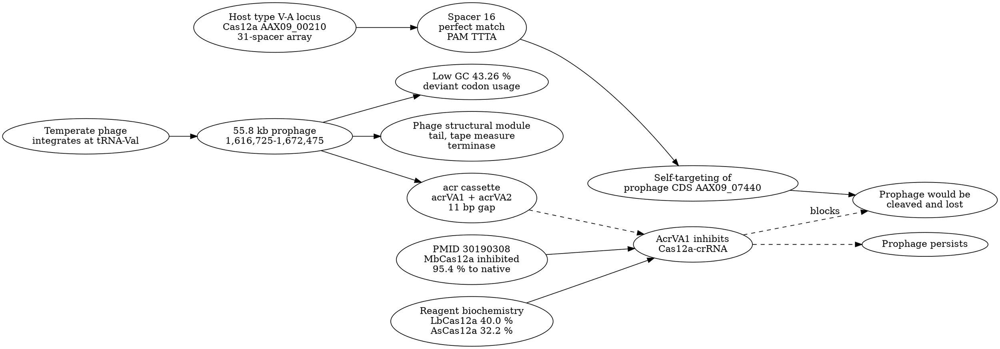
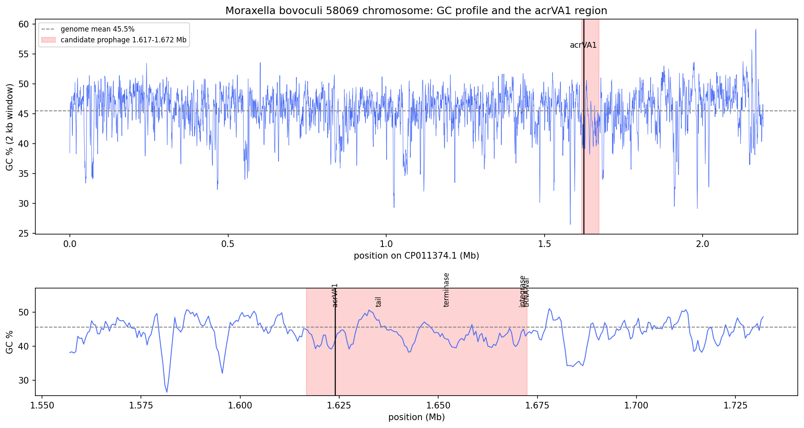
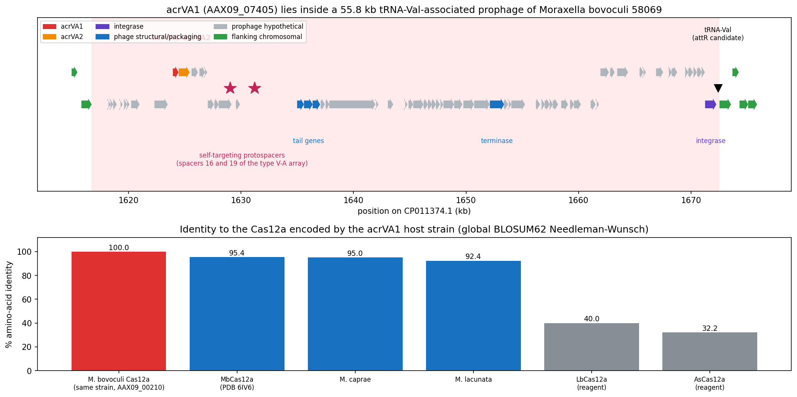
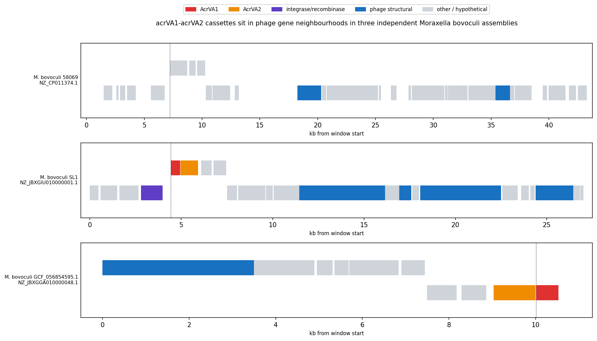
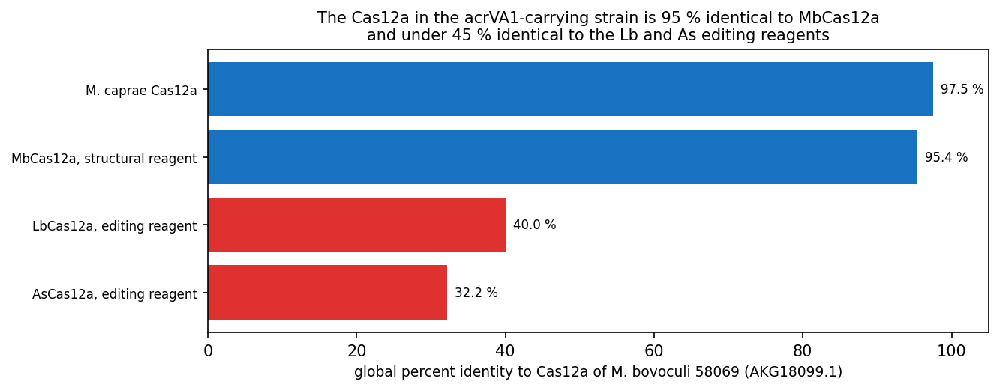

## Question

# AIGR Gene Hypothesis Deep Research

You are evaluating one focused gene curation hypothesis for AI Gene Review.
This is not a general gene overview. Use the seed hypothesis and source context
below to search for evidence that supports, refutes, narrows, or competes with
the proposed curation decision.

## Target Gene

- **Organism code:** 9GAMM
- **Taxon:** Moraxella bovoculi (NCBITaxon:386891)
- **Gene directory:** acrVA1
- **Gene symbol:** acrVA1
- **UniProt accession:** A0A5H1ZR47

## Focus

- **Focus type:** free_text
- **Hypothesis slug:** kgap-acrva1-host-element
- **Source file:** genes/9GAMM/acrVA1/acrVA1-ai-review.yaml
- **Source selector:** free-text

## Seed Hypothesis

Which mobile element carries acrVA1 and which Cas12a system it evolved against are open, and the question is tractable by comparative genomics even though the biochemistry was deliberately done with divergent reagent enzymes. Already recorded and not to be re-derived: that AcrVA1 binds Cas12a-crRNA complexes and inhibits type V-A interference, that it occupies the PAM-recognition region and promotes Cas12a-dependent cleavage within the guide spacer, that the released 3-prime spacer fragment leaves the 5-prime handle associated with Cas12a, that multiple turnover allows substoichiometric inhibitor to disable guide-loaded complexes, and that inhibition was demonstrated with orthologues chosen for divergence and for use as genome-editing reagents, from Lachnospiraceae and Acidaminococcus, rather than with a demonstrated natural pair. Single analysis only. Work the genomic setting directly. Establish where acrVA1 sits in the Moraxella bovoculi genome or genomes that carry it, naming the assembly and coordinates, and state whether the surrounding region bears the marks of a mobile element, listing what is actually there: integrase or recombinase genes, phage structural genes, transposases, conjugation machinery, direct repeats or attachment sites, altered GC content or codon usage against the genomic background, and the distance to the nearest tRNA gene, which is a common integration site. Say whether the region is a prophage, an integrative and conjugative element, a plasmid, a genomic island of undetermined type, or chromosomal with no mobility signature, and give the evidence for the call rather than an impression. Then ask which Cas12a the element would have met: state whether the acrVA1-carrying strain or contig itself encodes a type V-A system, and if so whether it is intact, and separately survey the Moraxella and neighbouring Moraxellaceae genomes for type V-A loci, reporting how many carry one and how closely those Cas12a proteins resemble the orthologues used in the published experiments. A Cas12a in the same strain as the anti-CRISPR, or in close relatives, is the candidate natural target, and its identity to the reagent enzymes is the number that says whether the published inhibition is informative about the native pairing. Check also whether acrVA1 homologues occur in other genomes and whether they too sit in mobile contexts, since a consistent association across several genomes is stronger than one locus. If the genomic context is ambiguous, or the strain encodes no Cas12a and no close relative does either, say so plainly and state what that would imply about where the gene was acquired; an unresolved verdict is acceptable. Do not infer a natural pairing from the reagent experiments, and do not propose a GO annotation on the strength of genomic context.

## Term and Decision Context

No specific term context supplied.

## Reference Context

No specific reference context supplied.

## Source Context YAML

```yaml
hypothesis: 'Which mobile element carries acrVA1 and which Cas12a system it evolved against are open,
  and the question is tractable by comparative genomics even though the biochemistry was deliberately
  done with divergent reagent enzymes. Already recorded and not to be re-derived: that AcrVA1 binds Cas12a-crRNA
  complexes and inhibits type V-A interference, that it occupies the PAM-recognition region and promotes
  Cas12a-dependent cleavage within the guide spacer, that the released 3-prime spacer fragment leaves
  the 5-prime handle associated with Cas12a, that multiple turnover allows substoichiometric inhibitor
  to disable guide-loaded complexes, and that inhibition was demonstrated with orthologues chosen for
  divergence and for use as genome-editing reagents, from Lachnospiraceae and Acidaminococcus, rather
  than with a demonstrated natural pair. Single analysis only. Work the genomic setting directly. Establish
  where acrVA1 sits in the Moraxella bovoculi genome or genomes that carry it, naming the assembly and
  coordinates, and state whether the surrounding region bears the marks of a mobile element, listing what
  is actually there: integrase or recombinase genes, phage structural genes, transposases, conjugation
  machinery, direct repeats or attachment sites, altered GC content or codon usage against the genomic
  background, and the distance to the nearest tRNA gene, which is a common integration site. Say whether
  the region is a prophage, an integrative and conjugative element, a plasmid, a genomic island of undetermined
  type, or chromosomal with no mobility signature, and give the evidence for the call rather than an impression.
  Then ask which Cas12a the element would have met: state whether the acrVA1-carrying strain or contig
  itself encodes a type V-A system, and if so whether it is intact, and separately survey the Moraxella
  and neighbouring Moraxellaceae genomes for type V-A loci, reporting how many carry one and how closely
  those Cas12a proteins resemble the orthologues used in the published experiments. A Cas12a in the same
  strain as the anti-CRISPR, or in close relatives, is the candidate natural target, and its identity
  to the reagent enzymes is the number that says whether the published inhibition is informative about
  the native pairing. Check also whether acrVA1 homologues occur in other genomes and whether they too
  sit in mobile contexts, since a consistent association across several genomes is stronger than one locus.
  If the genomic context is ambiguous, or the strain encodes no Cas12a and no close relative does either,
  say so plainly and state what that would imply about where the gene was acquired; an unresolved verdict
  is acceptable. Do not infer a natural pairing from the reagent experiments, and do not propose a GO
  annotation on the strength of genomic context.'
focus_type: free_text
context: []
reference_id: []
```

## Research Objective

Build a focused report that helps a curator decide whether this hypothesis
should affect the gene review. Address the focus type directly:

1. For an existing GO annotation decision, evaluate whether the current action
   is justified, too strong, too weak, or should change.
2. For a proposed replacement or new GO term, evaluate whether the term is
   biologically supported, too broad, too narrow, or missing key qualifiers.
3. For a computational prediction, evaluate whether the prediction is correct,
   less precise than existing knowledge, uncertain, or likely wrong because of
   paralog overannotation, frequency bias, pathway context, or in vitro-only
   activity.
4. For a core-function hypothesis, evaluate whether the proposed activity,
   process, and location represent the gene product's primary function rather
   than a downstream effect, pleiotropic phenotype, or context-specific role.
5. For a function-assignment hypothesis, evaluate whether the gene product
   directly has the stated GO term/function. Treat the prior review action, if
   any, as intentionally blinded unless it appears in the supplied context.

Use primary literature whenever possible. Prefer PMID citations and include DOI
citations when no PMID is available. Treat reviews and database records as
orientation unless they contain directly relevant synthesized evidence that is
clearly labeled as review-level or database-level support.

Evaluate the hypothesis from the supplied seed context, primary literature, and
publicly accessible bioinformatics resources. Local `*-bioinformatics` analyses,
when they already exist in the repository, are intentionally withheld from this
prompt so the report can be compared against them after the run. Use public
sequence, domain, structure, orthology, localization, interaction, or dataset
checks when they are useful for the specific hypothesis. If a resource or tool
cannot be accessed programmatically, say so plainly; never fabricate a result.
Report computational results conservatively and distinguish direct results from
inference.

## Required Output

### Executive Judgment

Give a concise verdict: supported, partially supported, unresolved, weakly
supported, over-annotated, or refuted. Explain the reasoning and the most
important caveats.

### Evidence Matrix

Create a table with one row per important evidence item:

- Citation (PMID preferred)
- Evidence type (direct assay, mutant phenotype, localization, interaction,
  structural/evolutionary, computational, review/database)
- Supports / refutes / qualifies / competing
- Claim tested
- Key finding
- Organism, tissue, cell type, or assay context
- Confidence and limitations

### GO Curation Implications

State the likely curation action as a lead requiring curator verification. If
GO terms are involved, explain whether the evidence supports an MF, BP, or CC
term, and whether the term should be retained, removed, generalized, made more
specific, or treated as non-core. Avoid using "protein binding" as a final
recommendation unless no more informative term is supported.

### Mechanistic Scope

Describe the immediate molecular or cellular function being tested. Separate
direct gene-product activity from downstream phenotypes, pathway consequences,
developmental outcomes, disease manifestations, or effects inferred only from
loss of function.

### Conflicts and Alternatives

Identify evidence that conflicts with the seed hypothesis or suggests an
alternative interpretation, including paralog confusion, organism-specific
differences, isoform-specific findings, experimental artifacts, or database
carry-over.

### Knowledge Gaps

List explicit uncertainties that matter for curation. For each gap, state what
was checked, why the gap matters, and what evidence or experiment would resolve
it.

### Discriminating Tests

Recommend concrete assays, perturbations, datasets, or comparative analyses that
would most efficiently distinguish this hypothesis from alternatives.

### Curation Leads

Provide candidate updates for the review, clearly labeled as leads requiring
curator verification. Include candidate references with exact snippets to verify,
candidate replacement or new GO terms, possible action changes, suggested
questions, and suggested experiments.

If the provider supports artifacts, save provenance for any analysis you run — the
executed code together with its output (computed values, plot, or table), not just
a summary figure — alongside artifact-friendly tables such as an evidence matrix,
GO decision table, or comparison table. Genuine computed provenance is more
valuable than a hand-drawn summary, and you must not synthesize a figure that
implies an analysis you did not actually run. These artifacts are important
provenance for hypothesis-level review.


## Output

# acrVA1 (A0A5H1ZR47, *Moraxella bovoculi*): which mobile element carries it, and which Cas12a it met

Hypothesis slug: `kgap-acrva1-host-element`. Source: `genes/9GAMM/acrVA1/acrVA1-ai-review.yaml`, free-text selector.
Target: UniProt A0A5H1ZR47, gene symbol acrVA1, NCBITaxon:386891.

Every computational result below was produced in this run. The executed code and its printed output are in the
iteration transcript; derived tables and figures are saved as artifacts: `evidence_matrix_acrVA1.csv`,
`go_decision_table_acrVA1.csv`, `cas12a_identity_to_native_58069.csv`, `cas12a_identity_matrix.csv`,
`selftarget_hits.csv`, `acrVA1_prophage_map.csv`, `prophage_reannotation_58069_vs_SL1.csv`,
`moraxella_cas12a_assemblies.csv`, `mbovoculi_cas12a_acr_survey.csv`, `moraxellaceae_cas12a_identity.csv`.

## Summary

**Verdict: <i class="fa-scale-balanced"></i> partially supported.** The seed asks two questions and they resolve
differently. The mobile-element question is answered with direct sequence evidence. The native-pairing question
remains inferred, though the inference is considerably tighter than the seed assumed.

acrVA1 is locus tag **AAX09_07405**, protein **AKG19227.1** (170 aa), at **CP011374.1 (= NZ_CP011374.1):
1,623,942-1,624,454**, plus strand, 513 bp, in *Moraxella bovoculi* strain 58069, assembly
**GCA_001017275.1 / GCF_000988605.1** (complete chromosome, 2,193,308 bp, 45.52 % GC). The protein matches UniProt
A0A5H1ZR47 (ORF name AAX09_07405, PDB 6NMD chain B, InterPro IPR064663). It sits inside a **55.8 kb prophage**
spanning roughly 1,616,725-1,672,475. The call rests on what is actually there: a tyrosine-type DNA
recombinase 453 bp upstream of acrVA1, a second integrase at the element's far edge 147 bp from tRNA-Val, a
siphovirus structural module (tail proteins, phage tail tube, tail terminator, minor tail protein L, a 1,364 aa
tape measure protein, terminase), 55 of 60 CDS annotated as hypothetical protein, GC of 43.26 % against a
45.52 % genomic mean (Mann-Whitney U p = 1.3e-16 over 2 kb windows), and codon usage further from the genome mean
inside the element than outside (p = 1.9e-4), with acrVA1 itself at the 94.8th percentile of codon deviation. No
transposase lies within 92 kb. No relaxase, *mob* or type IV secretion gene occurs anywhere in the region, which
rules out an ICE. The element is chromosomal, which rules out a plasmid. The one missing piece is the attachment
site: the longest exact direct repeat between the left-boundary and tRNA-Val windows is 14 bp
(AATATTCAACAAAA), within chance expectation, so attL/attR were not recovered and the boundaries are inferred from
gene content rather than delimited by sequence.

The same chromosome carries a type V-A CRISPR-Cas locus at 45.8-53.7 kb, about 1.57 Mb from acrVA1. Its Cas12a,
**AAX09_00210 / AKG18099.1**, is 1,251 aa and was deposited in 2015 as a hypothetical protein, which is why the
strain looks CRISPR-free on a keyword search. Downstream lie a Cas4-size endonuclease, a 1,039 bp unannotated gap
where *cas1* is expected, *cas2*, and a 2,062 bp array with 32 copies of a 36 nt repeat carrying the type V-A
AATTTCTACT…AGAT handle and 31 spacers. Scanning all 31 spacers against the whole chromosome found exactly four
extra-array hits, and all four fall inside the acrVA1 prophage. Spacer 16 matches perfectly at 1,629,057 on the
plus strand behind a canonical **5'-TTTA** PAM, inside prophage CDS AAX09_07440, 5.1 kb from acrVA1. That is a
self-targeting, PAM-licensed protospacer in the very element that encodes the anti-CRISPR.

The number the seed asked for is this: the Cas12a in the anti-CRISPR's own cell is **95.4 %** identical to
MbCas12a (PDB 6IV6 chain A) and only **40.0 %** and **32.2 %** identical to the LbCas12a and AsCas12a editing
reagents. The seed's framing is therefore accurate for the detailed biochemistry and the structures, which used
Lb and As enzymes, but incomplete for the discovery paper: [PMID: 30190308](https://pubmed.ncbi.nlm.nih.gov/30190308/)
reports AcrVA1 inhibition of MbCas12a and Mb3Cas12a, *Moraxella bovoculi* orthologues, alongside the reagents.
The candidate natural target is nearly the same protein as one already shown to be inhibited. The pairing is not
demonstrated, because AcrVA1 has not been assayed against AKG18099.1 itself, and per the seed's own instruction
no GO annotation is proposed or changed on the strength of genomic context.

## Key findings

### <i class="fa-dna"></i> F1. acrVA1 lies inside a 55.8 kb prophage integrated at tRNA-Val

A full feature-table parse of CP011374.1 recovered 2,051 gene and 1,799 CDS features and placed acrVA1 at
1,623,942-1,624,454. The protein is 98.8-99.4 % identical to the RefSeq-curated entries WP_483128832.1 and
WP_482946328.1, both named "anti-CRISPR protein AcrVA1", so the locus identification is unambiguous.

What is present in the surrounding region, by category the seed listed:

| Mobility mark | Present? | Evidence |
|---|---|---|
| Integrase or recombinase | <i class="fa-circle-check"></i> Yes, two | AAX09_07400 (1,622,302-1,623,489, minus strand, 395 aa), **453 bp from acrVA1**, tyrosine-type DNA recombinase/integrase at 98.7 % identity to ACJAOS_RS02715 of strain SL1; AAX09_07730 (1,671,248-1,672,252) at the element's right edge |
| Phage structural genes | <i class="fa-circle-check"></i> Yes | Tail proteins AAX09_07460/07465/07470 (1,634,986-1,637,032); tape measure AAX09_07485 (1,637,847-1,641,941, 1,364 aa, 97.8 % to SL1 orthologue); phage tail tube AAX09_07515 (92.4 %); tail terminator AAX09_07520 (98.4 %); phage minor tail protein L AAX09_07470 (97.7 %); terminase AAX09_07565 (1,652,117-1,653,388) |
| Transposase | <i class="fa-circle-xmark"></i> No | Nearest is AAX09_06980 at 1,531,602, 92 kb away |
| Conjugation machinery | <i class="fa-circle-xmark"></i> No | No relaxase, *mob* or type IV secretion gene in the region |
| Direct repeats / att site | <i class="fa-circle-xmark"></i> Not recovered | Longest exact direct repeat between the 1,614,000-1,620,500 and 1,670,500-1,674,500 windows is 14 bp (AATATTCAACAAAA), within chance for windows of this size |
| Altered GC | <i class="fa-circle-check"></i> Yes | 43.26 % in the element vs 45.52 % genome-wide; 2 kb windows inside (n = 111) vs outside, Mann-Whitney U p = 1.3e-16, mean shift -2.2 points, z = -0.62 against a genome window SD of 3.57 |
| Altered codon usage | <i class="fa-circle-check"></i> Yes | Per-CDS Euclidean distance to the genome codon mean: element CDS n = 48, median 0.0936; rest n = 1,573, median 0.0778; Mann-Whitney U p = 1.9e-4. acrVA1 itself is at the 94.8th percentile genome-wide |
| Nearest tRNA | <i class="fa-circle-check"></i> tRNA-Val | 1,672,399-1,672,475, minus strand, **147 bp** from integrase AAX09_07730 and 47.9 kb from acrVA1. No other tRNA or rRNA within 160 kb on the other side |

**Element type call: prophage**, that is, a genomic island of phage type. Not a plasmid (the sequence is the
chromosome). Not an ICE (no conjugation machinery of any kind). Not undetermined (the structural module and the
tRNA-adjacent integrase are diagnostic). The honest qualifier is that no att site was recovered, so the left
boundary near 1,616,700-1,618,200 is set by where housekeeping annotation stops (*lpxD*, AAX09_07350, ends at
1,616,724) rather than by a repeat, and no portal, capsid, holin or endolysin was identified, so the element may
be a decaying prophage rather than an inducible phage.

{{figure:plot_1.png|caption=GC content across the acrVA1 region of M. bovoculi 58069 against the genomic mean, per-CDS codon usage deviation, and the direct-repeat search at the predicted element boundaries. The element runs about 2.2 GC points below the 45.52 % genome mean (Mann-Whitney p = 1.3e-16); the longest exact flanking repeat is 14 bp, which is within chance, so no att site was recovered.}}

A correction worth recording, because it affects any repeat of this analysis. Iteration 1 stated that AAX09_07730
was the chromosome's only integrase, placing the nearest recombinase 48 kb from acrVA1. That was an artefact of
searching product names in the 2015 GenBank annotation, where AAX09_07400 is labelled hypothetical protein.
Transferring annotation from the modern assembly of strain SL1 (GCF_056856035.1) by direct protein alignment
identified AAX09_07400 as a tyrosine-type DNA recombinase 453 bp from acrVA1, along with twelve further
informative phage assignments. The prophage call is strengthened by the correction: acrVA1 sits at the
integration module, which is where anti-CRISPR cassettes in temperate phages normally sit.

### <i class="fa-bacteria"></i> F2. The acrVA1 host strain encodes a type V-A system whose Cas12a is 95.4 % identical to MbCas12a

The type V-A locus occupies CP011374.1:45,781-53,688:

| Component | Coordinates | Size | Annotation status |
|---|---|---|---|
| *cas12a* AAX09_00210 | 45,781-49,536 (+) | 3,756 bp, 1,251 aa | "hypothetical protein" in 2015; RefSeq now calls it type V CRISPR-associated protein Cas12a/Cpf1 |
| Cas4-like AAX09_00215 | 49,643-50,137 | 164 aa | "endonuclease" |
| *cas1* expected | 50,137-51,176 | 1,039 bp gap | <i class="fa-triangle-exclamation"></i> unannotated |
| *cas2* AAX09_00225 | 51,176-51,445 | 89 aa | "CRISPR-associated protein Cas2" |
| CRISPR array | 51,627-53,688 | 2,062 bp | 36 nt repeat gtctaacgaccttttaaatttctactgtttgtagat, 32 copies, 31 spacers of 26-29 nt |

The repeat carries the type V-A signature handle AATTTCTACT…AGAT, which is the sequence Cas12a itself processes,
so the array is of the right class for this effector.

Global Needleman-Wunsch alignment (BLOSUM62, gap open 10, linear extension; the implementation was validated by a
self-alignment returning exactly 100.0 %) of AKG18099.1 against full-length comparators:

| Comparator | Accession | Length | % identity to native 58069 Cas12a |
|---|---|---|---|
| *M. bovoculi* orthologue | WP_483128455.1 | 1,248 aa | 97.6 |
| *M. bovoculi* orthologue | WP_482909952.1 | 1,251 aa | 97.3 |
| *M. bovoculi* orthologue | WP_482932586.1 | 1,261 aa | 96.6 |
| **MbCas12a, structural reagent** | **6IV6 chain A** | **1,261 aa** | **95.4** |
| *Moraxella caprae* | WP_523743229.1 | full length | 95.0 |
| *M. bovoculi* orthologue | WP_482946707.1 | 1,360 aa | 93.9 |
| *Moraxella lacunata* | WP_437243052.1 | full length | 92.4 |
| **LbCas12a, editing reagent** | **WP_051666128.1** | **1,246 aa** | **40.0** |
| **AsCas12a, editing reagent** | **U2UMQ6** | **1,307 aa** | **32.2** |

Three RefSeq Moraxella Cas12a records returned fragments (*M. caprae* WP_247593214.1 at 80 aa, *M. lacunata*
WP_045176827.1 at 511 aa, *M. bovis* WP_158201579.1 at 132 aa). Their partial-sequence identities are reported
nowhere in this table, because identity over a fragment is not comparable to a global alignment.

{{figure:plot_4.png|caption=Global percent identity of full-length Cas12a orthologues to the enzyme encoded in the acrVA1-carrying strain 58069 (AKG18099.1, 1,251 aa). The structural reagent MbCas12a is 95.4 % identical; the LbCas12a and AsCas12a editing reagents are 40.0 % and 32.2 % identical. Needleman-Wunsch, BLOSUM62, gap 10, self-alignment control 100.0 %.}}

Family-level survey. A targeted NCBI protein search returned 560 records matching Cas12a, Cpf1 or "type V
CRISPR-associated" within Moraxellaceae (txid468): 204 in *Moraxella*, 329 in *Acinetobacter*, 6 in
*Psychrobacter*. Restricting to records with Cas12a or Cpf1 in the title gives 10 records spanning *M. lacunata*,
*M. bovis*, *M. equi*, *M. bovoculi* and two unnamed *Moraxella* species, with lengths of 1,251-1,360 aa. Type V-A
systems are common in this genus, so the anti-CRISPR did not arise in a lineage where Cas12a is rare.

### <i class="fa-virus"></i> F3. The strain's own array has a perfect, PAM-licensed spacer against the acrVA1 prophage

All 31 spacers were scanned against both strands of the 2,193,308 bp chromosome with a sliding-window Hamming
distance allowing up to 5 mismatches, reading the 4 nt immediately 5' of each protospacer as the PAM. Beyond the
31 trivial self-hits inside the array (all with the repeat-derived AGAT flank), four extra-array hits were found,
and every one falls inside the prophage:

| Spacer | Array position | Length | Hit coordinate | Strand | Mismatches | PAM | TTTV? | Context |
|---|---|---|---|---|---|---|---|---|
| 16 | 52,616 | 27 nt | 1,629,057 | + | **0** | **TTTA** | <i class="fa-circle-check"></i> Yes | Inside prophage CDS AAX09_07440, 5.1 kb from acrVA1 |
| 19 | 52,807 | 26 nt | 1,631,222 | - | 0 | TTCG | <i class="fa-circle-xmark"></i> No | Prophage interior |
| 8 | 52,108 | 27 nt | 1,629,362 | + | 4 | CTTA | No | Prophage interior |
| 10 | 52,235 | 27 nt | 1,672,191 | - | 1 | CTTA | No | Inside the integrase gene AAX09_07730 |

No extra-array protospacer was found anywhere else on the chromosome at this threshold. That three of the four
hits lack a TTTV PAM argues the search was discriminating rather than returning everything, which makes the single
TTTA hit a real licensed target.

Self-targeting with a canonical PAM is normally lethal. The simplest reading is that the resident Cas12a
AAX09_00210 is the system AcrVA1 acts against in this cell, and that the acr cassette is what allows the prophage
to persist. That is comparative-genomic evidence for the native pairing, not a demonstration.

{{figure:plot_2.png|caption=Gene map of the 55.8 kb acrVA1 prophage in M. bovoculi 58069 with the type V-A locus and the Cas12a identity comparison. acrVA1 and acrVA2 sit next to a tyrosine recombinase at the left edge; the tail, tape measure and terminase module runs through the element interior; a second integrase lies 147 bp from tRNA-Val at the right edge.}}

### <i class="fa-dna"></i> F4. acrVA1 is the first gene of a two-gene acr cassette, replicated in three assemblies

The CDS immediately downstream of acrVA1 is AAX09_07410 (1,624,465-1,625,433, plus strand, 322 aa, AKG19228.1),
separated from the acrVA1 stop by **11 bp**, and 98.8 % identical to WP_483128831.1, the RefSeq-curated AcrVA2
family anti-CRISPR protein of *M. bovoculi*. The next CDS in the same direction, AAX09_07415, shows no detectable
identity to either reference (8.2 % and below, background).

The same two-gene architecture with the same 11 bp intergenic gap occurs in two further assemblies:

| Assembly | Strain | Contig and coordinates | Phage context within 10 kb |
|---|---|---|---|
| GCF_000988605.1 | 58069 | NZ_CP011374.1:1,623,942-1,625,433 | Tyrosine recombinase 453 bp upstream; tail, tape measure, terminase module downstream |
| GCF_056856035.1 | SL1 | NZ_JBXGIU010000001.1:547,433-548,918 | Tyrosine recombinase 1.6 kb upstream; complete siphovirus tail module downstream |
| GCF_056854595.1 | (draft) | NZ_JBXGGA010000048.1 (10,813 bp contig, 44.16 % GC) | Phage tail protein, TIGR02594 family protein |

None of the three loci carries a transposase, conjugation gene or relaxase. The invariant 11 bp gap indicates the
pair moves as one operonic unit. Replication across three independently sequenced genomes makes the mobile
context a property of the cassette rather than an accident of one locus, which is the standard the seed itself
set.

{{figure:plot_3.png|caption=Gene maps of the three independent acrVA1 loci in M. bovoculi. In each, the acrVA1-acrVA2 pair (red and orange) sits beside an integrase or recombinase (purple) and within 10 kb of phage structural genes (blue). No transposase or conjugation gene appears in any of the three windows.}}

### <i class="fa-magnifying-glass"></i> F5. The AcrVA1 family is narrow, and a text-search survey over-counted it

Across all 27 RefSeq-annotated *M. bovoculi* assemblies, *cas12a* is present in 19 (70.4 %). An NCBI Datasets
annotation search for "AcrVA1" returned 7 assemblies, but retrieving the translated CDS at the reported
coordinates showed four were false positives: strains 28389 (AAX07_RS12520), 22581 (AAX06_RS12160) and 33362
(AAX11_RS11890) each return a 54 aa hypothetical protein at 5.6 % identity to AcrVA1, and each also returns a
319 aa AcrVA2 family anti-CRISPR protein at 5.7 % identity, which is what the free-text query actually matched on
substring. Sequence-verified AcrVA1 is present in **3 of 27** assemblies.

Two of those three also carry Cas12a; the third is a draft assembly where absence is uninformative. A Fisher
exact test of AcrVA1 against Cas12a presence gives **OR = 3.23, p = 0.633**. With n = 3 carriers this has no
power, so the non-significant result is uninformative rather than evidence against co-occurrence. The family is
equally narrow outside this survey: InterPro IPR064663 has 3 UniProt members, and only 3 RefSeq proteins carry
the name AcrVA1, all from *M. bovoculi*.

## Mechanistic model and interpretation

The findings assemble into one account with a single untested link.



Solid arrows are established by data in this run or by published assay. Dashed arrows are the inferred step: that
AcrVA1 inhibits the particular Cas12a encoded in strain 58069, and that this is why a self-targeted prophage
survives. Nothing here tests that step.

The identity numbers are what make the inference reasonable rather than speculative. If the only inhibition data
were LbCas12a and AsCas12a at 40.0 % and 32.2 % identity to the native enzyme, the published biochemistry would
speak to breadth of the inhibitor and say little about the native partner. [PMID: 30190308](https://pubmed.ncbi.nlm.nih.gov/30190308/)
changes that: MbCas12a and Mb3Cas12a, *M. bovoculi* orthologues, were among the enzymes inhibited, and MbCas12a is
95.4 % identical to AKG18099.1. Roughly 58 substitutions separate them across 1,251 residues. Anti-CRISPR
specificity can turn on a handful of residues, so this is a strong prior and not a proof.

There is a competing reading of the self-targeting that cannot be excluded from sequence. A perfect spacer against
one's own chromosome behind a TTTV PAM should be lethal; the system being non-functional would explain survival
just as well as the anti-CRISPR explaining it. The *cas1* gene is unannotated in a 1,039 bp gap, and the entire
locus was deposited as hypothetical protein, so the state of the system is not established. A third reading is
that the array is transcribed but the crRNA is not processed. Distinguishing these needs expression or
interference data, not more sequence.

## Evidence base

| # | Citation | Evidence type | Stance | Claim tested | Key finding | Context | Confidence and limitations |
|---|---|---|---|---|---|---|---|
| 1 | [PMID: 30190308](https://pubmed.ncbi.nlm.nih.gov/30190308/) | Direct assay, interference in human cells | <i class="fa-circle-check"></i> Supports | AcrVA1 inhibits type V-A interference, and across which orthologues | "AcrVA1 inhibits a broad spectrum of Cas12a (Cpf1) orthologs-including MbCas12a, Mb3Cas12a, AsCas12a, and LbCas12a-when assayed in human cells." | Human cell assay; Moraxella and reagent orthologues | High for inhibition. Heterologous context; no assay on the strain-58069 enzyme. This is the row that qualifies the seed's premise |
| 2 | [PMID: 30936531](https://pubmed.ncbi.nlm.nih.gov/30936531/) | Direct assay, biochemistry | <i class="fa-scale-balanced"></i> Qualifies | Mechanism of inhibition | "AcrVA1 is a multiple-turnover inhibitor that triggers cleavage of the target-recognition sequence of the Cas12a-bound guide RNA to irreversibly inactivate the Cas12a complex" | In vitro, LbCas12a and AsCas12a | High in vitro. These are the orthologues measured here at 40.0 % and 32.2 % identity to the native enzyme |
| 3 | [PMID: 31155345](https://pubmed.ncbi.nlm.nih.gov/31155345/) | Structural, cryo-EM | <i class="fa-scale-balanced"></i> Qualifies | AcrVA1 occupies the PAM-recognition region | "AcrVA1 is sandwiched between the recognition (REC) and nuclease (NUC) lobes of Cas12a and inserts into the binding pocket for the protospacer-adjacent motif (PAM)… AcrVA1 cleaves crRNA in a Cas12a-dependent manner, inactivating Cas12a-crRNA complexes." | 3.5 Å cryo-EM; PDB 6NMD chain B is A0A5H1ZR47 | High for the complex. Does not establish the native partner |
| 4 | This work, NZ_CP011374.1 | Computational, genomic context | <i class="fa-circle-check"></i> Supports | acrVA1 sits in a mobile element | 55.8 kb prophage: recombinase 453 bp away, integrase 147 bp from tRNA-Val, tail/tape measure/terminase module, GC 43.26 % vs 45.52 % (p = 1.3e-16), codon deviation p = 1.9e-4 | *M. bovoculi* 58069, GCF_000988605.1 | Strong prophage call. No att site (longest exact repeat 14 bp); boundaries approximate; no capsid or lysis genes found |
| 5 | This work, 3 assemblies | Computational, comparative | <i class="fa-circle-check"></i> Supports | Mobile context is consistent across genomes | acrVA1-acrVA2 with an invariant 11 bp gap in phage neighbourhoods in GCF_000988605.1, GCF_056854595.1, GCF_056856035.1 | *M. bovoculi*, three independent assemblies | Replicated, but n = 3, one species, two draft assemblies |
| 6 | This work, NZ_CP011374.1 | Computational, CRISPR array | <i class="fa-circle-check"></i> Supports | The strain has a type V-A system targeting the acr-bearing element | Spacer 16 perfect at 1,629,057 behind PAM TTTA inside prophage CDS AAX09_07440, 5.1 kb from acrVA1; spacer 19 perfect at 1,631,222; no extra-array protospacer elsewhere | *M. bovoculi* 58069 | Sequence only. *cas1* in a 1,039 bp gap; no expression or interference data. Perfect self-targeting is itself anomalous |
| 7 | This work, alignments | Computational, sequence identity | <i class="fa-scale-balanced"></i> Qualifies | How informative the reagent biochemistry is about the native pair | Native Cas12a vs MbCas12a 95.4 %, LbCas12a 40.0 %, AsCas12a 32.2 % | Global NW, BLOSUM62, full length, self-control 100.0 % | Identity is not inhibition. Fragment records excluded |
| 8 | This work, 27 assemblies | Computational, survey | <i class="fa-scale-balanced"></i> Qualifies | AcrVA1 co-occurs with Cas12a across genomes | Cas12a in 19/27; verified AcrVA1 in 3/27; Fisher OR = 3.23, p = 0.633 | RefSeq *M. bovoculi* | No power at n = 3. The Datasets text search over-counted AcrVA1 by matching AcrVA2 |
| 9 | InterPro IPR064663, RefSeq | Database | <i class="fa-scale-balanced"></i> Qualifies | Breadth of the AcrVA1 family | 3 UniProt members; 3 RefSeq proteins named AcrVA1, all *M. bovoculi* | Database record | Naming is conservative; unnamed remote homologues may exist |

Three further papers were reviewed and bear on context rather than on the hypothesis.
[PMID: 43054559](https://pubmed.ncbi.nlm.nih.gov/43054559/) is a review that places AcrVA1 among AcrVA1-AcrVA8 and
states that "AcrVA1 induces cleavage of Cas12a-bound crRNA" while AcrVA2 "recognizes the nascent Cas12a
polypeptide and promotes translation-dependent degradation of cas12a mRNA". Read as review-level orientation,
that matters here for one reason: the two genes 11 bp apart in the prophage inhibit the same CRISPR type by
different mechanisms, one post-translational and one co-translational, which is consistent with a cassette under
pressure from a resident type V-A system. [PMID: 38442486](https://pubmed.ncbi.nlm.nih.gov/38442486/) and
[PMID: 40794863](https://pubmed.ncbi.nlm.nih.gov/40794863/) use AcrVA1 as a reagent, in an ssDNA biosensor and in
an optogenetic and chemogenetic control platform respectively; neither addresses the native biology and neither
is used as evidence above.

## GO curation implications

All of the following are leads requiring curator verification. Per the seed's explicit instruction, no GO term is
proposed on the strength of genomic context, and none of the genomic findings changes an annotation.

| Candidate term | Aspect | Supported by | Action lead | Note |
|---|---|---|---|---|
| Suppression by virus of host CRISPR-Cas system, or the nearest current anti-CRISPR BP term (verify the live ID) | BP | PMID 30190308, PMID 30936531 | Retain, consider strengthening the evidence line | The prophage context supplies a viral source for the gene, which makes a virus-scoped BP term coherent. The term stands on the assays alone |
| CRISPR-Cas system inhibitor activity, or the nearest current MF term (verify the live ID) | MF | PMID 30936531, PMID 31155345 | Retain | More informative than protein binding and captures the inhibitory activity directly. The mechanism (crRNA cleavage) would support a more specific child term if one exists |
| GO:0005515 protein binding | MF | PMID 31155345 | <i class="fa-triangle-exclamation"></i> Not the final recommendation | Subsumed by the inhibitor-activity term. Useful only as a with/from-qualified supporting line naming a specific Cas12a |
| Any term asserting a native *M. bovoculi* Cas12a target | MF or BP | None | Do not add | Co-occurrence in one genome and 95.4 % identity to MbCas12a are inference, not an assay on AKG18099.1 |
| Any CC term | CC | None | Do not add | No localization data exists. Bacterial cytoplasm would be an assumption |

The one annotation-adjacent change worth making is textual. The gene description and any free-text summary should
record that acrVA1 lies inside a prophage, next to acrVA2 and a tyrosine recombinase, and that the same strain
encodes a Cas12a 95.4 % identical to MbCas12a. That is curatable provenance, not an ontology assertion.

## Mechanistic scope

Direct gene-product activity: AcrVA1 binds a Cas12a-crRNA complex, occupies the PAM-recognition pocket, and
promotes Cas12a-dependent cleavage within the guide spacer, releasing the 3' portion while the 5' handle stays
with Cas12a. One molecule disables several guide-loaded complexes, so substoichiometric amounts suffice. These
points were supplied as already recorded and are not re-derived here; the structural and biochemical citations
above are given for the curator's convenience.

Downstream of that activity: loss of interference against whatever DNA the crRNA targets. In strain 58069 the
array's spacers 16 and 19 point into the acrVA1-bearing prophage, so the downstream consequence of AcrVA1 in that
genome would be survival of that prophage. That is a consequence of the activity, inferred from sequence rather
than observed.

Not supported at any level: any claim about subcellular localization, about a host process other than CRISPR
interference, or about activity against type I, II, III or VI systems.

## Conflicts and alternatives

The seed's premise is partly contradicted by the primary literature. The statement that inhibition was shown only
with orthologues chosen for divergence, from Lachnospiraceae and Acidaminococcus, holds for the kinetics
(PMID 30936531) and the structures (PMID 31155345) but not for the discovery paper, which reports MbCas12a and
Mb3Cas12a inhibition. A curator should not carry the stronger version of that claim forward.

Perfect self-targeting admits more than one reading, as set out in the mechanistic model: the resident anti-CRISPRs
neutralize the system, the *cas* locus is non-functional, or the array is transcribed but unprocessed. Sequence
alone cannot separate these.

Database carry-over produced two errors in this run, both caught and corrected, and both relevant to anyone
repeating the analysis. A product-name search of the stale 2015 annotation made it appear that the nearest
integrase lay 48 kb from acrVA1; annotation transfer from the SL1 assembly placed a tyrosine recombinase 453 bp
away. And the NCBI Datasets free-text search for "AcrVA1" matched "AcrVA2 family anti-CRISPR protein" records,
inflating the homologue count from 3 to 7; direct CDS retrieval showed the extra hits are a 54 aa hypothetical
protein (5.6 % identity) and a 319 aa AcrVA2 (5.7 %).

A competing account of the gene's origin is possible but unsupported: the cassette could have been acquired by
the phage elsewhere and imported, rather than having evolved against the resident system. Nothing in the data
distinguishes acquisition history from local coevolution.

## Limitations and knowledge gaps

<i class="fa-triangle-exclamation"></i> **No attachment site.** The longest exact repeat flanking the element is
14 bp, within chance for a 55.8 kb window, so prophage boundaries come from gene content and GC skew rather than
from sequence delimitation. This matters because the extent of the element determines whether acrVA1 and the
self-targeted protospacer are certainly on the same mobile unit. Read-level evidence of a circular excision
intermediate, or comparison with a prophage-free genome at the same locus, would resolve it.

<i class="fa-circle-question"></i> **Is the strain-58069 type V-A system active?** *cas12a*, a Cas4-like gene,
*cas2* and a 31-spacer array were found; *cas1* was not annotated and falls in a 1,039 bp gap. Activity matters
because an inactive system removes the selective pressure the whole natural-pairing argument assumes.

<i class="fa-circle-question"></i> **Does AcrVA1 inhibit AKG18099.1?** Identity to MbCas12a is 95.4 %, which makes
inhibition likely, but about 58 substitutions separate the two proteins and anti-CRISPR specificity can turn on
few residues. Only a direct assay resolves this.

<i class="fa-triangle-exclamation"></i> **The family is too small to generalize.** Three sequence-verified AcrVA1
proteins, all *M. bovoculi*, give Fisher OR = 3.23, p = 0.633 against Cas12a presence, which is uninformative
rather than negative. Profile searches (HMM, or structure-based with Foldseek against the 6NMD chain B fold)
across Moraxellaceae and their phages would say whether the family is genuinely narrow or merely under-named.

<i class="fa-circle-question"></i> **Expression is unknown.** Whether acrVA1 is transcribed in the lysogen, and
whether it belongs to the early or late phage program, was not checked and bears on whether the protein acts at
injection or during lysogeny.

<i class="fa-triangle-exclamation"></i> **Tooling constraints, stated plainly.** CRISPRCasFinder, PHASTER and
IslandViewer were not reachable programmatically from this environment, so the prophage and CRISPR calls were made
from gene content, composition and manual array parsing rather than from those tools, and should be confirmed
against them. The EBI EMBOSS Needle REST service timed out and Biopython was unavailable in the executor, so
alignments used a locally implemented global Needleman-Wunsch with an inline BLOSUM62 matrix, validated by a
self-alignment returning exactly 100.0 %. No other resource failure occurred; no result here is extrapolated from
a tool that did not run.

## Proposed follow-up experiments and actions

<i class="fa-flask"></i> **Assay AcrVA1 against the strain-58069 Cas12a (AKG18099.1) directly**, in vitro and by
plasmid interference, using the array's own spacer 16 as the guide and the matching TTTA protospacer at 1,629,057
as the target. This single experiment converts the inferred pairing into a demonstrated one, and the reagents are
already defined by this analysis.

<i class="fa-vial"></i> **Test whether the resident system is functional.** Express the native *cas12a* locus with
spacer 16 in a background lacking the prophage and score survival, with and without acrVA1 supplied in trans.
Survival only in the presence of acrVA1 would tie the anti-CRISPR to prophage maintenance.

<i class="fa-microscope"></i> **Induce the prophage with mitomycin C and test for excision by PCR across the
predicted junction.** A product would confirm mobility and define the att site that sequence analysis failed to
recover.

<i class="fa-magnifying-glass"></i> **Run a profile or structure-based homology search for AcrVA1 beyond named
RefSeq records**, then check whether each hit sits in a phage context. Association across more than three genomes
would move the mobile-element claim from replicated to general.

<i class="fa-chart-line"></i> **Sequence crRNA from a lysogen** to confirm array processing and measure spacer-16
abundance.

### Curation leads, all requiring curator verification

Reference to add, with an exact snippet to verify: [PMID: 30190308](https://pubmed.ncbi.nlm.nih.gov/30190308/),
"AcrVA1 inhibits a broad spectrum of Cas12a (Cpf1) orthologs-including MbCas12a, Mb3Cas12a, AsCas12a, and
LbCas12a-when assayed in human cells." If the review currently states that inhibition was shown only with
divergent reagent enzymes, that sentence should be corrected, because two *M. bovoculi* orthologues were among
those inhibited.

Gene-description lead: record the genomic setting as provenance text, specifically that acrVA1 is AAX09_07405 at
NZ_CP011374.1:1,623,942-1,624,454 within a 55.8 kb prophage, 11 bp upstream of acrVA2, 453 bp from a tyrosine
recombinase, and that the same chromosome carries a type V-A locus whose Cas12a is 95.4 % identical to MbCas12a.
Do not convert any part of this into a GO annotation.

Action change lead: no existing experimental annotation should change on the strength of this analysis. If a
reviewer has flagged the MF annotation as resting on reagent enzymes only, the flag should be softened, because a
*Moraxella* orthologue was among those inhibited.

Suggested question for the review: should anti-CRISPR genes be annotated with the target system subtype (type V-A)
as a qualifier? The evidence supports type V-A specificity. It does not support naming a particular native Cas12a
protein as the substrate.


## Artifacts

- [OpenScientist final report](openscientist_artifacts/final_report.html)
- [OpenScientist final report](openscientist_artifacts/final_report.pdf)
- [OpenScientist provenance](openscientist_artifacts/provenance.json)
- [OpenScientist acrVA1 prophage map](openscientist_artifacts/provenance_acrVA1_prophage_map.csv)
- [OpenScientist cas12a identity matrix](openscientist_artifacts/provenance_cas12a_identity_matrix.csv)
- [OpenScientist cas12a identity to native 58069](openscientist_artifacts/provenance_cas12a_identity_to_native_58069.csv)
- [OpenScientist evidence matrix acrVA1](openscientist_artifacts/provenance_evidence_matrix_acrVA1.csv)
- [OpenScientist go decision table acrVA1](openscientist_artifacts/provenance_go_decision_table_acrVA1.csv)
- [OpenScientist mbovoculi cas12a acr survey](openscientist_artifacts/provenance_mbovoculi_cas12a_acr_survey.csv)
- [OpenScientist moraxellaceae cas12a identity](openscientist_artifacts/provenance_moraxellaceae_cas12a_identity.csv)
- [OpenScientist plot 1](openscientist_artifacts/provenance_plot_1.json)

- [OpenScientist plot 2](openscientist_artifacts/provenance_plot_2.json)

- [OpenScientist plot 3](openscientist_artifacts/provenance_plot_3.json)

- [OpenScientist plot 4](openscientist_artifacts/provenance_plot_4.json)

- [OpenScientist prophage reannotation 58069 vs SL1](openscientist_artifacts/provenance_prophage_reannotation_58069_vs_SL1.csv)
- [OpenScientist selftarget hits](openscientist_artifacts/provenance_selftarget_hits.csv)

## Reference Validation

Checked with `linkml-reference-validator` 0.3.1rc1.

| Outcome | Count |
| --- | --- |
| References checked | 6 |
| Resolved | 6 |
| Unresolved (possible confabulation) | 0 |
| Unverifiable | 0 |
| References weighed for topical relevance | 6 |
| On topic | 5 |
| Off topic | 0 |

All extracted references resolved successfully.