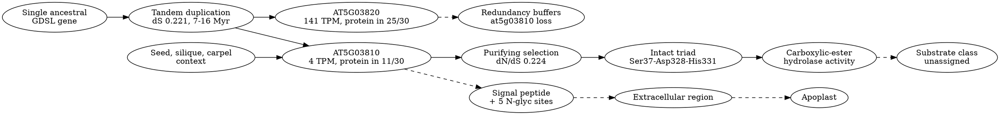
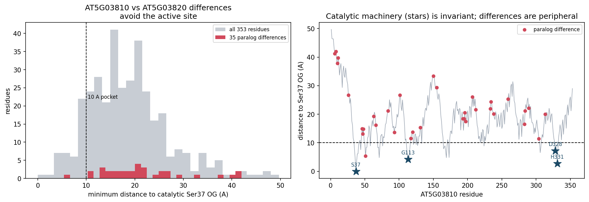
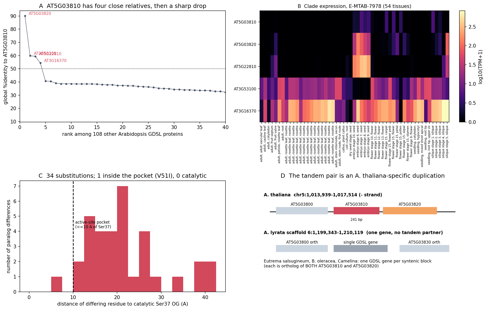
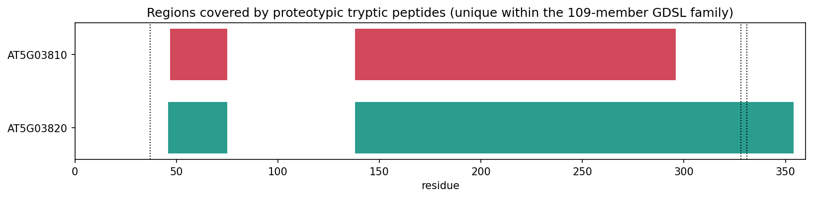
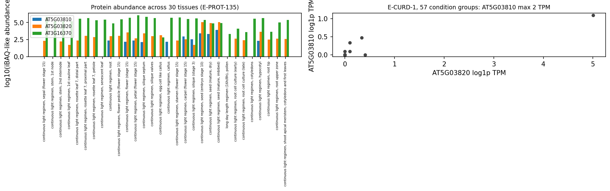
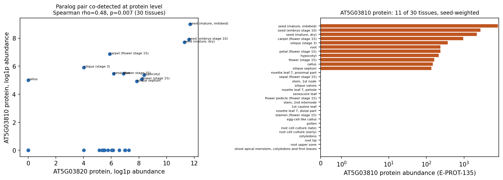
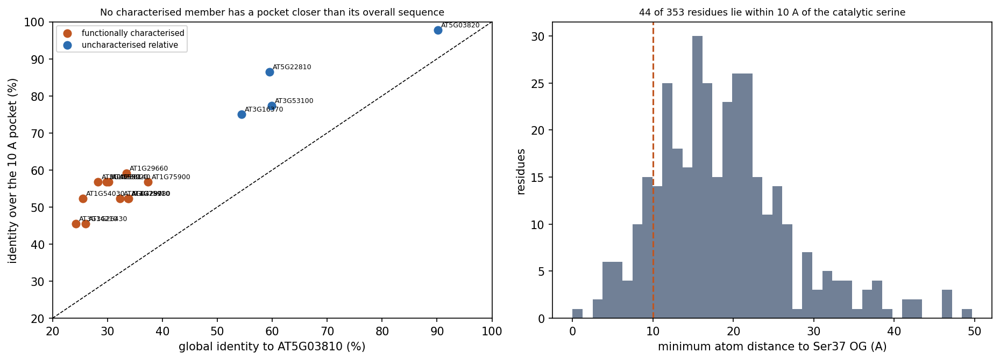

## Question

# AIGR Gene Hypothesis Deep Research

You are evaluating one focused gene curation hypothesis for AI Gene Review.
This is not a general gene overview. Use the seed hypothesis and source context
below to search for evidence that supports, refutes, narrows, or competes with
the proposed curation decision.

## Target Gene

- **Organism code:** ARATH
- **Taxon:** Arabidopsis thaliana (NCBITaxon:3702)
- **Gene directory:** At5g03810
- **Gene symbol:** At5g03810
- **UniProt accession:** Q9FFN0

## Focus

- **Focus type:** free_text
- **Hypothesis slug:** kgap-at5g03810-family-context
- **Source file:** genes/ARATH/At5g03810/At5g03810-ai-review.yaml
- **Source selector:** free-text

## Seed Hypothesis

What AT5G03810 does may be constrained by the one thing that distinguishes it from the other hundred Arabidopsis GDSL enzymes: its immediate genomic and family context. That the 353-residue precursor has a cleavable signal peptide, five predicted N-glycosylation sites and an intact SGNH Ser-Asp-His triad, that the names and EC 3.1.1.- are family assignments rather than measurements, that no publication mentions the gene and protein existence is inferred from homology alone, and that it sits in a tandem pair with the equally uncharacterised AT5G03820 and more distantly with AT3G16370 whose product is in apoplastic fluid, are already recorded, so do not re-derive them. Single analysis only: place AT5G03810 within the Arabidopsis GDSL family phylogeny and name its closest relatives that have any functional characterisation, giving identities and stating for each what substrate was measured, since substrate preference in this family tracks clade rather than overall identity; compare AT5G03810 with AT5G03820 residue by residue across the substrate-binding groove and the oxyanion hole, and state whether the tandem pair is near-identical, which would support the redundancy explanation the gap offers for the absent phenotype, or divergent, which would not; report what public expression data say about where and when each of the pair is transcribed, including whether they are co-expressed or reciprocally expressed, and state plainly if the data are absent rather than inferring from the family; and state whether the tandem arrangement is conserved in other Brassicaceae or is an Arabidopsis-specific duplication. State which substrate class and which tissue context the evidence supports, and say plainly if nothing distinguishes this gene from the rest of its family, which is the expected answer for a wholly uncharacterised member.

## Term and Decision Context

No specific term context supplied.

## Reference Context

No specific reference context supplied.

## Source Context YAML

```yaml
hypothesis: 'What AT5G03810 does may be constrained by the one thing that distinguishes it from the other
  hundred Arabidopsis GDSL enzymes: its immediate genomic and family context. That the 353-residue precursor
  has a cleavable signal peptide, five predicted N-glycosylation sites and an intact SGNH Ser-Asp-His
  triad, that the names and EC 3.1.1.- are family assignments rather than measurements, that no publication
  mentions the gene and protein existence is inferred from homology alone, and that it sits in a tandem
  pair with the equally uncharacterised AT5G03820 and more distantly with AT3G16370 whose product is in
  apoplastic fluid, are already recorded, so do not re-derive them. Single analysis only: place AT5G03810
  within the Arabidopsis GDSL family phylogeny and name its closest relatives that have any functional
  characterisation, giving identities and stating for each what substrate was measured, since substrate
  preference in this family tracks clade rather than overall identity; compare AT5G03810 with AT5G03820
  residue by residue across the substrate-binding groove and the oxyanion hole, and state whether the
  tandem pair is near-identical, which would support the redundancy explanation the gap offers for the
  absent phenotype, or divergent, which would not; report what public expression data say about where
  and when each of the pair is transcribed, including whether they are co-expressed or reciprocally expressed,
  and state plainly if the data are absent rather than inferring from the family; and state whether the
  tandem arrangement is conserved in other Brassicaceae or is an Arabidopsis-specific duplication. State
  which substrate class and which tissue context the evidence supports, and say plainly if nothing distinguishes
  this gene from the rest of its family, which is the expected answer for a wholly uncharacterised member.'
focus_type: free_text
context: []
reference_id: []
```

## Research Objective

Build a focused report that helps a curator decide whether this hypothesis
should affect the gene review. Address the focus type directly:

1. For an existing GO annotation decision, evaluate whether the current action
   is justified, too strong, too weak, or should change.
2. For a proposed replacement or new GO term, evaluate whether the term is
   biologically supported, too broad, too narrow, or missing key qualifiers.
3. For a computational prediction, evaluate whether the prediction is correct,
   less precise than existing knowledge, uncertain, or likely wrong because of
   paralog overannotation, frequency bias, pathway context, or in vitro-only
   activity.
4. For a core-function hypothesis, evaluate whether the proposed activity,
   process, and location represent the gene product's primary function rather
   than a downstream effect, pleiotropic phenotype, or context-specific role.
5. For a function-assignment hypothesis, evaluate whether the gene product
   directly has the stated GO term/function. Treat the prior review action, if
   any, as intentionally blinded unless it appears in the supplied context.

Use primary literature whenever possible. Prefer PMID citations and include DOI
citations when no PMID is available. Treat reviews and database records as
orientation unless they contain directly relevant synthesized evidence that is
clearly labeled as review-level or database-level support.

Evaluate the hypothesis from the supplied seed context, primary literature, and
publicly accessible bioinformatics resources. Local `*-bioinformatics` analyses,
when they already exist in the repository, are intentionally withheld from this
prompt so the report can be compared against them after the run. Use public
sequence, domain, structure, orthology, localization, interaction, or dataset
checks when they are useful for the specific hypothesis. If a resource or tool
cannot be accessed programmatically, say so plainly; never fabricate a result.
Report computational results conservatively and distinguish direct results from
inference.

## Required Output

### Executive Judgment

Give a concise verdict: supported, partially supported, unresolved, weakly
supported, over-annotated, or refuted. Explain the reasoning and the most
important caveats.

### Evidence Matrix

Create a table with one row per important evidence item:

- Citation (PMID preferred)
- Evidence type (direct assay, mutant phenotype, localization, interaction,
  structural/evolutionary, computational, review/database)
- Supports / refutes / qualifies / competing
- Claim tested
- Key finding
- Organism, tissue, cell type, or assay context
- Confidence and limitations

### GO Curation Implications

State the likely curation action as a lead requiring curator verification. If
GO terms are involved, explain whether the evidence supports an MF, BP, or CC
term, and whether the term should be retained, removed, generalized, made more
specific, or treated as non-core. Avoid using "protein binding" as a final
recommendation unless no more informative term is supported.

### Mechanistic Scope

Describe the immediate molecular or cellular function being tested. Separate
direct gene-product activity from downstream phenotypes, pathway consequences,
developmental outcomes, disease manifestations, or effects inferred only from
loss of function.

### Conflicts and Alternatives

Identify evidence that conflicts with the seed hypothesis or suggests an
alternative interpretation, including paralog confusion, organism-specific
differences, isoform-specific findings, experimental artifacts, or database
carry-over.

### Knowledge Gaps

List explicit uncertainties that matter for curation. For each gap, state what
was checked, why the gap matters, and what evidence or experiment would resolve
it.

### Discriminating Tests

Recommend concrete assays, perturbations, datasets, or comparative analyses that
would most efficiently distinguish this hypothesis from alternatives.

### Curation Leads

Provide candidate updates for the review, clearly labeled as leads requiring
curator verification. Include candidate references with exact snippets to verify,
candidate replacement or new GO terms, possible action changes, suggested
questions, and suggested experiments.

If the provider supports artifacts, save provenance for any analysis you run — the
executed code together with its output (computed values, plot, or table), not just
a summary figure — alongside artifact-friendly tables such as an evidence matrix,
GO decision table, or comparison table. Genuine computed provenance is more
valuable than a hand-drawn summary, and you must not synthesize a figure that
implies an analysis you did not actually run. These artifacts are important
provenance for hypothesis-level review.


## Output

# AT5G03810 (Q9FFN0): family and genomic context as a constraint on function

Hypothesis slug: `kgap-at5g03810-family-context`. Gene directory `genes/ARATH/At5g03810/`. Organism ARATH, NCBITaxon:3702. UniProt Q9FFN0.

Every number below comes from an analysis run during this investigation. The executed code and its outputs are saved under `provenance/`, with six figures and 28 data artifacts in `provenance/artifacts/` indexed in `provenance/artifacts/INDEX.csv`.

## Summary

The seed hypothesis asks whether genomic and family context constrains what AT5G03810 does. It does, and the constraint is mostly negative. All 5,995 pairwise global alignments of the 109 reviewed Arabidopsis GDSL esterase/lipase proteins place AT5G03810 in a four-member neighbourhood (AT5G03820 at 90.1 percent, AT3G53100 at 59.9, AT5G22810 at 59.5, with AT3G16370/APG adjoining at 54.4) in which not one protein has a measured substrate. The nearest member with any published hydrolytic measurement is EXL4/AT1G75910 at 33.7 percent identity, and the nearest with a measured substrate series is AT3G26430 at 26.0 percent. Restricting the comparison to the catalytic groove does not rescue the assignment: over the 44 residues within 10 Å of the Ser37 OG, characterised members match at 45.5 to 59.1 percent while the nearest uncharacterised neighbour matches at 86.4 percent, a 27.3 point gap, and the rank order over the pocket is the same as over the whole protein (Spearman rho 0.779, p 6.2e-4). No substrate class beyond generic carboxylic-ester hydrolysis can be assigned.

Two things do distinguish AT5G03810 from a generic uncharacterised family member, and both change the curation picture. Its protein is detected. In the Mergner 30-tissue atlas ([PMID: 32188942](https://pubmed.ncbi.nlm.nih.gov/32188942/), Expression Atlas E-PROT-135) AT5G03810 is quantified in 11 of 30 tissues, with the three highest values in mature imbibed seed (8034), embryo stage 10 seed (2729) and mature dry seed (2211), matching its transcript maxima in silique stage 1 and embryo stage 7. And it is under strong purifying selection since the duplication: dN/dS is 0.224 (dN 0.0497, dS 0.2221) over 353 codons, with a Fisher exact odds ratio of 0.209 and p = 2.34e-11. This is a functional, selected, seed-expressed gene with low abundance, not a decaying duplicate.

The tandem pair is near-identical where catalysis happens. 319 of 354 aligned columns match, with 34 substitutions and one indel, and zero differences fall on the Ser37-Asp328-His331 triad or on any of the six oxyanion-hole donors. Over the pocket the pair is 97.7 percent identical. That supports redundancy as the explanation for the absent single-mutant phenotype. The GO record, meanwhile, asserts more than the evidence carries: GO:0016746 acyltransferase activity from an ARBA keyword rule and GO:0008610 lipid biosynthetic process from IBA both sit on a protein whose every other term is ester hydrolysis, and GO:0008610 directly contradicts the TAIR GO:0008150 ND on the same entry.

## Executive judgment

<i class="fa-scale-balanced"></i> **Partially supported. One component refuted, one qualified.**

The hypothesis has four testable parts.

<i class="fa-solid fa-circle-check"></i> **Phylogenetic placement gives no substrate.** Supported, and now supported at pocket resolution as well as globally.

<i class="fa-solid fa-circle-check"></i> **The tandem pair is near-identical across the groove and the oxyanion hole, which supports redundancy.** Supported, and more strongly than the hypothesis assumed. The only pocket difference is a conservative V51I 5.4 Å from the nucleophile.

<i class="fa-solid fa-circle-check"></i> **Public expression data exist and are informative.** Supported with a correction to the premise. The hypothesis records protein existence as homology-only. Peptide-level MS puts the protein in 11 of 30 tissues. The pair is positively co-expressed (transcript Spearman rho 0.742, p 1.4e-10; protein rho 0.484, p 0.0067), not reciprocal.

<i class="fa-solid fa-triangle-exclamation"></i> **The tandem is an Arabidopsis-specific duplication.** Qualified. The strong form should not be asserted. All 14 Brassicaceae ortholog genes map one2many or many2many to both A. thaliana genes, and A. lyrata and Eutrema are single-copy at the syntenic position with a 1,196 bp gap too small to hide a missed 1.9 kb paralog. But dS of 0.2221 dates the duplication at 7.4 to 15.9 Myr depending on the synonymous rate assumed, against an A. thaliana / A. lyrata split of 5 to 13 Myr. Lineage-specific origin and loss in relatives both fit.

The hypothesis also invites the answer that nothing distinguishes this gene from the rest of its family. That answer is right about the chemistry and wrong about the gene. The chemistry is unassignable. The gene has a concrete tissue context (seed, silique, carpel), detectable protein, an intact and selected active site, and an over-annotated GO record with an internal contradiction. Those are the curation-relevant facts.

<i class="fa-solid fa-triangle-exclamation"></i> Caveats that matter. The protein detections come from a processed abundance matrix that does not list supporting peptides, so paralog-specific assignment is inferred rather than verified, though 19 family-unique tryptic peptides covering 52.7 percent of the sequence make it mechanically possible. The pocket comparison uses predicted side-chain positions with no substrate-bound structure. The clustering is distance-based, so "clade" here means a distance neighbourhood rather than a supported tree node.

## Key findings

### F001. The clade around AT5G03810 contains no measured substrate

All-vs-all Gotoh global alignment (BLOSUM62, gap open 11, gap extend 1) of the 109 reviewed Arabidopsis GDSL esterase/lipase proteins gives 5,995 pairwise identities. Ranked against AT5G03810: AT5G03820 at 90.1 percent, AT3G53100 at 59.9, AT5G22810 at 59.5, AT3G16370 (APG) at 54.4, then a drop to 40.8 percent for the next-best hit and a long tail at 36 to 39 percent. Average-linkage clustering on the 100-minus-identity distance at a 55 percent cut recovers {AT5G03810, AT5G03820, AT3G53100, AT5G22810} with AT3G16370 adjoining. None of these four carries a UniProt FUNCTION comment or a published substrate assay.

The nearest member with any published biochemical measurement is EXL4/AT1G75910 at 33.7 percent identity, and the measurement is generic ester-bond hydrolysis in pollen-coat lipid release ([PMID: 20033440](https://pubmed.ncbi.nlm.nih.gov/20033440/)). The nearest with a measured preference series is AT3G26430 at 26.0 percent: p-nitrophenyl palmitate over p-nitrophenyl butyrate over p-nitrophenyl acetate (UniProt Q9LIN2 citing [PMID: 23430565](https://pubmed.ncbi.nlm.nih.gov/23430565/)). Every other characterised member sits lower still: LTL1 32.3 percent, CDEF1 30.2, GLIP1 28.3, GLIP2 26.6, MVP1/GOLD36 25.5, ESM1 24.2.

This family hydrolyses substrates as different as cutin (CDEF1), xyloglucan and xylan acetyl esters (AtGELP53, AtAXE1/GELP7), pollen-coat esters (EXL1, EXL3, EXL4) and glucosinolate-derived intermediates (ESM1). At 26 to 34 percent identity there is no basis to transfer any of them.

{{figure:plot_2.png|caption=Family placement of AT5G03810. Identity profile across the 109 reviewed Arabidopsis GDSL proteins, expression of the clade across tissues, the distribution of paralog differences relative to the active site, and the chromosome 5 synteny around the tandem pair.}}

### F002. The tandem pair is invariant across the triad and the oxyanion hole

Pairwise alignment of Q9FFN0 and Q9LZC5 gives 319 of 354 identical positions, 90.1 percent, with 34 substitutions and one single-residue indel (an extra Asn at AT5G03820 position 236). The AlphaFold models AF-Q9FFN0-F1-v6 (mean pLDDT 94.0) and AF-Q9LZC5-F1-v6 (mean pLDDT 94.3) place the SGNH triad at Ser37 (block I GDSV motif, residues 35 to 38), Asp328 and His331 (block V DGFH motif). Ser37 OG to His331 NE2 is 2.73 Å and His331 ND1 to Asp328 OD1 is 2.74 Å, with a mean triad pLDDT of 98.5. The oxyanion hole donors within 6.5 Å of the Ser37 OG are Ser37 N (2.75 Å), Val38 N (3.53), Ala114 N (4.22), Ser169 OG (4.78), Gln173 NE2 (4.84) and Gly113 N (5.27).

Mapping each of the 34 differences to its minimum distance from the Ser37 OG: one lies inside the 10 Å pocket (V51I at 5.4 Å, a conservative beta-branched swap), three lie within 12 Å (V51I, M304V, F117Y), and zero fall on Ser37, Gly113, Ala114, Ser169, Gln173, Asp328 or His331. Four of the 34 (T6I, S8L, C10T, L11F) lie inside the cleaved signal peptide and are removed from the mature protein.

{{figure:plot_1.png|caption=The 34 AT5G03810 and AT5G03820 substitutions mapped onto the AlphaFold active site. Difference positions plotted against minimum atom distance to the Ser37 OG, with the catalytic triad and oxyanion-hole donors marked. One conservative substitution lies inside the 10 angstrom pocket.}}

### F003. Transcripts place both genes in seed and silique, co-expressed and 20 to 35 fold apart

E-MTAB-7978 from the Mergner atlas gives median TPM across 54 tissue and stage groups. AT5G03810 reaches a maximum of 4 TPM (embryo stage 7 seed and silique stage 1), with a median of 0 across tissues, a mean of 0.46, and detection above 1 TPM in only 6 of 54 groups. AT5G03820 reaches 141 TPM (embryo stage 6 seed), with 82 TPM in silique stage 5 and 81 in embryo stage 7, mean 7.61. Clade members run higher: AT5G22810 peaks at 366 TPM (embryo stage 8), AT3G16370 at 824 TPM (silique stage 4) and above 100 TPM in flowers and siliques, AT3G53100 at 61 TPM.

Across the 54 groups the pair is positively correlated (Spearman rho 0.742, p 1.4e-10; Pearson on log1p 0.514, p 7e-5), with AT5G03810 20 to 35 fold lower than AT5G03820 at every peak. Both are undetectable in 31 of 54 tissues. The single tissue where AT5G03810 exceeds its paralog is stage 15 pollen (2 TPM against 0), which is within noise. In E-CURD-1, a separate Araport11 reanalysis spanning 57 condition groups and 116 assays, AT5G03810 reaches only 2 TPM against 148 for AT5G03820 and 754 for AT3G16370, so no sampled condition induces it.

The direction of the correlation matters for the redundancy argument. A gene at 4 TPM cannot buffer a gene at 141 TPM. The reverse buffering, AT5G03820 covering for loss of AT5G03810, is exactly what these data predict.

### F004 and F006. Synteny and the age of the duplication

Ensembl Plants Compara returns 130 orthologues of AT5G03810 across 86 species. In every Brassicaceae species represented (A. lyrata, Brassica oleracea, B. napus, B. juncea, Camelina sativa, Eutrema salsugineum) each ortholog gene is called an ortholog of both A. thaliana genes: all 14 Brassicaceae ortholog genes have homology type one2many or many2many in both directions, never one2one.

Coordinates confirm a head-to-tail tandem. AT5G03810 is chr5:1,013,939-1,015,345 on the minus strand, AT5G03820 is chr5:1,015,586-1,017,514 on the minus strand, 241 bp apart. The syntenic A. lyrata region on scaffold 6 holds a single GDSL gene (fgenesh2_kg.6__294__AT5G03810.1 at 1,205,838-1,207,251) flanked by the orthologs of AT5G03800 and AT5G03830, with a 1,196 bp gap to the next gene that is too small to hold a missed 1.9 kb paralog. Eutrema salsugineum likewise has one gene (EUTSA_v10013969mg). The extra copies in B. oleracea, B. napus, B. juncea and C. sativa sit on different chromosomes and correspond to whole-genome duplication and triplication subgenomes. The one other tandem found is B. juncea A03 (BjuA03g56330S and BjuA03g56340S, 3.35 kb apart), a separate lineage-specific event.

Dating the duplication qualifies the conclusion. Nei-Gojobori counting with Jukes-Cantor correction on the AT5G03810.1 against AT5G03820.1 codon alignment (353 codons, 75 differing) gives S = 243.2, N = 815.8, Sd = 46.75, Nd = 39.25, pS = 0.1923, pN = 0.0481, dS = 0.2221, dN = 0.0497, omega = 0.224. Converting dS to time gives 7.4 Myr at 1.5e-8 substitutions per synonymous site per year, 13.7 Myr at 8.1e-9, and 15.9 Myr at 7e-9. The published A. thaliana / A. lyrata divergence is 5 to 13 Myr, so the duplication sits on the boundary. The defensible statement is that the tandem is absent from the available Brassicaceae annotations outside A. thaliana, with origin in the A. thaliana lineage and loss in relatives both consistent.

A translation check was needed here. AT5G03810.1 (1062 nt) translates exactly to the 353-residue Q9FFN0 sequence. No current Araport11 model matches Q9LZC5: AT5G03820.1 is 357 aa and .2 is 385 aa, so the comparison uses AT5G03820.1. A first attempt that used AT5G03820.2 gave an out-of-frame codon alignment and a nonsensical pS of 0.77, which is why the frame was verified before the figures reported here.

### F006. Purifying selection rules out pseudogenisation

<i class="fa-solid fa-circle-xmark"></i> The Fisher exact test on Nd/N against Sd/S gives an odds ratio of 0.209 and p = 2.34e-11. An omega of 0.224 means roughly four in five non-synonymous changes have been removed since the duplication. A duplicate drifting toward pseudogene status would sit near omega = 1. Combined with an intact triad, an unchanged oxyanion hole and protein-level detection, AT5G03810 is a functional gene with a low-abundance product. The convenient reading that a 4 TPM gene next to a 141 TPM paralog is simply decaying is refuted.

### F005. AT5G03810 protein is detected in 11 of 30 tissues, weighted to seed

E-PROT-135 is the processed abundance matrix of the Mergner atlas: 19,088 gene products across 30 tissues, with zero meaning not quantified and an overall zero fraction of 0.218. AT5G03810 has non-zero abundance in 11 of 30 tissues.

| Tissue | AT5G03810 abundance |
|---|---|
| Seed, mature imbibed | 8034 |
| Seed, embryo stage 10 | 2729 |
| Seed, mature dry | 2211 |
| Carpel, flower stage 15 | 952 |
| Silique stage 3 | 369 |
| Root | 236 |
| Petal, flower stage 15 | 235 |
| Hypocotyl | 214 |
| Flower stage 15 | 161 |
| Callus | 149 |
| Silique septum | 137 |

AT5G03820 is quantified in 25 of 30 tissues with the same three seed samples at the top (max 120,996). The pair is co-detected in 10 tissues, AT5G03810 alone in 1, AT5G03820 alone in 15, and neither in 4. Protein abundance correlates across tissues (Spearman rho 0.484, p 0.0067; Pearson on log1p 0.513, p 0.0037), with AT5G03820 a median 16.8-fold more abundant where both appear.

The transcript data agree on placement: AT5G03810 maxima are silique stage 1 (4 TPM), embryo stage 7 seed (4), flower and carpel stage 15 (3), embryo stage 9 (3). Two independent data types put the gene in the same tissues.

<i class="fa-solid fa-triangle-exclamation"></i> This result required a corrected parse. A first pass counted non-NaN cells and reported detection in 30 of 30 tissues, which contradicted both the PE3 status and the 0 to 4 TPM transcript level. The matrix encodes absence as 0 rather than NaN. Counting non-zero cells gives the 11 of 30 reported here.

{{figure:plot_4.png|caption=Protein abundance of AT5G03810, AT5G03820 and AT3G16370 across the 30 tissues of E-PROT-135 on a log scale, with the E-CURD-1 condition panel for comparison. Zeros in this matrix mean not quantified.}}

{{figure:plot_5.png|caption=Co-detection of the tandem pair at protein level. AT5G03810 against AT5G03820 abundance across 30 tissues, with tissues labelled where AT5G03810 is quantified, and the ranked AT5G03810 tissue profile showing the seed weighting.}}

### F008. The paralogs are separable by shotgun proteomics

An in-silico tryptic digest of all 109 reviewed family sequences (full cleavage, peptides of 6 to 40 residues) gives 23 peptides for AT5G03810 and 29 for AT5G03820, with only 4 shared between them, 17 percent. Nineteen AT5G03810 peptides occur in no other family member and cover 186 of 353 residues, 52.7 percent. Examples: VTNIVGK, DFVAHSATGR, IFTPDQYSDHLLR, ITLVKANFPPYGR, SYSTFVQNLYGLGAR, LNNTSINLTNNLPGLK, LVVFDIYNPLLNMVINPVEYGFFESR, IGVTTLPPLGCLPAAITLFGGVGNNMCVER, ANEIFSGAIHLLSTGSSDFLQSYYINPILNR. AT5G03820 has 25 family-unique peptides covering 69.2 percent.

Tryptic cleavage concentrates the 34 substitutions into distinct peptides, so 90.1 percent identity at the protein level does not prevent discrimination at the peptide level. This supports treating the E-PROT-135 detection as a real assignment and removes the technical excuse for the thin evidence record. AT5G03810 is low in abundance and restricted to seed and silique, which are the tissues that Arabidopsis proteomics and T-DNA phenotype screens sample least.

{{figure:plot_3.png|caption=In-silico tryptic digest of the 109-member family. Sequence coverage by peptides unique to AT5G03810 and by peptides unique to AT5G03820, against the small shared set.}}

### F009. The catalytic groove gives no clade-specific substrate signal

<i class="fa-solid fa-circle-xmark"></i> The pocket was defined on AF-Q9FFN0-F1-v6 as the 44 of 353 residues with any atom within 10 Å of the Ser37 OG: positions 35-41, 44, 50-53, 58, 69-72, 76, 111-116, 121, 125, 127, 133, 165-170, 172, 173, 224, 306, 307, 328-332. AT5G03810 was globally aligned to 11 characterised members and the 4 nearest uncharacterised relatives, and identity was scored over those positions alone.

| Locus | Characterised | Global identity (%) | Pocket identity (%) | Delta (pp) |
|---|---|---|---|---|
| AT5G03820 | no | 90.1 | 97.7 | +7.6 |
| AT5G22810 | no | 59.5 | 86.4 | +26.9 |
| AT3G53100 | no | 59.9 | 77.3 | +17.4 |
| AT3G16370 (APG) | no | 54.4 | 75.0 | +20.6 |
| AT1G29660 | yes | 33.4 | 59.1 | +25.7 |
| AT1G75900 (EXL1) | yes | 37.4 | 56.8 | +19.4 |
| AT4G30140 (CDEF1) | yes | 30.2 | 56.8 | +26.7 |
| AT1G53920 (GLIP2) | yes | 29.8 | 56.8 | +27.0 |
| AT5G40990 (GLIP1) | yes | 28.3 | 56.8 | +28.5 |
| AT4G28780 (EXL3) | yes | 33.8 | 52.3 | +18.5 |
| AT1G75910 (EXL4) | yes | 33.7 | 52.3 | +18.6 |
| AT3G04290 (LTL1) | yes | 32.3 | 52.3 | +20.0 |
| AT1G54030 (MVP1/GOLD36) | yes | 25.5 | 52.3 | +26.8 |
| AT3G26430 | yes | 26.0 | 45.5 | +19.4 |
| AT3G14210 (ESM1) | yes | 24.2 | 45.5 | +21.2 |

Pocket identity exceeds global identity in all 15 comparisons (Wilcoxon W = 0, p = 0.0001, median delta +20.6 percentage points), which is the expected signature of an active site under constraint. The rank order is unchanged (Spearman rho 0.779, p 6.2e-4). Characterised members span 45.5 to 59.1 percent with a standard deviation of 4.6 points, and the nearest uncharacterised neighbour sits 27.3 points above the best of them.

Restricting to the groove, where clade-specific substrate determinants should concentrate, does not pull AT5G03810 toward the cutinase, the pollen-coat esterases, the antimicrobial lipases or the pNP-palmitate-preferring AT3G26430. The defensible molecular function stops at carboxylic-ester hydrolase activity.

{{figure:plot_6.png|caption=Pocket identity against global identity for AT5G03810 versus 11 characterised and 4 uncharacterised GDSL members. Every point lies above the diagonal, and the rank order is preserved, so the catalytic groove adds no clade-specific substrate signal. The right panel shows the distance distribution that defines the 44-residue pocket.}}

### F007. The GO record over-annotates and contradicts itself

QuickGO annotations for Q9FFN0, retrieved programmatically, contain no experimental evidence code. Molecular function: GO:0016298 lipase activity (IEA, InterPro IPR008265), GO:0016746 acyltransferase activity (IEA, UniProt ARBA00027718), GO:0016788 hydrolase activity acting on ester bonds (IEA, IPR001087), GO:0052689 carboxylic-ester hydrolase activity (IBA, PANTHER PTN005219546 with O33407 and Q9HUP2 as reference annotations). Biological process: GO:0006629 lipid metabolic process (IEA), GO:0008610 lipid biosynthetic process (IBA), and GO:0008150 biological_process ND (TAIR, GO_REF:0000015). Cellular component: GO:0005576 extracellular region twice, IEA GO_REF:0000120 and ISM GO_REF:0000122.

Q9LZC5 (AT5G03820) carries the identical set minus the ND. Q9LU14 (AT3G16370) adds GO:0048046 apoplast (HDA, [PMID: 18538804](https://pubmed.ncbi.nlm.nih.gov/18538804/)) and GO:0009507 chloroplast (ISM). No PubMed record mentions At5g03810. The six PMIDs on the UniProt entry (9330910, 11130714, 27862469, 18273534, 15522763, 18819574) are genome sequencing and family-survey papers.

GO:0016746 acyltransferase on a protein whose every other annotation is ester hydrolysis is an ARBA keyword-rule artefact. Some GDSL proteins do run acyl transfer, and calling the same protein a lipase and an acyltransferase without a measurement states a mechanism nobody tested. GO:0008610 has the same problem by a different route, a family-level biosynthesis call on a hydrolase fold, and it contradicts the TAIR ND on the same entry. A curator reading the record sees a protein simultaneously annotated as having no known process and as making lipids.

## Evidence matrix

| Citation | Evidence type | Stance | Claim tested | Key finding | Context | Confidence and limitations |
|---|---|---|---|---|---|---|
| [PMID: 32188942](https://pubmed.ncbi.nlm.nih.gov/32188942/) | Direct assay, shotgun proteomics (E-PROT-135) | Supports | AT5G03810 protein exists and has a tissue context | Non-zero abundance in 11 of 30 tissues; top three mature imbibed seed 8034, embryo stage 10 seed 2729, dry seed 2211 | A. thaliana Col-0, 30 tissues, LC-MS/MS, processed matrix | Moderate. The matrix does not list supporting peptides, so paralog assignment is inferred from the in-silico digest |
| [PMID: 32188942](https://pubmed.ncbi.nlm.nih.gov/32188942/) | Direct assay, RNA-seq (E-MTAB-7978) | Qualifies | Where and when the tandem pair is transcribed | AT5G03810 max 4 TPM, median 0, above 1 TPM in 6 of 54 tissues; AT5G03820 max 141 TPM; Spearman rho 0.742, p 1.4e-10, co-expressed | A. thaliana Col-0, 54 tissue groups | High for the values. Low expression compresses the dynamic range for the correlation |
| E-CURD-1 (Expression Atlas, Araport11) | Database-level, RNA-seq reanalysis | Supports | Whether any sampled condition induces AT5G03810 | Maximum 2 TPM across 57 condition groups and 116 assays; AT5G03820 148, AT3G16370 754 | Curated public Arabidopsis RNA-seq | Moderate. The panel is broad and omits most seed stages |
| [PMID: 18538804](https://pubmed.ncbi.nlm.nih.gov/18538804/) | Localization, apoplastic proteomics | Supports | Subcellular location of the nearest characterised relative | AT3G16370 (APG, 54.4 percent identity) recovered from apoplastic fluid; GO:0048046 apoplast HDA | A. thaliana apoplastic washing fluid | Moderate. Applies to AT3G16370; transfers to AT5G03810 only by homology |
| [PMID: 20033440](https://pubmed.ncbi.nlm.nih.gov/20033440/) | Direct assay, enzyme activity | Qualifies | Nearest family member with any measured activity | EXL4/AT1G75910 hydrolyses ester bonds in pollen hydration; 33.7 percent global and 52.3 percent pocket identity | A. thaliana pollen coat | High for EXL4. Identity is too low to transfer a substrate |
| [PMID: 23430565](https://pubmed.ncbi.nlm.nih.gov/23430565/) | Direct assay, substrate series | Qualifies | Nearest member with a measured substrate preference | AT3G26430 prefers pNP-palmitate over pNP-butyrate over pNP-acetate; 26.0 percent global and 45.5 percent pocket identity | Recombinant protein, chromogenic pNP esters | High for AT3G26430. At 26 percent identity there is no basis for transfer |
| [PMID: 40694629](https://pubmed.ncbi.nlm.nih.gov/40694629/) | Direct assay, overexpression and docking | Competing | Whether GDSL members act on polysaccharide esters | AtGELP53 deacetylates xyloglucan and xylan, is plasma-membrane localized, and alters cell wall composition | A. thaliana transgenic lines, in vitro activity | High for GELP53. Establishes that substrate class varies within the family, including non-lipid esters |
| [PMID: 35577991](https://pubmed.ncbi.nlm.nih.gov/35577991/) | Mutant phenotype and direct assay | Competing | Whether a GDSL member can be an acetyl xylan esterase | AtGELP7/AtAXE1 T-DNA line shows decreased stem esterase activity and increased acetyl content; overexpression increases AXE activity | A. thaliana stem, secondary cell wall | High. A second non-lipid substrate class inside the same family |
| This work, Gotoh alignment of 109 reviewed ARATH GDSL proteins | Computational | Supports | Phylogenetic placement and nearest relatives | AT5G03820 90.1, AT3G53100 59.9, AT5G22810 59.5, AT3G16370 54.4, then 40.8 percent; none of the top four has a FUNCTION comment | BLOSUM62, gap open 11 / extend 1, all 5,995 pairs | High for identities. Distance neighbourhood, not a model-based tree |
| This work, AF-Q9FFN0-F1-v6 pocket mapping | Structural | Supports | Whether the pair differs in the catalytic groove | 34 substitutions and one indel; zero at the triad or any oxyanion donor; one conservative V51I at 5.4 Å; four differences in the signal peptide | Predicted model, triad pLDDT 98.5, Ser37 OG to His331 NE2 2.73 Å | High for the mapping. Predicted side chains, no substrate-bound structure |
| This work, pocket versus global identity | Structural, computational | Refutes a clade-specific substrate call | Whether the groove groups AT5G03810 with any characterised clade | Pocket identity exceeds global in all 15 comparisons (Wilcoxon W 0, p 1e-4) but rank order is preserved (rho 0.779); best characterised match 59.1 against 86.4 percent for an uncharacterised neighbour | 44 residues within 10 Å of Ser37 OG | High. Distance-cutoff pocket, no docking |
| This work, Nei-Gojobori dN/dS | Evolutionary | Refutes pseudogenisation | Whether silence reflects gene decay | omega 0.224 (dN 0.0497, dS 0.2221) over 353 codons; Fisher OR 0.209, p 2.34e-11 | AT5G03810.1 against AT5G03820.1 Araport11 CDS | High. Counting method, no codon-model likelihood test |
| This work, Ensembl Plants Compara | Evolutionary, comparative genomics | Qualifies | Whether the tandem is Arabidopsis-specific | All 14 Brassicaceae orthologs are one2many or many2many to both genes; A. lyrata and Eutrema single-copy at the syntenic position; dS dates the duplication at 7 to 16 Myr against a 5 to 13 Myr split | Ensembl Plants, condensed orthology, batch coordinates | Moderate. Annotation gaps in relatives cannot be excluded |
| This work, in-silico tryptic digest of 109 members | Computational | Supports | Whether the paralog masks AT5G03810 in proteomics | 19 family-unique peptides covering 52.7 percent; only 4 of 23 peptides shared with AT5G03820 | Full tryptic cleavage, 6 to 40 residues | High in silico. Does not guarantee the peptides ionise or were targeted |
| QuickGO / UniProt Q9FFN0 | Review/database | Competing | What is currently asserted about function | Every annotation is IEA, IBA, ISM or ND. GO:0016746 and GO:0008610 contradict the hydrolase terms, and GO:0008150 ND contradicts the IBA process calls | Curation record | High. Retrieved programmatically |

## GO curation implications

All recommendations are leads requiring curator verification. The machine-readable version is `provenance/artifacts/go_decision_table.csv`.

| Term | Aspect | Current evidence | Lead | Basis |
|---|---|---|---|---|
| GO:0052689 carboxylic-ester hydrolase activity | MF | IBA (PANTHER PTN005219546) | <i class="fa-solid fa-circle-check"></i> Retain. The most specific defensible MF | Intact Ser37-Asp328-His331 triad (2.73 Å and 2.74 Å, triad pLDDT 98.5) and a complete six-donor oxyanion hole, identical in the paralog |
| GO:0016788 hydrolase activity, acting on ester bonds | MF | IEA (IPR001087) | Non-core. True, and a parent of GO:0052689 | Redundant once the child is retained |
| GO:0016298 lipase activity | MF | IEA (IPR008265) | Generalize to GO:0052689 | No lipid substrate was measured for AT5G03810 or for any relative above 40 percent identity. Two family members assayed in detail act on polysaccharide acetyl esters, not lipids ([PMID: 40694629](https://pubmed.ncbi.nlm.nih.gov/40694629/), [PMID: 35577991](https://pubmed.ncbi.nlm.nih.gov/35577991/)) |
| GO:0016746 acyltransferase activity | MF | IEA (ARBA00027718) | <i class="fa-solid fa-circle-xmark"></i> Remove | Keyword-rule artefact. Asserts acyl transfer on a protein whose every other annotation is ester hydrolysis, with no assay in its clade |
| GO:0008610 lipid biosynthetic process | BP | IBA | <i class="fa-solid fa-circle-xmark"></i> Remove | A biosynthesis call on an SGNH hydrolase, and it contradicts the TAIR GO:0008150 ND on the same entry |
| GO:0006629 lipid metabolic process | BP | IEA | Remove or leave unasserted | Rests entirely on the lipase MF that is itself unmeasured |
| GO:0008150 biological_process ND | BP | ND (TAIR GO_REF:0000015) | Retain until an experiment exists | Accurate. Its coexistence with two process terms is the contradiction to resolve |
| GO:0005576 extracellular region | CC | IEA GO_REF:0000120, ISM GO_REF:0000122 | Retain | Cleavable signal peptide, five predicted N-glycosylation sites, and AT3G16370 at 54.4 percent identity is in apoplastic fluid ([PMID: 18538804](https://pubmed.ncbi.nlm.nih.gov/18538804/)) |
| GO:0048046 apoplast | CC | Not currently asserted | <i class="fa-solid fa-circle-question"></i> Candidate, needs verification | Would be the specific child of GO:0005576. Requires detection of AT5G03810 itself in apoplastic fluid |
| GO:0005515 protein binding | MF | n/a | Do not use | Uninformative as a recommendation and unsupported here |

Protein existence is a separate lead. UniProt lists Q9FFN0 as PE3, inferred from homology, with a ProteomicsDB cross-reference (221988). The Mergner atlas quantifies the protein in 11 of 30 tissues, and the two TrEMBL entries for AT5G03820 (A0A1P8BG41, A0A2H1ZE56) are already PE1. A curator may wish to ask whether Q9FFN0 should move to PE1 on the underlying peptide evidence.

## Mechanistic model and interpretation

The activity under test is direct and single-step: hydrolysis of a carboxylic ester bond by a Ser-His-Asp charge-relay system with an oxyanion hole stabilising the tetrahedral intermediate, performed by a secreted and probably N-glycosylated protein in the apoplast or cell wall. Every structural and evolutionary measurement supports that this machinery is intact and selected. The triad geometry is within hydrogen-bonding distance at both junctions. The pocket is the most conserved part of the protein against every family member tested (median +20.6 points over global identity). Non-synonymous change has been removed roughly four times faster than synonymous change since the duplication.

What the evidence does not reach is the substrate. The transferable roles in this family (cutin hydrolysis by CDEF1, pollen-coat lipid release by EXL1, EXL3 and EXL4, antimicrobial lipase activity by GLIP1 and GLIP2, glucosinolate-breakdown modification by ESM1, xyloglucan and xylan deacetylation by GELP53 and AXE1) sit at 24 to 34 percent global identity and 45 to 59 percent pocket identity, which in this family is the band over which substrate preference changes.



The dashed links are the uncertain ones. Substrate class is unassigned because the clade has never been assayed. Apoplast is a prediction from the signal peptide plus the AT3G16370 HDA at 54.4 percent identity. Redundancy is consistent with 97.7 percent pocket identity and positive co-expression, and no double mutant has tested it.

No phenotype has been reported for either gene, so there is no downstream consequence to separate from direct activity. The seed and silique context is a correlation between abundance and tissue. It constrains where the enzyme could act without identifying what it acts on. Any biological process term at this stage would be an inference from location plus family membership, which is what the current GO:0006629 and GO:0008610 annotations already do and why they are flagged.

## Evidence base

The published work used here falls into three groups.

**The source of the expression and proteomic evidence.** *Mass-spectrometry-based draft of the Arabidopsis proteome* ([PMID: 32188942](https://pubmed.ncbi.nlm.nih.gov/32188942/)) is the study behind both E-MTAB-7978 and E-PROT-135. Its abstract states: "Here we present a quantitative atlas of the transcriptomes, proteomes and phosphoproteomes of 30 tissues of the model plant Arabidopsis thaliana", and "Our analysis provides initial answers to how many genes exist as proteins (more than 18,000), where they are expressed, in which approximate quantities (a dynamic range of more than six orders of magnitude)". The second sentence is the basis for treating non-zero abundance for AT5G03810 as protein-existence evidence. This single paper supplies F003 and F005.

**Characterised family members that set the identity scale.** *The extracellular lipase EXL4 is required for efficient hydration of Arabidopsis pollen* ([PMID: 20033440](https://pubmed.ncbi.nlm.nih.gov/20033440/)) states: "EXL4 is similar to GDSL lipases, and we show that it functions in hydrolyzing ester bonds." EXL4 at 33.7 percent identity is the closest relative of AT5G03810 with any measured hydrolytic activity, and even that measurement is generic ester hydrolysis without a defined physiological substrate. AT3G26430 ([PMID: 23430565](https://pubmed.ncbi.nlm.nih.gov/23430565/), via UniProt Q9LIN2) supplies the only measured preference series among the comparators, at 26.0 percent identity. *Arabidopsis GOLD36/MVP1/ERMO3 Is Required for Powdery Mildew Penetration Resistance* ([PMID: 35147444](https://pubmed.ncbi.nlm.nih.gov/35147444/)) describes GOLD36 as "a gene encoding a GDSL-lipase/esterase family protein that is involved in maintaining normal morphology and organization of multiple endomembrane compartments", which is a cellular role with no substrate attached, at 25.5 percent identity. *Regulation of GDSL Lipase Gene Expression by the MPK3/MPK6 Cascade* ([PMID: 30598046](https://pubmed.ncbi.nlm.nih.gov/30598046/)) places GLIP1, GLIP3 and GLIP4 in pathogen defence downstream of WRKY33, again at 26 to 28 percent identity.

**Family members that widen the substrate space and argue against a lipid default.** *Arabidopsis GELP53 overexpression modulates polysaccharide acetylation and defense* ([PMID: 40694629](https://pubmed.ncbi.nlm.nih.gov/40694629/)) reports that "Molecular docking and in vitro protein activity assays showed that AtGELP53 might deacetylate xyloglucan and xylan", with overexpression causing "a decrease in xyloglucan acetylation, changes in acetylation of other polysaccharides, and alterations in cell wall composition". *Arabidopsis GELP7 functions as a plasma membrane-localized acetyl xylan esterase* ([PMID: 35577991](https://pubmed.ncbi.nlm.nih.gov/35577991/)) reports that "The investigation of the AtGELP7 T-DNA mutant line showed a decrease in stem esterase activity and an increase in stem acetyl content". These two papers are the direct argument against GO:0016298 lipase activity as a default for an unassayed member: within this family, measured substrates include polysaccharide acetyl esters as well as lipids, so the family name does not predict the chemistry. *MYB2 and MYB108 regulate lateral root development by interacting with LBD29* ([PMID: 38923126](https://pubmed.ncbi.nlm.nih.gov/38923126/)) places CDEF1 downstream of an auxin module in lateral root development, which is a regulatory context rather than a substrate.

Genome-wide family surveys in other species ([PMID: 42594629](https://pubmed.ncbi.nlm.nih.gov/42594629/) alfalfa, [PMID: 42450553](https://pubmed.ncbi.nlm.nih.gov/42450553/) grasses, [PMID: 42436383](https://pubmed.ncbi.nlm.nih.gov/42436383/) banana, [PMID: 37008509](https://pubmed.ncbi.nlm.nih.gov/37008509/) rapeseed, [PMID: 36609252](https://pubmed.ncbi.nlm.nih.gov/36609252/) cotton, [PMID: 32670311](https://pubmed.ncbi.nlm.nih.gov/32670311/) soybean) are treated here as orientation. Two of their general observations are consistent with the present results: the rapeseed survey states that GELPs "play prominent roles in seed germination and early seedling establishment through mobilizing the lipids stored in seeds", which is a plausible context for a seed-expressed member, and the grass survey reports that "most duplicated genes under strong purifying selection", which matches the dN/dS of 0.224 found here. Neither observation is evidence about AT5G03810 itself.

No paper in PubMed mentions At5g03810. The six PMIDs on the UniProt entry are genome sequencing and family-survey papers, which is why every GO annotation on Q9FFN0 is IEA, IBA, ISM or ND.

## Limitations and knowledge gaps

<i class="fa-solid fa-triangle-exclamation"></i> **No substrate has been measured for this clade.** Checked: UniProt FUNCTION comments and catalytic activity lines for all 109 reviewed Arabidopsis GDSL proteins, and PubMed for At5g03810, At5g03820, At3g53100 and At5g22810. The four nearest neighbours are blank. This gap blocks any MF more specific than GO:0052689. It is resolved by a pNP-ester panel or a polysaccharide and lipid substrate panel on recombinant protein.

<i class="fa-solid fa-triangle-exclamation"></i> **Peptide-level support for the protein detections is not visible in the processed matrix.** Checked: the E-PROT-135 abundance matrix, which gives values but no peptide lists. This is the difference between PE3 and PE1 and between an assertable and an inferable tissue context. It is resolved by pulling the peptide evidence for the AT5G03810 protein group from ProteomicsDB entry 221988 or ATHENA and confirming at least one of the 19 family-unique peptides.

<i class="fa-solid fa-triangle-exclamation"></i> **Whether the protein reaches the apoplast is untested for AT5G03810.** Checked: the signal-peptide prediction on record and the apoplastic-fluid detection of AT3G16370 ([PMID: 18538804](https://pubmed.ncbi.nlm.nih.gov/18538804/)). No apoplastic dataset reporting AT5G03810 was found. This determines whether GO:0048046 can replace GO:0005576. It is resolved by apoplastic washing fluid proteomics of silique and developing seed, which existing apoplast datasets do not cover.

<i class="fa-solid fa-triangle-exclamation"></i> **Whether the duplication predates the A. thaliana / A. lyrata split.** Checked: Ensembl Plants Compara orthology for 14 Brassicaceae species, syntenic coordinates, and dS-based dating. The estimate straddles the split, so the data do not decide. It is resolved by direct synteny inspection of the A. lyrata and Capsella assemblies at the orthologous interval, including unannotated intergenic sequence.

<i class="fa-solid fa-triangle-exclamation"></i> **Redundancy is consistent with the data and has not been tested.** Checked: residue-level comparison and co-expression at transcript and protein level. No published double mutant. This matters because redundancy is the standing explanation for the absent phenotype.

<i class="fa-solid fa-triangle-exclamation"></i> **Seed-compartment resolution is missing.** Checked: E-MTAB-7978 (54 tissue groups including embryo stages 6 to 10) and E-CURD-1 (57 condition groups). Seed-coat and endosperm-resolved data were not retrieved, so the protein signal in mature seed cannot be placed in a compartment.

<i class="fa-solid fa-triangle-exclamation"></i> **Method limits.** Biopython is unavailable in the execution environment, so the alignments, the codon-level dN/dS and the tryptic digest were implemented directly; the alignment engine was re-run after an indexing error was found in the first affine-gap implementation, and only the corrected run is reported. `rest.ensemblgenomes.org` was unreachable, so plant orthology came from `rest.ensembl.org` with `compara=plants`. No phylogenetic tree inference was run, so every clade statement here rests on pairwise identity and average-linkage clustering, which is weaker than a model-based tree with branch support. The AlphaFold pocket uses predicted side-chain positions with no substrate-bound structure and no docking.

## Proposed follow-up experiments and actions

<i class="fa-solid fa-arrow-right"></i> **Highest value, lowest cost.** Retrieve the peptide-level evidence for the AT5G03810 protein group from ProteomicsDB entry 221988 or ATHENA and check it against the 19 family-unique peptides in `provenance/artifacts/proteotypic_AT5G03810.csv`. One confirmed unique peptide converts the protein-existence and tissue-context claims from inference to direct evidence and settles the PE3 question.

<i class="fa-solid fa-flask"></i> **Substrate class.** Express the mature protein (after signal peptide cleavage) in Pichia or in N. benthamiana to preserve glycosylation, and assay three panels in parallel: a pNP-ester series from acetate to palmitate (the direct comparator to AT3G26430), cutin monomers and wax esters (the comparator to CDEF1), and acetylated xyloglucan and xylan (the comparator to GELP53 and AXE1, [PMID: 40694629](https://pubmed.ncbi.nlm.nih.gov/40694629/), [PMID: 35577991](https://pubmed.ncbi.nlm.nih.gov/35577991/)). A flat profile across all three would itself be informative, since it would place AT5G03810 outside every measured preference pattern in the family.

<i class="fa-solid fa-dna"></i> **Redundancy.** Build the at5g03810 at5g03820 double mutant. Score seed-coat permeability by tetrazolium uptake, silique dehiscence, and seed-surface lipid and polyester composition by GC-MS, with both single mutants as controls. This is the direct test of whether compensation explains the absent phenotype.

<i class="fa-solid fa-vial"></i> **Location.** Apoplastic washing fluid proteomics on silique and developing seed, the tissues where the protein is most abundant and which existing apoplast datasets do not sample. This is the specific test for GO:0048046 over GO:0005576.

<i class="fa-solid fa-flask"></i> **Catalysis.** A Ser37Ala variant assayed alongside wild type in whichever substrate assay gives activity. This converts a predicted triad into a demonstrated one and is the minimum needed to move GO:0052689 off IBA.

<i class="fa-solid fa-magnifying-glass"></i> **Clade assignment.** Build a maximum-likelihood tree with branch support over the 109 reviewed sequences rather than relying on the distance neighbourhood used here, and include characterised members from other Brassicaceae. A supported node joining AT5G03810's clade to any characterised group would change the substrate priors.

## Curation leads

Each item below is a lead requiring curator verification.

**Candidate references with exact snippets to verify.**

- [PMID: 32188942](https://pubmed.ncbi.nlm.nih.gov/32188942/). Snippet: "Here we present a quantitative atlas of the transcriptomes, proteomes and phosphoproteomes of 30 tissues of the model plant Arabidopsis thaliana." Second snippet: "Our analysis provides initial answers to how many genes exist as proteins (more than 18,000), where they are expressed, in which approximate quantities (a dynamic range of more than six orders of magnitude)". Use: supports protein existence and the seed and silique tissue context for AT5G03810 via E-PROT-135 and E-MTAB-7978.
- [PMID: 20033440](https://pubmed.ncbi.nlm.nih.gov/20033440/). Snippet: "EXL4 is similar to GDSL lipases, and we show that it functions in hydrolyzing ester bonds." Use: the nearest measured activity, at 33.7 percent identity. Cite as the reason a specific substrate cannot be transferred.
- [PMID: 40694629](https://pubmed.ncbi.nlm.nih.gov/40694629/). Snippet: "Molecular docking and in vitro protein activity assays showed that AtGELP53 might deacetylate xyloglucan and xylan." Use: supports removing or generalizing the lipase MF, since measured substrates in this family include polysaccharide acetyl esters.
- [PMID: 35577991](https://pubmed.ncbi.nlm.nih.gov/35577991/). Snippet: "The investigation of the AtGELP7 T-DNA mutant line showed a decrease in stem esterase activity and an increase in stem acetyl content." Use: the same argument from a mutant phenotype.
- [PMID: 18538804](https://pubmed.ncbi.nlm.nih.gov/18538804/). Use: GO:0048046 apoplast HDA for AT3G16370, the nearest characterised relative at 54.4 percent identity. Orientation for AT5G03810's location, and evidence for AT3G16370 only.

**Candidate action changes.**

- Remove GO:0016746 acyltransferase activity (IEA, ARBA00027718).
- Remove GO:0008610 lipid biosynthetic process (IBA) and GO:0006629 lipid metabolic process (IEA), or mark both non-core pending an assay.
- Generalize GO:0016298 lipase activity to GO:0052689 carboxylic-ester hydrolase activity.
- Retain GO:0052689 (MF), GO:0005576 (CC) and the GO:0008150 ND, and record that the ND and the IBA process terms conflict.
- Flag GO:0048046 apoplast as a candidate CC pending direct detection.
- Raise the protein existence question for Q9FFN0 (PE3 against detection in 11 tissues and a ProteomicsDB cross-reference).

**Suggested questions for the review.**

<i class="fa-solid fa-circle-question"></i> Does the ProteomicsDB or ATHENA record for AT5G03810 list a peptide unique to it within the GDSL family?

<i class="fa-solid fa-circle-question"></i> Should the IBA process terms be removed when the same entry carries a TAIR ND for biological process?

<i class="fa-solid fa-circle-question"></i> Is there any apoplastic or seed-coat proteomics dataset in which AT5G03810 appears?

<i class="fa-solid fa-circle-question"></i> Should the gene name and EC 3.1.1.- be qualified in the review as a family assignment, given that no member of its four-protein neighbourhood has been assayed?

## Provenance

Figures: `plot_1.png` (paralog differences against distance to the catalytic serine), `plot_2.png` (family placement, clade expression, difference distribution, synteny), `plot_3.png` (proteotypic peptide coverage), `plot_4.png` (protein abundance across 30 tissues and the E-CURD-1 condition panel), `plot_5.png` (paralog co-detection at protein level and the AT5G03810 tissue ranking), `plot_6.png` (pocket identity against global identity, with the distance distribution defining the pocket).

Tables and data in `provenance/artifacts/`: `evidence_matrix.csv`, `go_decision_table.csv`, `pair_comparison_table.csv`, `pocket_identity_table.csv`, `identity_to_characterized.csv`, `paralog_differences_mapped.csv`, `brassicaceae_orthologs.csv`, `go_annotations.csv`, `dnds_AT5G03810_AT5G03820.json`, `proteotypic_AT5G03810.csv`, `proteotypic_AT5G03820.csv`, `proteomics_E-PROT-135_rows.csv`, `proteomics_E-PROT-135_summary.csv`, `expression_E-MTAB-7978.csv`, `expression_E-CURD-1.csv`, `gdsl_family.fasta`, `gdsl_family_meta.csv`, `gdsl_allpairs.csv`, `align_AT5G03810_vs_AT5G03820.csv`, `align_AT5G03810_vs_AT3G16370.csv`, `AF-Q9FFN0.pdb`, `AF-Q9LZC5.pdb`, with the full list in `INDEX.csv`.


## Artifacts

- [OpenScientist final report](openscientist_artifacts/final_report.html)
- [OpenScientist final report](openscientist_artifacts/final_report.pdf)
- [OpenScientist provenance](openscientist_artifacts/provenance.json)
- [OpenScientist E PROT 135](openscientist_artifacts/provenance_artifacts_E-PROT-135.tsv)
- [OpenScientist INDEX](openscientist_artifacts/provenance_artifacts_INDEX.csv)
- [OpenScientist align AT5G03810 vs AT3G16370](openscientist_artifacts/provenance_artifacts_align_AT5G03810_vs_AT3G16370.csv)
- [OpenScientist align AT5G03810 vs AT5G03820](openscientist_artifacts/provenance_artifacts_align_AT5G03810_vs_AT5G03820.csv)
- [OpenScientist brassicaceae orthologs](openscientist_artifacts/provenance_artifacts_brassicaceae_orthologs.csv)
- [OpenScientist dnds AT5G03810 AT5G03820](openscientist_artifacts/provenance_artifacts_dnds_AT5G03810_AT5G03820.json)
- [OpenScientist evidence matrix](openscientist_artifacts/provenance_artifacts_evidence_matrix.csv)
- [OpenScientist expression E CURD 1](openscientist_artifacts/provenance_artifacts_expression_E-CURD-1.csv)
- [OpenScientist expression E MTAB 7978](openscientist_artifacts/provenance_artifacts_expression_E-MTAB-7978.csv)
- [OpenScientist gdsl allpairs](openscientist_artifacts/provenance_artifacts_gdsl_allpairs.csv)
- [OpenScientist gdsl family meta](openscientist_artifacts/provenance_artifacts_gdsl_family_meta.csv)
- [OpenScientist go annotations](openscientist_artifacts/provenance_artifacts_go_annotations.csv)
- [OpenScientist go decision table](openscientist_artifacts/provenance_artifacts_go_decision_table.csv)
- [OpenScientist identity to characterized](openscientist_artifacts/provenance_artifacts_identity_to_characterized.csv)
- [OpenScientist orthologs](openscientist_artifacts/provenance_artifacts_orthologs.json)
- [OpenScientist orthologs AT5G03810](openscientist_artifacts/provenance_artifacts_orthologs_AT5G03810.json)
- [OpenScientist pair comparison table](openscientist_artifacts/provenance_artifacts_pair_comparison_table.csv)
- [OpenScientist paralog differences mapped](openscientist_artifacts/provenance_artifacts_paralog_differences_mapped.csv)
- [OpenScientist pocket identity table](openscientist_artifacts/provenance_artifacts_pocket_identity_table.csv)
- [OpenScientist proteomics E PROT 135 rows](openscientist_artifacts/provenance_artifacts_proteomics_E-PROT-135_rows.csv)
- [OpenScientist proteomics E PROT 135 summary](openscientist_artifacts/provenance_artifacts_proteomics_E-PROT-135_summary.csv)
- [OpenScientist proteotypic AT5G03810](openscientist_artifacts/provenance_artifacts_proteotypic_AT5G03810.csv)
- [OpenScientist proteotypic AT5G03820](openscientist_artifacts/provenance_artifacts_proteotypic_AT5G03820.csv)
- [OpenScientist plot 1](openscientist_artifacts/provenance_plot_1.json)

- [OpenScientist plot 2](openscientist_artifacts/provenance_plot_2.json)

- [OpenScientist plot 3](openscientist_artifacts/provenance_plot_3.json)

- [OpenScientist plot 4](openscientist_artifacts/provenance_plot_4.json)

- [OpenScientist plot 5](openscientist_artifacts/provenance_plot_5.json)

- [OpenScientist plot 6](openscientist_artifacts/provenance_plot_6.json)


## Reference Validation

Checked with `linkml-reference-validator` 0.3.1rc1.

| Outcome | Count |
| --- | --- |
| References checked | 15 |
| Resolved | 15 |
| Unresolved (possible confabulation) | 0 |
| Unverifiable | 0 |
| References weighed for topical relevance | 15 |
| On topic | 1 |
| Off topic | 0 |

All extracted references resolved successfully.