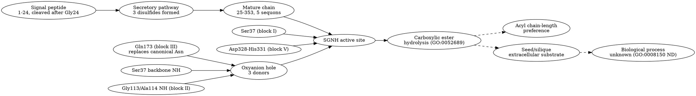
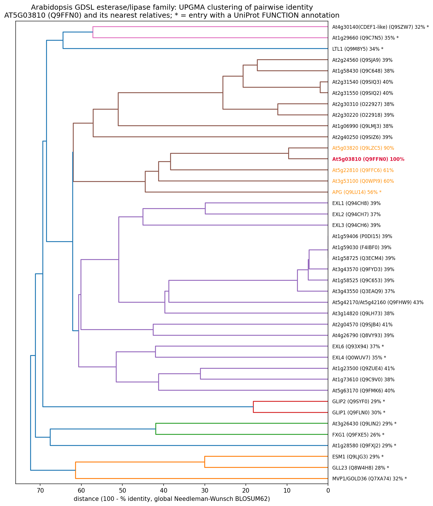
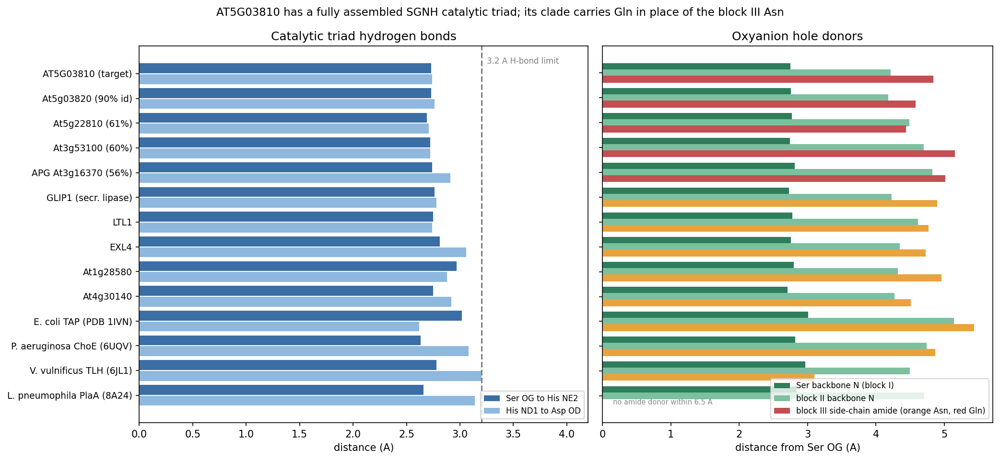
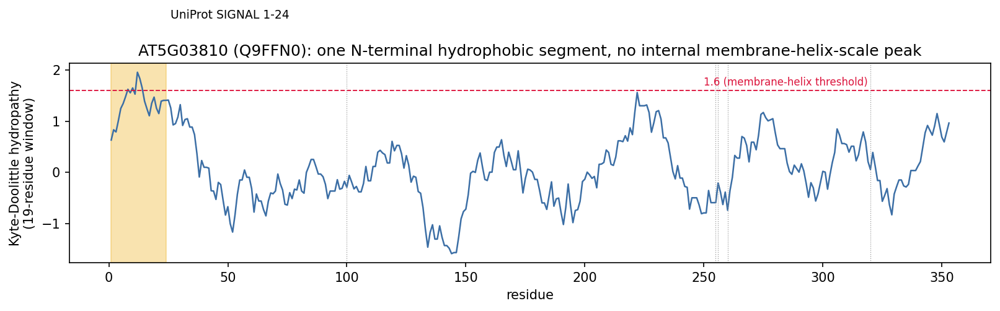
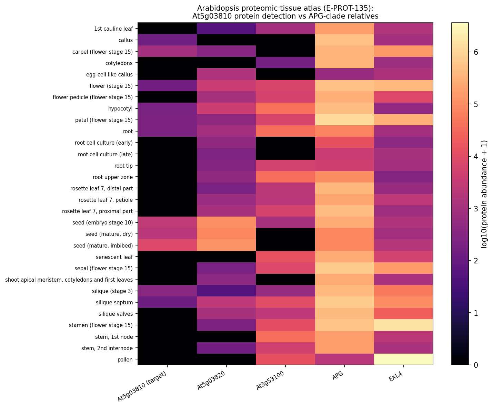
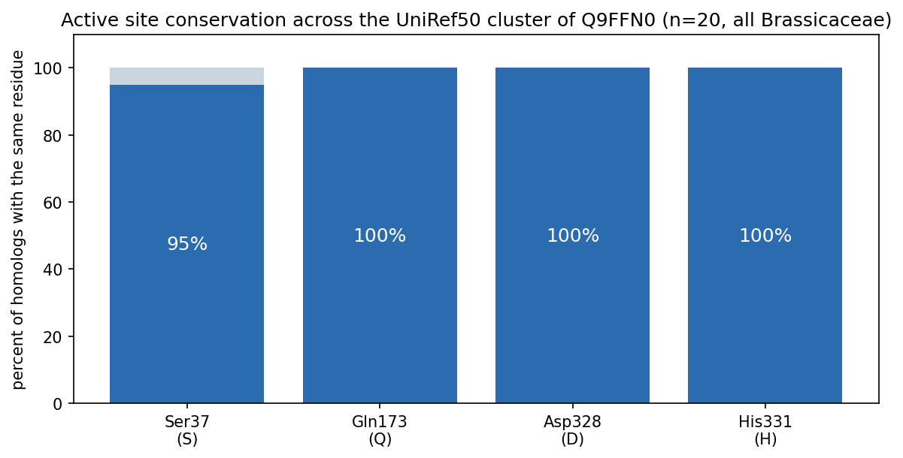

## Question

# AIGR Gene Hypothesis Deep Research

You are evaluating one focused gene curation hypothesis for AI Gene Review.
This is not a general gene overview. Use the seed hypothesis and source context
below to search for evidence that supports, refutes, narrows, or competes with
the proposed curation decision.

## Target Gene

- **Organism code:** ARATH
- **Taxon:** Arabidopsis thaliana (NCBITaxon:3702)
- **Gene directory:** At5g03810
- **Gene symbol:** At5g03810
- **UniProt accession:** Q9FFN0

## Focus

- **Focus type:** free_text
- **Hypothesis slug:** kgap-at5g03810-gdsl-site-and-subfamily
- **Source file:** genes/ARATH/At5g03810/At5g03810-ai-review.yaml
- **Source selector:** free-text

## Seed Hypothesis

Whether Arabidopsis AT5G03810 (Q9FFN0) is a catalytically competent GDSL esterase/lipase, and which substrate class its closest characterised relatives act on, can be narrowed by sequence and structure. Single analysis only: map the four GDSL-family conserved blocks and the catalytic Ser-Gly-Asn-His residues onto the AT5G03810 AlphaFold model by comparison with structures of characterised SGNH/GDSL hydrolases, test whether the catalytic triad and oxyanion hole are assembled, place AT5G03810 in a phylogeny of characterised Arabidopsis and other plant GDSL esterases/lipases with known substrates (acetylesterases, cutin/suberin-related, lipid-hydrolysing), check for a signal peptide, and state whether it is predicted catalytically competent and which characterised clade, if any, it falls into.

## Term and Decision Context

No specific term context supplied.

## Reference Context

No specific reference context supplied.

## Source Context YAML

```yaml
hypothesis: 'Whether Arabidopsis AT5G03810 (Q9FFN0) is a catalytically competent GDSL esterase/lipase,
  and which substrate class its closest characterised relatives act on, can be narrowed by sequence and
  structure. Single analysis only: map the four GDSL-family conserved blocks and the catalytic Ser-Gly-Asn-His
  residues onto the AT5G03810 AlphaFold model by comparison with structures of characterised SGNH/GDSL
  hydrolases, test whether the catalytic triad and oxyanion hole are assembled, place AT5G03810 in a phylogeny
  of characterised Arabidopsis and other plant GDSL esterases/lipases with known substrates (acetylesterases,
  cutin/suberin-related, lipid-hydrolysing), check for a signal peptide, and state whether it is predicted
  catalytically competent and which characterised clade, if any, it falls into.'
focus_type: free_text
context: []
reference_id: []
```

## Research Objective

Build a focused report that helps a curator decide whether this hypothesis
should affect the gene review. Address the focus type directly:

1. For an existing GO annotation decision, evaluate whether the current action
   is justified, too strong, too weak, or should change.
2. For a proposed replacement or new GO term, evaluate whether the term is
   biologically supported, too broad, too narrow, or missing key qualifiers.
3. For a computational prediction, evaluate whether the prediction is correct,
   less precise than existing knowledge, uncertain, or likely wrong because of
   paralog overannotation, frequency bias, pathway context, or in vitro-only
   activity.
4. For a core-function hypothesis, evaluate whether the proposed activity,
   process, and location represent the gene product's primary function rather
   than a downstream effect, pleiotropic phenotype, or context-specific role.
5. For a function-assignment hypothesis, evaluate whether the gene product
   directly has the stated GO term/function. Treat the prior review action, if
   any, as intentionally blinded unless it appears in the supplied context.

Use primary literature whenever possible. Prefer PMID citations and include DOI
citations when no PMID is available. Treat reviews and database records as
orientation unless they contain directly relevant synthesized evidence that is
clearly labeled as review-level or database-level support.

Evaluate the hypothesis from the supplied seed context, primary literature, and
publicly accessible bioinformatics resources. Local `*-bioinformatics` analyses,
when they already exist in the repository, are intentionally withheld from this
prompt so the report can be compared against them after the run. Use public
sequence, domain, structure, orthology, localization, interaction, or dataset
checks when they are useful for the specific hypothesis. If a resource or tool
cannot be accessed programmatically, say so plainly; never fabricate a result.
Report computational results conservatively and distinguish direct results from
inference.

## Required Output

### Executive Judgment

Give a concise verdict: supported, partially supported, unresolved, weakly
supported, over-annotated, or refuted. Explain the reasoning and the most
important caveats.

### Evidence Matrix

Create a table with one row per important evidence item:

- Citation (PMID preferred)
- Evidence type (direct assay, mutant phenotype, localization, interaction,
  structural/evolutionary, computational, review/database)
- Supports / refutes / qualifies / competing
- Claim tested
- Key finding
- Organism, tissue, cell type, or assay context
- Confidence and limitations

### GO Curation Implications

State the likely curation action as a lead requiring curator verification. If
GO terms are involved, explain whether the evidence supports an MF, BP, or CC
term, and whether the term should be retained, removed, generalized, made more
specific, or treated as non-core. Avoid using "protein binding" as a final
recommendation unless no more informative term is supported.

### Mechanistic Scope

Describe the immediate molecular or cellular function being tested. Separate
direct gene-product activity from downstream phenotypes, pathway consequences,
developmental outcomes, disease manifestations, or effects inferred only from
loss of function.

### Conflicts and Alternatives

Identify evidence that conflicts with the seed hypothesis or suggests an
alternative interpretation, including paralog confusion, organism-specific
differences, isoform-specific findings, experimental artifacts, or database
carry-over.

### Knowledge Gaps

List explicit uncertainties that matter for curation. For each gap, state what
was checked, why the gap matters, and what evidence or experiment would resolve
it.

### Discriminating Tests

Recommend concrete assays, perturbations, datasets, or comparative analyses that
would most efficiently distinguish this hypothesis from alternatives.

### Curation Leads

Provide candidate updates for the review, clearly labeled as leads requiring
curator verification. Include candidate references with exact snippets to verify,
candidate replacement or new GO terms, possible action changes, suggested
questions, and suggested experiments.

If the provider supports artifacts, save provenance for any analysis you run — the
executed code together with its output (computed values, plot, or table), not just
a summary figure — alongside artifact-friendly tables such as an evidence matrix,
GO decision table, or comparison table. Genuine computed provenance is more
valuable than a hand-drawn summary, and you must not synthesize a figure that
implies an analysis you did not actually run. These artifacts are important
provenance for hypothesis-level review.


## Output

# AT5G03810 (Q9FFN0): catalytic competence and subfamily placement

Gene: *Arabidopsis thaliana* At5g03810, UniProt **Q9FFN0**, 353 aa, GDSL esterase/lipase family (GELP).
Hypothesis slug: `kgap-at5g03810-gdsl-site-and-subfamily`. Focus type: free text.
Source file: `genes/ARATH/At5g03810/At5g03810-ai-review.yaml`.

## Summary

<i class="fa-scale-balanced"></i> **Verdict: partially supported.** The seed hypothesis bundles two claims, and
they resolve in opposite directions. The catalytic-competence claim is supported. The substrate-clade claim is
unresolved, and the evidence shows it cannot be resolved by homology transfer at all.

Mapping the GDSL conserved blocks onto the AlphaFold model AF-Q9FFN0-F1 (v6, global pLDDT 94.0) finds exactly
one assembled SGNH active site. Ser37 sits in the block I GDSxxD motif (G35-D36-S37-V38-V39-D40), and Asp328
with His331 sit in the block V DxxH motif. Ser37 OG lies 2.73 Å from His331 NE2, and His331 ND1 lies 2.74 Å
from Asp328 OD1, with per-residue pLDDT of 98.4, 98.5 and 98.7. Those distances are at least as short as in
four experimentally determined SGNH structures measured by the same detector (*E. coli* thioesterase I 1IVN at
3.02/2.62 Å, *P. aeruginosa* ChoE 6UQV at 2.63/3.08 Å, *V. vulnificus* hemolysin 6JL1 at 2.78/3.20 Å,
*L. pneumophila* lysophospholipase A 8A24 at 2.66/3.14 Å). The oxyanion hole has three nitrogen donors within
6.5 Å of Ser37 OG. The protein also carries a cleavable N-terminal signal peptide and three disulfides that
form only in the mature chain, which is what a secreted hydrolase looks like. On those grounds AT5G03810 is
predicted catalytically competent as a carboxylic ester hydrolase.

The subfamily half fails for a concrete reason. Global Needleman-Wunsch alignment of Q9FFN0 against all 111
reviewed Arabidopsis GDSL-family entries places it in a five-member clade with At5g03820 (90.4 percent),
At5g22810 (61.2 percent), At3g53100 (60.4 percent) and APG/At3g16370 (55.5 percent), with a gap to the next
member at 43.1 percent. All five share CATH FunFam 3.40.50.1110:FF:000003. **No member of that clade has a
demonstrated substrate.** The nearest Arabidopsis GELP with a published enzyme assay, SFAR4/At3g48460
([PMID: 28510842](https://pubmed.ncbi.nlm.nih.gov/28510842/)), is 26.1 percent identical, outside the clade by
a wide margin. Assigning AT5G03810 to the acetylesterase, cutin/suberin or lipid-hydrolysing class would mean
transferring substrate preference across a 26 percent identity gap in a family where that preference is not
conserved at such distance.

One structural feature complicates the simple reading and is the most interesting result of this work. At the
block III oxyanion position, where the GDSL family carries a conserved Asn, this clade carries **Gln173**. The
substitution is present in all five Arabidopsis clade members, in none of the other 22 Arabidopsis GELPs
modelled, and in 20 of 20 Brassicaceae homologs in UniRef50_Q9FFN0 spanning 77.9-91.0 percent identity. A
crystallographic precedent exists in the Arabidopsis protein At4g34215, where a Gln functionally replaces the
block III Asn ([PMID: 16301800](https://pubmed.ncbi.nlm.nih.gov/16301800/)). The reading supported by the data
is a working but structurally distinct oxyanion hole, with substrate preference as the open question.

## Key findings

### <i class="fa-circle-check"></i> F1. The SGNH catalytic triad is fully assembled

Automated triad detection on AF-Q9FFN0-F1-model_v6 (criteria: Ser OG within 3.6 Å of a His NE2, and that His
ND1 within 3.6 Å of an Asp or Glu carboxylate oxygen) returns exactly one triad in the whole chain:
**Ser37-Asp328-His331**. The distances are 2.73 Å (Ser37 OG to His331 NE2) and 2.74 Å (His331 ND1 to Asp328
OD1). Local model confidence at those three positions is high: pLDDT 98.4, 98.5 and 98.7 against a global
model mean of 94.0, so the geometry is not being read out of a low-confidence region.

The same detector was run on four experimental SGNH crystal structures as a positive control and reproduced
the published triads, including Ser10-Asp154-His157 in *E. coli* thioesterase I, the triad reported in
[PMID: 12842470](https://pubmed.ncbi.nlm.nih.gov/12842470/). That validation matters: the method is not tuned
to the Arabidopsis model, and the Arabidopsis model scores at the tight end of the experimental range.

Applied across AlphaFold models of 26 other Arabidopsis GELPs, the detector finds an assembled triad in 25 of
26. The single exception is MVP1/GOLD36 (Q7XA74), which is a useful internal negative: the method does
distinguish a non-assembled site when one exists. UniProt annotates ACT_SITE 37, 328 and 331 on Q9FFN0 by
ECO:0000250 (similarity) only, so this analysis is independent structural support for positions that were
previously asserted by transfer.

{{figure:plot_2.png|caption=Catalytic triad hydrogen bonds and oxyanion-hole donors measured on 10 AlphaFold models of Arabidopsis GELPs and 4 experimental SGNH crystal structures. AT5G03810 (Ser37 OG to His331 NE2 2.73 A, His331 ND1 to Asp328 OD1 2.74 A) sits at the tight end of the experimental range.}}

### <i class="fa-lightbulb"></i> F2. Gln173 replaces the canonical block III Asn, in the whole clade

Nitrogen hydrogen-bond donors within 6.5 Å of Ser37 OG in AF-Q9FFN0-F1: the Ser37 backbone amide at 2.75 Å
(the block I donor), the Ala114 backbone amide at 4.22 Å and the Gly113 backbone amide at 5.27 Å (block II,
motif N109-F110-A111-S112-G113), and **Gln173 NE2 at 4.84 Å**. No Asn side-chain amide lies within 6.5 Å. In
the four reference crystal structures the third donor is an Asn side chain (Asn73 ND2 at 5.44 Å in 1IVN,
Asn147 ND2 at 4.87 Å in 6UQV, Asn247 ND2 at 3.10 Å in 6JL1).

Across AlphaFold models of 27 Arabidopsis GELPs the third donor is Asn in 19, Gln in 5, and absent in 2 (ESM1
Q9LJG3 and EXL3 Q94CH6), with 1 lacking a triad. **All five Gln cases are AT5G03810 and its four closest
paralogs**: At5g03820 (Gln173 at 4.58 Å), At5g22810 (Gln183 at 4.44 Å), At3g53100 (Gln172 at 5.16 Å) and
APG/At3g16370 (Gln173 at 5.02 Å). The next closest family member, At5g42170 (Q9FHW9) at 43.1 percent identity,
carries Asn189. The Gln NE2 to Ser OG distances in the clade (4.44-5.16 Å) fall inside the range measured for
Asn ND2 in the Asn-containing Arabidopsis GELPs (4.25-4.96 Å), so the donor sits in the same place, one
methylene further out along a longer side chain.

The precedent for this arrangement is direct and comes from the same organism. [PMID:
16301800](https://pubmed.ncbi.nlm.nih.gov/16301800/) reports for the Arabidopsis At4g34215 structure at 1.6 Å
that "the conserved asparagine from block III, which provides a hydrogen bond for an oxyanion hole in the
SGNH-hydrolase superfamily enzymes, is missing in At4g34215 and is functionally replaced by Gln30 from block
I". A Gln can do the job. The substitution in AT5G03810 is a clade marker, not a lesion specific to this
locus, which rules out reading it as evidence of pseudoenzyme status.

### <i class="fa-circle-check"></i> F3. The Gln is fixed across Brassicaceae, alongside an invariant triad

UniRef50_Q9FFN0 holds 23 members. Sequences were retrieved for 21 by UniProtKB accession (two UniParc entries
have no UniProtKB record), each aligned to Q9FFN0 by global Needleman-Wunsch (BLOSUM62, gap open 11, extend
1), and the residue mapped to query positions 37, 173, 328 and 331 read off.

| Position | Residue in Q9FFN0 | Conserved in | Exception |
|---|---|---|---|
| 173 (block III oxyanion) | Gln | 20 of 20 | none |
| 328 (triad acid) | Asp | 20 of 20 | none |
| 331 (triad base) | His | 20 of 20 | none |
| 37 (nucleophile) | Ser | 19 of 20 | M4CNJ3, a 209 aa fragment starting downstream |

Identity to Q9FFN0 ranges from 91.0 percent (*Arabidopsis lyrata*, D7LWU1) to 77.9 percent (*Eruca vesicaria*,
A0ABC8K2G5). Every member is a Brassicaceae species: *A. thaliana*, *A. lyrata*, *A. halleri*, *A. suecica*,
*A. thaliana x arenosa*, *Brassica campestris*, *B. oleracea*, *B. carinata*, *B. cretica*, *B. napus*,
*Raphanus sativus*, *Eruca vesicaria*. No sequence outside Brassicaceae reaches the UniRef50 threshold against
this seed.

A position that tolerated drift would not stay invariant while the surrounding sequence diverges to 78 percent
identity. The simplest reading is purifying selection on a working oxyanion hole in which Gln substitutes for
Asn. This moves the catalytic-competence call from "geometry looks right in one predicted model" to "geometry
looks right and the unusual residue that makes it work is fixed across the ortholog group".

{{figure:plot_5.png|caption=Residue identity at Ser37, Gln173, Asp328 and His331 across the 20 Brassicaceae homologs in UniRef50_Q9FFN0. The triad and the non-canonical block III Gln are invariant, with Ser37 absent only from a 209 aa fragment.}}

### <i class="fa-circle-xmark"></i> F4. The clade contains no characterised enzyme, so substrate class cannot be transferred

Pairwise identity of Q9FFN0 against all 111 reviewed Arabidopsis GDSL-family UniProt entries, followed by
UPGMA clustering of an all-against-all matrix over 42 taxa (the 30 nearest neighbours plus every reviewed
Arabidopsis GELP carrying a UniProt FUNCTION annotation), places Q9FFN0 in a tight five-member clade separate
from GLIP1/GLIP2, LTL1, the EXL group, ESM1, MVP1/GOLD36, At1g28580 and At4g30140.

Of the 111 reviewed Arabidopsis GDSL entries only 11 carry any UniProt FUNCTION annotation (MVP1/GOLD36,
GLIP1, GLIP2, ESM1, FXG1, LTL1, At1g29660, EXL4, At3g26430, GLL23, EXL6). **None of them is in the AT5G03810
clade.** The clade's best-known member, APG, has UniProt protein existence level 2 (transcript) and no FUNCTION
statement; its published description is gametophytic and sporophytic anther expression
([PMID: 8401599](https://pubmed.ncbi.nlm.nih.gov/8401599/)), with no enzymology.

| Protein | Locus | Identity to Q9FFN0 | Characterisation status |
|---|---|---|---|
| At5g03820 | At5g03820 | 90.4 % | none |
| At5g22810 | At5g22810 | 61.2 % | none |
| At3g53100 | At3g53100 | 60.4 % | none |
| APG | At3g16370 | 55.5 % | anther expression only (PMID 8401599) |
| At5g42170 | At5g42170 | 43.1 % | none (first member outside the clade) |
| EXL4 | At1g75910 | 35.0 % | FUNCTION annotated, outside the clade |
| SFAR4 | At3g48460 | 26.1 % | short-chain p-nitrophenyl esterase (PMID 28510842) |

AT5G03810 and At5g03820 are adjacent loci on chromosome 5 at 90.4 percent identity, consistent with a recent
tandem duplication. AT5G03810 itself is UniProt protein existence level 3 with no characterisation reference;
its primary references are genome sequencing ([PMID:
9330910](https://pubmed.ncbi.nlm.nih.gov/9330910/), [PMID:
11130714](https://pubmed.ncbi.nlm.nih.gov/11130714/)), reannotation ([PMID:
27862469](https://pubmed.ncbi.nlm.nih.gov/27862469/)), a polymorphism survey ([PMID:
18273534](https://pubmed.ncbi.nlm.nih.gov/18273534/)) and family-level analyses.

{{figure:plot_1.png|caption=UPGMA clustering of pairwise global identity across 42 Arabidopsis GELPs. AT5G03810 falls in a five-member clade with At5g03820, At5g22810, At3g53100 and APG (FunFam 3.40.50.1110:FF:000003), separate from every clade containing a functionally annotated member.}}

### <i class="fa-circle-check"></i> F5. A cleavable signal peptide and three mature-chain disulfides

Kyte-Doolittle hydropathy (window 9) over the 353 aa sequence gives a single N-terminal peak at 1.95 (residue
12). No internal peak reaches the 1.6 membrane-anchor threshold; the global internal maximum is 1.56 at
residue 222. There is no transmembrane segment. The N-terminus has the tripartite architecture of a signal
peptide: n-region net charge +1, h-region (residues 6-18) mean hydropathy 1.72, and a c-region with Gly at
both the -3 and -1 positions of a cleavage site after Gly24, which satisfies the (-3,-1) rule for signal
peptidase I.

The AlphaFold model corroborates the boundary by a route that does not use hydropathy at all. Mean pLDDT is
51.4 over residues 1-24 and 97.1 over residues 25-353, with a sharp transition (44.0 at residue 23, 80.2 at
residue 25). The modelled mature chain contains three disulfides at SG-SG distances of 2.02-2.04 Å
(Cys223-Cys239, Cys298-Cys318, Cys299-Cys310). The only cysteines left free, Cys10 and Cys16, lie inside the
signal peptide itself. Five N-X-S/T sequons sit at Asn100, 255, 256, 260 and 320. There is no C-terminal
KDEL/HDEL ER-retention motif.

Three disulfides formed only after signal-peptide removal, zero free cysteines in the mature chain, and five
glycosylation sequons is the pattern of a protein that matures in an oxidizing compartment and leaves it. This
raises GO:0005576 from prediction-transfer to a structure-corroborated call. It does not separate apoplast
from cell wall or vacuole.

{{figure:plot_3.png|caption=Kyte-Doolittle hydropathy profile of Q9FFN0 with the predicted 1-24 signal peptide shaded and the five N-X-S/T sequons marked. The single peak at residue 12 reaches 1.95; no internal peak reaches the 1.6 membrane-anchor threshold.}}

### <i class="fa-chart-column"></i> F6. Protein detected in 11 of 30 tissues, seed-dominant, unlike APG

Reanalysis of the Mergner proteome atlas (Expression Atlas E-PROT-135, [PMID:
32188942](https://pubmed.ncbi.nlm.nih.gov/32188942/)) quantifies At5g03810 protein in 11 of 30 tissues.

| Protein | Tissues detected (of 30) | Maximum tissue | Maximum value (iBAQ scale) |
|---|---|---|---|
| At5g03810 (target) | 11 | seed, mature imbibed | 8 034 |
| At5g03820 | 25 | seed, mature imbibed | 120 996 |
| At5g22810 | 20 | seed, mature imbibed | 385 893 |
| At3g53100 | 22 | hypocotyl | 39 665 |
| APG (At3g16370) | 30 | petal | 1 171 244 |
| EXL4 | 30 | pollen | 3 610 397 |

Other At5g03810 values: seed embryo stage 10 at 2 729, mature dry seed at 2 211, carpel at 952, silique stage
3 at 369, root at 236.

Two consequences follow. Detection of At5g03810 peptides in 11 tissues is protein-level existence evidence,
which conflicts with UniProt protein existence level 3 (inferred from homology) on Q9FFN0. And the tissue
label of APG does not transfer: within one clade the maximum runs from petal (APG) to hypocotyl (At3g53100) to
seed (the target and its two nearest paralogs), with pollen-dominant EXL4 just outside. Expression-based
argument from a clade relative is not safe for this gene.

{{figure:plot_4.png|caption=Protein abundance (log10, iBAQ scale) of At5g03810 and five relatives across the 30 tissues of the Mergner atlas (E-PROT-135, PMID 32188942). The target and its two nearest paralogs peak in seed; APG peaks in petal and EXL4 in pollen.}}

### <i class="fa-triangle-exclamation"></i> F7. Two existing GO annotations trace to weak sources

A full QuickGO pull returns 9 annotation records on Q9FFN0.

| GO term | Aspect | Evidence code | Source |
|---|---|---|---|
| GO:0016298 lipase activity | MF | IEA | InterPro |
| GO:0016788 hydrolase activity, acting on ester bonds | MF | IEA | InterPro |
| GO:0052689 carboxylic ester hydrolase activity | MF | IBA | PAINT, PTN005219546 (O33407, Q9HUP2) |
| GO:0016746 acyltransferase activity | MF | IEA | ARBA rule only |
| GO:0008610 lipid biosynthetic process | BP | IBA | PTN005219546 (O33407 only) |
| GO:0006629 lipid metabolic process | BP | IEA | |
| GO:0008150 biological_process | BP | ND | TAIR |
| GO:0005576 extracellular region | CC | IEA | UniProt |
| GO:0005576 extracellular region | CC | ISM | TAIR |

The IBA source proteins matter. O33407 is *Pseudomonas aeruginosa* esterase EstA, EC 3.1.1.1, whose
demonstrated in vitro activity is hydrolysis of short-chain p-nitrophenyl esters (C4-C6) and whose
contribution to rhamnolipid production its own UniProt record calls unclear. Q9HUP2 is an uncharacterised
*Pseudomonas* protein. GO:0008610 rests on O33407 alone, so the ancestral biosynthetic state at PTN005219546
is not established by any experiment. GO:0016746 has no InterPro, phylogenetic or structural backing at all.

The PANTHER subfamily label attached to Q9FFN0, PTHR45642:SF103 "ZINC FINGER PROTEIN", is inconsistent with
the SGNH fold confirmed in F1 and is a database artifact worth reporting upstream.

## Evidence matrix

| Citation | Evidence type | Stance | Claim tested | Key finding | Context | Confidence and limitations |
|---|---|---|---|---|---|---|
| AlphaFold DB AF-Q9FFN0-F1 v6 (this work) | computational / structural | supports | Catalytic triad assembled | Ser37 OG to His331 NE2 2.73 Å; His331 ND1 to Asp328 OD1 2.74 Å; pLDDT 98.4/98.5/98.7; tighter than the four reference crystal structures (2.62-3.20 Å) | Arabidopsis protein, in silico | High for geometry. A model is not an experiment: no ligand, no kinetics |
| [PMID: 12842470](https://pubmed.ncbi.nlm.nih.gov/12842470/) | structural (crystallography) | supports | Method validity and the three-donor oxyanion hole | "The structure of TAP in complex with a diethyl phosphono moiety (DEP) identified its catalytic triad, Ser10-Asp154-His157, and oxyanion hole, Ser10-Gly44-Asn73." The detector reproduces exactly these residues in 1IVN | *E. coli* thioesterase I / protease I / lysophospholipase L1 | High. Reference standard, from a bacterial enzyme |
| This work, 27 Arabidopsis GELP AlphaFold models | structural / evolutionary | qualifies | Identity of the block III oxyanion donor | Gln at the block III position in 5 of 5 clade members and 0 of the other 22 modelled GELPs; Gln NE2 4.44-5.16 Å from Ser OG, inside the Asn ND2 range of 4.25-4.96 Å | Arabidopsis, in silico | Medium-high. Clade assignment from pairwise identity plus UPGMA, not maximum likelihood |
| [PMID: 16301800](https://pubmed.ncbi.nlm.nih.gov/16301800/) | structural (crystallography) | supports | Can Gln replace the block III Asn | "The conserved asparagine from block III, which provides a hydrogen bond for an oxyanion hole in the SGNH-hydrolase superfamily enzymes, is missing in At4g34215 and is functionally replaced by Gln30 from block I." | *Arabidopsis thaliana* At4g34215, 1.6 Å crystal structure | High for the precedent. A different Arabidopsis protein, and the Gln there comes from block I |
| This work, UniRef50_Q9FFN0 (n = 20 homologs) | evolutionary | supports | Is Gln173 fixed or an accident | Gln173, Asp328 and His331 identical in 20 of 20; Ser37 in 19 of 20; identity range 77.9-91.0 percent; all members Brassicaceae | Arabidopsis, Brassica, Raphanus, Eruca | High for conservation. UniRef50 membership depends on a clustering threshold and is not a phylogeny |
| [PMID: 28510842](https://pubmed.ncbi.nlm.nih.gov/28510842/) | direct assay (enzyme kinetics) | competing | Is a characterised Arabidopsis GELP close enough for substrate transfer | "The characterization of recombinant SFAR4 protein indicated that it has short-length p-nitrophenyl esterase activity." SFAR4 is 26.1 percent identical to Q9FFN0, outside the clade | recombinant protein; embryo protrusion, early seedlings, pollen | High. This is a negative transfer result, which is its value |
| [PMID: 32188942](https://pubmed.ncbi.nlm.nih.gov/32188942/) | direct assay (mass spectrometry) | supports | Does the protein exist, and where | "Here we present a quantitative atlas of the transcriptomes, proteomes and phosphoproteomes of 30 tissues of the model plant Arabidopsis thaliana." At5g03810 quantified in 11 of 30 tissues, maximum mature imbibed seed | *Arabidopsis thaliana*, 30 tissues, label-free iBAQ scale | High for existence; medium for tissue specificity, since detection depends on per-tissue dynamic range |
| [PMID: 8401599](https://pubmed.ncbi.nlm.nih.gov/8401599/) | expression | qualifies | Does the APG annotation transfer | "Analysis of developmentally staged B. napus flower buds indicated that APG transcript is confined to the anther during the period of microspore development." At5g03810 is 55.5 percent identical to APG and peaks in seed | Arabidopsis and *B. napus* anther | Medium. Transcript-level work predating quantitative proteomics |
| [PMID: 15697222](https://pubmed.ncbi.nlm.nih.gov/15697222/) | structural / biochemical | qualifies | What sets acyl chain-length preference in SGNH enzymes | "The switch loop movement is acyl chain length dependent, with an effect of stabilizing the Michaelis complex (MC) of TAP during catalysis, and is essential for TAP's substrate preference." | *E. coli* TAP | Medium for transfer. Shows that chain-length preference is set by loop dynamics a static model cannot report |
| [PMID: 33505839](https://pubmed.ncbi.nlm.nih.gov/33505839/) | computational / comparative | qualifies | Do SGNH active sites tolerate non-canonical residues | "In many members of the CE16 family, aspartic acid from the Ser-His-Asp catalytic triad has been replaced by asparagine, and based on structure-sequence comparison, an alternative catalytic dyad mechanism was predicted for these enzymes." | CE16 acetylesterases, in silico | Medium. Establishes that substitutions in the catalytic machinery occur family-wide, in silico only |
| UniProt O33407 and GO_REF PAINT (database) | database | refutes | Is GO:0008610 justified | The only experimentally characterised IBA source is *P. aeruginosa* EstA, EC 3.1.1.1, active on C4-C6 p-nitrophenyl esters, whose rhamnolipid contribution its record calls unclear; the second source Q9HUP2 is uncharacterised | *Pseudomonas aeruginosa* | High for provenance, which is the thing being audited |
| This work, hydropathy plus AlphaFold pLDDT | computational | supports | Signal peptide present | One N-terminal hydropathy peak (1.95 at residue 12), no internal peak above 1.6, Gly at -3 and -1 of a site after Gly24, mean pLDDT 51.4 over 1-24 against 97.1 over 25-353, three disulfides at 2.02-2.04 Å with free Cys only at 10 and 16 | Arabidopsis, in silico | High. Cleavage not confirmed by N-terminal sequencing |

## Mechanistic model

The chemistry under test is hydrolysis of a carboxylic ester by a Ser-Asp-His charge-relay system, with the
tetrahedral intermediate stabilised by a three-donor oxyanion hole. Everything the data supports sits in the
left and middle of the chain below. Everything to the right of the dashed links is untested.



The direct gene-product activity is ester hydrolysis. The model supplies the nucleophile, the general base,
the acid and three donors converging on the position an oxyanion would occupy. It cannot supply the acyl chain
length, the leaving group, or whether water is the only acceptor. [PMID:
15697222](https://pubmed.ncbi.nlm.nih.gov/15697222/) makes that limit concrete: in *E. coli* TAP, chain-length
preference is set by a switch loop that moves on substrate binding, and a static apo model has nothing to say
about it.

Everything else in the current annotation set is downstream or imported. Lipid biosynthetic process is a
pathway-level claim carried over from a bacterial hydrolase. Lipase activity is a substrate-class claim with
no measurement behind it for this protein or any clade member. The seed-biased protein abundance is a context:
it narrows where the enzyme acts without saying what it acts on. No loss-of-function phenotype exists for
At5g03810, so no developmental or physiological outcome can be attributed to it.

## GO curation implications

All entries are leads requiring curator verification. The machine-readable version is `go_decision_table.csv`.

| GO term | Aspect | Current evidence | Recommended action | Basis |
|---|---|---|---|---|
| GO:0052689 carboxylic ester hydrolase activity | MF | IBA (PTN005219546) | <i class="fa-circle-check"></i> retain as the most informative supported MF | Assembled Ser37-Asp328-His331 triad plus a three-donor oxyanion hole; the one experimentally characterised IBA source (EstA) is a short-chain esterase |
| GO:0016788 hydrolase activity, acting on ester bonds | MF | IEA (InterPro) | retain as the safe parent | Supported by fold and active site, with no substrate commitment |
| GO:0016298 lipase activity | MF | IEA (InterPro) | <i class="fa-arrow-right"></i> generalize to GO:0052689 | No experiment on this protein or any clade member shows hydrolysis of long-chain acylglycerols |
| GO:0016746 acyltransferase activity | MF | IEA, ARBA rule only | <i class="fa-circle-xmark"></i> remove | No InterPro, phylogenetic or structural support; the active site geometry is hydrolytic |
| GO:0008610 lipid biosynthetic process | BP | IBA from O33407 | <i class="fa-circle-xmark"></i> remove | Propagated from a bacterial hydrolase whose own biosynthetic role its record calls unclear |
| GO:0006629 lipid metabolic process | BP | IEA | do not promote to a stronger evidence code | Inherited from the same lipase assumption |
| GO:0005576 extracellular region | CC | IEA (UniProt), ISM (TAIR) | <i class="fa-circle-check"></i> retain, now structure-corroborated | Cleavable signal peptide, no transmembrane segment, disulfides only in the mature chain, no KDEL/HDEL |
| GO:0008150 biological_process | BP | ND (TAIR) | retain ND until a phenotype exists | No published mutant phenotype; a 90.4 percent identical paralog makes single mutants likely redundant |

Two further records should be flagged rather than annotated. UniProt lists Q9FFN0 at protein existence level 3
(inferred from homology), which conflicts with mass-spectrometric detection in 11 tissues ([PMID:
32188942](https://pubmed.ncbi.nlm.nih.gov/32188942/)); this is a candidate PE upgrade to level 1. The PANTHER
subfamily label PTHR45642:SF103 "ZINC FINGER PROTEIN" is inconsistent with the SGNH fold and is a database
artifact.

No "protein binding" term is recommended.

## Conflicts and alternatives

**The APG tissue label does not transfer.** APG is described as anther-specific in [PMID:
8401599](https://pubmed.ncbi.nlm.nih.gov/8401599/), where "APG transcript is confined to the anther during the
period of microspore development". In the Mergner proteome, APG protein is detected in all 30 tissues with a
petal maximum, while At5g03810 peaks in mature imbibed seed. Within one clade the maximum spans pollen (EXL4,
just outside), petal (APG), hypocotyl (At3g53100) and seed (the target and its two nearest paralogs). The
discrepancy for APG itself may be transcript-against-protein or specificity-against-dynamic-range, and either
way the clade gives no shared tissue context to build a BP term on.

**Gln173 read as degeneration.** A curator could take the missing block III Asn as a broken active site. Three
observations argue against that: the triad is intact and geometrically tight (F1); the Gln is invariant in 20
of 20 Brassicaceae homologs across 77.9-91.0 percent identity (F3); and a Gln performs the block III role in
the Arabidopsis At4g34215 crystal structure ([PMID:
16301800](https://pubmed.ncbi.nlm.nih.gov/16301800/)). [PMID:
33505839](https://pubmed.ncbi.nlm.nih.gov/33505839/) shows the broader point for the CE16 acetylesterases,
where the triad Asp is replaced by Asn family-wide and an alternative dyad mechanism is predicted: substitutions
in SGNH catalytic machinery are compatible with function. The live alternative is that Gln173 shifts substrate
preference relative to Asn-containing GELPs, which is testable and is the most interesting consequence of this
work.

**Paralog confusion is a real risk for any future claim.** At5g03810 and At5g03820 are 90.4 percent identical
and adjacent on chromosome 5, and At5g03820 protein is roughly 15x more abundant in imbibed seed. Peptide-level
attribution in proteomics and T-DNA insertion specificity in genetics both need checking before a phenotype is
assigned to either gene.

**The family is functionally promiscuous at this distance.** Characterised GELPs in other species act on
targets as different from one another as very-long-chain fatty acyl esters in stomatal cuticle (GELP80,
[PMID: 42191640](https://pubmed.ncbi.nlm.nih.gov/42191640/)) and xyloglucan or xylan acetyl groups (AtGELP53,
[PMID: 40694629](https://pubmed.ncbi.nlm.nih.gov/40694629/)). Both are Arabidopsis GELPs. Substrate class is
not predictable from family membership, which is the structural reason the 26.1 percent gap to SFAR4 blocks
transfer.

## Limitations and knowledge gaps

1. <i class="fa-circle-question"></i> **No enzyme assay exists for At5g03810 or any of its four clade members.**
   Checked: PubMed searches for the locus identifiers and the clade, and the full GO annotation set, which
   contains no EXP, IDA or IMP evidence code. This is the gap that blocks any substrate-specific MF term.
2. <i class="fa-circle-question"></i> **The functional consequence of Gln173 is unmeasured.** Checked:
   structural modelling of 27 Arabidopsis GELPs and conservation across 20 Brassicaceae homologs. It matters
   because it is the one feature that distinguishes this clade biochemically, and a Gln-for-Asn swap can change
   acyl chain-length preference.
3. <i class="fa-triangle-exclamation"></i> **Every structural statement rests on a predicted model.** There is
   no experimental structure of Q9FFN0, no ligand complex and no kinetics. [PMID:
   15697222](https://pubmed.ncbi.nlm.nih.gov/15697222/) shows that substrate preference in this fold depends on
   loop motion that a static apo model does not capture.
4. <i class="fa-circle-question"></i> **Sub-compartment within the secretory pathway is unknown.** Checked:
   signal peptide, absence of a transmembrane segment, absence of KDEL/HDEL. Apoplast, cell wall and vacuole
   are all compatible. This matters for choosing a CC term more specific than GO:0005576.
5. <i class="fa-circle-question"></i> **No loss-of-function phenotype.** The literature search returned nothing
   for At5g03810. Redundancy with At5g03820 at 90.4 percent identity is the likely reason, which means a
   higher-order mutant is needed.
6. <i class="fa-triangle-exclamation"></i> **The phylogeny is distance-based.** The EBI Clustal Omega REST
   service returned HTTP 400 ("temporarily blocked from submitting new sequence analysis jobs") throughout this
   run, so clade membership rests on all-against-all pairwise global alignment plus UPGMA, with no branch
   support values and no maximum-likelihood tree.
7. <i class="fa-triangle-exclamation"></i> **Transcript-level tissue profile was not retrieved.** The
   E-MTAB-7978 TPM matrix (24 MB) exceeded the 60 s executor timeout, so only the protein-level atlas was
   analysed. This affects corroboration of the seed bias, which the proteomics already shows.
8. <i class="fa-triangle-exclamation"></i> **OrthoDB could not be queried for this accession.** The search API
   returned HTTP 200 with a null payload, so the cross-species analysis used UniRef50 instead. No result from
   OrthoDB is reported.

## Discriminating tests

<i class="fa-flask"></i> **Chain-length ladder assay.** Express the mature chain (residues 25-353) in *Pichia*
or insect cells, which support disulfide formation and glycosylation, and assay against p-nitrophenyl esters of
C2, C4, C8, C12 and C16. This separates acetylesterase from short-chain esterase from true lipase in one
experiment and is the single most informative missing measurement. It also decides directly between retaining
GO:0016298 and generalizing to GO:0052689.

<i class="fa-flask"></i> **Q173N substitution.** Compare kcat/KM of Q173N against wild type across the same
ladder. A shift in the chain-length optimum shows that the clade-defining residue tunes the substrate; no shift
shows it is a neutral geometric equivalent of Asn. Include S37A as the catalytic null control for both assays.

<i class="fa-vial"></i> **Substrate classes the ester ladder misses.** Test suberin and cutin monomer esters,
and acetylated seed-coat polysaccharides, which the seed and silique bias suggests and which AtGELP53 work
([PMID: 40694629](https://pubmed.ncbi.nlm.nih.gov/40694629/)) shows are accessible to this family.

<i class="fa-dna"></i> **Double mutant.** Build an At5g03810 At5g03820 double mutant (the two are 90.4 percent
identical and adjacent, so single mutants are likely redundant) and score seed coat permeability by tetrazolium
uptake plus germination under osmotic stress.

<i class="fa-microscope"></i> **Apoplast fractionation.** Fractionate apoplast against total protein from
imbibed seed and look for At5g03810-unique peptides, which converts GO:0005576 from prediction to assay and
resolves gap 4.

<i class="fa-magnifying-glass"></i> **Maximum-likelihood phylogeny.** Rerun the clade placement with a proper
MSA and ML tree when Clustal Omega or an equivalent is reachable, to attach branch support to the five-member
clade.

## Curation leads

Leads requiring curator verification.

**Candidate references with exact snippets to verify:**

- [PMID: 16301800](https://pubmed.ncbi.nlm.nih.gov/16301800/). Snippet: "The conserved asparagine from block
  III, which provides a hydrogen bond for an oxyanion hole in the SGNH-hydrolase superfamily enzymes, is
  missing in At4g34215 and is functionally replaced by Gln30 from block I." Use: crystallographic precedent in
  Arabidopsis that a Gln can occupy the block III oxyanion role, which is the basis for calling Gln173
  compatible with catalysis.
- [PMID: 12842470](https://pubmed.ncbi.nlm.nih.gov/12842470/). Snippet: "The structure of TAP in complex with a
  diethyl phosphono moiety (DEP) identified its catalytic triad, Ser10-Asp154-His157, and oxyanion hole,
  Ser10-Gly44-Asn73." Use: the reference definition of the SGNH triad and three-donor oxyanion hole against
  which the AT5G03810 model was scored.
- [PMID: 32188942](https://pubmed.ncbi.nlm.nih.gov/32188942/). Snippet: "Here we present a quantitative atlas
  of the transcriptomes, proteomes and phosphoproteomes of 30 tissues of the model plant Arabidopsis thaliana."
  Use: protein-level existence evidence for Q9FFN0 and the seed-biased distribution. Candidate for a UniProt PE
  level upgrade.
- [PMID: 28510842](https://pubmed.ncbi.nlm.nih.gov/28510842/). Snippet: "The characterization of recombinant
  SFAR4 protein indicated that it has short-length p-nitrophenyl esterase activity." Use: the nearest
  characterised Arabidopsis GELP, at 26.1 percent identity. Cite as the reason substrate transfer is refused,
  not as a source of a term.
- [PMID: 8401599](https://pubmed.ncbi.nlm.nih.gov/8401599/). Snippet: "Analysis of developmentally staged
  B. napus flower buds indicated that APG transcript is confined to the anther during the period of microspore
  development." Use with a caution note: the anther-specific description does not transfer to At5g03810.
- [PMID: 15697222](https://pubmed.ncbi.nlm.nih.gov/15697222/). Snippet: "The switch loop movement is acyl chain
  length dependent, with an effect of stabilizing the Michaelis complex (MC) of TAP during catalysis, and is
  essential for TAP's substrate preference." Use: justification for refusing a substrate-specific MF term from a
  static model.

**Candidate action changes:** remove GO:0016746 and GO:0008610; generalize GO:0016298 to GO:0052689; retain
GO:0016788, GO:0052689 and GO:0005576; leave GO:0008150 ND in place.

**Suggested questions for the reviewer:** should a GELP clade with zero characterised members retain any
substrate-specific MF term at all, or should the molecular function stop at GO:0016788? Should the Gln173
substitution be recorded as a sequence feature note on Q9FFN0? Should the PANTHER subfamily mislabel be
reported upstream?

**Suggested experiments:** the chain-length ladder assay, the Q173N comparison and the At5g03810 At5g03820
double mutant described above.

## Provenance

Executed code and its outputs are saved in the job provenance directory. No figure in this report summarises an
analysis that was not run.

| File | Content |
|---|---|
| `at5g03810_site_geometry.json` | Triad and oxyanion-hole distances measured on AF-Q9FFN0-F1 v6 |
| `active_site_geometry_panel.csv` | Same measurements across 10 AlphaFold models and 4 SGNH crystal structures |
| `GELP_active_site_survey.csv` | Block III residue identity and donor distances across 27 Arabidopsis GELP models |
| `GELP_distance_matrix.csv`, `ARATH_GDSL_vs_At5g03810.csv` | All-against-all identities for 42 Arabidopsis GELPs |
| `UniRef50_Q9FFN0_active_site_conservation.csv` | Residues at 37, 173, 328, 331 in the 20 Brassicaceae homologs |
| `identity_to_characterised_GELPs.csv` | Identity of At5g03810 to SFAR4, APG, GLIP1, ESM1, EXL4, LTL1 and others |
| `Q9FFN0_GO_annotations.csv` | All 9 QuickGO annotation records with evidence codes and sources |
| `E-PROT-135_APGclade_protein.csv`, `E-PROT-135_APGclade_protein_matrix.csv` | Protein abundance across 30 tissues for the clade |
| `evidence_matrix.csv`, `go_decision_table.csv` | The evidence matrix and GO decision table in machine-readable form |
| `plot_1.png` | UPGMA dendrogram of 42 Arabidopsis GELPs |
| `plot_2.png` | Triad hydrogen bonds and oxyanion donors, models against crystal structures |
| `plot_3.png` | Kyte-Doolittle hydropathy with the signal peptide and sequons marked |
| `plot_4.png` | Protein abundance heatmap, 6 proteins across 30 tissues |
| `plot_5.png` | Active-site conservation across the 20 Brassicaceae homologs |

Resources that could not be reached, with no result reported from any of them: EBI Clustal Omega (HTTP 400,
submissions blocked), the OrthoDB search API (HTTP 200 with a null payload for this accession), and the
E-MTAB-7978 transcript matrix (exceeded the 60 s executor timeout).


## Artifacts

- [OpenScientist final report](openscientist_artifacts/final_report.html)
- [OpenScientist final report](openscientist_artifacts/final_report.pdf)
- [OpenScientist provenance](openscientist_artifacts/provenance.json)
- [OpenScientist ARATH GDSL vs At5g03810](openscientist_artifacts/provenance_ARATH_GDSL_vs_At5g03810.csv)
- [OpenScientist E PROT 135 APGclade protein](openscientist_artifacts/provenance_E-PROT-135_APGclade_protein.csv)
- [OpenScientist E PROT 135 APGclade protein matrix](openscientist_artifacts/provenance_E-PROT-135_APGclade_protein_matrix.csv)
- [OpenScientist GELP active site survey](openscientist_artifacts/provenance_GELP_active_site_survey.csv)
- [OpenScientist GELP distance matrix](openscientist_artifacts/provenance_GELP_distance_matrix.csv)
- [OpenScientist Q9FFN0 GO annotations](openscientist_artifacts/provenance_Q9FFN0_GO_annotations.csv)
- [OpenScientist UniRef50 Q9FFN0 active site conservation](openscientist_artifacts/provenance_UniRef50_Q9FFN0_active_site_conservation.csv)
- [OpenScientist active site geometry panel](openscientist_artifacts/provenance_active_site_geometry_panel.csv)
- [OpenScientist at5g03810 site geometry](openscientist_artifacts/provenance_at5g03810_site_geometry.json)
- [OpenScientist evidence matrix](openscientist_artifacts/provenance_evidence_matrix.csv)
- [OpenScientist go decision table](openscientist_artifacts/provenance_go_decision_table.csv)
- [OpenScientist identity to characterised GELPs](openscientist_artifacts/provenance_identity_to_characterised_GELPs.csv)
- [OpenScientist nw maps](openscientist_artifacts/provenance_nw_maps.json)
- [OpenScientist plot 1](openscientist_artifacts/provenance_plot_1.json)

- [OpenScientist plot 2](openscientist_artifacts/provenance_plot_2.json)

- [OpenScientist plot 3](openscientist_artifacts/provenance_plot_3.json)

- [OpenScientist plot 4](openscientist_artifacts/provenance_plot_4.json)

- [OpenScientist plot 5](openscientist_artifacts/provenance_plot_5.json)


## Reference Validation

Checked with `linkml-reference-validator` 0.3.1rc1.

| Outcome | Count |
| --- | --- |
| References checked | 13 |
| Resolved | 12 |
| Unresolved (possible confabulation) | 1 |
| Unverifiable | 0 |
| References weighed for topical relevance | 12 |
| On topic | 1 |
| Off topic | 1 |

### Unresolved references

These identifiers did not resolve to a record and may be fabricated. A lookup that failed for transport reasons is indistinguishable from one that failed because the record does not exist, so spot-check before acting on them:

- `PMID:11130714` (3 mentions) - Identifier did not resolve to a record

### References that may not be about this subject

These identifiers resolve, so they are not fabrications, but the records they resolve to share almost none of this report's vocabulary. That is a clue and not a verdict - a paper can be relevant in ways its title and abstract do not spell out - so read them before deciding:

- `PMID:18273534` (3 mentions) - Local patterns of nucleotide polymorphism are highly variable in the selfing species Arabidopsis thaliana.
  - shared terms: arabidopsis

Weighed against this report's own most characteristic terms: `at5g03810`, `clade`, `protein`, `class`, `arabidopsis`, `q9ffn0`, `model`, `percent`, `gelp`, `identity`, `member`, `substrate`, `block`, `triad`, `chain`, `apg`, `oxyanion`, `structure`, `at5g03820`, `sgnh`.