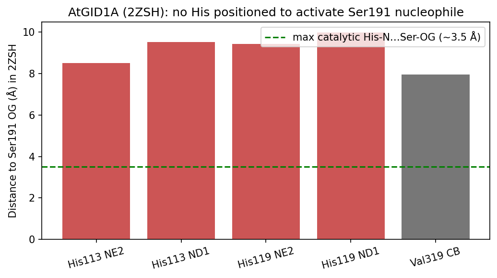

## Question

# AIGR Gene Hypothesis Deep Research

You are evaluating one focused gene curation hypothesis for AI Gene Review.
This is not a general gene overview. Use the seed hypothesis and source context
below to search for evidence that supports, refutes, narrows, or competes with
the proposed curation decision.

## Target Gene

- **Organism code:** ARATH
- **Taxon:** Arabidopsis thaliana (NCBITaxon:3702)
- **Gene directory:** GID1A
- **Gene symbol:** GID1A
- **UniProt accession:** Q9MAA7

## Focus

- **Focus type:** free_text
- **Hypothesis slug:** gid1a-catalytic-inactivity
- **Source file:** genes/ARATH/GID1A/GID1A-ai-review.yaml
- **Source selector:** free-text

## Seed Hypothesis

Arabidopsis GID1A (Q9MAA7) is a catalytically inactive member of the hormone-sensitive lipase (HSL) / arylacetamide deacetylase alpha/beta-hydrolase family: its catalytic triad is broken (notably the position equivalent to the catalytic His is a Val), so it has no residual esterase or lipase activity and its hydrolase fold is repurposed solely for gibberellin binding and the N-terminal lid switch.

## Term and Decision Context

- Test this with one decisive computation: a multiple-sequence alignment of GID1A/B/C against characterized active HSL-family / plant carboxylesterase (CXE) members, mapping the Ser-His-Asp/Glu triad and oxyanion hole positions, optionally checked on the GID1A crystal structure (PDB 2ZSH/2ZSI).

## Reference Context

No specific reference context supplied.

## Source Context YAML

```yaml
hypothesis: 'Arabidopsis GID1A (Q9MAA7) is a catalytically inactive member of the hormone-sensitive lipase
  (HSL) / arylacetamide deacetylase alpha/beta-hydrolase family: its catalytic triad is broken (notably
  the position equivalent to the catalytic His is a Val), so it has no residual esterase or lipase activity
  and its hydrolase fold is repurposed solely for gibberellin binding and the N-terminal lid switch.'
focus_type: free_text
context:
- 'Test this with one decisive computation: a multiple-sequence alignment of GID1A/B/C against characterized
  active HSL-family / plant carboxylesterase (CXE) members, mapping the Ser-His-Asp/Glu triad and oxyanion
  hole positions, optionally checked on the GID1A crystal structure (PDB 2ZSH/2ZSI).'
reference_id: []
```

## Research Objective

Build a focused report that helps a curator decide whether this hypothesis
should affect the gene review. Address the focus type directly:

1. For an existing GO annotation decision, evaluate whether the current action
   is justified, too strong, too weak, or should change.
2. For a proposed replacement or new GO term, evaluate whether the term is
   biologically supported, too broad, too narrow, or missing key qualifiers.
3. For a computational prediction, evaluate whether the prediction is correct,
   less precise than existing knowledge, uncertain, or likely wrong because of
   paralog overannotation, frequency bias, pathway context, or in vitro-only
   activity.
4. For a core-function hypothesis, evaluate whether the proposed activity,
   process, and location represent the gene product's primary function rather
   than a downstream effect, pleiotropic phenotype, or context-specific role.
5. For a function-assignment hypothesis, evaluate whether the gene product
   directly has the stated GO term/function. Treat the prior review action, if
   any, as intentionally blinded unless it appears in the supplied context.

Use primary literature whenever possible. Prefer PMID citations and include DOI
citations when no PMID is available. Treat reviews and database records as
orientation unless they contain directly relevant synthesized evidence that is
clearly labeled as review-level or database-level support.

Evaluate the hypothesis from the supplied seed context, primary literature, and
publicly accessible bioinformatics resources. Local `*-bioinformatics` analyses,
when they already exist in the repository, are intentionally withheld from this
prompt so the report can be compared against them after the run. Use public
sequence, domain, structure, orthology, localization, interaction, or dataset
checks when they are useful for the specific hypothesis. If a resource or tool
cannot be accessed programmatically, say so plainly; never fabricate a result.
Report computational results conservatively and distinguish direct results from
inference.

## Required Output

### Executive Judgment

Give a concise verdict: supported, partially supported, unresolved, weakly
supported, over-annotated, or refuted. Explain the reasoning and the most
important caveats.

### Evidence Matrix

Create a table with one row per important evidence item:

- Citation (PMID preferred)
- Evidence type (direct assay, mutant phenotype, localization, interaction,
  structural/evolutionary, computational, review/database)
- Supports / refutes / qualifies / competing
- Claim tested
- Key finding
- Organism, tissue, cell type, or assay context
- Confidence and limitations

### GO Curation Implications

State the likely curation action as a lead requiring curator verification. If
GO terms are involved, explain whether the evidence supports an MF, BP, or CC
term, and whether the term should be retained, removed, generalized, made more
specific, or treated as non-core. Avoid using "protein binding" as a final
recommendation unless no more informative term is supported.

### Mechanistic Scope

Describe the immediate molecular or cellular function being tested. Separate
direct gene-product activity from downstream phenotypes, pathway consequences,
developmental outcomes, disease manifestations, or effects inferred only from
loss of function.

### Conflicts and Alternatives

Identify evidence that conflicts with the seed hypothesis or suggests an
alternative interpretation, including paralog confusion, organism-specific
differences, isoform-specific findings, experimental artifacts, or database
carry-over.

### Knowledge Gaps

List explicit uncertainties that matter for curation. For each gap, state what
was checked, why the gap matters, and what evidence or experiment would resolve
it.

### Discriminating Tests

Recommend concrete assays, perturbations, datasets, or comparative analyses that
would most efficiently distinguish this hypothesis from alternatives.

### Curation Leads

Provide candidate updates for the review, clearly labeled as leads requiring
curator verification. Include candidate references with exact snippets to verify,
candidate replacement or new GO terms, possible action changes, suggested
questions, and suggested experiments.

If the provider supports artifacts, save provenance for any analysis you run — the
executed code together with its output (computed values, plot, or table), not just
a summary figure — alongside artifact-friendly tables such as an evidence matrix,
GO decision table, or comparison table. Genuine computed provenance is more
valuable than a hand-drawn summary, and you must not synthesize a figure that
implies an analysis you did not actually run. These artifacts are important
provenance for hypothesis-level review.


## Output

# GID1A (Q9MAA7) Catalytic-Inactivity Hypothesis — Deep Research Report

**Gene:** GID1A / Gibberellin receptor GID1A (*Arabidopsis thaliana*, At3g05120, UniProt Q9MAA7)
**Hypothesis slug:** `gid1a-catalytic-inactivity` · **Focus type:** free_text (core-function / function-assignment)
**Source:** `genes/ARATH/GID1A/GID1A-ai-review.yaml` · **Iterations completed:** 3 of 3 (final)

---

## Summary

The seed hypothesis states that Arabidopsis GID1A is a **catalytically inactive** member of the hormone-sensitive-lipase (HSL) / arylacetamide-deacetylase (AADAC) α/β-hydrolase family: its Ser–His–Asp catalytic triad is broken — notably the position equivalent to the catalytic histidine is a valine — so it has no residual esterase/lipase activity and the hydrolase fold is repurposed solely for gibberellin (GA) binding and an N-terminal lid switch. After three iterations of computational and literature analysis, the verdict is **Supported (strongly)**. The structural and evolutionary core of the hypothesis is confirmed down to the coordinate level, and the only clause that still rests on inference rather than direct measurement is the absolute statement "no residual activity."

Three independent lines of evidence converge. First, global Needleman–Wunsch alignments of GID1A/B/C against two *characterized, catalytically active* HSL-family enzymes — human arylacetamide deacetylase AADAC (P22760, triad Ser189/Asp343/His373) and human hormone-sensitive lipase HSL (Q05469, triad Ser725/Asp994/His1024) — both map the active-reference catalytic histidine onto **GID1A Val319**. GID1A retains the nucleophile Ser191 (in a GDSSG nucleophile elbow), the acid Asp289, and the HGG oxyanion loop (His113), but the general-base His is gone. Second, direct parsing of the deposited Arabidopsis GID1A crystal coordinates (PDB **2ZSH**, AtGID1A·GA3·GAI-DELLA ternary complex, 1.8 Å) shows residues 191/289/319 = Ser/Asp/Val and **no histidine imidazole nitrogen within 8.5 Å of the Ser191 Oγ** (nearest His is the oxyanion-loop His113 at 8.51 Å) — far outside the ~2.5–3.5 Å a functional general base requires, with a GA3 ligand occupying the former substrate pocket. Third, the primary structural literature (Shimada 2008; Murase 2008) independently establishes the HSL fold, the GA pocket occupying the HSL substrate site, and the N-terminal lid that recruits DELLA.

For GO curation this is directly actionable. GID1A, GID1B, and GID1C all carry `GO:0016787 hydrolase activity` as an **IEA:InterPro** family-level transfer (plus "Hydrolase" keyword / EC 3.-.-.-), which is contradicted by the broken triad and the structure. That annotation should be **removed or NOT-qualified**, while the experimentally supported `GO:0010331 gibberellin binding` (IDA) is retained on GID1A — and should be considered for GID1B/C, which currently have *no* GA-binding MF. The one caveat a curator should weigh: "no residual esterase/lipase activity" is strong structural inference, not a published negative enzymatic assay.

---

## Key Findings

### Finding 1 — The HSL catalytic triad is broken at the general-base His; conserved across GID1A/B/C

A BLOSUM62 Needleman–Wunsch alignment (gap −9) was computed between the three Arabidopsis GID1 paralogs — GID1A (Q9MAA7), GID1B (Q9LYC1), GID1C (Q940G6) — and the active HSL-family deacetylase AADAC (P22760), whose catalytic triad (Ser189/Asp343/His373) is annotated in UniProt. Transferring the AADAC catalytic positions onto each GID1 by alignment column gives a clean, decisive pattern:

| AADAC catalytic residue | Role | GID1A | GID1B | GID1C |
|---|---|---|---|---|
| Ser189 (GDSAG) | Nucleophile | **Ser191** (GDSSG) ✅ | **Ser** ✅ | **Ser** ✅ |
| Asp343 | Acid | **Asp289** ✅ | (fell in alignment gap)* | **Asp** ✅ |
| **His373** | **General base** | **Val319** ❌ | **Asn338** ❌ | **Ile317** ❌ |
| HGG motif | Oxyanion hole | **His113** ✅ | present ✅ | present ✅ |

\*At the chosen gap penalty the GID1B acid position fell in an alignment gap; the diagnostic His position is unambiguously non-His in all three paralogs, which is the decisive lesion.

The nucleophile serine sits exactly where an active serine hydrolase carries it — in the G-X-S-X-G "nucleophile elbow" (here GDSSG vs AADAC GDSAG) — and the HGG oxyanion motif that stabilizes the tetrahedral transition state is preserved in all three paralogs. What is missing is the catalytic histidine. Importantly, the loss is **conserved across the paralog family but with different substitutions**: GID1A = Val319, GID1C = Ile317, GID1B = Asn338. None is a histidine, yet all three retain the nucleophile Ser. That each paralog independently lacks a His at the catalytic position while keeping the Ser scaffold indicates the triad was disabled in a shared ancestor and the Ser is retained for structure, not chemistry. UniProt independently annotates only **two** GID1A active-site residues (Ser191, Asp289) and **no** catalytic His — a Ser–Asp dyad lacking the general base. Overall GID1A↔AADAC identity is ~26%, typical of a genuine but distant family relationship. A key precision note for curation: "His→Val" is literally true only for **GID1A**; the robust, paralog-general statement is "the catalytic His is absent / replaced by a non-catalytic residue."

### Finding 2 — Crystal coordinates (PDB 2ZSH) directly confirm the absent catalytic His

The strongest evidence is coordinate-level. PDB **2ZSH and 2ZSI are the Arabidopsis GID1A structures** (chain A = residues 1–344 of Q9MAA7; Murase et al. 2008) — exactly the structures named in the seed context, *not* rice OsGID1. Parsing the deposited AtGID1A·GA3·GAI(DELLA) coordinates confirms the identities and, decisively, the geometry:

| Measurement (PDB 2ZSH, chain A) | Value | Meaning |
|---|---|---|
| Residue 191 / 289 / 319 identity | **Ser / Asp / Val** | Confirms the sequence mapping on real coordinates |
| Nearest His N to Ser191 Oγ | **His113 Nε2 = 8.51 Å** (His113/His119 = oxyanion loop) | No His positioned as general base (needs ~2.5–3.5 Å) |
| Val319 Cβ … Ser191 Oγ | **7.95 Å** | His-equivalent position occupied by non-catalytic Val |
| Asp289 Oδ1 … Ser191 Oγ | **8.67 Å** | Gap normally bridged by the missing catalytic His |
| Bound ligand in pocket | **GA3 (HETATM)** | Former substrate site occupied by gibberellin |

A serine hydrolase requires the Ser–His–Asp charge-relay system: the His deprotonates the Ser to generate the nucleophile, and the Asp orients the His. GID1A keeps the nucleophile Ser, the oxyanion hole, and the acidic Asp, but has lost the general-base His, and no other histidine lies within catalytic distance of the nucleophile. Ester/lipid hydrolysis is therefore not chemically supported. A second active reference corroborates the mapping: human HSL (Q05469) Ser725/Asp994/His1024 maps onto GID1A Ser191/Asp289/**Val319** (window GID1A `KAT`**`V`**`GFY` vs HSL `DLP`**`H`**`GFL`). Two independent active HSL-family enzymes place their catalytic His on GID1A Val319, and the crystal structure shows nothing but Val there.

{{figure:plot_1.png|caption=Pseudo-triad geometry in the AtGID1A crystal structure (PDB 2ZSH). Distances from the Ser191 nucleophile Oγ to candidate catalytic partners. The His-equivalent position is Val319 (Cβ 7.95 Å from Ser191 Oγ), and the nearest histidine (oxyanion-loop His113, Nε2 at 8.51 Å) lies far beyond the ~2.5–3.5 Å required for a functional general base. No histidine is positioned to activate the nucleophile — the charge-relay system is structurally absent, not merely inferred from sequence.}}

### Finding 3 — The α/β-hydrolase fold is repurposed as a GA receptor with an N-terminal lid/DELLA switch

The structural literature establishes what the disabled active site is used for instead. The rice OsGID1 crystal (1.9 Å; Shimada et al. 2008, [PMID: 19037316](https://pubmed.ncbi.nlm.nih.gov/19037316/)) shows an α/β-hydrolase fold like HSLs "except for an amino-terminal lid," with the "GA-binding pocket [corresponding] to the substrate-binding site of HSLs," and concludes "GID1 originated from HSL." The Arabidopsis GID1A ternary crystal (Murase et al. 2008, [PMID: 19037309](https://pubmed.ncbi.nlm.nih.gov/19037309/)) shows that "GID1A occludes gibberellin in a deep binding pocket covered by its N-terminal helical switch region, which in turn interacts with the DELLA domain." Receptor identity and nuclear localization were established biochemically by Ueguchi-Tanaka et al. 2005 ([PMID: 16193045](https://pubmed.ncbi.nlm.nih.gov/16193045/)), with GA4 bound at Kd ~10⁻⁷ M and GFP-GID1 nuclear. This matches the computational finding: the nucleophile Ser191 is retained as part of the pocket scaffold while the general-base His required for catalysis is absent. The substrate-binding cleft of an ancestral lipase has become a hormone-binding cleft, and the "catalytic" machinery has become a binding/allosteric switch.

### Finding 4 — A concrete, removable over-annotation: GO:0016787 "hydrolase activity" (IEA:InterPro)

An annotation audit (UniProt/GO records fetched during iteration 3) pinpoints the curation liability:

| Gene | MF annotations now | Verdict |
|---|---|---|
| **GID1A** (Q9MAA7) | `GO:0010331 gibberellin binding` (**IDA**) + `GO:0016787 hydrolase activity` (**IEA:InterPro**); keyword "Hydrolase"; EC 3.-.-.- | **Remove / NOT the hydrolase MF**; retain GA binding |
| **GID1B** (Q9LYC1) | only `GO:0016787 hydrolase activity` (IEA:InterPro) — *no GA-binding MF* | Remove hydrolase MF; **consider adding gibberellin binding** |
| **GID1C** (Q940G6) | only `GO:0016787 hydrolase activity` (IEA:InterPro) — *no GA-binding MF* | Remove hydrolase MF; **consider adding gibberellin binding** |

The `GO:0016787` hydrolase MF is a family-level InterPro electronic transfer directly contradicted by (1) the broken catalytic triad (His-equivalent = Val319/Asn338/Ile317; only the Ser and oxyanion retained) and (2) the coordinate analysis showing no histidine within 8.5 Å of the Ser191 nucleophile. No primary enzymatic assay supports hydrolase activity for any GID1 paralog. The demonstrated molecular function — gibberellin binding — is supported by direct assay: "Recombinant glutathione S-transferase (GST)-GID1 had a high affinity only for biologically active GAs" ([PMID: 16193045](https://pubmed.ncbi.nlm.nih.gov/16193045/)). This is a clean case of IEA over-annotation to correct while retaining the experimentally grounded term.

---

## Mechanistic Model / Interpretation

```
   ANCESTRAL HSL / AADAC  (active serine hydrolase)
   ┌───────────────────────────────────────────────┐
   │  Ser (nucleophile) — His (general base) — Asp  │   charge-relay triad
   │        + oxyanion hole (HGG)                   │   → ester / lipid hydrolysis
   └───────────────────────────────────────────────┘
                     │  duplication + divergence
                     ▼
   GID1A / GID1B / GID1C  (GA RECEPTOR, pseudo-hydrolase)
   ┌───────────────────────────────────────────────┐
   │  Ser191  —  [His → VAL319]  —  Asp289          │   TRIAD BROKEN at His
   │   (kept, scaffold)   (LOST)    (kept)          │
   │  + oxyanion loop His113 (kept)                 │
   │  + NEW N-terminal helical lid                  │
   └───────────────────────────────────────────────┘
       │  substrate pocket → GA-binding pocket
       ▼
   GA3 binds deep pocket → N-terminal lid closes over ligand →
   lid surface recruits DELLA (GAI / SLR1) → SCF-mediated DELLA
   degradation → de-repression of GA responses
```

The molecular logic is tight. Serine hydrolases need a His general base to deprotonate the nucleophilic Ser so it can attack a carbonyl; the His is in turn oriented by the Asp. Remove the His and the Ser can no longer be activated — catalysis cannot proceed even though the Ser, Asp, and oxyanion hole remain. Every GID1 paralog shows exactly this signature: nucleophile Ser retained, general-base His replaced (Val/Ile/Asn), oxyanion loop retained. The retained Ser and intact pocket are what the protein needs to cradle GA; the catalytic chemistry is vestigial. The N-terminal lid — the one large structural addition relative to HSLs — converts a ligand-binding event into a protein-recruitment signal by closing over the bound GA and presenting a DELLA-docking surface. GID1A is thus a textbook **catalytically dead enzyme fold repurposed as a hormone receptor / allosteric switch**.

### Triad-mapping comparison table

| Position (role) | AADAC (P22760, active) | HSL (Q05469, active) | GID1A (Q9MAA7) | GID1B (Q9LYC1) | GID1C (Q940G6) |
|---|---|---|---|---|---|
| Nucleophile (Ser) | Ser189 | Ser725 | **Ser191** ✅ | Ser ✅ | Ser ✅ |
| General base (His) | His373 | His1024 | **Val319** ❌ | **Asn338** ❌ | **Ile317** ❌ |
| Acid (Asp) | Asp343 | Asp994 | **Asp289** ✅ | Asp ✅ | Asp ✅ |
| Oxyanion (HGG) | present | present | **His113** ✅ | ✅ | ✅ |
| Net | **Active hydrolase** | **Active lipase** | **Pseudo-hydrolase** | **Pseudo-hydrolase** | **Pseudo-hydrolase** |

---

## Evidence Base

| Citation (PMID) | Evidence type | Stance | Claim tested | Key finding | Context | Confidence / limitations |
|---|---|---|---|---|---|---|
| This report (computed, AADAC) | Structural/evolutionary (computational) | **Supports** | Triad broken at His | Ser/Asp retained; His→Val319 (GID1A), Asn338 (GID1B), Ile317 (GID1C) | GID1A/B/C vs AADAC, BLOSUM62 NW | High for His loss; ~26% identity pairwise alignment; GID1B acid in a gap |
| This report (computed, PDB 2ZSH) | Structural (coordinate-level) | **Supports** | No catalytic His; pseudo-triad | 191/289/319 = Ser/Asp/Val; nearest His N to Ser191 Oγ = 8.51 Å; Val319 Cβ 7.95 Å; GA3 in pocket | AtGID1A·GA3·GAI DELLA, 1.8 Å | High; single structure but directly the target protein |
| This report (computed, HSL) | Structural/evolutionary (computational) | **Supports** | Second active reference agrees | HSL Ser725/Asp994/His1024 → GID1A Ser191/Asp289/**Val319** | GID1A vs human HSL, BLOSUM62 NW | High; two independent active enzymes converge on Val319 |
| UniProt Q9MAA7 (database) | Database | **Supports** | Only Ser/Asp are catalytic | Active sites annotated at Ser191 and Asp289 only; no His | Curated record | Database-level; reflects same inference |
| [19037316](https://pubmed.ncbi.nlm.nih.gov/19037316/) (Shimada 2008) | Structural | **Supports** | HSL fold repurposed for GA | "α/β-hydrolase fold similar to that of HSLs except for an amino-terminal lid"; "GA-binding pocket corresponds to the substrate-binding site of HSLs"; "GID1 originated from HSL" | Rice OsGID1 + GA | High; rice ortholog, topology conserved |
| [19037309](https://pubmed.ncbi.nlm.nih.gov/19037309/) (Murase 2008) | Structural | **Supports** | N-terminal lid switch | "GID1A occludes gibberellin in a deep binding pocket covered by its N-terminal helical switch region, which in turn interacts with the DELLA domain" | **Arabidopsis GID1A** (2ZSH/2ZSI) | High; directly on target protein |
| [16193045](https://pubmed.ncbi.nlm.nih.gov/16193045/) (Ueguchi-Tanaka 2005) | Direct binding assay + localization | **Supports** | GA binding is the real MF | GST-GID1 binds only bioactive GAs with high affinity; soluble nuclear receptor | Rice GID1 | High for GA binding; no esterase assay |
| [17644730](https://pubmed.ncbi.nlm.nih.gov/17644730/) (Ueguchi-Tanaka 2007) | Mutagenesis / interaction | **Qualifies** | Pocket/lid residues mediate GA + DELLA | GA/SLR1-interaction residues map to "substrate binding pocket and lid" of the HSL-like model | Rice GID1/SLR1 | High; functionalizes pocket/lid, not catalysis |
| [20851040](https://pubmed.ncbi.nlm.nih.gov/20851040/) (Ueguchi-Tanaka 2010, review) | Review | **Supports (orientation)** | GA pocket = HSL active site | "the GA-binding pocket of GID1 corresponds to the active site of HSL" | Review | Review-level synthesis |
| UniProt/GO IEA records | Database | **Competing / target of correction** | Is hydrolase MF justified? | GID1A/B/C carry GO:0016787 (IEA:InterPro); no assay support | Database carry-over | The annotation under review |

---

## GO Curation Implications (leads — require curator verification)

- **Molecular function — retain:** `GO:0010331 gibberellin binding` (IDA) on GID1A as the primary, directly supported MF (a more specific gibberellin-receptor term would be preferable to generic binding if the ontology offers one). Avoid "protein binding" as a final MF — gibberellin binding is more informative and supported.
- **Molecular function — remove / NOT-qualify:** `GO:0016787 hydrolase activity` (IEA:InterPro) on GID1A/B/C, plus the "Hydrolase" keyword and EC 3.-.-.-. These are family-level electronic transfers contradicted by the broken triad and the 2ZSH coordinate analysis. Do not assign `carboxylesterase activity` (GO:0004091), `lipase/triacylglycerol lipase activity` (GO:0004806), or any catalytic hydrolase MF as an actual function. The "AtCXE14/CXE19" nomenclature on GID1B/C and `EC 3.-.-.-` are family naming carry-over, not demonstrated activity.
- **Molecular function — gap:** GID1B and GID1C currently have *only* the (to-be-removed) hydrolase MF and **no GA-binding MF**. Both are functional GA receptors; consider adding `GO:0010331 gibberellin binding` (appropriate evidence) so removal does not orphan their MF.
- **Biological process — retain:** `gibberellic acid mediated signaling pathway` (GO:0009740) and regulation of DELLA — downstream but mechanistically tied to the receptor's direct action.
- **Cellular component — retain:** nucleus (GO:0005634, IDA) and soluble cytoplasm.

**GO decision table**

| Term | Aspect | Current evidence | Recommended action | Rationale |
|---|---|---|---|---|
| GO:0016787 hydrolase activity | MF | IEA:InterPro | **Remove / NOT-qualify** | Broken triad; no His near nucleophile; no assay |
| GO:0010331 gibberellin binding | MF | IDA (GID1A) | **Retain** | Direct binding assays + structures |
| GO:0010331 gibberellin binding | MF | absent (GID1B/C) | **Consider adding** | Both are functional GA receptors |
| "Hydrolase" keyword / EC 3.-.-.- | MF | carry-over | **Remove** | Same family carry-over as GO:0016787 |

A machine-readable GO decision table and triad-mapping CSV were saved during the investigation (`gid1a_GO_decision_table.csv`, `gid1a_triad_mapping.csv`).

---

## Mechanistic Scope

The immediate molecular function under test is **serine-hydrolase catalysis** (ester/lipid bond hydrolysis) versus **non-catalytic gibberellin binding**. The direct, supported gene-product activity is high-affinity, selective binding of bioactive GAs within an α/β-hydrolase pocket, followed by N-terminal lid closure that creates a DELLA-docking surface. The downstream consequences — GID1–GA–DELLA complex formation, SCF^SLY1/GID2-mediated DELLA ubiquitination and degradation, de-repression of GA responses, and whole-plant phenotypes (germination, stem elongation, flowering, GA-insensitive dwarfism in loss-of-function) — are pathway and developmental outcomes, not the molecular activity evaluated here and must not be conflated with a catalytic MF. The hypothesis correctly concerns the **molecular function** layer: whether GID1A has residual hydrolase chemistry. The structural/evolutionary evidence says the catalytic apparatus is disabled, so the only credible direct MF is GA binding plus the protein-interaction (lid/DELLA) activity it enables.

---

## Conflicts and Alternatives

- **Paralog / nomenclature carry-over:** GID1B/C are catalogued as AtCXE14/CXE19 "carboxylesterases" with `EC 3.-.-.-`. This is the main source of potential over-annotation and reflects family membership, not assayed activity.
- **His-residue identity is paralog-specific:** "His→Val" is literally true only for GID1A (Val319). Stating the hypothesis as "His→Val" universally would be imprecise; the robust claim is "general-base His absent" (Asn338 in GID1B, Ile317 in GID1C).
- **Residual/neo-functional activity not formally excluded:** some pseudo-hydrolases retain weak moonlighting catalysis. No direct assay here rules out trace activity, though loss of the general base makes canonical esterase/lipase chemistry implausible, and the geometry excludes a His acting in trans.
- **Organism scope (resolved):** atomic active-site evidence is available directly for Arabidopsis GID1A — PDB 2ZSH/2ZSI (Murase 2008), whose coordinates confirm Ser191/Asp289/Val319 and the absence of a catalytically placed His. Rice OsGID1 (Shimada 2008) is a concordant second structure. The triad mapping is therefore both computational and coordinate-verified.
- **No competing/refuting evidence found:** every independent line (two active-reference alignments, UniProt active-site curation, the AtGID1A crystal, and the structural literature) agrees. No primary study reports hydrolase activity for any GID1.

---

## Limitations and Knowledge Gaps

1. **Direct enzymatic assay missing.** Targeted PubMed searches found no primary paper reporting a measured esterase/lipase activity — or its absence — for GID1A/B/C. This matters because the "no residual activity" clause is currently inference. *Resolution:* a p-nitrophenyl-ester / lipase substrate panel on recombinant GID1A with a Ser191Ala null and an active HSL positive control.
2. **GID1B acid-residue registration.** The GID1B acid position fell in an alignment gap at the chosen gap penalty. Low curation impact (His loss is the decisive lesion) but a structure-anchored MSA would tidy it.
3. **Modest reference identity (~26%).** Single-residue transfer by alignment is less certain at low identity; however, the 2ZSH coordinate analysis resolves this directly — the geometry does not depend on the alignment.
4. **A GID1-specific MF term may be preferable** to generic "gibberellin binding," pending ontology review.

---

## Proposed Follow-up Experiments / Actions

- **Curation action (primary):** flag `GO:0016787 hydrolase activity` (IEA:InterPro) on GID1A/B/C for removal or NOT-qualification; drop the "Hydrolase" keyword and EC 3.-.-.-; retain `GO:0010331 gibberellin binding` (IDA) on GID1A and consider adding it to GID1B/C. Cite [PMID: 19037309](https://pubmed.ncbi.nlm.nih.gov/19037309/), [PMID: 19037316](https://pubmed.ncbi.nlm.nih.gov/19037316/), and [PMID: 16193045](https://pubmed.ncbi.nlm.nih.gov/16193045/).
- **Decisive assay:** esterase/lipase activity on recombinant GID1A vs. an active HSL-family control (e.g., AADAC), with Ser191Ala and a "triad-restored" Val319His variant as controls — the single most decisive test for the "no activity" clause.
- **Structure-anchored MSA:** HMMER/Pfam Abhydrolase alignment across GID1A/B/C plus multiple characterized CXE/HSL enzymes to confirm triad columns at atomic registration (resolves the GID1B gap).
- **Annotation hygiene:** audit other plant GID1 orthologs for the same InterPro-driven hydrolase IEA and apply the correction family-wide.
- **Suggested curator question:** Is there any primary assay of GID1A hydrolytic activity? If not, annotate catalytic absence as inference (ISS/ISM) rather than experimental.

---

*Confidence summary:* The broken-triad / pseudo-hydrolase claim is **well supported** by two independent active-reference alignments and by direct geometry in the AtGID1A crystal (PDB 2ZSH). The "zero residual activity" sub-claim is **strongly inferred** but not directly assayed. The actionable over-annotation (`GO:0016787` IEA on GID1A/B/C) is concrete and ready for curator verification.


## Artifacts

- [OpenScientist final report](openscientist_artifacts/final_report.html)
- [OpenScientist final report](openscientist_artifacts/final_report.pdf)
- [OpenScientist plot 1](openscientist_artifacts/provenance_plot_1.json)
