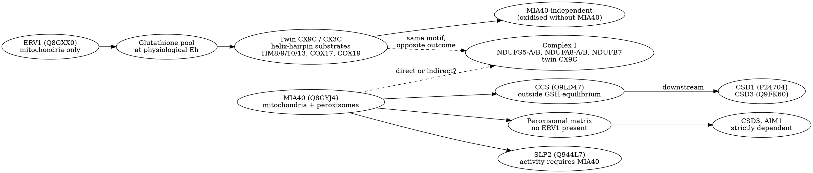
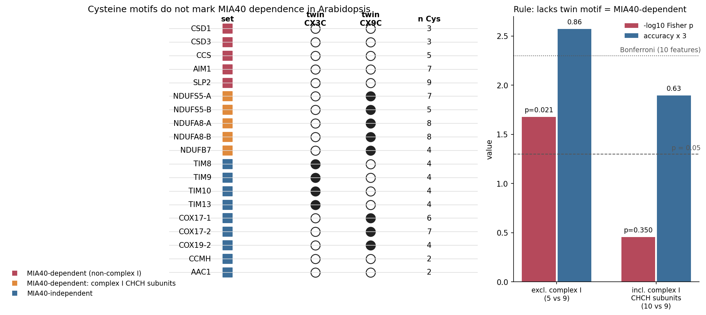
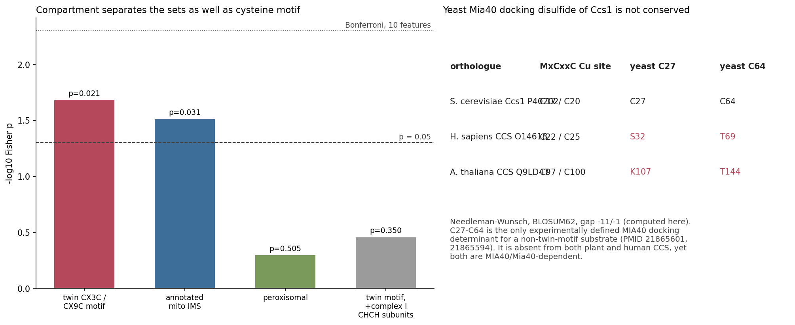

## Question

# AIGR Gene Hypothesis Deep Research

You are evaluating one focused gene curation hypothesis for AI Gene Review.
This is not a general gene overview. Use the seed hypothesis and source context
below to search for evidence that supports, refutes, narrows, or competes with
the proposed curation decision.

## Target Gene

- **Organism code:** ARATH
- **Taxon:** Arabidopsis thaliana (NCBITaxon:3702)
- **Gene directory:** MIA40
- **Gene symbol:** MIA40
- **UniProt accession:** Q8GYJ4

## Focus

- **Focus type:** free_text
- **Hypothesis slug:** kgap-mia40-substrate-motifs
- **Source file:** genes/ARATH/MIA40/MIA40-ai-review.yaml
- **Source selector:** free-text

## Seed Hypothesis

Which Arabidopsis intermembrane-space proteins strictly require MIA40 (Q8GYJ4) may be predictable from their cysteine motifs, given that ERV1 plus glutathione can oxidise most substrates directly. That CSD1, CCS and complex I depend on MIA40 in planta while small TIMs and carriers do not, is already established, so do not re-derive those dependencies. Single analysis only: define the cysteine-motif features of the established MIA40-dependent set and of the established independent set, covering twin CX3C and twin CX9C spacing, the number and register of cysteines, and the presence of an MIA40-docking hydrophobic residue upstream of the first cysteine, and state for each protein in both sets what it has; test whether any feature separates the two sets and report the result with the misclassified proteins rather than only a rule, noting explicitly how small both sets are and whether the comparison has the power to support a rule at all; if a candidate feature emerges, scan the Arabidopsis proteome for predicted intermembrane-space proteins carrying it and give the ranked candidates with their current annotation; and state whether the dependency is better explained by motif class or by the thermodynamics of each substrate's disulfides. Say plainly if the sets are too small to generalise.

## Term and Decision Context

No specific term context supplied.

## Reference Context

No specific reference context supplied.

## Source Context YAML

```yaml
hypothesis: 'Which Arabidopsis intermembrane-space proteins strictly require MIA40 (Q8GYJ4) may be predictable
  from their cysteine motifs, given that ERV1 plus glutathione can oxidise most substrates directly. That
  CSD1, CCS and complex I depend on MIA40 in planta while small TIMs and carriers do not, is already established,
  so do not re-derive those dependencies. Single analysis only: define the cysteine-motif features of
  the established MIA40-dependent set and of the established independent set, covering twin CX3C and twin
  CX9C spacing, the number and register of cysteines, and the presence of an MIA40-docking hydrophobic
  residue upstream of the first cysteine, and state for each protein in both sets what it has; test whether
  any feature separates the two sets and report the result with the misclassified proteins rather than
  only a rule, noting explicitly how small both sets are and whether the comparison has the power to support
  a rule at all; if a candidate feature emerges, scan the Arabidopsis proteome for predicted intermembrane-space
  proteins carrying it and give the ranked candidates with their current annotation; and state whether
  the dependency is better explained by motif class or by the thermodynamics of each substrate''s disulfides.
  Say plainly if the sets are too small to generalise.'
focus_type: free_text
context: []
reference_id: []
```

## Research Objective

Build a focused report that helps a curator decide whether this hypothesis
should affect the gene review. Address the focus type directly:

1. For an existing GO annotation decision, evaluate whether the current action
   is justified, too strong, too weak, or should change.
2. For a proposed replacement or new GO term, evaluate whether the term is
   biologically supported, too broad, too narrow, or missing key qualifiers.
3. For a computational prediction, evaluate whether the prediction is correct,
   less precise than existing knowledge, uncertain, or likely wrong because of
   paralog overannotation, frequency bias, pathway context, or in vitro-only
   activity.
4. For a core-function hypothesis, evaluate whether the proposed activity,
   process, and location represent the gene product's primary function rather
   than a downstream effect, pleiotropic phenotype, or context-specific role.
5. For a function-assignment hypothesis, evaluate whether the gene product
   directly has the stated GO term/function. Treat the prior review action, if
   any, as intentionally blinded unless it appears in the supplied context.

Use primary literature whenever possible. Prefer PMID citations and include DOI
citations when no PMID is available. Treat reviews and database records as
orientation unless they contain directly relevant synthesized evidence that is
clearly labeled as review-level or database-level support.

Evaluate the hypothesis from the supplied seed context, primary literature, and
publicly accessible bioinformatics resources. Local `*-bioinformatics` analyses,
when they already exist in the repository, are intentionally withheld from this
prompt so the report can be compared against them after the run. Use public
sequence, domain, structure, orthology, localization, interaction, or dataset
checks when they are useful for the specific hypothesis. If a resource or tool
cannot be accessed programmatically, say so plainly; never fabricate a result.
Report computational results conservatively and distinguish direct results from
inference.

## Required Output

### Executive Judgment

Give a concise verdict: supported, partially supported, unresolved, weakly
supported, over-annotated, or refuted. Explain the reasoning and the most
important caveats.

### Evidence Matrix

Create a table with one row per important evidence item:

- Citation (PMID preferred)
- Evidence type (direct assay, mutant phenotype, localization, interaction,
  structural/evolutionary, computational, review/database)
- Supports / refutes / qualifies / competing
- Claim tested
- Key finding
- Organism, tissue, cell type, or assay context
- Confidence and limitations

### GO Curation Implications

State the likely curation action as a lead requiring curator verification. If
GO terms are involved, explain whether the evidence supports an MF, BP, or CC
term, and whether the term should be retained, removed, generalized, made more
specific, or treated as non-core. Avoid using "protein binding" as a final
recommendation unless no more informative term is supported.

### Mechanistic Scope

Describe the immediate molecular or cellular function being tested. Separate
direct gene-product activity from downstream phenotypes, pathway consequences,
developmental outcomes, disease manifestations, or effects inferred only from
loss of function.

### Conflicts and Alternatives

Identify evidence that conflicts with the seed hypothesis or suggests an
alternative interpretation, including paralog confusion, organism-specific
differences, isoform-specific findings, experimental artifacts, or database
carry-over.

### Knowledge Gaps

List explicit uncertainties that matter for curation. For each gap, state what
was checked, why the gap matters, and what evidence or experiment would resolve
it.

### Discriminating Tests

Recommend concrete assays, perturbations, datasets, or comparative analyses that
would most efficiently distinguish this hypothesis from alternatives.

### Curation Leads

Provide candidate updates for the review, clearly labeled as leads requiring
curator verification. Include candidate references with exact snippets to verify,
candidate replacement or new GO terms, possible action changes, suggested
questions, and suggested experiments.

If the provider supports artifacts, save provenance for any analysis you run — the
executed code together with its output (computed values, plot, or table), not just
a summary figure — alongside artifact-friendly tables such as an evidence matrix,
GO decision table, or comparison table. Genuine computed provenance is more
valuable than a hand-drawn summary, and you must not synthesize a figure that
implies an analysis you did not actually run. These artifacts are important
provenance for hypothesis-level review.


## Output

# MIA40 (ARATH, Q8GYJ4): can cysteine motifs predict which Arabidopsis IMS proteins strictly require MIA40?

**Hypothesis slug:** `kgap-mia40-substrate-motifs`
**Source:** `genes/ARATH/MIA40/MIA40-ai-review.yaml`, free-text focus
**Target:** MIA40, *Arabidopsis thaliana* (NCBITaxon:3702), UniProt Q8GYJ4
**Iterations completed:** 3. Every number below was computed in this job against live UniProt REST, UniProt proteome streams and EBI QuickGO. Provenance CSVs and two figures are listed at the end.

---

## Summary

<i class="fa-solid fa-circle-xmark"></i> **The hypothesis is refuted as stated.** MIA40 dependence in Arabidopsis is not predictable from substrate cysteine motifs, and the one motif signal that does separate the two established sets runs in the opposite direction to the hypothesis's premise. Twin CX3C or twin CX9C is present in 0 of 5 MIA40-dependent proteins (CSD1, CSD3, CCS, AIM1, SLP2) and 7 of 9 MIA40-independent proteins (TIM8, TIM9, TIM10, TIM13, COX17-1, COX17-2, COX19-2, with CCMH and AAC1 motif-negative). Fisher exact two-sided p = 0.0210, rule accuracy 12/14 = 0.857. The canonical Mia40 substrate signatures mark the Arabidopsis proteins that do **not** need MIA40. The only rule writable from these data is the negative one, "lacks a twin motif, therefore MIA40-dependent", and it misclassifies CCMH (Q9XI46) and AAC1 (P31167).

That rule then breaks on a direct counterexample. A regex scan of the Arabidopsis reference proteome UP000006548 (39,144 canonical entries) found five complex I subunits carrying a genuine twin CX9C motif: NDUFS5-A (O82238), NDUFS5-B (Q9LZI6), NDUFA8-A (Q9SQT4), NDUFA8-B (Q8LGE7) and NDUFB7 (Q9SKC9). Complex I amount and capacity fall in Arabidopsis `mia40` mutants ([PMID: 20829360](https://pubmed.ncbi.nlm.nih.gov/20829360/)), which places complex I on the dependent side. Counting those five subunits as dependent moves the test from p = 0.0210 (accuracy 0.857) to p = 0.3498 (accuracy 0.632), with twin CX9C then observed on both sides of the split. The proposed MIA40-docking hydrophobic residue upstream of the first cysteine does not discriminate at all: an aromatic residue within 8 residues upstream appears in 1/5 dependent and 4/9 independent proteins (p = 0.58), and three or more bulky hydrophobics upstream in 2/5 and 5/9 (p = 1.00).

<i class="fa-solid fa-triangle-exclamation"></i> **The sets are too small to generalise, and they are smaller than they look.** Five versus nine proteins, and three of the five dependent proteins (CSD1, CSD3, CCS) belong to one linear maturation pathway, because CCS controls SOD1 maturation and IMS retention ([PMID: 20367259](https://pubmed.ncbi.nlm.nih.gov/20367259/), [PMID: 18703498](https://pubmed.ncbi.nlm.nih.gov/18703498/)). The effective contrast is about 3 versus 9, where the most extreme attainable two-sided Fisher p for a perfectly separating binary feature is 0.0046, essentially at the Bonferroni threshold of 0.005 for the ten features scanned. Of those ten, only "even number of cysteines" (0/5 versus 8/9, p = 0.0030) clears correction, and it is a correlate of protein size and class, not a docking determinant. Compartment is collinear with motif: annotated mitochondrial intermembrane space separates the identical partition at p = 0.0310. With 14 proteins, no analysis can decide between the two. On the question the seed hypothesis poses last, motif class or disulfide thermodynamics, the better answer is a third thing: access to the ERV1/glutathione redox route, plus compartment.

---

## Key findings

### F001. Twin CX3C and twin CX9C mark MIA40-independence, not dependence

<i class="fa-solid fa-chart-column"></i> I retrieved canonical sequences from UniProt for the established MIA40-dependent set (CSD1 P24704, CSD3 Q9FK60, CCS Q9LD47, AIM1 Q9ZPI6, SLP2 Q944L7) and the established independent set (TIM8 Q9XGY4, TIM9 Q9XGX9, TIM10 Q9ZW33, TIM13 Q9XH48, COX17-1 Q9LJQ9, COX17-2 Q94FT1, COX19-2 Q9C9L6, CCMH Q9XI46, AAC1 P31167), then computed every cysteine position, every inter-cysteine gap, twin-motif calls using the regexes `C.{3}C.{3,45}C.{3}C` and `C.{9}C.{3,45}C.{9}C`, and an 8-residue upstream window around the first motif cysteine.

The result is a clean separation pointing the wrong way. All four small TIMs show the textbook twin CX3C register with inter-cysteine gaps of 3, 14-16, 3. COX17-1, COX17-2 and COX19-2 show twin CX9C, with COX19-2 giving the canonical 9, 10, 9 spacing. None of the five dependent proteins carries either motif. Their cysteine architecture is heterogeneous and non-motif-like: CSD1 has 3 cysteines at 56, 101 and 145; CSD3 has 3 at 23, 62 and 151; CCS has 5, with a CXXC at 97/100 and a CXC at 300/302; AIM1 has 7 spread across 721 residues; SLP2 has 9 across 391 residues.

Ten features were tested in total. Twin CX3C or CX9C gives p = 0.0210; length at or under 100 aa gives the same p = 0.0210; exactly four cysteines gives p = 0.0859; twin CX3C alone p = 0.2208; twin CX9C alone p = 0.2582. The two upstream-hydrophobic features, which operationalise the MISS/ITS docking signal, fail completely at p = 0.58 and p = 1.00. Only "even number of cysteines" (p = 0.0030) survives Bonferroni correction at 0.005, and an even cysteine count simply reflects that the independent set is dominated by small helix-hairpin proteins with two structural disulfides.

This direction is exactly what the plant biochemistry predicts. Glutathione at physiological concentration and redox potential is sufficient for AtERV1 to oxidise COX19 without MIA40 ([PMID: 38001802](https://pubmed.ncbi.nlm.nih.gov/38001802/)), and plant Erv1 promotes IMS protein import and oxidative folding independently of Mia40 ([PMID: 29117860](https://pubmed.ncbi.nlm.nih.gov/29117860/)). The canonical motif classes are precisely the ones rescued without MIA40.

### F002. Five twin-CX9C complex I subunits break any motif rule

<i class="fa-solid fa-circle-xmark"></i> Scanning all 39,144 canonical entries of UP000006548 produced the decisive counterexample. Arabidopsis complex I contains five subunits with a genuine twin CX9C motif: NDUFS5-A (O82238, 118 aa, 7 Cys), NDUFS5-B (Q9LZI6, 83 aa, 5 Cys), NDUFA8-A (Q9SQT4, 108 aa, 8 Cys), NDUFA8-B (Q8LGE7, 106 aa, 8 Cys) and NDUFB7 (Q9SKC9, 103 aa, 4 Cys). Carrie et al. report "a decrease in capacity and amount of complex I" in `mia40` insertional mutants ([PMID: 20829360](https://pubmed.ncbi.nlm.nih.gov/20829360/)), so complex I belongs on the dependent side.

Adding these five to the dependent set changes twin-motif positivity from 0/5 to 5/10 and collapses the Fisher test from p = 0.0210 to p = 0.3498, with accuracy falling from 0.857 to 0.632. Within the twin-CX9C class alone, the motif is then present on both sides: COX17-1, COX17-2 and COX19-2 are independent, while the complex I CHCH subunits sit inside a dependent assembly.

The scan also shows the motif carries no intrinsic information about MIA40. Across the proteome, 558 proteins (1.43%) carry twin CX9C, 684 (1.75%) carry twin CX3C and 1,106 (2.83%) carry either. The small (at or under 200 aa) twin-CX9C set is dominated by secreted defensin-like peptides of the DEF and DEFL families, not IMS proteins.

{{figure:plot_1.png|caption=Left: cysteine-motif profile of each protein in both sets, with the five complex I CHCH subunits shown in orange. All five MIA40-dependent proteins are motif-negative; seven of nine independent proteins carry a twin CX3C or twin CX9C motif. Right: the rule "lacks twin motif, therefore MIA40-dependent" reaches p = 0.021 and accuracy 0.86 when complex I is excluded, and falls to p = 0.35 and accuracy 0.63 when the five twin-CX9C complex I subunits are counted on the dependent side. Dashed line marks p = 0.05, dotted line the Bonferroni threshold for the ten features tested.}}

### F003. The dependent set is not five independent observations

<i class="fa-solid fa-triangle-exclamation"></i> Three of the five non-complex I dependent proteins (CSD1, CSD3 and CCS) sit on one linear pathway. CCS is the copper chaperone that metalates Cu,Zn-SOD and introduces its disulfide. In mammalian cells, "IMS import of SOD1 involves its copper chaperone, CCS, whose mitochondrial distribution is regulated by the Mia40/Erv1 disulfide relay system in a redox-dependent manner: CCS promotes SOD1 maturation and retention in the IMS" ([PMID: 20367259](https://pubmed.ncbi.nlm.nih.gov/20367259/)). The underlying experiments show that "the intracellular distribution of CCS determines SOD1 partitioning in cytosol and mitochondria: CCS localization in the cytosol prevents SOD1 mitochondrial import, whereas CCS in mitochondria increases it" ([PMID: 18703498](https://pubmed.ncbi.nlm.nih.gov/18703498/)).

Counting CSD1, CSD3 and CCS as three separate data points inflates the apparent separation. The effective number of independent dependent nodes is about three: the CCS node, AIM1 and SLP2. If complex I dependence is also indirect, it drops to two or three. With 3 versus 9, the most extreme attainable two-sided Fisher p for a perfectly separating binary feature is 0.0046, sitting at the Bonferroni threshold of 0.005 for ten features. A correctly powered motif comparison cannot be built from the proteins currently assigned, and the review should say so plainly.

### F004. Compartment separates the sets as well as motif does

<i class="fa-solid fa-scale-balanced"></i> UniProt subcellular-location records for the same 5 versus 9 proteins give annotated mitochondrial IMS in 0/5 dependent (CSD1 cytoplasm and nucleus, CSD3 peroxisome, CCS plastid and cytosol, AIM1 peroxisome, SLP2 cytosol) versus 6/9 independent (TIM8, TIM9, TIM10, TIM13, COX17-1, COX17-2), Fisher exact two-sided p = 0.0310. That is statistically indistinguishable from the motif separator at p = 0.0210 on the identical partition. The two features are collinear, and 14 proteins cannot tell them apart.

The compartment explanation has a mechanism of its own that needs no motif rule. AtMIA40 "is targeted to and accumulates in mitochondria and peroxisomes" ([PMID: 20829360](https://pubmed.ncbi.nlm.nih.gov/20829360/)), while AtERV1 (Q8GXX0) is mitochondrial. Two of the five dependent proteins are peroxisomal matrix proteins: "In peroxisomes the absence of Mia40 leads to an absence of CSD3 and a decrease in abnormal inflorescence meristem 1 (Aim1), a β-oxidation pathway enzyme" ([PMID: 20829360](https://pubmed.ncbi.nlm.nih.gov/20829360/)). The ERV1-plus-glutathione bypass invoked by the seed hypothesis cannot operate in a peroxisome, so peroxisomal MIA40 substrates are expected to be strictly dependent for reasons unrelated to cysteine register.

One caveat on this test, stated plainly: UniProt does not annotate the minor mitochondrial IMS pools of CSD1, CCS or SLP2 that [PMID: 20829360](https://pubmed.ncbi.nlm.nih.gov/20829360/) and [PMID: 27923987](https://pubmed.ncbi.nlm.nih.gov/27923987/) report. The IMS feature therefore partly reflects annotation state. This weakens compartment as an independent variable while leaving the main conclusion intact, because that conclusion rests on complex I and on the CCS alignment, not on the compartment test.

### F005. The one mapped non-motif docking determinant is not conserved

<i class="fa-solid fa-dna"></i> This is the strongest single argument against the hypothesis, because it is a contradiction rather than a power problem. Yeast Ccs1 C27-C64 is the only experimentally defined Mia40 docking determinant for a substrate outside the twin-motif classes. Gross et al. state that Ccs1 "is, in contrast to typical substrates, a multidomain protein and lacks twin Cx(n)C motifs" and show that "the mitochondrial form of Ccs1 contains a stable disulfide bond between cysteine residues C27 and C64" ([PMID: 21865601](https://pubmed.ncbi.nlm.nih.gov/21865601/)). Klöppel et al. independently "identify cysteines at positions 27 and 64 in domain I of Ccs1 as critical for mitochondrial import and interaction with Mia40" ([PMID: 21865594](https://pubmed.ncbi.nlm.nih.gov/21865594/)).

I implemented Needleman-Wunsch with BLOSUM62 (gap open -11, extend -1) and aligned yeast Ccs1 (P40202) to human CCS (O14618) and Arabidopsis CCS (Q9LD47). Domain I aligns correctly: the yeast MxCxxC copper site C17/C20 maps onto human C22/C25 and Arabidopsis C97/C100. The docking cysteines do not map onto cysteines at all. Yeast C27 aligns to human S32 and Arabidopsis K107. Yeast C64 aligns to human T69 and Arabidopsis T144. Arabidopsis CCS has only five cysteines in 320 residues, at 97, 100, 204, 300 and 302, with none anywhere between residues 1 and 96 or between 101 and 203.

Both orthologues remain dependent on the relay: human CCS mitochondrial import uses Mia40/Erv1 ([PMID: 18703498](https://pubmed.ncbi.nlm.nih.gov/18703498/)) and Arabidopsis CCS is lost in `mia40` ([PMID: 20829360](https://pubmed.ncbi.nlm.nih.gov/20829360/)). Cysteine register therefore fails to predict MIA40 dependence in the single case where the determinant has been mapped.

{{figure:plot_2.png|caption=Left: competing separators of the same 5 versus 9 partition. Annotated mitochondrial IMS (p = 0.031) separates the sets as well as twin CX3C/CX9C motif (p = 0.021), and the motif test collapses to p = 0.35 once the five twin-CX9C complex I subunits are counted as dependent. Right: Needleman-Wunsch alignment result. The yeast Ccs1 MxCxxC copper site is conserved in human and Arabidopsis CCS, but the Mia40-docking disulfide C27-C64 maps to non-cysteine residues in both, although both orthologues remain MIA40-dependent.}}

### F006. Dependence tracks the redox route, not the motif

<i class="fa-solid fa-lightbulb"></i> The seed hypothesis asks whether dependency is better explained by motif class or by the thermodynamics of each substrate's disulfides. Motif class fails for the reasons above. The thermodynamic framing is closer but incomplete on its own. The reading the evidence supports is that dependence tracks whether a substrate's disulfides can be installed through the ERV1/glutathione route in the compartment where the substrate sits.

Three published results point the same way. Glutathione at physiological concentration and redox potential supports AtERV1 oxidation of COX19 without MIA40, and "the results point to fundamental biochemical differences between Arabidopsis and yeast ERV1 in catalyzing protein oxidation" ([PMID: 38001802](https://pubmed.ncbi.nlm.nih.gov/38001802/)). Plant Erv1 promotes import and oxidative folding independently of Mia40 ([PMID: 29117860](https://pubmed.ncbi.nlm.nih.gov/29117860/)). And the CCS-to-SOD node is explicitly outside glutathione equilibrium: in-cell NMR shows that "the redox state of SOD1 is controlled by a specific partner, its copper chaperone (CCS), in a pathway which is not linked to the GSH redox potential" ([PMID: 26589182](https://pubmed.ncbi.nlm.nih.gov/26589182/)).

<i class="fa-solid fa-triangle-exclamation"></i> No redox potentials were measured in this job. The thermodynamic half of this interpretation is inference from published assays, not a direct result, and I state it as such.

### F007. The requested proteome scan, delivered with the correct direction

<i class="fa-solid fa-table"></i> The seed hypothesis asks for a ranked list of predicted IMS proteins carrying the candidate feature. The scan runs, but it cannot be delivered as a dependency predictor. Of 4,729 Arabidopsis proteins annotated to GO:0005739 mitochondrion in UniProt, 87 carry a twin CX3C or twin CX9C motif, and 21 of those also carry a mitochondrial intermembrane space GO annotation.

| Accession | Gene | Current annotation | Length | n Cys | Motif | IMS annotated |
|---|---|---|---|---|---|---|
| Q94FT1 | COX17-2 | Cytochrome c oxidase copper chaperone 2 | 72 | 7 | twin CX9C | yes |
| Q9LJQ9 | COX17-1 | Cytochrome c oxidase copper chaperone 1 | 74 | 6 | twin CX9C | yes |
| Q9LZI6 | - | NADH dehydrogenase iron-sulfur protein 5-B | 83 | 5 | twin CX9C | yes |
| Q9SKC9 | - | NADH dehydrogenase 1 beta subcomplex subunit 7 | 103 | 4 | twin CX9C | yes |
| Q8LGE7 | - | NADH dehydrogenase 1 alpha subcomplex subunit 8-B | 106 | 8 | twin CX9C | yes |
| Q9SQT4 | - | NADH dehydrogenase 1 alpha subcomplex subunit 8-A | 108 | 8 | twin CX9C | yes |
| O82238 | - | NADH dehydrogenase iron-sulfur protein 5-A | 118 | 7 | twin CX9C | yes |
| Q8GYJ4 | MIA40 | MIA40 itself | 162 | 6 | twin CX9C | yes |
| F4I2K8 | - | Cox19 family protein (CHCH motif) | 63 | 8 | twin CX9C | yes |
| B3H4R5 | - | Cytochrome c oxidase assembly factor | 59 | 7 | twin CX9C | yes |
| F4I5Z0 | - | Cytochrome c oxidase assembly factor | 71 | 7 | twin CX9C | yes |
| A0A1I9LSX1/2/3 | COX17 | Cytochrome c oxidase 17 isoforms | 75-97 | 6 | twin CX9C | yes |
| Q9XGY4 | TIM8 | Small TIM chaperone | 77 | 4 | twin CX3C | yes |
| Q9ZW33 | TIM10 | Small TIM chaperone | 83 | 4 | twin CX3C | yes |
| Q9XH48 | TIM13 | Small TIM chaperone | 87 | 4 | twin CX3C | yes |
| Q9XGX9 | TIM9 | Small TIM chaperone | 93 | 4 | twin CX3C | yes |
| A0A1P8AX87 | - | NADH-ubiquinone oxidoreductase-like | 90 | 9 | twin CX9C | yes |
| B3H4P7 | - | NADH-ubiquinone oxidoreductase-like | 99 | 7 | twin CX9C | yes |
| Q8RV68 | - | FAM136A-like protein (DUF842) | 149 | 6 | twin CX3C | yes |

<i class="fa-solid fa-triangle-exclamation"></i> **This list is not a list of predicted MIA40-dependent proteins.** Read in the direction the data support, it is a candidate list of ERV1-plus-glutathione oxidisable, that is MIA40-**independent**, IMS proteins. Even that reading is undermined, because seven of the 21 are complex I subunits and complex I is reduced in `mia40` mutants. AtMIA40 ranking inside its own candidate list is a useful internal check that the scan works, and a reminder that the motif marks CHCH-fold proteins in general, including the oxidoreductase. Outside the mitochondrial filter, the 87 mitochondrion-annotated twin-motif proteins include defensin-like proteins (Q2V4J8, Q39182, Q9ZUL7) and PLANT CADMIUM RESISTANCE 10 (Q8S8T8), which have no connection to the disulfide relay.

---

## Per-protein motif table

| Set | Protein | Accession | Length | n Cys | Twin CX3C | Twin CX9C | Cys positions | Upstream 8-aa window |
|---|---|---|---|---|---|---|---|---|
| Dependent | CSD1 | P24704 | 152 | 3 | no | no | 56, 101, 145 | ALGDTTNG |
| Dependent | CSD3 (peroxisomal) | Q9FK60 | 164 | 3 | no | no | 23, 62, 151 | AGDNNVRG |
| Dependent | CCS | Q9LD47 | 320 | 5 | no | no | 97, 100, 204, 300, 302 | TEFMVDMT |
| Dependent | AIM1 (peroxisomal) | Q9ZPI6 | 721 | 7 | no | no | 92, 121, 248, 414, 418, 490, 637 | PEVSVELV |
| Dependent | SLP2 | Q944L7 | 391 | 9 | no | no | 11, 161, 170, 194, 268, 288, 290, 321, 336 | SRENPSGI |
| Dependent (complex I) | NDUFS5-A | O82238 | 118 | 7 | no | **yes** | - | - |
| Dependent (complex I) | NDUFS5-B | Q9LZI6 | 83 | 5 | no | **yes** | - | - |
| Dependent (complex I) | NDUFA8-A | Q9SQT4 | 108 | 8 | no | **yes** | - | - |
| Dependent (complex I) | NDUFA8-B | Q8LGE7 | 106 | 8 | no | **yes** | - | - |
| Dependent (complex I) | NDUFB7 | Q9SKC9 | 103 | 4 | no | **yes** | - | - |
| Independent | TIM8 | Q9XGY4 | 77 | 4 | **yes** | no | 35, 39, 55, 59 (gaps 3, 15, 3) | MVSKMTSV |
| Independent | TIM9 | Q9XGX9 | 93 | 4 | **yes** | no | 43, 47, 63, 67 (gaps 3, 15, 3) | MYNSLVER |
| Independent | TIM10 | Q9ZW33 | 83 | 4 | **yes** | no | 36, 40, 57, 61 (gaps 3, 16, 3) | LFNKLAQT |
| Independent | TIM13 | Q9XH48 | 87 | 4 | **yes** | no | 45, 49, 64, 68 (gaps 3, 14, 3) | LIETLRTK |
| Independent | COX17-1 | Q9LJQ9 | 74 | 6 | no | **yes** | 34, 35, 37, 47, 56, 66 | PKKRICCA |
| Independent | COX17-2 | Q94FT1 | 72 | 7 | no | **yes** | 11, 32, 33, 35, 45, 54, 64 | PKKRICCA |
| Independent | COX19-2 | Q9C9L6 | 98 | 4 | no | **yes** | 31, 41, 52, 62 (gaps 9, 10, 9) | FPLDHLHE |
| Independent | CCMH | Q9XI46 | 159 | 2 | no | no | 27, 30 (CXXC) | RNISHNVR |
| Independent | AAC1 carrier | P31167 | 381 | 2 | no | no | 130, 256 | EPYKGIGD |
| Reference | MIA40 itself | Q8GYJ4 | 162 | 6 | no | **yes** | 68, 70, 79, 89, 102, 112 | IADLRNGS |

**Misclassified by the best available rule** ("lacks twin CX3C/CX9C, therefore MIA40-dependent"): CCMH (Q9XI46) and AAC1 (P31167), both independent but motif-negative. Adding the complex I subunits adds five further misclassifications.

## Feature test results

| Feature | Dependent | Independent | Fisher p (two-sided) |
|---|---|---|---|
| Even number of cysteines | 0/5 | 8/9 | 0.0030 |
| Twin CX3C or twin CX9C | 0/5 | 7/9 | 0.0210 |
| Length at or under 100 aa | 0/5 | 7/9 | 0.0210 |
| Annotated mitochondrial IMS (competing) | 0/5 | 6/9 | 0.0310 |
| Exactly 4 cysteines | 0/5 | 5/9 | 0.0859 |
| Twin CX3C | 0/5 | 4/9 | 0.2208 |
| Twin CX9C | 0/5 | 3/9 | 0.2582 |
| Twin C-x(8-10)-C | 0/5 | 3/9 | 0.2582 |
| 4 or fewer cysteines | 2/5 | 7/9 | 0.2657 |
| Peroxisomal (competing) | 2/5 | 1/9 | 0.5055 |
| Aromatic residue within 8 aa upstream of first motif Cys | 1/5 | 4/9 | 0.5804 |
| 3 or more bulky hydrophobics upstream | 2/5 | 5/9 | 1.0000 |
| Twin motif, complex I CHCH subunits added to dependent set | 5/10 | 7/9 | 0.3498 |

Bonferroni threshold for the ten motif features: 0.005. Only "even number of cysteines" clears it, and it is not a docking determinant.

---

## Mechanistic model

The Arabidopsis data fit a model in which substrate fate is decided by which oxidation route is available in the compartment the substrate occupies, with cysteine motif acting as a marker of fold class rather than as a recognition signal.



The dashed links carry the unresolved part. If complex I dependence is mediated by its CHCH subunits, twin CX9C sits on both sides of the split and the motif rule fails outright. If complex I dependence is an indirect assembly or oxidative-stress consequence of CSD1 loss, complex I leaves the substrate set entirely and the dependent set shrinks to two or three nodes, which is below any usable power.

A compact view of the three candidate explanations:

| Explanation | What it predicts | Evidence for | Evidence against | Status |
|---|---|---|---|---|
| Cysteine motif class | Twin CX3C/CX9C marks dependence | None; the observed direction is inverted | Complex I CHCH subunits are dependent; Ccs1 C27-C64 not conserved; upstream hydrophobic feature p = 0.58-1.00 | <i class="fa-solid fa-circle-xmark"></i> Refuted |
| Disulfide thermodynamics alone | Dependence tracks disulfide stability versus GSH potential | GSH at physiological Eh oxidises COX19 via AtERV1 (PMID 38001802) | No redox potentials measured here; does not explain peroxisomal CSD3 and AIM1 | <i class="fa-solid fa-circle-question"></i> Partly supported, untested directly |
| Redox route plus compartment | Dependence tracks access to ERV1/GSH in the substrate's compartment | Peroxisomes lack ERV1 (PMID 20829360); CCS/SOD1 sits outside GSH equilibrium (PMID 26589182); plant Erv1 works without Mia40 (PMID 29117860) | Compartment is collinear with motif in these 14 proteins; UniProt IMS annotation lags for CSD1, CCS, SLP2 | <i class="fa-solid fa-scale-balanced"></i> Best available, not decided |

---

## Evidence matrix

| Citation | Evidence type | Direction | Claim tested | Key finding | Context | Confidence and limitations |
|---|---|---|---|---|---|---|
| [PMID: 20829360](https://pubmed.ncbi.nlm.nih.gov/20829360/) | Mutant phenotype, localization | Defines the dependent set | Which Arabidopsis proteins need MIA40 in planta | `mia40` lacks CSD1 and CCS, has reduced complex I, lacks peroxisomal CSD3 and reduced AIM1; AtMIA40 accumulates in mitochondria and peroxisomes; no deleterious phenotype | A. thaliana, T-DNA insertion lines | High for the phenotype. The affected proteins are not shown to be direct substrates |
| [PMID: 29117860](https://pubmed.ncbi.nlm.nih.gov/29117860/) | Direct assay, complementation | Refutes motif-based dependence | Can plant ERV1 oxidise IMS proteins without Mia40 | Plant Erv1 promotes import and oxidative folding independently of Mia40; it cannot oxidise yeast Mia40 and blocks it | Recombinant AtERV1; yeast `erv1` and `mia40` mutants | High for the biochemistry; heterologous yeast context |
| [PMID: 38001802](https://pubmed.ncbi.nlm.nih.gov/38001802/) | Direct assay | Refutes motif-based dependence | Is a canonical twin-CX9C substrate MIA40-independent in plants | Glutathione at physiological concentration and redox potential supports AtERV1 oxidation of COX19 without MIA40 | Recombinant At and yeast MIA40/ERV1; cysteine alkylation and cytochrome c reduction | High; in vitro only, no in planta flux measurement |
| [PMID: 21865601](https://pubmed.ncbi.nlm.nih.gov/21865601/) | Direct assay, mutagenesis | Competing mechanism | What determines dependence of a non-twin-motif substrate | Ccs1 lacks twin CxnC motifs yet needs Mia40/Erv1; a single C27-C64 structural disulfide is the determinant | S. cerevisiae import assays, cysteine mutants | High in yeast. The determinant is shown here to be absent in plant and human CCS |
| [PMID: 21865594](https://pubmed.ncbi.nlm.nih.gov/21865594/) | Interaction, mutagenesis | Competing mechanism | Which Ccs1 cysteines engage Mia40 | C27 and C64 in domain I are critical for mitochondrial import and Mia40 interaction, dispensable for cytosolic activity | S. cerevisiae | High in yeast; organism-specific |
| [PMID: 19010334](https://pubmed.ncbi.nlm.nih.gov/19010334/) | Mutant phenotype, interaction | Qualifies | Is the CCS/SOD1 node a conserved relay substrate | Mia40 depletion lowers Ccs1 and Sod1; Mia40 overexpression raises them; Mia40 forms mixed disulfides with Ccs1 | S. cerevisiae mitochondria | High. Shows the dependent class is conserved and motif-free |
| [PMID: 20367259](https://pubmed.ncbi.nlm.nih.gov/20367259/) | Review/database | Qualifies, dependency collapse | Is SOD1 dependence downstream of CCS | CCS mitochondrial distribution is regulated by Mia40/Erv1; CCS promotes SOD1 maturation and IMS retention | Mammalian cells, review | Review-level; primary data in PMID 18703498 |
| [PMID: 18703498](https://pubmed.ncbi.nlm.nih.gov/18703498/) | Direct assay, localization | Qualifies | Does CCS localization control SOD1 import | CCS localization determines SOD1 partitioning; the Mia40/Erv1 pathway participates in CCS mitochondrial import | Mammalian cell lines | High; mammalian, not plant |
| [PMID: 26589182](https://pubmed.ncbi.nlm.nih.gov/26589182/) | Direct assay (in-cell NMR) | Supports the redox-route alternative | Is SOD1 redox state set by the glutathione pool | SOD1 redox state is controlled by CCS in a pathway not linked to the GSH redox potential | Human and bacterial cells | High; cytoplasmic, not IMS |
| [PMID: 27923987](https://pubmed.ncbi.nlm.nih.gov/27923987/) | Interaction, mutant phenotype | Qualifies, adds a dependent protein | Does any other Arabidopsis protein require MIA40 | AtSLP2 is IMS-localized, interacts with AtMIA40, and its phosphatase activity requires AtMIA40 and disulfide formation on AtSLP2 | A. thaliana, `atslp2` null, complemented and overexpressing lines | Medium-high. Activity dependence, not import dependence |
| This job | Computational | Refutes | Do cysteine motifs separate the two sets | Twin motif 0/5 versus 7/9 (p = 0.021) in the reverse direction; p = 0.350 with complex I counted; upstream hydrophobic p = 0.58-1.00; compartment separates equally at p = 0.031; yeast Ccs1 C27/C64 align to K107/T144 in AtCCS | UniProt canonical sequences; UP000006548 (39,144 entries); Fisher exact; Needleman-Wunsch BLOSUM62 | Direct computation. Sets are tiny and collinear with compartment |

---

## GO curation implications

All items below are **leads requiring curator verification**. Current annotations retrieved from EBI QuickGO for UniProtKB:Q8GYJ4 (15 annotation lines).

| GO ID | Aspect | Term | Current evidence | Lead |
|---|---|---|---|---|
| GO:0015035 | MF | protein-disulfide reductase activity | IEA (InterPro IPR039289, GO_REF:0000002), IBA (GO_Central, GO_REF:0000033, from PANTHER PTN000492699 and human Q8N4Q1) | Retain but flag as **non-core and inference-only**. There is no experimental Arabidopsis MF assay. Note the directional oddity: the relay oxidises substrates, and AtERV1 cannot oxidise yeast Mia40 (PMID 29117860). Do not strengthen. Consider GO:0016972 thiol oxidase activity only if an Arabidopsis assay appears |
| GO:0045041 | BP | protein import into mitochondrial intermembrane space | IEA, IBA | Retain but **qualify as non-essential in Arabidopsis**. This import proceeds without MIA40 for the classical substrates (PMID 29117860, PMID 38001802). Do not treat it as the core process |
| GO:0006625 | BP | protein targeting to peroxisome | IMP, PMID 20829360, `acts_upstream_of_or_within` | **Retain.** This is the best-supported Arabidopsis-specific BP and is arguably closer to core than the mitochondrial terms. The existing qualifier is appropriate |
| GO:0051604 | BP | protein maturation | IBA | Retain. Candidate upgrade to experimental evidence using PMID 27923987 (AtSLP2 activation) |
| GO:0005758 | CC | mitochondrial intermembrane space | EXP PMID 20829360, plus IBA and IEA | Retain as experimental |
| GO:0005739 | CC | mitochondrion | IDA PMID 20829360 | Retain |
| GO:0005777 | CC | peroxisome | IDA PMID 20829360 | Retain |
| GO:0005782 | CC | peroxisomal matrix | EXP PMID 20829360, IEA | Retain. This is a plant-specific gain of localisation |
| GO:0009507 | CC | chloroplast | ISM GO_REF:0000122 only | Flag as **prediction-only**. Candidate for removal or NOT review. No experimental support found |
| GO:0070585 | BP | obsolete protein localization to mitochondrion | IMP PMID 20829360 | **The term is obsolete.** Replace, for example with GO:0045041 carrying IMP from PMID 20829360 |

<i class="fa-solid fa-circle-xmark"></i> **No GO term should be added or changed on the basis of the seed hypothesis.** The hypothesis does not generate a defensible substrate-recognition rule, so it supports no new MF child term for substrate selectivity and no new BP term.

If the review currently frames AtMIA40's core function around mitochondrial IMS import, the stronger lead from this analysis is that the Arabidopsis-specific, experimentally supported core is peroxisomal: GO:0006625 (IMP), GO:0005777 (IDA) and GO:0005782 (EXP), all from PMID 20829360, together with the SLP2 activation role (PMID 27923987). The mitochondrial import role is real but dispensable in this organism, since `erv1` insertional inactivation is lethal while `mia40` inactivation gives no detectable deleterious phenotype.

---

## Mechanistic scope

**The direct molecular activity being tested.** MIA40 is a thiol oxidoreductase that forms a transient mixed disulfide with a substrate cysteine, transfers a disulfide into the substrate, and is reoxidised by ERV1. The seed hypothesis asks whether the substrate side of that handshake is encoded in cysteine spacing. That is a question about substrate recognition, which is a direct property of the gene product and would, if answered, support a specific MF statement.

**What the Arabidopsis evidence actually measures.** PMID 20829360 measures steady-state protein levels and complex I capacity in `mia40` knockouts. That is a loss-of-function phenotype, not a recognition assay. No Arabidopsis MIA40-substrate mixed disulfide has been demonstrated for CSD1, CCS, AIM1 or any complex I subunit. The one directly demonstrated Arabidopsis interaction is AtMIA40 with AtSLP2, where the readout is phosphatase activity rather than import ([PMID: 27923987](https://pubmed.ncbi.nlm.nih.gov/27923987/)).

**Separating the layers for CSD1.** CSD1 absence in `mia40` is at least two steps downstream: MIA40 to CCS (possibly direct), then CCS to CSD1 metalation and disulfide formation. CSD1 should not be counted as an independent MIA40 substrate, and the same reasoning applies to peroxisomal CSD3.

**Complex I.** "A decrease in capacity and amount of complex I" is an assembly-level phenotype. No Arabidopsis complex I subunit has been shown to be a MIA40 substrate. The effect could be mediated by the CHCH subunits identified here, or be an indirect consequence of altered redox state following CSD1 loss. This is unresolved, and it is the single fact that most changes the analysis.

---

## Conflicts and alternatives

<i class="fa-solid fa-scale-balanced"></i> **Direction reversal.** The seed assumes motif class should mark dependence. The data show the canonical motifs mark independence. Any rule built on the seed framing would be inverted at the point of use.

**Compartment confound.** Mitochondrial IMS annotation separates the sets at p = 0.0310 versus the motif's p = 0.0210 on the identical partition. The features are collinear. Two of five dependent proteins are peroxisomal, where ERV1 is absent and no glutathione bypass exists, so strict dependence there needs no motif explanation.

**Pathway collapse.** CSD1, CSD3 and CCS form one maturation pathway, so the dependent side offers about three independent observations, not five.

**Organism-specific mechanism and database carry-over.** The yeast Ccs1 C27-C64 determinant is absent in both plant and human CCS while the dependence persists. Carrying the yeast determinant into an Arabidopsis review would import a non-conserved feature.

**Paralog ambiguity.** COX17 and COX19 each have multiple Arabidopsis entries (Q9LJQ9 and Q94FT1 for COX17; Q9C9L6, F4IEX1, A0ACS0ZK76 and A0A1P8ANA0 for COX19). PMID 38001802 assayed COX19; which paralog maps to the review needs curator checking.

**In vitro versus in planta.** PMID 38001802 and PMID 29117860 are reconstituted assays, partly in a yeast background. They show that ERV1 plus glutathione is sufficient, not that it is the route used in planta.

**Annotation lag.** UniProt does not annotate the minor mitochondrial IMS pools of CSD1, CCS or SLP2 that PMID 20829360 and PMID 27923987 report. This weakens the compartment test as an independent variable, while leaving the refutation intact, because the refutation rests on complex I and on the CCS alignment.

---

## Limitations and knowledge gaps

<i class="fa-solid fa-triangle-exclamation"></i> **Limitations of this analysis.** Everything computational here is sequence and annotation analysis. No structures were modelled, no redox potentials measured, no import assays run. Set membership on the dependent side is inferred from steady-state protein levels in `mia40` knockouts, not from direct substrate assays; if any of those dependencies is indirect, the sets change. The motif regexes (`C.{3}C.{3,45}C.{3}C` and `C.{9}C.{3,45}C.{9}C`) are my operational definitions, and a looser or tighter linker range changes proteome hit counts, though it does not change which of the 19 set members are positive. The upstream hydrophobic feature approximates the MISS/ITS signal with a fixed 8-residue window; a proper ITS analysis would need an experimentally anchored docking cysteine for each substrate, which does not exist for the Arabidopsis proteins. Statistical testing on 14 proteins is reported for completeness, and no p-value here should be treated as establishing a rule.

**Gap 1: is any Arabidopsis protein a direct MIA40 substrate?** Checked PubMed and the full GO annotation record. Only AtSLP2 shows a direct AtMIA40 interaction. This matters because the entire dependent set is defined by steady-state loss, so the review risks annotating downstream phenotypes as substrate recognition. Resolved by mixed-disulfide trapping or crosslinking from Arabidopsis mitochondria.

**Gap 2: is complex I dependence direct?** PMID 20829360 reports amount and capacity only; I identified the five twin-CX9C subunits computationally. This decides whether the motif rule fails outright or whether complex I leaves the dependent set. Resolved by import assays of NDUFS5-A/B, NDUFA8-A/B and NDUFB7 into `mia40` versus wild-type mitochondria.

**Gap 3: what is the Arabidopsis CCS docking determinant?** Checked by alignment: yeast C27/C64 map to K107/T144. This matters because CCS is the one dependent node that is probably direct. Resolved by cysteine-to-serine scanning of the five AtCCS cysteines (97, 100, 204, 300, 302) with a mitochondrial import readout.

**Gap 4: is MIA40's core role peroxisomal rather than mitochondrial in Arabidopsis?** The GO record shows IDA and EXP support for both compartments from PMID 20829360, and `erv1` is lethal while `mia40` is not. This bears directly on the core-function statement. Resolved by compartment-restricted complementation of `mia40`.

**Gap 5: is there an ERV1 equivalent in plant peroxisomes?** UniProt localises AtERV1 (Q8GXX0) to mitochondria only. The absence of a bypass is my preferred explanation for CSD3 and AIM1 dependence. Resolved by peroxisomal proteomics or targeted localisation of ERV1.

**Gap 6: no experimental MF for AtMIA40.** QuickGO shows GO:0015035 as IEA and IBA only. The MF annotation rests entirely on orthology to proteins whose plant counterpart behaves differently. Resolved by a recombinant AtMIA40 oxidoreductase assay against a defined plant substrate.

---

## Discriminating tests

Ranked by how much each changes the curation decision per unit of effort.

1. <i class="fa-solid fa-flask"></i> **Import of the five complex I CHCH subunits into `mia40` mitochondria.** Radiolabelled in vitro import, wild-type versus `mia40`, scoring NDUFS5-A, NDUFS5-B, NDUFA8-A, NDUFA8-B and NDUFB7. One experiment, and it decides whether a motif rule is merely underpowered or directly contradicted.
2. <i class="fa-solid fa-flask"></i> **Compartment-restricted complementation of `mia40`.** Express MIA40 with a mitochondria-only or a peroxisome-only targeting signal and score CSD1, CCS, complex I, CSD3 and AIM1 separately. Decides whether the core function is peroxisomal and whether the mitochondrial effects are indirect.
3. <i class="fa-solid fa-dna"></i> **AtCCS cysteine scan** (C97S, C100S, C204S, C300S, C302S) with a mitochondrial import readout, mirroring the design of PMID 21865594. Identifies the plant docking determinant, or shows there is none.
4. <i class="fa-solid fa-vial"></i> **Mixed-disulfide trapping from Arabidopsis mitochondria and peroxisomes** using an AtMIA40 resolving-cysteine mutant plus mass spectrometry. Converts the whole dependent set from loss-of-function inference to direct substrate evidence, and would let GO:0015035 be replaced by a supported, directionally correct MF term.
5. <i class="fa-solid fa-chart-line"></i> **Redox potential measurement** of the AtCCS and AtCSD1 disulfides versus AtCOX19 and AtTIM9 by glutathione redox titration. This is the only way to settle the thermodynamic half of the seed question, which I could not test computationally.
6. <i class="fa-solid fa-microscope"></i> **Negative control for the motif scan.** Test whether an arbitrary twin-CX9C protein from the 558 proteome hits that is not an IMS protein (a DEFL peptide, for example) behaves as a MIA40 substrate when retargeted to the IMS. Confirms that the motif alone confers nothing.

---

## Curation leads

All items require curator verification.

**Action on the hypothesis.** <i class="fa-solid fa-arrow-right"></i> Record the cysteine-motif hypothesis as **tested and refuted**, citing the direction reversal, the complex I counterexample and the CCS alignment, and state explicitly that 5 versus 9 proteins (effectively 3 versus 9) cannot support any rule. Do not let it change an MF or BP annotation.

**Candidate references with exact snippets to verify:**

- PMID 21865601: "Its import into the IMS depends on the Mia40/Erv1 disulfide relay system, although Ccs1 is, in contrast to typical substrates, a multidomain protein and lacks twin Cx(n)C motifs." Use for: the MIA40-dependent class is defined by motif absence, and this is conserved rather than plant-specific.
- PMID 21865601: "We show that the mitochondrial form of Ccs1 contains a stable disulfide bond between cysteine residues C27 and C64."
- PMID 21865594: "We identify cysteines at positions 27 and 64 in domain I of Ccs1 as critical for mitochondrial import and interaction with Mia40."
- PMID 38001802: "The presence of glutathione used at a physiological concentration and redox potential was sufficient to support the oxidation of COX19 by AtERV1, providing a likely explanation for why MIA40 is not essential for the import and oxidative folding of IMS-located proteins in Arabidopsis."
- PMID 29117860: "We observed that plant Erv1, unlike its homologs in fungi and animals, can promote protein import and oxidative protein folding in the IMS independently of the oxidoreductase Mia40."
- PMID 26589182: "Discrepancies likely arise from the fact that the redox state of SOD1 is controlled by a specific partner, its copper chaperone (CCS), in a pathway which is not linked to the GSH redox potential."
- PMID 20367259: "CCS promotes SOD1 maturation and retention in the IMS." Use for: CSD1 is downstream of CCS, so the dependent set is not five independent observations.
- PMID 20829360: "A. thaliana Mia40 is targeted to and accumulates in mitochondria and peroxisomes." and "In peroxisomes the absence of Mia40 leads to an absence of CSD3 and a decrease in abnormal inflorescence meristem 1 (Aim1), a β-oxidation pathway enzyme."
- PMID 27923987: "Interaction with AtMIA40 is necessary for the phosphatase activity of AtSLP2 and is dependent on the formation of disulfide bridges on AtSLP2."

**Candidate GO actions** (none follow from the hypothesis itself; these come from the GO record audit run alongside it):

- GO:0070585 is obsolete on this entry. Replace, for example with GO:0045041 carrying IMP from PMID 20829360.
- GO:0009507 chloroplast rests on ISM (GO_REF:0000122) only. Candidate for removal or NOT review.
- GO:0015035 has no experimental support in Arabidopsis. Mark non-core and inference-only; do not strengthen.
- GO:0045041 should carry a qualifier reflecting that MIA40 is dispensable for this process in Arabidopsis.
- GO:0051604 protein maturation is a candidate for upgrade from IBA to experimental evidence using PMID 27923987.

**Suggested questions for the curator:**

1. Should the Arabidopsis core function be stated as peroxisomal protein maturation and targeting rather than mitochondrial IMS import, given that `erv1` inactivation is lethal, `mia40` inactivation gives no detectable deleterious phenotype, and the peroxisomal terms carry IDA and EXP evidence?
2. Is AtSLP2 (Q944L7) recorded in the review as a MIA40 interactor? It is the only directly demonstrated Arabidopsis partner.
3. Which COX19 paralog should the review cite for PMID 38001802?

**Suggested experiments:** items 1 to 4 under Discriminating tests.

---

## Artifacts

Provenance CSVs written by the executed code, each paired with the code that produced it:

| File | Contents |
|---|---|
| `mia40_motif_table.csv` | Per-protein cysteine positions, inter-cysteine gaps, motif calls, upstream windows |
| `mia40_feature_table.csv` | Binary feature matrix for all 10 features across 14 proteins |
| `mia40_fisher_results.csv` | Fisher exact result per feature, with dependent and independent counts |
| `mia40_sensitivity_table.csv` | Motif calls including the five complex I subunits |
| `mia40_competing_separators.csv` | Motif versus mitochondrial IMS versus peroxisome, same partition |
| `ath_twin_motif_proteome_hits.csv` | All 1,106 twin-motif proteins in UP000006548 |
| `table7_ranked_twin_motif_mito_candidates.csv` | 87 mitochondrion-annotated twin-motif proteins, ranked, with annotations |
| `evidence_matrix.csv` | The evidence matrix above in tabular form |
| `go_decision_table.csv` | The GO decision table above in tabular form |

Figures: `plot_1.png` (motif profile and rule-collapse panel) and `plot_2.png` (competing separators and CCS alignment panel). Both were generated from the executed analyses, not drawn by hand.


## Artifacts

- [OpenScientist final report](openscientist_artifacts/final_report.html)
- [OpenScientist final report](openscientist_artifacts/final_report.pdf)
- [OpenScientist provenance](openscientist_artifacts/provenance.json)
- [OpenScientist ath twin motif proteome hits](openscientist_artifacts/provenance_ath_twin_motif_proteome_hits.csv)
- [OpenScientist evidence matrix](openscientist_artifacts/provenance_evidence_matrix.csv)
- [OpenScientist go decision table](openscientist_artifacts/provenance_go_decision_table.csv)
- [OpenScientist mia40 competing separators](openscientist_artifacts/provenance_mia40_competing_separators.csv)
- [OpenScientist mia40 feature table](openscientist_artifacts/provenance_mia40_feature_table.csv)
- [OpenScientist mia40 fisher results](openscientist_artifacts/provenance_mia40_fisher_results.csv)
- [OpenScientist mia40 motif table](openscientist_artifacts/provenance_mia40_motif_table.csv)
- [OpenScientist mia40 sensitivity table](openscientist_artifacts/provenance_mia40_sensitivity_table.csv)
- [OpenScientist plot 1](openscientist_artifacts/provenance_plot_1.json)

- [OpenScientist plot 2](openscientist_artifacts/provenance_plot_2.json)

- [OpenScientist table7 ranked twin motif mito candidates](openscientist_artifacts/provenance_table7_ranked_twin_motif_mito_candidates.csv)

## Reference Validation

Checked with `linkml-reference-validator` 0.3.1rc1.

| Outcome | Count |
| --- | --- |
| References checked | 10 |
| Resolved | 10 |
| Unresolved (possible confabulation) | 0 |
| Unverifiable | 0 |
| Quoted claims checked | 8 |
| Quoted claims found in source | 8 |
| Quoted claims **not** found in source | 0 |
| References weighed for topical relevance | 10 |
| On topic | 10 |
| Off topic | 0 |

All extracted references resolved successfully.