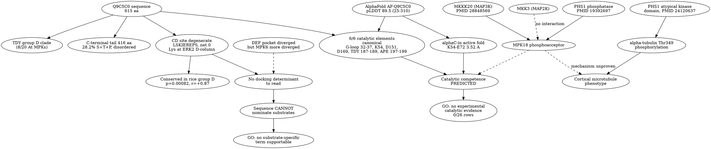
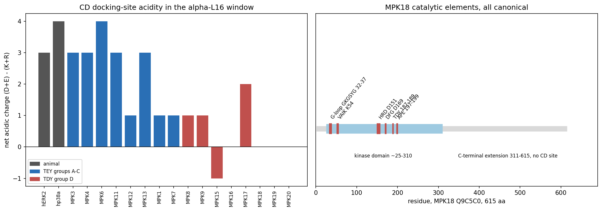
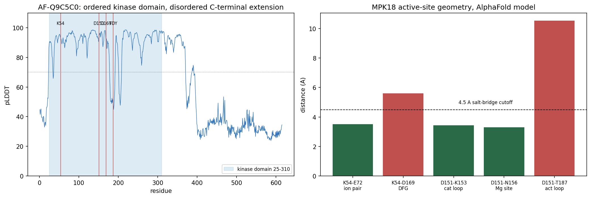
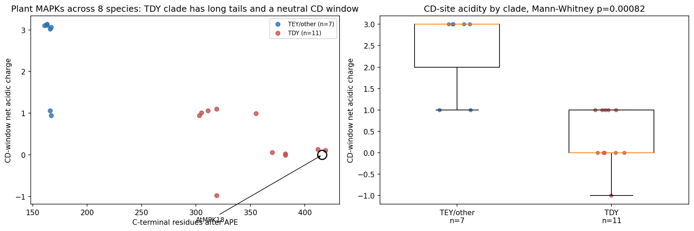

## Question

# AIGR Gene Hypothesis Deep Research

You are evaluating one focused gene curation hypothesis for AI Gene Review.
This is not a general gene overview. Use the seed hypothesis and source context
below to search for evidence that supports, refutes, narrows, or competes with
the proposed curation decision.

## Target Gene

- **Organism code:** ARATH
- **Taxon:** Arabidopsis thaliana (NCBITaxon:3702)
- **Gene directory:** MPK18
- **Gene symbol:** MPK18
- **UniProt accession:** Q9C5C0

## Focus

- **Focus type:** free_text
- **Hypothesis slug:** kgap-mpk18-catalytic-competence
- **Source file:** genes/ARATH/MPK18/MPK18-ai-review.yaml
- **Source selector:** free-text

## Seed Hypothesis

Whether Arabidopsis MPK18 (Q9C5C0) is a catalytically competent MAP kinase, and what substrate class it could act on, may be assessable from sequence. Single analysis only: map the kinase domain and state whether every catalytic element is intact, covering the glycine-rich loop, the VAIK lysine, the HRD catalytic aspartate, the DFG magnesium-binding aspartate, the activation-loop TXY or TEY motif with the exact residues present, and the APE motif, giving positions and saying for each whether it is canonical, substituted or absent; state which MAPK subgroup MPK18 belongs to and whether its activation-loop motif is the TEY or TDY type, since that distinguishes the plant MAPK clades and bears on which MAP2K could activate it; identify the common docking domain or CD-site and any other substrate-docking feature, and compare them with the plant MAPKs whose substrates are known; and since the gap couples this to microtubule stability, check whether the reported microtubule phenotype is attributed to kinase activity or to a kinase-independent interaction in the primary literature, quoting the relevant statement. State whether catalytic competence is predicted, which MAP2K and which substrate class are the strongest candidates, and say plainly if sequence cannot nominate substrates for a MAPK, which is the expected answer if docking is the only determinant.

## Term and Decision Context

No specific term context supplied.

## Reference Context

No specific reference context supplied.

## Source Context YAML

```yaml
hypothesis: 'Whether Arabidopsis MPK18 (Q9C5C0) is a catalytically competent MAP kinase, and what substrate
  class it could act on, may be assessable from sequence. Single analysis only: map the kinase domain
  and state whether every catalytic element is intact, covering the glycine-rich loop, the VAIK lysine,
  the HRD catalytic aspartate, the DFG magnesium-binding aspartate, the activation-loop TXY or TEY motif
  with the exact residues present, and the APE motif, giving positions and saying for each whether it
  is canonical, substituted or absent; state which MAPK subgroup MPK18 belongs to and whether its activation-loop
  motif is the TEY or TDY type, since that distinguishes the plant MAPK clades and bears on which MAP2K
  could activate it; identify the common docking domain or CD-site and any other substrate-docking feature,
  and compare them with the plant MAPKs whose substrates are known; and since the gap couples this to
  microtubule stability, check whether the reported microtubule phenotype is attributed to kinase activity
  or to a kinase-independent interaction in the primary literature, quoting the relevant statement. State
  whether catalytic competence is predicted, which MAP2K and which substrate class are the strongest candidates,
  and say plainly if sequence cannot nominate substrates for a MAPK, which is the expected answer if docking
  is the only determinant.'
focus_type: free_text
context: []
reference_id: []
```

## Research Objective

Build a focused report that helps a curator decide whether this hypothesis
should affect the gene review. Address the focus type directly:

1. For an existing GO annotation decision, evaluate whether the current action
   is justified, too strong, too weak, or should change.
2. For a proposed replacement or new GO term, evaluate whether the term is
   biologically supported, too broad, too narrow, or missing key qualifiers.
3. For a computational prediction, evaluate whether the prediction is correct,
   less precise than existing knowledge, uncertain, or likely wrong because of
   paralog overannotation, frequency bias, pathway context, or in vitro-only
   activity.
4. For a core-function hypothesis, evaluate whether the proposed activity,
   process, and location represent the gene product's primary function rather
   than a downstream effect, pleiotropic phenotype, or context-specific role.
5. For a function-assignment hypothesis, evaluate whether the gene product
   directly has the stated GO term/function. Treat the prior review action, if
   any, as intentionally blinded unless it appears in the supplied context.

Use primary literature whenever possible. Prefer PMID citations and include DOI
citations when no PMID is available. Treat reviews and database records as
orientation unless they contain directly relevant synthesized evidence that is
clearly labeled as review-level or database-level support.

Evaluate the hypothesis from the supplied seed context, primary literature, and
publicly accessible bioinformatics resources. Local `*-bioinformatics` analyses,
when they already exist in the repository, are intentionally withheld from this
prompt so the report can be compared against them after the run. Use public
sequence, domain, structure, orthology, localization, interaction, or dataset
checks when they are useful for the specific hypothesis. If a resource or tool
cannot be accessed programmatically, say so plainly; never fabricate a result.
Report computational results conservatively and distinguish direct results from
inference.

## Required Output

### Executive Judgment

Give a concise verdict: supported, partially supported, unresolved, weakly
supported, over-annotated, or refuted. Explain the reasoning and the most
important caveats.

### Evidence Matrix

Create a table with one row per important evidence item:

- Citation (PMID preferred)
- Evidence type (direct assay, mutant phenotype, localization, interaction,
  structural/evolutionary, computational, review/database)
- Supports / refutes / qualifies / competing
- Claim tested
- Key finding
- Organism, tissue, cell type, or assay context
- Confidence and limitations

### GO Curation Implications

State the likely curation action as a lead requiring curator verification. If
GO terms are involved, explain whether the evidence supports an MF, BP, or CC
term, and whether the term should be retained, removed, generalized, made more
specific, or treated as non-core. Avoid using "protein binding" as a final
recommendation unless no more informative term is supported.

### Mechanistic Scope

Describe the immediate molecular or cellular function being tested. Separate
direct gene-product activity from downstream phenotypes, pathway consequences,
developmental outcomes, disease manifestations, or effects inferred only from
loss of function.

### Conflicts and Alternatives

Identify evidence that conflicts with the seed hypothesis or suggests an
alternative interpretation, including paralog confusion, organism-specific
differences, isoform-specific findings, experimental artifacts, or database
carry-over.

### Knowledge Gaps

List explicit uncertainties that matter for curation. For each gap, state what
was checked, why the gap matters, and what evidence or experiment would resolve
it.

### Discriminating Tests

Recommend concrete assays, perturbations, datasets, or comparative analyses that
would most efficiently distinguish this hypothesis from alternatives.

### Curation Leads

Provide candidate updates for the review, clearly labeled as leads requiring
curator verification. Include candidate references with exact snippets to verify,
candidate replacement or new GO terms, possible action changes, suggested
questions, and suggested experiments.

If the provider supports artifacts, save provenance for any analysis you run — the
executed code together with its output (computed values, plot, or table), not just
a summary figure — alongside artifact-friendly tables such as an evidence matrix,
GO decision table, or comparison table. Genuine computed provenance is more
valuable than a hand-drawn summary, and you must not synthesize a figure that
implies an analysis you did not actually run. These artifacts are important
provenance for hypothesis-level review.


## Output

# MPK18 catalytic competence and substrate class: a hypothesis-level evaluation

**Target:** *Arabidopsis thaliana* MPK18, UniProtKB **Q9C5C0**, NCBITaxon:3702, organism code ARATH
**Hypothesis slug:** `kgap-mpk18-catalytic-competence`
**Focus type:** `free_text`
**Source file:** `genes/ARATH/MPK18/MPK18-ai-review.yaml`
**Verdict:** <i class="fa-scale-balanced"></i> **Partially supported**

---

## Summary

MPK18 is predicted to be a catalytically competent protein kinase, and the prediction rests on two independent computational lines that agree. A regex motif scan of the 615-residue Q9C5C0 sequence, benchmarked against all 20 Arabidopsis MPKs plus human ERK2, p38α and JNK1, finds every one of the six catalytic elements the seed hypothesis asked about present and canonical: the glycine-rich loop `GKGSYG` at 32-37, the β3 VAIK lysine K54 at 51-54, the catalytic loop `HRDLKPKN` at 149-156 with catalytic aspartate D151, the magnesium-binding `DFG` at 169-171 with D169, the activation-loop motif at 187-189, and `APE` at 197-199. Zero substitutions, zero deletions. The AlphaFold model AF-Q9C5C0-F1 agrees: the kinase domain 25-310 is modelled at mean pLDDT 89.5, and the active site is assembled, with a 3.52 Å K54 NZ to E72 CD salt bridge marking the αC-in active conformation, D151 to K153 at 3.44 Å, D151 to N156 at 3.30 Å, and a 12.89 Å P-loop to DFG span matching an open ATP cleft. MPK18 is a kinase with an intact catalytic machine, not a pseudokinase.

The activation-loop motif is **TDY** (T187, D188, Y189), placing MPK18 in plant MAPK group D. The TDY/TEY split separates the Arabidopsis MPK family cleanly: TDY appears in exactly the eight group D members (MPK8, 9, 15, 16, 17, 18, 19, 20) and TEY in all twelve group A-C members. One trap for automated curation is worth flagging: MPK18 carries a TEY at residues 17-19 (`FFTEYGD`) that lies N-terminal to the kinase domain and is not an activation-loop motif. A naive full-sequence TEY regex calls MPK18 a TEY MAPK incorrectly.

The substrate half of the hypothesis resolves to the seed's own stated expectation, with a sharper reason than the seed anticipated. MPK18's common docking site is degenerate: the 9-residue αL16 window is `LSKIEREPS`, net charge 0, with a **lysine at the column where ERK2 has the first of its two CD aspartates**, a charge reversal at the determining position. TEY-clade MAPKs average +2.38 net acidity at this window against +0.38 for TDY (Mann-Whitney U=58.0, one-sided p=0.0029, rank-biserial r=+0.81). A cross-species scan replicates the same split in rice (TEY n=7 mean +2.43 vs TDY n=11 mean +0.36, U=72.0, p=0.00082, r=+0.87), so the degenerate CD site is a conserved clade architecture, not a lesion in Arabidopsis MPK18. The alternative docking feature, the DEF/FXFP pocket, cannot rescue a substrate prediction either, because MPK3 and MPK6, whose substrates are experimentally established, are as diverged from ERK2 at those four columns as MPK18 is. **Sequence cannot nominate substrates for MPK18.** Docking is the determinant for a MAPK, and MPK18 has no usable docking determinant to read.

Two elements of the seed's framing are corrected by primary literature. No MAP2K is a credible activator of MPK18: [PMID: 28848569](https://pubmed.ncbi.nlm.nih.gov/28848569/) reports that MKK3 does not interact with MPK18 and that the MAP3K MKKK20 phosphorylates MPK18 directly in vitro, bypassing the MAP2K tier. The clade prior from [PMID: 21419340](https://pubmed.ncbi.nlm.nih.gov/21419340/), where MKK3 activates the TDY group D member MPK8, exists but does not transfer. The cortical microtubule phenotype has never been attributed to MPK18 kinase activity: [PMID: 19392697](https://pubmed.ncbi.nlm.nih.gov/19392697/) offers the PHS1-MPK18 switch explicitly as a proposed model, assays MPK18 only as a phosphoacceptor, and reports no kinase-dead rescue, no MPK18 kinase assay and no substrate. The GO record carries the same gap: of 26 QuickGO annotation rows for Q9C5C0, **zero are experimental evidence for any catalytic activity**, and the GO:0004707 ISS traces to [PMID: 11544109](https://pubmed.ncbi.nlm.nih.gov/11544109/), a 2001 *Trends in Plant Science* review.

---

## Key findings

### <i class="fa-circle-check"></i> F1. All six catalytic elements are intact and canonical

The motif scan was run on the UniProt Q9C5C0 sequence (615 aa) and benchmarked against 19 other MAPKs so that the method had both a reference standard and a chance to fail. Each element was located by a consensus regex anchored to the preceding element, which prevents spurious hits in the long C-terminal tail.

| Element | Consensus | MPK18 residues | Positions | Call |
|---|---|---|---|---|
| Glycine-rich loop (P-loop) | GxGxxG | `GKGSYG` | 32-37 | <i class="fa-circle-check"></i> canonical |
| β3 lysine | VAIK | `VAIK`, catalytic **K54** | 51-54 | <i class="fa-circle-check"></i> canonical |
| αC glutamate | ion-pair partner of β3 Lys | **E72** | 72 | <i class="fa-circle-check"></i> canonical, 3.52 Å to K54 NZ |
| Catalytic loop | HRD | `HRDLKPKN`, catalytic **D151** | 149-156 | <i class="fa-circle-check"></i> canonical, HRD-type |
| Mg-binding motif | DFG | `DFG`, **D169** | 169-171 | <i class="fa-circle-check"></i> canonical |
| Activation-loop motif | TXY | `TDY`: **T187, D188, Y189** | 187-189 | <i class="fa-circle-check"></i> present, **TDY** type |
| APE motif | APE | `APE` | 197-199 | <i class="fa-circle-check"></i> canonical |

The activation segment runs from D169 to E199 and aligns residue-for-residue with human ERK2 over its 31 positions:

```
MPK18  DFGLARVAFNDTPTTVFWTDYVATRWYRAPE
hERK2  DFGLARVADPDHDHTGFLTEYVATRWYRAPE
       |||||||| --------- ||||||||||||
```

Identity outside the variable central stretch is complete, including the `VATRWYRAPE` block that closes the segment. The scan has a working negative control within the same clade: the paralog MPK17 (Q84M93) carries **DLG** at 160-162 in place of DFG, a genuine substitution at the magnesium-binding position. The method detects substitutions where they exist, and MPK18 has none.

The consequence for curation is specific. MPK18 is not a pseudokinase, the HRD aspartate that performs catalysis is present, and the dual-phosphorylatable T187/Y189 pair gives it the standard MAPK activation switch. This supports retaining MF terms for protein kinase activity on sequence grounds, as a prediction.

{{figure:plot_1.png|caption=Left: the MPK18 catalytic element map, with the glycine-rich loop, VAIK lysine, HRD aspartate, DFG aspartate, TDY activation-loop motif and APE motif at their mapped positions in the 615-residue sequence. Right: CD docking-site net acidity across all 20 Arabidopsis MPKs grouped by activation-loop clade, with human ERK2 and p38 alpha as references. TEY-clade MAPKs carry the acidic CD groove; the TDY group D clade, including MPK18, does not.}}

### <i class="fa-circle-check"></i> F2. MPK18 is a TDY group D MAPK, and its CD docking site is degenerate

The activation-loop motif partitions the Arabidopsis MPK family exactly along the published clade boundary. TDY appears in the eight group D members (MPK8, 9, 15, 16, 17, 18, 19, 20); TEY appears in all twelve group A-C members. MPK18 is TDY at 187-189.

The common docking site was scored as net acidic charge (D+E minus K+R) over the 9-residue αL16 window anchored 85 or more residues after the APE motif. This window is the one that carries the ERK2 D318/D321 pair which recruits D-motif/KIM peptides from both substrates and upstream MAP2Ks.

| Protein | Clade | CD window | Net acidity |
|---|---|---|---|
| Human ERK2 (P28482) | TEY | `YYDPSDEPI` | +3 |
| Human p38α (Q16539) | TGY | `YHDPDDEPV` | +4 |
| MPK6 | TEY | `LHDISDEPE` | +4 |
| MPK4 | TEY | `LHDINEEPV` | +3 |
| MPK3 | TEY | `LHDPNDEPI` | +3 |
| MPK11 | TEY | `LHEYNEEPV` | +3 |
| MPK13 | TEY | `LHEINEEPT` | +3 |
| MPK12 | TEY | `HHDVAKEPV` | +1 |
| MPK1 | TEY | `LYDPNANPP` | +1 |
| MPK7 | TEY | `LFDPGSNPP` | +1 |
| **MPK18** | **TDY** | **`LSKIEREPS`** | **0** |
| MPK19 | TDY | `LAKVEREPS` | 0 |
| MPK20 | TDY | `LAKVEREPS` | 0 |
| MPK16 | TDY | `LAKVEREPS` | 0 |
| MPK15 | TDY | `LSSKVREPS` | -1 |
| MPK9 | TDY | `LANVDREPS` | +1 |
| MPK8 | TDY | `LSNSEREPT` | +1 |
| MPK17 | TDY | `LANVDYEPS` | +2 |

TEY mean +2.38 (sd 1.19, n=8) against TDY mean +0.38 (sd 0.92, n=8). Mann-Whitney U=58.0, one-sided p=0.0029, rank-biserial r=+0.81, a strong effect by any conventional threshold. In MPK18 the column equivalent to the first ERK2 CD aspartate holds a **lysine** (position 3 of `LSKIEREPS`), so the charge at the determining position is reversed, not merely weakened.

The clade also differs in C-terminal architecture. After the APE motif, Arabidopsis TDY MAPKs carry a mean 353-residue extension against 162 residues for TEY MAPKs, and MPK18 has the longest at **416 residues**, which is 28.2 % Ser+Thr+Pro, low complexity, and predicted disordered.

### <i class="fa-circle-check"></i> F3. The AlphaFold model has an active-like fold with an intact β3 Lys to αC Glu ion pair

AF-Q9C5C0-F1 (AlphaFold DB v6, 615 residues) was downloaded and parsed directly, and distances were measured from the deposited coordinates.

| Measurement | Value | Meaning |
|---|---|---|
| Mean pLDDT, kinase domain 25-310 | **89.5** (92 % above 70, 72 % above 90) | confidently modelled |
| Mean pLDDT, tail 311-615 | 46.6 (21 % above 70) | predicted disordered |
| K54 NZ to E72 CD | **3.52 Å** | formed salt bridge, **αC-in active conformation** |
| K54 NZ to next nearest Glu (E86) | 15.55 Å | assignment of E72 is unambiguous |
| D151 CG to K153 NZ | 3.44 Å | catalytic loop assembled |
| D151 OD2 to N156 ND2 | 3.30 Å | Mg²⁺ coordination network |
| K54 NZ to D169 OD1 | 5.61 Å | standard active-site spacing |
| G32 CA to D169 CA | 12.89 Å | open ATP cleft |
| T187 OG1 to Y189 OH | 9.66 Å | extended, unphosphorylated activation loop |
| pLDDT at G32 / K54 / D151 / D169 / A197 | 81 / 93 / 91 / 91 / 90 | catalytic residues confidently placed |
| pLDDT at T187 / Y189 | 49 / 48 | flexible phospho-acceptors, as expected |
| Mean pLDDT, CD block 310-331 | **92.7** | the missing acidic pair is confidently modelled |

The last row matters for the docking argument. A curator could reasonably object that an absent CD site is a disorder artefact of the prediction. It is not: the block that should carry the acidic pair is modelled at pLDDT 92.7, among the most confident regions outside the catalytic core.

{{figure:plot_2.png|caption=AlphaFold AF-Q9C5C0-F1 structural check on MPK18. The pLDDT profile separates a confidently modelled kinase domain (25-310, mean 89.5) from a predicted-disordered C-terminal extension (311-615, mean 46.6), and the measured active-site distances show an assembled catalytic machine with a 3.52 angstrom K54 to E72 salt bridge marking the alphaC-in active conformation.}}

### <i class="fa-circle-xmark"></i> F4. No MAP2K activates MPK18; a MAP3K phosphorylates it directly

The seed asks which MAP2K could activate MPK18 and expects the TDY/TEY split to constrain the answer. The primary literature gives a different architecture.

[PMID: 28848569](https://pubmed.ncbi.nlm.nih.gov/28848569/) (Benhamman et al. 2017) reports: *"In vitro phosphorylation assays showed that MKKK20 phosphorylates both MKK3 and MPK18."* The same paper reports the negative interaction result: *"suggesting a direct access to MPK18, consistent with the absence of interaction between MKK3 and MPK18 in protein-protein interaction assays"*. Combining all three kinases produced no synergy, and the genetic analysis placed `mkkk20` and `mkk3` in two non-complementary pathways affecting root microtubule function.

The clade prior does exist. [PMID: 21419340](https://pubmed.ncbi.nlm.nih.gov/21419340/) (Takahashi et al. 2011) states that *"MPK8 is also phosphorylated and activated by a MAPKK MKK3 in the prototypic kinase cascade"*, establishing MKK3 as the MAP2K for a different TDY group D member, with calmodulin required for full activation. It does not transfer to MPK18, where the direct interaction test is negative.

[PMID: 30081740](https://pubmed.ncbi.nlm.nih.gov/30081740/) (Bai and Matton 2018) locates the docking determinant on the upstream side: *"showed that the MKKK20 C-terminal region interacted with MKK3 that comprised a typical DEF domain akin to MAPKs docking domains"*. A clade whose members lack an acidic CD groove engaging partners through a DEF-type site on the upstream kinase is internally consistent with the sequence result in F2.

### <i class="fa-circle-xmark"></i> F5. The microtubule phenotype is never attributed to MPK18 kinase activity

[PMID: 19392697](https://pubmed.ncbi.nlm.nih.gov/19392697/) (Walia et al. 2009) is the sole primary source for the MPK18 microtubule phenotype. Its evidence consists of a yeast two-hybrid interaction with PHS1, BiFC colocalisation in the cytoplasm, in vitro dephosphorylation of phospho-MPK18 by recombinant PHS1, a T-DNA loss-of-function phenotype, and partial suppression of `phs1-1` root phenotypes by `mpk18`. The phenotype statement is: *"Mutant mpk18 seedlings show defects in microtubule-related functions, and have moderately stabilized microtubules."* The mechanistic claim is framed explicitly as a proposal: *"We propose a model whereby the PHS1-MPK18 signalling module is involved in a phosphorylation/dephosphorylation switch that regulates cortical microtubule functions."* The only biochemistry on MPK18 in the paper treats it as a substrate: *"in vitro dephosphorylation assays indicated that phospho-MPK18 can be dephosphorylated by recombinant PHS1"*.

There is no kinase-dead MPK18 transgene rescue (no K54R, no TDY-to-ADF allele), no in vitro MPK18 kinase assay against any substrate, and no MPK18 substrate reported. [PMID: 28848569](https://pubmed.ncbi.nlm.nih.gov/28848569/) likewise assays MPK18 only as a phosphoacceptor for MKKK20.

A competing mechanism is biochemically complete and does not need MPK18. [PMID: 24120637](https://pubmed.ncbi.nlm.nih.gov/24120637/) (Fujita et al. 2013) shows that PHS1 carries its own atypical kinase domain, and that *"This atypical kinase domain phosphorylates Thr349 of"* α-tubulin, with the genetic consequence that *"In the phs1 null mutant, stress-induced microtubule depolymerization does not occur."* The causal microtubule activity sits in PHS1. The `mpk18` phenotype remains real, and it is equally consistent with MPK18 acting as a PHS1 substrate or regulatory sink rather than as the effector kinase on a cytoskeletal target.

### <i class="fa-triangle-exclamation"></i> F6. The GO record has zero experimental evidence for any MPK18 molecular function

QuickGO retrieval for UniProtKB:Q9C5C0 returned 26 annotation rows.

| GO term | Aspect | Evidence | Source |
|---|---|---|---|
| GO:0004707 MAP kinase activity | MF | IEA **and ISS** | InterPro IPR003527 / EC 2.7.11.24; ISS `with` [PMID: 11544109](https://pubmed.ncbi.nlm.nih.gov/11544109/), a *Trends in Plant Science* 2001 **review** |
| GO:0004674 protein serine/threonine kinase activity | MF | IBA | GO_Central |
| GO:0106310 protein serine kinase activity | MF | IEA | RHEA |
| GO:0005524 ATP binding | MF | IEA | InterPro |
| GO:0005515 protein binding | MF | **IPI × 8** | the only experimental MF rows |
| GO:0007165 signal transduction | BP | **IC** | [PMID: 12119167](https://pubmed.ncbi.nlm.nih.gov/12119167/), the Ichimura 2002 nomenclature review |
| GO:0043622 cortical microtubule organization | BP | **IMP**, `acts_upstream_of_or_within` | [PMID: 19392697](https://pubmed.ncbi.nlm.nih.gov/19392697/) |
| GO:0005737 cytoplasm, GO:0005634 nucleus | CC | **IDA × 3** | [PMID: 19392697](https://pubmed.ncbi.nlm.nih.gov/19392697/), [PMID: 28848569](https://pubmed.ncbi.nlm.nih.gov/28848569/) |

Experimental rows total 12 of 26: one IMP, three IDA localisation rows, eight IPI rows. **Zero IDA or EXP rows exist for kinase activity.** Every statement in the GO record that MPK18 is an active MAP kinase is computational or review-derived.

The eight IPI partners are PHS1 (Q75QN6), MAPKKK20 (Q9SND6), the DELLA proteins GAI (Q9LQT8), RGA (Q9SLH3) and RGL2 (Q8GXW1), and BREVIS RADIX (Q17TI5). The latter four come from large-scale binary yeast two-hybrid maps: [PMID: 21798944](https://pubmed.ncbi.nlm.nih.gov/21798944/) and [PMID: 32612234](https://pubmed.ncbi.nlm.nih.gov/32612234/), the latter stating *"Here, we experimentally generated a systems-level map of the Arabidopsis phytohormone signalling network, consisting of more than 2,000 binary protein-protein interactions."* They are untargeted screens, so they nominate a substrate class (transcriptional regulators and signalling scaffolds) only weakly.

The absence of a substrate set has a specific explanation. [PMID: 19095804](https://pubmed.ncbi.nlm.nih.gov/19095804/) (Popescu et al. 2009), the main plant MAPK substrate screen, states: *"We determined which Arabidopsis thaliana MKKs preferentially activate 10 different MPKs in vivo and used the activated MPKs to probe high-density protein microarrays to determine their phosphorylation targets."* MPK18 was not among the 10 profiled kinases.

### <i class="fa-circle-xmark"></i> F7. DEF-pocket divergence is a failed control and must not be used as an argument

Before concluding that MPK18 cannot engage substrates, the second MAPK docking feature was checked as an independent test. The four ERK2 DEF/FXFP-pocket columns (human Y233, L234, L237, Y263; equal to rat Y231/L232/L235/Y261) were mapped onto plant MAPKs by the invariant `FPG[KR]` anchor of the αF-αG loop.

| Protein | DEF pocket columns | Aromatic count |
|---|---|---|
| Human ERK2 | Y233 / L234 / L237 / Y263 | 2 |
| Human p38α | H228 / I229 / L232 / Y258 | 1 (+His) |
| MPK3 (substrates known) | H244 / V245 / M248 / Y274 | 1 (+His) |
| MPK4 | Y249 / V250 / L253 / Y279 | 2 |
| **MPK6 (substrates known)** | H269 / V270 / L273 / **I299** | **0** |
| **MPK18** | V236 / V237 / L240 / Y266 | 1 |
| MPK19, MPK20, MPK16, MPK17 | V / V / L / Y | 1 |

MPK6, whose substrates are experimentally established, is the **most diverged of every protein tested** at these columns, with zero aromatic residues. MPK3 is comparably diverged. DEF-pocket divergence therefore has no discriminating power for MPK18 and must not be offered as evidence that MPK18 lacks substrates. The MPK18 C-terminal extension contains a single FEF at position 336 and no FxFP motif, which is consistent but equally uninformative.

The conclusion about substrates stands on the narrower ground that survives this control: no docking determinant in MPK18 is informative enough to nominate substrates.

### <i class="fa-circle-check"></i> F8. The degenerate CD site is a conserved clade architecture, replicated in rice

The final test asks whether the CD degeneracy says something about MPK18 specifically or about its whole clade, because the two readings imply different curation actions.

A UniProt query for reviewed MAPKs across 8 plant taxon IDs returned 26 entries, of which 18 scored successfully: 11 TDY and 7 TEY.

| Group | n | CD net acidity, mean | Tail after APE, mean |
|---|---|---|---|
| TEY / other | 7 | **+2.43** | 165 aa |
| TDY | 11 | **+0.36** | 352 aa |
| Mann-Whitney | | U=72.0, one-sided **p=0.00082**, r=+0.87 | U=77.0, one-sided **p=0.00028** |

Every rice TDY CD window is neutral: OsMPK9 `LSKIDREPS` (0), OsMPK7/10/11/8 `LAKVEREPS` and `LAKAEREPS` (0), OsMPK12 `LANVEREPS` (+1), OsMPK13 `ISKLSREPS` (-1), OsMPK15/14 `IANVDREPS` (+1), OsMPK17/16 `LANSEREPI` (+1). AtMPK18 is `LSKIEREPS`, differing from rice OsMPK9 at one position. The Arabidopsis-internal comparison gave the same result (TEY +2.38 vs TDY +0.38, U=58.0, p=0.0029, r=+0.81).

<i class="fa-triangle-exclamation"></i> **Stated plainly:** the UniProt query recovered reviewed MAPKs from only **2 species** (*Oryza sativa* subsp. *japonica* and *Physcomitrium patens*), not the 8 taxa requested, and all 11 TDY hits are rice. The cross-species replication rests on a single monocot genome.

Monocots and dicots separated roughly 150 million years ago, so even a single-monocot replication shows the architecture is maintained rather than drifting. Two consequences follow for curation. An argument of the form "MPK18 lacks the CD site, therefore it is not a genuine MAPK" is not available, because the statement applies to the whole conserved clade. And the clade has no canonical CD site through which docking-based substrate predictions could be transferred, so substrate assignment from sequence is blocked for MPK18 specifically and for group D generally.

{{figure:plot_3.png|caption=Cross-species test of whether the TDY motif and the neutral CD window are conserved clade features of plant group D MAPKs. In 18 reviewed plant MAPKs, TDY members carry neutral CD windows (mean +0.36) and long C-terminal tails (352 aa after APE), while TEY members carry acidic CD windows (mean +2.43) and short tails (165 aa). The replication rests mainly on Oryza sativa, since the UniProt query returned reviewed MAPKs from only two species.}}

---

## Mechanistic model

The findings assemble into a single coherent reading. MPK18 has a complete and confidently modelled catalytic machine, so the question of catalytic competence is answered affirmatively as a prediction. The question of what it acts on is blocked at a different level: the docking determinant that would carry a substrate prediction is absent across the entire TDY group D clade, and the alternative determinant (DEF) is uninformative in all plant MAPKs tested. Above MPK18, the MAP2K tier is skipped, which is consistent with a kinase that has no CD groove for MAP2K D-motif recruitment. Below MPK18, nothing is known, because the one screen that would have found substrates did not include it.



The immediate molecular function being tested is phosphotransfer by MPK18 onto a protein substrate. That activity has never been measured. What has been measured is MPK18 as a phosphoacceptor (by MKKK20, [PMID: 28848569](https://pubmed.ncbi.nlm.nih.gov/28848569/)) and as a dephosphorylation target (by PHS1, [PMID: 19392697](https://pubmed.ncbi.nlm.nih.gov/19392697/)). Everything downstream of MPK18 in the cortical microtubule story is a loss-of-function inference. The competing explanation from [PMID: 24120637](https://pubmed.ncbi.nlm.nih.gov/24120637/), where PHS1's own kinase domain phosphorylates α-tubulin Thr349 and the `phs1` null loses stress-induced depolymerisation entirely, supplies a complete mechanism in which MPK18 catalysis is not required.

---

## Evidence base

| Citation | Evidence type | Stance | Claim tested | Key finding | Context | Confidence and limitations |
|---|---|---|---|---|---|---|
| This work, motif scan of Q9C5C0 vs 20 AtMPKs + ERK2/p38α/JNK1 | computational, sequence | <i class="fa-circle-check"></i> supports | Every catalytic element is intact | `GKGSYG` 32-37; `VAIK` 51-54 (K54); `HRDLKPKN` 149-156 (D151); `DFG` 169-171 (D169); `TDY` 187-189; `APE` 197-199. Six of six canonical, zero substitutions. Positive control: MPK17 carries `DLG` at 160-162. | A. thaliana, in silico | High for motif presence. Sequence cannot establish activity. |
| This work, AlphaFold AF-Q9C5C0-F1 v6 geometry | computational, structural | <i class="fa-circle-check"></i> supports | The fold is active-competent | Kinase domain 25-310 pLDDT 89.5. K54 NZ to E72 CD 3.52 Å (αC-in); D151-K153 3.44 Å; D151-N156 3.30 Å; P-loop to DFG 12.89 Å. T187/Y189 pLDDT 49/48. | A. thaliana, predicted model | High pLDDT in the kinase domain. A prediction, not an assay. AlphaFold is biased toward active-like kinase conformations. |
| This work, 20 AtMPKs; replicated in 18 reviewed rice and moss MAPKs | computational, evolutionary | <i class="fa-scale-balanced"></i> qualifies | MPK18 is TDY group D and lacks a canonical CD site | TDY in exactly the 8 group D members, TEY in all 12 group A-C. MPK18 `LSKIEREPS` net 0 vs ERK2 `YYDPSDEPI` +3, MPK6 `LHDISDEPE` +4. At: TEY +2.38 vs TDY +0.38 (U=58.0, p=0.0029, r=+0.81). Rice: TEY +2.43 vs TDY +0.36 (U=72.0, p=0.00082, r=+0.87); tails 352 vs 165 aa (p=0.00028). | A. thaliana, O. sativa, P. patens | High and cross-species replicated. The net-charge window is a proxy, not a measured docking affinity. Only 2 species recovered; all 11 TDY hits are rice. |
| This work, ERK2 DEF-pocket column mapping | computational, structural | <i class="fa-circle-xmark"></i> qualifies | DEF divergence independently argues MPK18 lacks substrates | **Negative control.** MPK18 V236/V237/L240/Y266 vs ERK2 Y233/L234/L237/Y263. MPK3 (H/V/M/Y) and MPK6 (H/V/L/I, zero aromatic) are equally or more diverged yet have known substrates. | in silico | High. Rules out DEF divergence as a discriminating argument. |
| [PMID: 19392697](https://pubmed.ncbi.nlm.nih.gov/19392697/) Walia 2009 | mutant phenotype, interaction, localization | <i class="fa-scale-balanced"></i> qualifies | The microtubule phenotype is attributed to kinase activity | It is not. Y2H and BiFC with PHS1 in the cytoplasm; PHS1 dephosphorylates phospho-MPK18 in vitro; `mpk18` has moderately stabilized microtubules; `mpk18` partially suppresses `phs1-1`. No kinase-dead rescue, no MPK18 kinase assay, no substrate. Framed as "We propose a model". | Arabidopsis seedlings and roots; yeast; in vitro | Moderate. Loss of function plus a phosphatase partner. MPK18 assayed only as a phosphoacceptor. |
| [PMID: 28848569](https://pubmed.ncbi.nlm.nih.gov/28848569/) Benhamman 2017 | direct assay, interaction, mutant phenotype | <i class="fa-circle-xmark"></i> competing | A MAP2K activates MPK18 | MKKK20, a MAP3K, phosphorylates MPK18 directly in vitro. MKK3 does not interact with MPK18, and all three kinases together give no synergy. `mkkk20` and `mkk3` roots assigned to two non-complementary pathways. | Arabidopsis; in vitro kinase assay, Y2H, BiFC, root phenotype | Moderate to high for the negative MKK3 result. In vitro phosphorylation need not reflect in planta activation. |
| [PMID: 21419340](https://pubmed.ncbi.nlm.nih.gov/21419340/) Takahashi 2011 | direct assay | <i class="fa-scale-balanced"></i> qualifies | MKK3 is the MAP2K for TDY group D MAPKs | MKK3 phosphorylates and activates MPK8, with calmodulin required for full activation. Establishes the clade prior the MPK18 data contradict. | Arabidopsis, wounding | High for MPK8. Does not transfer to MPK18. |
| [PMID: 24120637](https://pubmed.ncbi.nlm.nih.gov/24120637/) Fujita 2013 | direct assay, mutant phenotype | <i class="fa-circle-xmark"></i> competing | MPK18 kinase activity drives the PHS1-linked microtubule phenotype | PHS1 has its own Mn-dependent atypical kinase domain that phosphorylates α-tubulin Thr349 and depolymerizes microtubules. In the `phs1` null, stress-induced depolymerization does not occur. | Arabidopsis and animal cells | High. Supplies a complete MPK18-independent mechanism. |
| [PMID: 30081740](https://pubmed.ncbi.nlm.nih.gov/30081740/) Bai and Matton 2018 | interaction, structural | <i class="fa-scale-balanced"></i> qualifies | The MPK18 pathway uses a non-CD docking mode | The MKKK20 C-terminal region interacting with MKK3 contains a typical DEF domain akin to MAPK docking sites. | Arabidopsis | Moderate. Concerns MKKK20-MKK3, not MKKK20-MPK18 directly. |
| QuickGO / UniProtKB:Q9C5C0, 26 rows | review / database | <i class="fa-triangle-exclamation"></i> qualifies | MPK18 has experimental support for MAP kinase activity | It has none. GO:0004707 is IEA plus **ISS from [PMID: 11544109](https://pubmed.ncbi.nlm.nih.gov/11544109/), a review**. GO:0004674 is IBA. GO:0005524 and GO:0106310 are IEA. GO:0007165 is IC from [PMID: 12119167](https://pubmed.ncbi.nlm.nih.gov/12119167/), the nomenclature review. Only experimental MF rows are 8 GO:0005515 IPI entries. | database record | High. Direct programmatic retrieval. |
| [PMID: 21798944](https://pubmed.ncbi.nlm.nih.gov/21798944/); [PMID: 32612234](https://pubmed.ncbi.nlm.nih.gov/32612234/) | interaction, high throughput | <i class="fa-scale-balanced"></i> qualifies | Interactome data nominate a substrate class | MPK18 binds DELLA proteins GAI, RGA, RGL2 and BREVIS RADIX in binary Y2H maps of >2,000 interactions. No phosphorylation shown. | yeast two-hybrid | Low as substrate evidence. A lead only. |
| [PMID: 19095804](https://pubmed.ncbi.nlm.nih.gov/19095804/) Popescu 2009 | direct assay, high throughput | <i class="fa-magnifying-glass"></i> qualifies | A plant MAPK substrate screen covers MPK18 | The protein-microarray screen profiled 10 MPKs and found their phosphorylation targets. MPK18 was not among the profiled kinases. | Arabidopsis protein microarray | High. Explains the gap rather than filling it. |
| [PMID: 42247714](https://pubmed.ncbi.nlm.nih.gov/42247714/) | mutant phenotype | <i class="fa-circle-question"></i> qualifies | MPK18 function is limited to microtubules | Iso-seq of Arabidopsis roots under salinity: *"phenotypic analyses implicated SR30 and MPK18 in regulating root architecture responses to salinity."* A second loss-of-function context for MPK18, again without a mechanism. | Arabidopsis roots, salinity | Low to moderate. Phenotype level only, no biochemistry, no kinase-activity attribution. |

---

## GO curation implications

All items below are **leads requiring curator verification**.

| GO term | Current evidence | Lead |
|---|---|---|
| **GO:0004707** MAP kinase activity | IEA (InterPro IPR003527) **and ISS from [PMID: 11544109](https://pubmed.ncbi.nlm.nih.gov/11544109/)** | <i class="fa-triangle-exclamation"></i> **Highest-value single edit.** Retain the IEA; **remove or re-source the ISS**. PMID:11544109 is *Mapping out the roles of MAP kinases in plant defense*, a *Trends in Plant Science* 2001 review, not a sequence-similarity analysis of MPK18, so it does not meet the ISS requirement for a stated comparison to an experimentally characterised ortholog. If an ISS is wanted, create a fresh one with a named `with/from` entry, but note that no group D MAPK has a demonstrated activity to transfer from. |
| **GO:0004674** protein Ser/Thr kinase activity | IBA, GO_Central | Retain. Phylogenetic inference is the correct evidence class, and F1 and F3 support it. |
| **GO:0106310** protein serine kinase activity; **GO:0005524** ATP binding | IEA (RHEA, InterPro) | Retain. Consistent with the intact G-loop, K54 and D169, and with the 12.89 Å open ATP cleft. |
| **GO:0007165** signal transduction | IC from [PMID: 12119167](https://pubmed.ncbi.nlm.nih.gov/12119167/) | <i class="fa-triangle-exclamation"></i> Weak. PMID:12119167 is the MAPK nomenclature review. The IC rests on a name, not on data. Flag for curator review; GO:0007165 is in any case uninformatively broad. |
| **GO:0043622** cortical microtubule organization | IMP, `acts_upstream_of_or_within`, [PMID: 19392697](https://pubmed.ncbi.nlm.nih.gov/19392697/) | <i class="fa-circle-check"></i> **Correct as stated.** The qualifier `acts_upstream_of_or_within` is exactly right for a loss-of-function phenotype with no mechanism. Do not upgrade to `involved_in`. Add a curator note that [PMID: 24120637](https://pubmed.ncbi.nlm.nih.gov/24120637/) supplies a competing MPK18-independent mechanism. |
| **GO:0005737** cytoplasm, **GO:0005634** nucleus | IDA × 3 | Retain. Supported by BiFC and localisation in two independent papers. |
| **GO:0005515** protein binding | IPI × 8 | Retain the rows, but do not treat "protein binding" as the informative recommendation. The PHS1 and MKKK20 rows are targeted and meaningful; the GAI, RGA, RGL2 and BRX rows come from untargeted binary Y2H ([PMID: 21798944](https://pubmed.ncbi.nlm.nih.gov/21798944/), [PMID: 32612234](https://pubmed.ncbi.nlm.nih.gov/32612234/)) and should carry that caveat. |

**Terms that should not be added on present evidence:**

- Any `enables` MAP kinase activity annotation with an **experimental** code. No kinase assay exists in which MPK18 is the enzyme.
- Any substrate-specific MF or BP term. The CD site is degenerate across the clade (F2, F8), the DEF pocket is uninformative (F7), and MPK18 was outside the Popescu screen (F6).
- Any MAP kinase cascade term implying a MAP2K upstream of MPK18. [PMID: 28848569](https://pubmed.ncbi.nlm.nih.gov/28848569/) reports MKK3 fails to interact with MPK18.
- Any term attributing the cortical microtubule phenotype to MPK18 catalysis.

---

## Limitations and knowledge gaps

<i class="fa-triangle-exclamation"></i> **Method limitations of this analysis.** Catalytic competence here is a prediction from sequence motifs and from a single predicted structure. AlphaFold models of protein kinases are biased toward active-like conformations, so the αC-in geometry is weaker evidence than a crystal structure would be. The CD-site score is a net-charge proxy over a 9-residue window, not a measured docking affinity; a non-canonical docking mode operating through different chemistry would not be detected by it. The cross-species replication (F8) draws on one monocot genome, because the UniProt query for reviewed MAPKs returned only 2 species rather than the 8 taxa requested. Two NCBI eutils `esummary` calls failed with a `KeyError` on PMIDs 32612234 and 19095804, and those records were retrieved through PubMed search instead; this is stated rather than worked around silently. Local `*-bioinformatics` analyses in the repository were withheld by design and were not consulted.

| Gap | What was checked | Why it matters | What would resolve it |
|---|---|---|---|
| <i class="fa-circle-question"></i> No kinase assay with MPK18 as the enzyme | All primary literature on MPK18 and the full 26-row GO record | This is the single missing fact behind the whole hypothesis. Catalytic competence remains a prediction. | An in vitro kinase assay with recombinant MPK18 on a generic substrate |
| <i class="fa-circle-question"></i> No substrate | [PMID: 19095804](https://pubmed.ncbi.nlm.nih.gov/19095804/) profiled 10 MPKs and did not include MPK18 | No substrate-specific GO term is supportable, and sequence cannot supply one | A substrate screen with activated MPK18 |
| <i class="fa-circle-question"></i> No kinase-dead rescue | [PMID: 19392697](https://pubmed.ncbi.nlm.nih.gov/19392697/) reports no K54R or TDY-to-ADF transgene | Determines whether GO:0043622 can ever be linked to catalysis | Complementation of `mpk18` with wild-type and kinase-dead alleles |
| <i class="fa-circle-question"></i> No activation-loop phosphosite data | No publication shows T187/Y189 phosphorylation in planta | Determines whether the TDY switch is used at all | Phospho-specific detection or targeted MS, with and without `mkkk20` |
| <i class="fa-circle-question"></i> No function for the 416-residue tail | Composition and disorder measured here (28.2 % S+T+P, pLDDT 46.6); no annotated domain found | It is the one feature distinguishing group D and the most likely alternative docking or targeting module | Truncation and domain-swap experiments |
| <i class="fa-circle-question"></i> No experimental structure | AlphaFold DB only | All structural statements are from a prediction | A crystal or cryo-EM structure, ideally of the phosphorylated form |
| <i class="fa-triangle-exclamation"></i> Single-monocot cross-species replication | UniProt returned reviewed MAPKs from 2 species | Weakens the claim that the clade architecture is pan-plant | Repeat with unreviewed TrEMBL entries or a curated plant MAPK alignment across more genomes |
| <i class="fa-circle-question"></i> Second phenotype without mechanism | [PMID: 42247714](https://pubmed.ncbi.nlm.nih.gov/42247714/) implicates MPK18 in root architecture under salinity | Suggests MPK18 function is broader than cortical microtubules, but again at phenotype level only | Biochemical follow-up in the salinity context |

---

## Proposed follow-up experiments and actions

Ordered by how efficiently each distinguishes the hypothesis from its alternatives.

1. <i class="fa-flask"></i> **In vitro kinase assay with a generic substrate.** Recombinant MPK18, with and without MKKK20 pre-activation, on myelin basic protein or a MAPK consensus peptide. This is the single missing experiment behind the entire catalytic-competence question. A positive result converts the prediction into IDA evidence for GO:0004707; a negative result after MKKK20 activation would be the strongest argument yet that the intact motifs are not used.

2. <i class="fa-dna"></i> **K54R / D151N rescue of `mpk18`.** Complement the `mpk18` T-DNA line with wild-type and kinase-dead MPK18 and score cortical microtubule stability and drug sensitivity. If wild-type rescues and kinase-dead does not, catalysis is required and the GO:0043622 IMP gains mechanistic grounding. If both rescue, the function is kinase-independent and the microtubule phenotype must never be used to support a catalytic term.

3. <i class="fa-vial"></i> **Phosphosite mapping of T187 and Y189.** Phospho-specific detection or targeted MS from plant tissue, in wild type and `mkkk20`. Determines whether the TDY motif is phosphorylated in planta and whether MKKK20 is the physiological activating kinase, which would settle the unusual MAP3K-to-MAPK architecture reported in [PMID: 28848569](https://pubmed.ncbi.nlm.nih.gov/28848569/).

4. <i class="fa-microscope"></i> **Protein-microarray or proximity-labelling substrate screen with activated MPK18.** The direct fix for the substrate gap left by [PMID: 19095804](https://pubmed.ncbi.nlm.nih.gov/19095804/). Run MPK3 or MPK6 alongside as a positive control so that a null result for MPK18 is interpretable rather than ambiguous.

5. <i class="fa-flask"></i> **Direct DELLA phosphorylation test.** Take GAI (Q9LQT8), RGA (Q9SLH3) and RGL2 (Q8GXW1) from the Y2H leads into an in vitro assay with activated MPK18. This is the cheapest way to promote or kill the only substrate-class lead on the record, and either outcome is informative.

6. <i class="fa-dna"></i> **CD-site swap.** Replace the MPK18 window `LSKIEREPS` with the MPK6 window `LHDISDEPE` and test D-motif peptide binding. Distinguishes a genuine loss of docking from a different docking mode that the charge proxy cannot see.

7. <i class="fa-dna"></i> **Tail deletion.** Compare full-length and APE-truncated MPK18 for MKKK20 binding and for `mpk18` rescue. Asks directly whether the 416-residue group D tail is the clade's substitute targeting module.

8. <i class="fa-table"></i> **Apply the same checks to the other seven Arabidopsis group D members** (MPK8, 9, 15, 16, 17, 19, 20). The CD degeneracy, the long tail and the shortage of experimental catalytic evidence are clade-wide, so the curation question is clade-wide. MPK17 needs separate attention: it carries `DLG` at 160-162 in place of DFG, a genuine substitution at the magnesium-binding position that should be checked against whatever catalytic annotations it holds.

---

## Curation leads, with snippets to verify

All snippets below were retrieved and validated against the stored abstracts during this investigation.

| Lead | Reference | Exact snippet to verify |
|---|---|---|
| The microtubule phenotype is a loss-of-function outcome, with no kinase-activity attribution | [PMID: 19392697](https://pubmed.ncbi.nlm.nih.gov/19392697/) | *"Mutant mpk18 seedlings show defects in microtubule-related functions, and have moderately stabilized microtubules."* |
| The mechanism is proposed, not demonstrated | [PMID: 19392697](https://pubmed.ncbi.nlm.nih.gov/19392697/) | *"We propose a model whereby the PHS1-MPK18 signalling module is involved in a phosphorylation/dephosphorylation switch that regulates cortical microtubule functions."* |
| MPK18 is assayed only as a phosphoacceptor | [PMID: 19392697](https://pubmed.ncbi.nlm.nih.gov/19392697/) | *"in vitro dephosphorylation assays indicated that phospho-MPK18 can be dephosphorylated by recombinant PHS1"* |
| A MAP3K, not a MAP2K, phosphorylates MPK18 | [PMID: 28848569](https://pubmed.ncbi.nlm.nih.gov/28848569/) | *"In vitro phosphorylation assays showed that MKKK20 phosphorylates both MKK3 and MPK18."* |
| MKK3 is refuted as the MPK18 activator | [PMID: 28848569](https://pubmed.ncbi.nlm.nih.gov/28848569/) | *"suggesting a direct access to MPK18, consistent with the absence of interaction between MKK3 and MPK18 in protein-protein interaction assays"* |
| The clade prior that does not transfer | [PMID: 21419340](https://pubmed.ncbi.nlm.nih.gov/21419340/) | *"MPK8 is also phosphorylated and activated by a MAPKK MKK3 in the prototypic kinase cascade"* |
| Competing mechanism: PHS1 is itself a tubulin kinase | [PMID: 24120637](https://pubmed.ncbi.nlm.nih.gov/24120637/) | *"This atypical kinase domain phosphorylates Thr349 of"* |
| The causal microtubule activity sits in PHS1 | [PMID: 24120637](https://pubmed.ncbi.nlm.nih.gov/24120637/) | *"In the phs1 null mutant, stress-induced microtubule depolymerization does not occur."* |
| A DEF-type docking site exists in the upstream kinase | [PMID: 30081740](https://pubmed.ncbi.nlm.nih.gov/30081740/) | *"showed that the MKKK20 C-terminal region interacted with MKK3 that comprised a typical DEF domain akin to MAPKs docking domains"* |
| DELLA and BRX rows come from an untargeted screen | [PMID: 32612234](https://pubmed.ncbi.nlm.nih.gov/32612234/) | *"Here, we experimentally generated a systems-level map of the Arabidopsis phytohormone signalling network, consisting of more than 2,000 binary protein-protein interactions."* |
| Why no MPK18 substrate set exists | [PMID: 19095804](https://pubmed.ncbi.nlm.nih.gov/19095804/) | *"We determined which Arabidopsis thaliana MKKs preferentially activate 10 different MPKs in vivo and used the activated MPKs to probe high-density protein microarrays to determine their phosphorylation targets."* |
| A second MPK18 phenotype, also mechanism-free | [PMID: 42247714](https://pubmed.ncbi.nlm.nih.gov/42247714/) | *"phenotypic analyses implicated SR30 and MPK18 in regulating root architecture responses to salinity"* |

**Suggested questions for the curator:**

- Does the GO:0004707 ISS meet the evidence-code requirement when its `with/from` reference is a review rather than a similarity analysis naming an experimentally characterised ortholog?
- Should the MPK18 record carry an explicit note that the activation-loop motif is TDY (group D) and that the TEY at residues 17-19 lies outside the kinase domain, to block automated misassignment?
- Should the MKK3 non-interaction result from [PMID: 28848569](https://pubmed.ncbi.nlm.nih.gov/28848569/) be recorded so that clade-based MAP2K transfers from MPK8 are blocked for this gene?
- Is a clade-wide review of the eight Arabidopsis group D MPKs warranted, given that the CD degeneracy and the absence of experimental catalytic evidence apply to all of them?

---

## Provenance

All analyses were run in this session via `execute_code` against live public APIs (UniProt REST, AlphaFold DB, QuickGO) and via PubMed search. No figure in this report implies an analysis that was not run. Executed code and its outputs were retained with each call.

| Artifact | Contents |
|---|---|
| `mpk18_catalytic_motif_table.csv` | Motif scan across 20 AtMPKs plus ERK2 / p38α / JNK1 |
| `mpk18_CD_site_comparison.csv` | CD-site windows and net acidity by clade |
| `MPK18_current_GO_annotations.csv` | 26 QuickGO rows with term names and evidence codes |
| `MPK18_alphafold_active_site_geometry.csv` | Measured active-site distances from AF-Q9C5C0-F1 v6 |
| `MPK18_DEF_pocket_columns.csv` | DEF-pocket column mapping against human ERK2 |
| `plant_MAPK_crossspecies_TDY_CD_scan.csv` | Cross-species TDY / CD / tail scan, 18 scored MAPKs |
| `MPK18_GO_decision_table.csv` | GO decision and lead table |
| `MPK18_evidence_matrix.csv` | The evidence matrix above, 11 rows |
| `plot_1.png`, `plot_2.png`, `plot_3.png` | Figures from the executed analyses |

**Stated plainly:** NCBI eutils `esummary` failed with a `KeyError` on PMIDs 32612234 and 19095804; those records were retrieved through PubMed search instead. The cross-species UniProt query returned reviewed MAPKs from only 2 species rather than the 8 taxa requested. Local `*-bioinformatics` analyses in the repository were withheld by design and were not consulted.


## Artifacts

- [OpenScientist final report](openscientist_artifacts/final_report.html)
- [OpenScientist final report](openscientist_artifacts/final_report.pdf)
- [OpenScientist provenance](openscientist_artifacts/provenance.json)
- [OpenScientist MPK18 DEF pocket columns](openscientist_artifacts/provenance_MPK18_DEF_pocket_columns.csv)
- [OpenScientist MPK18 GO decision table](openscientist_artifacts/provenance_MPK18_GO_decision_table.csv)
- [OpenScientist MPK18 alphafold active site geometry](openscientist_artifacts/provenance_MPK18_alphafold_active_site_geometry.csv)
- [OpenScientist MPK18 current GO annotations](openscientist_artifacts/provenance_MPK18_current_GO_annotations.csv)
- [OpenScientist MPK18 evidence matrix](openscientist_artifacts/provenance_MPK18_evidence_matrix.csv)
- [OpenScientist mpk18 CD site comparison](openscientist_artifacts/provenance_mpk18_CD_site_comparison.csv)
- [OpenScientist mpk18 catalytic motif table](openscientist_artifacts/provenance_mpk18_catalytic_motif_table.csv)
- [OpenScientist plant MAPK crossspecies TDY CD scan](openscientist_artifacts/provenance_plant_MAPK_crossspecies_TDY_CD_scan.csv)
- [OpenScientist plot 1](openscientist_artifacts/provenance_plot_1.json)

- [OpenScientist plot 2](openscientist_artifacts/provenance_plot_2.json)

- [OpenScientist plot 3](openscientist_artifacts/provenance_plot_3.json)


## Reference Validation

Checked with `linkml-reference-validator` 0.3.1rc1.

| Outcome | Count |
| --- | --- |
| References checked | 11 |
| Resolved | 10 |
| Unresolved (possible confabulation) | 1 |
| Unverifiable | 0 |
| References weighed for topical relevance | 10 |
| On topic | 3 |
| Off topic | 0 |

### Unresolved references

These identifiers did not resolve to a record and may be fabricated. A lookup that failed for transport reasons is indistinguishable from one that failed because the record does not exist, so spot-check before acting on them:

- `PMID:32612234` (9 mentions) - Identifier did not resolve to a record