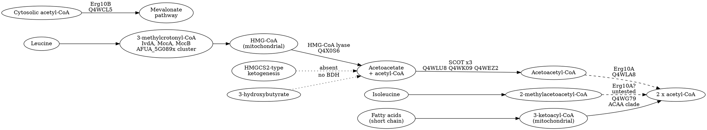
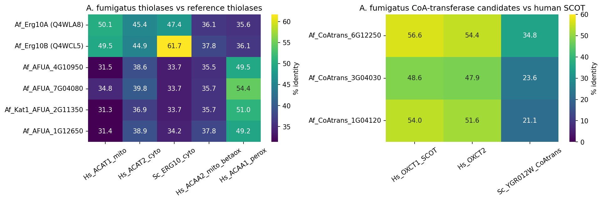
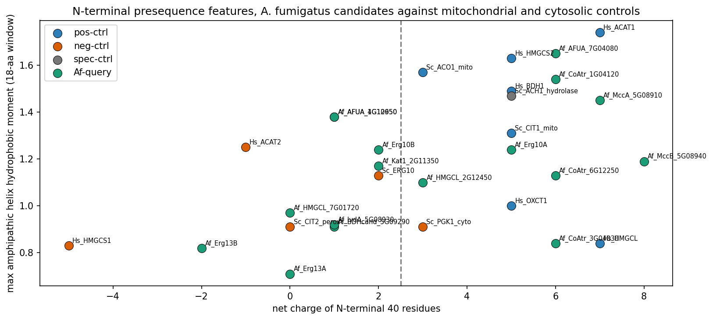
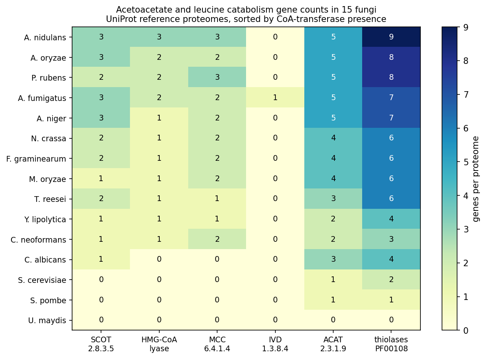

## Question

# AIGR Gene Hypothesis Deep Research

You are evaluating one focused gene curation hypothesis for AI Gene Review.
This is not a general gene overview. Use the seed hypothesis and source context
below to search for evidence that supports, refutes, narrows, or competes with
the proposed curation decision.

## Target Gene

- **Organism code:** ASPFU
- **Taxon:** Aspergillus fumigatus Af293 (NCBITaxon:330879)
- **Gene directory:** erg10A
- **Gene symbol:** erg10A
- **UniProt accession:** Q4WLA8

## Focus

- **Focus type:** free_text
- **Hypothesis slug:** kgap-erg10a-mitochondrial-pathway
- **Source file:** genes/ASPFU/erg10A/erg10A-ai-review.yaml
- **Source selector:** free-text

## Seed Hypothesis

Which mitochondrial pathway consumes or produces the acetoacetyl-CoA that AfErg10A's thiolase activity handles is the question, and the useful move is to ask what the organism's own metabolic inventory permits rather than to assume the mammalian ketone-body answer. Already recorded and not to be re-derived: that purified AfErg10A catalyses both the synthetic and the degradative acetoacetyl-CoA thiolase reactions reversibly, that a functional C-terminal GFP fusion colocalises with mitochondrial dye in hyphae, that the gene is essential, that it sits in the PTHR18919:SF156 ACAT1-like branch, and that UniProt's curated FUNCTION comment states Erg10A has no overlapping function with the cytosolic Erg10B and appears not to be involved in ergosterol biosynthesis. Single analysis only. Begin with the inventory, because it decides which candidate pathways are even available. For Aspergillus fumigatus, establish from the genome, naming accessions, whether the organism encodes the enzymes of mitochondrial ketone-body formation and utilisation, namely HMG-CoA synthase of the mitochondrial type and HMG-CoA lyase on the synthetic side and succinyl-CoA:3-oxoacid CoA-transferase and beta-hydroxybutyrate dehydrogenase on the utilisation side, and say which of those are present and which absent. The absence of a CoA-transferase in particular would make ketone-body utilisation impossible and would remove the obvious mammalian analogy, so state it plainly either way. Then take the alternatives in turn and say what the inventory and the literature permit for each: terminal beta-oxidation of fatty acids, in which the thiolase performs the last degradative step, noting whether beta-oxidation in this organism is peroxisomal, mitochondrial or both and which enzymes are localised where; isoleucine and other branched-chain amino acid catabolism, which produces 2-methylacetoacetyl-CoA rather than acetoacetyl-CoA, so state whether this enzyme's measured substrate preference distinguishes the two; leucine catabolism, which converges on HMG-CoA; and the biosynthetic direction supplying acetoacetyl-CoA for a mitochondrial polyketide, siderophore or secondary metabolite route, naming any such route the organism has. Essentiality is a constraint worth using: say which of the candidate pathways would plausibly be essential in this organism under laboratory conditions, since a dispensable catabolic route does not explain an essential gene, and note explicitly if the essentiality is better explained by a function other than the thiolase reaction, for example a role in complex assembly or an unrelated moonlighting activity. Conclude with which pathway the evidence favours and with what strength. If the inventory does not single out one pathway, say so plainly and name the measurement that would settle it; an unresolved verdict is acceptable. Do not assume the mammalian ACAT1 role transfers on the strength of the branch assignment, and do not propose a GO process annotation for a pathway whose enzymes this organism lacks.

## Term and Decision Context

No specific term context supplied.

## Reference Context

No specific reference context supplied.

## Source Context YAML

```yaml
hypothesis: 'Which mitochondrial pathway consumes or produces the acetoacetyl-CoA that AfErg10A''s thiolase
  activity handles is the question, and the useful move is to ask what the organism''s own metabolic inventory
  permits rather than to assume the mammalian ketone-body answer. Already recorded and not to be re-derived:
  that purified AfErg10A catalyses both the synthetic and the degradative acetoacetyl-CoA thiolase reactions
  reversibly, that a functional C-terminal GFP fusion colocalises with mitochondrial dye in hyphae, that
  the gene is essential, that it sits in the PTHR18919:SF156 ACAT1-like branch, and that UniProt''s curated
  FUNCTION comment states Erg10A has no overlapping function with the cytosolic Erg10B and appears not
  to be involved in ergosterol biosynthesis. Single analysis only. Begin with the inventory, because it
  decides which candidate pathways are even available. For Aspergillus fumigatus, establish from the genome,
  naming accessions, whether the organism encodes the enzymes of mitochondrial ketone-body formation and
  utilisation, namely HMG-CoA synthase of the mitochondrial type and HMG-CoA lyase on the synthetic side
  and succinyl-CoA:3-oxoacid CoA-transferase and beta-hydroxybutyrate dehydrogenase on the utilisation
  side, and say which of those are present and which absent. The absence of a CoA-transferase in particular
  would make ketone-body utilisation impossible and would remove the obvious mammalian analogy, so state
  it plainly either way. Then take the alternatives in turn and say what the inventory and the literature
  permit for each: terminal beta-oxidation of fatty acids, in which the thiolase performs the last degradative
  step, noting whether beta-oxidation in this organism is peroxisomal, mitochondrial or both and which
  enzymes are localised where; isoleucine and other branched-chain amino acid catabolism, which produces
  2-methylacetoacetyl-CoA rather than acetoacetyl-CoA, so state whether this enzyme''s measured substrate
  preference distinguishes the two; leucine catabolism, which converges on HMG-CoA; and the biosynthetic
  direction supplying acetoacetyl-CoA for a mitochondrial polyketide, siderophore or secondary metabolite
  route, naming any such route the organism has. Essentiality is a constraint worth using: say which of
  the candidate pathways would plausibly be essential in this organism under laboratory conditions, since
  a dispensable catabolic route does not explain an essential gene, and note explicitly if the essentiality
  is better explained by a function other than the thiolase reaction, for example a role in complex assembly
  or an unrelated moonlighting activity. Conclude with which pathway the evidence favours and with what
  strength. If the inventory does not single out one pathway, say so plainly and name the measurement
  that would settle it; an unresolved verdict is acceptable. Do not assume the mammalian ACAT1 role transfers
  on the strength of the branch assignment, and do not propose a GO process annotation for a pathway whose
  enzymes this organism lacks.'
focus_type: free_text
context: []
reference_id: []
```

## Research Objective

Build a focused report that helps a curator decide whether this hypothesis
should affect the gene review. Address the focus type directly:

1. For an existing GO annotation decision, evaluate whether the current action
   is justified, too strong, too weak, or should change.
2. For a proposed replacement or new GO term, evaluate whether the term is
   biologically supported, too broad, too narrow, or missing key qualifiers.
3. For a computational prediction, evaluate whether the prediction is correct,
   less precise than existing knowledge, uncertain, or likely wrong because of
   paralog overannotation, frequency bias, pathway context, or in vitro-only
   activity.
4. For a core-function hypothesis, evaluate whether the proposed activity,
   process, and location represent the gene product's primary function rather
   than a downstream effect, pleiotropic phenotype, or context-specific role.
5. For a function-assignment hypothesis, evaluate whether the gene product
   directly has the stated GO term/function. Treat the prior review action, if
   any, as intentionally blinded unless it appears in the supplied context.

Use primary literature whenever possible. Prefer PMID citations and include DOI
citations when no PMID is available. Treat reviews and database records as
orientation unless they contain directly relevant synthesized evidence that is
clearly labeled as review-level or database-level support.

Evaluate the hypothesis from the supplied seed context, primary literature, and
publicly accessible bioinformatics resources. Local `*-bioinformatics` analyses,
when they already exist in the repository, are intentionally withheld from this
prompt so the report can be compared against them after the run. Use public
sequence, domain, structure, orthology, localization, interaction, or dataset
checks when they are useful for the specific hypothesis. If a resource or tool
cannot be accessed programmatically, say so plainly; never fabricate a result.
Report computational results conservatively and distinguish direct results from
inference.

## Required Output

### Executive Judgment

Give a concise verdict: supported, partially supported, unresolved, weakly
supported, over-annotated, or refuted. Explain the reasoning and the most
important caveats.

### Evidence Matrix

Create a table with one row per important evidence item:

- Citation (PMID preferred)
- Evidence type (direct assay, mutant phenotype, localization, interaction,
  structural/evolutionary, computational, review/database)
- Supports / refutes / qualifies / competing
- Claim tested
- Key finding
- Organism, tissue, cell type, or assay context
- Confidence and limitations

### GO Curation Implications

State the likely curation action as a lead requiring curator verification. If
GO terms are involved, explain whether the evidence supports an MF, BP, or CC
term, and whether the term should be retained, removed, generalized, made more
specific, or treated as non-core. Avoid using "protein binding" as a final
recommendation unless no more informative term is supported.

### Mechanistic Scope

Describe the immediate molecular or cellular function being tested. Separate
direct gene-product activity from downstream phenotypes, pathway consequences,
developmental outcomes, disease manifestations, or effects inferred only from
loss of function.

### Conflicts and Alternatives

Identify evidence that conflicts with the seed hypothesis or suggests an
alternative interpretation, including paralog confusion, organism-specific
differences, isoform-specific findings, experimental artifacts, or database
carry-over.

### Knowledge Gaps

List explicit uncertainties that matter for curation. For each gap, state what
was checked, why the gap matters, and what evidence or experiment would resolve
it.

### Discriminating Tests

Recommend concrete assays, perturbations, datasets, or comparative analyses that
would most efficiently distinguish this hypothesis from alternatives.

### Curation Leads

Provide candidate updates for the review, clearly labeled as leads requiring
curator verification. Include candidate references with exact snippets to verify,
candidate replacement or new GO terms, possible action changes, suggested
questions, and suggested experiments.

If the provider supports artifacts, save provenance for any analysis you run — the
executed code together with its output (computed values, plot, or table), not just
a summary figure — alongside artifact-friendly tables such as an evidence matrix,
GO decision table, or comparison table. Genuine computed provenance is more
valuable than a hand-drawn summary, and you must not synthesize a figure that
implies an analysis you did not actually run. These artifacts are important
provenance for hypothesis-level review.


## Output

# Which mitochondrial pathway consumes the acetoacetyl-CoA handled by A. fumigatus Erg10A?

Gene: *erg10A*, Aspergillus fumigatus Af293 (NCBITaxon:330879), UniProt **Q4WLA8**, locus AFUA_1G13490 (A1163 orthologue AFUB_000550).
Hypothesis slug: `kgap-erg10a-mitochondrial-pathway`. Source: `genes/ASPFU/erg10A/erg10A-ai-review.yaml`, selector `free-text`.
Focus type: `free_text`. Three investigation iterations, 9 recorded findings, 26 papers reviewed, 3 computed figures and 4 provenance tables.

## Summary

The seed hypothesis proposed to settle the pathway question by subtraction: ask what the A. fumigatus metabolic inventory permits, and in particular test whether the organism lacks a succinyl-CoA:3-oxoacid CoA-transferase (SCOT), because without one, acetoacetate cannot be activated and the mammalian ketone-body analogy collapses. The inventory does not deliver that elimination. A. fumigatus Af293 encodes three full-length family I 3-oxoacid CoA-transferases, **Q4WLU8** (AFUA_6G12250, 518 aa), **Q4WK09** (AFUA_1G04120, 504 aa) and **Q4WEZ2** (AFUA_3G04030, 526 aa), at 56.6, 54.0 and 48.6 percent identity to human OXCT1 (P55809) by Smith-Waterman, all carrying InterPro IPR014388 and Pfam PF01144 and all with mitochondrial-type N-terminal presequences. Acetoacetate activation is metabolically permitted in this organism. The "organism lacks the enzyme" argument is unavailable and must be dropped from the review.

What the inventory does settle is the direction of acetoacetate supply and the exclusion of two candidate pathways. There is no mitochondrial-type HMG-CoA synthase: both paralogues, Erg13A (Q4WBQ3, N-terminal net charge 0) and Erg13B (Q4WXT8, net -2), sit inside the cytosolic control range, against a mitochondrial control median of +5 (Mann-Whitney U = 34.5, one-sided p = 0.0031, n = 7 versus 5). There is no credible 3-hydroxybutyrate dehydrogenase: the sole EC 1.1.1.30 candidate Q4WUQ4 is 22.3 percent identical to human BDH1 and is a generic short-chain dehydrogenase/reductase. So A. fumigatus has an **acetoacetate module** and not a mammalian ketone-body system. The acetoacetate it can make comes from leucine, through the clustered loci AFUA_5G08910 (MccA, net +7), AFUA_5G08930 (IvdA) and AFUA_5G08940 (MccB, net +8) and mitochondrial-type HMG-CoA lyase Q4X0S6 (net +3). Across 15 fungal reference proteomes, SCOT presence and the leucine catabolism module co-occur in 14 of 15 (Fisher exact two-sided p = 0.0088), and SCOT-positive proteomes carry a larger thiolase complement (median 6 versus 1, Mann-Whitney one-sided p = 0.0053).

Terminal beta-oxidation is ruled out for Erg10A on two independent grounds. Erg10A is in the ACAT clade (50.1 percent identity to human ACAT1 P24752, 47.4 percent to yeast Erg10, but 36.1 percent to ACAA2 and 35.6 percent to ACAA1), and A. fumigatus maintains four separate ACAA-clade thiolases for the 3-ketoacyl-CoA step. A controlled PTS2 analysis separates their compartments: E9RBL5 and Q4WPY9 carry PTS2 nonapeptides and are peroxisomal, while Q4WG79 (AFUA_7G04080) has no PTS2 and net charge +6, the mitochondrial pattern, making it the plausible counterpart of the A. nidulans mitochondrial ketoacyl-CoA thiolase of [PMID: 18245820](https://pubmed.ncbi.nlm.nih.gov/18245820/). The mitochondrial beta-oxidation thiolysis step therefore has a dedicated enzyme that is not Erg10A. Two questions stay open. Isoleucine catabolism cannot be separated from the acetoacetate loop, because activity on 2-methylacetoacetyl-CoA, the one measurement that discriminates them, has never been run on Erg10A. Essentiality supports no pathway assignment at all, because every candidate route is dispensable in fungi.

**Verdict: <i class="fa-scale-balanced"></i> partially supported, with the pathway assignment unresolved and one premise of the seed hypothesis refuted.**

## Key findings

### The organism has three genuine SCOT orthologues, which overturns the seed premise

A UniProt proteome query of UP000002530 for EC 2.8.3.5 returns exactly three entries: Q4WLU8 (518 aa), Q4WEZ2 (526 aa) and Q4WK09 (504 aa). No other EC 2.8.3.- enzyme is annotated in the proteome. Smith-Waterman local alignment against human OXCT1 (520 aa, mitochondrial SCOT), run here with BLOSUM62 and affine gaps of 11 and 1, gives 56.6, 48.6 and 54.0 percent identity respectively, and against OXCT2 (Q9BYC2) 54.4, 47.9 and 51.6 percent. The internal calibration matters: OXCT1 against OXCT2, a genuine human paralogue pair, is 74.6 percent, while the A. fumigatus beta-oxidation thiolases against their human counterpart reach only 49 to 54 percent. The three candidates therefore sit in the same identity band that other confidently assigned fungal-human orthologue pairs occupy, and their lengths match OXCT1 almost exactly, consistent with full-length orthologues rather than partial domain hits.

InterPro assignment through the EBI API returns IPR014388 (3-oxoacid CoA-transferase), IPR004165 (coenzyme A transferase family I) and Pfam PF01144 for all three, with IPR012791 and IPR012792 (3-oxoacid CoA-transferase subunits B and A) on two of them, matching human OXCT1 domain for domain. The obvious confounder is the Ach1-type acetyl-CoA hydrolase/transferase that performs propionyl-CoA detoxification in Aspergillus ([PMID: 18331473](https://pubmed.ncbi.nlm.nih.gov/18331473/)). That enzyme is a separate, single, non-homologous gene in A. fumigatus, Q4WC63 (AFUA_8G05580, Pfam PF02550 and PF13336), so the SCOT assignment is not family confusion. <i class="fa-triangle-exclamation"></i> All three SCOT candidates are unreviewed TrEMBL entries with no experimental characterisation, so this is sequence evidence that the chemistry is possible, not evidence that it happens.

{{figure:plot_1.png|caption=Smith-Waterman percent identity matrices computed here with BLOSUM62 and affine gaps 11/1. Left: the seven A. fumigatus PF00108 thiolases against reference thiolases, showing Erg10A in the ACAT clade (50.1 percent to human ACAT1, 36.1 percent to ACAA2) and four separate enzymes in the ACAA clade. Right: the three A. fumigatus CoA-transferase candidates against human SCOT, at 48.6 to 56.6 percent identity to OXCT1.}}

### Erg10A is an ACAT-clade enzyme and A. fumigatus has four ACAA-clade thiolases for beta-oxidation

Aligning all A. fumigatus PF00108 thiolases against reference enzymes gives a clean two-clade separation. Erg10A (Q4WLA8) best-hits human ACAT1 at 50.1 percent, then ACAT2 at 45.4 percent and S. cerevisiae Erg10 at 47.4 percent, but only 36.1 percent to human ACAA2 (mitochondrial beta-oxidation 3-ketoacyl-CoA thiolase) and 35.6 percent to ACAA1 (peroxisomal). Erg10B (Q4WCL5) best-hits yeast Erg10 at 61.7 percent, which fits the curated UniProt statement that the two A. fumigatus paralogues have no overlapping function and that Erg10A is not in ergosterol biosynthesis. The other four thiolases, Q4WPY9 (AFUA_4G10950), Q4WG79 (AFUA_7G04080), Q4X135 (Kat1, AFUA_2G11350) and E9RBL5 (AFUA_1G12650), all best-hit ACAA1 at 49.5, 54.4, 51.0 and 49.2 percent and reach only 31 to 35 percent to ACAT1. The gap between clades is 14 to 19 percentage points.

<i class="fa-circle-xmark"></i> A. fumigatus therefore maintains a dedicated four-member ACAA-type thiolase set for the degradative 3-ketoacyl-CoA step, so Erg10A is not needed for the general terminal beta-oxidation reaction. Its substrate is the unsubstituted C4 acetoacetyl-CoA that the ACAT subfamily handles. The caveat is explicit: mammalian ACAT1 uses both acetoacetyl-CoA and 2-methylacetoacetyl-CoA, so clade placement alone does not exclude isoleucine catabolism.

### A controlled PTS2 test finds a second mitochondrial thiolase that is not Erg10A

N-terminal net charge alone cannot separate mitochondrial presequences from peroxisomal PTS2 nonapeptides, which are also basic. Testing both signals together across all seven A. fumigatus PF00108 thiolases, with the Gould/Petriv PTS2 consensus [RK]-[LVIQ]-x(5)-[HQ]-[LAF] scanned within residues 1 to 35, the three experimental positive controls all match: human ACAA1 at position 3 (RLQVVLGHL), yeast Pot1 at position 4 (RLQSIKDHL) and human PHYH at position 9 (RLQIVLGHL), each with low N-terminal net charge of +1 to +2. The mitochondrial controls ACAT1 (+5) and ACAA2 (+1) and the cytosolic controls ACAT2 (-1) and yeast Erg10 (+1) produce no PTS2 match, so the test does not fire spuriously on either control class.

Applied to A. fumigatus, E9RBL5 matches PTS2 at position 5 (RLSSLLNHL, net 0) and Q4WPY9 at position 7 (RLSQVSSHF, net +1), placing both in peroxisomes. Q4WG79 has no PTS2 and net charge +6, the mitochondrial pattern, and is in the ACAA clade (54.4 percent to ACAA1, 34.8 percent to ACAT1). Erg10A has no PTS2 and net +7. Erg10B is at net +1, the cytosolic pattern. Q4X135 (net +2) and the SCPx-type Q4WNN6 (net +3) are unresolved by this test. The reading is that A. fumigatus has at least two mitochondrial thiolases with different clade assignments, and that Q4WG79 is the plausible A. fumigatus counterpart of the A. nidulans mitochondrial ketoacyl-CoA thiolase whose mutation blocks growth on short-chain but not long-chain fatty acids ([PMID: 18245820](https://pubmed.ncbi.nlm.nih.gov/18245820/)).

### Both HMG-CoA synthases look cytosolic, so mitochondrial acetoacetate comes from leucine

The presequence heuristic was calibrated on seven experimentally mitochondrial-matrix proteins with cleavable presequences (human ACAT1, OXCT1, HMGCS2, HMGCL, BDH1; yeast Cit1, Aco1) and five cytosolic or peroxisomal controls (human ACAT2, HMGCS1; yeast Erg10, Cit2, Pgk1). N-terminal net charge over the first 40 residues separates them: mitochondrial median +5 (range +3 to +7), cytosolic median 0 (range -5 to +3), Mann-Whitney U = 34.5, one-sided p = 0.0031.

Scored against that calibration, Erg10A is +5, which agrees with its experimentally demonstrated mitochondrial localisation and its UniProt-annotated 34-residue transit peptide. Erg10B is +2. All three SCOT candidates are +6. The leucine catabolism carboxylase subunits MccA (Q4WUL8) and MccB (Q4WUM1) are +7 and +8. HMG-CoA lyase Q4X0S6 is +3 and the second lyase Q4WAL4 is 0. The two HMG-CoA synthases, Erg13A (Q4WBQ3) at 0 and Erg13B (Q4WXT8) at -2, both fall in the cytosolic control range. The three leucine-catabolism genes AFUA_5G08910, AFUA_5G08930 and AFUA_5G08940 are consecutive loci, a physical gene cluster.

<i class="fa-circle-xmark"></i> The mammalian liver ketogenic route, which runs acetoacetyl-CoA plus acetyl-CoA to HMG-CoA to acetoacetate driven by HMGCS2, is therefore not available in A. fumigatus. <i class="fa-lightbulb"></i> What is available is leucine catabolism into mitochondrial HMG-CoA, with HMG-CoA lyase releasing free acetoacetate plus acetyl-CoA, three mitochondrial-type SCOTs to re-activate it, and Erg10A to perform the final thiolysis. This is the single pathway that the A. fumigatus inventory most specifically permits.

{{figure:plot_2.png|caption=Left: EC-class counts for the ketone-body and acetoacetate enzymes across four reference proteomes, showing that A. fumigatus and A. nidulans carry a SCOT plus HMG-CoA lyase module absent from S. cerevisiae. Right: calibrated N-terminal presequence analysis, net charge against maximum amphipathic hydrophobic moment, placing the three SCOTs and the leucine-cluster enzymes with the mitochondrial controls and both HMG-CoA synthases with the cytosolic controls.}}

### The fungal CoA-transferase travels with leucine catabolism across 15 proteomes

Counting genes per family in 15 fungal UniProt reference proteomes gives the distribution below. SCOT presence (EC 2.8.3.5) and the leucine catabolism module (HMG-CoA lyase EC 4.1.3.4 together with 3-methylcrotonyl-CoA carboxylase EC 6.4.1.4) agree in 14 of 15 proteomes: 11 double-positive, 3 double-negative, 1 discordant (C. albicans, SCOT-positive and leucine-module-negative). Fisher exact two-sided p = 0.0088 with an infinite odds ratio. The three double-negatives are S. cerevisiae (0, 0, 0), S. pombe (0, 0, 0) and U. maydis (0, 0, 0). The PF00108 thiolase complement is larger in SCOT-positive proteomes, median 6 (n = 12) against median 1 (n = 3), Mann-Whitney U = 36.0, one-sided p = 0.0053.

| Organism | SCOT 2.8.3.5 | HMG-CoA lyase 4.1.3.4 | MCC 6.4.1.4 | IVD 1.3.8.4 | ACAT 2.3.1.9 | PF00108 thiolases |
|---|---|---|---|---|---|---|
| A. fumigatus | 3 | 2 | 2 | 1 | 5 | 7 |
| A. nidulans | 3 | 3 | 3 | 0 | 5 | 9 |
| A. niger | 3 | 1 | 2 | 0 | 5 | 7 |
| A. oryzae | 3 | 2 | 2 | 0 | 5 | 8 |
| P. rubens | 2 | 2 | 3 | 0 | 5 | 8 |
| N. crassa | 2 | 1 | 2 | 0 | 4 | 6 |
| F. graminearum | 2 | 1 | 2 | 0 | 4 | 6 |
| M. oryzae | 1 | 1 | 2 | 0 | 4 | 6 |
| T. reesei | 2 | 1 | 1 | 0 | 3 | 6 |
| Y. lipolytica | 1 | 1 | 1 | 0 | 2 | 4 |
| C. albicans | 1 | 0 | 0 | 0 | 3 | 4 |
| C. neoformans | 1 | 1 | 2 | 0 | 2 | 3 |
| S. cerevisiae | 0 | 0 | 0 | 0 | 1 | 2 |
| S. pombe | 0 | 0 | 0 | 0 | 1 | 1 |
| U. maydis | 0 | 0 | 0 | 0 | 0 | 0 |

The acetoacetate module in fungi is tied to leucine catabolism, which is the one fungal pathway that releases free acetoacetate. Species that dropped leucine catabolism dropped the CoA-transferase, and those same species retain a single cytosolic ACAT thiolase with no mitochondrial paralogue. S. pombe survives on one thiolase in total. <i class="fa-triangle-exclamation"></i> EC annotation in these proteomes is largely electronic, and U. maydis returning zero PF00108 thiolases is biologically implausible, so the three negatives are partly undercounted and the p values should be read as support for a trend rather than as exact.

{{figure:plot_3.png|caption=Gene counts for the acetoacetate and leucine catabolism enzymes across 15 fungal reference proteomes, sorted by CoA-transferase presence. SCOT and the leucine module co-occur in 14 of 15 proteomes (Fisher p = 0.0088); the three double-negatives at the bottom are S. cerevisiae, S. pombe and U. maydis.}}

### Neither the kinetics nor the active-site sequence distinguishes acetoacetyl-CoA from 2-methylacetoacetyl-CoA

The seed hypothesis asks whether the measured substrate preference separates acetoacetyl-CoA from the 2-methylacetoacetyl-CoA of isoleucine catabolism. It does not. UniProt's biophysicochemical properties for Q4WLA8, sourced from [PMID: 32005728](https://pubmed.ncbi.nlm.nih.gov/32005728/), list Km values for three substrates only: CoA 26 uM, acetoacetyl-CoA 43 uM, acetyl-CoA 232 uM. No 2-methylacetoacetyl-CoA measurement exists. Haapalainen et al. ([PMID: 17371050](https://pubmed.ncbi.nlm.nih.gov/17371050/)) established that human T2/ACAT1 degrades acetoacetyl-CoA and 2-methylacetoacetyl-CoA with similar catalytic efficiencies while other structurally characterised thiolases cannot use 2-methylated compounds, so this is the discriminating assay, and it has not been run on Erg10A.

Mapping all 14 UniProt-annotated functional residues of human ACAT1 onto the fungal thiolases by Smith-Waterman residue projection gives Erg10A 9 of 14 (64 percent), Erg10B 9 of 14, cytosolic yeast Erg10 12 of 14 (86 percent), human ACAT2 6 of 14 and human ACAA2 6 of 14. The potassium-site tyrosine Tyr219 is conserved in Erg10A (Tyr219), Erg10B (Tyr187) and yeast Erg10 (Tyr186) and replaced by Gln in both ACAT2 and ACAA2. <i class="fa-circle-question"></i> The annotated residue set, including the K+ site, is a clade-wide feature that identifies the chemistry and not the pathway, and the cytosolic yeast enzyme scores higher than Erg10A on it. The 2-methyl capability that makes mammalian ACAT1 the isoleucine-catabolism thiolase depends on the Phe325-Pro326 dipeptide near the catalytic cavity ([PMID: 17371050](https://pubmed.ncbi.nlm.nih.gov/17371050/)) and not on the annotated set, so residue mapping has no discriminating power here.

### Essentiality is not explained by any candidate pathway

Loss of mitochondrial beta-oxidation function in Aspergillus gives a conditional carbon-source phenotype and not lethality. The A. nidulans deltaechA mutant is viable and is required for growth on short-chain fatty acids and on isoleucine and valine ([PMID: 15554960](https://pubmed.ncbi.nlm.nih.gov/15554960/)). A mutation affecting a mitochondrial ketoacyl-CoA thiolase, with disruption of a mitochondrial hydroxy-acyl-CoA dehydrogenase, prevented growth on short-chain but not long-chain fatty acids, again without loss of viability ([PMID: 18245820](https://pubmed.ncbi.nlm.nih.gov/18245820/)). Branched-chain amino acid catabolism is active in A. fumigatus and generates propionyl-CoA from valine, isoleucine and methionine ([PMID: 16008561](https://pubmed.ncbi.nlm.nih.gov/16008561/)), and it is a dispensable catabolic convenience. Against this, both knockout and inducible-promoter strategies show that Aferg10A is essential for survival ([PMID: 32005728](https://pubmed.ncbi.nlm.nih.gov/32005728/)).

<i class="fa-circle-xmark"></i> Lethality therefore cannot be used as evidence for any of the candidate pathway assignments, because all of them are dispensable in laboratory media and the organism keeps four ACAA-clade thiolases available for beta-oxidation. The essentiality is better explained by a requirement that is not pathway-specific, for example mitochondrial acetyl-CoA and free CoA homeostasis, or by a function other than the thiolase reaction. The reported phenotype of reduced expression, severe morphological defects and increased susceptibility to oxidative and cell wall stresses ([PMID: 32005728](https://pubmed.ncbi.nlm.nih.gov/32005728/)), is as consistent with a general mitochondrial metabolic requirement as with loss of a specific catabolic route.

## Mechanistic model

The inventory supports a closed intramitochondrial loop in which leucine, and possibly isoleucine, feeds carbon back into the mitochondrial acetyl-CoA pool, with Erg10A performing the final thiolytic step. The link from Erg10A to the acetoacetate branch is drawn dashed, because it rests on compartment and clade inference rather than on flux data. The isoleucine branch is drawn dashed for the same reason, with the extra problem that the discriminating kinetic measurement has never been made.



The A. fumigatus module inventory, enzyme by enzyme:

| Module | Status in Af293 | Supporting detail |
|---|---|---|
| Mitochondrial-type HMG-CoA synthase (HMGCS2-like) | <i class="fa-circle-xmark"></i> absent as a distinct gene | Erg13A Q4WBQ3 net 0, Erg13B Q4WXT8 net -2, both cytosolic-type N-termini |
| HMG-CoA lyase (EC 4.1.3.4) | <i class="fa-circle-check"></i> present, 2 genes | Q4X0S6 net +3, mitochondrial-type; releases free acetoacetate |
| 3-oxoacid CoA-transferase, SCOT (EC 2.8.3.5) | <i class="fa-circle-check"></i> present, 3 genes | Q4WLU8 56.6 percent, Q4WK09 54.0 percent, Q4WEZ2 48.6 percent to OXCT1; net +6, +7, +6; no PTS2 |
| 3-hydroxybutyrate dehydrogenase (EC 1.1.1.30) | <i class="fa-circle-xmark"></i> not credibly present | Q4WUQ4 only 22.3 percent identical to human BDH1, generic SDR |
| Ach1-type CoA-transferase (propionyl-CoA) | present, separate family | Q4WC63 AFUA_8G05580, PF02550/PF13336, not homologous to the SCOTs |
| Leucine catabolism cluster | <i class="fa-circle-check"></i> present and clustered | AFUA_5G08910 MccA net +7, AFUA_5G08930 IvdA, AFUA_5G08940 MccB net +8 |
| Mitochondrial ACAA-clade thiolase | present, 1 gene | Q4WG79, 54.4 percent to ACAA1, no PTS2, net +6 |
| Peroxisomal ACAA-clade thiolases | present, 2 genes | E9RBL5 PTS2 RLSSLLNHL at 5; Q4WPY9 PTS2 RLSQVSSHF at 7 |
| Mitochondrial ACAT-clade thiolase | present, 1 gene | Erg10A Q4WLA8, 50.1 percent to ACAT1, 36.1 percent to ACAA2 |
| Cytosolic ACAT-clade thiolase | present | Erg10B Q4WCL5, 61.7 percent to yeast Erg10, mevalonate step 1 |

### Candidate pathways scored

| Candidate pathway | Inventory permits it | Compartment fits Erg10A | Explains essentiality | Verdict |
|---|---|---|---|---|
| Mammalian-style ketone body formation (HMGCS2) | <i class="fa-circle-xmark"></i> no mitochondrial HMG-CoA synthase | n/a | no | refuted |
| Ketone body utilisation via 3-hydroxybutyrate | <i class="fa-circle-xmark"></i> no credible BDH | n/a | no | refuted |
| Terminal mitochondrial beta-oxidation | yes, but Q4WG79 covers it | <i class="fa-circle-xmark"></i> wrong clade, 36.1 percent to ACAA2 | no, Aspergillus mutants viable | refuted for Erg10A |
| Peroxisomal beta-oxidation | yes, E9RBL5 and Q4WPY9 | <i class="fa-circle-xmark"></i> Erg10A is mitochondrial | no | refuted for Erg10A |
| Leucine to acetoacetate to acetyl-CoA loop | <i class="fa-circle-check"></i> yes, all enzymes present | yes | no, dispensable route | favoured by inventory, unresolved |
| Isoleucine catabolism (2-methylacetoacetyl-CoA) | <i class="fa-circle-check"></i> yes, BCAA catabolism active | yes | no, dispensable route | co-equal, untested |
| Mitochondrial polyketide or siderophore supply | no such route identified | n/a | unknown | weak negative |
| Non-thiolase requirement (CoA or acetyl-CoA homeostasis, moonlighting) | n/a | yes | <i class="fa-circle-check"></i> yes, best fit | open |

## Evidence base

| Citation | Evidence type | Stance | Claim tested | Key finding | Context | Confidence and limitations |
|---|---|---|---|---|---|---|
| [PMID: 32005728](https://pubmed.ncbi.nlm.nih.gov/32005728/) | Direct assay plus mutant phenotype | Supports | Erg10A is a bidirectional acetoacetyl-CoA thiolase and the gene is essential | Recombinant AfERG10A catalyses both synthetic and degradative reactions; Km CoA 26 uM, acetoacetyl-CoA 43 uM, acetyl-CoA 232 uM; knockout and inducible promoter both show essentiality | A. fumigatus, recombinant protein and gene deletion | High. No 2-methylacetoacetyl-CoA or long-chain 3-ketoacyl-CoA tested, so the kinetics do not constrain the pathway |
| [PMID: 32005728](https://pubmed.ncbi.nlm.nih.gov/32005728/) | Localization | Supports | Erg10A is mitochondrial | C-terminal GFP fusion localizes AfERG10A to the mitochondria | A. fumigatus hyphae | High. Does not resolve matrix against inner membrane |
| This work: UniProt UP000002530, InterPro, Smith-Waterman | Computational sequence inventory | <i class="fa-circle-xmark"></i> Refutes a seed premise | A. fumigatus lacks a CoA-transferase, so ketone-body utilisation is impossible | Three PF01144 / IPR014388 SCOTs at 48.6 to 56.6 percent identity to OXCT1; calibration OXCT1 against OXCT2 is 74.6 percent | Af293 reference proteome | High for presence, none for activity. All three are unreviewed TrEMBL entries |
| This work: calibrated presequence and PTS2 scan | Computational localization prediction | Supports | The three SCOTs and the leucine genes are mitochondrial | Net charge +6, +7, +6 with no PTS2; mitochondrial controls median +5 against cytosolic 0, U = 34.5, p = 0.0031 | Heuristic calibrated on 7 mitochondrial and 5 cytosolic control proteins | Medium. Charge heuristic, not a cleavage-site predictor or an import assay |
| This work: 15 fungal reference proteomes | Computational, phylogenetic co-occurrence | Supports | The fungal SCOT serves a leucine-derived acetoacetate route | SCOT and the leucine module agree in 14 of 15, Fisher p = 0.0088; thiolase complement median 6 against 1, p = 0.0053 | UniProt reference proteomes | Medium. Mostly electronic EC annotation; U. maydis returns 0 PF00108 thiolases, which is implausible |
| This work: thiolase clade assignment | Structural/evolutionary | <i class="fa-circle-xmark"></i> Refutes | Erg10A performs the terminal step of mitochondrial beta-oxidation | Erg10A 50.1 percent to ACAT1 but 36.1 percent to ACAA2; four separate ACAA-clade thiolases exist | Af293 proteome, Smith-Waterman | High for clade, medium for functional inference. Clade predicts chain-length preference imperfectly |
| This work: PTS2 confounder control | Computational targeting signal | Supports | A dedicated mitochondrial beta-oxidation thiolase exists that is not Erg10A | E9RBL5 (RLSSLLNHL at 5) and Q4WPY9 (RLSQVSSHF at 7) are peroxisomal; Q4WG79 has no PTS2 and net +6 | Gould/Petriv consensus, validated on ACAA1, Pot1, PHYH | Medium. Q4WG79 has no experimental localization |
| [PMID: 18245820](https://pubmed.ncbi.nlm.nih.gov/18245820/) | Mutant phenotype | <i class="fa-circle-xmark"></i> Refutes | Loss of the mitochondrial beta-oxidation thiolase is lethal | A mutation affecting a mitochondrial ketoacyl-CoA thiolase prevented growth on short-chain but not long-chain fatty acids, without loss of viability | A. nidulans | High. Different species; the A. fumigatus orthologue has not been deleted |
| [PMID: 15554960](https://pubmed.ncbi.nlm.nih.gov/15554960/) | Mutant phenotype plus localization | <i class="fa-circle-xmark"></i> Refutes, and qualifies | Mitochondrial beta-oxidation is essential, and Aspergillus has only peroxisomal beta-oxidation | A. nidulans houses both peroxisomal and mitochondrial beta-oxidation; the deltaechA mutant is viable and is required for growth on short-chain fatty acids and on isoleucine and valine | A. nidulans, RFP and GFP fusions | High |
| [PMID: 16008561](https://pubmed.ncbi.nlm.nih.gov/16008561/) | Mutant phenotype plus biochemistry | Qualifies | Branched-chain amino acid catabolism is active in A. fumigatus | Valine, isoleucine and methionine as nitrogen sources yield propionyl-CoA upon degradation and inhibit growth and polyketide production in a methylcitrate synthase mutant | A. fumigatus | High for pathway activity; does not place Erg10A in it |
| This work: HMG-CoA synthase presequence analysis | Computational | <i class="fa-circle-xmark"></i> Refutes | A. fumigatus runs mammalian-style mitochondrial ketogenesis | Erg13A net 0, Erg13B net -2, both inside the cytosolic control range | Af293 proteome | Medium. Heuristic; mitochondrial HMG-CoA can come from leucine instead |
| This work: EC 1.1.1.30 search plus alignment | Computational | <i class="fa-circle-xmark"></i> Refutes | A. fumigatus interconverts acetoacetate and 3-hydroxybutyrate | Sole candidate Q4WUQ4 is 22.3 percent identical to human BDH1 and is a generic SDR | Af293 proteome | Medium. Low identity does not exclude convergent activity |
| [PMID: 17371050](https://pubmed.ncbi.nlm.nih.gov/17371050/) | Direct assay plus structure | <i class="fa-scale-balanced"></i> Competing | Erg10A handles isoleucine-derived 2-methylacetoacetyl-CoA | T2 degrades acetoacetyl-CoA and 2-methylacetoacetyl-CoA with similar catalytic efficiencies, while other structurally characterized thiolases cannot use 2-methylated compounds; the Phe325-Pro326 dipeptide is responsible | Human enzyme, crystallography and kinetics | High for the human enzyme. The corresponding measurement on Erg10A has never been made |
| This work: ACAT1 functional-residue mapping | Computational | Qualifies | The PTHR18919:SF156 branch assignment predicts an ACAT1-like substrate range | ACAT1 functional residues conserved: Erg10A 9/14, Erg10B 9/14, yeast Erg10 12/14, ACAT2 6/14, ACAA2 6/14; K+-site Tyr conserved across the fungal ACAT clade | Smith-Waterman residue projection | Medium. The residues that confer 2-methyl acceptance are not in the annotated set, so the test cannot decide the question |
| This work: QuickGO annotation pull | Database | Qualifies | Current GO annotation covers the biology | GO:0003985 MF with EXP from PMID:32005728 plus IBA (PTN000432235) plus IEA; GO:0005739 CC with EXP plus IBA plus IEA; GO:0016746 and GO:0016747 IEA; no BP term at all | QuickGO API snapshot | High at time of query |
| UniProt Q4WLA8 PATHWAY against FUNCTION | Database | <i class="fa-scale-balanced"></i> Conflict | Erg10A is mevalonate biosynthesis step 1 | PATHWAY reads "(R)-mevalonate biosynthesis; (R)-mevalonate from acetyl-CoA: step 1/3", attributed to PMID:32005728, while the FUNCTION comment on the same entry says Erg10A seems not to be involved in ergosterol biosynthesis | UniProtKB entry | High. This is an internal inconsistency in the entry |
| This work: STRING v12 channel decomposition | Interaction database | Qualifies | STRING partners indicate a pathway | erg13A and erg13B at 0.987, the three SCOTs at 0.946, HMG-CoA lyases at 0.928, all with dscore 0.900 to 0.947 and escore 0.000 to 0.233 | STRING, taxid 330879 | High. Database-channel scores are annotation carry-over, not evidence |
| This work: RCSB search plus SIFTS | Structural database | Supports a cross-reference fix | No experimental structure exists for this protein | PDB 6L2C (2.44 A, CoA complex) and 6L2G (2.41 A, apo) are AfErg10A structures that SIFTS maps to B0XMC1 (A1163, AFUB_000550), so they do not appear on Q4WLA8 | RCSB search and data APIs | High. Strain-level accession difference only |
| [PMID: 18331473](https://pubmed.ncbi.nlm.nih.gov/18331473/) | Direct assay plus mutant phenotype | Qualifies | The A. fumigatus CoA-transferases are the known propionyl-CoA detoxification enzyme | The Aspergillus CoA-transferase used succinyl-, propionyl- and acetyl-CoA as CoASH donors and displayed high sequence similarity to acetyl-CoA hydrolases; this is Q4WC63 (PF02550/PF13336), not the PF01144 SCOTs | A. nidulans purified enzyme plus deletion | High. Rules out family confusion |
| [PMID: 22106303](https://pubmed.ncbi.nlm.nih.gov/22106303/) | Mutant phenotype plus biochemistry | Context | A mitochondrial acetoacetyl-CoA-consuming secondary metabolite route exists | Mevalonate is limiting for triacetylfusarinine C biosynthesis, with SidI and SidH linking mevalonate and TAFC; the route runs on mevalonate and acyl-CoA intermediates | A. fumigatus | High for the pathway, but it does not place a mitochondrial acetoacetyl-CoA-consuming synthase in the inventory |
| [PMID: 24649827](https://pubmed.ncbi.nlm.nih.gov/24649827/) | Mutant phenotype | Context | Fungi can run a ketone-body-like acetate catabolism | Starvation induced ketone-body-like acetic acid generation from leucine in S. cerevisiae, depleted through a mitochondrial acetate CoA transferase-dependent mechanism | S. cerevisiae | Medium for this gene. Confirms the leucine-to-acetoacetate logic in fungi but uses the Ach1-type enzyme and a different species |

## GO curation implications

These are leads requiring curator verification, not finished annotations. The saved decision table is `provenance/table_go_decisions.csv`.

| Aspect | Term | Current state | Recommended action | Basis |
|---|---|---|---|---|
| MF | GO:0003985 acetyl-CoA C-acetyltransferase activity | EXP (PMID:32005728), IBA, IEA | <i class="fa-circle-check"></i> retain | Measured in both directions on purified enzyme with reported Km values |
| CC | GO:0005739 mitochondrion | EXP (PMID:32005728), IBA, IEA | <i class="fa-circle-check"></i> retain | Functional C-terminal GFP fusion colocalises with mitochondrial dye. GO:0005759 mitochondrial matrix only if a submitochondrial assay is published |
| MF | GO:0016746, GO:0016747 | IEA from InterPro | retain as parent IEA | Redundant with GO:0003985 and harmless |
| BP | GO:0046951 ketone body biosynthetic process | absent | <i class="fa-circle-xmark"></i> do not add | No mitochondrial HMG-CoA synthase. This is exactly the case the seed hypothesis warns against: no GO process for a pathway whose enzymes the organism lacks |
| BP | GO:0046952 ketone body catabolic process | absent | <i class="fa-circle-question"></i> lead only, do not add | Activation is possible (3 SCOTs) and the module co-occurs with leucine catabolism, but nothing links Erg10A to flux through it |
| BP | GO:0006635 fatty acid beta-oxidation | absent | <i class="fa-circle-xmark"></i> do not add | Wrong clade, a dedicated mitochondrial ACAA thiolase Q4WG79 exists, and the deletion phenotype does not match |
| BP | isoleucine catabolic process | absent | <i class="fa-circle-question"></i> do not add, record as the open alternative | Cannot be excluded without the 2-methylacetoacetyl-CoA measurement |
| BP | GO:0006551 leucine metabolic process | absent | do not add | The organism has the pathway; no evidence places Erg10A in it |
| BP | mevalonate biosynthetic process | asserted by the UniProt PATHWAY line | <i class="fa-triangle-exclamation"></i> flag as internally inconsistent | PATHWAY contradicts the FUNCTION comment in the same entry |
| MF | GO:0005515 protein binding | absent | do not use | STRING partners are database-channel carry-over, escore 0.000 to 0.233 |

The practical gap is that Q4WLA8 carries no biological process annotation at all, and nothing in the current evidence base justifies filling it. The curation problem here is a missing or wrong BP, not a wrong MF.

## Mechanistic scope

Direct activity, established experimentally: thiolytic cleavage of acetoacetyl-CoA into two acetyl-CoA, and the reverse Claisen condensation, by a mitochondrially localised enzyme. The Km for acetoacetyl-CoA (43 uM) against acetyl-CoA (232 uM) is consistent with the degradative direction being the physiologically favoured one, which is what an ACAT-clade enzyme in a mitochondrion would be expected to do.

Inference and not measurement: the identity of the metabolite flux that feeds the reaction. The inventory marks out what is possible, namely acetoacetate from leucine through HMG-CoA lyase and re-activation by one of three SCOTs, or 2-methylacetoacetyl-CoA from isoleucine, without showing which actually carries flux in a growing hypha.

Downstream phenotype, which must be kept separate from the above: the lethality of the deletion, with severe morphological defects and increased susceptibility to oxidative and cell wall stresses in the knockdown ([PMID: 32005728](https://pubmed.ncbi.nlm.nih.gov/32005728/)). Mapping that phenotype onto the thiolase reaction requires an assumption that no candidate pathway supports, because every candidate is dispensable in fungi. Lethality should be treated as a separate claim about mitochondrial acetyl-CoA or free CoA balance, or about a non-catalytic requirement, and should not be used as evidence for any particular pathway assignment.

## Conflicts and alternatives

The UniProt entry contradicts itself. The PATHWAY line places Erg10A at mevalonate step 1 while the FUNCTION comment on the same entry says the protein is not involved in ergosterol biosynthesis, and both cite the same paper. STRING reinforces the error, since its highest-scoring partners are the two HMG-CoA synthases at combined score 0.987 with an experimental score of 0.000, which is annotation carry-over from exactly that PATHWAY assignment. A curator reading STRING as independent support would be reading the UniProt PATHWAY line twice.

The branch assignment PTHR18919:SF156 (ACAT1-like) is suggestive and nothing more. Human ACAT1 works in ketone body utilisation and in isoleucine catabolism at the same time ([PMID: 17371050](https://pubmed.ncbi.nlm.nih.gov/17371050/)), so inheriting the branch inherits an ambiguity. <i class="fa-triangle-exclamation"></i> The PANTHER API returned no mapped genes for any of the six accessions queried here, so the branch assignment was taken as supplied in the seed context and was not independently confirmed.

Two competing hypotheses survive. Erg10A could be primarily an isoleucine-pathway 2-methylacetoacetyl-CoA thiolase with acetoacetyl-CoA activity as a side reaction, and nothing measured so far excludes it. Separately, Erg10A could be essential for a reason unrelated to its thiolase chemistry, with the enzymatic activity being real but not the essential property.

One alternative was considered and set aside. A mitochondrial polyketide or siderophore route drawing on acetoacetyl-CoA would fit the biosynthetic direction of the reaction. A. fumigatus siderophore biosynthesis is linked to mevalonate through SidI and SidH ([PMID: 22106303](https://pubmed.ncbi.nlm.nih.gov/22106303/)), but that route runs on mevalonate and acyl-CoA intermediates in other compartments, and no mitochondrial acetoacetyl-CoA-consuming synthase appeared in the inventory. This is a weak negative, because secondary-metabolite enzymes are poorly annotated in this genome.

A paralog-confusion risk was checked and cleared. The three PF01144 SCOTs are not the Ach1-type acetyl-CoA hydrolase/transferase used for propionyl-CoA detoxification in Aspergillus ([PMID: 18331473](https://pubmed.ncbi.nlm.nih.gov/18331473/)), which is the separate non-homologous gene Q4WC63 (PF02550 and PF13336).

## Limitations and knowledge gaps

<i class="fa-triangle-exclamation"></i> Every localisation claim except Erg10A's own rests on an N-terminal charge and amphipathicity heuristic. The heuristic was calibrated on experimental controls and gives a real separation (mitochondrial median +5 against cytosolic 0, p = 0.0031), and the PTS2 confounder was controlled with three experimentally peroxisomal positives, but it is still a prediction and not an import assay. A mitochondrial Erg13A would reopen the ketogenesis option that the analysis currently closes.

No substrate panel beyond acetoacetyl-CoA, acetyl-CoA and CoA has been run on Erg10A. Without 2-methylacetoacetyl-CoA, the isoleucine route can be neither confirmed nor excluded, and this single missing number is what keeps the verdict unresolved.

No A. fumigatus SCOT has been assayed. Three orthologues is a strong sequence signal and no signal at all about flux. All three are unreviewed TrEMBL entries.

The basis of essentiality is untested. There is no conditional allele reported beyond the inducible promoter, no catalytically dead point mutant, and no metabolite profile of a depleted strain, so the distinction between a catalytic and a non-catalytic requirement cannot be made from published data.

Q4WG79, the predicted mitochondrial beta-oxidation thiolase, has not been localised or deleted, so the division of labour proposed here between it and Erg10A is inferred from clade membership plus a motif scan.

The comparative genomics result rests on electronic EC annotation. U. maydis returning zero PF00108 thiolases is biologically implausible and shows that the SCOT-negative proteomes are partly undercounted, so the Fisher and Mann-Whitney p values support the trend without being exact.

PANTHER could not be queried programmatically, with all six accession requests failing, so the PTHR18919:SF156 assignment in the seed context was not independently verified here.

## Proposed follow-up experiments and actions

<i class="fa-flask"></i> **1. Measure kcat/Km of purified Erg10A on 2-methylacetoacetyl-CoA against acetoacetyl-CoA.** This is the single measurement that separates the two surviving routes, and it is the established discriminator for human T2 ([PMID: 17371050](https://pubmed.ncbi.nlm.nih.gov/17371050/)). A clear preference for the 2-methyl substrate assigns isoleucine catabolism. Near-indifference, or a strong preference for the unbranched substrate, assigns the acetoacetate loop. The existing 6L2C coordinates, which have CoA bound, would help interpret the result against the Phe325-Pro326 position.

<i class="fa-dna"></i> **2. Build a catalytically dead knock-in at the native locus**, replacing the active-site cysteine with serine or alanine. If the point mutant is viable while the deletion is lethal, essentiality is non-catalytic, and the pathway question becomes separable from the essentiality question.

<i class="fa-vial"></i> **3. Trace 13C-labelled leucine and isoleucine into mitochondrial acetyl-CoA**, with and without Erg10A depletion. This gives direct flux assignment and simultaneously tests whether the three SCOTs carry acetoacetate.

<i class="fa-dna"></i> **4. Delete the three SCOTs singly and in combination**, testing growth on leucine as sole carbon or nitrogen source. If the leucine-to-acetoacetate loop operates, the triple mutant should fail where the wild type grows.

<i class="fa-microscope"></i> **5. Localise Q4WG79, Erg13A and Erg13B** by tagging, to replace the charge heuristic with data at the three points where the heuristic currently does the most work.

### Curation actions

<i class="fa-arrow-right"></i> Retain GO:0003985 (EXP) and GO:0005739 (EXP) unchanged.

<i class="fa-arrow-right"></i> Add no biological process term. Record ketone body catabolic process and isoleucine catabolic process as competing unresolved leads in the review text, not as annotations.

<i class="fa-arrow-right"></i> Flag the UniProt PATHWAY line for mevalonate biosynthesis as inconsistent with the FUNCTION comment in the same entry.

<i class="fa-arrow-right"></i> Do not propagate STRING-derived partners, since the experimental channel is 0.000 to 0.233 for every top partner.

<i class="fa-arrow-right"></i> Add PDB cross-references 6L2C (2.44 A, CoA complex) and 6L2G (2.41 A, apo). These are AfErg10A structures that SIFTS maps to B0XMC1 (A1163 strain, AFUB_000550), so a curator working from the Af293 entry sees a protein with no structure when two exist.

<i class="fa-arrow-right"></i> Note in the review that essentiality ([PMID: 32005728](https://pubmed.ncbi.nlm.nih.gov/32005728/)) is not evidence for any pathway assignment, because all candidate pathways are dispensable in fungi and the organism retains four ACAA-clade thiolases.

### Candidate references with snippets to verify

| PMID | Snippet to verify | Why it matters |
|---|---|---|
| 32005728 | "Unexpectedly, AfERG10A localizes to the mitochondria in A. fumigatus, as shown by C-terminal green fluorescent protein (GFP) tag fusion." | Basis of the EXP CC annotation |
| 32005728 | "Both knockout and inducible promoter strategies demonstrate that Aferg10A is essential for the survival of A. fumigatus" | Essentiality claim that should not be used as pathway evidence |
| 18245820 | "A mutation affecting a mitochodrial ketoacyl-CoA thiolase and disruption of a mitochondrial hydroxy-acyl-CoA dehydrogenase gene prevented growth on short-chain but not long-chain fatty acids." | A dedicated mitochondrial beta-oxidation thiolase exists in Aspergillus and its loss is not lethal |
| 15554960 | "Here we present unequivocal evidence that the filamentous fungus Aspergillus nidulans houses both peroxisomal and mitochondrial beta-ox." | Settles the compartment question for beta-oxidation in Aspergillus |
| 17371050 | "The kinetic measurements show that T2 can degrade acetoacetyl-CoA and 2-methylacetoacetyl-CoA with similar catalytic efficiencies." | Defines the discriminating assay named in follow-up 1 |
| 18331473 | "The enzyme used succinyl-, propionyl- and acetyl-CoA as CoASH donors and the corresponding acids as acceptor molecules." | Prevents conflating Q4WC63 with the three PF01144 SCOTs |
| 16008561 | "Similarly, the use of valine, isoleucine and methionine as nitrogen sources, which yield propionyl-CoA upon degradation, inhibited growth and polyketide production." | Confirms active BCAA catabolism in A. fumigatus |

## Provenance artifacts

| File | Content |
|---|---|
| `provenance/plot_1.png` | Smith-Waterman identity heatmaps: thiolase clade placement and SCOT orthology |
| `provenance/plot_2.png` | Four-proteome EC inventory and calibrated presequence analysis with controls |
| `provenance/plot_3.png` | Gene counts for the acetoacetate and leucine modules across 15 fungal proteomes |
| `provenance/table_evidence_matrix.csv` | 17-row evidence matrix with stance, context, confidence and per-row limitations |
| `provenance/table_go_decisions.csv` | GO decision table, 10 terms with recommendation and curator check |
| `provenance/table_afumigatus_module_inventory.csv` | Module-by-module presence and absence in Af293 with accessions |
| `provenance/table_fungal_comparative_inventory.csv` | Per-family gene counts for 15 fungal reference proteomes |

All computation ran against public REST APIs (UniProtKB, InterPro, QuickGO, STRING, RCSB) from inside the analysis executor, with Smith-Waterman, the presequence heuristic and the PTS2 scan implemented from scratch and calibrated on experimental control sets. No wet-lab data were generated. PANTHER could not be reached and is reported as a failure rather than filled in.


## Artifacts

- [OpenScientist final report](openscientist_artifacts/final_report.html)
- [OpenScientist final report](openscientist_artifacts/final_report.pdf)
- [OpenScientist provenance](openscientist_artifacts/provenance.json)
- [OpenScientist plot 1](openscientist_artifacts/provenance_plot_1.json)

- [OpenScientist plot 2](openscientist_artifacts/provenance_plot_2.json)

- [OpenScientist plot 3](openscientist_artifacts/provenance_plot_3.json)

- [OpenScientist table afumigatus module inventory](openscientist_artifacts/provenance_table_afumigatus_module_inventory.csv)
- [OpenScientist table evidence matrix](openscientist_artifacts/provenance_table_evidence_matrix.csv)
- [OpenScientist table fungal comparative inventory](openscientist_artifacts/provenance_table_fungal_comparative_inventory.csv)
- [OpenScientist table go decisions](openscientist_artifacts/provenance_table_go_decisions.csv)

## Reference Validation

Checked with `linkml-reference-validator` 0.3.1rc1.

| Outcome | Count |
| --- | --- |
| References checked | 8 |
| Resolved | 8 |
| Unresolved (possible confabulation) | 0 |
| Unverifiable | 0 |
| References weighed for topical relevance | 8 |
| On topic | 2 |
| Off topic | 0 |

All extracted references resolved successfully.