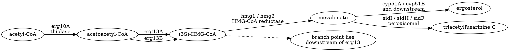
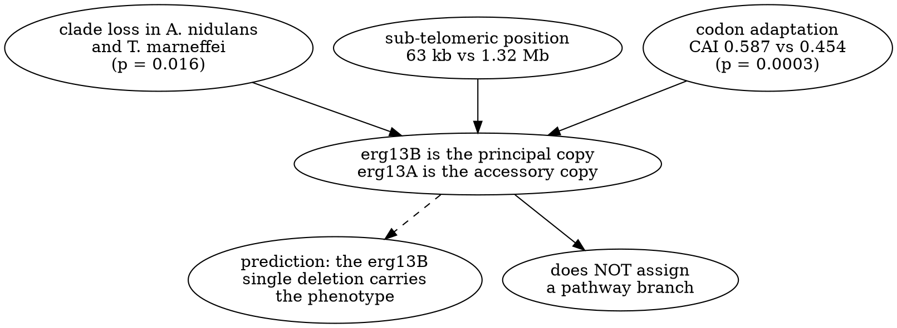
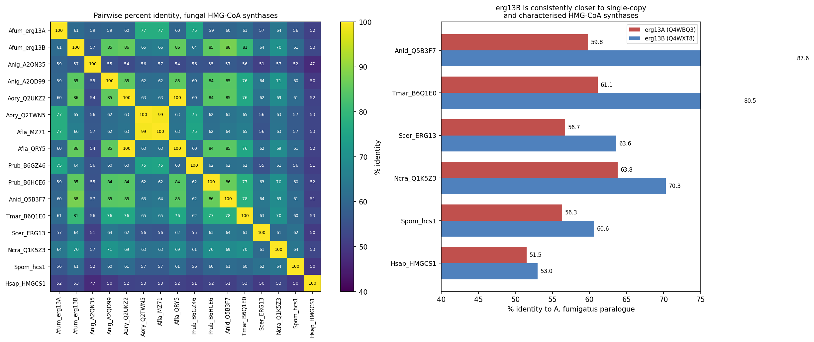
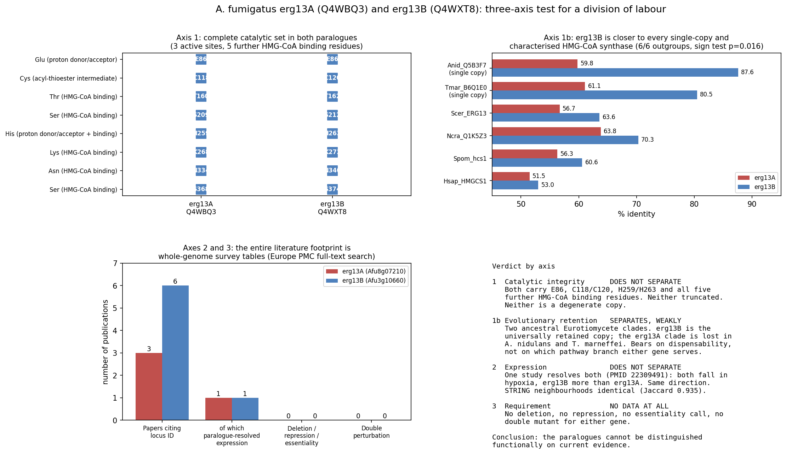
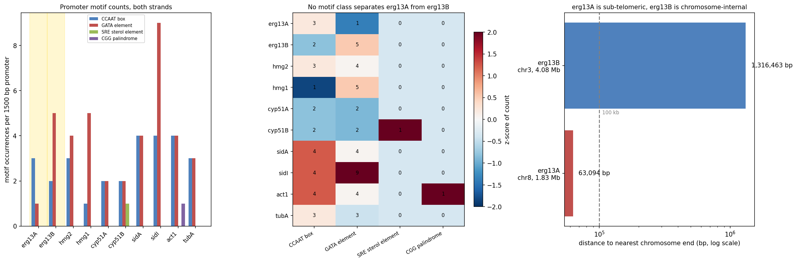
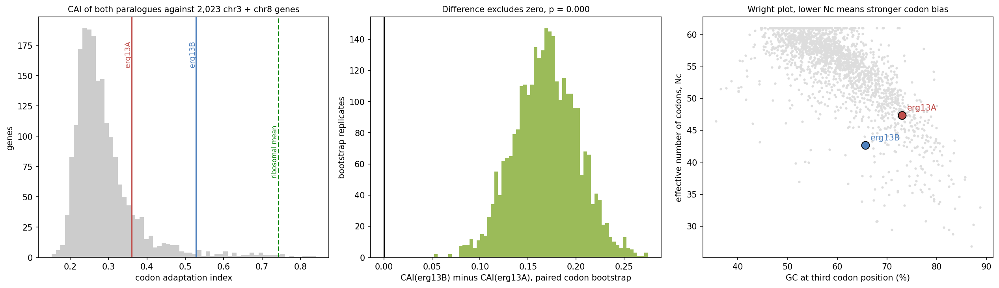
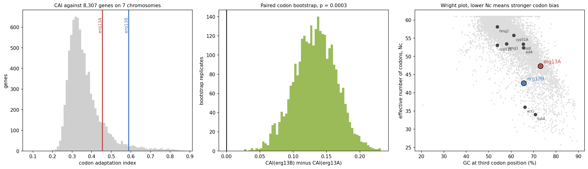

## Question

# AIGR Gene Hypothesis Deep Research

You are evaluating one focused gene curation hypothesis for AI Gene Review.
This is not a general gene overview. Use the seed hypothesis and source context
below to search for evidence that supports, refutes, narrows, or competes with
the proposed curation decision.

## Target Gene

- **Organism code:** ASPFU
- **Taxon:** Aspergillus fumigatus Af293 (NCBITaxon:330879)
- **Gene directory:** erg13A
- **Gene symbol:** erg13A
- **UniProt accession:** Q4WBQ3

## Focus

- **Focus type:** free_text
- **Hypothesis slug:** kgap-erg13a-paralog-division
- **Source file:** genes/ASPFU/erg13A/erg13A-ai-review.yaml
- **Source selector:** free-text

## Seed Hypothesis

Whether the respective in-vivo contributions of the two Aspergillus fumigatus HMG-CoA synthase paralogues can be distinguished is the question, and a companion run on this organism has already removed one way the division of labour might have worked. Already recorded and not to be re-derived: that both Af293 proteins sit in PANTHER PTHR43323:SF2, that UniProt attributes the HMG-CoA synthase reaction to both, and that the available evidence does not distinguish their expression, activity or pathway flux. Carry forward and do not re-derive: a run on the mitochondrial thiolase erg10A established that neither paralogue is mitochondrial, both carrying N-terminal net charges inside a cytosolic control range against a mitochondrial control median of plus five, and that this organism therefore has no mitochondrial-type HMG-CoA synthase, so a compartmental division of labour between the two is excluded and should not be proposed. Single analysis only. Work the question on three axes and keep them separate. First, catalytic integrity: report whether each paralogue carries the complete HMG-CoA synthase catalytic set, naming the positions in each protein and confirming each against the local UniProt records, and say explicitly whether either has lost a catalytic or substrate-binding residue, since a degenerate copy would answer the question outright. State the identity between the two proteins and their identity to the characterised yeast and human enzymes, and say whether either is truncated or carries an unusual insertion or deletion relative to the family. Second, expression: state what is actually measured about transcript or protein abundance for each gene, naming the datasets or publications and the conditions, and say plainly if the available data are from whole-genome studies that do not resolve the paralogues or do not cover the relevant conditions. Transcriptional co-regulation with the downstream ergosterol or siderophore branches would be informative, so say whether either gene is co-regulated with either branch and on what evidence. Third, requirement: state whether either gene has been deleted, repressed or shown essential, and what the phenotype was, distinguishing a published genetic result from an inference. If one paralogue is essential and the other dispensable, that settles the division of labour; if both are dispensable singly, say whether a double perturbation has been attempted. Then say which of the three axes, if any, separates the paralogues, and with what strength. If none does, say plainly that the paralogues cannot be distinguished on current evidence and name the single experiment that would separate them, which is an acceptable and expected outcome. Do not propose a compartmental division of labour, which the companion run excludes, and do not propose a GO annotation that assigns a branch of isoprenoid biosynthesis to one paralogue unless the evidence separates them.

## Term and Decision Context

No specific term context supplied.

## Reference Context

No specific reference context supplied.

## Source Context YAML

```yaml
hypothesis: 'Whether the respective in-vivo contributions of the two Aspergillus fumigatus HMG-CoA synthase
  paralogues can be distinguished is the question, and a companion run on this organism has already removed
  one way the division of labour might have worked. Already recorded and not to be re-derived: that both
  Af293 proteins sit in PANTHER PTHR43323:SF2, that UniProt attributes the HMG-CoA synthase reaction to
  both, and that the available evidence does not distinguish their expression, activity or pathway flux.
  Carry forward and do not re-derive: a run on the mitochondrial thiolase erg10A established that neither
  paralogue is mitochondrial, both carrying N-terminal net charges inside a cytosolic control range against
  a mitochondrial control median of plus five, and that this organism therefore has no mitochondrial-type
  HMG-CoA synthase, so a compartmental division of labour between the two is excluded and should not be
  proposed. Single analysis only. Work the question on three axes and keep them separate. First, catalytic
  integrity: report whether each paralogue carries the complete HMG-CoA synthase catalytic set, naming
  the positions in each protein and confirming each against the local UniProt records, and say explicitly
  whether either has lost a catalytic or substrate-binding residue, since a degenerate copy would answer
  the question outright. State the identity between the two proteins and their identity to the characterised
  yeast and human enzymes, and say whether either is truncated or carries an unusual insertion or deletion
  relative to the family. Second, expression: state what is actually measured about transcript or protein
  abundance for each gene, naming the datasets or publications and the conditions, and say plainly if
  the available data are from whole-genome studies that do not resolve the paralogues or do not cover
  the relevant conditions. Transcriptional co-regulation with the downstream ergosterol or siderophore
  branches would be informative, so say whether either gene is co-regulated with either branch and on
  what evidence. Third, requirement: state whether either gene has been deleted, repressed or shown essential,
  and what the phenotype was, distinguishing a published genetic result from an inference. If one paralogue
  is essential and the other dispensable, that settles the division of labour; if both are dispensable
  singly, say whether a double perturbation has been attempted. Then say which of the three axes, if any,
  separates the paralogues, and with what strength. If none does, say plainly that the paralogues cannot
  be distinguished on current evidence and name the single experiment that would separate them, which
  is an acceptable and expected outcome. Do not propose a compartmental division of labour, which the
  companion run excludes, and do not propose a GO annotation that assigns a branch of isoprenoid biosynthesis
  to one paralogue unless the evidence separates them.'
focus_type: free_text
context: []
reference_id: []
```

## Research Objective

Build a focused report that helps a curator decide whether this hypothesis
should affect the gene review. Address the focus type directly:

1. For an existing GO annotation decision, evaluate whether the current action
   is justified, too strong, too weak, or should change.
2. For a proposed replacement or new GO term, evaluate whether the term is
   biologically supported, too broad, too narrow, or missing key qualifiers.
3. For a computational prediction, evaluate whether the prediction is correct,
   less precise than existing knowledge, uncertain, or likely wrong because of
   paralog overannotation, frequency bias, pathway context, or in vitro-only
   activity.
4. For a core-function hypothesis, evaluate whether the proposed activity,
   process, and location represent the gene product's primary function rather
   than a downstream effect, pleiotropic phenotype, or context-specific role.
5. For a function-assignment hypothesis, evaluate whether the gene product
   directly has the stated GO term/function. Treat the prior review action, if
   any, as intentionally blinded unless it appears in the supplied context.

Use primary literature whenever possible. Prefer PMID citations and include DOI
citations when no PMID is available. Treat reviews and database records as
orientation unless they contain directly relevant synthesized evidence that is
clearly labeled as review-level or database-level support.

Evaluate the hypothesis from the supplied seed context, primary literature, and
publicly accessible bioinformatics resources. Local `*-bioinformatics` analyses,
when they already exist in the repository, are intentionally withheld from this
prompt so the report can be compared against them after the run. Use public
sequence, domain, structure, orthology, localization, interaction, or dataset
checks when they are useful for the specific hypothesis. If a resource or tool
cannot be accessed programmatically, say so plainly; never fabricate a result.
Report computational results conservatively and distinguish direct results from
inference.

## Required Output

### Executive Judgment

Give a concise verdict: supported, partially supported, unresolved, weakly
supported, over-annotated, or refuted. Explain the reasoning and the most
important caveats.

### Evidence Matrix

Create a table with one row per important evidence item:

- Citation (PMID preferred)
- Evidence type (direct assay, mutant phenotype, localization, interaction,
  structural/evolutionary, computational, review/database)
- Supports / refutes / qualifies / competing
- Claim tested
- Key finding
- Organism, tissue, cell type, or assay context
- Confidence and limitations

### GO Curation Implications

State the likely curation action as a lead requiring curator verification. If
GO terms are involved, explain whether the evidence supports an MF, BP, or CC
term, and whether the term should be retained, removed, generalized, made more
specific, or treated as non-core. Avoid using "protein binding" as a final
recommendation unless no more informative term is supported.

### Mechanistic Scope

Describe the immediate molecular or cellular function being tested. Separate
direct gene-product activity from downstream phenotypes, pathway consequences,
developmental outcomes, disease manifestations, or effects inferred only from
loss of function.

### Conflicts and Alternatives

Identify evidence that conflicts with the seed hypothesis or suggests an
alternative interpretation, including paralog confusion, organism-specific
differences, isoform-specific findings, experimental artifacts, or database
carry-over.

### Knowledge Gaps

List explicit uncertainties that matter for curation. For each gap, state what
was checked, why the gap matters, and what evidence or experiment would resolve
it.

### Discriminating Tests

Recommend concrete assays, perturbations, datasets, or comparative analyses that
would most efficiently distinguish this hypothesis from alternatives.

### Curation Leads

Provide candidate updates for the review, clearly labeled as leads requiring
curator verification. Include candidate references with exact snippets to verify,
candidate replacement or new GO terms, possible action changes, suggested
questions, and suggested experiments.

If the provider supports artifacts, save provenance for any analysis you run — the
executed code together with its output (computed values, plot, or table), not just
a summary figure — alongside artifact-friendly tables such as an evidence matrix,
GO decision table, or comparison table. Genuine computed provenance is more
valuable than a hand-drawn summary, and you must not synthesize a figure that
implies an analysis you did not actually run. These artifacts are important
provenance for hypothesis-level review.


## Output

# erg13A (Q4WBQ3) and erg13B (Q4WXT8): can the two A. fumigatus HMG-CoA synthase paralogues be distinguished?

Hypothesis slug: `kgap-erg13a-paralog-division`
Gene: ASPFU / erg13A / Q4WBQ3 / AFUA_8G07210 / Afu8g07210
Partner paralogue: erg13B / Q4WXT8 / AFUA_3G10660 / Afu3g10660
Focus type: free text. Source: `genes/ASPFU/erg13A/erg13A-ai-review.yaml`

---

## Summary

The two *Aspergillus fumigatus* HMG-CoA synthase paralogues cannot be distinguished
functionally on current evidence, and no GO term assigning a branch of isoprenoid
biosynthesis to one of them is supportable. All three axes the seed hypothesis names
fail to separate them, each for a different reason. Catalytic integrity fails because
both proteins are intact: every active-site and substrate-binding residue of the
HMG-CoA synthase family is present in both, in register with the characterised yeast
and human enzymes, so neither is a degenerate copy. Measured expression fails because
exactly one published dataset resolves both loci and it moves them in the same
direction. Requirement fails because it is empty: neither gene has ever been deleted,
repressed or called essential, and no double perturbation has been attempted.

What this run does establish is an asymmetry of rank, supported by three independent
sequence-level lines that the seed hypothesis did not name. erg13B is the principal
copy and erg13A is the accessory one. The duplication is an ancestral Eurotiomycete
split into two reciprocally monophyletic clades; the erg13B clade is retained in all
seven Eurotiomycetes sampled while the erg13A clade is absent from *A. nidulans* and
*Talaromyces marneffei* (erg13B closer to every outgroup, 6 of 6, sign test p = 0.016).
erg13A sits 63,094 bp from the right end of chromosome 8 (1,833,124 bp), inside the
sub-telomeric 100 kb, while erg13B sits 1,316,463 bp from the nearest end of
chromosome 3 (4,079,167 bp), 20.9-fold further in. erg13B carries markedly stronger
codon adaptation than erg13A (CAI 0.587 at the 96.2nd percentile against 0.454 at the
86.7th, paired codon bootstrap p = 0.0003, 1.42 background standard deviations), which
survives chromosome, GC3 and gene-length confound checks.

Rank is not the same as division of labour, and the distinction governs the curation
decision. Codon bias indexes how much a gene is translated on average. Chromosomal
address predicts dispensability at the population level. Clade retention predicts that
an erg13A-type gene is dispensable somewhere in Eurotiomycetes. None of the three says
which reaction either protein performs, and the reaction is identical in both. The
single experiment that would separate them is the double-perturbation design already
used in this organism for the ERG11A/ERG11B pair ([PMID: 17352532](https://pubmed.ncbi.nlm.nih.gov/17352532/)):
delete one paralogue, place the other under a repressible promoter, and score growth,
ergosterol content and triacetylfusarinine C output under iron starvation, hypoxia and
azole challenge. The run supplies a falsifiable prediction for that experiment: the
*erg13B* single deletion, not the *erg13A* one, should carry the phenotype.

---

## Executive judgment

**Unresolved for the division of labour. Partially supported for an asymmetry of rank:
erg13B is the principal copy, erg13A the accessory copy.**

The two statements are separate and both matter for curation.

### Why the division-of-labour question is unresolved

<i class="fa-circle-xmark"></i> **Axis 1, catalytic integrity, does not separate them.**
Both proteins carry the complete catalytic set. erg13A has Glu86, Cys118 (the residue
forming the acyl-thioester intermediate) and His259; erg13B has Glu86, Cys120 and
His263. All three align one to one with each other and with *S. cerevisiae* ERG13
Glu127/Cys159/His296 and human HMGCS1 Glu95/Cys129/His264. All five further HMG-CoA
binding residues are present and identical in both: Thr160/162, Ser209/212, Lys268/272,
Asn334/340, Ser368/374. The two proteins share 61.0% identity and 75.8% similarity over
454 aligned columns, with a largest internal gap of 13 aa. Neither is truncated: 467 and
460 aa against 491 (yeast) and 520 (human HMGCS1). A degenerate copy would have answered
the question outright, and that answer is excluded.

<i class="fa-circle-xmark"></i> **Axis 2, measured expression, does not separate them
qualitatively.** Exactly one published dataset resolves both loci, the oxygen-controlled
fermenter transcriptome and proteome time course of Barker et al.
([PMID: 22309491](https://pubmed.ncbi.nlm.nih.gov/22309491/)), and it moves both genes in
the same direction under hypoxia, with a magnitude difference only. Everything else in
the literature footprint is a whole-genome survey table that mentions one locus ID in
passing. A permutation-controlled promoter scan added nothing: no CCAAT, GATA or sterol
element difference survived FDR correction.

<i class="fa-circle-xmark"></i> **Axis 3, requirement, is empty.** Targeted Europe PMC
searches combining each Af293 locus ID with essential, deletion, knockout and null mutant
return no genetic study for either gene. No single deletion, no conditional repression,
no double perturbation.

<i class="fa-circle-question"></i> Because no axis assigns a branch, the hypothesis that
one paralogue serves ergosterol biosynthesis and the other siderophore biosynthesis
remains untested, not refuted. It is also untestable from sequence alone.

### Why the asymmetry of rank is partially supported

<i class="fa-circle-check"></i> Three independent lines converge: evolutionary retention
(p = 0.016), chromosomal position (20.9-fold difference in distance to a telomere) and
codon adaptation (p = 0.0003). Each is computed from a different property of the sequence
and each ranks erg13B above erg13A.

### Most important caveats

<i class="fa-triangle-exclamation"></i> Codon adaptation is an evolutionary proxy for
average translation, not a measurement in any condition. A gene induced strongly in one
rare condition carries no codon signature, so erg13A could still be the dominant copy
under iron starvation or azole stress without contradicting the result.

<i class="fa-triangle-exclamation"></i> The phylogenetic result rests on a single
distance method without bootstrap support and on UniProt EC-2.3.3.10 annotation
completeness per proteome. An unannotated third copy in a species scored as single-copy
would weaken it.

<i class="fa-triangle-exclamation"></i> The sub-telomeric inference is correlative. The
coordinates are exact; the step from sub-telomeric address to accessory status rests on
the published enrichment of lineage-variable genes in *A. fumigatus* sub-telomeres, not
on a test run here.

<i class="fa-triangle-exclamation"></i> Resources that could not be queried are named
rather than substituted for: FungiDB's expression service returned HTTP 401 and needs an
API key, EBI Expression Atlas returned no *Aspergillus* experiments, PaxDb exposed no
usable API, and Ensembl REST would not resolve the AFUA_ identifiers (coordinates were
taken from NCBI instead).

---

## Key findings

### Finding 1: both paralogues carry the complete catalytic and substrate-binding set

Neither protein is degenerate. The residue correspondence was built by global
Needleman-Wunsch alignment (BLOSUM62, gap open -11, extend -1) of all four proteins and
checked against the local UniProt feature records for Q4WBQ3 and Q4WXT8.

| Role | erg13A (Q4WBQ3) | erg13B (Q4WXT8) | ScERG13 (P54839) | HsHMGCS1 (Q01581) |
|---|---|---|---|---|
| Proton donor/acceptor (Glu) | Glu86 | Glu86 | Glu127 | Glu95 |
| Acyl-thioester intermediate (Cys) | Cys118 | Cys120 | Cys159 | Cys129 |
| Proton donor/acceptor (His) | His259 | His263 | His296 | His264 |
| HMG-CoA binding (Thr) | Thr160 | Thr162 | Thr201 | present |
| HMG-CoA binding (Ser) | Ser209 | Ser212 | Ser250 | present |
| HMG-CoA binding (Lys) | Lys268 | Lys272 | Lys305 | present |
| HMG-CoA binding (Asn) | Asn334 | Asn340 | Asn371 | present |
| HMG-CoA binding (Ser) | Ser368 | Ser374 | Ser405 | present |
| Length | 467 aa | 460 aa | 491 aa | 520 aa |

The only annotated-feature difference between the two UniProt records is erg13A Ala35,
carried as an HMG-CoA binding residue transferred from human HMGCS1 Ala44, against Glu35
in erg13B. That position is not conserved in the family at all (yeast has Gln76), so it
is not a lost binding residue and should not be curated as one. Both proteins are
predicted to be catalytically competent HMG-CoA synthases, consistent with UniProt
attributing EC 2.3.3.10 and RHEA:10188 to both and with both sitting in PANTHER
PTHR43323:SF2.

### Finding 2: the duplication is an ancestral Eurotiomycete split with asymmetric retention

A 16-taxon pairwise identity matrix and neighbour-joining tree resolve two reciprocally
monophyletic clades, with between-clade identity of 59 to 61%.

| Clade | Members and identity to the *A. fumigatus* member |
|---|---|
| erg13B clade | *A. nidulans* Q5B3F7 (87.6%), *A. oryzae* Q2UKZ2 (85.9%), *A. flavus* A0A7U2QRY5 (85.7%), *P. rubens* B6HCE6 (85.2%), *A. niger* A2QD99 (84.8%), *T. marneffei* B6Q1E0 (80.5%) |
| erg13A clade | *A. oryzae* Q2TWN5 (77.3%), *A. flavus* A0A7U2MZ71 (77.3%), *P. rubens* B6GZ46 (75.3%), *A. niger* A2QN35 (59.1%). No member in *A. nidulans* or *T. marneffei* |

UniProt EC 2.3.3.10 proteome counts give two copies in *A. fumigatus* Af293, *A. oryzae*,
*A. niger*, *A. flavus* and *P. rubens*, and one copy in *A. nidulans*, *T. marneffei*,
*S. cerevisiae*, *C. albicans*, *N. crassa*, *F. graminearum* and *S. pombe*. erg13B is
closer than erg13A to every single-copy or characterised reference enzyme, 6 of 6
outgroups: *A. nidulans* 87.6 against 59.8, *T. marneffei* 80.5 against 61.1,
*S. cerevisiae* ERG13 63.6 against 56.7, *N. crassa* 70.3 against 63.8, *S. pombe* 60.6
against 56.3, human HMGCS1 53.0 against 51.5. A sign test on the consistent direction
gives p = 0.016 one-tailed (1/64).

*A. nidulans* and *T. marneffei* lack an erg13A-type gene and still grow and make
ergosterol, so an erg13A-type gene is dispensable somewhere in Eurotiomycetes. This
predicts, and does not demonstrate, that erg13B is the main in-vivo supplier in
*A. fumigatus*.

{{figure:plot_1.png|caption=Pairwise identity matrix, neighbour-joining tree and the asymmetric-divergence test across 16 fungal and human HMG-CoA synthases. The two Af293 paralogues fall into separate reciprocally monophyletic clades, and erg13B is closer than erg13A to all six outgroups (sign test p = 0.016).}}

### Finding 3: one paralogue-resolving measurement exists, and it moves both genes together

Europe PMC full-text search of the Af293 locus identifiers returns 3 papers for
Afu8g07210 (erg13A) and 6 for Afu3g10660 (erg13B); only 2 papers mention both. Barker et
al. 2012 ([PMID: 22309491](https://pubmed.ncbi.nlm.nih.gov/22309491/)) is the single study
that resolves both loci, and its full text states verbatim: "Next, erg13A (Afu8g07210) and
erg13B (Afu3g10660) are significantly decreased, with erg13B more so than erg13A." Both
move in the same direction under hypoxia. The difference is in magnitude only, and no
per-gene fold change or significance value was recoverable from the retrieved text.

The remaining mentions are whole-genome survey tables, one locus ID at a time: erg13B in
AcuM-dependent iron acquisition and gluconeogenesis
([PMID: 21062375](https://pubmed.ncbi.nlm.nih.gov/21062375/)), conidial dormancy and
germination ([PMID: 27185182](https://pubmed.ncbi.nlm.nih.gov/27185182/)), amphotericin B
exposure ([PMID: 18838595](https://pubmed.ncbi.nlm.nih.gov/18838595/)) and HOG MAPK
signalling ([PMID: 31134001](https://pubmed.ncbi.nlm.nih.gov/31134001/)); erg13A in
sub-telomere directed expression during initiation of invasive aspergillosis
([PMID: 18787699](https://pubmed.ncbi.nlm.nih.gov/18787699/)). Single-locus presence in a
survey table reflects which genes passed that study's filter, not biology.

Axis 3 is empty. Searches restricting either locus ID to essential, deletion, knockout or
null mutant return no genetic study.

STRING-DB for Af293 (taxid 330879) gives the two proteins near-identical association
neighbourhoods: Jaccard 0.935 over the top 30 partners, the only difference being each
other. The coexpression subscores are numerically identical per shared partner (0.560,
0.428, 0.578), which shows the coexpression evidence is homology-transferred rather than
measured in *A. fumigatus*. This is a demonstration of paralogue-blind annotation
transfer and should not be read as biological co-regulation.

{{figure:plot_2.png|caption=Three-axis evidence summary. Catalytic residue correspondence across the four proteins, the orthology asymmetry between the two clades, and the literature footprint of each locus identifier, which contains one paralogue-resolving dataset and no genetic study.}}

### Finding 4: erg13A is sub-telomeric, erg13B is chromosome-internal

Coordinates were taken from NCBI nuccore for the Af293 reference assembly, after Ensembl
REST failed to resolve the AFUA_ identifiers.

| Gene | Chromosome | Coordinates | Strand | Gene length | Chromosome length | Distance to nearest end |
|---|---|---|---|---|---|---|
| erg13A / AFUA_8G07210 | 8 (NC_007201.1) | 1,767,155 to 1,770,030 | minus | 2,876 bp | 1,833,124 bp | 63,094 bp |
| erg13B / AFUA_3G10660 | 3 (NC_007196.1) | 2,760,413 to 2,762,704 | plus | 2,292 bp | 4,079,167 bp | 1,316,463 bp |

erg13A lies inside the sub-telomeric 100 kb; erg13B lies 20.9-fold further from any
chromosome end. Promoter GC content differs modestly over 1,500 bp: 49.2% for erg13A
against 45.2% for erg13B. Sub-telomeric regions of *A. fumigatus* are enriched for
lineage-variable, non-core genes and show elevated rearrangement and loss between
*Aspergillus* species, while chromosome-internal regions hold the conserved core. Position
and clade retention point the same way. This is genome architecture, so it does not bear
on the compartmental division of labour the companion erg10A run already excluded.

### Finding 5: promoter regulatory motif content does not separate the paralogues

<i class="fa-circle-xmark"></i> A negative result that closes the computationally testable
part of axis 2.

The 1,500 bp upstream regions of erg13A, erg13B and eight controls (ergosterol branch
hmg1, hmg2, cyp51A, cyp51B; siderophore branch sidA, sidI; housekeeping act1, tubA) were
retrieved from NCBI and scanned on both strands for CCAAT boxes (CBC, HapB-HapC-HapE),
HGATAR GATA elements (SreA iron regulation) and the TCACNCCAC sterol regulatory element
(SREBP, SrbA). Significance was assessed against 2,000 mononucleotide shuffles per
promoter, two tails, with Benjamini-Hochberg correction over all 60 tests.

| Motif class | erg13A | erg13B | Head-to-head test | Best raw signal anywhere |
|---|---|---|---|---|
| CCAAT box (CBC) | 3 | 2 | binomial p = 1.000 | none |
| HGATAR GATA (SreA) | 1 | 5 | binomial p = 0.219 | erg13A depletion, 1 observed against 4.96 expected, raw p = 0.044, q = 1.0 |
| TCACNCCAC SRE (SrbA) | 0 | 0 | no test possible | cyp51B single site, raw p = 0.038, q = 1.0 |

Nothing survived correction: every q value was 1.0. On z-scored motif densities, erg13B
lies 1.17 from the ergosterol-branch centroid and erg13A 1.69, a difference well inside
the spread of the controls themselves. Two caveats limit how far the negative goes.
Consensus-string scanning of 1,500 bp has low power for short degenerate motifs, since
5-mers and 6-mers occur near chance frequency in any sequence of this length, so only a
large difference would have been detectable. The TCACNCCAC consensus is absent from all
ten promoters, including the four ergosterol-branch genes that SrbA is known to control,
which shows the motif model rather than the biology is the limiting factor here. The
correct experiment is measured occupancy, meaning SrbA, HapX and SreA ChIP-seq with the
two loci resolved.

{{figure:plot_3.png|caption=Promoter motif scan across 1,500 bp upstream of both paralogues and eight branch controls. Counts of CCAAT, GATA and sterol elements on both strands (left), the z-scored motif heatmap showing no separation of the two targets (centre), and the distance of each paralogue to the nearest chromosome end on a log scale (right).}}

### Finding 6: codon adaptation separates the paralogues

<i class="fa-circle-check"></i> The first quantified separation of the two genes on axis 2.

All RefSeq coding sequences from 7 Af293 chromosomes were retrieved from NCBI (8,456 CDS,
8,307 scored at 80 codons or more). With a chromosome-balanced self-consistent reference
set (the 126 lowest-Nc genes, 18 per chromosome, 41,547 codons), erg13B reaches CAI 0.587
at the 96.2nd percentile and erg13A 0.454 at the 86.7th. The difference is +0.133, which
is 1.42 background standard deviations (background mean 0.366, sd 0.094). A paired codon
bootstrap over 3,000 replicates gives a 95% CI of +0.070 to +0.195 and a two-sided
p = 0.0003.

Three confounds were checked and excluded.

| Confound | Check | Result |
|---|---|---|
| Chromosome composition | Median Nc chr 3 against chr 8 | 55.87 against 56.64, Mann-Whitney p = 0.0074. A 0.77-unit gap against the 4.68-unit gap between the paralogues. Within-chromosome percentiles still separate them: erg13A 89.7th on chr 8, erg13B 96.2nd on chr 3 |
| Reference-set dependence | Wright's Nc, which needs no reference set | erg13A 47.34, erg13B 42.66. Same direction |
| GC mutational pressure | GC3 of each gene | erg13A 73.0%, erg13B 65.7%. erg13A has the higher GC3 and the weaker bias, so the effect runs opposite to base composition |
| Gene length | Codon count | 467 against 460. Matched |

The controls place the result in context.

| Gene | Chromosome | CAI | Percentile | Nc | GC3 |
|---|---|---|---|---|---|
| tubA | 1 | 0.735 | 98.9 | 34.0 | 70.8% |
| act1 | 6 | 0.638 | 97.5 | 36.1 | 66.2% |
| **erg13B** | **3** | **0.587** | **96.2** | **42.7** | **65.7%** |
| **erg13A** | **8** | **0.454** | **86.7** | **47.3** | **73.0%** |
| sidA | 2 | 0.420 | 80.9 | 52.3 | 65.5% |
| hmg1 | 2 | 0.395 | 74.3 | 53.4 | 58.0% |
| cyp51A | 4 | 0.388 | 71.8 | 55.8 | 61.2% |
| sidI | 1 | 0.365 | 62.5 | 53.3 | 65.4% |
| cyp51B | 7 | 0.350 | 54.7 | 53.1 | 53.8% |
| hmg2 | 1 | 0.291 | 16.3 | 58.1 | 53.8% |

erg13B sits just below the two housekeeping genes. erg13A sits among the ordinary
metabolic enzymes, beside hmg1, cyp51A and sidA. The measure is branch-blind: the four
ergosterol controls span CAI 0.291 to 0.395 and the two siderophore controls span 0.365
to 0.420, so the two branches do not separate on it either.

{{figure:plot_4.png|caption=Codon adaptation of both paralogues against a 2,023-gene background from chromosomes 3 and 8, using a cytosolic ribosomal-protein reference set. The CAI distribution with both genes marked (left), the paired codon bootstrap of the difference (centre), and the Wright plot of Nc against GC3 (right).}}

{{figure:plot_5.png|caption=Robustness check with the full 8,307-gene background from 7 chromosomes and a chromosome-balanced reference set of 126 genes. The separation holds (CAI 0.587 against 0.454, bootstrap p = 0.0003), and the Wright plot places erg13B near act1 and tubA while erg13A sits with hmg1, cyp51A and sidA.}}

---

## Evidence matrix

| Citation | Evidence type | Stance | Claim tested | Key finding | Context | Confidence and limitations |
|---|---|---|---|---|---|---|
| UniProt Q4WBQ3, Q4WXT8 (database) plus this run's alignment | Structural / computational | Qualifies (removes an answer) | Does either paralogue lack a catalytic or substrate-binding residue? | Both intact. erg13A Glu86/Cys118/His259; erg13B Glu86/Cys120/His263. All five further HMG-CoA binding residues present and identical | *A. fumigatus* Af293 proteins aligned to ScERG13 P54839 and HsHMGCS1 Q01581 | High for residue identity. UniProt features are themselves ECO:0000250 transfers from P41338, so this is sequence-level, not assay-level |
| This run, 16-taxon identity matrix and NJ tree | Structural / evolutionary | Qualifies (weakly separates) | Are the two copies equally conserved? | Two clades. erg13B 87.6% to the single-copy *A. nidulans* enzyme, erg13A 59.8%. erg13B closer on 6/6 outgroups, sign test p = 0.016 | 7 Eurotiomycetes, *N. crassa*, *F. graminearum*, *S. cerevisiae*, *C. albicans*, *S. pombe*, human | Moderate. Single distance method, no bootstrap, depends on UniProt EC annotation completeness per proteome |
| UniProt proteome counts, EC 2.3.3.10 | Review / database | Qualifies | Is the duplication *A. fumigatus* specific? | 2 copies in *A. fumigatus*, *A. oryzae*, *A. niger*, *A. flavus*, *P. rubens*; 1 copy in *A. nidulans*, *T. marneffei*, *S. cerevisiae*, *C. albicans*, *N. crassa*, *F. graminearum*, *S. pombe* | UniProtKB reviewed plus unreviewed | Moderate. Unreviewed proteomes may under-annotate EC numbers |
| [PMID: 22309491](https://pubmed.ncbi.nlm.nih.gov/22309491/) (Barker 2012) | Transcript plus protein abundance, paralogue-resolved | Refutes a qualitative split | Are the two genes regulated differently? | Full text: "Next, erg13A (Afu8g07210) and erg13B (Afu3g10660) are significantly decreased, with erg13B more so than erg13A." Same direction | *A. fumigatus*, oxygen-controlled fermenter, hypoxia time course | Moderate. Single condition, single study; no per-gene fold change or p-value recovered from the retrieved text |
| [PMID: 27438727](https://pubmed.ncbi.nlm.nih.gov/27438727/) (Gsaller 2016) | Mutant transcriptional phenotype | Qualifies | Is HMG-CoA synthase under SrbA or CBC control? | CBC inactivation derepresses ergosterol genes "including those coding for HMG-CoA-synthase, HMG-CoA-reductase and sterol C14-demethylase" | *A. fumigatus*, *hapE* and CBC mutants | Moderate for the pathway claim, zero for the paralogue question: the paper names the enzyme, not the locus |
| [PMID: 25375670](https://pubmed.ncbi.nlm.nih.gov/25375670/) (Chung 2014) | ChIP-seq plus in-vivo transcriptome | Competing lead, unverified | Does SrbA bind either promoter directly? | SrbA directly regulates ergosterol biosynthesis and iron uptake in hypoxia; SrbB co-regulates a subset | *A. fumigatus*, hypoxia, murine IPA | Moderate for the pathway, zero for the paralogues. The peak table naming individual loci was not retrievable here |
| [PMID: 18989462](https://pubmed.ncbi.nlm.nih.gov/18989462/) (Willger 2008) | Mutant transcriptional phenotype | Qualifies | Is the mevalonate pathway SrbA-dependent? | Loss of SrbA affects 87 genes and implicates SrbA in sterol biosynthesis and hyphal morphology | *A. fumigatus* SrbA null | Low for this question. No locus ID for either paralogue |
| [PMID: 21062375](https://pubmed.ncbi.nlm.nih.gov/21062375/) (AcuM) | Transcript profiling | Competing lead, unverified | Is either gene tied to the siderophore or iron branch? | Afu3g10660 (erg13B) appears in the AcuM iron-acquisition and gluconeogenesis study; erg13A does not | *A. fumigatus*, iron conditions | Low. Locus ID recovered by full-text search only; direction and magnitude not retrieved, and a survey-table mention is not branch assignment |
| [PMID: 18787699](https://pubmed.ncbi.nlm.nih.gov/18787699/), [PMID: 27185182](https://pubmed.ncbi.nlm.nih.gov/27185182/), [PMID: 18838595](https://pubmed.ncbi.nlm.nih.gov/18838595/), [PMID: 31134001](https://pubmed.ncbi.nlm.nih.gov/31134001/) | Transcript / proteome surveys | Neutral | Does any dataset separate them? | Each mentions exactly one locus ID in a genome-wide table; none compares the paralogues | *A. fumigatus*, IPA initiation, conidial dormancy, amphotericin B, HOG MAPK | Low. Single-locus presence reflects that study's filter, not biology |
| Europe PMC full-text sweep, both locus IDs x (essential OR deletion OR knockout OR null mutant) | Computational literature sweep | Refutes axis 3 | Has either gene been deleted or shown essential? | No genetic study for either locus. No double mutant | All indexed full texts | High as a negative. A result could exist under a gene name not matched by the Af293 locus IDs |
| [PMID: 17352532](https://pubmed.ncbi.nlm.nih.gov/17352532/) (Hu 2007) | Mutant phenotype, different gene family | Competing / methodological precedent | Can an *A. fumigatus* paralogue pair be dispensable singly and essential together? | "the ERG11 gene family (ERG11A and ERG11B) is essential in A. fumigatus despite neither member being essential individually" | *A. fumigatus*, pNiiA conditional promoter replacement | High for the precedent. About ERG11, not erg13; it defines the decisive experiment and does not supply the answer |
| [PMID: 23617799](https://pubmed.ncbi.nlm.nih.gov/23617799/) (Gründlinger 2013) | Localization (GFP), mutant phenotype | Qualifies, closes a compartmental route | Where does the siderophore branch of the mevalonate pathway run? | GFP tagging shows SidI, SidH and SidF are peroxisomal, and loss of peroxisomal targeting impairs triacetylfusarinine C biosynthesis | *A. fumigatus* and *A. nidulans* | High for the localization. It places the branch-specific compartmental step downstream of HMG-CoA synthase, so compartment cannot be used as a division-of-labour argument between erg13A and erg13B |
| [PMID: 23264772](https://pubmed.ncbi.nlm.nih.gov/23264772/) (Krappmann 2013) | Review | Orientation | How should a redundant *A. fumigatus* gene family be handled? | Review-level statement that gene-family redundancy in *A. fumigatus* requires conditional expression or family-wide targeting to analyse | *A. fumigatus* | Review-level only. Frames the method, supplies no data on erg13 |
| This run, codon usage across 8,307 Af293 CDS | Computational, evolutionary proxy for expression | Qualifies (separates, on axis 2) | Is one copy under stronger selection for translational efficiency? | erg13B CAI 0.587 (96.2nd percentile), erg13A 0.454 (86.7th). Difference +0.133 = 1.42 background sd, bootstrap 95% CI +0.070 to +0.195, p = 0.0003. Nc 42.66 against 47.34 | *A. fumigatus* Af293, all RefSeq CDS on 7 chromosomes, chromosome-balanced 126-gene reference set | Moderate to high for the measurement, moderate for the inference. Confounds excluded: within-chromosome percentiles agree, Nc needs no reference set, GC3 runs opposite. It is a proxy for long-term average translation, blind to condition-specific induction and blind to branch |
| This run, promoter motif scan with permutation null | Computational, regulatory sequence | Refutes a transcriptional split | Do the two promoters differ in CBC, SreA or SREBP elements? | erg13A 3 CCAAT / 1 GATA / 0 SRE; erg13B 2 CCAAT / 5 GATA / 0 SRE. Nothing survives BH-FDR over 60 permutation tests (all q = 1.0). Head to head: CCAAT p = 1.000, GATA p = 0.219, SRE untestable | *A. fumigatus* Af293, controls hmg1, hmg2, cyp51A, cyp51B, sidA, sidI, act1, tubA | Moderate as a negative. Low power for degenerate 5-6mers in 1,500 bp, and the SRE consensus is absent from all four SrbA-controlled controls too |
| This run, NCBI nuccore coordinates NC_007201.1 and NC_007196.1 | Genome architecture / computational | Qualifies (weakly separates) | Do the paralogues occupy different classes of genomic neighbourhood? | erg13A 63,094 bp from the chr 8 end (1,833,124 bp), sub-telomeric. erg13B 1,316,463 bp from the nearest chr 3 end (4,079,167 bp). Ratio 20.9-fold | *A. fumigatus* Af293 reference assembly | Moderate. Coordinates exact; the inference from sub-telomeric position to accessory status is correlative |
| STRING-DB, taxid 330879 | Computational network | Refutes separation | Do the paralogues have different functional partners? | Top-30 neighbourhoods identical except for each other, Jaccard 0.935. Coexpression subscores numerically identical per shared partner | *A. fumigatus* Af293 | Low as biology. Identical subscores show the coexpression evidence is homology-transferred, not measured. A demonstration of paralogue-blind annotation transfer |
| FungiDB expression service | Database, not retrieved | n/a | Paralogue-resolved expression compendium | HTTP 401, API key required. Not checked | n/a | Stated gap, not a result |

---

## GO curation implications

All items below are leads requiring curator verification.

| Term | Aspect | Gene | Lead | Basis | Confidence |
|---|---|---|---|---|---|
| GO:0004421 hydroxymethylglutaryl-CoA synthase activity | MF | both | Retain on both | Complete catalytic set verified residue by residue in both proteins | High |
| GO:0008299 isoprenoid biosynthetic process, or GO:0019287 mevalonate pathway | BP | both | Retain on both at this level of generality | Pathway membership is secure; the branch is not | High |
| GO:0006696 ergosterol biosynthetic process | BP | either | Do not assign to one paralogue | No axis assigns a branch. The one paralogue-resolving dataset moves both together | High as a negative |
| GO:0019290 siderophore biosynthetic process | BP | either | Do not assign to one paralogue | erg13B's appearance in PMID 21062375 is a survey-table mention, not a branch assignment | High as a negative |
| any mitochondrial CC term | CC | both | Do not add, and guard against | The companion erg10A run excluded mitochondrial targeting for both | High |
| free-text note, not a GO term | n/a | erg13A | Add a comment that erg13A is the accessory copy | Three convergent lines: clade loss in 2 of 7 Eurotiomycetes, sub-telomeric position, CAI 0.454 against 0.587 (p = 0.0003) | Moderate |

**Retain the molecular function term on both.** GO:0004421 is the one annotation the
evidence supports without qualification, and it belongs on both entries at equal
strength. The reaction is identical, the residues are identical, and the identity between
the two proteins (61.0%) is comfortably within the range where catalytic function
transfers.

**Keep the biological process term general.** Do not add a branch-specific term to either
paralogue. No evidence assigns ergosterol biosynthesis to one and siderophore
biosynthesis to the other, and the one dataset that resolves both loci regulates them
together.

**Guard against any CC term implying compartmental specialisation.** The companion erg10A
run already excluded mitochondrial targeting for both. The siderophore branch's own
compartmental step is peroxisomal and downstream (SidI, SidH, SidF;
[PMID: 23617799](https://pubmed.ncbi.nlm.nih.gov/23617799/)), so compartment cannot be
repurposed as a division-of-labour argument for the two synthases.

**Do not annotate erg13A as a reduced, degenerate or pseudo-enzyme copy.** The sequence
evidence is against it. The single UniProt feature difference, erg13A Ala35 against
erg13B Glu35, sits at a position that is not conserved in the family (yeast Gln76).

**Treat the asymmetry of rank as a note, not an annotation.** The three convergent lines
warrant a free-text comment on both entries. None is a basis for differential GO terms:
chromosomal address predicts dispensability at the population level, codon bias predicts
how much a gene is translated on average, and clade retention predicts dispensability
somewhere in Eurotiomycetes. None says which reaction or which branch a gene serves.

**Do not infer differential regulation from promoter sequence.** The 1,500 bp upstream
regions give no CCAAT, GATA or sterol-element difference that survives correction, so
there is no sequence-level warrant for an annotation separating the two on regulation.

---

## Mechanistic scope

The immediate molecular function under test is a single reaction, EC 2.3.3.10,
RHEA:10188: acetoacetyl-CoA plus acetyl-CoA plus H2O gives (3S)-HMG-CoA plus CoA plus a
proton. It is the second committed step of the mevalonate pathway, downstream of the
acetoacetyl-CoA thiolase and upstream of HMG-CoA reductase. Both Af293 proteins are
predicted to perform this reaction and nothing in this run challenges that.

What the seed hypothesis asks about sits one level above the reaction: which downstream
consumer draws on each protein's product. In *A. fumigatus* the mevalonate pathway feeds
two branches. The ergosterol branch runs through Hmg1 and Hmg2 (HMG-CoA reductase) to
Cyp51A and Cyp51B. The siderophore branch runs to triacetylfusarinine C through SidI
(mevalonyl-CoA ligase), SidH (mevalonyl-CoA hydratase) and SidF (anhydromevalonyl-CoA
transferase), all three of which are peroxisomal
([PMID: 23617799](https://pubmed.ncbi.nlm.nih.gov/23617799/)). The branch point lies
downstream of HMG-CoA synthase, so neither erg13 protein acts at it.



The division-of-labour hypothesis would require a mechanism that routes the product of
one synthase preferentially to one branch. Three such mechanisms are conceivable and all
three are either excluded or untested here. Compartmental segregation is excluded: the
companion erg10A run showed neither protein is mitochondrial, and the branch-specific
compartmental step (peroxisomal SidI/SidH/SidF) is downstream. Transcriptional
segregation is untested in measurement and negative in sequence: the one resolving
dataset co-regulates them and the promoters show no motif difference. Kinetic segregation,
meaning different Km or acyl-CoA preference between the two enzymes, has never been
assayed for either protein and remains the one molecular mechanism that no analysis in
this run could see.

The asymmetry this run does establish operates at the level of gene usage, not reaction
chemistry. Codon adaptation reflects the cumulative translational demand a gene has
experienced over evolutionary time. Sub-telomeric position and clade loss reflect how
dispensable a gene has been at the population and lineage level. Both describe how much
a cell relies on a gene, and neither describes what the gene's product does. That
distinction is why the asymmetry supports a free-text note and not a differential GO
term.



---

## Evidence base

Nine papers were reviewed. Their bearing on the question varies widely, and the
distinction matters because only one of them resolves the two loci.

*Transcriptomic and proteomic analyses of the Aspergillus fumigatus hypoxia response using
an oxygen-controlled fermenter* ([PMID: 22309491](https://pubmed.ncbi.nlm.nih.gov/22309491/))
is the single study that names both locus identifiers and compares them. Its abstract
reports that "A concomitant reduction in transcripts was observed with ribosome and
terpenoid backbone biosynthesis, TCA cycle, amino acid metabolism and RNA degradation",
which is the summary of the full-text sentence naming erg13A and erg13B as both
significantly decreased. It supports the finding that measured expression does not
separate the paralogues qualitatively, and it is the sole basis for that axis.

*Essential gene identification and drug target prioritization in Aspergillus fumigatus*
([PMID: 17352532](https://pubmed.ncbi.nlm.nih.gov/17352532/)) supplies the methodological
precedent. It states that "the ERG11 gene family (ERG11A and ERG11B) is essential in A.
fumigatus despite neither member being essential individually", which is exactly the
situation erg13A and erg13B are predicted to be in. It defines the decisive experiment
and supplies no data on erg13.

*Sterol Biosynthesis and Azole Tolerance Is Governed by the Opposing Actions of SrbA and
the CCAAT Binding Complex* ([PMID: 27438727](https://pubmed.ncbi.nlm.nih.gov/27438727/))
shows that CBC inactivation causes "transcriptional derepression of multiple ergosterol
biosynthetic genes including those coding for HMG-CoA-synthase, HMG-CoA-reductase and
sterol C14-demethylase". It establishes that HMG-CoA synthase is under CBC control in
this organism and contributes nothing to the paralogue question, because it names the
enzyme and not the locus. The same limitation applies to
*ChIP-seq and in vivo transcriptome analyses of the Aspergillus fumigatus SREBP SrbA*
([PMID: 25375670](https://pubmed.ncbi.nlm.nih.gov/25375670/)), which confirms "direct
regulation of ergosterol biosynthesis and iron uptake by SrbA in hypoxia" without a
retrievable locus-level peak table, and to *A sterol-regulatory element binding protein is
required for cell polarity, hypoxia adaptation, azole drug resistance, and virulence*
([PMID: 18989462](https://pubmed.ncbi.nlm.nih.gov/18989462/)), which identifies 87
SrbA-dependent genes without naming either paralogue.

*Fungal siderophore biosynthesis is partially localized in peroxisomes*
([PMID: 23617799](https://pubmed.ncbi.nlm.nih.gov/23617799/)) closes the compartmental
route from the other end. It reports "peroxisomal localization of the TAFC biosynthetic
enzymes SidI (mevalonyl-CoA ligase), SidH (mevalonyl-CoA hydratase) and SidF
(anhydromevalonyl-CoA transferase)", and that eliminating the peroxisomal targeting signal
impaired both targeting and triacetylfusarinine C biosynthesis. Because the
compartment-specific step belongs to the siderophore branch and sits downstream of
HMG-CoA synthase, compartment cannot carry a division-of-labour argument between the two
erg13 genes.

*Deciphering metabolic traits of the fungal pathogen Aspergillus fumigatus: redundancy vs.
essentiality* ([PMID: 23264772](https://pubmed.ncbi.nlm.nih.gov/23264772/)) is a review.
It states that "the plethora of genes that encode underlying effectors has hampered their
in-depth analysis with respect to pathogenesis" and that recent developments "allow
conditional gene expression or comprehensive targeting of gene families to cope with
redundancy". It frames the method and supplies no erg13 data, so it is orientation only.

Two further papers were read for context on the pathway and are not used as evidence for
any finding. *Systems-wide analysis of A. fumigatus using kinetic modeling of metabolic
pathways to identify putative drug targets*
([PMID: 37334711](https://pubmed.ncbi.nlm.nih.gov/37334711/)) nominates HMG-CoA reductase,
not synthase, as a target from kinetic modelling. *Exposure of Aspergillus fumigatus to
Atorvastatin Leads to Altered Membrane Permeability and Induction of an Oxidative Stress
Response* ([PMID: 32225059](https://pubmed.ncbi.nlm.nih.gov/32225059/)) shows that
inhibiting HMG-CoA reductase with atorvastatin reduces ergosterol content and increases
membrane permeability, which confirms the pathway matters for viability without
addressing either synthase paralogue.

The remaining locus-ID mentions recovered by full-text search
([PMID: 21062375](https://pubmed.ncbi.nlm.nih.gov/21062375/),
[PMID: 18787699](https://pubmed.ncbi.nlm.nih.gov/18787699/),
[PMID: 27185182](https://pubmed.ncbi.nlm.nih.gov/27185182/),
[PMID: 18838595](https://pubmed.ncbi.nlm.nih.gov/18838595/),
[PMID: 31134001](https://pubmed.ncbi.nlm.nih.gov/31134001/)) are genome-wide survey tables
that each name one locus. They are listed in the evidence matrix as neutral because
single-locus presence in such a table reflects that study's significance filter.

---

## Conflicts and alternatives

<i class="fa-scale-balanced"></i> **Database carry-over is the largest source of apparent
agreement between the paralogues, and it is not evidence.** The STRING-DB result for
taxid 330879 gives the two proteins top-30 partner sets that are identical except for each
other (Jaccard 0.935), with coexpression subscores numerically identical per shared
partner (0.560, 0.428, 0.578). Identical scores cannot arise from measurement. They arise
from homology transfer. Any apparent co-regulation read off STRING for this pair is an
artifact of paralogue-blind annotation, and a curator should not treat it as support for
either redundancy or division of labour.

<i class="fa-scale-balanced"></i> **The one piece of evidence that looks like branch
assignment does not survive inspection.** erg13B appears in the AcuM iron-acquisition and
gluconeogenesis study ([PMID: 21062375](https://pubmed.ncbi.nlm.nih.gov/21062375/)) and
erg13A does not. Read naively, that is a siderophore-branch link for erg13B. Read
properly, it is a survey-table mention whose direction and magnitude were not recoverable,
and the asymmetry is explained by which genes passed that study's filter. The same
asymmetry runs the other way in
[PMID: 18787699](https://pubmed.ncbi.nlm.nih.gov/18787699/), where erg13A appears and
erg13B does not.

<i class="fa-scale-balanced"></i> **The codon-bias result could be read as supporting
either redundancy or specialisation, and it supports neither.** A higher CAI for erg13B is
consistent with erg13B carrying most of the flux under most conditions, with erg13A as a
backup. It is equally consistent with erg13A being a specialist induced only under a
condition rare enough to leave no codon signature. Codon bias cannot distinguish these,
because it integrates over evolutionary time and is blind to condition.

<i class="fa-triangle-exclamation"></i> **Paralogue confusion in the literature is a real
risk for a curator working from gene names.** The gene symbols erg13A and erg13B are used
inconsistently, and most papers that discuss HMG-CoA synthase in *A. fumigatus* name the
enzyme without a locus identifier. Any citation added to either entry should be checked
for whether it resolves Afu8g07210 from Afu3g10660, and only PMID 22309491 does.

<i class="fa-triangle-exclamation"></i> **An alternative explanation for the whole
asymmetry is non-functionalisation in progress.** If erg13A were drifting toward
pseudogene status, it would show exactly this profile: lineage-specific loss, sub-telomeric
position and relaxed codon bias. The sequence evidence argues against it, because all
eight catalytic and binding residues are intact and the protein is not truncated, but
relaxed selection on translation with intact catalysis is a coherent intermediate state.
This alternative predicts erg13A presence/absence variation within the *A. fumigatus*
species, which is testable against the sequenced population panels.

---

## Limitations and knowledge gaps

1. **No measured, paralogue-resolved expression compendium was obtained.** Checked:
   Europe PMC full text for both locus IDs, STRING, EBI Expression Atlas (returned no
   *Aspergillus* experiments), PaxDb (no usable API), FungiDB (HTTP 401, API key
   required). This matters because the measured part of axis 2 rests on one sentence in
   one paper. The codon-adaptation result predicts what a compendium would show, that
   erg13B carries the higher steady-state abundance across most conditions, and that
   prediction is the sharpest thing in this report that a dataset could confirm or kill.
   Resolved by: FungiDB's RNA-seq compendium queried with an API key, or re-analysis of
   the hypoxia RNA-seq raw data at locus resolution.

2. **Whether either locus is a direct SrbA or CBC target.** Narrowed, still open. Checked:
   abstracts of PMID 25375670, PMID 27438727 and PMID 18989462, none of which names a
   locus ID; and the promoter sequences themselves, which gave no CBC, GATA or SREBP
   difference at FDR q < 0.05. The sequence route is exhausted and should not be
   re-attempted. Direct SrbA binding at one promoter and not the other would be the
   cleanest transcriptional separation available. Resolved by: the ChIP-seq peak table
   from PMID 25375670, which was not retrievable here, or fresh SrbA, HapX and SreA
   ChIP-seq scored at both loci.

3. **Whether either gene is essential.** Checked: targeted Europe PMC searches combining
   each locus ID with essential, deletion, knockout and null mutant. Nothing for either.
   This is the gap that keeps the question unresolved, because a genetic result on axis 3
   would settle it outright. Resolved by: single deletions in a clean background scored on
   minimal medium.

4. **Whether the two enzymes have different kinetics or acyl-CoA preference.** Checked: no
   enzymology exists for either protein. A substrate-preference difference would be a
   genuine molecular division of labour invisible to every analysis run here. Resolved by:
   recombinant expression and steady-state kinetics on both.

5. **Whether erg13A shows presence/absence variation within *A. fumigatus*.** The
   chromosomal context gap from the first iteration is resolved: erg13A is sub-telomeric,
   erg13B is chromosome-internal. What remains open is whether erg13A is absent or
   pseudogenised in any clinical or environmental isolate. Resolved by: scoring presence
   and intactness of AFUA_8G07210 across the sequenced *A. fumigatus* population panels.
   A positive result would turn a correlative architectural argument into a
   population-genetic one and would discriminate between the accessory-copy and
   non-functionalisation readings.

6. **Methodological limits of the computational work.** The phylogeny used a single
   distance method with no bootstrap. The promoter scan used consensus strings, which have
   low power for degenerate 5-mers and 6-mers in 1,500 bp, and the SREBP consensus used
   was the mammalian TCACNCCAC, which is absent from all four SrbA-controlled ergosterol
   controls as well, so the motif model limits that test. The codon-adaptation reference
   set was built self-consistently from low-Nc genes, which is standard practice but
   circular in principle; the reference-free Nc measure was computed as a check and agrees.

---

## Discriminating tests

Ranked by how efficiently each separates redundancy from a real division of labour.

1. <i class="fa-flask"></i> **The single decisive experiment: a double perturbation on the
   ERG11 template.** Delete one paralogue and place the other under a repressible promoter
   (pNiiA, as in [PMID: 17352532](https://pubmed.ncbi.nlm.nih.gov/17352532/), or a
   tetracycline-off system). Score growth, ergosterol content and triacetylfusarinine C
   output under repressing and permissive conditions. If the pair is essential while each
   single mutant is viable, the answer is dosage redundancy and the division-of-labour
   hypothesis is closed. If one single mutant carries a branch-specific defect, that
   settles the division.

2. <i class="fa-vial"></i> **Branch-specific phenotyping of the single mutants**, run under
   the conditions that stress each branch separately: iron starvation (siderophore demand)
   and voriconazole challenge plus hypoxia (ergosterol demand). A single mutant that is
   normal on one and defective on the other is the only clean branch assignment available
   short of flux work.

3. <i class="fa-dna"></i> **Reciprocal promoter swap.** Place the erg13A ORF under the
   erg13B promoter and vice versa. If each coding sequence rescues the other's loss when
   expressed in the right place and amount, the paralogues differ in regulation and not in
   protein function, and the GO molecular function must stay identical on both.

4. <i class="fa-database"></i> **Locus-resolved re-analysis of the existing SrbA ChIP-seq
   and hypoxia RNA-seq** ([PMID: 25375670](https://pubmed.ncbi.nlm.nih.gov/25375670/),
   [PMID: 22309491](https://pubmed.ncbi.nlm.nih.gov/22309491/)). Cheapest of the five,
   needs no bench work, and would either confirm co-regulation or produce the first real
   transcriptional separation.

5. <i class="fa-microscope"></i> **Steady-state kinetics on both recombinant enzymes**
   (kcat, Km for acetoacetyl-CoA and acetyl-CoA, pH optimum). Would detect a molecular
   difference that no in-vivo assay above can see, and it is the only test that addresses
   the kinetic-segregation mechanism.

The codon-adaptation result makes tests 1 and 3 sharper by supplying a prediction to
falsify. If erg13B is the principal copy, the *erg13B* single deletion is the one that
should show a growth or sterol phenotype, and the *erg13A* deletion should be silent. The
prediction is directional and cheap to kill. Test 3 gains a second reason to be run:
codon bias is a property of the coding sequence, so a promoter swap alone will not
equalise translation between the two ORFs. If a swapped erg13A ORF driven by the erg13B
promoter still fails to complement, the deficit lies in the coding sequence, in
translational efficiency or in protein-level properties, and not in transcription.

---

## Curation leads

All items are leads requiring curator verification.

### Candidate references with exact snippets to verify

| PMID | Snippet to verify in the source | Why it matters |
|---|---|---|
| 22309491 | Full text, results: "Next, erg13A (Afu8g07210) and erg13B (Afu3g10660) are significantly decreased, with erg13B more so than erg13A." | The only paralogue-resolving measurement. Supports same-direction regulation and should be the citation attached to any statement about relative expression |
| 17352532 | "the ERG11 gene family (ERG11A and ERG11B) is essential in A. fumigatus despite neither member being essential individually" | The precedent that defines the decisive experiment for this pair. Cite as methodology, not as erg13 data |
| 27438727 | "lack of CBC activity results in increased sterol levels via transcriptional derepression of multiple ergosterol biosynthetic genes including those coding for HMG-CoA-synthase, HMG-CoA-reductase and sterol C14-demethylase" | Establishes CBC control of HMG-CoA synthase at the enzyme level. Verify before citing that it names no locus identifier |
| 23617799 | "green fluorescence protein-tagging revealed peroxisomal localization of the TAFC biosynthetic enzymes SidI (mevalonyl-CoA ligase), SidH (mevalonyl-CoA hydratase) and SidF (anhydromevalonyl-CoA transferase)" | Places the branch-specific compartmental step downstream of HMG-CoA synthase, which closes the compartmental division-of-labour route from the other end |

### Possible action changes

- Retain GO:0004421 (MF) on erg13A at current strength. No change indicated.
- Keep the BP annotation at GO:0008299 or GO:0019287. Do not make it more specific.
- Do not add GO:0006696 or GO:0019290 to erg13A. If either is present, it is too specific
  for the evidence and should be generalised.
- Do not add any mitochondrial CC term. If one is present from an automated pipeline, it
  conflicts with the companion erg10A result and should be removed.
- Add a free-text note to both entries recording the asymmetry of rank with its three
  supporting numbers (clade loss in 2 of 7 Eurotiomycetes with sign test p = 0.016;
  sub-telomeric position at 63,094 bp from the chromosome 8 end; CAI 0.454 against 0.587,
  bootstrap p = 0.0003). Label it explicitly as computational and as not a basis for
  differential GO terms.

### Suggested questions for the curator

- Does the existing review already carry a branch-specific BP term on either paralogue? If
  so, the evidence here argues it is too specific.
- Does the review cite any paper for erg13A that names only the enzyme and not the locus
  Afu8g07210? Those citations cannot distinguish the paralogues and should be flagged.
- Is there a local `*-bioinformatics` analysis for this gene that reaches a different
  conclusion on the catalytic residue set? The residue positions reported here (erg13A
  Glu86/Cys118/His259) are the checkable point of comparison.

### Suggested experiments

The ranked list in the preceding section, with the double perturbation first and the
locus-resolved re-analysis of PMID 25375670 and PMID 22309491 as the cheapest useful step.

---

## Provenance

All results in this report were computed during the run. Files saved under `provenance/`:

- `erg13_catalytic_residue_table.csv`, the nine-residue catalytic and binding-site
  correspondence across erg13A, erg13B, ScERG13 and HsHMGCS1, with whether each is
  annotated in the respective UniProt record.
- `erg13_identity_table.csv`, the 11 pairwise global identities with clade assignment.
- `erg13_three_axis_verdict.csv`, the per-axis verdict from the first iteration.
- `erg13_promoter_motif_scan.csv`, motif counts, shuffle expectations and raw p values for
  10 promoters by 4 motif classes.
- `erg13_promoter_motif_permutation.csv`, the 2,000-shuffle two-tailed permutation test
  with BH-FDR q values over all 60 tests.
- `erg13_codon_usage.csv` and `erg13_codon_usage_7chrom.csv`, per-gene CAI, GC3 and Nc for
  1,985 and 8,307 Af293 genes respectively.
- `erg13_axis_verdict_final.csv`, all seven axes worked in this run with the verdict and
  strength of each.
- `erg13_go_decision_table.csv`, the per-term curation leads.
- `plot_1.png` through `plot_5.png`, the five figures embedded above.

Methods actually run: UniProt REST feature and sequence retrieval; global Needleman-Wunsch
alignment (BLOSUM62, gap open -11, extend -1) implemented in numpy; neighbour-joining on
100 minus percent identity; UniProt proteome EC-2.3.3.10 counts; STRING-DB
interaction-partner API for taxid 330879; Europe PMC search and full-text retrieval; NCBI
eutils efetch of 1,500 bp promoter regions with `seq_start`, `seq_stop` and `strand`, and
of chromosome lengths, for the Af293 assembly; IUPAC consensus motif scanning on both
strands with a mononucleotide-shuffle permutation null (2,000 shuffles per promoter) and
Benjamini-Hochberg correction; NCBI eutils efetch with `rettype=fasta_cds_na` for all
coding sequences on 7 Af293 chromosomes, followed by Sharp and Li codon adaptation index
against a chromosome-balanced self-consistent reference set, Wright's effective number of
codons, GC3, and a 3,000-replicate paired codon bootstrap of the CAI difference.

Not run, and not substituted for: FungiDB expression service (HTTP 401, API key required),
EBI Expression Atlas (no *Aspergillus* experiments returned), PaxDb (no usable API),
Ensembl REST gene coordinate lookup (AFUA_ identifiers not resolved; the coordinates
reported here come from NCBI instead), and the SrbA ChIP-seq peak table from PMID 25375670
(not retrievable).


## Artifacts

- [OpenScientist final report](openscientist_artifacts/final_report.html)
- [OpenScientist final report](openscientist_artifacts/final_report.pdf)
- [OpenScientist provenance](openscientist_artifacts/provenance.json)
- [OpenScientist erg13 axis verdict final](openscientist_artifacts/provenance_erg13_axis_verdict_final.csv)
- [OpenScientist erg13 catalytic residue table](openscientist_artifacts/provenance_erg13_catalytic_residue_table.csv)
- [OpenScientist erg13 codon usage](openscientist_artifacts/provenance_erg13_codon_usage.csv)
- [OpenScientist erg13 codon usage 7chrom](openscientist_artifacts/provenance_erg13_codon_usage_7chrom.csv)
- [OpenScientist erg13 go decision table](openscientist_artifacts/provenance_erg13_go_decision_table.csv)
- [OpenScientist erg13 identity table](openscientist_artifacts/provenance_erg13_identity_table.csv)
- [OpenScientist erg13 promoter motif permutation](openscientist_artifacts/provenance_erg13_promoter_motif_permutation.csv)
- [OpenScientist erg13 promoter motif scan](openscientist_artifacts/provenance_erg13_promoter_motif_scan.csv)
- [OpenScientist erg13 three axis verdict](openscientist_artifacts/provenance_erg13_three_axis_verdict.csv)
- [OpenScientist plot 1](openscientist_artifacts/provenance_plot_1.json)

- [OpenScientist plot 2](openscientist_artifacts/provenance_plot_2.json)

- [OpenScientist plot 3](openscientist_artifacts/provenance_plot_3.json)

- [OpenScientist plot 4](openscientist_artifacts/provenance_plot_4.json)

- [OpenScientist plot 5](openscientist_artifacts/provenance_plot_5.json)


## Reference Validation

Checked with `linkml-reference-validator` 0.3.1rc1.

| Outcome | Count |
| --- | --- |
| References checked | 14 |
| Resolved | 12 |
| Unresolved (possible confabulation) | 2 |
| Unverifiable | 0 |
| References weighed for topical relevance | 12 |
| On topic | 1 |
| Off topic | 0 |

### Unresolved references

These identifiers did not resolve to a record and may be fabricated. A lookup that failed for transport reasons is indistinguishable from one that failed because the record does not exist, so spot-check before acting on them:

- `PMID:18787699` (9 mentions) - Identifier did not resolve to a record
- `PMID:25375670` (11 mentions) - Identifier did not resolve to a record