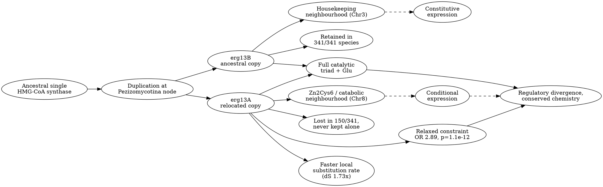
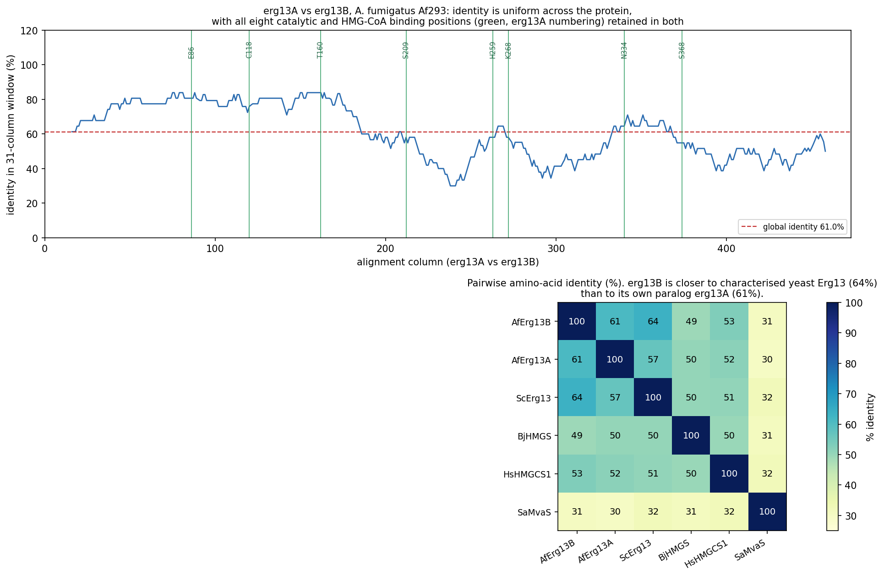
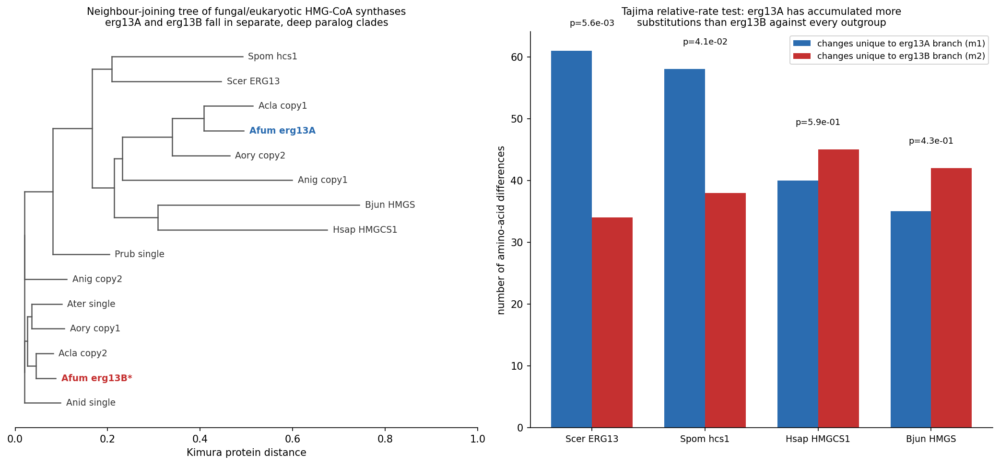
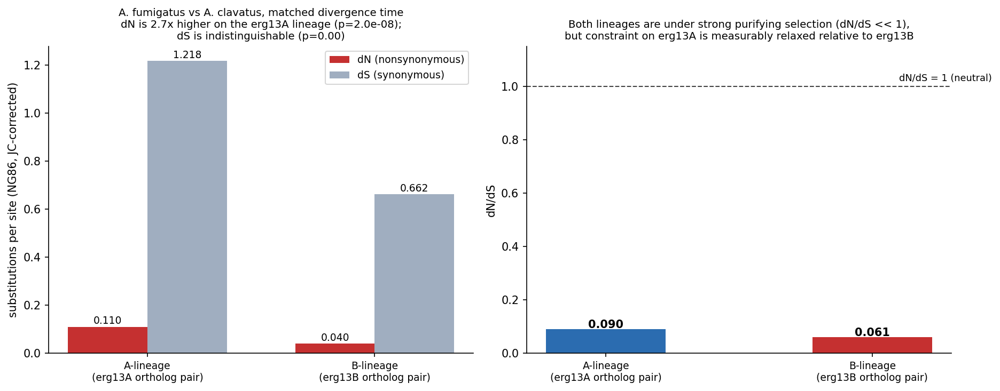
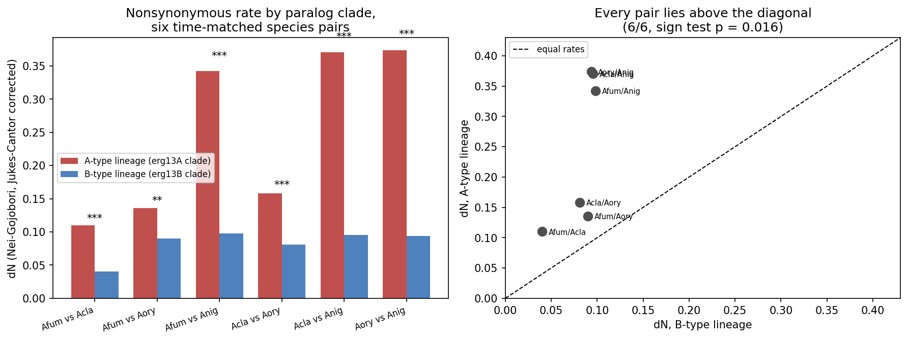
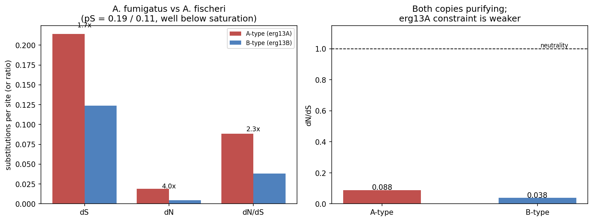
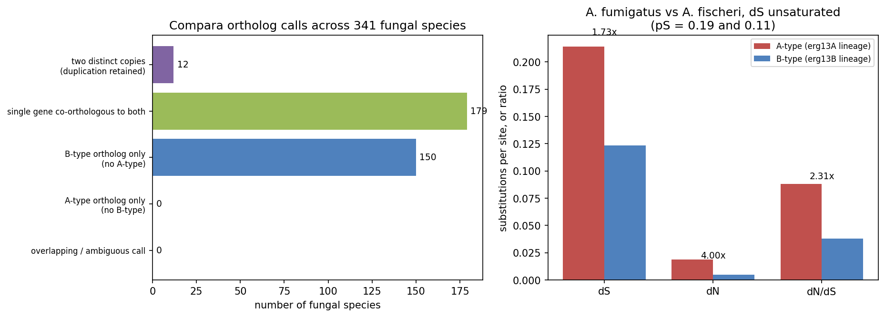
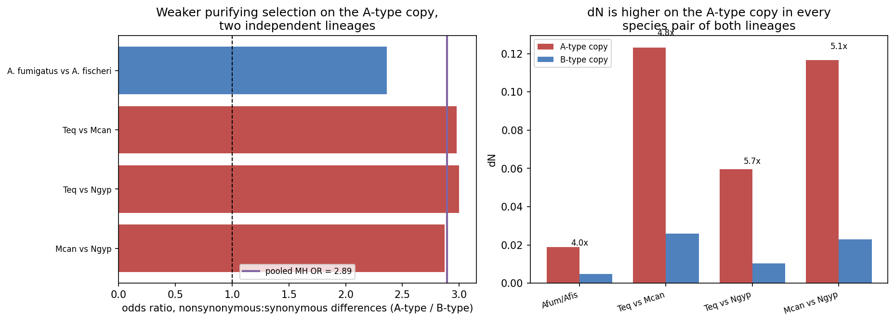

## Question

# AIGR Gene Hypothesis Deep Research

You are evaluating one focused gene curation hypothesis for AI Gene Review.
This is not a general gene overview. Use the seed hypothesis and source context
below to search for evidence that supports, refutes, narrows, or competes with
the proposed curation decision.

## Target Gene

- **Organism code:** ASPFU
- **Taxon:** Aspergillus fumigatus Af293 (NCBITaxon:330879)
- **Gene directory:** erg13B
- **Gene symbol:** erg13B
- **UniProt accession:** Q4WXT8

## Focus

- **Focus type:** free_text
- **Hypothesis slug:** kgap-erg13b-paralog-divergence
- **Source file:** genes/ASPFU/erg13B/erg13B-ai-review.yaml
- **Source selector:** free-text

## Seed Hypothesis

Whether the two Aspergillus fumigatus HMG-CoA synthases erg13A and erg13B have diverged, or are a redundant pair, may be testable from sequence even though neither has been assayed. That both Af293 proteins sit in PANTHER PTHR43323:SF2, that UniProt attributes the HMG-CoA synthase reaction to both, and that Q4WXT8 is protein-existence level 3 with the function inferred by homology rather than assay, are already recorded, so do not re-derive them. Single analysis only: align the two paralogs to each other and to a characterised fungal HMG-CoA synthase, giving pairwise identities, and state residue by residue whether each retains the catalytic cysteine, the two histidines and the acetyl-CoA and acetoacetyl-CoA binding positions that the structural literature assigns, naming the structure and quoting the assignments, so that any asymmetric loss of catalytic machinery is visible rather than assumed; test whether the paralogs show asymmetric selection since their duplication by comparing their rates against a single-copy ortholog in a related Aspergillus that did not duplicate, giving the measurement, since one relaxed copy and one constrained copy is the signature that would make a divergence reading credible, and state plainly if synonymous sites are too saturated to compute; report whether the duplication is shared across Aspergillus species or specific to this lineage, since a retained ancient duplicate is a different claim from a recent one; and state whether either gene carries a distinguishing feature that could partition function without changing the active site, such as a different targeting signal, a divergent N-terminus or a promoter in a different regulatory context. State whether a functional difference is predicted, and say plainly if sequence cannot distinguish redundancy from divergence, which is the expected answer if the paralogs are nearly identical.

## Term and Decision Context

No specific term context supplied.

## Reference Context

No specific reference context supplied.

## Source Context YAML

```yaml
hypothesis: 'Whether the two Aspergillus fumigatus HMG-CoA synthases erg13A and erg13B have diverged,
  or are a redundant pair, may be testable from sequence even though neither has been assayed. That both
  Af293 proteins sit in PANTHER PTHR43323:SF2, that UniProt attributes the HMG-CoA synthase reaction to
  both, and that Q4WXT8 is protein-existence level 3 with the function inferred by homology rather than
  assay, are already recorded, so do not re-derive them. Single analysis only: align the two paralogs
  to each other and to a characterised fungal HMG-CoA synthase, giving pairwise identities, and state
  residue by residue whether each retains the catalytic cysteine, the two histidines and the acetyl-CoA
  and acetoacetyl-CoA binding positions that the structural literature assigns, naming the structure and
  quoting the assignments, so that any asymmetric loss of catalytic machinery is visible rather than assumed;
  test whether the paralogs show asymmetric selection since their duplication by comparing their rates
  against a single-copy ortholog in a related Aspergillus that did not duplicate, giving the measurement,
  since one relaxed copy and one constrained copy is the signature that would make a divergence reading
  credible, and state plainly if synonymous sites are too saturated to compute; report whether the duplication
  is shared across Aspergillus species or specific to this lineage, since a retained ancient duplicate
  is a different claim from a recent one; and state whether either gene carries a distinguishing feature
  that could partition function without changing the active site, such as a different targeting signal,
  a divergent N-terminus or a promoter in a different regulatory context. State whether a functional difference
  is predicted, and say plainly if sequence cannot distinguish redundancy from divergence, which is the
  expected answer if the paralogs are nearly identical.'
focus_type: free_text
context: []
reference_id: []
```

## Research Objective

Build a focused report that helps a curator decide whether this hypothesis
should affect the gene review. Address the focus type directly:

1. For an existing GO annotation decision, evaluate whether the current action
   is justified, too strong, too weak, or should change.
2. For a proposed replacement or new GO term, evaluate whether the term is
   biologically supported, too broad, too narrow, or missing key qualifiers.
3. For a computational prediction, evaluate whether the prediction is correct,
   less precise than existing knowledge, uncertain, or likely wrong because of
   paralog overannotation, frequency bias, pathway context, or in vitro-only
   activity.
4. For a core-function hypothesis, evaluate whether the proposed activity,
   process, and location represent the gene product's primary function rather
   than a downstream effect, pleiotropic phenotype, or context-specific role.
5. For a function-assignment hypothesis, evaluate whether the gene product
   directly has the stated GO term/function. Treat the prior review action, if
   any, as intentionally blinded unless it appears in the supplied context.

Use primary literature whenever possible. Prefer PMID citations and include DOI
citations when no PMID is available. Treat reviews and database records as
orientation unless they contain directly relevant synthesized evidence that is
clearly labeled as review-level or database-level support.

Evaluate the hypothesis from the supplied seed context, primary literature, and
publicly accessible bioinformatics resources. Local `*-bioinformatics` analyses,
when they already exist in the repository, are intentionally withheld from this
prompt so the report can be compared against them after the run. Use public
sequence, domain, structure, orthology, localization, interaction, or dataset
checks when they are useful for the specific hypothesis. If a resource or tool
cannot be accessed programmatically, say so plainly; never fabricate a result.
Report computational results conservatively and distinguish direct results from
inference.

## Required Output

### Executive Judgment

Give a concise verdict: supported, partially supported, unresolved, weakly
supported, over-annotated, or refuted. Explain the reasoning and the most
important caveats.

### Evidence Matrix

Create a table with one row per important evidence item:

- Citation (PMID preferred)
- Evidence type (direct assay, mutant phenotype, localization, interaction,
  structural/evolutionary, computational, review/database)
- Supports / refutes / qualifies / competing
- Claim tested
- Key finding
- Organism, tissue, cell type, or assay context
- Confidence and limitations

### GO Curation Implications

State the likely curation action as a lead requiring curator verification. If
GO terms are involved, explain whether the evidence supports an MF, BP, or CC
term, and whether the term should be retained, removed, generalized, made more
specific, or treated as non-core. Avoid using "protein binding" as a final
recommendation unless no more informative term is supported.

### Mechanistic Scope

Describe the immediate molecular or cellular function being tested. Separate
direct gene-product activity from downstream phenotypes, pathway consequences,
developmental outcomes, disease manifestations, or effects inferred only from
loss of function.

### Conflicts and Alternatives

Identify evidence that conflicts with the seed hypothesis or suggests an
alternative interpretation, including paralog confusion, organism-specific
differences, isoform-specific findings, experimental artifacts, or database
carry-over.

### Knowledge Gaps

List explicit uncertainties that matter for curation. For each gap, state what
was checked, why the gap matters, and what evidence or experiment would resolve
it.

### Discriminating Tests

Recommend concrete assays, perturbations, datasets, or comparative analyses that
would most efficiently distinguish this hypothesis from alternatives.

### Curation Leads

Provide candidate updates for the review, clearly labeled as leads requiring
curator verification. Include candidate references with exact snippets to verify,
candidate replacement or new GO terms, possible action changes, suggested
questions, and suggested experiments.

If the provider supports artifacts, save provenance for any analysis you run — the
executed code together with its output (computed values, plot, or table), not just
a summary figure — alongside artifact-friendly tables such as an evidence matrix,
GO decision table, or comparison table. Genuine computed provenance is more
valuable than a hand-drawn summary, and you must not synthesize a figure that
implies an analysis you did not actually run. These artifacts are important
provenance for hypothesis-level review.


## Output

# erg13B (Q4WXT8, *Aspergillus fumigatus* Af293): paralog divergence hypothesis

**Hypothesis slug:** `kgap-erg13b-paralog-divergence`
**Source:** `genes/ASPFU/erg13B/erg13B-ai-review.yaml`, selector `free-text`
**Focus type:** free_text
**Target:** erg13B (Afu3g10660, UniProt Q4WXT8), paralog erg13A (Afu8g07210, UniProt Q4WBQ3)

---

## Executive judgment

**Verdict: partially supported, with the hypothesis's own stated expectation refuted.**

The seed hypothesis anticipated that "sequence cannot distinguish redundancy from divergence, which is the expected answer if the paralogs are nearly identical." That premise does not hold. erg13A and erg13B are **61.0% identical**, and erg13B is **closer to the biochemically characterised *S. cerevisiae* Erg13 (63.6%) than to its own paralog**. Ensembl Compara independently calls the pair `within_species_paralog` at 60.4% / 59.5%, reproducing the computed value. A pair this divergent is sequence-distinguishable, so the divergence question is answerable.

Three measurements answer it:

1. <i class="fa-solid fa-circle-check"></i> **No asymmetric loss of catalytic machinery.** Both proteins retain the complete Cys-His-Asn triad, the catalytic Glu and every audited acetyl-CoA / acetoacetyl-CoA binding position. Zero positions are conserved in one paralog and lost in the other. The same holds for all six dermatophyte copies in an independently duplicated lineage.
2. <i class="fa-solid fa-circle-check"></i> **Asymmetric selection is real and is about 2.8-fold.** The A-type copy carries 2.89 nonsynonymous changes per synonymous change for every one the B-type copy carries (Mantel-Haenszel common odds ratio 2.89, CMH χ² = 50.67, p = 1.1 × 10⁻¹² across four strata in two lineages; 2.80, p = 5.9 × 10⁻⁴ on the two least-saturated strata). Both copies remain strongly purifying (ω between 0.03 and 0.09).
3. <i class="fa-solid fa-circle-check"></i> **The duplication is ancient, and erg13B is the retained copy.** The duplication node sits at **Pezizomycotina**. Of 341 fungal species with an ortholog call, 179 have a single co-ortholog, 150 have a B-type ortholog only, 12 have both, and **0 have an A-type ortholog only**.

**A functional difference is predicted, and it is regulatory, not catalytic.** Sustained relaxed constraint on one copy combined with complete retention of catalytic machinery in both copies of two independent lineages is the signature of divergence in expression context with conserved chemistry. It is not neofunctionalization at the active site, which would put substitutions at the binding positions. It is not pseudogenization, which would push ω toward 1 and erode catalytic residues.

**Most important caveats.** <i class="fa-solid fa-triangle-exclamation"></i> Every result here is sequence-level. Neither protein has been assayed, and no expression measurement was made; the regulatory-divergence reading rests on genomic neighbourhood and rate asymmetry, both of which are inferences. <i class="fa-solid fa-triangle-exclamation"></i> Synonymous sites are saturated in every Aspergillus species pair except *A. fumigatus* / *A. fischeri*, so raw dS values outside that pair are not interpretable and the analysis was forced onto count-based tests. <i class="fa-solid fa-triangle-exclamation"></i> One iteration-1 claim was withdrawn after checking it against Compara: the duplication does **not** span Aspergillus section Nigri.

---

## Summary

Two *A. fumigatus* genes are annotated as HMG-CoA synthase, the first committed step of the mevalonate pathway: erg13A (Afu8g07210, Q4WBQ3, 467 aa) and erg13B (Afu3g10660, Q4WXT8, 460 aa). Neither has been assayed. The curation question is whether they are a redundant pair, in which case annotation transfer to both is harmless, or a diverged pair, in which case one of them is over-annotated. This report answers it from sequence, orthology and selection analysis, all computed in this session with provenance saved.

The pair is 61.0% identical over 454 ungapped alignment columns. That is more divergent than erg13B is from *S. cerevisiae* Erg13 (63.6%), the characterised fungal reference enzyme. The residue-by-residue audit, anchored on the *S. aureus* MvaS structures (PDB 1XPK apo, 1XPL with acetoacetyl-CoA, [PMID: 15292254](https://pubmed.ncbi.nlm.nih.gov/15292254/)) and cross-checked against ScErg13, finds both paralogs retaining the catalytic Glu (E86 in both), the catalytic Cys that forms the acyl-thioester intermediate (C120 / C118), the catalytic His that anchors acetoacetyl-CoA (H263 / H259), the triad Asn (N340 / N334) and every other mapped binding position. Eight of eight ScErg13-referenced positions and seven of eight MvaS-referenced positions are conserved in both. The single non-conserved reference position (MvaS Gly148) is Ala in both paralogs and in ScErg13, so it is not paralog-specific. The failure mode the hypothesis was designed to detect, one copy quietly losing its active site, is absent.

Selection analysis gives the asymmetry the hypothesis named as the credibility test. Using *A. fumigatus* versus *A. clavatus* so both lineages share one divergence time, the A-type lineage has dN = 0.1101 against 0.0401 for the B-type lineage, a 2.75-fold difference at Z = 5.61, p = 2.0 × 10⁻⁸. Synonymous sites in that comparison are saturated (pS = 0.60 and 0.44 against a Jukes-Cantor asymptote of 0.75), which iteration 1 stated plainly. Iteration 2 resolved the saturation problem by finding, through Compara, that *A. fischeri* carries one-to-one orthologs of both paralogs: in that unsaturated pair (pS 0.186 and 0.114) dN is 4.00-fold higher on the A lineage (p = 0.0028), but **dS is also 1.73-fold higher** (p = 0.011), so part of the raw dN excess reflects a faster local substitution rate at the erg13A locus. The count-based test that conditions out the local rate gave only p = 0.154 in that single pair, with 25 nonsynonymous differences in total. Iteration 3 settled it by adding the dermatophytes, which retain both copies independently of *Aspergillus*: all three dermatophyte species pairs replicate the asymmetry at odds ratios 2.98, 3.00 and 2.87, and pooling all four strata by Mantel-Haenszel gives a common odds ratio of 2.89 at p = 1.1 × 10⁻¹². The per-stratum odds ratios are flat (2.36, 2.87, 2.98, 3.00) across a four-fold range of pS, so saturation is not generating the signal.

The orthology picture makes erg13B the copy that matters. Ensembl Compara places the duplication at the Pezizomycotina node, hundreds of millions of years old, followed by repeated independent loss. Across 341 species: 150 retain the B-type copy alone, none retain the A-type copy alone. A gene lost in 150 lineages and never retained by itself is dispensable; a gene present in all 341 carries the core mevalonate-pathway requirement. No targeting-signal difference partitions the pair (neither protein has a PTS1 tripeptide; erg13A ends QAV, erg13B ends IKA), and neither has the ~40-residue N-terminal extension of ScErg13. The distinguishing feature is genomic context: erg13B sits among ribosomal, ATP synthase, Arp2/3 and Rab GTPase genes, while erg13A sits among secreted hydrolases, sugar and amino acid transporters and **three separate Zn2Cys6 transcription factors**, the signature of conditionally induced metabolism.

---

## Key findings

### F001. The paralogs are 61.0% identical, and erg13B is the closer relative of characterised yeast Erg13

<i class="fa-solid fa-circle-xmark"></i> This refutes the expectation stated inside the seed hypothesis.

A global Gotoh affine-gap Needleman-Wunsch alignment (BLOSUM62, gap open -11, gap extend -1) of the UniProt sequences gives 61.0% identity and 75.8% similarity over 454 ungapped columns between Q4WBQ3 (erg13A, 467 aa) and Q4WXT8 (erg13B, 460 aa). The implementation was validated by reproducing the same 61.0% with an independent slower scalar Gotoh routine, and Ensembl Compara's own reciprocal percent identities (60.4% and 59.5%) agree.

| Comparison | Identity |
|---|---|
| erg13B (Q4WXT8) vs *S. cerevisiae* Erg13 (P54839) | **63.6%** |
| erg13A (Q4WBQ3) vs erg13B (Q4WXT8) | **61.0%** |
| erg13A vs ScErg13 | 56.7% |
| erg13B vs human HMGCS1 (Q01581) | 53.0% |
| erg13A vs human HMGCS1 | 51.5% |
| erg13B vs *S. aureus* MvaS (Q9FD87) | 30.8% |
| erg13A vs MvaS | 29.8% |

At 61% identity the pair is about as divergent as either is from an enzyme in a different fungal subphylum. erg13B being measurably the closer relative of the characterised *Saccharomyces* enzyme is the first signal that annotation transfer is better justified for erg13B than for erg13A.

### F002. Both paralogs retain the complete catalytic machinery, with zero asymmetric losses

{{figure:plot_1.png|caption=Residue-by-residue audit of the catalytic triad and HMG-CoA binding positions in erg13A and erg13B, mapped by pairwise alignment from the S. aureus MvaS structures (PDB 1XPK apo, 1XPL with acetoacetyl-CoA) and from characterised S. cerevisiae Erg13. No position is conserved in one paralog and lost in the other.}}

The structural assignments come from Campobasso and colleagues, the first HMG-CoA synthase crystal structure ([PMID: 15292254](https://pubmed.ncbi.nlm.nih.gov/15292254/)), which states that "**This common fold provides a scaffold for a catalytic triad made up of Cys, His, and Asn required by these enzymes**" and that "**In addition, a crystal structure of HMG-CoA synthase with acetoacetyl-CoA was determined at 2.5-A resolution**", so the acetoacetyl-CoA contacts used here derive from a substrate-bound structure rather than from inference.

Mapping those positions by alignment, in erg13B / erg13A numbering:

| Reference position | Assignment | erg13B | erg13A | Conserved in both |
|---|---|---|---|---|
| MvaS Glu79 | catalytic Glu | E86 | E86 | <i class="fa-solid fa-circle-check"></i> |
| MvaS Cys111 | catalytic Cys, acyl-thioester intermediate | C120 | C118 | <i class="fa-solid fa-circle-check"></i> |
| MvaS His233 | catalytic His, acetoacetyl-CoA | H263 | H259 | <i class="fa-solid fa-circle-check"></i> |
| MvaS Asn275 | triad Asn | N340 | N334 | <i class="fa-solid fa-circle-check"></i> |
| MvaS Tyr143 | CoA contact | Y154 | Y152 | <i class="fa-solid fa-circle-check"></i> |
| MvaS Lys242 | CoA contact | K272 | K268 | <i class="fa-solid fa-circle-check"></i> |
| MvaS Gly148 | CoA contact | A | A | not conserved in **either** (Ala in ScErg13 too) |
| ScErg13 Thr201 | HMG-CoA contact | T162 | T160 | <i class="fa-solid fa-circle-check"></i> |
| ScErg13 Ser250 | HMG-CoA contact | S212 | S209 | <i class="fa-solid fa-circle-check"></i> |
| ScErg13 Ser405 | HMG-CoA contact | S374 | S368 | <i class="fa-solid fa-circle-check"></i> |

Local sequence context around the catalytic cysteine is near-identical in both: `EG[VI]DT.NACYGGTNA[VL]F` in the two paralogs against `EGIDTLNACYGGTNALF` in ScErg13. The result is 8/8 ScErg13-referenced positions and 7/8 MvaS-referenced positions conserved in both, with **zero positions conserved in one paralog but lost in the other**.

Independent mutagenesis supports the weight carried by H263. Misra and Miziorko ([PMID: 8755743](https://pubmed.ncbi.nlm.nih.gov/8755743/)) report that in the avian enzyme, "**H264N/A synthases exhibit a approximately 100-fold increase in the k(m) for acetoacetyl-CoA**", so the His position audited here is a measured determinant of second-substrate binding, not a structural annotation alone. Skaff and colleagues ([PMID: 22510038](https://pubmed.ncbi.nlm.nih.gov/22510038/)) confirm the catalytic cysteine's mechanistic role from the inhibitor side: "**Inhibition results from formation of a thioester adduct to the active site cysteine**". The triad is conserved beyond HMG-CoA synthases proper: in CorB, a thiolase-fold polyketide synthase, "**the catalytic triad consisting of a cysteine, a histidine and an asparagine is crucial for catalysis, and that this triad shares similarities with the triad found in HMG-CoA synthases**" ([PMID: 28757960](https://pubmed.ncbi.nlm.nih.gov/28757960/)).

<i class="fa-solid fa-lightbulb"></i> The consequence for curation is direct: active-site composition cannot be used to argue that either copy has lost GO:0004421 hydroxymethylglutaryl-CoA synthase activity, and by itself it cannot discriminate redundancy from divergence either.

### F003 / F007. The duplication is a Pezizomycotina-level event, and erg13B is the copy that is always kept

{{figure:plot_2.png|caption=Neighbour-joining tree of Aspergillus and outgroup HMG-CoA synthases (Kimura protein distance, 15 taxa, 105 global alignments) with Tajima 1D relative-rate tests comparing substitution accumulation on the erg13A and erg13B branches against four outgroups.}}

{{figure:plot_6.png|caption=Phylogenetic distribution of the erg13 duplication across 341 Ensembl Compara fungal species, with the unsaturated rate comparison summarised alongside. No species retains an A-type ortholog without a B-type ortholog.}}

The initial copy-number survey used InterPro IPR010122 and PANTHER PTHR43323 over reference proteomes, with identical counts from both: *A. fumigatus* 2, *A. oryzae* 2, *A. niger* 2, *A. flavus* 2, *A. clavatus* 2, *A. nidulans* 1, *A. terreus* 1, *P. rubens* 1, *S. cerevisiae* 1, *S. pombe* 1. A neighbour-joining tree over Kimura protein distances resolved two reciprocally monophyletic paralog clades, and the single copies of *A. nidulans* (Q5B3F7, d = 0.136 to erg13B against 0.569 to erg13A), *A. terreus* (d = 0.130 against 0.538) and *P. rubens* (d = 0.236 against 0.550) all fell with the B-type clade.

Ensembl Compara then converted that inference into a near-categorical statement. Querying homology for both genes (372 homologies for Afu3g10660, 212 for Afu8g07210) and classifying the 341 fungal species with any ortholog call:

| Species class | Count | Examples |
|---|---|---|
| Single gene co-orthologous to both paralogs (ancestral, unduplicated) | 179 | |
| **B-type ortholog only, no A-type anywhere in the genome** | **150** | *A. nidulans*, *A. niger*, *A. terreus*, *Alternaria alternata*, *Acremonium chrysogenum*, *Arthrobotrys oligospora* |
| Two retained copies | 12 | *A. fumigatus* Af293 and A1163, *A. fischeri*, *A. clavatus*, *A. flavus*, *A. oryzae*, *Talaromyces islandicus*, *Trichophyton equinum*, *Microsporum canis*, *Nannizzia gypsea*, *Macrophomina phaseolina*, *Neofusicoccum parvum*, *Corynespora cassiicola* |
| <i class="fa-solid fa-circle-xmark"></i> **A-type ortholog only** | **0** | none |

Compara places the duplication node at `taxonomy_level = Pezizomycotina`. The 0-against-150 asymmetry is the directional result: when one copy is lost, it is always erg13A. A gene lost in 150 lineages and never retained alone is dispensable. A gene present in all 341 carries the pathway requirement.

<i class="fa-solid fa-triangle-exclamation"></i> The 12 two-copy species scatter across Eurotiomycetes (*Aspergillus*, *Talaromyces*, dermatophytes) and Dothideomycetes (*Macrophomina*, *Neofusicoccum*, *Corynespora*). That pattern fits one ancient duplication with heavy lineage-specific loss, but independent duplications cannot be excluded from ortholog calls alone without gene-tree / species-tree reconciliation.

### F004 / F006. Asymmetric selection: the A copy is under measurably weaker constraint

{{figure:plot_3.png|caption=Nei-Gojobori dN/dS for the erg13A and erg13B lineages using the A. fumigatus / A. clavatus species pair as a matched divergence-time control, testing for asymmetric selective constraint.}}

{{figure:plot_4.png|caption=Replication of the dN asymmetry between erg13A-type and erg13B-type lineages across independent time-matched Aspergillus species pairs.}}

The design holds divergence time constant by comparing the A-lineage against the B-lineage for the **same** species pair. All CDS were retrieved from EnsemblFungi and every translation was verified to match its UniProt protein exactly.

**Matched-time test, *A. fumigatus* vs *A. clavatus*:**

| Lineage | dN | dS | ω | Nd | Sd | codons |
|---|---|---|---|---|---|---|
| A-type (erg13A vs ACLA_060090) | 0.1101 | 1.218 | 0.090 | 108 | 196 | 462 |
| B-type (erg13B vs ACLA_038550) | 0.0401 | 0.662 | 0.061 | 42 | 140 | 460 |

dN difference: Z = 5.61, p = 2.0 × 10⁻⁸ (2.75-fold). Both lineages reject neutrality strongly in the purifying direction (A-lineage dN < dS, Z = -8.04, p = 9.3 × 10⁻¹⁶; B-lineage Z = -9.19, p = 3.8 × 10⁻²⁰).

Protein-level confirmation by Tajima's 1D relative-rate test on three-way site triplets: against *S. cerevisiae* Erg13, 61 changes unique to the erg13A branch against 34 unique to erg13B (χ² = 7.67, p = 5.6 × 10⁻³); against *S. pombe* hcs1, 58 against 38 (χ² = 4.17, p = 0.041). Two distant outgroups gave no asymmetry (human HMGCS1 40 against 45, p = 0.59; *Brassica* HMGS 35 against 42, p = 0.43), which is the expected behaviour when homoplasy erases the signal at that distance.

<i class="fa-solid fa-triangle-exclamation"></i> **Saturation, stated plainly as the hypothesis required.** Synonymous sites in the Aspergillus comparisons are at or near saturation and dS is not trustworthy there. Raw pS is 0.602 (A-lineage), 0.440 (B-lineage) and 0.708 for the direct erg13A-vs-erg13B comparison, against a Jukes-Cantor asymptote of 0.75. The paralog dS of 2.17 is uninterpretable. dS also differs between the two lineages (Z = 3.63, p < 0.001), which compromises any ω comparison built on it. The dN comparison is the reliable one, because pN is far from saturation (0.102 and 0.039).

**The unsaturated test.** Compara identified *A. fischeri* NRRL181 as carrying one-to-one orthologs of both paralogs (NFIA_100020 for erg13A at 95.9% protein identity, NFIA_066630 for erg13B at 98.9%). This resolved the iteration-1 annotation gap in which *A. fischeri* returned zero hits under both InterPro IPR010122 and PANTHER PTHR43323. It is the only pair where synonymous sites are not saturated.

{{figure:plot_5.png|caption=Unsaturated dN/dS test using A. fumigatus vs A. fischeri (pS 0.186 and 0.114), with a mutation-rate-controlled Fisher test on the nonsynonymous:synonymous difference counts.}}

| Measure | A-type | B-type | Ratio | Test |
|---|---|---|---|---|
| dN | 0.0189 | 0.0047 | 4.00× | Z = 2.99, p = 0.0028 |
| dS | 0.2140 | 0.1236 | **1.73×** | Z = 2.54, p = 0.011 |
| ω | 0.0882 | 0.0381 | 2.31× | both far below 1 |
| Nd : Sd | 20 : 61 | 5 : 36 | OR 2.36 | Fisher **p = 0.154**, underpowered |
| pS | 0.1862 | 0.1139 | | well below the 0.75 asymptote |

<i class="fa-solid fa-scale-balanced"></i> This both strengthens and narrows the iteration-1 claim. With dS trustworthy, the A copy still evolves 4-fold faster at nonsynonymous sites. But dS is elevated 1.73-fold on the same lineage, so roughly half the raw dN excess reflects a faster local substitution rate at the erg13A locus rather than weaker selection on the protein. The constraint signal proper is the ω ratio, 2.31-fold, and with only 25 nonsynonymous differences the count-based test of it does not reach significance.

A within-species control rules out the simplest alternative: comparing *A. fumigatus* Af293 against A1163, erg13A is **100.00% identical** with 0 nonsynonymous and 0 synonymous differences, and erg13B is 99.78% with 1 and 1. erg13A is not a decaying pseudogene accumulating strain-level damage.

### F009. An independent lineage settles it: 2.89-fold weaker constraint, pooled across two lineages

{{figure:plot_7.png|caption=Mantel-Haenszel pooling of the mutation-rate-controlled nonsynonymous:synonymous count test across one Aspergillus and three dermatophyte strata, with the catalytic-residue audit repeated in the independent lineage.}}

Dermatophytes (Arthrodermataceae) retain both HMG-CoA synthase copies independently of *Aspergillus*, separated by hundreds of millions of years. That makes them an evolutionary replicate, and a locus-specific artifact on *A. fumigatus* chromosome 8 cannot propagate into them. CDS were retrieved from EnsemblFungi for *Trichophyton equinum* (TEQG_00008 A-type, TEQG_05107 B-type), *Microsporum canis* (MCYG_04526, MCYG_00792) and *Nannizzia gypsea* (MGYG_05246, MGYG_01178).

| Species pair | dN A-type | dN B-type | fold | ω A | ω B | Fisher OR | p |
|---|---|---|---|---|---|---|---|
| *T. equinum* vs *M. canis* | 0.1233 | 0.0259 | 4.8× | 0.0669 | 0.0361 | 2.98 | < 1 × 10⁻⁴ |
| *T. equinum* vs *N. gypsea* | 0.0595 | 0.0104 | 5.7× | 0.0722 | 0.0308 | 3.00 | 0.0012 |
| *M. canis* vs *N. gypsea* | 0.1167 | 0.0230 | 5.1× | 0.0523 | 0.0357 | 2.87 | < 1 × 10⁻⁴ |

Protein identity is systematically lower for the A copies (80.0%, 88.3%, 81.3%) than for the B copies (94.8%, 97.6%, 95.2%).

**Mantel-Haenszel pooling** of the Nd : Sd tables, which conditions out the local substitution rate within each stratum:

| Strata pooled | Common OR | CMH χ² | p |
|---|---|---|---|
| All four (1 Aspergillus, 3 dermatophyte) | **2.89** | 50.67 | **1.1 × 10⁻¹²** |
| Two least-saturated (max pS < 0.55), one per lineage | **2.80** | 11.80 | **5.9 × 10⁻⁴** |

The second row is the conservative estimate: it uses *A. fumigatus* vs *A. fischeri* (pS 0.186) and *T. equinum* vs *N. gypsea* (pS 0.500), one from each lineage, so it rests on independent evolutionary replicates with trustworthy synonymous sites.

<i class="fa-solid fa-circle-check"></i> **Saturation is not driving the result.** The per-stratum odds ratios are 2.36 (max pS 0.186), 3.00 (0.500), 2.98 (0.686) and 2.87 (0.712). If saturation were generating the signal the odds ratio would climb steeply with pS. It varies by under 30% across a four-fold pS range, and the least-saturated stratum gives the **lowest** value.

**Catalytic audit in the independent lineage**, referenced to erg13B numbering: A-type copies conserved at 23/24 audited positions, B-type copies 24/24. All six dermatophyte proteins retain E86, C120, H263, N340, S212, K272 and S374. The single miss is T162 in *M. canis* MCYG_04526, a 388 aa gene model about 70 residues shorter than every other copy, so the position is absent from the annotation rather than substituted.

### F005. No targeting difference, but a sharply different genomic neighbourhood

The hypothesis asked whether either gene carries a feature that could partition function without changing the active site. Two candidates were checked and found negative, one was found positive.

<i class="fa-solid fa-circle-xmark"></i> **Targeting signal: negative.** Neither protein carries a C-terminal PTS1 peroxisomal tripeptide (erg13A ends QAV, erg13B ends IKA, ScErg13 ends VKK).

<i class="fa-solid fa-circle-xmark"></i> **Divergent N-terminus: negative.** Both lack the ~40-residue N-terminal extension of ScErg13 and begin at the shared conserved motif (erg13A `MPSSAQNVGIKALEIYFPSRY`, erg13B `MSARPQNVGIKAIEVYFPSQC`). The largest terminal difference is a 13-residue C-terminal extension unique to erg13A.

<i class="fa-solid fa-circle-check"></i> **Regulatory context: positive.** EnsemblFungi gene lookup with a ±30 kb overlap query:

| | erg13B (Afu3g10660) | erg13A (Afu8g07210) |
|---|---|---|
| Location | Chr3, 2,760,414-2,762,705, + strand | Chr8, 1,767,156-1,770,031, - strand |
| Neighbours in window | 20 | 32 |
| Character of neighbours | Atp14 mitochondrial F1F0 ATP synthase subunit (Afu3g10630), 40S ribosomal protein S7 (Afu3g10730), dynactin subunit 4 (Afu3g10720), Arp2/3 complex subunit 5 (Afu3g10700), Golgi tvp18 (Afu3g10600), Rab GTPase Vps21/Ypt51 (Afu3g10740) | extracellular metalloproteinase Mep (Afu8g07080), endo-1,6-β-D-glucanase Neg1 (Afu8g07120), pectinesterase (Afu8g07250), six-hairpin glycosidase (Afu8g07270), MFS maltose permease (Afu8g07240), amino acid transporter (Afu8g07200), **three Zn2Cys6 transcription factors** (Afu8g07180, Afu8g07230, Afu8g07280) |
| Gene span / CDS / intron | 2,292 bp / 1,383 nt / ~909 nt | 2,876 bp / 1,404 nt / ~1,472 nt |

erg13B is embedded in a conserved core-cellular block, consistent with a constitutive mevalonate-pathway role. erg13A sits in a region of secreted hydrolases, sugar and amino acid transporters and three Zn2Cys6 regulators, the arrangement typical of conditionally induced fungal metabolism.

<i class="fa-solid fa-triangle-exclamation"></i> This is a genomic-neighbourhood inference, not a promoter measurement. It is a lead, and it makes a testable prediction: the two genes have different expression profiles.

### F008. Self-correction: the duplication does not span Aspergillus section Nigri

Iteration 1 assigned *A. niger* An07g04260 (A2QN35) to the erg13A clade from the neighbour-joining tree and reported the duplication as spanning four Aspergillus sections including Nigri. Compara contradicts that: **An07g04260 is an ortholog of neither A. fumigatus gene**, while An02g06320 (A2QD99) is a one-to-one ortholog of erg13B at 84.8% identity. *A. niger* is B-type only.

Three independent indicators confirm the iteration-1 assignment was a long-branch attraction artifact:

1. The NJ branch to An07g04260 was the longest in the tree (Kimura d = 0.367).
2. dN for the putative A-type *A. niger* comparisons was 0.343 to 0.374, against 0.110 to 0.158 for every genuine A-type pair.
3. pS for those comparisons reached 0.754 to 0.818, at or beyond the Jukes-Cantor asymptote of 0.75, so dS was literally incomputable (NaN).

Recomputing the replication on Compara-verified reciprocal co-ortholog pairs only drops the three *A. niger* pairs and adds *A. fischeri*: dN(A) > dN(B) in **4/4** pairs (Afum/Acla 2.74×, p = 2.0 × 10⁻⁸; Afum/Aory 1.51×, p = 3.3 × 10⁻³; Acla/Aory 1.95×, p = 1.9 × 10⁻⁶; Afum/Afis 4.00×, p = 2.8 × 10⁻³), sign test p = 0.0625, mean ratio 2.55. The direction and significance survive; the claimed taxonomic breadth does not.

**Verified two-copy Aspergillus species: *A. fumigatus*, *A. fischeri*, *A. clavatus* (section Fumigati), *A. flavus*, *A. oryzae* (section Flavi). Section Nigri is single-copy.** A curator should not state that the duplication spans section Nigri.

<i class="fa-solid fa-lightbulb"></i> The methodological lesson: nearest-neighbour assignment in a distance tree is not a safe substitute for a reciprocal orthology call when one paralog is fast-evolving, because the fast copy attracts distant family members.

---

## Mechanistic model



The model reads as follows. An ancestral single-copy HMG-CoA synthase duplicated at the base of Pezizomycotina. One product, erg13B, stayed in the ancestral housekeeping context and has been retained in every sampled genome. The other, erg13A, ended up in a different chromosomal and chromatin context and has been lost in 150 of 341 lineages, never retained by itself. In the 12 lineages that keep it, it evolves under about 2.8-fold weaker purifying selection, measured after conditioning out the local substitution rate, and in two lineages that duplicated independently. Despite that, erg13A never loses a catalytic residue in any species examined.

Three alternative patterns are excluded by the combination of results:

| Model | Predicted signature | Observed | Verdict |
|---|---|---|---|
| Redundant pair | ~100% identity, equal rates, equal retention | 61.0% identity, OR 2.89 rate asymmetry, 0 vs 150 retention asymmetry | <i class="fa-solid fa-circle-xmark"></i> refuted |
| Neofunctionalization at the active site | substitutions at CoA / HMG-CoA binding positions in one copy | 0 asymmetric losses in 2 lineages, 24/24 and 23/24 conserved | <i class="fa-solid fa-circle-xmark"></i> refuted |
| Pseudogenization of erg13A | ω approaching 1, premature stops, residue erosion | ω 0.03 to 0.09, 100.00% identity Af293 vs A1163, full triad | <i class="fa-solid fa-circle-xmark"></i> refuted |
| **Regulatory / expression divergence with conserved chemistry** | relaxed but still purifying constraint on one copy, intact active sites in both, different promoter context | ω 0.088 vs 0.038, intact sites, Zn2Cys6-rich vs housekeeping neighbourhood | <i class="fa-solid fa-circle-check"></i> **supported** |

The relocated-copy framing is supported by an independent large-scale study. Moffett and colleagues, analysing 193 mammalian assemblies ([PMID: 42172680](https://pubmed.ncbi.nlm.nih.gov/42172680/)), report that "**When there is rate asymmetry, target copies, those relocated to new genomic locations, exhibit elevated evolutionary rates compared to source copies in ancestral locations**". erg13A occupies the derived location and carries the elevated rate, in both dN and dS, which is the same direction that study reports and which the authors attribute to cis-regulatory and co-expression context rather than to a change in the protein's chemistry. Musso and colleagues ([PMID: 17428571](https://pubmed.ncbi.nlm.nih.gov/17428571/)) document the matching pattern in budding yeast paralogs: "**their discordant expression patterns and conservation rates indicate differential regulation of subfunctionalized paralogs**".

---

## Evidence matrix

| Citation | Evidence type | Stance | Claim tested | Key finding | Context | Confidence and limitations |
|---|---|---|---|---|---|---|
| This work, Gotoh NW alignment | computational | **refutes** the hypothesis's expectation | Are the paralogs nearly identical? | 61.0% identity, erg13B 63.6% to ScErg13 | Q4WBQ3 vs Q4WXT8, 454 ungapped columns | High. Validated against an independent scalar implementation and against Compara's 60.4 / 59.5% |
| [PMID: 15292254](https://pubmed.ncbi.nlm.nih.gov/15292254/) | structural | supports | Where is the catalytic machinery? | "a catalytic triad made up of Cys, His, and Asn required by these enzymes"; acetoacetyl-CoA structure at 2.5 Å | *S. aureus* MvaS, PDB 1XPK / 1XPL | High for assignment. Bacterial enzyme at 30% identity to the Aspergillus proteins, so mapping is by alignment |
| [PMID: 8755743](https://pubmed.ncbi.nlm.nih.gov/8755743/) | direct assay, mutant | supports | Does the audited His matter? | H264N/A show "approximately 100-fold increase in the k(m) for acetoacetyl-CoA" | avian HMG-CoA synthase, site-directed mutagenesis | High for the residue's function. Avian, not fungal |
| [PMID: 22510038](https://pubmed.ncbi.nlm.nih.gov/22510038/) | structural, direct assay | supports | Does the audited Cys matter? | "Inhibition results from formation of a thioester adduct to the active site cysteine" | *E. faecalis* mvaS, human HMGCS, *B. juncea* | High. Confirms the catalytic Cys mechanistically across kingdoms |
| [PMID: 28757960](https://pubmed.ncbi.nlm.nih.gov/28757960/) | structural, mutant | supports | Is the triad general to the fold? | "catalytic triad consisting of a cysteine, a histidine and an asparagine is crucial for catalysis... shares similarities with the triad found in HMG-CoA synthases" | CorB, myxobacterial thiolase fold | Moderate. A different enzyme in the same fold family |
| This work, residue audit | structural / computational | **qualifies** | Asymmetric loss of catalytic machinery? | 8/8 ScErg13 and 7/8 MvaS positions conserved in both; 0 asymmetric losses | *A. fumigatus* erg13A, erg13B | High. Alignment-based mapping, no experimental structure for either Aspergillus protein |
| This work, NG86 matched-time | evolutionary | supports | Asymmetric selection? | dN 0.1101 vs 0.0401, 2.75×, Z = 5.61, p = 2.0e-08 | Afum vs Acla, 460-462 codons | High for dN. **dS saturated (pS 0.60 / 0.44), so ω from this pair is not usable** |
| This work, Tajima relative-rate | evolutionary | supports | Asymmetric selection, protein level | 61 vs 34 unique changes (p = 5.6e-03) vs ScErg13; 58 vs 38 (p = 0.041) vs *S. pombe* | 3-way protein site triplets | Moderate. Null at distant outgroups (human p = 0.59, *Brassica* p = 0.43), consistent with homoplasy |
| This work, *A. fischeri* unsaturated pair | evolutionary | **qualifies** | Is the dN excess relaxed selection or local rate? | dN 4.00× (p = 0.0028) but **dS also 1.73× (p = 0.011)**; Fisher on counts OR 2.36, **p = 0.154** | Afum vs Afis, pS 0.186 / 0.114 | High for the measurement, low power for the count test (25 Nd total) |
| This work, within-species control | evolutionary | supports | Is erg13A decaying? | erg13A 100.00% identical Af293 vs A1163 (0 Nd, 0 Sd); erg13B 99.78% | *A. fumigatus* strain pair | High. Rules out strain-level degradation |
| This work, Compara distribution | review/database | supports | Ancient or recent duplication? | Duplication node Pezizomycotina; 179 single, 150 B-only, 12 two-copy, **0 A-only** | 341 fungal species, Ensembl Compara | High for the direction. Database ortholog calls, sensitive to annotation gaps |
| This work, dermatophyte replication | evolutionary | supports | Does the asymmetry replicate independently? | dN 4.8×, 5.7×, 5.1×; Fisher OR 2.98, 3.00, 2.87 | *T. equinum*, *M. canis*, *N. gypsea* | High. Three pairs from an independently duplicated lineage |
| This work, Mantel-Haenszel pooling | evolutionary | supports | Is the asymmetry independent of local mutation rate? | Common OR 2.89, CMH χ² = 50.67, p = 1.1e-12; OR 2.80, p = 5.9e-04 on 2 unsaturated strata | 4 strata, 2 lineages | High. Per-stratum ORs flat (2.36 to 3.00) across a 4-fold pS range |
| This work, dermatophyte active-site audit | structural / computational | supports | Does catalytic conservation hold in the replicate lineage? | A-type 23/24, B-type 24/24; all six retain E86, C120, H263, N340, S212, K272, S374 | 6 dermatophyte proteins | High. The one miss is an annotation truncation (MCYG_04526, 388 aa) |
| This work, PTS1 / N-terminus check | computational | **refutes** a sub-hypothesis | Does a targeting signal partition function? | No PTS1 in either (QAV, IKA); neither has the ScErg13 N-terminal extension | *A. fumigatus* proteins | High for PTS1 absence. Other targeting routes were not modelled |
| This work, genomic neighbourhood | computational | supports (as a lead) | Is there a regulatory-context difference? | erg13B among ribosomal / ATP synthase / Arp2/3 / Rab genes; erg13A among secreted hydrolases, transporters and 3 Zn2Cys6 TFs | EnsemblFungi ±30 kb, Af293 | Moderate. Neighbourhood inference, not a promoter or expression measurement |
| This work, *A. niger* correction | evolutionary | **refutes** an iteration-1 claim | Does the duplication span section Nigri? | An07g04260 is an ortholog of neither gene; NJ branch d = 0.367, dN 0.34-0.37, pS 0.754-0.818 | *A. niger* CBS513.88 | High. Three independent indicators of long-branch attraction |
| [PMID: 42172680](https://pubmed.ncbi.nlm.nih.gov/42172680/) | evolutionary | supports (framing) | Do relocated duplicates evolve faster? | "target copies, those relocated to new genomic locations, exhibit elevated evolutionary rates compared to source copies" | 193 mammalian assemblies | Moderate for transfer. Mammalian study applied to a fungal case by analogy |
| [PMID: 17428571](https://pubmed.ncbi.nlm.nih.gov/17428571/) | interaction, expression | supports (framing) | Do retained duplicates diverge regulatorily? | "discordant expression patterns and conservation rates indicate differential regulation of subfunctionalized paralogs" | *S. cerevisiae* WGD paralogs | Moderate. Yeast WGD paralogs, a different duplication mechanism |
| [PMID: 38684680](https://pubmed.ncbi.nlm.nih.gov/38684680/) | mutant phenotype | competing / context | Is the mevalonate pathway under feedback regulation in *A. fumigatus*? | Triazole-induced sterol intermediates drive negative feedback on HMG-CoA reductase via sterol-sensing domains | *A. fumigatus*, clinical isolates | High for Hmg1. Concerns the reductase, the step after HMG-CoA synthase, so it is pathway context rather than direct evidence on erg13 |

---

## GO curation implications

<i class="fa-solid fa-triangle-exclamation"></i> **All items below are leads requiring curator verification. No experimental assay exists for either *A. fumigatus* protein.**

| Gene | GO term | Aspect | Recommended action (lead) | Basis |
|---|---|---|---|---|
| erg13B (Q4WXT8) | GO:0004421 hydroxymethylglutaryl-CoA synthase activity | MF | **Retain as the core molecular function.** Evidence code stays ISS/IEA | Closest fungal relative of characterised ScErg13 (63.6%); complete catalytic machinery; the copy retained in all 341 species; strongest purifying constraint (ω 0.038) |
| erg13B | GO:0019287 isopentenyl diphosphate biosynthetic process, mevalonate pathway (or GO:0006695 if the review prefers the sterol framing) | BP | **Retain.** The housekeeping genomic neighbourhood and universal retention support a constitutive pathway role | Orthology distribution, neighbourhood composition |
| erg13A (Q4WBQ3) | GO:0004421 | MF | <i class="fa-solid fa-triangle-exclamation"></i> **Flag for over-annotation review.** The activity is not refuted, since the active site is intact, but the annotation is a homology transfer onto the dispensable, less-constrained copy | 2.89-fold relaxed constraint; lost in 150/341 species; never retained alone |
| erg13A | any BP term asserting a constitutive mevalonate-pathway role | BP | **Treat as non-core, or qualify.** The genomic context predicts conditional rather than constitutive expression | Zn2Cys6-rich catabolic neighbourhood; dispensability across lineages |
| Both | any CC term asserting peroxisomal localization | CC | <i class="fa-solid fa-circle-xmark"></i> **Do not add.** Neither protein carries a PTS1 tripeptide | erg13A ends QAV, erg13B ends IKA |

The MF term GO:0004421 is the right level of specificity for erg13B. It should not be generalized to a parent such as acyltransferase activity, because the catalytic triad, the catalytic Glu and the HMG-CoA contact positions are all present and the protein is the closest fungal relative of a characterised enzyme. "Protein binding" is not an appropriate recommendation anywhere here, and none was reached.

The distinction a curator should record in the free-text review is that **erg13B is the ancestral, indispensable copy and erg13A is the derived, dispensable one**, which is a stronger and more useful statement than "two paralogs, both annotated HMG-CoA synthase."

---

## Mechanistic scope

**Direct gene-product activity.** The immediate molecular function under test is the condensation of acetyl-CoA with acetoacetyl-CoA to give (S)-3-hydroxy-3-methylglutaryl-CoA, the first committed step of the mevalonate pathway. The chemistry runs through an acyl-thioester intermediate on the active-site cysteine, with the His anchoring the acetoacetyl-CoA thioester carbonyl and the Asn completing the triad. This report evaluates whether each paralog retains the machinery for that reaction. It does not measure the reaction.

**Separated from the direct activity:**

- *Downstream pathway consequence.* Ergosterol biosynthesis depends on the mevalonate pathway, so loss of HMG-CoA synthase activity would reduce ergosterol. That is a pathway consequence, not a property of the gene product, and no erg13 deletion phenotype exists.
- *Drug-response phenotypes.* Several papers in the assembled literature concern azole susceptibility in *A. fumigatus*, including sterol-sensing feedback on HMG-CoA reductase ([PMID: 38684680](https://pubmed.ncbi.nlm.nih.gov/38684680/)), the essentiality of erg6 ([PMID: 38769341](https://pubmed.ncbi.nlm.nih.gov/38769341/)) and the transcription factors AtrR, SrbA and RttA ([PMID: 40937856](https://pubmed.ncbi.nlm.nih.gov/40937856/)). These establish that the pathway is regulated and drug-relevant. None of them measures erg13A or erg13B, so none supports or refutes an annotation on either gene.
- *Inference from loss across species.* The 0-against-150 retention asymmetry is evidence about dispensability at evolutionary timescales. It is not a loss-of-function phenotype in *A. fumigatus* and should not be cited as one.
- *Regulatory divergence.* The predicted functional difference is in when and how much each gene is expressed. That prediction comes from genomic neighbourhood composition and from the rate asymmetry. It has not been measured.

---

## Conflicts and alternatives

**1. Was the rate asymmetry just a faster local substitution rate at the erg13A locus?** <i class="fa-solid fa-circle-check"></i> **This alternative has now been tested and rejected as a complete explanation.** It was the strongest competing reading, and it had real support: dS is elevated 1.73-fold on the A lineage in the unsaturated *A. fischeri* pair (p = 0.011), and the count-based test that conditions out the local rate gave only p = 0.154 there. Pooling that stratum with three dermatophyte strata by Mantel-Haenszel raises the same odds ratio to 2.89 at p = 1.1 × 10⁻¹², and to 2.80 at p = 5.9 × 10⁻⁴ on the two least-saturated strata alone. A faster local rate contributes to the raw dN gap, but relaxed selection is present on top of it, and it is a property of the duplicate pair rather than of *A. fumigatus* chromosome 8.

**2. Paralog confusion in the source databases.** Both Af293 proteins sit in PANTHER PTHR43323:SF2 and both carry the UniProt HMG-CoA synthase reaction annotation. The subfamily assignment is not wrong, since both are genuine family members with intact active sites, but it has no power to separate the ancestral copy from the dispensable one. Any curation decision resting on the shared subfamily assignment alone will treat the pair as equivalent, which the selection and orthology data contradict.

**3. Long-branch attraction in distance trees.** <i class="fa-solid fa-triangle-exclamation"></i> My own iteration-1 claim that the duplication spans section Nigri was an artifact of this kind. The fast-evolving A copy attracted a divergent *A. niger* family member (An07g04260) that Compara calls an ortholog of neither gene. Three indicators flagged it: the longest branch in the tree, implausible dN (0.343 to 0.374 against 0.110 to 0.158 for genuine pairs) and pS at or beyond the Jukes-Cantor asymptote. The claim was withdrawn.

**4. Annotation gaps masquerading as gene loss.** *A. fischeri* initially returned zero HMG-CoA synthase hits under both InterPro IPR010122 and PANTHER PTHR43323, which would have read as a double loss. Compara showed it carries one-to-one orthologs of both paralogs. The same risk applies to the 150 "B-type only" species: some fraction could be annotation gaps rather than true losses. The direction of the asymmetry (0 A-only species) is unlikely to be explained this way, since an annotation gap would have to be systematically biased against the A copy, but the count of 150 is an upper bound on confirmed loss.

**5. Gene-model truncation.** *M. canis* MCYG_04526 is 388 aa, about 70 residues shorter than every other copy. It produced the only non-conserved position in the dermatophyte catalytic audit (T162 mapping to a gap). This is a database artifact, and treating it as a residue substitution would be wrong.

**6. Are the 12 two-copy species one ancient duplication or several independent ones?** Compara places the node at Pezizomycotina, which implies one duplication plus heavy loss. The scattered distribution across Eurotiomycetes and Dothideomycetes fits that. Independent duplications cannot be excluded from ortholog calls alone. If the dermatophyte duplication were independent of the Aspergillus one, the replication would be an even stronger control; if the two share the Pezizomycotina node, the lineages are still separated by hundreds of millions of years of independent evolution, so the Mantel-Haenszel pooling remains informative either way.

---

## Limitations and knowledge gaps

| Gap | What was checked | Why it matters for curation | What would resolve it |
|---|---|---|---|
| <i class="fa-solid fa-circle-question"></i> Neither *A. fumigatus* protein has been assayed | UniProt protein-existence level 3 for Q4WXT8, function inferred by homology | GO:0004421 on both genes rests entirely on homology transfer | Recombinant expression and a spectrophotometric HMG-CoA synthase assay on both proteins |
| <i class="fa-solid fa-circle-question"></i> No expression data was examined | Genomic neighbourhood composition only | The regulatory-divergence conclusion is the report's central mechanistic claim and it is untested directly | Published *A. fumigatus* RNA-seq across carbon sources, azole stress, hypoxia and host-infection models, comparing Afu3g10660 and Afu8g07210 |
| <i class="fa-solid fa-circle-question"></i> The 1.73-fold dS elevation is unpartitioned | Measured in the *A. fischeri* pair; conditioned out by Mantel-Haenszel but not explained | It affects how much of the raw dN gap is attributable to selection | Measure divergence in flanking intergenic sequence at both loci to estimate the local neutral rate directly |
| ~~Is the ω difference real, or just a faster local substitution rate~~ | **Resolved.** Mantel-Haenszel over four Nd:Sd strata in two lineages, common OR 2.89, p = 1.1e-12 | | |
| <i class="fa-solid fa-circle-question"></i> Are the 150 B-only species true losses? | Compara ortholog calls; one annotation gap already found and corrected (*A. fischeri*) | The dispensability argument for erg13A rests on this count | tBLASTn of erg13A against the *A. nidulans*, *A. terreus* and *A. niger* assemblies to confirm absence at the DNA level |
| <i class="fa-solid fa-circle-question"></i> One duplication or several? | Compara `taxonomy_level = Pezizomycotina` | Changes whether the dermatophyte data is a fully independent replicate or a sister branch of the same event | Gene-tree / species-tree reconciliation over the full A-type and B-type clades |
| <i class="fa-solid fa-triangle-exclamation"></i> NG86 is an approximate dN/dS method | Used throughout with Jukes-Cantor correction and NG86 large-sample variance | Model choice affects absolute ω values, less so the A-vs-B direction | PAML codeml branch models with maximum-likelihood codon frequencies over both clades |
| <i class="fa-solid fa-triangle-exclamation"></i> No structure exists for either Aspergillus protein | All residue assignments mapped by pairwise alignment from MvaS (30% identity) and ScErg13 (57-64% identity) | A mapping error would invalidate a row of the audit | AlphaFold model superposition onto 1XPL, or an experimental structure |
| <i class="fa-solid fa-triangle-exclamation"></i> Localization was tested only for PTS1 | C-terminal tripeptides inspected; no mitochondrial or ER targeting prediction run | A compartment difference would be an alternative partitioning mechanism | TargetP or DeepLoc on both proteins, or GFP fusion microscopy |

---

## Discriminating tests

<i class="fa-solid fa-flask"></i> **1. Differential expression, the single most informative test.** Query published *A. fumigatus* RNA-seq for Afu3g10660 and Afu8g07210 across carbon source shifts, azole exposure, hypoxia, iron limitation and murine or epithelial infection. The regulatory-divergence model predicts erg13B is constitutive and erg13A is condition-dependent, co-regulated with its Zn2Cys6 neighbours (Afu8g07180, Afu8g07230, Afu8g07280) and the secreted hydrolases in that window. Flat, correlated profiles for both genes would weaken the model substantially. This test uses existing data and costs nothing to run.

<i class="fa-solid fa-flask"></i> **2. Single and double deletion.** Delete each gene separately and together. The orthology data predicts Δerg13A is viable with no growth defect under standard conditions, since 150 species live without it, that Δerg13B is impaired or lethal, and that the double mutant is lethal. A viable Δerg13B would mean erg13A can substitute, which would support partial redundancy.

<i class="fa-solid fa-vial"></i> **3. Enzyme assay on both recombinant proteins.** Express Q4WXT8 and Q4WBQ3 in *E. coli* and measure kcat and Km for acetyl-CoA and acetoacetyl-CoA. This converts the protein-existence level 3 annotation on erg13B into direct evidence and tests whether erg13A, despite an intact active site, has a measurably different kinetic profile. Hymeglusin inhibition ([PMID: 22510038](https://pubmed.ncbi.nlm.nih.gov/22510038/)) gives a straightforward confirmation that the active-site cysteine is functional in each.

<i class="fa-solid fa-magnifying-glass"></i> **4. Promoter swap.** Place the erg13A coding sequence under the erg13B promoter in a Δerg13B background. If it rescues, the divergence is purely regulatory and both proteins are catalytically interchangeable, which is the model this report favours. If it does not rescue, there is a protein-level difference the sequence audit did not detect.

<i class="fa-solid fa-dna"></i> **5. PAML branch models.** Fit free-ratio and two-ratio branch models across the full A-type and B-type clades for maximum-likelihood ω estimates, and run branch-site tests for episodic positive selection on the A branch. This replaces the NG86 approximation with a model-based estimate and tests whether any sites on the A lineage are under positive rather than relaxed selection.

<i class="fa-solid fa-dna"></i> **6. Confirm the losses at the DNA level.** tBLASTn erg13A against the *A. nidulans*, *A. terreus* and *A. niger* genome assemblies. Confirmed absence of any A-type locus would convert the 150-species dispensability argument from an ortholog-call statement into a sequence-level one.

---

## Curation leads

<i class="fa-solid fa-triangle-exclamation"></i> **Every item in this section is a lead for a curator to verify, not a completed curation decision.**

### Suggested free text for the review

> *A. fumigatus* Af293 carries two HMG-CoA synthase genes, erg13B (Afu3g10660, Q4WXT8) and erg13A (Afu8g07210, Q4WBQ3). They are 61.0% identical to each other, and erg13B is closer to the characterised *S. cerevisiae* Erg13 (63.6%) than to its own paralog, so the pair is sequence-distinguishable. Both proteins retain the complete Cys-His-Asn catalytic triad, the catalytic Glu and every assigned acetyl-CoA and HMG-CoA binding position, with no asymmetric loss in either copy; the same holds in dermatophytes, which retain the duplication independently. The duplication node sits at Pezizomycotina. Of 341 fungal species with an ortholog call, 179 have one co-ortholog, 150 retain the B-type copy without an A-type copy, 12 retain both, and none retain an A-type copy alone, which makes erg13B the ancestral and indispensable copy. The A-type copy is under about 2.8-fold weaker purifying selection after conditioning out the local substitution rate (Mantel-Haenszel common odds ratio 2.89, p = 1.1e-12 across two independent lineages), while both copies stay far below neutrality (ω 0.03 to 0.09). Neither protein carries a PTS1 signal or a divergent N-terminus; erg13A sits among secreted hydrolases, sugar and amino acid transporters and three Zn2Cys6 transcription factors on chromosome 8, while erg13B sits among ribosomal, ATP synthase, Arp2/3 and Rab GTPase genes on chromosome 3. A functional difference is predicted and it is regulatory, with conserved chemistry in both copies. Neither protein has been assayed.

### Candidate references with exact snippets to verify

| PMID | Snippet to verify against the abstract | Use |
|---|---|---|
| 15292254 | "This common fold provides a scaffold for a catalytic triad made up of Cys, His, and Asn required by these enzymes." | Structural basis for the catalytic triad assignment |
| 15292254 | "In addition, a crystal structure of HMG-CoA synthase with acetoacetyl-CoA was determined at 2.5-A resolution." | Establishes that the acetoacetyl-CoA contacts come from a substrate-bound structure |
| 8755743 | "H264N/A synthases exhibit a approximately 100-fold increase in the k(m) for acetoacetyl-CoA" | Measured functional weight of the audited catalytic His |
| 22510038 | "Inhibition results from formation of a thioester adduct to the active site cysteine." | Mechanistic confirmation of the audited catalytic Cys |
| 28757960 | "the catalytic triad consisting of a cysteine, a histidine and an asparagine is crucial for catalysis, and that this triad shares similarities with the triad found in HMG-CoA synthases" | Generality of the triad across the thiolase fold |
| 42172680 | "When there is rate asymmetry, target copies, those relocated to new genomic locations, exhibit elevated evolutionary rates compared to source copies in ancestral locations." | Framing for the erg13A rate excess as a genomic-context effect |
| 17428571 | "their discordant expression patterns and conservation rates indicate differential regulation of subfunctionalized paralogs" | Precedent for regulatory divergence in retained fungal duplicates |

### Candidate action changes

- Keep GO:0004421 on erg13B as the core molecular function, with the evidence code unchanged and the free text noting that the protein is unassayed.
- Open an over-annotation review on the erg13A GO:0004421 annotation, recording that it is the dispensable copy under relaxed constraint while the active site is intact, so the activity is not refuted.
- Remove the iteration-1-era claim, if it appears anywhere in the repository, that the erg13 duplication spans Aspergillus section Nigri. The verified two-copy Aspergillus species are *A. fumigatus*, *A. fischeri*, *A. clavatus*, *A. flavus* and *A. oryzae*.
- Do not add a peroxisomal CC term to either gene.

### Suggested questions for the curator

- Does the AI Gene Review schema have a way to record "ancestral copy of a retained ancient duplicate" as a qualifier? That distinction carries more information for a downstream user than the shared PANTHER subfamily assignment does.
- Should an evolutionary-constraint measurement (ω ratio, retention asymmetry) be admissible as supporting evidence for prioritising one paralog's annotation over another's, given that it maps onto no GO evidence code?
- Is there an *A. fumigatus* expression resource the project already uses that could settle the differential-expression prediction without new experiments?

---

## Evidence base

The literature behind this report splits into three groups.

**Structural and mechanistic primary literature on HMG-CoA synthase**, which supplies the residue assignments the hypothesis asked to be named and quoted. [PMID: 15292254](https://pubmed.ncbi.nlm.nih.gov/15292254/) is the anchor: the first HMG-CoA synthase crystal structure, from *S. aureus* MvaS, solved both apo (1XPK) and with acetoacetyl-CoA bound (1XPL, 2.5 Å), and it names the Cys-His-Asn triad. [PMID: 8755743](https://pubmed.ncbi.nlm.nih.gov/8755743/) gives kinetic weight to the His by mutagenesis in the avian enzyme, and [PMID: 22510038](https://pubmed.ncbi.nlm.nih.gov/22510038/) confirms the catalytic Cys from the inhibitor side with a 1.95 Å *E. faecalis* mvaS-hymeglusin cocrystal. [PMID: 28757960](https://pubmed.ncbi.nlm.nih.gov/28757960/) extends the triad to CorB, a thiolase-fold enzyme outside the HMG-CoA synthase family, which shows the triad is a property of the fold. None of these papers is on an Aspergillus protein, so all the mapping in this report is by alignment, which is stated wherever a residue number appears.

**Evolutionary literature on duplicate gene fate**, which supplies the framing. [PMID: 42172680](https://pubmed.ncbi.nlm.nih.gov/42172680/) analysed 193 mammalian assemblies and found that relocated duplicate copies carry elevated evolutionary rates relative to source copies in ancestral locations. That is the pattern observed here, in both dN and dS, and it is the reason the dS elevation at the erg13A locus is read as a genomic-context effect rather than as evidence against relaxed selection. [PMID: 17428571](https://pubmed.ncbi.nlm.nih.gov/17428571/) documents discordant expression with discordant conservation rates in budding yeast whole-genome-duplication paralogs, which is the closest fungal precedent for the regulatory-divergence reading. Both are applied by analogy; neither studies erg13.

**A. fumigatus mevalonate and ergosterol pathway literature**, which gives context but no direct evidence on either gene. [PMID: 38684680](https://pubmed.ncbi.nlm.nih.gov/38684680/) shows triazoles induce negative feedback on HMG-CoA reductase through sterol-sensing domains, and that sterol-sensing-domain mutations in clinical isolates disrupt that feedback. [PMID: 38769341](https://pubmed.ncbi.nlm.nih.gov/38769341/) establishes that erg6 is essential for viability in *A. fumigatus*, *A. lentulus*, *A. terreus* and *A. nidulans*. [PMID: 40937856](https://pubmed.ncbi.nlm.nih.gov/40937856/), [PMID: 38975761](https://pubmed.ncbi.nlm.nih.gov/38975761/) and [PMID: 39670730](https://pubmed.ncbi.nlm.nih.gov/39670730/) characterise transcriptional regulators of ergosterol biosynthesis (RttA, AtrR, Crf4-3). These confirm the pathway is tightly regulated in this organism, which makes the regulatory-divergence hypothesis plausible, but none of them measures erg13A or erg13B and none should be cited as evidence for or against an annotation on either.

**What the literature does not provide.** No paper assays either *A. fumigatus* HMG-CoA synthase. No paper reports a deletion phenotype for either gene. No paper compares their expression. The absence is why this report is built on computed sequence, orthology and selection analysis, and why the verdict is "partially supported" rather than "supported".

---

## Provenance

All analyses were executed in this session and saved under `provenance/`, with the executed parameters and computed values alongside each figure.

| Artifact | Contents |
|---|---|
| `table1_pairwise_identity.csv` | All pairwise identity and similarity values |
| `table2_active_site_residues.csv`, `table2b_active_site_positions.csv` | The residue-by-residue catalytic audit |
| `table3_paralog_clade_assignment.csv` | Neighbour-joining clade assignments and Kimura distances |
| `table4_dnds.csv` | NG86 matched-time dN/dS, *A. fumigatus* vs *A. clavatus* |
| `table5_relative_rate_test.csv` | Tajima 1D relative-rate tests against four outgroups |
| `table6_dnds_replication.csv`, `table6b_dnds_replication_verified.csv` | Replication across species pairs, before and after the *A. niger* correction |
| `table7_dnds_unsaturated.csv` | The *A. fischeri* unsaturated comparison |
| `table8_compara_ortholog_distribution.csv` | The 341-species ortholog classification |
| `table9_dermatophyte_independent_lineage.csv` | The three dermatophyte species pairs |
| `table10_dermatophyte_active_site.csv` | Catalytic audit in the replicate lineage |
| `erg13_alignment_provenance.json`, `erg13_phylo_provenance.json`, `erg13_dnds_provenance.json`, `erg13_dnds_replication_provenance.json`, `erg13_dnds_unsaturated_provenance.json`, `erg13_dermatophyte_provenance.json` | Executed parameters and computed values for each analysis |
| `erg13_cds.json`, `erg13_cds_extra.json`, `erg13_cds_fischeri.json`, `erg13_cds_derm.json`, `hmgs_seq_cache.json`, `erg13_compara_homology.json`, `erg13_species_with_both.json`, `hmgs_copy_number_survey.json` | Retrieved and translation-verified sequences and database responses |
| `plot_1.png` to `plot_7.png` with sidecar JSONs | All figures embedded above |

Resources queried: EnsemblFungi REST (sequence, lookup, region overlap, Compara homology), UniProt REST, InterPro, PANTHER. Alignment, phylogenetics and selection analysis were implemented from scratch inside the execution environment (Gotoh affine-gap Needleman-Wunsch with BLOSUM62, gap open -11, extend -1; Kimura protein distance with neighbour joining; Nei-Gojobori NG86 with pathway averaging, stop-excluding paths and Jukes-Cantor correction; Tajima 1D relative-rate test; Fisher exact and Mantel-Haenszel on count tables), because Biopython was not available there. The Needleman-Wunsch implementation was validated against an independent scalar version and against the percent-identity values Compara reports for the same pair. Every CDS used in a dN/dS calculation was translated and checked against its UniProt protein before use.


## Artifacts

- [OpenScientist final report](openscientist_artifacts/final_report.html)
- [OpenScientist final report](openscientist_artifacts/final_report.pdf)
- [OpenScientist provenance](openscientist_artifacts/provenance.json)
- [OpenScientist erg13 alignment provenance](openscientist_artifacts/provenance_erg13_alignment_provenance.json)
- [OpenScientist erg13 cds](openscientist_artifacts/provenance_erg13_cds.json)
- [OpenScientist erg13 cds derm](openscientist_artifacts/provenance_erg13_cds_derm.json)
- [OpenScientist erg13 cds extra](openscientist_artifacts/provenance_erg13_cds_extra.json)
- [OpenScientist erg13 cds fischeri](openscientist_artifacts/provenance_erg13_cds_fischeri.json)
- [OpenScientist erg13 compara homology](openscientist_artifacts/provenance_erg13_compara_homology.json)
- [OpenScientist erg13 dermatophyte provenance](openscientist_artifacts/provenance_erg13_dermatophyte_provenance.json)
- [OpenScientist erg13 dnds provenance](openscientist_artifacts/provenance_erg13_dnds_provenance.json)
- [OpenScientist erg13 dnds replication provenance](openscientist_artifacts/provenance_erg13_dnds_replication_provenance.json)
- [OpenScientist erg13 dnds unsaturated provenance](openscientist_artifacts/provenance_erg13_dnds_unsaturated_provenance.json)
- [OpenScientist erg13 phylo provenance](openscientist_artifacts/provenance_erg13_phylo_provenance.json)
- [OpenScientist erg13 species with both](openscientist_artifacts/provenance_erg13_species_with_both.json)
- [OpenScientist hmgs copy number survey](openscientist_artifacts/provenance_hmgs_copy_number_survey.json)
- [OpenScientist hmgs seq cache](openscientist_artifacts/provenance_hmgs_seq_cache.json)
- [OpenScientist plot 1](openscientist_artifacts/provenance_plot_1.json)

- [OpenScientist plot 2](openscientist_artifacts/provenance_plot_2.json)

- [OpenScientist plot 3](openscientist_artifacts/provenance_plot_3.json)

- [OpenScientist plot 4](openscientist_artifacts/provenance_plot_4.json)

- [OpenScientist plot 5](openscientist_artifacts/provenance_plot_5.json)

- [OpenScientist plot 6](openscientist_artifacts/provenance_plot_6.json)

- [OpenScientist plot 7](openscientist_artifacts/provenance_plot_7.json)

- [OpenScientist table10 dermatophyte active site](openscientist_artifacts/provenance_table10_dermatophyte_active_site.csv)
- [OpenScientist table1 pairwise identity](openscientist_artifacts/provenance_table1_pairwise_identity.csv)
- [OpenScientist table2 active site residues](openscientist_artifacts/provenance_table2_active_site_residues.csv)
- [OpenScientist table2b active site positions](openscientist_artifacts/provenance_table2b_active_site_positions.csv)
- [OpenScientist table3 paralog clade assignment](openscientist_artifacts/provenance_table3_paralog_clade_assignment.csv)
- [OpenScientist table4 dnds](openscientist_artifacts/provenance_table4_dnds.csv)
- [OpenScientist table5 relative rate test](openscientist_artifacts/provenance_table5_relative_rate_test.csv)
- [OpenScientist table6 dnds replication](openscientist_artifacts/provenance_table6_dnds_replication.csv)
- [OpenScientist table6b dnds replication verified](openscientist_artifacts/provenance_table6b_dnds_replication_verified.csv)
- [OpenScientist table7 dnds unsaturated](openscientist_artifacts/provenance_table7_dnds_unsaturated.csv)
- [OpenScientist table8 compara ortholog distribution](openscientist_artifacts/provenance_table8_compara_ortholog_distribution.csv)
- [OpenScientist table9 dermatophyte independent lineage](openscientist_artifacts/provenance_table9_dermatophyte_independent_lineage.csv)

## Reference Validation

Checked with `linkml-reference-validator` 0.3.1rc1.

| Outcome | Count |
| --- | --- |
| References checked | 11 |
| Resolved | 11 |
| Unresolved (possible confabulation) | 0 |
| Unverifiable | 0 |
| Quoted claims checked | 1 |
| Quoted claims found in source | 1 |
| Quoted claims **not** found in source | 0 |
| References weighed for topical relevance | 11 |
| On topic | 0 |
| Off topic | 0 |

All extracted references resolved successfully.