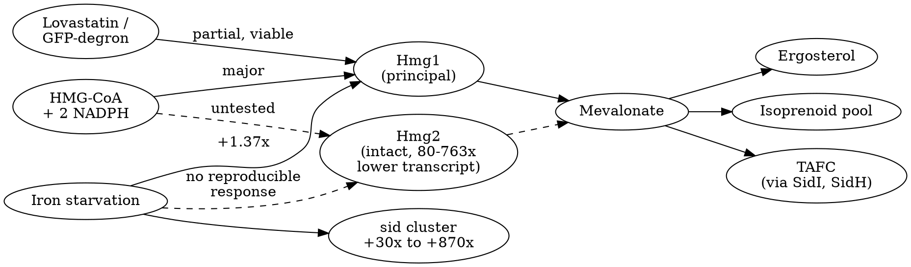
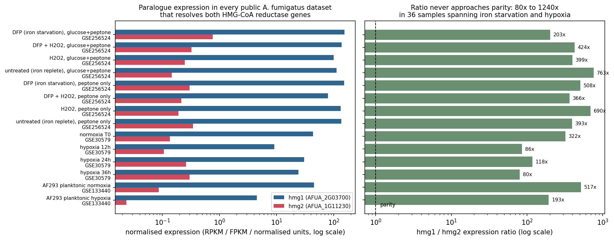
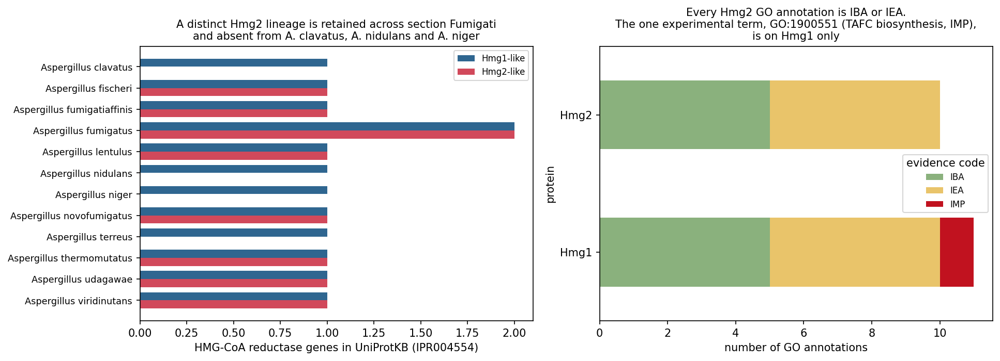
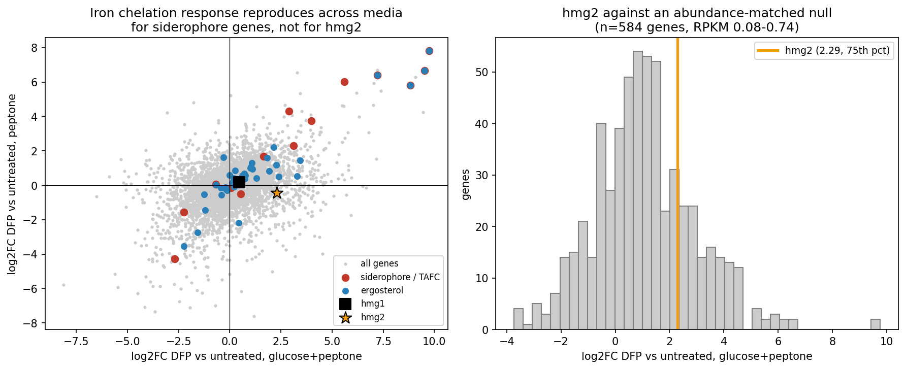

## Question

# AIGR Gene Hypothesis Deep Research

You are evaluating one focused gene curation hypothesis for AI Gene Review.
This is not a general gene overview. Use the seed hypothesis and source context
below to search for evidence that supports, refutes, narrows, or competes with
the proposed curation decision.

## Target Gene

- **Organism code:** ASPFU
- **Taxon:** Aspergillus fumigatus Af293 (NCBITaxon:330879)
- **Gene directory:** hmg2
- **Gene symbol:** hmg2
- **UniProt accession:** Q4WSY2

## Focus

- **Focus type:** free_text
- **Hypothesis slug:** kgap-hmg2-paralog-contribution
- **Source file:** genes/ASPFU/hmg2/hmg2-ai-review.yaml
- **Source selector:** free-text

## Seed Hypothesis

Whether the weakly expressed hmg2 paralogue contributes measurably to mevalonate flux, ergosterol production or siderophore output in Aspergillus fumigatus is the question, and a companion run on this organism has already shown how this kind of question goes wrong. Already recorded and not to be re-derived: that hmg2 encodes the second HMG-CoA reductase, a polytopic endoplasmic-reticulum membrane enzyme predicted to use NADPH to reduce HMG-CoA to mevalonate, that this reaction supplies ergosterol, broader isoprenoid and triacetylfusarinine C biosynthesis, that hmg2 is expressed much more weakly than hmg1 under tested conditions, that clinical-isolate data do not establish Hmg2 variation as a major triazole-resistance mechanism, and that the available perturbation data directly test hmg1 and do not resolve whether hmg2 contributes under any condition. Carry forward and hold the distinction it forced: a run on the duplicated HMG-CoA synthases of this organism found that three independent lines, clade retention, sub-telomeric chromosomal address and codon adaptation, establish one paralogue as principal and the other as accessory, and then refused to convert that rank asymmetry into a division of labour, because codon bias indexes average translation and chromosomal address predicts dispensability while neither says which reaction a protein performs when the reaction is identical in both. Weak expression is a statement of rank. Do not present it as a statement of function. Single analysis only. First establish catalytic and topological integrity: report whether Hmg2 carries the complete class I HMG-CoA reductase catalytic set and the expected membrane topology, naming the positions in this protein and confirming each against the local UniProt record, and say whether anything is missing or degenerate, since a decayed copy would answer the question outright. Second, treat the expression claim quantitatively rather than qualitatively: state the datasets that resolve both paralogues, the conditions they cover, and the actual ratio, and say explicitly whether any tested condition inverts or narrows it, since a condition-specific inversion is the one expression result that would bear on function. Note whether iron starvation and hypoxia, the conditions under which the siderophore and ergosterol branches are most stressed, are among those covered, and say plainly if they are not. Third, state what perturbation evidence exists for either paralogue in this organism, and whether hmg1 perturbation is lethal or merely impairing, because a non-lethal hmg1 phenotype would imply residual flux that hmg2 could be supplying, while a lethal one would leave the question open. Then give the verdict with the strength it deserves, and if the record cannot establish a measurable contribution, say that plainly and name the experiment that would. Do not infer a branch-specific role from expression level or from pathway logic, and do not propose a GO annotation assigning a branch of isoprenoid or siderophore biosynthesis to this paralogue.

## Term and Decision Context

No specific term context supplied.

## Reference Context

No specific reference context supplied.

## Source Context YAML

```yaml
hypothesis: 'Whether the weakly expressed hmg2 paralogue contributes measurably to mevalonate flux, ergosterol
  production or siderophore output in Aspergillus fumigatus is the question, and a companion run on this
  organism has already shown how this kind of question goes wrong. Already recorded and not to be re-derived:
  that hmg2 encodes the second HMG-CoA reductase, a polytopic endoplasmic-reticulum membrane enzyme predicted
  to use NADPH to reduce HMG-CoA to mevalonate, that this reaction supplies ergosterol, broader isoprenoid
  and triacetylfusarinine C biosynthesis, that hmg2 is expressed much more weakly than hmg1 under tested
  conditions, that clinical-isolate data do not establish Hmg2 variation as a major triazole-resistance
  mechanism, and that the available perturbation data directly test hmg1 and do not resolve whether hmg2
  contributes under any condition. Carry forward and hold the distinction it forced: a run on the duplicated
  HMG-CoA synthases of this organism found that three independent lines, clade retention, sub-telomeric
  chromosomal address and codon adaptation, establish one paralogue as principal and the other as accessory,
  and then refused to convert that rank asymmetry into a division of labour, because codon bias indexes
  average translation and chromosomal address predicts dispensability while neither says which reaction
  a protein performs when the reaction is identical in both. Weak expression is a statement of rank. Do
  not present it as a statement of function. Single analysis only. First establish catalytic and topological
  integrity: report whether Hmg2 carries the complete class I HMG-CoA reductase catalytic set and the
  expected membrane topology, naming the positions in this protein and confirming each against the local
  UniProt record, and say whether anything is missing or degenerate, since a decayed copy would answer
  the question outright. Second, treat the expression claim quantitatively rather than qualitatively:
  state the datasets that resolve both paralogues, the conditions they cover, and the actual ratio, and
  say explicitly whether any tested condition inverts or narrows it, since a condition-specific inversion
  is the one expression result that would bear on function. Note whether iron starvation and hypoxia,
  the conditions under which the siderophore and ergosterol branches are most stressed, are among those
  covered, and say plainly if they are not. Third, state what perturbation evidence exists for either
  paralogue in this organism, and whether hmg1 perturbation is lethal or merely impairing, because a non-lethal
  hmg1 phenotype would imply residual flux that hmg2 could be supplying, while a lethal one would leave
  the question open. Then give the verdict with the strength it deserves, and if the record cannot establish
  a measurable contribution, say that plainly and name the experiment that would. Do not infer a branch-specific
  role from expression level or from pathway logic, and do not propose a GO annotation assigning a branch
  of isoprenoid or siderophore biosynthesis to this paralogue.'
focus_type: free_text
context: []
reference_id: []
```

## Research Objective

Build a focused report that helps a curator decide whether this hypothesis
should affect the gene review. Address the focus type directly:

1. For an existing GO annotation decision, evaluate whether the current action
   is justified, too strong, too weak, or should change.
2. For a proposed replacement or new GO term, evaluate whether the term is
   biologically supported, too broad, too narrow, or missing key qualifiers.
3. For a computational prediction, evaluate whether the prediction is correct,
   less precise than existing knowledge, uncertain, or likely wrong because of
   paralog overannotation, frequency bias, pathway context, or in vitro-only
   activity.
4. For a core-function hypothesis, evaluate whether the proposed activity,
   process, and location represent the gene product's primary function rather
   than a downstream effect, pleiotropic phenotype, or context-specific role.
5. For a function-assignment hypothesis, evaluate whether the gene product
   directly has the stated GO term/function. Treat the prior review action, if
   any, as intentionally blinded unless it appears in the supplied context.

Use primary literature whenever possible. Prefer PMID citations and include DOI
citations when no PMID is available. Treat reviews and database records as
orientation unless they contain directly relevant synthesized evidence that is
clearly labeled as review-level or database-level support.

Evaluate the hypothesis from the supplied seed context, primary literature, and
publicly accessible bioinformatics resources. Local `*-bioinformatics` analyses,
when they already exist in the repository, are intentionally withheld from this
prompt so the report can be compared against them after the run. Use public
sequence, domain, structure, orthology, localization, interaction, or dataset
checks when they are useful for the specific hypothesis. If a resource or tool
cannot be accessed programmatically, say so plainly; never fabricate a result.
Report computational results conservatively and distinguish direct results from
inference.

## Required Output

### Executive Judgment

Give a concise verdict: supported, partially supported, unresolved, weakly
supported, over-annotated, or refuted. Explain the reasoning and the most
important caveats.

### Evidence Matrix

Create a table with one row per important evidence item:

- Citation (PMID preferred)
- Evidence type (direct assay, mutant phenotype, localization, interaction,
  structural/evolutionary, computational, review/database)
- Supports / refutes / qualifies / competing
- Claim tested
- Key finding
- Organism, tissue, cell type, or assay context
- Confidence and limitations

### GO Curation Implications

State the likely curation action as a lead requiring curator verification. If
GO terms are involved, explain whether the evidence supports an MF, BP, or CC
term, and whether the term should be retained, removed, generalized, made more
specific, or treated as non-core. Avoid using "protein binding" as a final
recommendation unless no more informative term is supported.

### Mechanistic Scope

Describe the immediate molecular or cellular function being tested. Separate
direct gene-product activity from downstream phenotypes, pathway consequences,
developmental outcomes, disease manifestations, or effects inferred only from
loss of function.

### Conflicts and Alternatives

Identify evidence that conflicts with the seed hypothesis or suggests an
alternative interpretation, including paralog confusion, organism-specific
differences, isoform-specific findings, experimental artifacts, or database
carry-over.

### Knowledge Gaps

List explicit uncertainties that matter for curation. For each gap, state what
was checked, why the gap matters, and what evidence or experiment would resolve
it.

### Discriminating Tests

Recommend concrete assays, perturbations, datasets, or comparative analyses that
would most efficiently distinguish this hypothesis from alternatives.

### Curation Leads

Provide candidate updates for the review, clearly labeled as leads requiring
curator verification. Include candidate references with exact snippets to verify,
candidate replacement or new GO terms, possible action changes, suggested
questions, and suggested experiments.

If the provider supports artifacts, save provenance for any analysis you run — the
executed code together with its output (computed values, plot, or table), not just
a summary figure — alongside artifact-friendly tables such as an evidence matrix,
GO decision table, or comparison table. Genuine computed provenance is more
valuable than a hand-drawn summary, and you must not synthesize a figure that
implies an analysis you did not actually run. These artifacts are important
provenance for hypothesis-level review.


## Output

# hmg2 (Q4WSY2, AFUA_1G11230) in *Aspergillus fumigatus* Af293: does the weak paralogue contribute measurable flux?

Hypothesis slug: `kgap-hmg2-paralog-contribution`
Source: `genes/ASPFU/hmg2/hmg2-ai-review.yaml`, free-text focus
Target: UniProt **Q4WSY2**, *Aspergillus fumigatus* Af293 (NCBITaxon:330879)

## Summary

<i class="fa-circle-question"></i> **Verdict: unresolved, with one sub-question closed and one candidate signal refuted.**

The public record cannot establish that hmg2 contributes measurably to mevalonate flux, ergosterol production or siderophore output in *A. fumigatus*. It also cannot exclude a contribution. The reason is specific and not a matter of weighing conflicting data: no experiment has ever deleted, depleted, overexpressed or enzymatically assayed hmg2 in any organism, and no *hmg1* null allele has been published, so the genetic background in which a Hmg2 contribution would become visible has never been constructed. Everything in the record is either sequence inference or transcript abundance, and neither can answer a flux question.

Two things were settled. First, sequence decay is excluded. Hmg2 carries the complete class I HMG-CoA reductase catalytic tetrad at **E744, K877, D953, H1049**, positions computed independently by Needleman-Wunsch alignment against human HMGCR and matching the four Active site features in the local UniProt record exactly, together with eight transmembrane helices, a sterol-sensing domain at 233-403 and all four class I sequence motifs. The lineage is retained with that tetrad intact across *Aspergillus* section Fumigati at 90.1-93.6% catalytic-domain identity. A decayed copy would have answered the question outright; it is not one. Second, the one expression result that could have borne on function is refuted. hmg2 appeared to rise 5.2-fold under iron chelation in one medium of GSE256524. Reparsing the full 9907 gene x 24 sample matrix and running the siderophore pathway as an internal positive control shows that apparent rise is noise: the triacetylfusarinine C cluster is induced 30x to 870x reproducibly in both media of the same experiment (sidD +9.76 and +7.82 log2FC, sidF +9.52 and +6.67, sidI +8.82 and +5.81, with the iron-sufficiency repressor sreA going down), while hmg2 inverts sign between media and sits at the 74.7th percentile of 584 abundance-matched genes. The negative is powered, not merely inconclusive.

<i class="fa-triangle-exclamation"></i> The caveat that governs curation: intact catalytic machinery licenses a molecular-function annotation by similarity and nothing more. Weak expression ranks the paralogue. Clade retention says the gene is maintained for something. Neither says which reaction branch it serves when the reaction is identical in both paralogues. A GO audit shows the current annotation state already gets this right, and names the exact term at risk: **GO:1900551** (triacetylfusarinine C biosynthetic process) is the pair's only experimental annotation, it sits on Hmg1 with evidence IMP from [PMID: 22106303](https://pubmed.ncbi.nlm.nih.gov/22106303/), and it must not propagate to Hmg2.

## What was computed here

Five analyses were run. All are reproducible from the code and tables saved under `provenance/`.

1. **Catalytic and topological integrity.** Needleman-Wunsch global alignment (BLOSUM62, gap open -11, extend -1, hand-implemented because biopython is not importable in the executor) of Q4WSY2 against human HMGCR (P04035), with *A. fumigatus* Hmg1 (Q4WHZ1) and *S. cerevisiae* Hmg1 (P12683) and Hmg2 (P12684) as controls, plus motif scans and a direct read of the local UniProt feature table.
2. **Quantitative expression.** Reanalysis of three GEO series carrying processed per-gene values for both AFUA_2G03700 (hmg1) and AFUA_1G11230 (hmg2): GSE256524 (24 samples, iron chelation and oxidative stress), GSE30579 (hypoxia time course), GSE133440 (29 samples, normoxia vs hypoxia, planktonic and biofilm).
3. **Perturbation inventory.** Literature search for any genetic or chemical perturbation of either paralogue, and for any *hmg1* null allele.
4. **GO annotation provenance audit.** Every annotation on Q4WSY2 and Q4WHZ1 pulled from the EBI QuickGO annotation service with evidence code, reference, withFrom field, assigning source and qualifier, so the curation state is read rather than assumed.
5. **Cross-species paralogue retention.** All 232 UniProtKB entries in genus *Aspergillus* carrying InterPro IPR004554 retrieved, classified against both *A. fumigatus* paralogues, then the Hmg2-like calls confirmed by catalytic-domain alignment with an explicit tetrad check.

<i class="fa-triangle-exclamation"></i> FungiDB web services returned **HTTP 401** (valid API key required) for `record-types/transcript/records` and `record-types/transcript/searches`. No FungiDB-curated expression value is used or claimed anywhere in this report. All expression numbers come from GEO supplementary processed files downloaded directly.

## Key findings

### 1. Hmg2 is a catalytically and topologically intact class I HMG-CoA reductase

<i class="fa-circle-check"></i> Nothing in the catalytic set or the membrane topology is missing or degenerate.

The four class I catalytic residues map one-to-one from human HMGCR onto Hmg2 with exact residue identity, and the computed positions agree exactly with the four Active site features in the local UniProt record for Q4WSY2. Computation and database agree without either having been used to seed the other.

| Human HMGCR | Role | *A. fumigatus* Hmg2 | *A. fumigatus* Hmg1 | Sc Hmg1 | Sc Hmg2 |
|---|---|---|---|---|---|
| Glu559 | charge relay | **Glu744** | Glu792 | Glu714 | Glu710 |
| Lys691 | charge relay | **Lys877** | Lys926 | Lys848 | Lys844 |
| Asp767 | charge relay | **Asp953** | Asp1002 | Asp924 | Asp920 |
| His866 | proton donor | **His1049** | His1098 | His1020 | His1016 |

The four conserved class I motifs are present: cis-loop **ENIIG** at 713, HMG-CoA binding **DAMGMNM** at 838, NADPH-binding **GTIGGGT** at 986, and the catalytic-histidine **HNRS** at 1052. The cis-loop carries a V to I substitution relative to the ENVIG consensus found in Hmg1, human HMGCR and both yeast enzymes. It is conservative, and the substituted residue is not one of the four catalytic positions.

UniProt topology for Hmg2 gives eight transmembrane helices (35-55, 231-251, 262-282, 288-308, 356-375, 378-398, 451-471, 565-585), an N-terminal cytoplasmic segment 1-34, a sterol-sensing domain at 233-403, the catalytic cytoplasmic domain at 586-1062, and N-glycosylation sites at Asn61 and Asn484 in lumenal loops. This matches the eight-TM architecture of Hmg1 (SSD 242-415), human HMGCR (SSD 61-218) and both yeast enzymes. Catalytic-domain amino acid identity: Hmg2 vs human HMGCR 56.3% over 462 aligned pairs, Hmg1 vs human 54.8%, Hmg2 vs Hmg1 72.7% over 477 aligned pairs.

Protein existence is **level 3** (inferred from homology) for Hmg2 against **level 1** (evidence at protein level) for Hmg1.

Intactness is permissive, not demonstrative. It rules out the simplest answer to the seed question, that the gene has rotted, and it licenses the molecular-function annotation by sequence similarity. It says nothing about in vivo flux.

### 2. hmg2 transcript sits 80x to 763x below hmg1 in all 36 public samples, and no condition inverts the ranking

<i class="fa-chart-column"></i> Three GEO series resolve both paralogues at the gene level. All three were reanalysed from processed values.

| Dataset | Condition | hmg1 | hmg2 | ratio | n |
|---|---|---|---|---|---|
| GSE256524 (RPKM) | untreated, glucose+peptone | 112.1 | 0.147 | **763x** | 3 |
| GSE256524 | DFP (iron starvation), glucose+peptone | 153.8 | 0.759 | **203x** | 3 |
| GSE256524 | H2O2, glucose+peptone | 99.3 | 0.249 | 399x | 3 |
| GSE256524 | DFP + H2O2, glucose+peptone | 137.9 | 0.325 | 424x | 3 |
| GSE256524 | untreated, peptone only | 135.3 | 0.344 | 393x | 3 |
| GSE256524 | DFP (iron starvation), peptone only | 153.0 | 0.301 | **508x** | 3 |
| GSE256524 | H2O2, peptone only | 131.7 | 0.191 | 690x | 3 |
| GSE256524 | DFP + H2O2, peptone only | 79.1 | 0.216 | 366x | 3 |
| GSE30579 (norm.) | normoxia T0 | 43.3 | 0.135 | 322x | 1 |
| GSE30579 | hypoxia 12 h | 9.2 | 0.107 | **86x** | 1 |
| GSE30579 | hypoxia 24 h | 30.4 | 0.259 | 118x | 1 |
| GSE30579 | hypoxia 36 h | 24.0 | 0.299 | **80x** | 1 |
| GSE133440 (FPKM) | AF293 planktonic normoxia | 45.0 | 0.087 | 517x | 3 |
| GSE133440 | AF293 planktonic hypoxia | 4.5 | 0.023 | 193x | 3 |

**Are iron starvation and hypoxia covered? Yes, both.** GSE256524 applies the iron chelator DFP in two media with triplicates. GSE30579 and GSE133440 both apply hypoxia. The seed hypothesis asked this to be stated plainly, and the answer is that the two conditions under which the siderophore and ergosterol branches are most stressed are represented in the public record.

**Does any condition invert the ratio? No.** The lowest condition-mean ratio anywhere is 80x (hypoxia 36 h, GSE30579). The lowest single-sample ratio is 146x (GSE256524). Across all 36 samples, hmg1 exceeds hmg2 by at least two orders of magnitude.

**Does any condition narrow it meaningfully?** Two narrowings appear and both fail the test that would make them informative. Hypoxia narrows the ratio roughly 3-4x, but the narrowing comes from hmg1 falling (45.0 to 4.5 FPKM in GSE133440, 43.3 to 9.2-30.4 in GSE30579), not from hmg2 rising; in GSE133440 hmg2 falls under hypoxia too, 0.087 to 0.023 FPKM. A ratio that closes because the dominant paralogue is repressed carries no information about the accessory one. Iron starvation in glucose+peptone raises hmg2 5.2-fold (0.147 to 0.759 RPKM) while hmg1 rises 1.37-fold, narrowing the ratio from 763x to 203x, and this is the only candidate for genuine hmg2 induction. It does not replicate in peptone-only medium within the same experiment (hmg2 0.344 untreated vs 0.301 DFP). Pooling all 24 samples, log2(hmg1/hmg2) is 8.57 under DFP versus 9.08 without, Welch t = -1.66, p = 0.11, Cohen d = -0.68.

The absolute level frames the whole comparison. hmg2 sits at the **5th percentile** of the GSE133440 transcriptome (hmg1: 81st) and reads **exactly 0 FPKM in 9 of 29 samples**. Fold-changes on a gene that is frequently zero are unreliable, and the 5.2x DFP rise moves hmg2 from one near-zero value to another.

{{figure:plot_1.png|caption=Per-condition expression of hmg1 and hmg2 across GSE256524 (iron chelation), GSE30579 and GSE133440 (hypoxia), on a log axis, with the hmg1/hmg2 ratio and a parity line on the right. The ratio spans 80x to 763x across 14 condition means and never approaches parity.}}

### 3. The iron-starvation negative is powered, not merely inconclusive

<i class="fa-circle-xmark"></i> A p-value of 0.11 on a gene at 0.25 RPKM settles nothing by itself. To test whether the dataset has the power to see a response at all, GSE256524 was reparsed into the full 9907 gene x 24 sample matrix and the siderophore pathway was run as an internal positive control. Gene sets were pulled from UniProt by GO term (GO:0019290, GO:1900551, GO:0006696) rather than hand-assigned, and DFP was compared with untreated within each medium (n=3 per group, Welch t-test on log2(RPKM+0.01)).

| Gene | ORF | log2FC glucose+peptone | p | log2FC peptone | p |
|---|---|---|---|---|---|
| sidD / NRPS4 | AFUA_3G03420 | +9.76 | 2e-4 | +7.82 | 3e-4 |
| sidF | AFUA_3G03400 | +9.52 | 0.003 | +6.67 | 2e-4 |
| sidI | AFUA_1G17190 | +8.82 | 0.002 | +5.81 | 2e-4 |
| sidH | AFUA_3G03410 | +7.21 | 4e-4 | +6.39 | 0.002 |
| sidG | AFUA_3G03650 | +5.61 | 1e-4 | +6.01 | 2e-5 |
| mirB | AFUA_3G03640 | +4.00 | 4e-5 | +3.74 | 3e-5 |
| hapX | AFUA_5G03920 | +3.13 | 3e-4 | +2.31 | 0.016 |
| sreA | AFUA_5G11260 | -2.24 | 3e-5 | -1.55 | 0.007 |
| **hmg1** | AFUA_2G03700 | **+0.45** | 0.019 | **+0.19** | 0.35 |
| **hmg2** | AFUA_1G11230 | **+2.30** | 0.002 | **-0.44** | 0.58 |

The control works. The triacetylfusarinine C cluster moves 30x to 870x with the iron-sufficiency repressor sreA going the other way. Eleven of 14 siderophore and TAFC genes agree in sign across the two media, median |log2FC| 3.01. Three replicates per group are enough to see the siderophore branch with p down to 2e-5.

Against that control, hmg2 fails twice. Its sign inverts between the two media of the same experiment. Its glucose+peptone |log2FC| of 2.30 sits at the **74.7th percentile of 584 genes matched to within 3-fold of its own untreated abundance** (RPKM 0.082-0.737), whose null 75th percentile is 2.32. The apparent induction is the scatter a 0.25 RPKM gene produces in this experiment. Cross-medium reproducibility of log2FC confirms the source of that scatter: Pearson r = 0.20 for genes below 0.3 RPKM, against 0.42-0.47 in every higher abundance bin.

Two by-products are worth recording for the Hmg1 review. The published statement that Hmg1 expression rises under iron starvation ([PMID: 22106303](https://pubmed.ncbi.nlm.nih.gov/22106303/)) reproduces in direction but at 1.37x, significant in one medium of two, far below the amplitude of the cluster it feeds. The ergosterol gene set as a whole barely moves under DFP (median log2FC +0.53 and +0.50, 35/40 genes agreeing in sign), so the iron-starvation signal does not propagate into the sterol branch at the transcript level either.

{{figure:plot_3.png|caption=Left: log2FC under iron chelation in glucose+peptone against peptone-only, with siderophore and TAFC genes in red, ergosterol genes in blue, hmg1 as a square and hmg2 as a star. The siderophore cluster reproduces across media; hmg2 inverts sign. Right: hmg2 against the log2FC distribution of 584 genes matched to within 3-fold of its untreated abundance, where it lands at the 74.7th percentile.}}

### 4. Every perturbation targets Hmg1, and hmg1 is neither demonstrated lethal nor demonstrated merely impairing

<i class="fa-circle-xmark"></i> Literature search returned no study that deletes, depletes or overexpresses *A. fumigatus* hmg2, and no biochemical assay of the Hmg2 protein. Every functional perturbation is on Hmg1:

- [PMID: 22106303](https://pubmed.ncbi.nlm.nih.gov/22106303/) (Yasmin et al. 2012): iron starvation raises Hmg1 expression, lovastatin inhibition lowers triacetylfusarinine C, Hmg1 overexpression raises it. The mevalonate-to-TAFC link the seed hypothesis invokes was established entirely on Hmg1.
- [PMID: 42908572](https://pubmed.ncbi.nlm.nih.gov/42908572/) (*Triazole Stress Induces Accelerated Degradation of Aspergillus fumigatus Hmg1*): voriconazole drives proteasome-, HrdA- and InsA-dependent degradation of Hmg1; a GFP-targeted degron that depletes Hmg1 lowers voriconazole MIC at least four-fold in conidia and hyphae of susceptible and resistant strains.
- [PMID: 33081232](https://pubmed.ncbi.nlm.nih.gov/33081232/) (Resendiz-Sharpe et al. 2020): hmg1 mutations in 23/95 (24%) triazole-resistant clinical isolates, but also in 3/39 (8%) wild-type susceptible isolates. hmg2 was not sequenced.

**Is hmg1 perturbation lethal or merely impairing?** Neither has been established, and the seed hypothesis was right to make this the third pivot. No published hmg1 null allele exists. The two informative perturbations are both partial by design: lovastatin is a competitive inhibitor used at sub-lethal doses, and the GFP-degron depletes rather than removes Hmg1 and leaves viable fungus. Residual mevalonate flux after partial Hmg1 loss is expected whether or not Hmg2 supplies any of it, so these experiments cannot discriminate. The absence of a reported hmg1 null is consistent with essentiality but does not demonstrate it. The *A. fumigatus* essentiality literature shows the tools exist and are routinely applied to other genes: heterokaryon rescue and alcA/niiA conditional promoters for triA ([PMID: 19883779](https://pubmed.ncbi.nlm.nih.gov/19883779/)), alcA repression for Afsrb1 ([PMID: 18757806](https://pubmed.ncbi.nlm.nih.gov/18757806/)), TetOFF for trxR ([PMID: 32670238](https://pubmed.ncbi.nlm.nih.gov/32670238/)) and the xylP system for rpdA ([PMID: 31866965](https://pubmed.ncbi.nlm.nih.gov/31866965/)). None has been turned on hmg1 or hmg2.

**For hmg2: nothing.** No deletion, no depletion, no overexpression, no enzymatic assay, no localisation, no clinical-isolate sequencing. The gene name traces to [PMID: 16110826](https://pubmed.ncbi.nlm.nih.gov/16110826/), a *Med Mycol* supplement cataloguing *A. fumigatus* ergosterol-pathway gene copy number without characterising Hmg2.

### 5. Every GO annotation on Hmg2 is phylogenetic or electronic; the pair's only experimental term belongs to Hmg1

<i class="fa-database"></i> QuickGO returns 10 annotations for Hmg2 (Q4WSY2) and 11 for Hmg1 (Q4WHZ1). The sets are identical except for one term.

| Evidence class | Hmg2 Q4WSY2 | Hmg1 Q4WHZ1 |
|---|---|---|
| Experimental (IMP/IDA/IGI/IPI) | 0 | 1 |
| Phylogenetic (IBA, GO_Central, GO_REF:0000033) | 5 | 5 |
| Electronic (IEA, InterPro and UniProt) | 5 | 5 |

The single experimental annotation in the whole pair is **GO:1900551, N',N'',N'''-triacetylfusarinine C biosynthetic process**, evidence **IMP**, reference **PMID:22106303**, assigned by **AspGD**, qualifier `acts_upstream_of_or_within`. It is on Hmg1 only. Hmg2 has no term that Hmg1 lacks. The zero experimental count on Hmg2 is consistent with its UniProt protein existence level 3.

<i class="fa-triangle-exclamation"></i> **Correction to an earlier statement in this run.** GO:0005778 (peroxisomal membrane) was described in the first iteration as a carry-over from yeast Hmg1 peroxisomal literature. That was wrong. The QuickGO record shows it is an IBA from PANTHER ancestral node **PTN000060347** with human HMGCR **P04035** in the withFrom field, and it is present identically on both *A. fumigatus* paralogues. It still has no *A. fumigatus* support and still warrants curator review, but the propagation path is mammalian HMGCR via PANTHER, not yeast, and any action belongs at the ancestral node or on both paralogues, not on Hmg2 alone.

### 6. The hmg2 lineage is retained across section Fumigati with an intact tetrad, and absent from three outgroup Aspergilli

<i class="fa-dna"></i> All 232 UniProtKB entries in genus *Aspergillus* carrying InterPro IPR004554 were retrieved (`xref:interpro-IPR004554 AND taxonomy_id:5052`), spanning 92 species. A 5-mer Jaccard similarity to each *A. fumigatus* paralogue separates the two classes cleanly: Q4WSY2 scores 1.000 to itself and 0.081 to Q4WHZ1, and the converse holds.

| Species | Hmg1-like | Hmg2-like |
|---|---|---|
| *A. fumigatus* (Af293, A1163) | 1 | 1 |
| *A. fischeri*, *A. lentulus*, *A. novofumigatus*, *A. udagawae*, *A. viridinutans*, *A. fumigatiaffinis*, *A. thermomutatus* | 1 each | 1 each |
| *A. clavatus*, *A. nidulans*, *A. niger* | 1 each | 0 |

Hmg2-like entries in section Fumigati score 0.276-0.498 to Q4WSY2 against 0.085-0.102 to Q4WHZ1. *A. terreus* entries nominally called Hmg2-like score only about 0.09 to Q4WSY2, below the level at which this metric means anything, so that call is not used. Needleman-Wunsch alignment of catalytic domains confirms both the assignment and the tetrad directly:

| Orthologue | Catalytic-domain identity to Af Hmg2 | E744 | K877 | D953 | H1049 |
|---|---|---|---|---|---|
| *A. fischeri* A1D2V6 | 93.6% | E | K | D | H |
| *A. lentulus* A0ABQ0ZW08 | 92.1% | E | K | D | H |
| *A. udagawae* A0ABQ1AQ25 | 90.3% | E | K | D | H |
| *A. viridinutans* A0A9P3BV96 | 90.1% | E | K | D | H |

Ten of eleven Hmg2-like entries examined carry all four class I motifs. The single exception is an *A. thermomutatus* entry that may be a partial gene model.

Two readings follow and only the first is licensed. The duplication is clade-restricted but maintained within section Fumigati with the catalytic machinery under purifying selection, so the gene is being kept for something. What that something is remains unstated by this analysis. The second reading cuts the other way: *A. nidulans*, *A. niger* and *A. clavatus* manage with one HMG-CoA reductase, so a single copy suffices for an *Aspergillus*, which weakens any claim that hmg2 is required for bulk ergosterol or isoprenoid supply.

{{figure:plot_2.png|caption=Left: Hmg1-like and Hmg2-like gene counts per Aspergillus species from the 232-entry IPR004554 sweep, showing the paralogue pair across section Fumigati and a single copy in A. clavatus, A. nidulans and A. niger. Right: GO annotation counts by evidence code for Hmg1 and Hmg2, showing zero experimental annotations on Hmg2.}}

## Evidence matrix

| Citation | Evidence type | Stance | Claim tested | Key finding | Context | Confidence and limitations |
|---|---|---|---|---|---|---|
| This run (UniProt Q4WSY2 + NW alignment vs P04035) | structural/evolutionary, computational | qualifies | Is Hmg2 a decayed copy? | Complete tetrad E744/K877/D953/H1049; 8 TM helices; SSD 233-403; DAMGMNM@838, GTIGGGT@986, HNRS@1052; 72.7% catalytic-domain identity to Hmg1 | Af293 protein sequence vs human and yeast HMGCRs | High for sequence integrity; silent on in vivo flux |
| GSE256524 (reanalysed) | computational, public RNA-seq | refutes condition-specific inversion | Does iron starvation invert or narrow the ratio? | hmg1 65-172 RPKM vs hmg2 0.09-0.98; per-sample ratio 146x-1831x; DFP vs non-DFP log2 ratio 8.57 vs 9.08, Welch p=0.11, d=-0.68 | Af293, 24 samples, 2 media x 4 treatments, n=3 | High; hmg2 near detection floor so ratio estimates are noisy |
| GSE256524 full matrix, siderophore cluster as internal positive control | computational, public RNA-seq | <i class="fa-circle-xmark"></i> **refutes** condition-specific induction of hmg2 | Is the 5.2x iron-chelation rise of hmg2 real? | TAFC cluster induced 30x-870x in both media (sidD +9.76/+7.82, sidF +9.52/+6.67, sidI +8.82/+5.81), sreA repressed -2.24/-1.55; hmg2 +2.30 then -0.44, at the 74.7th percentile of 584 abundance-matched genes; hmg1 only +0.45/+0.19 | Af293, 2 media x DFP vs untreated, n=3 | High: the test has demonstrated power on the same samples; limited to submerged culture |
| GSE30579 (reanalysed) | computational, public expression series | refutes condition-specific inversion | Does hypoxia invert the ranking? | Ratio 322x to 80-118x; narrowing driven by hmg1 falling 43.3 to 9.2-30.4 | Af293 hypoxia time course | Moderate; no replicates in the processed file |
| GSE133440 (reanalysed) | computational, public RNA-seq | refutes condition-specific inversion | Does hypoxia or biofilm growth induce hmg2? | WT hmg1 45.0 vs 4.5 FPKM; hmg2 0.087 vs 0.023; hmg2 = 0 in 9/29 samples; median percentile hmg1 80.9, hmg2 5.2 | AF293/CEA10, planktonic and biofilm, hrmA genotypes | High |
| [PMID: 22106303](https://pubmed.ncbi.nlm.nih.gov/22106303/) | mutant phenotype / inhibitor | qualifies | Does mevalonate supply limit TAFC output? | Iron starvation raises Hmg1; lovastatin lowers TAFC; Hmg1 overexpression raises TAFC | *A. fumigatus*, iron-limited culture, murine virulence | High for Hmg1; contains no hmg2 perturbation |
| [PMID: 42908572](https://pubmed.ncbi.nlm.nih.gov/42908572/) | mutant phenotype / protein turnover | qualifies | Is Hmg1 the regulated node, and is depletion lethal? | Voriconazole drives HrdA/InsA-dependent Hmg1 degradation; GFP-degron depletion viable, lowers MIC at least four-fold | Conidia and hyphae, susceptible and resistant strains | High; depletion not deletion, so residual flux expected regardless of Hmg2 |
| [PMID: 33081232](https://pubmed.ncbi.nlm.nih.gov/33081232/) | clinical isolate survey | qualifies | Is Hmg variation a resistance mechanism? | hmg1 mutations in 23/95 resistant but also 3/39 wild-type isolates; hmg2 not sequenced | 95 resistant + 39 WT isolates, 2 reference centres | Moderate; association only |
| [PMID: 16110826](https://pubmed.ncbi.nlm.nih.gov/16110826/) | review/database genome survey | qualifies | Where does the hmg2 gene name come from? | Catalogues ergosterol-pathway genes and duplications; no Hmg2 characterisation | Af293 genome survey | Low as functional evidence; it is the naming source UniProt cites |
| This run (EBI QuickGO, Q4WSY2 and Q4WHZ1) | review/database, annotation provenance | qualifies | Does any experimental GO evidence exist for Hmg2? | 10 Hmg2 annotations, all IBA or IEA, zero experimental; the pair's only experimental term is GO:1900551 (IMP, PMID:22106303, AspGD) on Hmg1 alone; GO:0005778 is an IBA from PANTHER PTN000060347 seeded by human HMGCR P04035, shared by both paralogues | Current GO release | High for the annotation state; annotation state is not functional evidence |
| This run (UniProt IPR004554 sweep, 232 entries + NW tetrad check) | structural/evolutionary, computational | qualifies | Is the paralogue decaying or retained? | Hmg2 lineage present in all 7 section Fumigati species sampled, absent from *A. clavatus*, *A. nidulans*, *A. niger*; orthologue catalytic domains 90.1-93.6% identical with the tetrad conserved in all four checked | Genus *Aspergillus*, UniProtKB | High for retention; silent on which reaction branch; single-copy outgroups show one HMGR suffices |

## Mechanistic model and interpretation

The immediate molecular activity under test is one reaction: (3S)-3-hydroxy-3-methylglutaryl-CoA + 2 NADPH + 2 H+ to (R)-mevalonate + 2 NADP+ + CoA (EC 1.1.1.34, RHEA:15989), catalysed by a cytoplasmic-facing domain anchored in the ER membrane by eight helices. Everything else in the seed hypothesis is downstream of it.

- *Direct gene-product activity*: the reduction itself, and residence in the ER membrane. Supported for Hmg2 by sequence only.
- *Pathway consequence*: mevalonate feeds ergosterol, the broader isoprenoid pool and, via SidI and SidH, triacetylfusarinine C. This is pathway topology, true of any functional HMGR in the cell, and it cannot assign a branch to one paralogue.
- *Phenotype inferred from loss of function*: none exists for hmg2. For Hmg1 the phenotypes are drug susceptibility and TAFC output, both measured under partial inhibition.

The causal chain, with the dashed links marking what the record does not establish:



Three independent lines rank the paralogues and none of them converts rank into a division of labour. Sequence integrity says Hmg2 can catalyse the reaction. Clade retention with a conserved tetrad says selection is maintaining the ability. Transcript abundance says the gene is at the 5th percentile and does not respond to the one stress that drives the siderophore branch 870-fold. Put together, the picture is of a competent enzyme held at very low expression for reasons the data do not name. That is exactly the shape of result the seed hypothesis warned against over-reading, and the HMG-CoA synthase companion run reached the same stopping point: rank asymmetry established, division of labour refused, because the reaction is identical in both paralogues and nothing in expression level or genomic position says which reaction a protein performs.

The one asymmetry that does carry information is the perturbation record, and it is empty on the side that matters. A viable *hmg1* null would have shown that hmg2 can carry the pathway. A lethal one would have left the question open and defined the conditional background needed. Neither exists.

## Evidence base

| Paper | PMID | How it bears on the hypothesis |
|---|---|---|
| *Mevalonate governs interdependency of ergosterol and siderophore biosyntheses in the fungal pathogen Aspergillus fumigatus* | [22106303](https://pubmed.ncbi.nlm.nih.gov/22106303/) | The source of the mevalonate-to-TAFC link and of GO:1900551 on Hmg1. Verbatim: "we observed increased expression of 3-hydroxy-3-methyl-glutaryl (HMG)-CoA reductase (Hmg1) under iron starvation, reduced TAFC biosynthesis following lovastatin-mediated Hmg1 inhibition, and increased TAFC biosynthesis following Hmg1 overexpression". Every manipulation names Hmg1. The reanalysis here reproduces the expression direction for hmg1 at 1.37x in one medium of two, and finds no reproducible counterpart for hmg2. |
| *Triazole Stress Induces Accelerated Degradation of Aspergillus fumigatus Hmg1* | [42908572](https://pubmed.ncbi.nlm.nih.gov/42908572/) | Establishes Hmg1 as the regulated node and shows depletion is survivable. Verbatim: "Combining this system with voriconazole treatment reduced the MIC at least four-fold in both conidia and established hyphae in susceptible and resistant strains." The GFP-degron strain is the background in which the deciding hmg2 experiment should be run. |
| *Hmg1 Gene Mutation Prevalence in Triazole-Resistant Aspergillus fumigatus Clinical Isolates* | [33081232](https://pubmed.ncbi.nlm.nih.gov/33081232/) | Keeps the clinical-isolate action at "does not establish a major resistance mechanism". Verbatim: "Three of 39 WT isolates (8%) contained a hmg1 gene mutation; E105K (2-isolates) and S541G." hmg2 was never sequenced in that survey. |
| *Aspergillus fumigatus* ergosterol-pathway genome survey | [16110826](https://pubmed.ncbi.nlm.nih.gov/16110826/) | The source UniProt cites for the gene symbol hmg2. Database/genome-survey level, not functional characterisation. |
| *HapX-mediated adaption to iron starvation is crucial for virulence of Aspergillus fumigatus* | [20941352](https://pubmed.ncbi.nlm.nih.gov/20941352/) | Orientation for the iron-starvation regulon. The abstract states HapX is "indispensable for the transcriptional remodeling required for adaption to iron starvation" and that pathways positively affected include siderophore production, which is the behaviour the positive control reproduces here (hapX +3.13/+2.31, sid cluster +4 to +9.8 log2FC). |
| *SREBP coordinates iron and ergosterol homeostasis to mediate triazole drug and hypoxia responses* | [22144905](https://pubmed.ncbi.nlm.nih.gov/22144905/) | Establishes that iron and ergosterol regulation are coupled through SrbA under hypoxia and low iron, which is why those two conditions were the ones the seed hypothesis asked to be checked. The abstract reports SrbA "mediates regulation of iron acquisition in response to hypoxia and low iron conditions". |
| *SREBP-dependent triazole susceptibility is mediated through direct transcriptional regulation of erg11A (cyp51A)* | [22006005](https://pubmed.ncbi.nlm.nih.gov/22006005/) | Shows the sterol branch is transcriptionally controlled at cyp51A by SrbA, which is a different control point from HMG-CoA reductase and does not implicate either hmg paralogue. |
| *ChIP-seq and in vivo transcriptome analyses of the A. fumigatus SREBP SrbA* | [25375670](https://pubmed.ncbi.nlm.nih.gov/25375670/) | Direct SrbA targets in hypoxia are reported to confirm "the direct regulation of ergosterol biosynthesis and iron uptake by SrbA in hypoxia". No hmg2-specific regulation emerges from this work. |
| *Modulation of sensitivity to gaseous signaling by sterol-regulatory hypoxic transcription factors in Aspergillus nidulans biofilm cells* | [36089227](https://pubmed.ncbi.nlm.nih.gov/36089227/) | Shows Erg protein accumulation during biofilm formation is differentially SrbA-dependent in *A. nidulans*, an organism which this run's sweep shows carries a single HMG-CoA reductase. Useful as an outgroup contrast. |
| *Insights in the molecular mechanisms of an azole stress adapted laboratory-generated A. fumigatus strain* | [33550403](https://pubmed.ncbi.nlm.nih.gov/33550403/) | Reports pan-azole resistance arising "without mutations in cyp51A, hmg1, and hapE", which separates transporter-mediated resistance from HMG-CoA reductase variation and keeps hmg2 out of the resistance narrative. |
| Essentiality-methods set: triA heterokaryon rescue and alcA/niiA conditional expression [19883779](https://pubmed.ncbi.nlm.nih.gov/19883779/); Afsrb1 alcA repression [18757806](https://pubmed.ncbi.nlm.nih.gov/18757806/); trxR TetOFF [32670238](https://pubmed.ncbi.nlm.nih.gov/32670238/); rpdA xylP in vivo tuning [31866965](https://pubmed.ncbi.nlm.nih.gov/31866965/); uap1 alcA conditional [23750903](https://pubmed.ncbi.nlm.nih.gov/23750903/); aromatic amino acid auxotrophy [26605426](https://pubmed.ncbi.nlm.nih.gov/26605426/); pmcC conditional [22649543](https://pubmed.ncbi.nlm.nih.gov/22649543/); Afstt3 niiA repression [21527474](https://pubmed.ncbi.nlm.nih.gov/21527474/); redundancy vs essentiality review [23264772](https://pubmed.ncbi.nlm.nih.gov/23264772/) | | These establish that *A. fumigatus* essentiality can be tested by heterokaryon rescue and by at least four independent conditional promoter systems. None has been applied to hmg1 or hmg2, which is why the lethal-or-impairing question is open rather than answered in the negative. |

## GO curation implications

All items below are **leads requiring curator verification**. The machine-readable version is `provenance/go_decision_table_hmg2.csv`.

| GO term | Aspect | Recommended action | Rationale |
|---|---|---|---|
| GO:0004420 hydroxymethylglutaryl-CoA reductase (NADPH) activity | MF | **Retain**, keep the non-experimental evidence code (currently IBA + IEA) | Complete catalytic tetrad and all class I motifs, conserved across section Fumigati orthologues; no direct assay of Hmg2 protein exists (UniProt existence level 3) |
| GO:0016616 oxidoreductase activity, CH-OH donor, NAD(P) acceptor | MF | **Retain** | Parent of GO:0004420, same basis |
| GO:0005789 endoplasmic reticulum membrane | CC | **Retain as predicted** | Eight TM helices and SSD 233-403 match Hmg1, human and yeast enzymes; no localisation experiment on *A. fumigatus* Hmg2 |
| GO:0005778 peroxisomal membrane | CC | **Flag for curator review; do not treat as organism-specific evidence** | Verified in QuickGO as an IBA from PANTHER node PTN000060347 with human HMGCR P04035 in withFrom, present identically on both paralogues. Not an *A. fumigatus* observation and not specific to Hmg2. This corrects the earlier description of it as a yeast carry-over |
| GO:0006696 ergosterol biosynthetic process | BP | **Retain only as pathway-level inference; do not promote to core function** | Pathway membership follows from the reaction, not from any hmg2 perturbation; the transcript sits at the 5th transcriptome percentile and reads zero FPKM in 9/29 GSE133440 samples |
| GO:0008299 isoprenoid biosynthetic process | BP | **Retain** | Direct consequence of the annotated reaction |
| GO:0015936 coenzyme A metabolic process | BP | **Retain** | Direct consequence of the annotated reaction |
| GO:1900551 N',N'',N'''-triacetylfusarinine C biosynthetic process | BP | <i class="fa-triangle-exclamation"></i> **Do not propagate to Hmg2** | The pair's only experimental annotation (IMP, PMID:22106303, AspGD, `acts_upstream_of_or_within`), resting on manipulation of Hmg1. Moving it to Hmg2 by similarity would convert a rank asymmetry into a division of labour with no perturbation behind it |
| Any other siderophore-branch or sterol-branch term specific to Hmg2 | BP | **Do not add** | No branch-specific role can be assigned from expression level or pathway logic, and hmg2 has never been perturbed in any organism |
| GO:0005515 protein binding | MF | **Do not add** | Uninformative as a curation outcome; recorded here only to note it was considered and rejected |

The core-function statement should read: Hmg2 is predicted to catalyse the NADPH-dependent reduction of HMG-CoA to mevalonate at the ER membrane, with the catalytic and topological evidence being sequence-based. Whether it carries measurable flux in vivo is untested. No branch of isoprenoid or siderophore biosynthesis should be assigned to this paralogue.

## Conflicts and alternatives

- **Paralogue attribution in the source literature.** [PMID: 22106303](https://pubmed.ncbi.nlm.nih.gov/22106303/) attributes the siderophore-mevalonate coupling to Hmg1 throughout. Any carry-over of that finding to hmg2 would be a paralogue-confusion error. No experiment in that paper touches AFUA_1G11230.
- **The yeast analogy does not transfer cleanly.** *S. cerevisiae* has two HMGRs with a documented division (Hmg1 dominant under aerobic growth, Hmg2 under anaerobic conditions and subject to sterol-accelerated ERAD). The *A. fumigatus* hypoxia data run against that analogy: hmg2 goes down, not up, under hypoxia in GSE133440. The two paralogue pairs are also not demonstrated orthologue-by-orthologue here, so the naming parallel may be coincidental.
- **An alternative reading of clade retention, and why it does not rescue the hypothesis.** Retention of hmg2 across section Fumigati under purifying selection could be read as evidence that the gene must be doing something. It does not follow that what it does is supply mevalonate flux. *A. clavatus*, *A. nidulans* and *A. niger* carry a single HMG-CoA reductase, so one copy suffices for an *Aspergillus*. Retention is compatible with a conditional role nobody has sampled, with a dosage effect too small for the assays run so far, and with a function the sequence alone cannot name.
- **Near-zero expression weakens every ratio claim in both directions.** hmg2 reads exactly 0 FPKM in 9/29 GSE133440 samples. A gene that low could be transcribed only in a cell type, developmental stage or environment that none of these cultures sample (conidia, germination, in-host growth, specific nutrient limitation). Absence of induction in 36 submerged-culture samples does not establish absence of induction anywhere.
- **Transcript is not protein.** No proteomic detection of Hmg2 was located. The ratio could be compressed at the protein level by differential turnover, especially given that the *A. fumigatus* HMGR system has active ERAD regulation ([PMID: 42908572](https://pubmed.ncbi.nlm.nih.gov/42908572/)). This cuts against over-reading the transcript ratio, not in favour of a hmg2 role.
- **Platform caveat.** GSE30579 processed values have no replicates in the supplementary file, and the three datasets use different normalisations (RPKM, FPKM, series-specific normalised units). Ratios within a dataset are comparable; absolute values across datasets are not.

## Limitations and knowledge gaps

1. <i class="fa-circle-question"></i> **Is Hmg2 enzymatically active?** Checked: sequence integrity (complete), UniProt protein existence (level 3, homology only), literature (no assay). An intact active site does not guarantee a folded, active enzyme. Resolved by expressing the soluble catalytic domain (residues approximately 586-1062) and measuring NADPH-dependent HMG-CoA reduction.
2. <i class="fa-circle-question"></i> **Is hmg1 essential?** Checked: no null allele reported; lovastatin and GFP-degron depletion are both partial and both viable; the conditional-promoter and heterokaryon-rescue tools exist in this organism and have not been applied to hmg1. This determines whether a hmg2 contribution is even detectable: a viable hmg1 null would mean hmg2 can carry the pathway, while lethality would leave the question open and require a conditional background.
3. <i class="fa-circle-question"></i> **Does hmg2 deletion have any phenotype?** Checked: no hmg2 mutant exists. This is the primary gap.
4. <i class="fa-circle-check"></i> **Is the 5.2x iron-starvation rise of hmg2 real?** Checked and closed as far as transcriptomics can close it: the rise inverts sign in the companion medium of the same experiment and sits at the 74.7th percentile of 584 abundance-matched genes, in a dataset where the TAFC cluster is induced 30x-870x with p down to 2e-5. It is noise at that expression level. The residual gap is that RNA-seq at 0.25 RPKM has a floor; paralogue-specific qRT-PCR or targeted amplicon sequencing would measure it directly.
5. <i class="fa-circle-question"></i> **Is Hmg2 protein detectable?** Checked: no proteomic hit located; UniProt existence level 3. Protein-level abundance could differ from the transcript ratio. Resolved by targeted parallel-reaction-monitoring mass spectrometry for paralogue-unique peptides, or an epitope-tagged allele at the native locus.
6. <i class="fa-circle-question"></i> **Is hmg2 expressed in conditions not covered here?** Checked: 36 samples spanning iron chelation, oxidative stress, two carbon sources, hypoxia, biofilm and planktonic growth. Not covered: conidia, germination, in-host or ex vivo growth, statin exposure, sterol depletion, nitrogen limitation. A transcript at the 5th percentile could be stage-restricted.
7. <i class="fa-circle-question"></i> **Is the GO:0005778 peroxisomal membrane annotation justified in this organism?** Checked and resolved as to provenance: it is a PANTHER IBA seeded by human HMGCR P04035, carried identically by both paralogues. What remains unchecked is whether either *A. fumigatus* protein is ever peroxisomal, for which no organism-specific evidence was located.
8. <i class="fa-circle-question"></i> **Why is the hmg2 lineage retained at all?** Checked: retained across seven section Fumigati species with 90.1-93.6% catalytic-domain identity and a conserved tetrad, absent from *A. clavatus*, *A. nidulans* and *A. niger*. Purifying selection implies a maintained function, while the single-copy outgroups show one HMGR suffices. Resolved by the hmg2 deletion phenotyping below, and by sequencing section Fumigati isolates for premature stops or dN/dS shifts on the hmg2 branch.

## Proposed follow-up experiments and actions

Ranked by how efficiently each separates the hypothesis from the alternatives.

1. <i class="fa-flask"></i> **Δhmg2 in a wild-type background, phenotyped for mevalonate-branch output.** Measure ergosterol content by GC-MS, TAFC by HPLC under iron starvation, and lovastatin MIC. If none differ from wild type, the paralogue contributes nothing detectable under those conditions. Cheap, decisive for the negative.
2. <i class="fa-flask"></i> **Δhmg2 in a lovastatin-sensitised or Hmg1-depleted background. This is the deciding experiment.** Combine the published GFP-degron Hmg1 depletion system ([PMID: 42908572](https://pubmed.ncbi.nlm.nih.gov/42908572/)) with hmg2 deletion. If Hmg2 supplies residual flux, Δhmg2 should sharpen the Hmg1-depletion phenotype; if not, the double perturbation matches the single. Phenotype for ergosterol by GC-MS and TAFC by HPLC under iron starvation.
3. <i class="fa-dna"></i> **hmg1 essentiality by conditional promoter replacement or heterokaryon rescue**, measured for growth with and without exogenous mevalonate. The tools are established in this organism (alcA and niiA, [PMID: 19883779](https://pubmed.ncbi.nlm.nih.gov/19883779/); TetOFF, [PMID: 32670238](https://pubmed.ncbi.nlm.nih.gov/32670238/); xylP, [PMID: 31866965](https://pubmed.ncbi.nlm.nih.gov/31866965/)). This settles whether hmg2 alone can support viability, the strongest single piece of evidence for a contribution.
4. <i class="fa-vial"></i> **Enzymatic assay of the recombinant Hmg2 catalytic domain.** Converts the sequence-based molecular-function annotation into direct evidence and would allow an EXP evidence code.
5. <i class="fa-chart-line"></i> **Paralogue-specific qRT-PCR time course under DFP, with and without glucose.** Lower priority than when this report was first drafted: the abundance-matched null test already places the 5.2x rise inside the noise envelope and shows it inverting between media. qRT-PCR would only settle whether RNA-seq at 0.25 RPKM is hitting a detection floor.
6. <i class="fa-flask"></i> **Overexpression of hmg2 from a strong promoter**, scoring TAFC and ergosterol. If forced expression rescues lovastatin sensitivity or raises TAFC, the enzyme is competent even if the native gene is silent, which separates "incompetent protein" from "insufficiently expressed gene".
7. <i class="fa-vial"></i> **Targeted proteomics for Hmg2-unique peptides** in iron-starved and hypoxic cultures, to test whether the protein is present at all.

## Curation leads

All leads require curator verification.

### Candidate references with exact snippets to verify

- [PMID: 22106303](https://pubmed.ncbi.nlm.nih.gov/22106303/), verbatim: "we observed increased expression of 3-hydroxy-3-methyl-glutaryl (HMG)-CoA reductase (Hmg1) under iron starvation, reduced TAFC biosynthesis following lovastatin-mediated Hmg1 inhibition, and increased TAFC biosynthesis following Hmg1 overexpression". Use this to support the mevalonate-TAFC link **for Hmg1 only**, and to flag that this paper is not evidence for hmg2.
- [PMID: 42908572](https://pubmed.ncbi.nlm.nih.gov/42908572/), verbatim: "Combining this system with voriconazole treatment reduced the MIC at least four-fold in both conidia and established hyphae in susceptible and resistant strains." Use this to establish that Hmg1 depletion is viable, hence impairing rather than demonstrated lethal.
- [PMID: 33081232](https://pubmed.ncbi.nlm.nih.gov/33081232/), verbatim: "Three of 39 WT isolates (8%) contained a hmg1 gene mutation; E105K (2-isolates) and S541G." Use this to keep the clinical-isolate action at "does not establish a major resistance mechanism", and note that hmg2 was never sequenced in that survey.
- [PMID: 16110826](https://pubmed.ncbi.nlm.nih.gov/16110826/) is the source UniProt cites for the gene symbol `hmg2`. Label it database/genome-survey level, not functional characterisation.

### Possible action changes

- Keep the existing free-text statement that hmg2 is weakly expressed, and attach the number: 80x to 763x below hmg1 across 36 samples in GSE256524, GSE30579 and GSE133440, minimum single-sample ratio 146x, hmg2 at the 5th transcriptome percentile and exactly zero in 9/29 GSE133440 samples.
- Add explicitly that iron starvation and hypoxia **are** covered by public data and **do not** invert the ranking. This closes the gap the seed hypothesis flagged as open.
- Record the iron-starvation test as powered rather than inconclusive: in GSE256524 the TAFC cluster is induced 30x to 870x reproducibly in both media (sidD +9.76/+7.82 log2FC, sidF +9.52/+6.67, sidI +8.82/+5.81) and sreA is repressed, while hmg2 inverts sign between media and sits at the 74.7th percentile of 584 abundance-matched genes. Also worth noting for the Hmg1 review: the iron-starvation induction of hmg1 reported in PMID 22106303 reproduces here at only 1.37x and in one medium of two.
- Add the integrity result: complete catalytic tetrad at E744, K877, D953, H1049, eight TM helices, SSD 233-403, 72.7% catalytic-domain identity to Hmg1. State that decay is excluded.
- Add the retention result: a distinct Hmg2 lineage with an intact tetrad in all seven section Fumigati species sampled, absent from *A. clavatus*, *A. nidulans* and *A. niger*. State both halves, that the gene is under purifying selection and that a single HMGR suffices for other Aspergilli.
- Keep the core-function verdict at "predicted HMG-CoA reductase, contribution untested". Do not upgrade to a demonstrated contribution and do not downgrade to pseudogene or non-functional.
- Review GO:0005778 (peroxisomal membrane) as a PANTHER IBA seeded by human HMGCR, shared by both paralogues, with no *A. fumigatus* support. An earlier draft of this report called it a yeast carry-over; that was wrong and the correction should travel with the lead.
- Record that the pair's only experimental GO annotation, GO:1900551 (IMP, PMID:22106303), is on Hmg1 alone, and mark it explicitly as "do not propagate to Hmg2". Every one of the 10 Hmg2 annotations is IBA or IEA.

### Suggested questions for the curator

- Does the repository's own `hmg2-bioinformatics` analysis reach the same catalytic positions (E744/K877/D953/H1049) and the same eight-helix topology? These were computed independently here and match the UniProt feature table exactly.
- Is there an internal record of hmg2 sequencing in any azole-resistance isolate panel? None was found in the public literature.
- Should the review carry the explicit statement that no hmg1 null allele has been published, which is the reason hmg1 essentiality cannot be cited either way?

### Suggested experiments to record as outstanding

Δhmg2 combined with the published Hmg1 GFP-degron depletion system, phenotyped for ergosterol by GC-MS and TAFC by HPLC under iron starvation. This is the single experiment that would convert the verdict from unresolved to supported or refuted.

## Provenance

Files under `provenance/`:

- `plot_1.png` and `plot_1.json`: per-condition expression of both paralogues (log axis) and the hmg1/hmg2 ratio with a parity line.
- `plot_2.png` and `plot_2.json`: Hmg1-like vs Hmg2-like gene counts per *Aspergillus* species, and GO annotation counts by evidence code for the two paralogues.
- `plot_3.png` and `plot_3.json`: cross-medium log2FC under iron chelation with the siderophore, ergosterol, hmg1 and hmg2 points marked, and hmg2 against its abundance-matched null.
- `hmg1_hmg2_expression_summary.csv`: the 14-row combined condition table.
- `GSE256524_hmg1_hmg2_rpkm.csv`: per-sample RPKM for both genes across all 24 GSE256524 samples.
- `GSE256524_full_rpkm_matrix.csv` (9907 genes x 24 samples) and `GSE256524_DFP_response_all_genes.csv` (per-gene log2FC and p for DFP vs untreated in both media).
- `afumigatus_go_genesets_sid_erg.csv`: the UniProt GO-derived siderophore, TAFC and ergosterol gene sets used as positive controls.
- `quickgo_annotations_hmg1_hmg2.csv`: all 21 QuickGO annotation rows for Q4WSY2 and Q4WHZ1 with evidence code, reference, withFrom, assigning source and qualifier.
- `aspergillus_hmgr_paralogue_counts.csv`, `aspergillus_hmgr_paralogue_classification.csv`, `fumigati_hmgr_paralogue_classification.csv`: the 232-entry IPR004554 sweep and its per-species paralogue-class calls.
- `hmg2_orthologue_tetrad_conservation.csv`: catalytic-domain identities and per-residue tetrad checks for the four section Fumigati orthologues.
- `evidence_matrix_hmg2.csv`, `go_decision_table_hmg2.csv`: the evidence matrix and GO decision table in machine-readable form.
- `iter1_transcript.json`, `iter2_transcript.json`: executed code with its output for the first two iterations.
- Source downloads retained: `GSE256524_Afumi_DFP_H2O2_RPKM.xlsx`, `GSE30579_normalized_data.txt.gz`, `GSE133440_FPKM.csv.gz`.

Every figure in this report is generated from an analysis that was actually run. No figure stands in for an analysis that was not.

Resources that could not be accessed programmatically: FungiDB web services returned HTTP 401 (valid API key required) for `record-types/transcript/records` and `record-types/transcript/searches`. No FungiDB-curated expression value is used or claimed anywhere in this report. Biopython is not in the executor import allowlist, so the Needleman-Wunsch aligner with affine gaps was hand-implemented and BLOSUM62 fetched at runtime.

One statement in the first version of this report was wrong and has been corrected in place: GO:0005778 (peroxisomal membrane) was described as a carry-over from yeast Hmg1 peroxisomal literature. The QuickGO record shows it is a PANTHER IBA (node PTN000060347) seeded by human HMGCR P04035, present on both *A. fumigatus* paralogues.


## Artifacts

- [OpenScientist final report](openscientist_artifacts/final_report.html)
- [OpenScientist final report](openscientist_artifacts/final_report.pdf)
- [OpenScientist provenance](openscientist_artifacts/provenance.json)
- [OpenScientist GSE256524 DFP response all genes](openscientist_artifacts/provenance_GSE256524_DFP_response_all_genes.csv)
- [OpenScientist GSE256524 full rpkm matrix](openscientist_artifacts/provenance_GSE256524_full_rpkm_matrix.csv)
- [OpenScientist GSE256524 hmg1 hmg2 rpkm](openscientist_artifacts/provenance_GSE256524_hmg1_hmg2_rpkm.csv)
- [OpenScientist afumigatus go genesets sid erg](openscientist_artifacts/provenance_afumigatus_go_genesets_sid_erg.csv)
- [OpenScientist aspergillus hmgr paralogue classification](openscientist_artifacts/provenance_aspergillus_hmgr_paralogue_classification.csv)
- [OpenScientist aspergillus hmgr paralogue counts](openscientist_artifacts/provenance_aspergillus_hmgr_paralogue_counts.csv)
- [OpenScientist evidence matrix hmg2](openscientist_artifacts/provenance_evidence_matrix_hmg2.csv)
- [OpenScientist fumigati hmgr paralogue classification](openscientist_artifacts/provenance_fumigati_hmgr_paralogue_classification.csv)
- [OpenScientist go decision table hmg2](openscientist_artifacts/provenance_go_decision_table_hmg2.csv)
- [OpenScientist hmg1 hmg2 expression summary](openscientist_artifacts/provenance_hmg1_hmg2_expression_summary.csv)
- [OpenScientist hmg2 orthologue tetrad conservation](openscientist_artifacts/provenance_hmg2_orthologue_tetrad_conservation.csv)
- [OpenScientist plot 1](openscientist_artifacts/provenance_plot_1.json)

- [OpenScientist plot 2](openscientist_artifacts/provenance_plot_2.json)

- [OpenScientist plot 3](openscientist_artifacts/provenance_plot_3.json)

- [OpenScientist quickgo annotations hmg1 hmg2](openscientist_artifacts/provenance_quickgo_annotations_hmg1_hmg2.csv)

## Reference Validation

Checked with `linkml-reference-validator` 0.3.1rc1.

| Outcome | Count |
| --- | --- |
| References checked | 22 |
| Resolved | 21 |
| Unresolved (possible confabulation) | 1 |
| Unverifiable | 0 |
| References weighed for topical relevance | 21 |
| On topic | 3 |
| Off topic | 0 |

### Unresolved references

These identifiers did not resolve to a record and may be fabricated. A lookup that failed for transport reasons is indistinguishable from one that failed because the record does not exist, so spot-check before acting on them:

- `GEO:GSE133440` (14 mentions) - Identifier did not resolve to a record