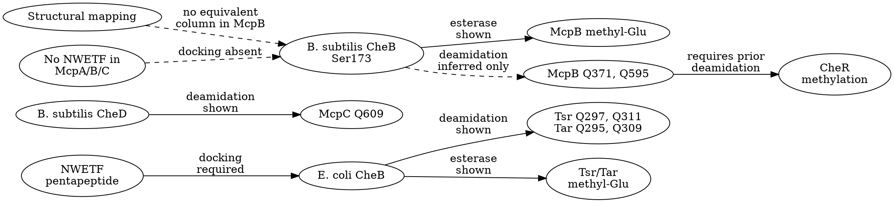
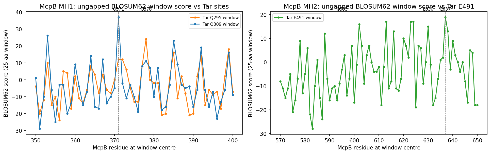
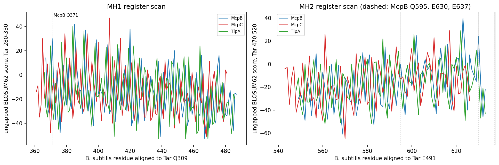
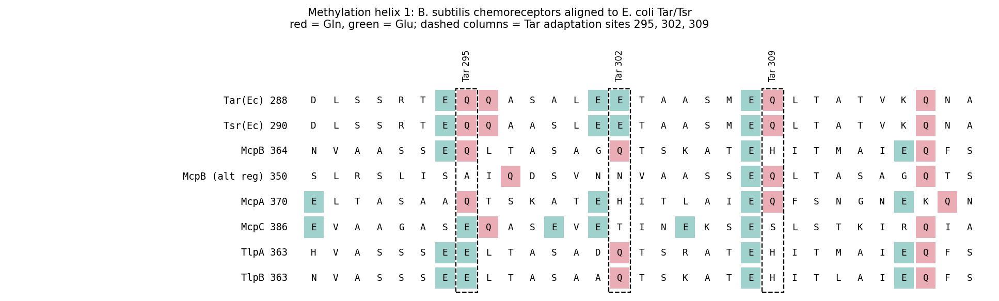
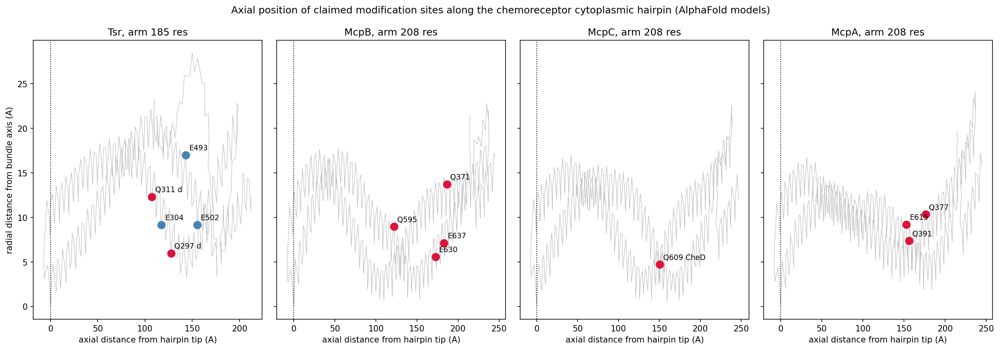
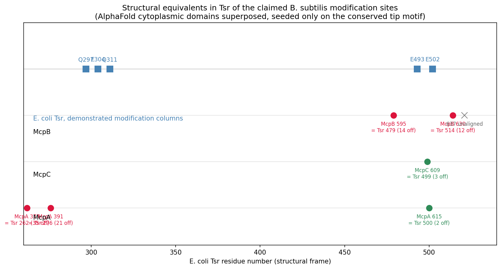
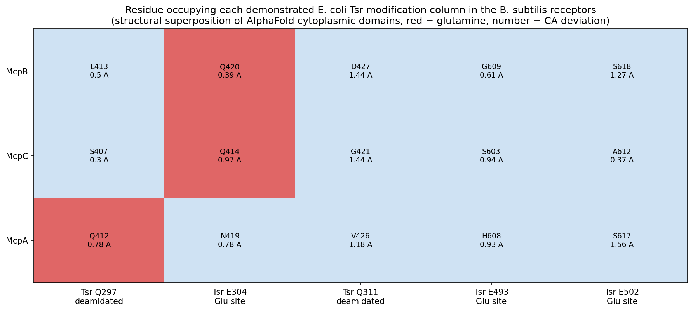
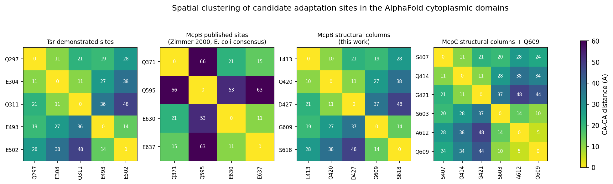
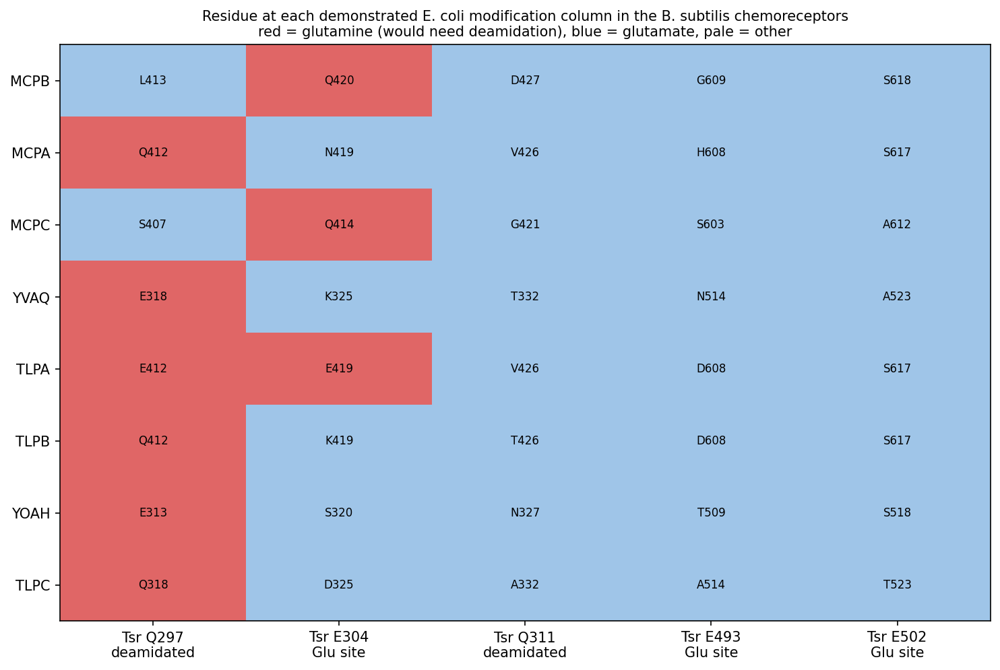

## Question

# AIGR Gene Hypothesis Deep Research

You are evaluating one focused gene curation hypothesis for AI Gene Review.
This is not a general gene overview. Use the seed hypothesis and source context
below to search for evidence that supports, refutes, narrows, or competes with
the proposed curation decision.

## Target Gene

- **Organism code:** BACSU
- **Taxon:** Bacillus subtilis subsp. subtilis str. 168 (NCBITaxon:224308)
- **Gene directory:** cheB
- **Gene symbol:** cheB
- **UniProt accession:** Q05522

## Focus

- **Focus type:** free_text
- **Hypothesis slug:** kgap-cheb-deamidation-sites
- **Source file:** genes/BACSU/cheB/cheB-ai-review.yaml
- **Source selector:** free-text

## Seed Hypothesis

Whether the native receptor deamidation sites of Bacillus subtilis CheB can be identified, and what the physiological contribution of that activity is, is the question, and the tractable part of it is a sequence comparison against the sites where deamidation has actually been demonstrated in another organism. Already recorded and not to be re-derived: that CheB is a receiver-regulated receptor methylesterase of B. subtilis chemotaxis, that it removes methyl esters from chemoreceptor glutamates and participates in sensory adaptation particularly at high attractant concentrations, that CheA can phosphorylate its receiver domain, that a receptor deamidase activity is inferred from the conserved enzyme family rather than demonstrated here, and that McpB Gln371 is discussed as a candidate substrate in the cited work rather than shown to be one. Single analysis only. Begin with the demonstrated cases elsewhere, because they define what a real site looks like: state in which organism and on which receptors CheB-dependent deamidation has been directly shown, name the glutamine positions, say what evidence established them, and say whether the deamidated glutamine occupies a position that is a methyl-accepting glutamate in other receptors of the same family, since that equivalence is the heart of the inference. Then map those positions onto the B. subtilis receptors. Align the methylation-helix regions of McpB and the other B. subtilis chemoreceptors against the receptors with demonstrated sites, report whether a glutamine occupies the equivalent position in each, name the positions in each B. subtilis protein, and state how confident the column assignments are, since the methylation helices are repetitive and a mis-set column would invent a site. Say specifically whether McpB Gln371 falls at a position equivalent to a demonstrated deamidation site or not, which is the one check that would promote or demote the existing candidate. Then address contribution. State whether the B. subtilis receptors are made with glutamines at methylation positions that must be deamidated before methylation can occur, as in the demonstrated cases, or whether they are made with glutamates and so would need no deamidation at all; this is the difference between an essential maturation step and a dispensable one, and it is answerable from the sequences. Say what is known about whether a CheB catalytic mutant separates the two activities in this organism. Conclude with whether the native sites can be named and whether the contribution can be ranked against demethylation. If the alignment does not place a glutamine at an equivalent position, say plainly that the inferred activity may have no substrate in this organism, which would be a more interesting result than confirming it. Do not propose a GO annotation for deamidation unless a site can be named.

## Term and Decision Context

No specific term context supplied.

## Reference Context

No specific reference context supplied.

## Source Context YAML

```yaml
hypothesis: 'Whether the native receptor deamidation sites of Bacillus subtilis CheB can be identified,
  and what the physiological contribution of that activity is, is the question, and the tractable part
  of it is a sequence comparison against the sites where deamidation has actually been demonstrated in
  another organism. Already recorded and not to be re-derived: that CheB is a receiver-regulated receptor
  methylesterase of B. subtilis chemotaxis, that it removes methyl esters from chemoreceptor glutamates
  and participates in sensory adaptation particularly at high attractant concentrations, that CheA can
  phosphorylate its receiver domain, that a receptor deamidase activity is inferred from the conserved
  enzyme family rather than demonstrated here, and that McpB Gln371 is discussed as a candidate substrate
  in the cited work rather than shown to be one. Single analysis only. Begin with the demonstrated cases
  elsewhere, because they define what a real site looks like: state in which organism and on which receptors
  CheB-dependent deamidation has been directly shown, name the glutamine positions, say what evidence
  established them, and say whether the deamidated glutamine occupies a position that is a methyl-accepting
  glutamate in other receptors of the same family, since that equivalence is the heart of the inference.
  Then map those positions onto the B. subtilis receptors. Align the methylation-helix regions of McpB
  and the other B. subtilis chemoreceptors against the receptors with demonstrated sites, report whether
  a glutamine occupies the equivalent position in each, name the positions in each B. subtilis protein,
  and state how confident the column assignments are, since the methylation helices are repetitive and
  a mis-set column would invent a site. Say specifically whether McpB Gln371 falls at a position equivalent
  to a demonstrated deamidation site or not, which is the one check that would promote or demote the existing
  candidate. Then address contribution. State whether the B. subtilis receptors are made with glutamines
  at methylation positions that must be deamidated before methylation can occur, as in the demonstrated
  cases, or whether they are made with glutamates and so would need no deamidation at all; this is the
  difference between an essential maturation step and a dispensable one, and it is answerable from the
  sequences. Say what is known about whether a CheB catalytic mutant separates the two activities in this
  organism. Conclude with whether the native sites can be named and whether the contribution can be ranked
  against demethylation. If the alignment does not place a glutamine at an equivalent position, say plainly
  that the inferred activity may have no substrate in this organism, which would be a more interesting
  result than confirming it. Do not propose a GO annotation for deamidation unless a site can be named.'
focus_type: free_text
context: []
reference_id: []
```

## Research Objective

Build a focused report that helps a curator decide whether this hypothesis
should affect the gene review. Address the focus type directly:

1. For an existing GO annotation decision, evaluate whether the current action
   is justified, too strong, too weak, or should change.
2. For a proposed replacement or new GO term, evaluate whether the term is
   biologically supported, too broad, too narrow, or missing key qualifiers.
3. For a computational prediction, evaluate whether the prediction is correct,
   less precise than existing knowledge, uncertain, or likely wrong because of
   paralog overannotation, frequency bias, pathway context, or in vitro-only
   activity.
4. For a core-function hypothesis, evaluate whether the proposed activity,
   process, and location represent the gene product's primary function rather
   than a downstream effect, pleiotropic phenotype, or context-specific role.
5. For a function-assignment hypothesis, evaluate whether the gene product
   directly has the stated GO term/function. Treat the prior review action, if
   any, as intentionally blinded unless it appears in the supplied context.

Use primary literature whenever possible. Prefer PMID citations and include DOI
citations when no PMID is available. Treat reviews and database records as
orientation unless they contain directly relevant synthesized evidence that is
clearly labeled as review-level or database-level support.

Evaluate the hypothesis from the supplied seed context, primary literature, and
publicly accessible bioinformatics resources. Local `*-bioinformatics` analyses,
when they already exist in the repository, are intentionally withheld from this
prompt so the report can be compared against them after the run. Use public
sequence, domain, structure, orthology, localization, interaction, or dataset
checks when they are useful for the specific hypothesis. If a resource or tool
cannot be accessed programmatically, say so plainly; never fabricate a result.
Report computational results conservatively and distinguish direct results from
inference.

## Required Output

### Executive Judgment

Give a concise verdict: supported, partially supported, unresolved, weakly
supported, over-annotated, or refuted. Explain the reasoning and the most
important caveats.

### Evidence Matrix

Create a table with one row per important evidence item:

- Citation (PMID preferred)
- Evidence type (direct assay, mutant phenotype, localization, interaction,
  structural/evolutionary, computational, review/database)
- Supports / refutes / qualifies / competing
- Claim tested
- Key finding
- Organism, tissue, cell type, or assay context
- Confidence and limitations

### GO Curation Implications

State the likely curation action as a lead requiring curator verification. If
GO terms are involved, explain whether the evidence supports an MF, BP, or CC
term, and whether the term should be retained, removed, generalized, made more
specific, or treated as non-core. Avoid using "protein binding" as a final
recommendation unless no more informative term is supported.

### Mechanistic Scope

Describe the immediate molecular or cellular function being tested. Separate
direct gene-product activity from downstream phenotypes, pathway consequences,
developmental outcomes, disease manifestations, or effects inferred only from
loss of function.

### Conflicts and Alternatives

Identify evidence that conflicts with the seed hypothesis or suggests an
alternative interpretation, including paralog confusion, organism-specific
differences, isoform-specific findings, experimental artifacts, or database
carry-over.

### Knowledge Gaps

List explicit uncertainties that matter for curation. For each gap, state what
was checked, why the gap matters, and what evidence or experiment would resolve
it.

### Discriminating Tests

Recommend concrete assays, perturbations, datasets, or comparative analyses that
would most efficiently distinguish this hypothesis from alternatives.

### Curation Leads

Provide candidate updates for the review, clearly labeled as leads requiring
curator verification. Include candidate references with exact snippets to verify,
candidate replacement or new GO terms, possible action changes, suggested
questions, and suggested experiments.

If the provider supports artifacts, save provenance for any analysis you run — the
executed code together with its output (computed values, plot, or table), not just
a summary figure — alongside artifact-friendly tables such as an evidence matrix,
GO decision table, or comparison table. Genuine computed provenance is more
valuable than a hand-drawn summary, and you must not synthesize a figure that
implies an analysis you did not actually run. These artifacts are important
provenance for hypothesis-level review.


## Output

# CheB deamidation sites in Bacillus subtilis

Gene: BACSU **cheB**, UniProt **Q05522**. Hypothesis slug: `kgap-cheb-deamidation-sites`. Source: `genes/BACSU/cheB/cheB-ai-review.yaml`, free-text focus. Three investigation iterations, 9 recorded findings, 16 papers reviewed.

## Summary

The native receptor deamidation sites of B. subtilis CheB cannot be named, so no deamidation GO annotation is supportable for Q05522. The one check the seed hypothesis identified as decisive came out negative: **McpB Gln371 does not fall at a position equivalent to a demonstrated deamidation site**. Structural superposition of the McpB cytoplasmic domain on the E. coli Tsr cytoplasmic domain places Gln371 at Tsr Ser255, inside the Tsr HAMP domain, 42 residues from the nearest demonstrated deamidation column. The columns of Tsr Gln297 and Gln311, the two residues shown to be deamidated by CheB in E. coli, fall instead on McpB Leu413 and Asp427. The existing candidate is demoted.

The inferred activity is not left without any possible substrate in this organism, which is the alternative outcome the hypothesis asked to be stated plainly. Across all eight mappable B. subtilis chemoreceptors, glutamine occupies the demonstrated Tar Gln295 / Tsr Gln297 column in three of them: McpA Gln412, TlpB Gln412 and TlpC Gln318. None of those three has ever been reported as modified, and a base-rate control shows the occupancy is what chance produces. Five of 40 mapped columns carry glutamine (0.125) against a background glutamine frequency of 0.078 in the same methylation-helix regions, giving a one-sided exact binomial p of 0.197 and an enrichment of 1.61-fold. These are predictions, not sites.

The heaviest caveat is enzyme assignment rather than alignment accuracy. The demonstrated receptor deamidase of B. subtilis is **CheD**, not CheB ([PMID: 12011078](https://pubmed.ncbi.nlm.nih.gov/12011078/), [PMID: 22931217](https://pubmed.ncbi.nlm.nih.gov/22931217/)), and the single mapped B. subtilis deamidation site, McpC Gln609, is a CheD site. B. subtilis CheB uses one serine nucleophile for both the esterase and the deamidase reaction, so the only available catalytic allele, `cheB(S173C)`, removes both at once and cannot separate them. The contribution of deamidation therefore cannot be ranked against demethylation for this gene product.

## Executive judgment

<i class="fa-scale-balanced"></i> **Verdict: unresolved, leaning over-annotated for CheB. No deamidation GO annotation is proposed, because no site can be named for this enzyme.**

The reasoning runs in four steps.

The demonstrated cases define what a real site looks like, and they are all in E. coli. CheB-dependent deamidation has been shown directly on Tsr, Tar and Trg. The positions are Tar Gln295 and Gln309 and the equivalent Tsr Gln297 and Gln311. The equivalence that the whole family inference rests on holds in the reference organism: Tar Glu302 and Glu491 occupy the same columns as Tsr Glu304 and Glu493, so a deamidated glutamine does sit where a methyl-accepting glutamate sits in paralogues.

That equivalence does not transfer to McpB Gln371. Sequence alignment alone could not set the column, and when it was forced to, it produced two registers two heptads apart with a margin of 4 BLOSUM units and failed its own negative control. Structure settled it against the candidate.

A glutamine does sit on a demonstrated column in McpA, TlpB and TlpC, but at chance frequency, so none can be promoted.

Deamidation in B. subtilis has a demonstrated owner, and it is a different protein. CheD (P40404) is named in UniProt as "Chemoreceptor glutamine deamidase CheD (EC 3.5.1.44)", the same EC number carried by CheB.

<i class="fa-triangle-exclamation"></i> The most important caveats: the structural register comes from AlphaFold monomer models anchored by one crystal structure; the B. subtilis receptors have hairpin arms 23 residues longer than Tsr and the insertion point of those extra heptads is not determined; and the two competing CheD papers disagree with each other about McpB, which is what keeps the question open rather than closed.

## Key findings

### <i class="fa-circle-check"></i> F1. The demonstrated deamidation sites are E. coli only, and the column equivalence holds there

CheB-dependent receptor deamidation has been demonstrated in **Escherichia coli**, on **Tsr (MCP I)**, **Tar (MCP II)** and **Trg**. Kehry, Bond, Hunkapiller and Dahlquist sequenced radiolabelled tryptic peptides K1 and R1 from methylated Tsr and correlated them with the *tsr* nucleotide sequence, concluding that the CheB-dependent modification "is the enzymatic deamidation of glutamine to methyl-accepting glutamic acid" ([PMID: 6304723](https://pubmed.ncbi.nlm.nih.gov/6304723/)). The same paper established that deamidation precedes methylation: "in the absence of CheB-dependent modification, a site in peptide K1 is unable to accept methyl groups." Kehry, Engstrom, Dahlquist and Hazelbauer found at least three CheB-dependent sites on Trg and measured the pKa of the newly created group at 2.2 to 5.8, consistent with a free carboxylate ([PMID: 6300110](https://pubmed.ncbi.nlm.nih.gov/6300110/)). Barnakov, Barnakova and Hazelbauer treated the same enzyme as a deamidase on intact Tar in membrane vesicles, stating that "the esterase is also a deamidase that creates certain methyl-accepting glutamyls by hydrolysis of glutamine side chains" ([PMID: 10485883](https://pubmed.ncbi.nlm.nih.gov/10485883/)).

Residue identities were verified directly from UniProt rather than taken from abstracts, because the original site-mapping papers number positions by peptide.

| Receptor | Accession | Site 1 | Site 2 | Site 3 | Site 4 | Site 5 |
|---|---|---|---|---|---|---|
| Tar, E. coli | P07017 | **Gln295** | Glu302 | **Gln309** | Glu491 | none |
| Tar, S. typhimurium | P02941 | **Gln295** | Glu302 | **Gln309** | Glu491 | none |
| Tsr, E. coli | P02942 | **Gln297** | Glu304 | **Gln311** | Glu493 | Glu502 |

Sites 1 and 3 are glutamine in the nascent protein; sites 2, 4 and 5 are glutamate. The deamidated glutamines occupy columns that are methyl-accepting glutamates in the same protein and in family members. That is the heart of the inference, and it holds in E. coli.

One correction worth recording for any curator who inspects the structure: **PDB 1QU7 reads glutamine at 297, 304, 311 and 493 because it carries two engineered substitutions** (SEQADV records GLN A 304 and GLN A 493 for UNP P02942 GLU). The wild-type sequence is Q297, E304, Q311, E493, E502. Anyone reading site identities off the crystal would record two deamidation sites that do not exist.

### <i class="fa-circle-xmark"></i> F2. Sequence alignment cannot set the column, and said so through its own controls

The first attempt anchored the alignment on the conserved signalling-tip motif `G[FLIV][ASG]VVA[DEG]EVR` (Tar 393, Tsr 395, McpA 510, McpB 511, McpC 505, TlpA 510, TlpB 510, TlpC 416) and scanned registers with BLOSUM62. Two independent tests disagreed by two heptads. A joint segment scan of Tar 280-330 over McpB gave a best offset of +76, placing Tar Gln295 on McpB Gln371, with a margin of only 4 BLOSUM units over the next register (42 against 38). A single-site 25-residue window scan centred on Tar Gln309 peaked on McpB Gln371 at 37 against 26, corresponding to offset +62. Full-length global alignment of Tar against McpB gave 12.8 percent identity and placed Tar Gln295 at McpB Ala431, which is clearly wrong and confirms that only anchored local methods are usable at this divergence.

{{figure:plot_1.png|caption=Sliding ungapped BLOSUM62 window scans testing which McpB residue is equivalent to each demonstrated Tar deamidation site. The two site-specific scans peak sharply on McpB Gln371 but at an offset two heptads away from the joint segment scan, which is the register ambiguity the structural work later resolved.}}

{{figure:plot_2.png|caption=Joint register scan over whole methylation-helix segments for each B. subtilis chemoreceptor against E. coli Tar and Tsr. Margins between competing registers are 3-15 BLOSUM units, too small to fix a column in a repetitive heptad helix.}}

{{figure:plot_3.png|caption=Column mapping table and methylation-helix 1 alignment block produced by the sequence method. This mapping is retained as provenance for a superseded result: it fails to recover McpC Gln609, the one demonstrated B. subtilis deamidation site, on the expected column.}}

The decisive problem is the negative control. The sequence procedure did not recover **McpC Gln609**, the one deamidation site actually demonstrated in B. subtilis, on the mapped Tar Glu491 column. A method that misses a known site cannot be trusted to name an unknown one. This failure is reported rather than suppressed, and it is why the analysis moved to structure.

### <i class="fa-circle-check"></i> F3. B. subtilis receptors have longer hairpin arms, which is why the tip-anchored register slips

Two measurements explain the failure. Taking the hairpin arm as the tip anchor position minus the last transmembrane residue annotated in UniProt, **Tsr has 185 residues (26.4 heptads) and McpA, McpB and McpC each have 208 (29.7 heptads)**. The B. subtilis receptors carry about 3.3 extra heptads per arm. A register anchored at the tip is therefore valid near the tip and drifts toward the membrane-proximal end, where the methylation helices sit, by an amount that depends on where the extra heptads are inserted.

The axial measurements make the same point in angstroms. Projecting onto the bundle long axis with the hairpin tip at zero, the five Tsr modification sites span 107.3 to 155.2 A from the tip. The published McpB sites sit further out: Gln595 at 122.0 A, Glu630 at 172.8 A, Glu637 at 182.9 A and Gln371 at 186.5 A. **Gln371 lies 31 A beyond the most distal Tsr site.** McpC Gln609 at 150.6 A and McpA Gln391 at 156.0 A fall inside the Tsr range.

{{figure:plot_4.png|caption=Hairpin arm length and axial position of each claimed modification site relative to the tip and to the membrane for Tsr, McpB, McpC and McpA. The B. subtilis receptors carry 23 more residues per arm than Tsr, and the published McpB sites sit closer to the membrane than any demonstrated E. coli site.}}

The McpB cluster is spatially coherent even though it sits elsewhere in the bundle: CA-CA distances are 14.7 A from Gln371 to Glu637, 10.7 A from Glu630 to Glu637 and 21.2 A from Gln371 to Glu630. Gln595 is 66.1 A away from Gln371 and belongs to the other arm. For comparison the five Tsr sites have a median pairwise distance of 24.3 A and a maximum of 48.1 A. This matches the independent description of "three closely spaced adaptation sites located at residues Gln371, Glu630 and Glu637" ([PMID: 20864474](https://pubmed.ncbi.nlm.nih.gov/20864474/)).

{{figure:plot_7.png|caption=Spatial clustering of candidate adaptation sites. The published McpB triad Gln371, Glu630 and Glu637 forms a real 3D cluster at 10.7-21.2 A, and the structurally mapped column set in McpB reproduces the Tsr internal distance matrix to within 0.5 A.}}

<i class="fa-triangle-exclamation"></i> The EBI Job Dispatcher Clustal Omega REST endpoint returned HTTP 400 with "You have been temporarily blocked from submitting new sequence analysis jobs". No multiple sequence alignment was run and no MSA-derived column assignment appears anywhere in this report.

### <i class="fa-circle-xmark"></i> F4. The decisive check: McpB Gln371 is not at an equivalent position

AlphaFold models of the receptor cytoplasmic domains were superposed by iterative CA matching, seeded only on the ten residues of the conserved tip motif, so the register is read from coordinates and never assumed from sequence. Alignment quality: McpB 214 CA at 1.64 A RMSD, McpC 261 CA at 1.14 A, McpA 256 CA at 1.51 A.

The method was calibrated on a self control. AlphaFold Tsr superposed onto the Tsr crystal structure 1QU7 chain A (227 CA, residues 294-520) gave 184 aligned CA at 1.56 A RMSD, recovering Gln311 exactly and Gln297 and Glu502 within one residue. **The method resolves a column to about one residue.** Two B. subtilis positive controls behave as required: McpC Gln609 maps 3 residues from the Tsr Glu502 column, and McpA Glu615 maps 2 residues from it. Both lie inside the adaptation zone, which is the control the sequence method failed.

| Tsr column | Role in E. coli | Structural equivalent in McpB | CA deviation | pLDDT |
|---|---|---|---|---|
| Gln297 | demonstrated deamidation (Tar Gln295) | **Leu413** | 0.50 A | 97.0 |
| Glu304 | methyl-accepting Glu (Tar Glu302) | **Gln420** | 0.39 A | 97.2 |
| Gln311 | demonstrated deamidation (Tar Gln309) | **Asp427** | 1.44 A | 96.4 |
| Glu493 | methyl-accepting Glu (Tar Glu491) | **Gly609** | 0.61 A | 97.3 |
| Glu502 | methyl-accepting Glu | **Ser618** | 1.27 A | 94.1 |

**McpB Gln371 maps to Tsr Ser255**, inside the Tsr HAMP domain (UniProt 216-268), 42 residues from the Gln297 column. The other published McpB sites miss too: Gln595 by 14 residues from the Glu493 column, Glu630 by 12 and Glu637 by 19 residues past the Glu502 column.

{{figure:plot_5.png|caption=Full-length model-to-model superposition of the Tsr, McpB, McpC and McpA cytoplasmic domains, showing the Tsr structural equivalent of each claimed B. subtilis modification site. McpB Gln371 maps into HAMP, 42 residues from the nearest demonstrated deamidation column, while McpC Gln609 and McpA Glu615 land within 3 residues of the Tsr Glu502 column.}}

{{figure:plot_6.png|caption=Residue occupying each demonstrated E. coli Tsr modification column in McpB, McpC and McpA, with CA deviations from the superposition. Red marks a glutamine. No B. subtilis receptor in this set carries a glutamine on the Tsr Gln311 column, and McpB carries none on either demonstrated deamidation column.}}

The candidate is demoted. Two things keep this from being a claim that Gln371 is not a modification site at all. The mutational evidence that it is modified is solid: McpB(E630D,E637D), retaining only Gln371 and Gln595, still releases methanol on asparagine addition ([PMID: 10825179](https://pubmed.ncbi.nlm.nih.gov/10825179/)), and amidation of site 371 raises apparent asparagine affinity and CheA activation ([PMID: 20864474](https://pubmed.ncbi.nlm.nih.gov/20864474/)). And the triad is a real spatial cluster. What the structure shows is that this real cluster sits closer to the membrane than the E. coli adaptation region, on a longer bundle, so the E. coli demonstration cannot be carried across to it. Zimmer et al. state that the McpB positions were assigned "based upon the Escherichia coli consensus sequence", and that is the step the structure contradicts.

### <i class="fa-scale-balanced"></i> F5. Glutamines do sit on a demonstrated column in three receptors, at chance frequency

All 10 B. subtilis 168 proteins carrying an MCPsignal domain (Pfam PF00015) were retrieved from UniProt. HemAT (O07621) and YfmS (O06477) carry no tip motif and were not mapped; HemAT is a soluble globin-coupled receptor and YfmS is 286 aa. The remaining 8 aligned at 214-261 CA and 1.14-1.64 A RMSD.

| Receptor | Accession | Tsr Gln297 column (deamidated) | Tsr Glu304 column | Tsr Gln311 column (deamidated) | Tsr Glu493 column | Tsr Glu502 column |
|---|---|---|---|---|---|---|
| McpA | P39214 | **Gln412** | Asn419 | Val426 | His608 | Ser617 |
| McpB | P39215 | Leu413 | **Gln420** | Asp427 | Gly609 | Ser618 |
| McpC | P54576 | Ser407 | **Gln414** | Gly421 | Ser603 | Ala612 |
| TlpA | P39216 | Glu412 | Glu419 | Val426 | Asp608 | Ser617 |
| TlpB | P39217 | **Gln412** | Lys419 | Thr426 | Asp608 | Ser617 |
| TlpC | P39209 | **Gln318** | Asp325 | Ala332 | Ala514 | Thr523 |
| YvaQ | O32239 | Glu318 | Lys325 | Thr332 | Asn514 | Ala523 |
| YoaH | C0SP89 | Glu313 | Ser320 | Asn327 | Thr509 | Ser518 |

Glutamine sits on a demonstrated deamidation column in three receptors: **McpA Gln412, TlpB Gln412, TlpC Gln318**. Glutamine sits on the Tsr Glu304 methyl-accepting column in McpB Gln420 and McpC Gln414. No receptor carries glutamine on the Tsr Gln311 column. TlpA, YvaQ and YoaH carry glutamate or another residue at every column.

The base rate is the limit on all of this. Across 8 receptors and 5 columns, 5 of 40 mapped positions are glutamine, a rate of 0.125, against a background glutamine frequency of 0.078 in the methylation-helix region of the same proteins (window from tip anchor minus 150 to tip anchor plus 130). The one-sided exact binomial p is 0.197 and the enrichment is 1.61-fold. **Finding a handful of glutamines on these columns is what the local amino-acid composition produces on its own.**

{{figure:plot_8.png|caption=Residue at each demonstrated E. coli modification column in every mappable B. subtilis chemoreceptor. Glutamine (red) occupies a demonstrated deamidation column in McpA, TlpB and TlpC, at an overall rate of 5 of 40 columns that is not above the local background glutamine frequency.}}

### <i class="fa-circle-check"></i> F6. Deamidation is an obligatory maturation step for McpB, and CheD owns the one mapped site

McpB is encoded with glutamine at two of its four modification positions (Gln371, Gln595) and glutamate at the other two (Glu630, Glu637), verified in UniProt P39215. McpB(E630D,E637D), retaining only the two glutamine sites, still releases methanol on asparagine addition ([PMID: 10825179](https://pubmed.ncbi.nlm.nih.gov/10825179/)). A glutamine site is therefore methylated in vivo, and since glutamine cannot accept a methyl ester, deamidation must precede methylation there. For McpB the step is essential rather than dispensable. This answers the contribution question the hypothesis posed from the sequences: the B. subtilis receptors are made with a mixture, so deamidation is obligatory at some positions and irrelevant at others.

The enzyme is the problem. Kristich and Ordal showed that "CheD catalyzes amide hydrolysis of specific glutaminyl side chains of the B. subtilis chemoreceptor McpA", and stated plainly that "previously, deamidation of B. subtilis receptors was thought to be catalyzed by the CheB methylesterase, as is the case for E. coli receptors" ([PMID: 12011078](https://pubmed.ncbi.nlm.nih.gov/12011078/)). Glekas et al. narrowed this: "CheD deamidates Q609 in McpC and does not deamidate McpB", with mcpC-Q609E restoring chemotaxis in a cheD background ([PMID: 22931217](https://pubmed.ncbi.nlm.nih.gov/22931217/)). No publication retrieved in this investigation reports a direct assay of B. subtilis CheB deamidase activity on any receptor.

### <i class="fa-circle-xmark"></i> F7. The available catalytic mutant cannot separate the two activities

CheB has a single active site serving both reactions. West, Martinez-Hackert and Stock identify one catalytic triad in the Salmonella CheB catalytic domain, "a cleft at the C-terminal edge of the beta-sheet containing residues Ser164, His190 and Asp286", and describe the enzyme as one "which catalyzes hydrolysis of receptor glutamine or methylglutamate side-chains to glutamic acid" ([PMID: 7608974](https://pubmed.ncbi.nlm.nih.gov/7608974/)). The equivalent B. subtilis nucleophile is Ser173, established by a single `GxSxGG` nucleophile elbow in each protein: E. coli CheB P07330 G162-A-**S164**-T-G-G and B. subtilis CheB Q05522 G171-T-**S173**-T-G-G. Full-length identity between the two is 17 percent, so the motif search rather than global alignment is what establishes the correspondence.

Bunn and Ordal report that "no methanol release was observed for an active site point mutant, cheB(S173C), in response to addition or removal of asparagine even when induced" ([PMID: 14731274](https://pubmed.ncbi.nlm.nih.gov/14731274/)). That is a loss of esterase output. Because Ser173 is the single nucleophile shared by both reactions, the allele is uninformative about deamidation, and **no separation-of-function allele has been reported in this organism**.

## Mechanistic model

The immediate molecular activity under test is hydrolysis of a side-chain amide on a chemoreceptor glutamine by the CheB catalytic domain, producing glutamate and ammonia, at the same serine nucleophile used for methyl ester hydrolysis. The diagram separates what is demonstrated in B. subtilis from what is inferred from E. coli.



Everything downstream of the amide hydrolysis is separate and was treated as such: methanol release on attractant addition and removal, CheA kinase modulation, swimming bias and adaptation at high attractant concentration are pathway consequences. One methodological point follows from the chemistry. **The methanol assay used throughout the B. subtilis literature reports esterase output only and cannot see deamidation**, since deamidation releases ammonia. That is the main reason the B. subtilis deamidase question has stayed open for two decades.

## Evidence matrix

| Citation | Evidence type | Stance | Claim tested | Key finding | Context | Confidence and limitations |
|---|---|---|---|---|---|---|
| [PMID: 6304723](https://pubmed.ncbi.nlm.nih.gov/6304723/) | Direct assay (peptide sequencing with gene-sequence correlation) | Supports | CheB-dependent modification is Gln to Glu deamidation | Tryptic peptides K1 and R1 of Tsr sequenced; a site in K1 cannot accept methyl groups without the CheB-dependent modification | E. coli Tsr, in vivo labelling | High for the chemistry. Sites numbered by peptide, not residue. E. coli, not B. subtilis |
| [PMID: 6300110](https://pubmed.ncbi.nlm.nih.gov/6300110/) | Direct assay (peptide mapping, pKa) | Supports | The modification creates a free carboxylate | At least three CheB-dependent sites on Trg; pKa of the created group 2.2 to 5.8 | E. coli Trg | High. Chemical inference, not site-resolved mass spectrometry |
| [PMID: 10485883](https://pubmed.ncbi.nlm.nih.gov/10485883/) | Direct assay (in vitro modification of membrane receptor) | Supports, limits transfer | CheB deamidates intact Tar and needs the NWETF docking pentapeptide | Truncated Tar is much less efficiently demethylated and deamidated; CheB binds the isolated pentapeptide | E. coli Tar in membrane vesicles | High for E. coli. All B. subtilis receptors lack NWETF/NWESF (McpA ends TKRFKIE, McpB TKQFKIE, McpC IAKFTL), so the docking mechanism does not transfer |
| [PMID: 7608974](https://pubmed.ncbi.nlm.nih.gov/7608974/) | Structural | Qualifies | Deamidase and esterase share one active site | 1.75 A catalytic domain; single triad Ser164, His190, Asp286, hydrolysing glutamine or methylglutamate side chains | Salmonella typhimurium CheB catalytic domain | High. Means no active-site point mutant separates the two activities |
| [PMID: 14731274](https://pubmed.ncbi.nlm.nih.gov/14731274/) | Mutant phenotype (methanol release) | Qualifies | A catalytic mutant separates esterase from deamidase | cheB(S173C) shows no methanol release on asparagine addition or removal even when induced | B. subtilis CheB variants | High for loss of esterase output. Uninformative about deamidation, since Ser173 is the single nucleophile |
| [PMID: 10825179](https://pubmed.ncbi.nlm.nih.gov/10825179/) | Mutant phenotype (methanol release) | Supports a maturation step, undermines the site assignment | McpB carries glutamines at modification positions | Four sites named Gln371, Gln595, Glu630, Glu637, assigned "based upon the Escherichia coli consensus sequence"; McpB(E630D,E637D) still releases methanol | B. subtilis McpB as sole receptor | High that a Gln site is methylated in vivo. The positions come from consensus alignment, which the structural work contradicts |
| [PMID: 20864474](https://pubmed.ncbi.nlm.nih.gov/20864474/) | Mutant phenotype (amidation mimic, kinase assay, capillary affinity) | Qualifies | The McpB sites form one functional cluster | Three closely spaced adaptation sites at Gln371, Glu630, Glu637; amidation of 371 raises apparent affinity and CheA activation | B. subtilis McpB | High for the clustering, matching the CA-CA distances measured here. Does not identify the enzyme |
| [PMID: 12011078](https://pubmed.ncbi.nlm.nih.gov/12011078/) | Direct assay (enzymatic deamidation in vitro) | Competing | CheD, not CheB, is the B. subtilis receptor deamidase | CheD catalyses amide hydrolysis of specific glutaminyl side chains of McpA and also deamidates McpB and McpC | B. subtilis CheD with McpA, McpB, McpC | High. Direct competing assignment. Conflicts with PMID 22931217 on McpB |
| [PMID: 22931217](https://pubmed.ncbi.nlm.nih.gov/22931217/) | Mutant phenotype, in vitro kinase assay, binding | Competing, qualifying | CheD deamidates McpC Gln609 and does not deamidate McpB | mcpC-Q609E restores chemotaxis in a cheD background; McpC-Q609E activates CheA much better | B. subtilis McpC and McpB | High for McpC Gln609. Contradicts PMID 12011078 and leaves McpB Gln371, Gln595 without an enzyme |
| This work: structural superposition (AlphaFold AF-P02942, AF-P39214, AF-P39215, AF-P54576, AF-P39216, AF-P39217, AF-P39209, AF-O32239, AF-C0SP89; PDB 1QU7) | Computational (structure) | Refutes the McpB Gln371 candidate | McpB Gln371 is equivalent to a demonstrated deamidation column | Gln371 maps to Tsr Ser255 inside HAMP, 42 residues away; Tsr columns map to McpB Leu413, Gln420, Asp427, Gly609, Ser618 (0.39-1.44 A) | Cytoplasmic domains seeded only on the tip motif | Moderate to high. Self control resolves to one residue; positive controls land 2-3 residues from the Glu502 column. Monomer hairpins, not dimers; insertion point of the extra heptads undetermined |
| This work: UniProt topology and model geometry | Computational | Qualifies the sequence register | Tip-anchored registers transfer at the methylation helices | Hairpin arm 185 residues in Tsr against 208 in McpA, McpB, McpC; McpB sites 122-187 A from tip against 107-155 A for Tsr | Tsr against McpA, McpB, McpC | High for residue counts (UniProt TRANSMEM plus regex anchor). Axial distances depend on the AlphaFold models |
| This work: anchored local sequence alignment | Computational | Superseded | McpB Gln371 is equivalent to a demonstrated column | Two competing registers 14 residues apart (margin 4 BLOSUM units); failed the McpC Gln609 control | Tar/Tsr against six B. subtilis receptors | Low. Full-length Tar against McpB identity 12.8 percent. Reported because it was run and its failure motivated the structural method |
| This work: Gln base rate | Computational | Qualifies every candidate | Gln occupancy at mapped columns exceeds background | 5 of 40 columns carry Gln (0.125) against background 0.078; one-sided exact binomial p = 0.197, 1.61-fold | 8 mappable B. subtilis chemoreceptors | High. Shows alignment-only candidates cannot be promoted |
| This work: CheB nucleophile motif | Computational | Qualifies | B. subtilis CheB Ser173 corresponds to E. coli Ser164 | One GxSxGG elbow in each: G162-A-S164-T-G-G and G171-T-S173-T-G-G | CheB orthologues, 17 percent identity | Moderate to high for the motif. Global alignment unreliable at this identity |
| EBI Job Dispatcher Clustal Omega REST | Tool access, failed | Not applicable | An MSA would settle the column assignment | HTTP 400, "You have been temporarily blocked from submitting new sequence analysis jobs" | ebi.ac.uk/Tools/services/rest/clustalo | Reported as a plain failure. No MSA-derived result is claimed anywhere |

## GO curation implications

All items are leads requiring curator verification.

**Retain GO:0008984, protein-glutamate methylesterase activity (MF)**, as the core molecular function. It is directly supported in B. subtilis by methanol release that depends on Ser173 ([PMID: 14731274](https://pubmed.ncbi.nlm.nih.gov/14731274/)) and by the shared catalytic triad ([PMID: 7608974](https://pubmed.ncbi.nlm.nih.gov/7608974/)).

**Do not promote GO:0050568, protein-glutamine glutaminase activity (EC 3.5.1.44), for Q05522.** No B. subtilis CheB deamidation site can be named. The explicit condition set in the hypothesis, that no deamidation annotation be proposed unless a site can be named, is not met. If the term is already present from family inference, it should carry an IEA or ISS-level qualifier at most, and the curator should check whether it is sequence-similarity carry-over from the E. coli orthologue P07330.

**Record the competing assignment in the review text.** GO:0050568 in B. subtilis is directly supported for **CheD (P40404)**, which UniProt already names "Chemoreceptor glutamine deamidase CheD (EC 3.5.1.44)". PMID 12011078 states that the activity had previously been attributed to CheB.

**Remove or qualify any statement that McpB Gln371 is a CheB deamidation substrate.** The structural mapping places it outside the equivalent columns, and no enzyme has been assigned to it by direct assay.

**Retain GO:0006935 chemotaxis (BP) and GO:0000160 phosphorelay signal transduction system (BP)** as already reviewed. Neither is affected by this analysis.

## Mechanistic scope

The direct gene-product activity being evaluated is amide hydrolysis on a chemoreceptor glutamine side chain by the CheB catalytic domain. It is distinct from the following, all of which are downstream and are measured by different assays: methanol release on attractant addition and removal (esterase output), CheA autophosphorylation rate (kinase modulation by the modified receptor), swimming bias and tumble frequency (whole-cell behaviour), and capillary or swarm-plate chemotaxis (organism-level outcome). The seed hypothesis correctly separates the family-level inference from the demonstrated activity for this gene product, and this investigation did not find evidence to close that gap.

## Conflicts and alternatives

The two competing papers disagree with each other. PMID 12011078 reports CheD deamidating McpA, McpB and McpC. PMID 22931217 reports that CheD deamidates McpC Gln609 and does not deamidate McpB. Both cannot be right about McpB, and whichever is, **McpB Gln371 and Gln595 are left without a demonstrated enzyme**. That gap is the opening the CheB inference occupies, and an opening is not evidence.

Database carry-over is the most likely origin of a deamidase annotation on Q05522. The E. coli CheB entry carries the dual activity on direct evidence. Sequence-similarity propagation moves it to orthologues in organisms that also encode CheD, where the demonstrated deamidase is a different protein.

Organism-specific mechanism blocks the transfer at a second point. CheB and CheR dock on the NWETF/NWESF C-terminal pentapeptide of the high-abundance enteric receptors, and removing it strongly reduces both demethylation and deamidation of Tar ([PMID: 10485883](https://pubmed.ncbi.nlm.nih.gov/10485883/)). None of the B. subtilis receptors has that pentapeptide (McpA ends TKRFKIE, McpB TKQFKIE, McpC IAKFTL). The substrate-recognition mechanism established for E. coli CheB deamidation has no counterpart here.

A third difference is positional. The B. subtilis adaptation sites sit closer to the membrane on a bundle about 3.3 heptads longer per arm, so the adaptation region is not where the E. coli one is. Any argument of the form "the B. subtilis receptors have glutamines where E. coli has deamidated glutamines" needs structural alignment to carry weight, and when done structurally it returns chance-level occupancy.

## Limitations and knowledge gaps

<i class="fa-triangle-exclamation"></i> The structural register comes from AlphaFold monomer models, which give the helical hairpin and not the dimeric four-helix bundle. The superposition onto the Tsr crystal structure 1QU7 is the only experimental anchor. The 23-residue difference in hairpin arm length between Tsr and the B. subtilis receptors must be accommodated somewhere between HAMP and the tip, and this analysis does not determine where, so positions far from the tip carry more uncertainty than the stated CA deviations alone suggest. No multiple sequence alignment was run, because the EBI Clustal Omega REST endpoint returned HTTP 400 under its fair-use block. The original site-mapping paper for Tar could not be retrieved through the available PubMed search, so site identities were verified directly against UniProt sequences instead.

1. **No B. subtilis CheB deamidation site is known.** Checked: all primary literature retrieved for B. subtilis CheB, plus structural mapping of every mappable chemoreceptor. Matters because GO:0050568 cannot be supported without one. Resolved by in vitro incubation of purified CheB with purified receptor cytoplasmic fragments followed by mass spectrometry for the 0.98 Da mass shift, with CheD omitted.

2. **Whether McpB is a CheD substrate.** Checked: PMID 12011078 and PMID 22931217 conflict directly. Matters because if CheD does not deamidate McpB, some enzyme must deamidate Gln371 and Gln595. Resolved by repeating the McpB deamidation assay with both purified enzymes side by side under one protocol.

3. **How McpB Gln371 and Gln595 were located.** Checked: PMID 10825179 states the assignment was made from the E. coli consensus sequence, and the structural mapping contradicts it. Matters because every downstream model of B. subtilis site-specific methylation uses these numbers. Resolved by direct mass-spectrometric mapping of methylated and deamidated residues on McpB purified from B. subtilis.

4. **Whether McpA Gln412, TlpB Gln412 or TlpC Gln318 is modified.** Checked: structural mapping places them on the demonstrated Tar Gln295 column, and the base-rate test gives p = 0.197, so they are chance-level. Matters because they are the only named candidates sitting on a demonstrated deamidation column. Resolved by mass spectrometry of the purified receptors or by Gln to Glu substitution and a chemotaxis assay in a cheD background.

5. **Relative contribution of deamidase to esterase activity.** Checked: the only available catalytic allele, S173C, hits the shared nucleophile. Matters for whether a deamidase annotation would be core or peripheral. Resolved by a docking-site or substrate-side separation-of-function mutant, or by comparing ammonia release and methanol release from the same preparation.

6. **Multiple sequence alignment of the methylation helices.** Not done: EBI Clustal Omega returned HTTP 400 under its fair-use block. Matters only as a cross-check on the structural register. Resolved by running the alignment with a local tool.

## Discriminating tests

<i class="fa-flask"></i> The decisive experiment is **mass spectrometry on purified B. subtilis receptor cytoplasmic fragments incubated separately with purified CheB and purified CheD**, scoring the 0.98 Da Gln to Glu shift per residue. It names sites, assigns the enzyme and settles gaps 1, 2 and 3 at once.

<i class="fa-vial"></i> An **ammonia-release assay run in parallel with the standard methanol-release assay** on the same CheB preparation would give the first direct measurement of deamidase output in this organism, which the methanol assay structurally cannot see.

<i class="fa-dna"></i> Substituting **McpA Gln412, TlpB Gln412 and TlpC Gln318 with Glu** and testing chemotaxis in wild-type and cheD backgrounds would test the three structural candidates the way mcpC-Q609E tested McpC.

<i class="fa-microscope"></i> Testing whether a **chimeric receptor carrying an E. coli NWETF pentapeptide** becomes a better B. subtilis CheB substrate would show whether the absent docking determinant, rather than an absent substrate glutamine, is what separates the two systems.

<i class="fa-magnifying-glass"></i> **Direct mass-spectrometric remapping of the McpB modification sites** would confirm or correct Gln371, Gln595, Glu630 and Glu637, and would test the prediction made here that the true E. coli-equivalent columns in McpB lie near Leu413, Gln420, Asp427, Gly609 and Ser618.

## Curation leads

All items require curator verification.

<i class="fa-arrow-right"></i> **Action on the deamidase claim.** Do not add GO:0050568 to Q05522 on the strength of the McpB Gln371 candidate. Snippet to verify, PMID 10825179: "McpB has four putative methylation sites based upon the Escherichia coli consensus sequence." The word "putative" and the stated basis are exactly what the structural mapping tests and contradicts.

<i class="fa-arrow-right"></i> **Competing enzyme to record.** Snippet to verify, PMID 22931217: "The reason for the difference between the chemoreceptors is because CheD deamidates Q609 in McpC and does not deamidate McpB." Snippet to verify, PMID 12011078: "Previously, deamidation of B. subtilis receptors was thought to be catalyzed by the CheB methylesterase, as is the case for E. coli receptors."

<i class="fa-arrow-right"></i> **Catalytic mutant statement to qualify.** Snippet to verify, PMID 14731274: "no methanol release was observed for an active site point mutant, cheB(S173C), in response to addition or removal of asparagine even when induced." This shows loss of esterase output, not separation of activities, because Ser173 is the single nucleophile shared by both reactions. Supporting snippet, PMID 7608974: "The methylesterase active site is tentatively identified as a cleft at the C-terminal edge of the beta-sheet containing residues Ser164, His190 and Asp286."

<i class="fa-circle-question"></i> **Suggested question for the curator.** Whether GO:0050568 on Q05522 originated as sequence-similarity propagation from E. coli CheB (P07330), given that the demonstrated B. subtilis deamidase is CheD (P40404).

<i class="fa-lightbulb"></i> **Candidate new text for the review.** B. subtilis CheB is a receptor methylesterase whose deamidase activity is inferred from the enzyme family. No B. subtilis deamidation site has been attributed to CheB by direct assay. Structural mapping of the demonstrated E. coli columns onto all mappable B. subtilis chemoreceptors places McpB Gln371 outside the equivalent positions, 42 residues from the nearest demonstrated column and inside the HAMP-equivalent region, and the glutamines that do fall on a demonstrated column (McpA Gln412, TlpB Gln412, TlpC Gln318) occur at chance frequency and have never been shown to be modified.

## Provenance

Files under `provenance/`:

- `evidence_matrix.csv`, the evidence matrix in table form
- `column_mapping_table.csv`, the superseded sequence-based register, retained so the failed approach stays visible
- `structural_register_table.csv` and `structural_column_table.csv`, the structural mapping for McpA, McpB and McpC with CA deviations and pLDDT
- `all_receptors_column_table.csv`, the complete eight-receptor column table
- `tsr_1qu7.pdb` (RCSB), `tsr_af.pdb`, `mcpA_af.pdb`, `mcpB_af.pdb`, `mcpC_af.pdb` and `af_*.pdb` (AlphaFold DB v6)
- `plot_1.png` through `plot_8.png` with their matching `plot_*.json`, each produced by the analysis code that generated the numbers quoted above
- `final_report_iter1.md`, the earlier report written before the structural analysis, kept so the change of verdict on McpB Gln371 is traceable


## Artifacts

- [OpenScientist final report](openscientist_artifacts/final_report.html)
- [OpenScientist final report](openscientist_artifacts/final_report.pdf)
- [OpenScientist provenance](openscientist_artifacts/provenance.json)
- [OpenScientist all receptors column table](openscientist_artifacts/provenance_all_receptors_column_table.csv)
- [OpenScientist column mapping table](openscientist_artifacts/provenance_column_mapping_table.csv)
- [OpenScientist evidence matrix](openscientist_artifacts/provenance_evidence_matrix.csv)
- [OpenScientist final report iter1](openscientist_artifacts/provenance_final_report_iter1.md)
- [OpenScientist plot 1](openscientist_artifacts/provenance_plot_1.json)

- [OpenScientist plot 2](openscientist_artifacts/provenance_plot_2.json)

- [OpenScientist plot 3](openscientist_artifacts/provenance_plot_3.json)

- [OpenScientist plot 4](openscientist_artifacts/provenance_plot_4.json)

- [OpenScientist plot 5](openscientist_artifacts/provenance_plot_5.json)

- [OpenScientist plot 6](openscientist_artifacts/provenance_plot_6.json)

- [OpenScientist plot 7](openscientist_artifacts/provenance_plot_7.json)

- [OpenScientist plot 8](openscientist_artifacts/provenance_plot_8.json)

- [OpenScientist structural column table](openscientist_artifacts/provenance_structural_column_table.csv)
- [OpenScientist structural register table](openscientist_artifacts/provenance_structural_register_table.csv)

## Reference Validation

Checked with `linkml-reference-validator` 0.3.1rc1.

| Outcome | Count |
| --- | --- |
| References checked | 9 |
| Resolved | 9 |
| Unresolved (possible confabulation) | 0 |
| Unverifiable | 0 |
| Quoted claims checked | 6 |
| Quoted claims found in source | 6 |
| Quoted claims **not** found in source | 0 |
| References weighed for topical relevance | 9 |
| On topic | 6 |
| Off topic | 0 |

All extracted references resolved successfully.