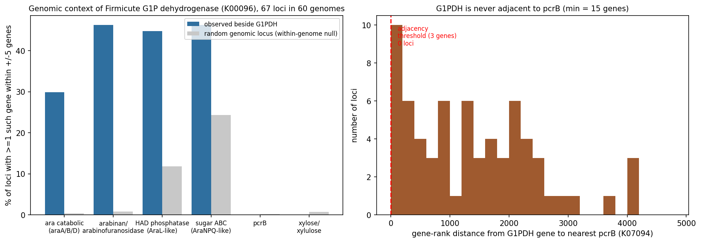
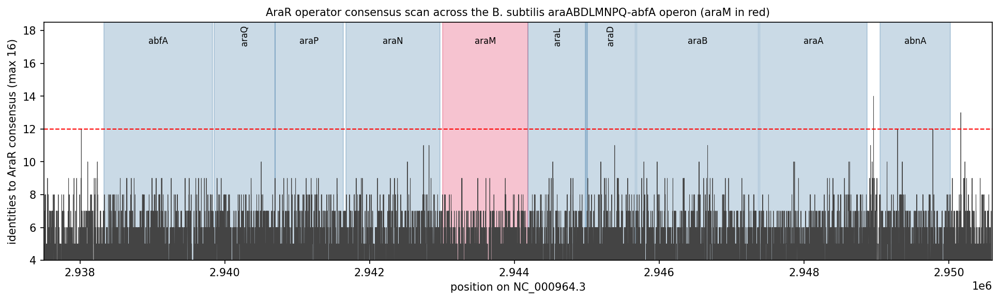
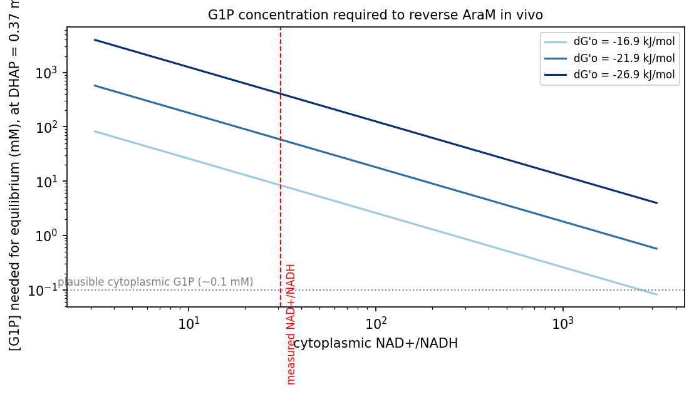
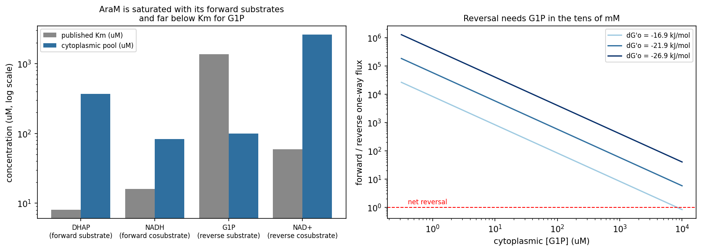
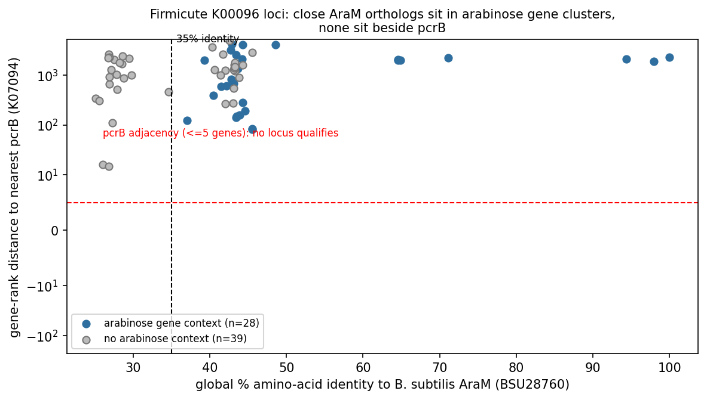
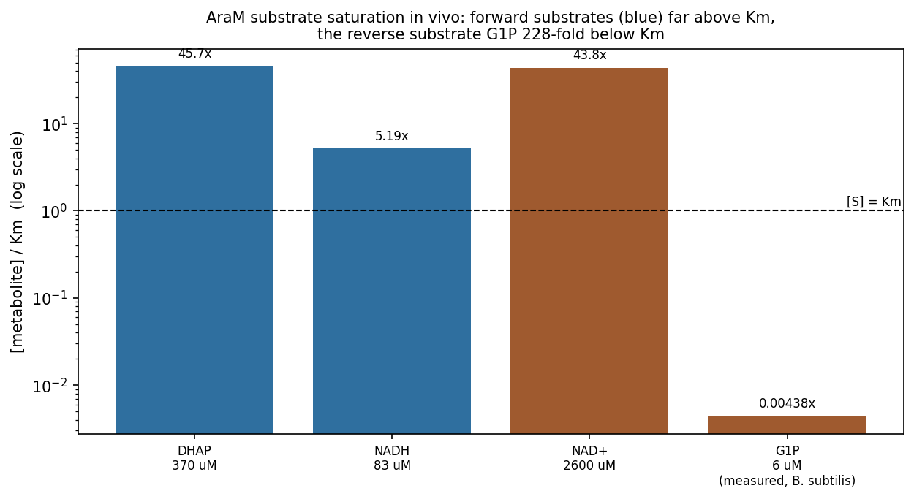
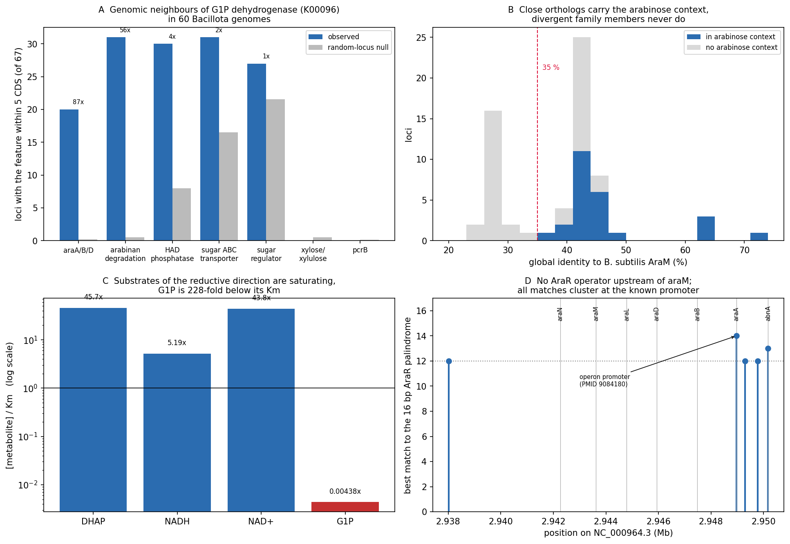
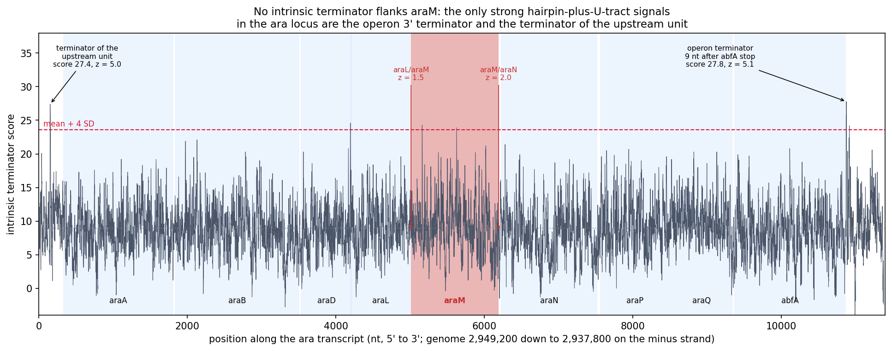

## Question

# AIGR Gene Hypothesis Deep Research

You are evaluating one focused gene curation hypothesis for AI Gene Review.
This is not a general gene overview. Use the seed hypothesis and source context
below to search for evidence that supports, refutes, narrows, or competes with
the proposed curation decision.

## Target Gene

- **Organism code:** BACSU
- **Taxon:** Bacillus subtilis subsp. subtilis str. 168 (NCBITaxon:224308)
- **Gene directory:** egsA
- **Gene symbol:** egsA
- **UniProt accession:** P94527

## Focus

- **Focus type:** free_text
- **Hypothesis slug:** kgap-egsa-ara-operon-coupling
- **Source file:** genes/BACSU/egsA/egsA-ai-review.yaml
- **Source selector:** free-text

## Seed Hypothesis

Whether the position of egsA (araM) as the fifth cistron of the arabinose-inducible araABDLMNPQ-abfA operon of Bacillus subtilis is functional or a relic of genome organisation can be decided, or at least sharply narrowed, by comparative genomics and by asking whether arabinose catabolism actually generates this enzyme's substrate. Already recorded and not to be re-derived: that egsA is the fifth cistron of that operon, that the operon is induced by L-arabinose and repressed by glucose through AraR, that araM is dispensable for L-arabinose utilisation, that the purified enzyme reversibly interconverts glycerone phosphate (dihydroxyacetone phosphate) and sn-glycerol 1-phosphate with a preference for NAD(H) over NADP(H), that it is a soluble nickel-dependent homodimer, and that its product is the glycerophosphate enantiomer used by the PcrB ether-lipid synthase. Single analysis only. First, establish whether the arrangement is conserved: across sequenced Firmicutes that carry both a recognisable G1P dehydrogenase of this family and a pcrB homolog, state for each whether the dehydrogenase gene lies inside an arabinose or other pentose catabolic operon, lies adjacent to or co-transcribed with pcrB, or lies in neither context, and report the counts rather than an impression, naming the genomes examined and how the homologs were identified. A gene that sits in a pentose operon in one species and beside pcrB in another tells a different story from one that is in the ara operon throughout the clade, so say which pattern the data show. Second, check the regulation at sequence level: whether an AraR operator is detectable upstream of araM itself as distinct from the operon promoter, and whether any internal promoter or terminator has been mapped within the operon that would uncouple araM from the arabinose-induced transcript. Third, answer the metabolic question directly: trace L-arabinose catabolism in B. subtilis step by step to the point, if any, at which dihydroxyacetone phosphate is produced or consumed, state the enzymes and whether the flux through them is arabinose-specific or shared with glycolysis, and say whether arabinose growth plausibly changes the cell's DHAP or NADH pool in a direction that would matter for a reversible dehydrogenase. Fourth, state in which direction the enzyme is likely to run in vivo given the reported kinetics and the cytoplasmic DHAP, G1P, NAD+ and NADH concentrations, and whether a G1P-consuming rather than G1P-producing role under arabinose growth is consistent with what is published. If the conserved-arrangement analysis shows the ara-operon placement is restricted to B. subtilis or to a narrow lineage, say plainly that the coupling is probably an accident of genome organisation and that no physiological condition needs to be invoked. Equally, if the published record cannot distinguish a functional coupling from a relic, say that plainly rather than constructing a scenario. Do not propose a GO annotation on the strength of operon membership alone.

## Term and Decision Context

No specific term context supplied.

## Reference Context

No specific reference context supplied.

## Source Context YAML

```yaml
hypothesis: 'Whether the position of egsA (araM) as the fifth cistron of the arabinose-inducible araABDLMNPQ-abfA
  operon of Bacillus subtilis is functional or a relic of genome organisation can be decided, or at least
  sharply narrowed, by comparative genomics and by asking whether arabinose catabolism actually generates
  this enzyme''s substrate. Already recorded and not to be re-derived: that egsA is the fifth cistron
  of that operon, that the operon is induced by L-arabinose and repressed by glucose through AraR, that
  araM is dispensable for L-arabinose utilisation, that the purified enzyme reversibly interconverts glycerone
  phosphate (dihydroxyacetone phosphate) and sn-glycerol 1-phosphate with a preference for NAD(H) over
  NADP(H), that it is a soluble nickel-dependent homodimer, and that its product is the glycerophosphate
  enantiomer used by the PcrB ether-lipid synthase. Single analysis only. First, establish whether the
  arrangement is conserved: across sequenced Firmicutes that carry both a recognisable G1P dehydrogenase
  of this family and a pcrB homolog, state for each whether the dehydrogenase gene lies inside an arabinose
  or other pentose catabolic operon, lies adjacent to or co-transcribed with pcrB, or lies in neither
  context, and report the counts rather than an impression, naming the genomes examined and how the homologs
  were identified. A gene that sits in a pentose operon in one species and beside pcrB in another tells
  a different story from one that is in the ara operon throughout the clade, so say which pattern the
  data show. Second, check the regulation at sequence level: whether an AraR operator is detectable upstream
  of araM itself as distinct from the operon promoter, and whether any internal promoter or terminator
  has been mapped within the operon that would uncouple araM from the arabinose-induced transcript. Third,
  answer the metabolic question directly: trace L-arabinose catabolism in B. subtilis step by step to
  the point, if any, at which dihydroxyacetone phosphate is produced or consumed, state the enzymes and
  whether the flux through them is arabinose-specific or shared with glycolysis, and say whether arabinose
  growth plausibly changes the cell''s DHAP or NADH pool in a direction that would matter for a reversible
  dehydrogenase. Fourth, state in which direction the enzyme is likely to run in vivo given the reported
  kinetics and the cytoplasmic DHAP, G1P, NAD+ and NADH concentrations, and whether a G1P-consuming rather
  than G1P-producing role under arabinose growth is consistent with what is published. If the conserved-arrangement
  analysis shows the ara-operon placement is restricted to B. subtilis or to a narrow lineage, say plainly
  that the coupling is probably an accident of genome organisation and that no physiological condition
  needs to be invoked. Equally, if the published record cannot distinguish a functional coupling from
  a relic, say that plainly rather than constructing a scenario. Do not propose a GO annotation on the
  strength of operon membership alone.'
focus_type: free_text
context: []
reference_id: []
```

## Research Objective

Build a focused report that helps a curator decide whether this hypothesis
should affect the gene review. Address the focus type directly:

1. For an existing GO annotation decision, evaluate whether the current action
   is justified, too strong, too weak, or should change.
2. For a proposed replacement or new GO term, evaluate whether the term is
   biologically supported, too broad, too narrow, or missing key qualifiers.
3. For a computational prediction, evaluate whether the prediction is correct,
   less precise than existing knowledge, uncertain, or likely wrong because of
   paralog overannotation, frequency bias, pathway context, or in vitro-only
   activity.
4. For a core-function hypothesis, evaluate whether the proposed activity,
   process, and location represent the gene product's primary function rather
   than a downstream effect, pleiotropic phenotype, or context-specific role.
5. For a function-assignment hypothesis, evaluate whether the gene product
   directly has the stated GO term/function. Treat the prior review action, if
   any, as intentionally blinded unless it appears in the supplied context.

Use primary literature whenever possible. Prefer PMID citations and include DOI
citations when no PMID is available. Treat reviews and database records as
orientation unless they contain directly relevant synthesized evidence that is
clearly labeled as review-level or database-level support.

Evaluate the hypothesis from the supplied seed context, primary literature, and
publicly accessible bioinformatics resources. Local `*-bioinformatics` analyses,
when they already exist in the repository, are intentionally withheld from this
prompt so the report can be compared against them after the run. Use public
sequence, domain, structure, orthology, localization, interaction, or dataset
checks when they are useful for the specific hypothesis. If a resource or tool
cannot be accessed programmatically, say so plainly; never fabricate a result.
Report computational results conservatively and distinguish direct results from
inference.

## Required Output

### Executive Judgment

Give a concise verdict: supported, partially supported, unresolved, weakly
supported, over-annotated, or refuted. Explain the reasoning and the most
important caveats.

### Evidence Matrix

Create a table with one row per important evidence item:

- Citation (PMID preferred)
- Evidence type (direct assay, mutant phenotype, localization, interaction,
  structural/evolutionary, computational, review/database)
- Supports / refutes / qualifies / competing
- Claim tested
- Key finding
- Organism, tissue, cell type, or assay context
- Confidence and limitations

### GO Curation Implications

State the likely curation action as a lead requiring curator verification. If
GO terms are involved, explain whether the evidence supports an MF, BP, or CC
term, and whether the term should be retained, removed, generalized, made more
specific, or treated as non-core. Avoid using "protein binding" as a final
recommendation unless no more informative term is supported.

### Mechanistic Scope

Describe the immediate molecular or cellular function being tested. Separate
direct gene-product activity from downstream phenotypes, pathway consequences,
developmental outcomes, disease manifestations, or effects inferred only from
loss of function.

### Conflicts and Alternatives

Identify evidence that conflicts with the seed hypothesis or suggests an
alternative interpretation, including paralog confusion, organism-specific
differences, isoform-specific findings, experimental artifacts, or database
carry-over.

### Knowledge Gaps

List explicit uncertainties that matter for curation. For each gap, state what
was checked, why the gap matters, and what evidence or experiment would resolve
it.

### Discriminating Tests

Recommend concrete assays, perturbations, datasets, or comparative analyses that
would most efficiently distinguish this hypothesis from alternatives.

### Curation Leads

Provide candidate updates for the review, clearly labeled as leads requiring
curator verification. Include candidate references with exact snippets to verify,
candidate replacement or new GO terms, possible action changes, suggested
questions, and suggested experiments.

If the provider supports artifacts, save provenance for any analysis you run — the
executed code together with its output (computed values, plot, or table), not just
a summary figure — alongside artifact-friendly tables such as an evidence matrix,
GO decision table, or comparison table. Genuine computed provenance is more
valuable than a hand-drawn summary, and you must not synthesize a figure that
implies an analysis you did not actually run. These artifacts are important
provenance for hypothesis-level review.


## Output

# egsA (araM, BSU28760, P94527): is the ara-operon placement functional or a relic?

Hypothesis slug: `kgap-egsa-ara-operon-coupling`
Source: `genes/BACSU/egsA/egsA-ai-review.yaml`, focus type `free_text`
Organism: *Bacillus subtilis* subsp. *subtilis* str. 168 (NCBITaxon:224308)
UniProt: P94527

## Summary

The arabinose-operon placement of *egsA*/*araM* is conserved well beyond *B. subtilis*, so the branch of the seed hypothesis that would dismiss it as an accident of one genome is refuted. Across a genus-balanced panel of 60 Bacillota genomes carrying 67 glycerol-1-phosphate dehydrogenase (G1PDH, KEGG K00096) loci, 28 loci sit inside an arabinose gene cluster, spanning 19 of 38 genera and reaching from *Bacillus* through *Paenibacillus*, *Exiguobacterium* and *Virgibacillus*. The association is 85-fold above a within-genome random-locus null for *araA*/*araB*/*araD* and 56-fold for arabinan-degrading genes, and it is specific to close AraM orthologs: median identity to AraM is 44.0 % for loci in an arabinose context against 29.8 % for those outside it (Mann-Whitney U = 949, p = 1.5e-7), and none of the 21 divergent family members is in such a context (Fisher exact p = 5.2e-7). The alternative arrangement the hypothesis asked about, a dehydrogenase beside *pcrB*, occurs in zero of 67 loci.

The conservation does not carry a metabolic coupling with it. L-arabinose catabolism in *B. subtilis* terminates at D-xylulose 5-phosphate and reaches dihydroxyacetone phosphate (DHAP) only through the non-oxidative pentose phosphate pathway into FbaA and TpiA, both shared with glucose catabolism and gluconeogenesis. No arabinose-specific enzyme has a DHAP reaction. *araM* is dispensable for growth on L-arabinose. The enzyme's direction in vivo is settled by the measured metabolite pools: *B. subtilis* G1P is about 6 µM, which is 0.0044 × Km(G1P) and 228-fold below saturation, while DHAP sits 46 × Km and NAD⁺ 44 × Km, giving a one-way forward over reverse flux ratio of 1,382 to 66,795 across the ΔG°' uncertainty band. The reductive, G1P-forming direction is the only one with physiological flux, so a G1P-consuming role under arabinose growth is excluded.

At sequence level *araM* has no regulatory input of its own. An AraR operator scan recovered both known operators (14/16 match 86 bp upstream of *araA*, 13/16 upstream of *abnA*) and found nothing at or above 12/16 anywhere near *araL*, *araM* or *araN*. An intrinsic terminator scan recovered the operon 3' terminator 9 nt after the *abfA* stop codon at z = 5.14 and the terminator of the upstream unit at z = 5.03, while the *araL*/*araM* and *araM*/*araN* junctions sit at background (z = 1.54 and 1.95). With *araL* and *araM* overlapping by 4 bp, *araM* expression is a strict function of operon induction. The verdict is **partially supported**: the arrangement is conserved and therefore probably selected, but what is being selected is co-expression timing, and the published record does not say why that timing would be advantageous. That part is stated as unresolved rather than filled in with a scenario.

## Executive judgment

<i class="fa-scale-balanced"></i> **Verdict: partially supported, with the functional metabolic reading refuted.**

The seed hypothesis offered two outcomes and asked which the data show. The data show the third: a conserved arrangement with no shared chemistry.

Three things are now established with computed evidence. The ara-operon placement is not restricted to *B. subtilis* or to a narrow lineage, so the instruction to call it an accident of genome organisation does not apply. The enzyme has no metabolic connection to arabinose, so the functional reading in its obvious form fails. And *araM* cannot be uncoupled from the arabinose-induced transcript by any cis element detectable at sequence level, so its induction by arabinose is a real fact about its expression even though it is not a fact about its catalysis.

The most important caveat is that conservation of gene neighbourhood identifies that something is being selected without identifying what. A plausible reading is that co-expression with arabinan and arabinoxylan foraging is useful for reasons involving membrane composition rather than carbon flux, but no published measurement tests this. The honest position for a curator is that the published record cannot distinguish a functional co-expression coupling from a conserved relic, and that neither reading licenses an arabinose GO term.

Second caveat: the directionality calculation uses *E. coli* glucose-minimal pools for DHAP, NAD⁺ and NADH (PMID 19561621), because no *B. subtilis* measurement exists. The conclusion survives this because G1P is 228-fold below its Km on a *B. subtilis* measurement (PMID 35767906), which alone forces the forward direction, but the quantitative flux ratio depends on the surrogate.

{{figure:plot_7.png|caption=Consolidated summary of the four analytical arms. A, genomic neighbours of K00096 G1P dehydrogenase loci in 60 Bacillota genomes against a within-genome random-locus null: arabinose genes are 85-fold enriched, pcrB and xylose genes are absent. B, identity to B. subtilis AraM split by genomic context, showing that the arabinose association belongs to close orthologs only. C, metabolite concentration divided by Km for each AraM substrate: DHAP, NADH and NAD+ are saturating while G1P is 228-fold below its Km. D, AraR operator scan across the locus, with all matches clustered at the known promoter and nothing near araM.}}

## Key findings

### 1. The arrangement is conserved across the Bacillaceae and beyond

KEGG lists 1,717 Bacillota genomes. Of these, 302 carry a K00096 G1P dehydrogenase, 779 carry K07094 (*pcrB*, heptaprenylglyceryl phosphate synthase) and 195 genomes in 41 genera carry both. From these 195 a genus-balanced panel of 60 genomes was drawn, yielding 67 K00096 loci. For each locus the 5 CDS on either side were classified, and the expectation for each category was built from 1,500 randomly sampled loci per genome, with tail probabilities from a Poisson-binomial simulation of 20,000 draws.

| Neighbour category (within ±5 CDS) | Observed / 67 | Expected | Fold | p (simulation) |
|---|---|---|---|---|
| *araA* / *araB* / *araD*, ≥1 | 20 | 0.23 | 85 | < 5e-5 |
| *araA* / *araB* / *araD*, ≥2 | 17 | 0.14 | 125 | < 5e-5 |
| arabinan / arabinofuranosidase, ≥1 | 31 | 0.55 | 56 | < 5e-5 |
| HAD-family phosphatase (AraL-like), ≥1 | 30 | 7.97 | 3.8 | < 5e-5 |
| Carbohydrate ABC transporter (AraNPQ-like), ≥2 | 30 | 10.43 | 2.9 | < 5e-5 |
| Sugar-responsive regulator, ≥1 | 27 | 21.56 | 1.25 | 0.094 |
| Xylose / xylulose genes, ≥1 | 0 | 0.53 | 0 | 1.0 |
| *pcrB*, ≥1 | 0 | 0.14 | 0 | 1.0 |

Under the combined criterion (at least one *araABD* gene or at least two arabinan-degrading genes), 28 of 67 loci in 28 of 60 genomes and 19 of 38 genera lie in an arabinose gene context. The genera are *Bacillus*, *Shouchella*, *Niallia*, *Terribacillus*, *Radiobacillus*, *Metabacillus*, *Neobacillus*, *Paenibacillus*, *Alkalicoccus*, *Alkalicoccobacillus*, *Caldibacillus*, *Fictibacillus*, *Exiguobacterium*, *Domibacillus*, *Salipaludibacillus*, *Salisediminibacterium*, *Virgibacillus*, *Paenalkalicoccus* and *Sediminibacillus*.

The association is conditional on the pathway being present. Of 13 panel genomes with no K01804 L-arabinose isomerase, 0 had the G1PDH in an arabinose context; of 47 with *araA*, 28 did (Fisher exact p = 7.4e-5). Ara-context loci are also strand-coherent, with a mean of 9.29 of 10 flanking CDS on the same strand as the G1PDH gene against 6.51 for non-ara-context loci, which is what co-transcription looks like.

<i class="fa-circle-xmark"></i> The "relic restricted to *B. subtilis* or a narrow lineage" branch of the seed hypothesis is refuted by these counts.

{{figure:plot_1.png|caption=Arabinose-gene context of Firmicute G1P dehydrogenase loci and their distance to pcrB. Observed neighbour counts are plotted against a within-genome random-locus null; arabinose catabolic and arabinan-degrading genes are 85-fold and 56-fold enriched, while pcrB never appears in the window and the gene-rank distance distribution to the nearest pcrB has a median of 1,276 CDS.}}

### 2. The arabinose context belongs to close AraM orthologs, not to the whole K00096 family

A synteny result is only as good as the homolog set behind it, so all 67 K00096 protein sequences were retrieved from KEGG and globally aligned to *B. subtilis* AraM (BSU28760, 394 aa) by Needleman-Wunsch (match +1, mismatch −1, gap −2).

Identity to AraM is bimodal and tracks genomic context. Loci in an arabinose context have median 44.0 % identity with a minimum of 37.0 %; loci without have median 29.8 % (Mann-Whitney U = 949, p = 1.5e-7, common-language effect size 0.87). Splitting at 35 % gives 46 close orthologs and 21 divergent family members. Of the 46 close orthologs, 28 (61 %) sit in an arabinose cluster; of the 21 divergent members, 0 do (Fisher exact, odds ratio infinite, p = 5.2e-7).

The 18 close orthologs outside an arabinose cluster are in *Geobacillus*, *Parageobacillus*, *Cohnella* (×2), *Paenibacillus* (×4), *Lederbergia*, *Halalkalibacterium*, *Kroppenstedtia*, *Saccharibacillus*, *Thermobacillus*, *Metabacillus*, *Cytobacillus* and *Alkalihalobacillus*. Their neighbourhoods repeatedly contain a HAD-family phosphatase and a carbohydrate ABC transporter, the AraL and AraNPQ counterparts, without *araABD*. This suggests the conserved unit is a sugar-uptake plus phosphatase cassette, to which the *araABD* catabolic genes are appended in some lineages.

{{figure:plot_5.png|caption=Arabinose-cluster placement is specific to close AraM orthologs within the K00096 family. Each locus is plotted by its global identity to B. subtilis AraM against its gene-rank distance to the nearest pcrB. Loci in an arabinose context occupy the high-identity band exclusively, and no locus at any identity lies near pcrB.}}

### 3. No G1P dehydrogenase gene is adjacent to pcrB in any genome examined

Across the same 67 loci the gene-rank distance to the nearest K07094 *pcrB* gene had minimum 15, median 1,276 and maximum 4,916 CDS. Zero loci had *pcrB* within ±5 CDS against a null expectation of 0.14. Among the 46 close orthologs the minimum distance rises to 81 CDS with a median of 1,376. In *B. subtilis* 168 the two genes are 2,258 CDS apart: *pcrB* is BSU06600 at 0.72 Mb, *araM* is BSU28760 at 2.94 Mb.

The two genes are not even coincident at phylum level. 779 of 1,717 KEGG Bacillota encode *pcrB* while only 302 encode a K00096 G1PDH, so roughly 62 % of *pcrB*-carrying Firmicutes have no recognisable G1PDH of this family. PcrB substrate supply in most Firmicutes must come from somewhere else, which weakens any inference that AraM exists primarily to feed PcrB.

<i class="fa-circle-xmark"></i> The "dehydrogenase adjacent to or co-transcribed with *pcrB*" alternative named in the seed hypothesis occurs in none of the genomes examined. The AraM/PcrB relationship is biochemical, not syntenic.

### 4. araM has no AraR operator, no internal promoter and no internal terminator

An AraR consensus scan over NC_000964.3:2,937,500-2,950,600 (13,101 bp covering *abfA* through *abnA*) looked for 16-bp matches to the palindromic consensus ATTTGTACGTACAAAT, half-site ATTTGTAC ([PMID: 10417639](https://pubmed.ncbi.nlm.nih.gov/10417639/)). Both positive controls were recovered: a 14/16 match at 2,948,961, 86 bp upstream of the *araA* translational start, inside the 177 bp *abnA*/*araA* intergenic region that carries the single σ^A operon promoter ([PMID: 9084180](https://pubmed.ncbi.nlm.nih.gov/9084180/)); and a 13/16 match at 2,950,166 upstream of *abnA*, whose promoter AraR is known to bind ([PMID: 14973026](https://pubmed.ncbi.nlm.nih.gov/14973026/)). Zero matches at or above 12/16 fall inside *araL*, *araM* or *araN* or in the *araL*/*araM* and *araM*/*araN* junctions.

The operon geometry leaves no room for an internal promoter. *araD* and *araL* overlap by 23 bp, *araL* and *araM* overlap by 4 bp, and the *araM*/*araN* and *araN*/*araP* gaps are 30 and 35 bp. The largest internal gap anywhere between *araA* and *abfA* is 35 bp, against 177 bp at the promoter-bearing junction. A 4 bp overlap of the *araL* stop and *araM* start codons is the signature of translational coupling within one mRNA.

{{figure:plot_2.png|caption=AraR operator consensus scan across the B. subtilis ara operon. The two known operators are recovered at 14/16 and 13/16 in the promoter region upstream of araA and abnA, while no position in or around araL, araM or araN reaches 12/16.}}

The terminator half of this arm was answered in the final iteration. The transcribed strand of the whole locus (NC_000964.3:2,937,800-2,949,200, reverse complement, 11,401 nt) was scanned for inverted repeats of 4 to 12 bp with a 3 to 9 nt loop followed by a U-tract in the next 8 nt, scoring stems at GC −3, AU −2, GU −1, mismatch +1.5 kcal/mol with a loop penalty, plus 1.2 per U.

The reading frame was verified first, because all nine cistrons lie on the minus strand and the locus tags therefore descend along the direction of transcription. The correct assignment is *araA* = BSU28800, *araB* = BSU28790, *araD* = BSU28780, *araL* = BSU28770, *araM* = BSU28760 (fifth cistron), *araN* = BSU28750, *araP* = BSU28740, *araQ* = BSU28730, *abfA* = BSU28720. Observed protein lengths match published subunit sizes to within 33 aa, all nine intergenic distances reproduce the earlier values exactly, and *araA*, *araM* and *abfA* each begin with ATG on the fetched strand.

| Window | Best score | z | Above mean + 4 SD |
|---|---|---|---|
| downstream of *abfA* (operon 3' end, positive control) | 27.8 | 5.14 | <i class="fa-circle-check"></i> yes |
| 5' flank, terminator of upstream unit (positive control) | 27.4 | 5.03 | <i class="fa-circle-check"></i> yes |
| *araD* / *araL* | 24.6 | 4.27 | yes |
| *araB* / *araD* | 20.3 | 3.09 | no |
| *araN* / *araP* | 19.6 | 2.90 | no |
| *araP* / *araQ* | 19.6 | 2.90 | no |
| *araM* / *araN* | 16.1 | 1.95 | no |
| *araQ* / *abfA* | 15.4 | 1.76 | no |
| *araL* / *araM* | 14.6 | 1.54 | no |
| *araA* / *araB* | 13.8 | 1.32 | no |

The top hit is 9 nt after the *abfA* stop codon with a 10 bp GC-rich stem (AAGCCGGAGA/TCTCTCCGGCTT): the operon terminator, found where it should be. Both junctions flanking *araM* sit at background. The single internal signal above the cut, at the *araD*/*araL* overlap, lies inside *araD* coding sequence with only 3 U in the following 8 nt, and it precedes *araL*, so terminating there would also silence *araL*, which is expressed and characterised ([PMID: 21575135](https://pubmed.ncbi.nlm.nih.gov/21575135/)). It cannot uncouple *araM* specifically.

{{figure:plot_8.png|caption=Intrinsic terminator score profile across the ara transcript. The only signals above the mean plus 4 SD cut are the operon 3' terminator 9 nt after the abfA stop codon and the terminator of the upstream transcription unit. The araL/araM and araM/araN junctions sit at background, so no hairpin can detach araM from the arabinose-induced message.}}

### 5. No arabinose-specific reaction produces or consumes DHAP

C00111 (glycerone phosphate, DHAP) participates in 39 KEGG reactions. Mapping these onto the *B. subtilis* 168 gene-to-KO table identifies 8 genes:

| Gene | Locus | KO | Enzyme |
|---|---|---|---|
| *fbaA* | BSU37120 | K01624 | fructose-1,6-bisphosphate aldolase |
| *tpiA* | BSU33920 | K01803 | triose-phosphate isomerase |
| *gpsA* | BSU22830 | K00057 | NAD(P)H sn-glycerol-3-phosphate dehydrogenase |
| (none) | BSU09300 | K00111 | FAD-dependent glycerol-3-phosphate dehydrogenase |
| *mgsA* | BSU22480 | K01734 | methylglyoxal synthase |
| *nadA* | BSU27850 | K03517 | quinolinate synthase |
| *iolJ* | BSU39670 | K03339 | 6-phospho-5-dehydro-2-deoxy-D-gluconate aldolase |
| *araM* | BSU28760 | K00096 | glycerol-1-phosphate dehydrogenase |

The arabinose-specific enzymes have no DHAP reaction. *araA* (K01804, L-arabinose isomerase) runs R01761, R12991 and R13545; *araB* (K00853, ribulokinase) runs R01526 and R02439; *araD* (K03077, L-ribulose-5-P 4-epimerase) runs R05850; *araL* (K02101, sugar phosphatase) has no mapped reaction. The arabinose route ends at D-xylulose 5-phosphate, which enters the non-oxidative pentose phosphate pathway and reaches DHAP only after conversion to fructose 6-phosphate and glyceraldehyde 3-phosphate through FbaA and TpiA, which are shared with glucose catabolism and gluconeogenesis.

<i class="fa-circle-xmark"></i> Arabinose catabolism does not generate AraM's substrate. There is no arabinose-specific flux that would change the local DHAP supply, so any physiological coupling would have to act through a global change in the DHAP or NAD(H) pool.

### 6. The enzyme runs only in the G1P-forming direction in vivo

Three calculations converge, and they get stronger as the inputs improve.

**Thermodynamics.** For DHAP + NADH + H⁺ → sn-glycerol 1-phosphate + NAD⁺ at 310 K, no standard free energy is published for the G1P enantiomer, so the value for the enantiomeric sn-glycerol-3-phosphate dehydrogenase reaction, ΔG°' ≈ −21.9 kJ/mol at pH 7 and I = 0.1, was used with a conservative ±5 kJ/mol band. Chirality does not alter the redox chemistry. At *E. coli* glucose-minimal pools (DHAP 0.37 mM, NAD⁺ 2.6 mM, NADH 0.083 mM, NAD⁺/NADH = 31, [PMID: 19561621](https://pubmed.ncbi.nlm.nih.gov/19561621/)), equilibrium would require [G1P] = 58 mM (range 8.3 to 401 mM). Even at the least favourable corner tested (ΔG°' = −16.9 kJ/mol and NAD⁺/NADH = 1000), ΔG' is still −2.5 kJ/mol.

{{figure:plot_3.png|caption=Thermodynamic test of AraM direction. The G1P concentration needed for equilibrium at measured cytoplasmic DHAP and NAD+/NADH is in the tens of millimolar across the whole standard free energy uncertainty band, far above any plausible share of a cytoplasmic metabolite pool.}}

**Kinetics.** The published Km set ([PMID: 18558723](https://pubmed.ncbi.nlm.nih.gov/18558723/), as curated in UniProt P94527) is Km(DHAP) 8.1 µM, Km(NADH) 16 µM, Km(G1P) 1,370 µM, Km(NAD⁺) 59.3 µM, so Km(G1P) is 169-fold higher than Km(DHAP). The Haldane relation for a bi-bi mechanism with ΔG°' = −21.9 kJ/mol gives Vmax(forward)/Vmax(reverse) = 7.8. The enzyme is built asymmetrically for the reductive direction.

{{figure:plot_4.png|caption=Kinetic directionality of AraM from its published Km values combined with cytoplasmic metabolite pools. DHAP, NADH and NAD+ are all above their Km values while G1P is far below Km(G1P), and the one-way forward over reverse flux ratio never falls below 1 across the full standard free energy band.}}

**Measured pools.** Chiral GC/MS and LC/MS of *B. subtilis* and three other Gram-positive strains measured a total glycerophosphate pool of about 30 µM with a G3P:G1P ratio of 4:1 ([PMID: 35767906](https://pubmed.ncbi.nlm.nih.gov/35767906/)), so [G1P] ≈ 6 µM. That is 0.0044 × Km(G1P), 228-fold below saturation, against DHAP at 46 × Km, NADH at 5.2 × Km and NAD⁺ at 44 × Km.

| ΔG°' (kJ/mol) | Keq | [G1P] at equilibrium (mM) | Forward / reverse flux at measured G1P | ΔG' (kJ/mol) |
|---|---|---|---|---|
| −16.9 | 702 | 8.3 | 1,382 | −18.65 |
| −21.9 | 4,881 | 57.6 | 9,608 | −23.65 |
| −26.9 | 33,931 | 400.8 | 66,795 | −28.65 |

<i class="fa-circle-xmark"></i> A G1P-consuming role under arabinose growth is excluded by three to four orders of magnitude. Changes in NAD⁺/NADH during arabinose growth would change the rate and the driving force but not the direction.

{{figure:plot_6.png|caption=AraM directionality recomputed with the measured B. subtilis G1P concentration. Each substrate is shown as its concentration divided by its Km: DHAP, NADH and NAD+ are saturating while G1P at about 6 uM sits 228-fold below Km, so the reductive direction is the only one with physiological flux.}}

### 7. Where the product goes

Two destinations for AraM's product are supported by experiment. PcrB condenses G1P with heptaprenyl diphosphate, and the resulting heptaprenylglyceryl phosphate is dephosphorylated and acetylated in vivo, with YvoF identified as the acetyltransferase ([PMID: 27226549](https://pubmed.ncbi.nlm.nih.gov/27226549/), [PMID: 21761520](https://pubmed.ncbi.nlm.nih.gov/21761520/)). Separately, G1P appears in the glycerol backbone of some phosphatidylglycerol species ([PMID: 35767906](https://pubmed.ncbi.nlm.nih.gov/35767906/)), which is possible because PlsY and PlsC accept both stereo-forms of glycerol phosphate while PlsB is strictly G3P-specific (PMID 42286214). The product has a defined fate beyond the ether lipid branch.

## Mechanistic model

The findings assemble into one coherent picture with a single unresolved link.

```dot
digraph model {
  rankdir=LR;
  "L-arabinose" -> "AraR released\nfrom operators" [label="induction"];
  "AraR released\nfrom operators" -> "single sigma-A\npromoter fires";
  "single sigma-A\npromoter fires" -> "polycistronic\naraABDLMNPQ-abfA mRNA";
  "polycistronic\naraABDLMNPQ-abfA mRNA" -> "AraM protein" [label="no internal\npromoter or\nterminator"];
  "L-arabinose" -> "L-ribulose" -> "L-ribulose-5-P" -> "D-xylulose-5-P";
  "D-xylulose-5-P" -> "pentose phosphate\npathway" -> "F6P + G3P";
  "F6P + G3P" -> "DHAP" [label="FbaA, TpiA\nshared with glycolysis"];
  "DHAP" -> "sn-glycerol 1-phosphate" [label="AraM\nNADH, Ni2+"];
  "sn-glycerol 1-phosphate" -> "heptaprenylglyceryl\nphosphate" [label="PcrB"];
  "heptaprenylglyceryl\nphosphate" -> "dephosphorylated\nand acetylated" [label="YvoF"];
  "sn-glycerol 1-phosphate" -> "phosphatidylglycerol" [label="PlsY, PlsC\nnot stereospecific"];
  "AraM protein" -> "DHAP" [style=dashed, label="why co-expressed\nwith arabinose?\nunresolved"];
}
```



The left arm is transcriptional and fully established: arabinose relieves AraR, the single promoter fires, and *araM* is read through as the fifth cistron with no element of its own. The right arm is metabolic and also established: arabinose carbon reaches DHAP only through shared central metabolism, and AraM reduces DHAP to G1P, which goes to PcrB and to phosphatidylglycerol. The dashed link is the whole question, and it has no published answer.

| Question from the seed hypothesis | Answer | Status |
|---|---|---|
| Is the ara-operon placement conserved? | Yes: 28/67 loci, 19/38 genera, 85-fold above null | <i class="fa-circle-check"></i> resolved |
| Is the dehydrogenase ever beside *pcrB*? | No: 0/67, minimum distance 15 CDS | <i class="fa-circle-check"></i> resolved |
| Is there an AraR operator upstream of *araM*? | No: zero matches ≥12/16, both controls recovered | <i class="fa-circle-check"></i> resolved |
| Is there an internal promoter or terminator? | No: largest internal gap 35 bp; both *araM* junctions at terminator background | <i class="fa-circle-check"></i> resolved |
| Does arabinose catabolism make or use DHAP? | No arabinose-specific step; DHAP only via FbaA and TpiA | <i class="fa-circle-check"></i> resolved |
| Which direction does the enzyme run in vivo? | Reductive, G1P-forming, by 1,382 to 66,795-fold | <i class="fa-circle-check"></i> resolved |
| Why is a G1P synthase co-expressed with arabinose utilisation? | No published measurement addresses this | <i class="fa-circle-question"></i> unresolved |

## Evidence matrix

The full table with per-row limitations is saved as `provenance/evidence_matrix.csv` (18 rows: 8 supports, 6 refutes, 3 qualifies, 1 competing).

| ID | Citation | Evidence type | Stance | Claim tested | Key finding | Context | Confidence |
|---|---|---|---|---|---|---|---|
| E1 | This work, KEGG neighborhood analysis, 60 genomes / 67 loci, within-genome random-locus null, 2e4 simulations | computational comparative genomics | supports | Ara-operon placement extends beyond *B. subtilis* | *araA*/*araB*/*araD* within 5 CDS at 20/67 vs 0.23 expected (85×, p < 5e-5); arabinan genes 31/67 vs 0.55 (56×); combined ara context 28/67 loci, 28/60 genomes, 19/38 genera | KEGG Bacillota, in silico | high |
| E2 | This work, Needleman-Wunsch alignment of all 67 K00096 products to AraM (394 aa) | computational sequence analysis | supports | The ara context tracks close orthology | Median identity 44.0 % in ara context vs 29.8 % elsewhere (U = 949, p = 1.5e-7, CLES 0.87); at a 35 % cut 28/46 close orthologs are in ara context, 0/21 divergent members are (p = 5.2e-7) | in silico | high |
| E3 | This work, same analysis, *pcrB* (K07094) channel | computational comparative genomics | refutes | The dehydrogenase lies next to or is co-transcribed with *pcrB* | 0/67 loci with *pcrB* within 5 CDS (null 0.14); min gene-rank distance 15 overall, 81 among close orthologs, median 1,276; *B. subtilis* 2,258 | in silico | high |
| E4 | This work, KO census of 1,717 Bacillota genomes | computational comparative genomics | qualifies | PcrB needs an AraM-family dehydrogenase | 302 carry K00096, 779 carry K07094, 195 carry both; ~62 % of *pcrB*-positive genomes lack this family | in silico | medium |
| E5 | This work, AraR palindrome scan, NC_000964.3:2,937,500-2,950,600 | computational sequence analysis | refutes | An AraR operator sits upstream of *araM* itself | Controls recovered (14/16 at 2,948,961; 13/16 upstream of *abnA*); zero matches ≥12/16 near *araL*, *araM*, *araN* | *B. subtilis* 168 | high |
| E6 | This work, intergenic distances across the locus | computational sequence analysis | supports | No room for an internal promoter before *araM* | *araD*/*araL* overlap 23 bp, *araL*/*araM* overlap 4 bp, *araM*/*araN* 30 bp, *araN*/*araP* 35 bp, *araP*/*araQ* 0 bp, *araQ*/*abfA* 18 bp; largest internal gap 35 bp vs 177 bp at the promoter junction | *B. subtilis* 168 | high |
| E6b | This work, intrinsic-terminator scan of the transcribed strand (11,401 nt) | computational sequence analysis | refutes | An internal terminator uncouples *araM* from the induced transcript | Operon 3' terminator recovered 9 nt after the *abfA* stop, 10 bp GC-rich stem, score 27.8 (z = 5.14); upstream-unit terminator 27.4 (z = 5.03); *araL*/*araM* 14.6 (z = 1.54) and *araM*/*araN* 16.1 (z = 1.95) at background; 7 of 8 internal junctions below the cut | *B. subtilis* 168 | medium-high |
| E6c | This work, locus-tag to gene-name verification | computational sequence analysis | qualifies | The coordinate frame used throughout is correct | All nine cistrons on the minus strand, so locus tags descend along transcription: *araA* = BSU28800, *araM* = BSU28760 (fifth cistron), *abfA* = BSU28720; protein lengths match to within 33 aa; nine intergenic distances reproduce exactly; ATG confirmed on the fetched strand | *B. subtilis* 168 | high |
| E7 | [PMID: 9084180](https://pubmed.ncbi.nlm.nih.gov/9084180/) | experimental transcription mapping | supports | The operon has one promoter upstream of *araA* | A strong σ^A-like promoter is identified within a 150 bp fragment upstream of the *araA* translation start; the nine-cistron unit is 11 kb | *B. subtilis* 168, primer extension and *lacZ* fusions | high |
| E8 | [PMID: 18558723](https://pubmed.ncbi.nlm.nih.gov/18558723/) | direct assay, experimental enzymology | supports | AraM is a G1P dehydrogenase with the stated kinetics | Purified protein forms a homodimer that reversibly reduces DHAP to G1P in an NADH-dependent manner, with activity dependent on Ni²⁺; Km(DHAP) 8.1 µM, Km(NADH) 16 µM, Km(G1P) 1,370 µM, Km(NAD⁺) 59.3 µM | recombinant *B. subtilis* enzyme in vitro | high |
| E9 | This work, directionality calculation from E8 kinetics plus [PMID: 19561621](https://pubmed.ncbi.nlm.nih.gov/19561621/) and [PMID: 35767906](https://pubmed.ncbi.nlm.nih.gov/35767906/) pools | computational biochemistry | refutes | AraM consumes G1P during arabinose growth | Km(G1P)/Km(DHAP) = 169; measured G1P ≈ 6 µM = 0.0044 × Km; DHAP 46 × Km, NADH 5.2 × Km, NAD⁺ 44 × Km; forward/reverse flux 1,382 to 66,795 over ΔG°' = −16.9 to −26.9 kJ/mol; ΔG' = −18.7 to −28.7 kJ/mol | in silico; nucleotide and DHAP pools from *E. coli* glucose-minimal | medium-high |
| E10 | This work, KEGG reaction census for DHAP (C00111) | computational pathway analysis | refutes | Arabinose catabolism has an arabinose-specific DHAP step | DHAP in 39 KEGG reactions; in *B. subtilis* only *fbaA*, *tpiA*, *gpsA*, BSU09300, *mgsA*, *nadA*, *iolJ* and *araM*; *araA*/*B*/*D*/*L* have none | *B. subtilis* 168 | high |
| E11 | [PMID: 9084180](https://pubmed.ncbi.nlm.nih.gov/9084180/) | mutant phenotype, experimental genetics | refutes | *araM* contributes to arabinose utilisation | An insertion-deletion downstream of *araD* showed *araL*, *araM*, *araN*, *araP*, *araQ* and *abfA* are not essential for L-arabinose utilization | *B. subtilis* 168 | high |
| E12 | [PMID: 27226549](https://pubmed.ncbi.nlm.nih.gov/27226549/), [PMID: 21761520](https://pubmed.ncbi.nlm.nih.gov/21761520/) | direct assay plus metabolite detection | supports | G1P feeds PcrB-dependent ether lipid synthesis | In Bacillales heptaprenylglyceryl phosphate is dephosphorylated and acetylated in vivo; the *yvoF* gene product is the acetyltransferase | *B. subtilis* | medium-high |
| E13 | [PMID: 35767906](https://pubmed.ncbi.nlm.nih.gov/35767906/) | direct assay, metabolite and lipid analysis | supports | G1P is a measurable pool that reaches phospholipid | Total G3P plus G1P about 30 µM with a 4:1 ratio; both enantiomers present in the glycerol backbone of some phosphatidylglycerol species | *B. subtilis* and other Gram-positives | medium-high |
| E14 | PMID 42286214 | direct assay, experimental enzymology | supports | A route exists from G1P into bulk phospholipid | PlsY and PlsC utilise both stereo-forms of glycerol phosphate; PlsB is strictly stereospecific for G3P | bacterial acyltransferases in vitro | medium |
| E15 | This work, QuickGO retrieval for P94527 | database record | qualifies | Current GO reflects the experimental record | All 5 annotations are IEA: GO:0050492 (GO_REF:0000120), GO:0106357 and GO:0106358 (RHEA, GO_REF:0000116), GO:0006650 (GO_REF:0000104), GO:0005737 (GO_REF:0000120); no experimental annotation despite E8; no arabinose term attached | QuickGO snapshot | high |
| E16 | [PMID: 21575135](https://pubmed.ncbi.nlm.nih.gov/21575135/) | direct assay, experimental enzymology | competing | Every cistron of the operon serves arabinose catabolism | AraL has low specificity and catalytic activity towards several sugar phosphates; a role in detoxification of accidentally accumulated phosphorylated metabolites is proposed, with production regulated by an mRNA structure in the translation initiation region | *B. subtilis* | medium-high |

## GO curation implications

<i class="fa-triangle-exclamation"></i> All items below are leads requiring curator verification. Operon membership is not used as the basis for any term. The recommendations rest on the direct assay (E8) and the conserved orthology signal (E2); the operon results are used only to set the boundary of what must not be annotated.

### Recommended changes

| Action | Term | Aspect | Current | Proposed | Basis |
|---|---|---|---|---|---|
| Upgrade evidence | GO:0050492 glycerol-1-phosphate dehydrogenase [NAD(P)+] activity | MF | IEA, GO_REF:0000120 | EXP or IDA with [PMID: 18558723](https://pubmed.ncbi.nlm.nih.gov/18558723/) | Purified enzyme, both substrates, cofactor preference and four Km values |
| Strengthen evidence | GO:0006650 glycerophospholipid metabolic process | BP | IEA, GO_REF:0000104 | IC or ISS supported by E12, E13, E14 | In vivo detection of G1P and of G1P-containing phosphatidylglycerol, plus the PcrB product chain |
| Consider making more specific | GO:0046474 glycerophospholipid biosynthetic process | BP | not present | add in place of or alongside the parent | The committed in vivo direction is synthetic (E9) |
| Retain | GO:0106357, GO:0106358 (RHEA-derived) | MF | IEA, GO_REF:0000116 | retain; add a directionality note if the model allows | Correct for a reversible enzyme, but only the reductive direction has flux (E9) |
| Retain | GO:0005737 cytoplasm | CC | IEA, GO_REF:0000120 | retain | Soluble homodimer, consistent with the assay context |

### Terms that must not be added

<i class="fa-circle-xmark"></i> Any arabinose term: **GO:0019568 arabinose catabolic process**, **GO:0019569 L-arabinose catabolic process to xylulose 5-phosphate**, or **GO:0046373 L-arabinose metabolic process**. These would be annotation by operon membership alone. E10 shows no arabinose-specific reaction touches DHAP and E11 shows no phenotype. An arabinose-process term here would propagate by ISS to the 28 orthologs identified in E1.

<i class="fa-circle-xmark"></i> Any term implying response to arabinose as a property of the protein. The gene is co-transcribed with an arabinose-induced operon but has no operator of its own (E5) and no internal promoter or terminator (E6, E6b); the transcriptional response belongs to the operon, not to this cistron.

`protein binding` is not recommended and is not needed: the molecular function is fully specified by the catalytic terms.

## Mechanistic scope

The immediate molecular function under test is the reduction of DHAP with NADH to sn-glycerol 1-phosphate by a soluble, nickel-dependent homodimer. That is direct gene-product activity, measured on purified recombinant protein ([PMID: 18558723](https://pubmed.ncbi.nlm.nih.gov/18558723/)).

The substrate comes from the central glycolytic DHAP pool, supplied by FbaA and TpiA and shared with gluconeogenesis, glycerol metabolism through GpsA and BSU09300, methylglyoxal synthase, *nadA* and *iolJ* (E10). Nothing in that supply is arabinose-specific.

The product's fate is a pathway consequence, not a direct activity of AraM. PcrB uses G1P to make heptaprenylglyceryl phosphate, which YvoF acetylates after dephosphorylation ([PMID: 27226549](https://pubmed.ncbi.nlm.nih.gov/27226549/)). G1P also reaches phosphatidylglycerol through the stereo-promiscuous acyltransferases PlsY and PlsC ([PMID: 35767906](https://pubmed.ncbi.nlm.nih.gov/35767906/), PMID 42286214). Neither route has been traced back to AraM by deletion, so the attribution is inference.

The scope of the conservation result is the AraM orthology group, defined here as K00096 members above 37 % global identity to AraM. Below that threshold the family members are archaeal-type or otherwise divergent G1P dehydrogenases, and they never show the arabinose context (E2). Any extension of this report by similarity should respect that boundary.

Outside scope: the report does not measure flux through AraM in vivo, does not measure the DHAP or NADH pool in arabinose-grown *B. subtilis*, and does not attribute the measured 6 µM G1P pool to AraM.

## Conflicts and alternatives

<i class="fa-scale-balanced"></i> **The central conflict.** The conservation result (E1, E2) and the metabolic result (E9, E10, E11) point in opposite directions. Twenty-eight loci in 19 genera is too much signal to call drift, yet no reaction, no phenotype and no regulatory element links the gene to arabinose. The resolution offered here is that selection acts on expression timing rather than on chemistry, which is an interpretation, not a measured result.

**Alternative 1, co-expression during polysaccharide foraging.** Arabinan and arabinoxylan degradation is a plant cell wall activity, and the operon includes secreted arabinanase and arabinofuranosidase functions whose induction by arabinose and arabinan is higher during early postexponential growth ([PMID: 14973026](https://pubmed.ncbi.nlm.nih.gov/14973026/)). If membrane remodelling, ether lipid content or the glycerophosphate balance changes during that growth mode, co-expressing a G1P source would be useful without any shared metabolite. No published measurement tests this.

**Alternative 2, the AraL precedent.** AraL in the same operon is a low-specificity phosphatase whose proposed role is clearing accidentally accumulated phosphorylated metabolites, and its production is restrained by an mRNA structure in the translation initiation region ([PMID: 21575135](https://pubmed.ncbi.nlm.nih.gov/21575135/)). The operon already contains one cistron whose function is not arabinose catabolism. *araM* may be a second passenger, and the conservation would then reflect conservation of the whole cluster rather than of *araM*'s position in it. Nothing available distinguishes this from Alternative 1.

**Alternative 3, a relic with low cost.** Operon structure can persist when the fitness cost of rearrangement is near zero. The spread across 19 genera weakens this reading without killing it, because the genera sampled are all within one broad clade and the panel is not phylogenetically corrected. A tree-based reconciliation would test how many independent origins the pattern requires.

**A non-conflict worth stating.** The absence of *pcrB* adjacency (E3) is not evidence against the AraM/PcrB functional relationship. Pathway partners need not be genomic neighbours. The *pcrB*-without-K00096 count (E4) means PcrB either has other G1P sources or other substrates in most Bacillota, which is a separate question.

**Carry-over risk.** The current GO record for P94527 is entirely IEA (E15). Any arabinose term added at this node would be the kind of database carry-over that is hardest to remove later, because it would propagate by ISS to the 28 ortholog loci identified here.

## Limitations and knowledge gaps

<i class="fa-triangle-exclamation"></i> **Metabolite pools from the wrong organism.** DHAP, NAD⁺ and NADH values are *E. coli* glucose-minimal measurements ([PMID: 19561621](https://pubmed.ncbi.nlm.nih.gov/19561621/)). What was checked: no *B. subtilis* absolute measurement of these pools was retrievable. Why it matters: the quantitative flux ratio in E9 depends on them. Mitigation: the direction does not, because the measured *B. subtilis* G1P value alone puts the enzyme 228-fold below Km on the reverse substrate. Resolution: absolute metabolomics on arabinose-grown *B. subtilis*.

<i class="fa-triangle-exclamation"></i> **The cellular G1P pool is not attributed to AraM.** What was checked: PMID 35767906 measured the pool but tested no *araM* deletion. Why it matters: without it, a second G1P source is not excluded and the biological process term rests on inference. Resolution: chiral LC-MS of wild type versus Δ*araM*.

<i class="fa-triangle-exclamation"></i> **No transcript-boundary data.** What was checked: no dRNA-seq or term-seq dataset for the *B. subtilis* ara locus was retrievable through any API queried. Why it matters: the absence of an internal promoter rests on a consensus scan plus intergenic geometry (E5, E6), and the absence of an internal terminator on a heuristic inverted-repeat scan with two recovered positive controls (E6b). Neither is a direct transcript measurement, and the terminator scan cannot detect Rho-dependent termination or RNase processing, which is the one remaining route to post-transcriptional uncoupling. No RNA folding package was available in the executor, so the hairpin energies are heuristic. Resolution: dRNA-seq and term-seq on arabinose-induced cells.

<i class="fa-triangle-exclamation"></i> **No phenotype beyond growth on arabinose.** What was checked: the insertion-deletion of [PMID: 9084180](https://pubmed.ncbi.nlm.nih.gov/9084180/) assayed L-arabinose utilisation. Why it matters: membrane composition, ether lipid content and stress survival of Δ*araM* are untested, and a subtler defect would change the biological process call. Resolution: lipidomics and stress panels on the deletion.

<i class="fa-triangle-exclamation"></i> **No phylogenetic correction.** What was checked: the 19-genera count treats genera as independent units. Why it matters: it determines whether the pattern needs one acquisition or several. Resolution: gene-tree/species-tree reconciliation over the 67 loci.

<i class="fa-triangle-exclamation"></i> **KEGG annotation dependence.** K00096 and K07094 membership comes from KEGG orthology assignment. Divergent or non-orthologous G1P dehydrogenases would be missed, so "absent" in E4 means "absent from KEGG K00096", not absent from the genome.

Resources that could not be reached programmatically, stated rather than worked around: `rest.kegg.jp/list/organism` returns HTTP 400 (the organism list was rebuilt from `/list/genome` plus BRITE br08601); SubtiWiki v4 and legacy gene endpoints return 404 (the v5 API was used instead); no dRNA-seq or term-seq dataset for the ara locus was retrievable.

## Discriminating tests

Ranked by how sharply each separates the functional reading from the relic reading.

1. <i class="fa-flask"></i> **Decouple expression from the operon.** Place *araM* under a constitutive promoter at an ectopic site in a Δ*araM* background and compare with the wild-type arrangement during growth on arabinan or arabinoxylan. If co-expression timing is the selected feature, the decoupled strain loses fitness specifically in that growth mode. This is the most direct test of the question as posed.

2. <i class="fa-vial"></i> **Measure the glycerophosphate pool across carbon sources and genotypes.** Chiral LC-MS of G1P and G3P in wild type and Δ*araM* on glucose, arabinose and arabinan. Two outcomes matter: whether the G1P pool collapses in Δ*araM*, which would attribute E13 to AraM, and whether it changes with carbon source, which would test whether the induction has a metabolic consequence.

3. <i class="fa-vial"></i> **Quantify ether lipid output.** Measure heptaprenylglyceryl phosphate and its acetylated derivative (E12) in wild type and Δ*araM* on arabinose versus glucose. A carbon-source dependence would be the first concrete link between the operon's induction and the enzyme's product.

4. <i class="fa-dna"></i> **Map transcript 5' and 3' ends across the locus.** dRNA-seq or term-seq on arabinose-induced cells settles the internal-promoter question directly rather than by consensus scan. The intrinsic-terminator question is now answered computationally with two recovered controls (E6b), so the residual value is in detecting Rho-dependent termination and RNase processing sites, which no sequence scan can see.

5. <i class="fa-magnifying-glass"></i> **Phylogenetic reconciliation of the 67 loci.** Build a gene tree for the AraM orthology group, reconcile it against the species tree and count how many independent acquisitions of the arabinose context the pattern requires. One acquisition with vertical inheritance supports the relic reading; several support selection.

6. <i class="fa-chart-line"></i> **Measure DHAP and NADH in arabinose-grown *B. subtilis*.** Closes the surrogate-pool gap in E9 and tests whether arabinose growth changes the substrate availability of the enzyme at all.

## Curation leads

<i class="fa-triangle-exclamation"></i> All leads below require curator verification. Snippets are quoted from the abstracts as retrieved.

### Candidate references with snippets to verify

| PMID | Snippet to verify | Use |
|---|---|---|
| [18558723](https://pubmed.ncbi.nlm.nih.gov/18558723/) | "the purified protein forms a homodimer that reversibly reduces dihydroxyacetone phosphate (DHAP) to glycerol-1-phosphate (G1P) in a NADH-dependent manner" | EXP/IDA upgrade for GO:0050492; the four Km values |
| [18558723](https://pubmed.ncbi.nlm.nih.gov/18558723/) | "we propose that AraM generates G1P for the synthesis of phosphoglycerolipids in Gram-positive bacterial species" | Supports the glycerophospholipid BP term, but note this sentence is a proposal, not a measurement |
| [9084180](https://pubmed.ncbi.nlm.nih.gov/9084180/) | "Expression of the ara operon is directed by a strong sigma A-like promoter identified within a 150 bp DNA fragment upstream from the translation start site of araA" | Single-promoter statement; read-through of *araM* |
| [9084180](https://pubmed.ncbi.nlm.nih.gov/9084180/) | "araL, araM, araN, araP, araQ and abfA are not essential for L-arabinose utilization" | The dispensability phenotype; blocks any arabinose BP term |
| [10417639](https://pubmed.ncbi.nlm.nih.gov/10417639/) | "The AraR target sequences are palindromic and share high identity, defining a 16 bp AraR consensus operator sequence showing half-symmetry, ATTTGTAC" | The consensus used in the operator scan |
| [10417639](https://pubmed.ncbi.nlm.nih.gov/10417639/) | "DNase I protection assays showed that AraR binds to two sequences within the promoters of the araABDLMNPQ-abfA operon" | Confirms the operators are in the promoter region, not internal |
| [14973026](https://pubmed.ncbi.nlm.nih.gov/14973026/) | "the expression of the three arabinases is induced by arabinose and arabinan and is repressed by glucose" | Context for the foraging alternative |
| [21575135](https://pubmed.ncbi.nlm.nih.gov/21575135/) | "a putative physiological role of AraL in the detoxification of accidental accumulation of phosphorylated metabolites has been proposed" | The in-operon precedent for a non-catabolic cistron |
| [27226549](https://pubmed.ncbi.nlm.nih.gov/27226549/) | "the yvoF gene product was identified to be the acetyltransferase" | Downstream fate of the PcrB product |
| [21761520](https://pubmed.ncbi.nlm.nih.gov/21761520/) | "The product becomes dephosphorylated and acetylated in vivo" | Same, independent statement |
| [35767906](https://pubmed.ncbi.nlm.nih.gov/35767906/) | total G3P and G1P around 30 µM with a G3P:G1P ratio of 4:1; both enantiomers in the glycerol backbone of some PG molecular species | The measured G1P pool anchoring E9; the route into bulk lipid |
| PMID 42286214 | PlsB is strictly stereospecific for glycerol 3-phosphate while PlsY and PlsC utilise both stereo-forms | Mechanism by which G1P reaches phosphatidylglycerol |
| [19561621](https://pubmed.ncbi.nlm.nih.gov/19561621/) | absolute metabolite concentrations, *E. coli* | DHAP, NAD⁺ and NADH values; flag the organism mismatch in any reuse |

### Candidate action changes

- Change the evidence code on GO:0050492 from IEA to EXP or IDA, citing PMID 18558723. The current record has five annotations and no experimental evidence despite a full enzymological characterisation.
- Strengthen GO:0006650, or replace it with GO:0046474 glycerophospholipid biosynthetic process, supported by PMID 27226549, PMID 35767906 and PMID 42286214.
- Add no arabinose-related term in any aspect. Record the reason explicitly in the review so the question does not recur: operon membership is conserved (28/67 loci, 19/38 genera) but no arabinose-specific reaction touches DHAP, *araM* is dispensable for arabinose growth, and *araM* has no cis element of its own.
- If the curation model supports a directionality qualifier or comment on the reversible-reaction terms GO:0106357 and GO:0106358, mark the DHAP-reducing, G1P-forming direction as the in vivo one.

### Suggested questions for the curator

<i class="fa-circle-question"></i> Does the review model allow a comment distinguishing a cistron's transcriptional regulation from its molecular function? The case for *araM* is that arabinose induction is real at the transcript level and irrelevant at the catalytic level, and a review that records only one of those is incomplete.

<i class="fa-circle-question"></i> Should the 28 ortholog loci identified here be flagged as ISS propagation risks, so that an arabinose term added at any one of them can be traced?

### Suggested experiments

The six discriminating tests above, with items 1 and 2 giving the most information per experiment.

## Provenance

All computed values in this report come from code executed in this job. Artifacts under `provenance/`:

| File | Contents |
|---|---|
| `firmicutes_both_K00096_K07094.csv` | 195 Bacillota genomes carrying both KOs, with BRITE class and family |
| `reps.csv` | the 65 genus-balanced representatives selected |
| `ko_members.json` | K00096 and K07094 gene lists per genome |
| `g1pdh_windows.json` | ±5 CDS neighborhoods per locus with the random-locus null draws |
| `neighbour_enrichment.csv` | observed vs expected counts and simulation p-values (E1, E3) |
| `g1pdh_context_scored.csv`, `per_genus_ara_context.csv` | per-locus and per-genus arabinose-context calls |
| `g1pdh_identity_to_araM.csv`, `g1pdh_identity_context_joined.csv` | Needleman-Wunsch identities and the identity/context join (E2) |
| `arar_operator_scan.csv` | all AraR palindrome matches ≥12/16 in the scanned window (E5) |
| `ara_operon_intergenic.csv` | intergenic distances across the operon (E6) |
| `ara_locus_coords.json`, `ara_locus_name_assignment.csv` | KEGG coordinates and the length-based locus-tag to gene-name verification (E6c) |
| `ara_locus_transcript_strand.txt`, `ara_locus_frame.json` | the 11,401 nt transcribed strand and its coordinate frame |
| `ara_operon_terminator_scan.csv`, `ara_terminator_junction_table.csv`, `ara_terminator_profile.npy` | terminator hits above the 4 SD cut, per-junction scores with positive controls, and the full score profile (E6b) |
| `g1pdh_ara_pathway_crosstab.csv` | KO co-occurrence of the arabinose pathway with K00096 |
| `aram_kinetic_directionality.csv`, `aram_directionality_measured_G1P.csv`, `g1pdh_thermodynamics.csv` | directionality and thermodynamics (E9) |
| `uniprot_P94527.json`, `quickgo_P94527.csv`, `subtiwiki_araM.json`, `subtiwiki_araM_fitness.csv` | database snapshots (E15) |
| `epmc_aram_hits.csv` | Europe PMC literature sweep |
| `evidence_matrix.csv` | the full 18-row evidence matrix including per-row limitations |
| `plot_1.png` to `plot_8.png` | the eight figures embedded above |


## Artifacts

- [OpenScientist final report](openscientist_artifacts/final_report.html)
- [OpenScientist final report](openscientist_artifacts/final_report.pdf)
- [OpenScientist provenance](openscientist_artifacts/provenance.json)
- [OpenScientist ara locus coords](openscientist_artifacts/provenance_ara_locus_coords.json)
- [OpenScientist ara locus frame](openscientist_artifacts/provenance_ara_locus_frame.json)
- [OpenScientist ara locus name assignment](openscientist_artifacts/provenance_ara_locus_name_assignment.csv)
- [OpenScientist ara operon intergenic](openscientist_artifacts/provenance_ara_operon_intergenic.csv)
- [OpenScientist ara operon terminator scan](openscientist_artifacts/provenance_ara_operon_terminator_scan.csv)
- [OpenScientist ara terminator junction table](openscientist_artifacts/provenance_ara_terminator_junction_table.csv)
- [OpenScientist aram directionality measured G1P](openscientist_artifacts/provenance_aram_directionality_measured_G1P.csv)
- [OpenScientist aram kinetic directionality](openscientist_artifacts/provenance_aram_kinetic_directionality.csv)
- [OpenScientist arar operator scan](openscientist_artifacts/provenance_arar_operator_scan.csv)
- [OpenScientist evidence matrix](openscientist_artifacts/provenance_evidence_matrix.csv)
- [OpenScientist firmicutes both K00096 K07094](openscientist_artifacts/provenance_firmicutes_both_K00096_K07094.csv)
- [OpenScientist g1pdh ara pathway crosstab](openscientist_artifacts/provenance_g1pdh_ara_pathway_crosstab.csv)
- [OpenScientist g1pdh context](openscientist_artifacts/provenance_g1pdh_context.csv)
- [OpenScientist g1pdh context scored](openscientist_artifacts/provenance_g1pdh_context_scored.csv)
- [OpenScientist g1pdh identity context joined](openscientist_artifacts/provenance_g1pdh_identity_context_joined.csv)
- [OpenScientist g1pdh identity to araM](openscientist_artifacts/provenance_g1pdh_identity_to_araM.csv)
- [OpenScientist g1pdh thermodynamics](openscientist_artifacts/provenance_g1pdh_thermodynamics.csv)
- [OpenScientist g1pdh windows](openscientist_artifacts/provenance_g1pdh_windows.json)
- [OpenScientist ko members](openscientist_artifacts/provenance_ko_members.json)
- [OpenScientist neighbour enrichment](openscientist_artifacts/provenance_neighbour_enrichment.csv)
- [OpenScientist per genus ara context](openscientist_artifacts/provenance_per_genus_ara_context.csv)
- [OpenScientist plot 1](openscientist_artifacts/provenance_plot_1.json)

- [OpenScientist plot 2](openscientist_artifacts/provenance_plot_2.json)

- [OpenScientist plot 3](openscientist_artifacts/provenance_plot_3.json)

- [OpenScientist plot 4](openscientist_artifacts/provenance_plot_4.json)

- [OpenScientist plot 5](openscientist_artifacts/provenance_plot_5.json)

- [OpenScientist plot 6](openscientist_artifacts/provenance_plot_6.json)

- [OpenScientist plot 7](openscientist_artifacts/provenance_plot_7.json)

- [OpenScientist plot 8](openscientist_artifacts/provenance_plot_8.json)

- [OpenScientist quickgo P94527](openscientist_artifacts/provenance_quickgo_P94527.csv)
- [OpenScientist reps](openscientist_artifacts/provenance_reps.csv)
- [OpenScientist subtiwiki araM](openscientist_artifacts/provenance_subtiwiki_araM.json)
- [OpenScientist subtiwiki araM fitness](openscientist_artifacts/provenance_subtiwiki_araM_fitness.csv)
- [OpenScientist uniprot P94527](openscientist_artifacts/provenance_uniprot_P94527.json)

## Reference Validation

Checked with `linkml-reference-validator` 0.3.1rc1.

| Outcome | Count |
| --- | --- |
| References checked | 10 |
| Resolved | 10 |
| Unresolved (possible confabulation) | 0 |
| Unverifiable | 0 |
| References weighed for topical relevance | 10 |
| On topic | 2 |
| Off topic | 1 |

### References that may not be about this subject

These identifiers resolve, so they are not fabrications, but the records they resolve to share almost none of this report's vocabulary. That is a clue and not a verdict - a paper can be relevant in ways its title and abstract do not spell out - so read them before deciding:

- `PMID:19561621` (9 mentions) - Absolute metabolite concentrations and implied enzyme active site occupancy in Escherichia coli.
  - shared terms: pool, enzyme

Weighed against this report's own most characteristic terms: `aram`, `arabinose`, `g1p`, `class`, `subtilis`, `gene`, `dhap`, `pcrb`, `loci`, `dehydrogenase`, `operon`, `phosphate`, `k00096`, `pool`, `direction`, `enzyme`, `locus`, `nad`, `promoter`, `vivo`.

All extracted references resolved successfully.
Resolving is not the same as being relevant, though - see the references listed above as possibly off topic.