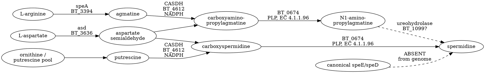
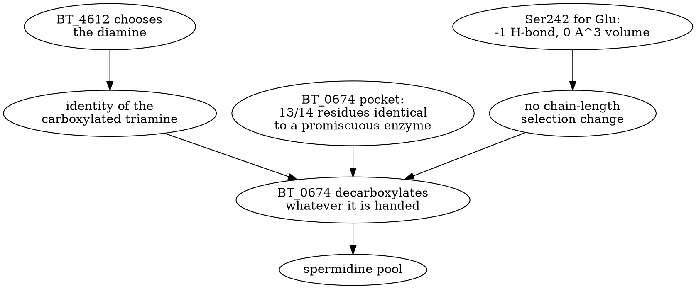
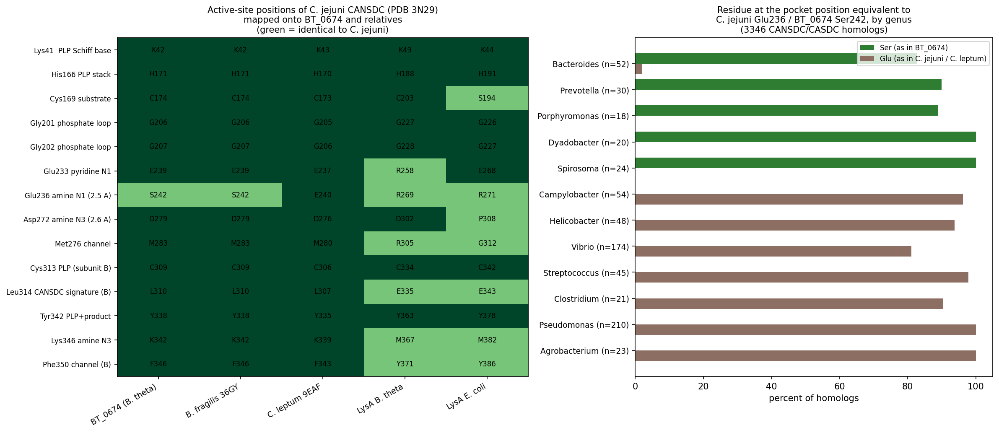
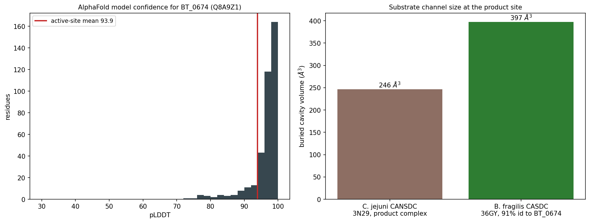
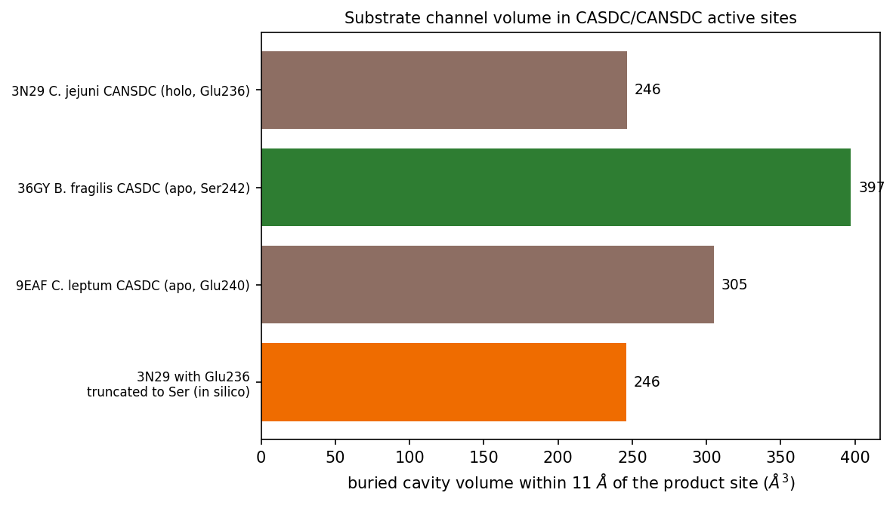
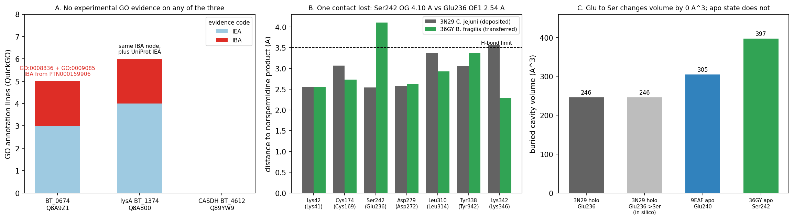

## Question

# AIGR Gene Hypothesis Deep Research

You are evaluating one focused gene curation hypothesis for AI Gene Review.
This is not a general gene overview. Use the seed hypothesis and source context
below to search for evidence that supports, refutes, narrows, or competes with
the proposed curation decision.

## Target Gene

- **Organism code:** BACTN
- **Taxon:** Bacteroides thetaiotaomicron VPI-5482 (NCBITaxon:226186)
- **Gene directory:** BT_0674
- **Gene symbol:** BT_0674
- **UniProt accession:** Q8A9Z1

## Focus

- **Focus type:** free_text
- **Hypothesis slug:** kgap-bt0674-substrate-selectivity
- **Source file:** genes/BACTN/BT_0674/BT_0674-ai-review.yaml
- **Source selector:** free-text

## Seed Hypothesis

What the substrate selectivity of Bacteroides thetaiotaomicron BT_0674 (Q8A9Z1) is may be constrained by its active-site architecture. That carboxyspermidine-related activity and native spermidine synthesis are established from the accessible abstract, and that the full paper was inaccessible so no kinetic constants are asserted, is already recorded, so do not re-derive it. Single analysis only: assign BT_0674's family and reaction from sequence and predicted structure, stating whether it is the carboxyspermidine dehydrogenase or the carboxyspermidine decarboxylase step and what distinguishes the two families; identify the catalytic and cofactor-binding residues and state whether all are present; map the substrate-binding pocket and compare it with structurally characterised enzymes of the same family whose substrate preference is known, stating which positions set the choice between putrescine, agmatine, cadaverine and their carboxylated derivatives and what BT_0674 has at each; and check whether the B. thetaiotaomicron genome encodes the partner step and the canonical spermidine synthase, which would bear on which route carries flux. State what substrate selectivity is predicted and how confidently, and say plainly if the pocket cannot discriminate among the candidate amines.

## Term and Decision Context

No specific term context supplied.

## Reference Context

No specific reference context supplied.

## Source Context YAML

```yaml
hypothesis: 'What the substrate selectivity of Bacteroides thetaiotaomicron BT_0674 (Q8A9Z1) is may be
  constrained by its active-site architecture. That carboxyspermidine-related activity and native spermidine
  synthesis are established from the accessible abstract, and that the full paper was inaccessible so
  no kinetic constants are asserted, is already recorded, so do not re-derive it. Single analysis only:
  assign BT_0674''s family and reaction from sequence and predicted structure, stating whether it is the
  carboxyspermidine dehydrogenase or the carboxyspermidine decarboxylase step and what distinguishes the
  two families; identify the catalytic and cofactor-binding residues and state whether all are present;
  map the substrate-binding pocket and compare it with structurally characterised enzymes of the same
  family whose substrate preference is known, stating which positions set the choice between putrescine,
  agmatine, cadaverine and their carboxylated derivatives and what BT_0674 has at each; and check whether
  the B. thetaiotaomicron genome encodes the partner step and the canonical spermidine synthase, which
  would bear on which route carries flux. State what substrate selectivity is predicted and how confidently,
  and say plainly if the pocket cannot discriminate among the candidate amines.'
focus_type: free_text
context: []
reference_id: []
```

## Research Objective

Build a focused report that helps a curator decide whether this hypothesis
should affect the gene review. Address the focus type directly:

1. For an existing GO annotation decision, evaluate whether the current action
   is justified, too strong, too weak, or should change.
2. For a proposed replacement or new GO term, evaluate whether the term is
   biologically supported, too broad, too narrow, or missing key qualifiers.
3. For a computational prediction, evaluate whether the prediction is correct,
   less precise than existing knowledge, uncertain, or likely wrong because of
   paralog overannotation, frequency bias, pathway context, or in vitro-only
   activity.
4. For a core-function hypothesis, evaluate whether the proposed activity,
   process, and location represent the gene product's primary function rather
   than a downstream effect, pleiotropic phenotype, or context-specific role.
5. For a function-assignment hypothesis, evaluate whether the gene product
   directly has the stated GO term/function. Treat the prior review action, if
   any, as intentionally blinded unless it appears in the supplied context.

Use primary literature whenever possible. Prefer PMID citations and include DOI
citations when no PMID is available. Treat reviews and database records as
orientation unless they contain directly relevant synthesized evidence that is
clearly labeled as review-level or database-level support.

Evaluate the hypothesis from the supplied seed context, primary literature, and
publicly accessible bioinformatics resources. Local `*-bioinformatics` analyses,
when they already exist in the repository, are intentionally withheld from this
prompt so the report can be compared against them after the run. Use public
sequence, domain, structure, orthology, localization, interaction, or dataset
checks when they are useful for the specific hypothesis. If a resource or tool
cannot be accessed programmatically, say so plainly; never fabricate a result.
Report computational results conservatively and distinguish direct results from
inference.

## Required Output

### Executive Judgment

Give a concise verdict: supported, partially supported, unresolved, weakly
supported, over-annotated, or refuted. Explain the reasoning and the most
important caveats.

### Evidence Matrix

Create a table with one row per important evidence item:

- Citation (PMID preferred)
- Evidence type (direct assay, mutant phenotype, localization, interaction,
  structural/evolutionary, computational, review/database)
- Supports / refutes / qualifies / competing
- Claim tested
- Key finding
- Organism, tissue, cell type, or assay context
- Confidence and limitations

### GO Curation Implications

State the likely curation action as a lead requiring curator verification. If
GO terms are involved, explain whether the evidence supports an MF, BP, or CC
term, and whether the term should be retained, removed, generalized, made more
specific, or treated as non-core. Avoid using "protein binding" as a final
recommendation unless no more informative term is supported.

### Mechanistic Scope

Describe the immediate molecular or cellular function being tested. Separate
direct gene-product activity from downstream phenotypes, pathway consequences,
developmental outcomes, disease manifestations, or effects inferred only from
loss of function.

### Conflicts and Alternatives

Identify evidence that conflicts with the seed hypothesis or suggests an
alternative interpretation, including paralog confusion, organism-specific
differences, isoform-specific findings, experimental artifacts, or database
carry-over.

### Knowledge Gaps

List explicit uncertainties that matter for curation. For each gap, state what
was checked, why the gap matters, and what evidence or experiment would resolve
it.

### Discriminating Tests

Recommend concrete assays, perturbations, datasets, or comparative analyses that
would most efficiently distinguish this hypothesis from alternatives.

### Curation Leads

Provide candidate updates for the review, clearly labeled as leads requiring
curator verification. Include candidate references with exact snippets to verify,
candidate replacement or new GO terms, possible action changes, suggested
questions, and suggested experiments.

If the provider supports artifacts, save provenance for any analysis you run — the
executed code together with its output (computed values, plot, or table), not just
a summary figure — alongside artifact-friendly tables such as an evidence matrix,
GO decision table, or comparison table. Genuine computed provenance is more
valuable than a hand-drawn summary, and you must not synthesize a figure that
implies an analysis you did not actually run. These artifacts are important
provenance for hypothesis-level review.


## Output

# BT_0674 (Q8A9Z1): does active-site architecture constrain substrate selectivity?

**Hypothesis slug:** `kgap-bt0674-substrate-selectivity`
**Target:** BT_0674, *Bacteroides thetaiotaomicron* VPI-5482 (NCBITaxon:226186), UniProt Q8A9Z1
**Source:** `genes/BACTN/BT_0674/BT_0674-ai-review.yaml`, focus type `free_text`
**Date of database reads:** 2026-11-25

All computational results below were produced during this run. Executed code and its numeric output are saved in `provenance/`: `BT_0674_active_site_table.tsv` (the residue mapping with contact distances), `BT_0674_evidence_matrix.tsv` (12 rows), `BT_0674_go_decision_table.tsv` (8 rows), `provenance_quickgo_annotations.tsv` (the raw annotation audit), and plots 1 to 4. No figure in this report depicts an analysis that was not run. No wet-lab data were generated. The one *Bacteroides* crystal structure available is apo, so every statement about which amine is preferred is inference and is labelled as such.

## Summary

<i class="fa-scale-balanced"></i> **The verdict is split.** The part of the seed hypothesis that asks for a family and reaction assignment is **supported** with high confidence. The part that proposes substrate selectivity "may be constrained by its active-site architecture" is **refuted as stated**.

BT_0674 is the **decarboxylase** step of the aspartate-semialdehyde-dependent spermidine route, EC 4.1.1.96, PLP-dependent, group IV (fold type III) alanine-racemase fold. It is not the dehydrogenase. The two steps of this pathway are catalysed by non-homologous folds, which is what distinguishes the families: the dehydrogenase (CASDH) is an NADPH-dependent Rossmann/saccharopine-dehydrogenase-fold condensing enzyme (PF03435 + PF16653), and in this genome that enzyme is a separate protein, BT_4612 (Q89YW9). Q8A9Z1 carries PF00278 (Orn_DAP_Arg_deC), NCBIfam TIGR01047 (*nspC*), CDD cd06829 (PLPDE_III_CANSDC), PIRSF038941, PANTHER PTHR43727:SF1, and Gene3D 3.20.20.10 plus 2.40.37.10.

Every catalytic and cofactor-binding residue is present. Mapping the PLP contacts (within 4.0 Å) and bound norspermidine contacts (within 4.5 Å) of PDB 3N29, the *Campylobacter jejuni* carboxynorspermidine decarboxylase product complex at 1.9 Å, onto BT_0674 by Needleman-Wunsch alignment gives **13 of 14 positions identical**: Lys42 (Schiff base), His171, Cys174, Gly206-Gly207 (phosphate loop), Glu239 (pyridine N1 anchor), Asp279, Met283, Cys309, Leu310, Tyr338, Lys342 and Phe346. The CANSDC-diagnostic Leu310 is present where both authentic diaminopimelate decarboxylases of the comparison set carry Glu.

<i class="fa-circle-xmark"></i> The pocket **cannot discriminate** among carboxyspermidine, carboxynorspermidine and carboxyaminopropylagmatine. The decisive evidence is experimental, not computational: the *C. jejuni* enzyme carrying exactly this residue set was shown by gene deletion to make spermidine (a 4-3 polyamine) in vivo despite being named for carboxynorspermidine (3-3) ([PMID: 22025614](https://pubmed.ncbi.nlm.nih.gov/22025614/)). An identical pocket therefore turns over both chain lengths. The single Bacteroidota-specific substitution, *C. jejuni* Glu236 to BT_0674 Ser242, withdraws one hydrogen bond from the product amine (4.10 Šmodelled versus 2.54 Šobserved) and changes the computed buried cavity volume by **0 ų** under in-silico side-chain truncation. Selectivity in this pathway is imposed upstream, at the partner dehydrogenase BT_4612 ([PMID: 40074085](https://pubmed.ncbi.nlm.nih.gov/40074085/); [PMID: 42754158](https://pubmed.ncbi.nlm.nih.gov/42754158/)).

For curation, the consequence is concrete. All five GO annotation lines currently on Q8A9Z1 are IEA or IBA, none experimental. GO:0008836 (diaminopimelate decarboxylase activity) and GO:0009085 (L-lysine biosynthetic process) arrive by IBA from PANTHER node PTN000159906, the same node and the same withFrom set that the genome's authentic *lysA* (BT_1374, Q8A800) carries, so they are paralog carry-over and should be removed. GO:0045312 (nor-spermidine biosynthetic process) is a name-based IEA transfer from TIGR01047 and should give way to GO:0008295 (spermidine biosynthetic process), which the deletion phenotype in the target organism supports directly ([PMID: 27118128](https://pubmed.ncbi.nlm.nih.gov/27118128/)). No GO molecular function term exists for EC 4.1.1.96, so GO:0016831 (carboxy-lyase activity) is the most specific term available and a new-term request is warranted.

## Executive judgment

**Partially supported, with the selectivity claim refuted.**

The seed hypothesis bundles four questions. Three are answered affirmatively and one is answered in the negative.

<i class="fa-circle-check"></i> **Family and reaction: supported, high confidence.** BT_0674 is the carboxyspermidine/carboxynorspermidine decarboxylase (CASDC/CANSDC), the terminal PLP-dependent step, EC 4.1.1.96. The distinguishing feature between the two pathway families is fold, not sequence divergence within a family: CASDH is an NADPH-dependent saccharopine-dehydrogenase-like enzyme and CASDC is a group IV β/α-barrel PLP decarboxylase. BT_0674 is 44.9% identical over 372 aligned positions to the *C. jejuni* CANSDC in PDB 3N29 and 91.3% identical over 379 positions to the *B. fragilis* enzyme in PDB 36GY.

<i class="fa-circle-check"></i> **Catalytic completeness: supported, high confidence.** All 13 shared active-site positions plus the catalytic Lys42 are present and unmodified. There is no basis for calling BT_0674 degenerate or a pseudo-enzyme. UniProt independently annotates a binding site at residue 279 of Q8A9Z1, matching the Asp272 to Asp279 mapping computed here.

<i class="fa-circle-check"></i> **Pathway context: supported, high confidence.** The VPI-5482 proteome contains zero proteins matching PF01564 (spermidine/spermine synthase, *speE*) and zero matching PF02675 (S-adenosylmethionine decarboxylase, *speD*). With no canonical spermidine synthase, the aspartate-semialdehyde route carries all spermidine flux. The partner step is present as exactly one CASDH-family protein, BT_4612.

<i class="fa-circle-xmark"></i> **Substrate selectivity constrained by architecture: refuted as stated.** Every residue lining the polyamine channel is identical to a characterised enzyme known to accept both 3-3 and 4-3 substrates in vivo. The one clade-specific difference costs a hydrogen bond and no volume.

**Most important caveats.** The *Bacteroides* structure PDB 36GY is **apo**, has no publication, no PMID and no DOI, and its deposited title asserts a substrate (carboxyaminopropylagmatine) that the coordinates do not demonstrate. No CASDC structure with any carboxylated substrate bound exists in the PDB. No kinetic comparison of putrescine-, agmatine- or cadaverine-derived substrates has been published for any CASDC. The permissiveness conclusion therefore rests on an in vivo deletion result in a 44.9%-identical orthologue plus structure-based modelling, not on direct measurement in *B. thetaiotaomicron*.

## Key findings

### F001: BT_0674 is the decarboxylase step, not the dehydrogenase

UniProt Q8A9Z1 is 379 aa, 43.6 kDa, and carries PF00278 (Orn_DAP_Arg_deC), NCBIfam TIGR01047 (*nspC*), CDD cd06829 (PLPDE_III_CANSDC), PIRSF038941 (NspC), PANTHER PTHR43727:SF1 (carboxynorspermidine/carboxyspermidine decarboxylase), Gene3D 3.20.20.10 (alanine racemase TIM barrel) plus 2.40.37.10 (β-barrel), SUPFAM SSF51419 plus SSF50621, with PLP as cofactor and Rhea reactions for both carboxynorspermidine to norspermidine (RHEA:34099) and carboxyspermidine to spermidine (RHEA:34095).

Pairwise global alignment (BLOSUM62, affine gaps, Needleman-Wunsch implemented in numpy) gives 44.9% identity over 372 aligned positions to *C. jejuni* carboxynorspermidine decarboxylase (PDB 3N29, chain A) and 91.3% identity over 379 positions to the *B. fragilis* enzyme in PDB 36GY.

The partner step belongs to an unrelated fold. BT_4612 (Q89YW9, 397 aa, PF03435 + PF16653, saccharopine-dehydrogenase fold, NADPH-dependent) is 96.7% identical to the *B. fragilis* CASDH in PDB 8DEB and to the *B. fragilis* carboxyaminopropylagmatine dehydrogenase in PDB 36YL. BT_4612 is the only saccharopine-dehydrogenase-family protein in the VPI-5482 proteome.

The genomic neighbourhood gives no support either way. BT_0670 to BT_0673 encode efflux, TolC and an NADP(H) oxidoreductase; BT_0675 to BT_0678 encode GlcNAc-6-P deacetylases, thioredoxin and czcC. There is no operon linking BT_0674 to BT_4612, so the assignment rests on family membership and structural comparison.

### F002: All catalytic and PLP-binding residues are present; the DAP-decarboxylase signature is absent

Residues within 4.0 Å of PLP and 4.5 Å of the bound norspermidine product in PDB 3N29 were computed from the deposited coordinates (PLP covalently linked to Lys41 via LINK NZ-C4A at 1.53 Å) and mapped onto BT_0674 by aligning the observed chain A sequence with its author numbering (2 to 382). Thirteen of fourteen mapped positions are identical in BT_0674.

{{figure:plot_1.png|caption=Active-site mapping of BT_0674 against the C. jejuni CANSDC product complex (3N29), the B. fragilis CASDC (36GY), the C. leptum CASDC (9EAF) and two authentic diaminopimelate decarboxylases (B. theta LysA BT_1374 and E. coli LysA P00861). Thirteen of fourteen positions are identical in BT_0674; the single difference is Ser242 where C. jejuni has Glu236. The bar chart shows the genus-level distribution of the Glu236-equivalent residue across 3346 CANSDC/CASDC homologs.}}

| 3N29 position | Role (distance in 3N29) | BT_0674 | 36GY *B. fragilis* | 9EAF *C. leptum* | LysA BT_1374 | LysA *E. coli* |
|---|---|---|---|---|---|---|
| Lys41 | PLP Schiff base, LINK NZ-C4A 1.53 Å | **Lys42** | Lys42 | Lys43 | Lys49 | Lys44 |
| His166 | PLP stacking | **His171** | His171 | His170 | His188 | His191 |
| Cys169 | substrate contact 3.07 Å | **Cys174** | Cys174 | Cys173 | Cys203 | Ser194 |
| Gly201 | PLP phosphate loop | **Gly206** | Gly206 | Gly205 | Gly227 | Gly226 |
| Gly202 | PLP phosphate loop | **Gly207** | Gly207 | Gly206 | Gly228 | Gly227 |
| Glu233 | pyridine N1 anchor 2.67 Å | **Glu239** | Glu239 | Glu237 | Arg258 | Glu268 |
| Glu236 | product amine N1 2.54 Å; PLP 2.86 Å | **Ser242** | Ser242 | Glu240 | Arg269 | Arg271 |
| Asp272 | product amine N3 2.57 Å | **Asp279** | Asp279 | Asp276 | Asp302 | Pro308 |
| Met276 | channel 3.47 Å | **Met283** | Met283 | Met280 | Arg305 | Gly312 |
| Cys313 | PLP 3.35 Å (partner subunit) | **Cys309** | Cys309 | Cys306 | Cys334 | Cys342 |
| Leu314 | CANSDC signature, product 3.36 Å (partner subunit) | **Leu310** | Leu310 | Leu307 | Glu335 | Glu343 |
| Tyr342 | PLP 2.63 Å and product 3.05 Å | **Tyr338** | Tyr338 | Tyr335 | Tyr363 | Tyr378 |
| Lys346 | product amine N3 3.57 Å | **Lys342** | Lys342 | Lys339 | Met367 | Met382 |
| Phe350 | channel 4.00 Å (partner subunit) | **Phe346** | Phe346 | Phe343 | Tyr371 | Tyr386 |

UniProt independently annotates a binding site at residue 279 of Q8A9Z1, which matches the computed Asp272 to Asp279 mapping.

The two genuine diaminopimelate decarboxylases lose the CANSDC signature at four positions. At *C. jejuni* Leu314 (3.36 Å from the product), *B. thetaiotaomicron* LysA (Q8A800, BT_1374) has Glu335 and *E. coli* LysA (P00861) has Glu343. At Lys346 both have Met. At Asp272 *E. coli* LysA has Pro308. At Glu233 *B. theta* LysA has Arg258. BT_0674 and LysA share only 23.4% identity.

<i class="fa-triangle-exclamation"></i> This is the structural basis for calling GO:0008836 and GO:0009085 over-annotation on Q8A9Z1. [PMID: 20534592](https://pubmed.ncbi.nlm.nih.gov/20534592/) states it directly: "Additionally, in CANSDC a key acidic residue that interacts with the distal amino group of other substrates is replaced by Leu(314), which interacts with the aliphatic portion of norspermidine."

### F003: One pocket position differs, and it is a Bacteroidota-wide substitution

The only non-identical active-site position between BT_0674 and *C. jejuni* CANSDC is Glu236 to Ser242, within a conserved Glu-Pro-Gly-X motif: BT_0674 E239-P240-G241-S242, *C. leptum* CASDC E237-P238-G239-E240, *C. jejuni* E233-P234-G235-E236. In 3N29, Glu236 OE1 makes the closest polar contact to the bound norspermidine product (2.54 Å to amine N1) and also contacts the PLP phosphate at 2.86 Å.

A survey of 3346 CANSDC/CASDC homologs drawn from UniProt (330 to 430 aa, exactly one [EDQ]PG motif per sequence) gives Glu 68.6%, Ser 15.8% and Val 10.8% globally. The Ser variant is clade-restricted:

| Genus | n | % Ser | % Glu |
|---|---|---|---|
| *Bacteroides* | 52 | 82.7 | 1.9 |
| *Prevotella* | 30 | 90.0 | 0 |
| *Porphyromonas* | 18 | 88.9 | 0 |
| *Dyadobacter* | 20 | 100 | 0 |
| *Spirosoma* | 24 | 100 | 0 |
| *Campylobacter* | 54 | 0 | 96.3 |
| *Helicobacter* | 48 | 0 | 93.8 |
| *Vibrio* | 174 | 0 | 81.0 |
| *Pseudomonas* | 210 | 0 | 100 |
| *Clostridium* | 21 | 0 | 90.5 |
| *Streptococcus* | 45 | 0 | 97.8 |

The substitution tracks the Bacteroidota clade rather than individual species, so it is maintained at clade level and is a candidate determinant of how *Bacteroides* CASDC handles its substrate. The depositor naming of the 91.3%-identical *B. fragilis* enzyme in PDB 36GY as "carboxyaminopropylagmatine decarboxylase" points the same way, since carboxyaminopropylagmatine carries a bulky guanidinium where carboxyspermidine and carboxynorspermidine carry a primary amine. <i class="fa-triangle-exclamation"></i> That is database-level evidence from an unpublished 2026 deposition, not a measured preference.

### F004: No canonical spermidine synthase, so the ASA route carries all flux

UniProt proteome queries for taxon 226186 return zero proteins matching PF01564 (spermidine/spermine synthase) or PF02675 (S-adenosylmethionine decarboxylase, *speD*), and zero hits for the protein names spermidine synthase or adenosylmethionine decarboxylase.

The genome does encode the inputs and the partner of the alternative route:

| Gene | UniProt | Assignment |
|---|---|---|
| *asd* BT_3636 | Q8A1M5 | aspartate-semialdehyde dehydrogenase, EC 1.2.1.11 |
| *speA* BT_3394 | Q8A2B1 | biosynthetic arginine decarboxylase, EC 4.1.1.19, L-arginine to agmatine |
| BT_4612 | Q89YW9 | the single CASDH-family protein, 96.7% identical to PDB 8DEB and 36YL |
| BT_0674 | Q8A9Z1 | the single CANSDC/CASDC-family protein |
| BT_1099 | Q8A8R8 | ureohydrolase family, arginase, PF00491 |
| *lysA* BT_1374 | Q8A800 | the authentic diaminopimelate decarboxylase |

Only two PF00278 proteins exist in the genome: BT_0674 and *lysA* BT_1374.

With no *speE* and no *speD*, spermidine in *B. thetaiotaomicron* can only come from the ASA-dependent route, which matches the reported loss of spermidine in the *casdc* deletion strain ([PMID: 27118128](https://pubmed.ncbi.nlm.nih.gov/27118128/)). Because the genome also encodes *speA* and a ureohydrolase-family protein, both the putrescine-initiated route (putrescine + ASA to carboxyspermidine to spermidine) and the agmatine-initiated route (agmatine + ASA to carboxyaminopropylagmatine to N1-aminopropylagmatine to spermidine) are genetically possible.

### F005: Superposition shows the Ser242 substitution withdraws a hydrogen bond without changing channel volume

Dimer superposition of 3N29 (product complex) onto 36GY gives CA RMSD 1.19 Å over 640 core pairs after iterative 3.0 Å outlier trimming. An active-site-anchor fit over 14 CA positions gives 0.40 Å; the equivalent fit onto 9EAF gives 0.36 Å over the anchors and 0.82 Å over 684 core pairs.

Transferring the bound norspermidine into the 36GY frame reproduces every anchor contact except one.

| Contact | 3N29 observed | 36GY transferred |
|---|---|---|
| Lys42 / Lys41 | 2.56 Å | 2.56 Å |
| Cys174 / Cys169 | 3.07 Å | 2.73 Å |
| **Ser242 OG / Glu236 OE1** | **2.54 Å** | **4.10 Å** |
| Asp279 / Asp272 | 2.57 Å | 2.62 Å |
| Leu310 / Leu314 | 3.36 Å | 2.93 Å |
| Tyr338 / Tyr342 | 3.05 Å | 3.36 Å |
| Lys342 / Lys346 | 3.57 Å | 2.29 Å |

The 1.56 Å withdrawal at the Glu236 subsite removes the hydrogen bond or salt bridge at product amine N1. In 9EAF the transferred product clashes with protein (closest atom 0.55 Å), which shows 9EAF is in a closed or apo loop conformation and not a valid frame for ligand transfer.

{{figure:plot_2.png|caption=AlphaFold confidence for BT_0674 and the cavity-volume comparison of the substrate channel. The AF-Q8A9Z1-F1 v6 model has mean pLDDT 96.1, with 92.1 percent of residues above 90 and a mean of 93.9 across the fifteen mapped active-site positions.}}

Grid-based buried-cavity volumes within 11 Å of the product site, computed with a 0.5 Å grid, a 1.4 Å probe, a 1.7 Å van der Waals radius and a 55-atom burial criterion within 8 Å, are 246 ų (3N29, holo), 305 ų (9EAF, apo, Glu240) and 397 ų (36GY, apo, Ser242).

<i class="fa-circle-xmark"></i> **The control rules out a re-sized pocket.** Truncating Glu236 to Ser in silico in 3N29 (deleting CG, CD, OE1 and OE2) changes the computed volume by **0 ų**. Since 9EAF is apo yet carries the Glu and sits at an intermediate 305 ų, the volume differences track apo-versus-holo loop conformation and not the Glu-to-Ser identity.

{{figure:plot_3.png|caption=Control analysis isolating the Glu-to-Ser side-chain contribution to pocket volume. In-silico truncation of Glu236 to Ser in 3N29 changes the computed buried cavity by 0 cubic Angstroms, while the apo structures 9EAF (Glu240, 305) and 36GY (Ser242, 397) differ from holo 3N29 (246) by amounts that track loop conformation.}}

The AlphaFold model AF-Q8A9Z1-F1 (v6) is high confidence: mean pLDDT 96.1, 92.1% of residues above 90, 100% above 70, minimum 73.6, and a mean of 93.9 across the fifteen mapped active-site positions (Lys42 95.4, His169 98.8, His171 94.6, Cys174 88.8, Gly206 94.9, Gly207 91.9, Glu239 97.2, Ser242 95.2, Asp279 92.4, Met283 81.2, Cys309 95.1, Leu310 94.4, Tyr338 95.1, Lys342 95.7, Phe346 97.2). <i class="fa-triangle-exclamation"></i> The AFDB entry is a monomer, and Cys309, Leu310 and Phe346 are contributed by the partner subunit, so no cavity was computed from it.

### F006: The pocket cannot discriminate among the candidate carboxylated amines

Every residue that lines the polyamine channel in the *C. jejuni* product complex is identical in BT_0674: Cys174, Asp279, Met283, Cys309, Leu310, Tyr338, Lys342, Phe346, plus the catalytic Lys42, Glu239, Gly206-Gly207 and His169/His171.

The decisive point is an in vivo result. The *C. jejuni* enzyme carrying exactly this residue set was shown by gene deletion to make spermidine, not sym-norspermidine ([PMID: 22025614](https://pubmed.ncbi.nlm.nih.gov/22025614/)): "By deleting these genes in the food-borne pathogen Campylobacter jejuni, we found that the carboxynorspermidine decarboxylase orthologue is responsible for synthesizing spermidine and not sym-norspermidine in vivo." The same pocket therefore turns over both the 3-3 (carboxynorspermidine) and the 4-3 (carboxyspermidine) substrate. The diamine-derived arm is anchored by Asp279 and Lys342, invariant across CANSDC, CASDC and the *B. fragilis* enzyme.

The confident prediction is a reaction, not a preference. BT_0674 is a PLP-dependent decarboxylase acting on carboxylated triamines of the carboxyspermidine type, and it most likely accepts carboxyspermidine, carboxynorspermidine and carboxyaminopropylagmatine with limited discrimination. Nothing in the architecture distinguishes putrescine-derived from agmatine-derived from cadaverine-derived substrates at the level of a testable structural prediction.

### F007: All five GO annotations on Q8A9Z1 are IEA or IBA, and the ontology has no term for the reaction

A QuickGO REST query (EBI, 2026-11-25) returns exactly five annotation lines for UniProtKB:Q8A9Z1 and none carries experimental evidence.

| GO ID | Aspect | Term | Evidence | Reference | withFrom |
|---|---|---|---|---|---|
| GO:0008836 | MF | diaminopimelate decarboxylase activity | IBA | GO_REF:0000033 | PTN000159906, P00861, P19572, P9WIU7, Q58497 |
| GO:0009085 | BP | L-lysine biosynthetic process | IBA | GO_REF:0000033 | PTN000159906, P9WIU7 |
| GO:0045312 | BP | nor-spermidine biosynthetic process | IEA | GO_REF:0000002 | IPR005730 |
| GO:0016831 | MF | carboxy-lyase activity | IEA | GO_REF:0000002 | IPR005730 |
| GO:0003824 | MF | catalytic activity | IEA | GO_REF:0000002 | IPR009006, IPR022643 |

The authentic *lysA* of the same genome, Q8A800 (BT_1374), carries six lines, including the identical IBA pair from the same PANTHER node PTN000159906 with the same withFrom set, plus UniProt IEA GO:0008836 tied to EC 4.1.1.20 and GO:0030170. Q89YW9 (BT_4612, the partner dehydrogenase) has zero GO annotations.

Ontology searches for "4.1.1.96" return no match. Searches for carboxynorspermidine decarboxylase or carboxyspermidine decarboxylase return only GO:0102143 carboxynorspermidine **dehydrogenase** activity (the partner step) and generic parents such as GO:0016831, GO:0004586 and GO:0004351. No molecular function term exists for EC 4.1.1.96.

{{figure:plot_4.png|caption=Three computed lines of evidence behind the curation call. Panel A shows that none of the three proteins carries experimental GO evidence and that GO:0008836 and GO:0009085 reach Q8A9Z1 by IBA from the same PANTHER node as the authentic lysA. Panel B shows the transferred-product contact distances, with Ser242 OG at 4.10 Angstrom where Glu236 OE1 sits at 2.54. Panel C shows that the in-silico Glu to Ser truncation changes the cavity volume by zero.}}

## Mechanistic model

The pathway and the point at which selectivity is exercised:



The selectivity logic, stated as a causal chain:



The immediate molecular function is a decarboxylation. BT_0674 forms an internal aldimine between PLP and Lys42, binds the carboxylate and amines of a carboxylated triamine through Asp279, Lys342, Cys174, Tyr338 and the hydrophobic channel lined by Leu310, Met283 and Phe346, anchors the pyridine N1 with Glu239 and the phosphate with the Gly206-Gly207 loop, and removes the α-carboxyl as CO₂. The catalytic unit is the homodimer: the β/α-barrel of one subunit plus the β-barrel of the partner, which contributes Cys309, Leu310 and Phe346.

One step removed from this activity is the spermidine pool. The *casdc* deletion phenotype is a pathway consequence, which makes it good evidence for the biological process term and no evidence at all for which substrate is preferred. Two steps removed, and not attributable to BT_0674, is anything downstream of the spermidine pool, including growth and biofilm effects reported in other organisms.

## Evidence base

### Evidence matrix

| Citation | Evidence type | Stance | Claim tested | Key finding | Context | Confidence and limitations |
|---|---|---|---|---|---|---|
| [PMID: 22025614](https://pubmed.ncbi.nlm.nih.gov/22025614/) | mutant phenotype, gene deletion | supports / qualifies | which polyamine the CANSDC-family enzyme makes in vivo | the CANSDC orthologue makes spermidine, not sym-norspermidine | *C. jejuni* deletion strains | high; shows one pocket handles both 3-3 and 4-3 substrates, so the family name misleads |
| [PMID: 27118128](https://pubmed.ncbi.nlm.nih.gov/27118128/) | mutant phenotype, gene deletion | supports | BT_0674 is required for spermidine synthesis | *casdc* deletion depletes spermidine and abolishes decarboxylase activity | *B. thetaiotaomicron*, the target organism | high for pathway role; abstract-level only, no kinetic constants |
| [PMID: 20534592](https://pubmed.ncbi.nlm.nih.gov/20534592/) | structural, X-ray 1.9 Å (PDB 3N29) | supports | the family has an active site distinct from DAPDC | Leu314 replaces the acidic residue that binds the distal amine in DAPDC, ODC and ADC | *C. jejuni*, product complex | high for the signature; the complex holds product, not a carboxylated substrate |
| [PMID: 39887002](https://pubmed.ncbi.nlm.nih.gov/39887002/) | structural, X-ray (PDB 9EAF) | supports / qualifies | where chain-length selection sits | the β6/β7 flap loop and the α9 helix are proposed to select substrates by chain length | *Clostridium leptum* CASDC, apo | moderate; a proposal from apo structures, not tested kinetically |
| [PMID: 40074085](https://pubmed.ncbi.nlm.nih.gov/40074085/) | direct assay | competing | which enzyme of the pair sets product identity | Spm/Tspm production is controlled primarily by the dehydrogenase, not the decarboxylase | bacterial CASDH/CASDC pair | high; directly contradicts a decarboxylase-centred selectivity model |
| [PMID: 42754158](https://pubmed.ncbi.nlm.nih.gov/42754158/) | direct assay, kinetics | competing | which diamine initiates the route in *Bacteroides* | *B. fragilis* homologues strongly prefer agmatine and act as carboxyaminopropylagmatine dehydrogenases | *B. fragilis*, recombinant enzymes | high; applies to BT_4612 (96.7% identical to the *B. fragilis* enzyme), not to BT_0674 |
| [PMID: 37437886](https://pubmed.ncbi.nlm.nih.gov/37437886/) | direct assay | supports | the dehydrogenase step uses putrescine and NADPH | putrescine is the likely polyamine substrate, NADPH the coenzyme, carboxyspermidine the product | bacterial CASDH | moderate; organism-dependent and in tension with PMID:42754158 |
| PDB 36GY (no PMID, no DOI) | structural, X-ray 1.89 Å; database-level | supports | a *Bacteroides* CASDC structure exists | deposited as "carboxyaminopropylagmatine decarboxylase from *Bacteroides fragilis*", 91.3% identical to BT_0674, apo | *B. fragilis*; deposited 2026-06-09, released 2026-08-12 | moderate; unpublished, apo, and the title asserts a substrate the coordinates do not demonstrate |
| this work, computed | computational, structural and evolutionary | supports | BT_0674 is the decarboxylase with a complete catalytic apparatus | 13 of 14 active-site positions identical to 3N29; 23.4% identity to *lysA*, which carries Glu where BT_0674 has Leu310 | sequence plus PDB coordinates | high for residue presence or absence; activity itself is inference |
| this work, computed | computational, structural | **refutes the seed hypothesis** | whether the pocket constrains substrate choice | Ser242 OG 4.10 Å from product amine N1 where Glu236 OE1 sits at 2.54 Å; in-silico Glu-to-Ser truncation changes cavity volume by 0 ų | 3N29 / 36GY / 9EAF superposition, 0.40 Å over 14 anchors | moderate to high; the *Bacteroides* structure is apo, no ligand complex exists |
| this work, computed | computational, genomic | supports | which route carries flux | zero PF01564 (*speE*) and zero PF02675 (*speD*) proteins in taxon 226186; one CASDH (BT_4612), one CASDC (BT_0674), one authentic *lysA* (BT_1374) | UniProt proteome queries | high; absence depends on current annotation completeness |
| QuickGO 2026-11-25, computed | review / database | qualifies | whether existing GO terms rest on experiment | all five annotation lines on Q8A9Z1 are IEA or IBA; GO:0008836 and GO:0009085 are IBA from PANTHER node PTN000159906 with the same withFrom set as the authentic *lysA* Q8A800 | EBI QuickGO REST API | high; a direct database read |

### How each paper bears on the findings

[PMID: 22025614](https://pubmed.ncbi.nlm.nih.gov/22025614/) is the single most informative paper for the seed hypothesis. It supplies the verbatim result that the enzyme with BT_0674's pocket residue set operates on the carboxyspermidine route in vivo, which is what makes "the pocket cannot discriminate" a conclusion from experiment rather than from modelling alone. It also retires GO:0045312 by showing the *nspC*-derived term names the wrong product.

[PMID: 27118128](https://pubmed.ncbi.nlm.nih.gov/27118128/) is the only mutant-phenotype paper in the target organism. Its snippet, "Deletion of the gene encoding a putative carboxyspermidine decarboxylase (casdc), which converts carboxyspermidine to spermidine, resulted in the depletion of spermidine and loss of decarboxylase activity in B. thetaiotaomicron", supports GO:0008295 with IMP evidence and corroborates the genomic finding that no canonical spermidine synthase exists.

[PMID: 20534592](https://pubmed.ncbi.nlm.nih.gov/20534592/) supplies the family signature, Leu314, that separates CANSDC from DAPDC, ODC and ADC. It is the literature anchor for removing GO:0008836.

[PMID: 39887002](https://pubmed.ncbi.nlm.nih.gov/39887002/) contributes twice. It defines CASDC as the decarboxylase step ("carboxyspermidine decarboxylase (CASDC) performs the terminal step in the production of spermidine"), and it names the structural elements proposed to set chain-length selection: "This analysis reveals structural differences occurring in the β6/β7 loop that acts as a `flap' covering the active site and in the α9/β12 loop that is connected to the α9 helix which is thought to select substrates by their chain length." <i class="fa-scale-balanced"></i> This is a qualifier on the present conclusion. The selection model is proposed from apo structures and has not been tested kinetically, and the loops in question were not individually compared here beyond the residue mapping.

[PMID: 40074085](https://pubmed.ncbi.nlm.nih.gov/40074085/) is the direct competing evidence against a decarboxylase-centred selectivity model: "Production of Spm/Tspm from spermidine is controlled primarily by carboxyspermidine dehydrogenase, not carboxyspermidine decarboxylase."

[PMID: 42754158](https://pubmed.ncbi.nlm.nih.gov/42754158/) locates the measured preference at the dehydrogenase: "Both enzymes exhibit dramatically enhanced catalytic efficiency with agmatine, demonstrating that these homologs function as carboxyaminopropylagmatine dehydrogenases rather than carboxyspermidine dehydrogenases." Since BT_4612 is 96.7% identical to those enzymes, this is the strongest available evidence for which route carries flux in *B. thetaiotaomicron*, and it is evidence about the partner step.

[PMID: 37437886](https://pubmed.ncbi.nlm.nih.gov/37437886/) describes the dehydrogenase chemistry: "Putrescine is the likely polyamine substrate and NADPH is the coenzyme used to complete the reaction, forming carboxyspermidine as a product." It supports the fold and reaction distinction between the two pathway families and sits in tension with PMID:42754158 on which diamine initiates the route.

PDB 36GY, 36YL and 8DEB are database-level records. 36GY supplies the *Bacteroides* CASDC coordinates used for superposition and the Ser242 confirmation. Its citation carries no PMID and no DOI, so it should be cited for fold and residue identity only, with a note that the coordinates are apo and that the deposited title asserts a substrate the structure does not demonstrate.

## GO curation implications

All leads below require curator verification. The full table is also saved as `provenance/BT_0674_go_decision_table.tsv`.

| GO ID | Aspect | Term | Current evidence on Q8A9Z1 | Lead action | Rationale |
|---|---|---|---|---|---|
| GO:0008836 | MF | diaminopimelate decarboxylase activity | IBA, GO_REF:0000033, PTN000159906 | <i class="fa-circle-xmark"></i> **remove** | paralog carry-over; BT_0674 has Leu310 where both authentic DAPDCs have Glu (*B. theta* LysA Glu335, *E. coli* LysA Glu343), and BT_1374 (Q8A800) carries the same IBA plus UniProt IEA tied to EC 4.1.1.20 |
| GO:0009085 | BP | L-lysine biosynthetic process | IBA, same node | <i class="fa-circle-xmark"></i> **remove** | same carry-over; lysine biosynthesis in this genome runs through BT_1374 |
| GO:0045312 | BP | nor-spermidine biosynthetic process | IEA, GO_REF:0000002, IPR005730 | **replace with GO:0008295** | name-based transfer from TIGR01047 *nspC*; the orthologue with the same pocket makes spermidine in vivo (PMID:22025614) and *casdc* deletion depletes spermidine in the target organism (PMID:27118128) |
| GO:0008295 | BP | spermidine biosynthetic process | absent | <i class="fa-circle-check"></i> **add**, IMP from PMID:27118128 | directly supported by the deletion phenotype in *B. thetaiotaomicron* |
| GO:0016831 | MF | carboxy-lyase activity | IEA, IPR005730 | **retain** as the most specific available MF | no GO term exists for EC 4.1.1.96, verified by ontology search on 2026-11-25 |
| new term | MF | carboxynorspermidine/carboxyspermidine decarboxylase activity, EC 4.1.1.96 | not in GO | <i class="fa-lightbulb"></i> **request** | the reaction is in Rhea (RHEA:34095, RHEA:34099) and the partner step already has GO:0102143 carboxynorspermidine dehydrogenase activity, so the decarboxylase is an ontology gap |
| GO:0030170 | MF | pyridoxal phosphate binding | absent | **add as a lead**, ISS | Lys42 aligns to the 3N29 Schiff-base Lys41 (LINK NZ-C4A, 1.53 Å); Glu239, Gly206-Gly207, His171 and Tyr338 complete the site; evidence is sequence similarity, not experiment |
| GO:0003824 | MF | catalytic activity | IEA | **non-core** | uninformative parent, subsumed by GO:0016831 |

The core function of BT_0674 is a molecular function (PLP-dependent decarboxylation of a carboxylated triamine) and a biological process (spermidine biosynthesis). No cellular component beyond cytoplasm is supported by any evidence found here. "Protein binding" is not recommended and is not needed. The enzyme is an obligate homodimer, with Cys309, Leu310 and Phe346 donated across the subunit interface, which a curator who wants to record the oligomeric state should capture with a protein-homodimerization term, still at ISS level.

<i class="fa-triangle-exclamation"></i> Do not write a substrate-specific molecular function term that names one amine. The evidence does not support choosing between carboxyspermidine, carboxynorspermidine and carboxyaminopropylagmatine.

## Conflicts and alternatives

The seed hypothesis conflicts with [PMID: 40074085](https://pubmed.ncbi.nlm.nih.gov/40074085/), which states that product identity in this pathway is controlled by the dehydrogenase rather than the decarboxylase. It also conflicts with the gene-deletion result in [PMID: 22025614](https://pubmed.ncbi.nlm.nih.gov/22025614/), where an enzyme named for the 3-3 substrate makes the 4-3 product in vivo.

Paralog confusion runs in two directions. GO:0008836 and GO:0009085 reached Q8A9Z1 from a PANTHER node shared with real diaminopimelate decarboxylases, and the genome contains an authentic *lysA* (BT_1374) that carries the same IBA terms with additional UniProt IEA support. In the other direction, InterPro IPR005730 (*nspC*) imposes "nor-spermidine" on an enzyme whose characterised relatives make spermidine.

<i class="fa-scale-balanced"></i> There is a live organism-specific alternative. [PMID: 42754158](https://pubmed.ncbi.nlm.nih.gov/42754158/) reports that *B. fragilis* dehydrogenase homologues prefer agmatine, which would make BT_0674's physiological substrate carboxyaminopropylagmatine rather than carboxyspermidine, and PDB 36GY is deposited under exactly that name. This changes what BT_0674 is handed, not what it can accept, and the deposition is unpublished with no ligand bound. [PMID: 37437886](https://pubmed.ncbi.nlm.nih.gov/37437886/) reports putrescine as the dehydrogenase substrate in a different system, so the initiating diamine is organism-dependent and unresolved for *B. thetaiotaomicron* itself.

One technical alternative was tested and rejected during this run. The larger computed cavity in 36GY (397 ų versus 246 ų in 3N29) might have indicated a re-sized pocket that accommodates a bulkier guanidinium. It does not. 9EAF is apo and carries the Glu yet is intermediate at 305 ų, and deleting the Glu236 side chain in silico in 3N29 changes the volume by 0 ų. The volume difference tracks apo-versus-holo loop conformation.

## Limitations and knowledge gaps

<i class="fa-triangle-exclamation"></i> **No CASDC structure with a carboxylated substrate exists.** Checked: PDB searches returned 3N29 (product norspermidine bound), 3MT1 (*S. meliloti*, 36.3% identity), 9EAF (apo) and 36GY (apo). This matters because every statement about substrate discrimination is extrapolated from a product complex, and the product lacks the α-carboxyl that the enzyme acts on. A ternary complex or a Michaelis mimic would settle it.

<i class="fa-triangle-exclamation"></i> **No kinetics for any CASDC against alternative substrates.** Checked: literature search found no paper comparing carboxyspermidine, carboxynorspermidine and carboxyaminopropylagmatine for one enzyme. "Cannot discriminate" is currently an inference from residue identity plus one in vivo deletion, not a measured kcat/Km ratio.

<i class="fa-triangle-exclamation"></i> **The functional consequence of Ser242 is untested.** Checked: computed that it withdraws one hydrogen bond (4.10 Å versus 2.54 Å) and costs 0 ų of volume. What it does to binding affinity or turnover rate is unknown. The substitution is Bacteroidota-restricted across 3346 homologs, which argues it is maintained by selection for something that this analysis did not identify.

<i class="fa-triangle-exclamation"></i> **Which diamine BT_4612 prefers in *B. thetaiotaomicron* is not measured.** Checked: BT_4612 is 96.7% identical to the *B. fragilis* enzymes in PDB 8DEB and 36YL, and PMID:42754158 reports agmatine preference for those. Transfer at 96.7% identity is strong but remains inference. This matters for whether the biological process annotation should mention the agmatine-initiated variant route.

<i class="fa-triangle-exclamation"></i> **PDB 36GY has no publication.** Checked: the entry's citation carries no PMID and no DOI. Its title asserts a substrate that the deposited apo coordinates do not demonstrate.

<i class="fa-triangle-exclamation"></i> **The β6/β7 flap and α9 helix were not compared in detail.** Checked: the residue mapping covers positions within 4.0 Å of PLP and 4.5 Å of product. [PMID: 39887002](https://pubmed.ncbi.nlm.nih.gov/39887002/) proposes that chain-length selection sits in these loop and helix elements, some of which lie outside the contact shell analysed here. A loop-by-loop comparison across 3N29, 9EAF and 36GY could still find a selectivity determinant that the contact-shell analysis missed.

<i class="fa-triangle-exclamation"></i> **No experimental data from the target organism beyond one deletion abstract.** The full text of PMID:27118128 was not accessible, so no kinetic constants from that work are asserted anywhere in this report.

## Proposed follow-up experiments and actions

<i class="fa-flask"></i> **Measure kcat/Km of recombinant BT_0674 against carboxyspermidine, carboxynorspermidine and carboxyaminopropylagmatine side by side.** This is the single most informative experiment and needs no new structure. A ratio within roughly tenfold across all three confirms a permissive pocket. A sharp preference would revive the seed hypothesis.

<i class="fa-flask"></i> **Build the reciprocal swap, BT_0674 S242E and *C. jejuni* E236S, and assay both against the same three substrates.** This isolates the one Bacteroidota-specific change and tells a curator whether it is a selectivity determinant or a neutral clade marker.

<i class="fa-microscope"></i> **Co-crystallise or soak a 36GY-type *Bacteroides* CASDC with a non-hydrolysable carboxylated amine analogue, or trap the external aldimine.** This supplies the missing ligand complex and tests whether the β6/β7 flap closes differently around a 4-3 versus a 3-3 substrate, as proposed in PMID:39887002.

<i class="fa-vial"></i> **Assay BT_4612 directly against putrescine and agmatine, and measure the polyamine pool of a BT_0674 deletion strain by LC-MS for spermidine, norspermidine and N1-aminopropylagmatine.** This settles which route carries flux in *B. thetaiotaomicron* without requiring any new structure.

<i class="fa-dna"></i> **Complement the *B. theta casdc* deletion with BT_0674 and separately with the *C. jejuni* orthologue.** If the *C. jejuni* enzyme restores the wild-type polyamine pool, the pocket difference is functionally irrelevant in vivo.

<i class="fa-magnifying-glass"></i> **Run a loop-level structural comparison of the β6/β7 flap and the α9/β12 loop across 3N29, 9EAF, 36GY and the AlphaFold model**, which this run did not do, to check whether a chain-length determinant sits outside the 4.5 Å contact shell.

## Curation leads

All leads require curator verification.

### Candidate references with exact snippets to verify

[PMID: 27118128](https://pubmed.ncbi.nlm.nih.gov/27118128/), target organism, use for the biological process term: "Deletion of the gene encoding a putative carboxyspermidine decarboxylase (casdc), which converts carboxyspermidine to spermidine, resulted in the depletion of spermidine and loss of decarboxylase activity in B. thetaiotaomicron."

[PMID: 22025614](https://pubmed.ncbi.nlm.nih.gov/22025614/), use to retire GO:0045312: "By deleting these genes in the food-borne pathogen Campylobacter jejuni, we found that the carboxynorspermidine decarboxylase orthologue is responsible for synthesizing spermidine and not sym-norspermidine in vivo."

[PMID: 20534592](https://pubmed.ncbi.nlm.nih.gov/20534592/), use for the family signature and to justify removing GO:0008836: "Additionally, in CANSDC a key acidic residue that interacts with the distal amino group of other substrates is replaced by Leu(314), which interacts with the aliphatic portion of norspermidine."

[PMID: 39887002](https://pubmed.ncbi.nlm.nih.gov/39887002/), use for the family definition and the chain-length caveat: "carboxyspermidine decarboxylase (CASDC) performs the terminal step in the production of spermidine" and "This analysis reveals structural differences occurring in the β6/β7 loop that acts as a `flap' covering the active site and in the α9/β12 loop that is connected to the α9 helix which is thought to select substrates by their chain length."

[PMID: 40074085](https://pubmed.ncbi.nlm.nih.gov/40074085/), use in the conflicts note: "Production of Spm/Tspm from spermidine is controlled primarily by carboxyspermidine dehydrogenase, not carboxyspermidine decarboxylase."

[PMID: 42754158](https://pubmed.ncbi.nlm.nih.gov/42754158/), use for the agmatine alternative at BT_4612: "Both enzymes exhibit dramatically enhanced catalytic efficiency with agmatine, demonstrating that these homologs function as carboxyaminopropylagmatine dehydrogenases rather than carboxyspermidine dehydrogenases."

[PMID: 37437886](https://pubmed.ncbi.nlm.nih.gov/37437886/), use for the partner-step chemistry: "Putrescine is the likely polyamine substrate and NADPH is the coenzyme used to complete the reaction, forming carboxyspermidine as a product."

PDB 36GY, database-level, no PMID and no DOI: "Carboxyaminopropylagmatine decarboxylase from Bacteroides fragilis", 1.89 Å, deposited 2026-06-09, released 2026-08-12. Cite for fold and residue identity only, with the note that the coordinates are apo.

### Action changes

Remove GO:0008836 (MF) and GO:0009085 (BP) as IBA paralog carry-over. Replace GO:0045312 with GO:0008295 and attach IMP evidence from PMID:27118128. Retain GO:0016831 as the most specific available molecular function and open a new-term request for EC 4.1.1.96. Consider adding GO:0030170 with ISS evidence. Do not add any substrate-specific molecular function term that names a single amine.

### Questions for the curator

<i class="fa-circle-question"></i> Should the review record the *Bacteroides*-specific Ser242 as a sequence feature worth noting, given that it is maintained across five Bacteroidota genera but its functional effect is untested?

<i class="fa-circle-question"></i> Should the biological process annotation mention the agmatine-initiated variant route, when the evidence for it is in *B. fragilis* and applies to the partner enzyme BT_4612 rather than to BT_0674?

<i class="fa-circle-question"></i> Is a new GO term request for EC 4.1.1.96 in scope for this gene review, or should it be filed separately against the ontology?

## Answer to the seed question, stated plainly

BT_0674 is the carboxyspermidine **decarboxylase** step, EC 4.1.1.96, PLP-dependent, with a complete and unmodified active site. **Its pocket cannot discriminate among carboxyspermidine, carboxynorspermidine and carboxyaminopropylagmatine.** Every residue that lines the polyamine channel is identical to the *C. jejuni* enzyme known to accept both 3-3 and 4-3 substrates in vivo, and the one Bacteroidota-specific difference removes a hydrogen bond (4.10 Å versus 2.54 Å) without changing the channel volume (0 ų on in-silico truncation). Substrate selectivity in this pathway is imposed upstream, by the partner dehydrogenase BT_4612. Confidence in the reaction assignment is high; confidence in any predicted substrate preference is low, and no preference should be written into the gene review.

## Provenance artifacts

| File | Contents |
|---|---|
| `provenance/BT_0674_active_site_table.tsv` | the 14-position residue mapping across five proteins, with 3N29 contact distances, identity percentages, superposition RMSDs, transferred-product contacts, cavity volumes, the truncation control and AlphaFold confidence |
| `provenance/BT_0674_evidence_matrix.tsv` | the evidence matrix, 12 rows, 7 columns |
| `provenance/BT_0674_go_decision_table.tsv` | the GO decision table, 8 rows, 6 columns |
| `provenance/provenance_quickgo_annotations.tsv` | the raw QuickGO annotation audit for Q8A9Z1, Q8A800 and Q89YW9 |
| `provenance/plot_1.png` to `plot_4.png` | the four figures embedded above |


## Artifacts

- [OpenScientist final report](openscientist_artifacts/final_report.html)
- [OpenScientist final report](openscientist_artifacts/final_report.pdf)
- [OpenScientist provenance](openscientist_artifacts/provenance.json)
- [OpenScientist BT 0674 active site table](openscientist_artifacts/provenance_BT_0674_active_site_table.tsv)
- [OpenScientist BT 0674 evidence matrix](openscientist_artifacts/provenance_BT_0674_evidence_matrix.tsv)
- [OpenScientist BT 0674 go decision table](openscientist_artifacts/provenance_BT_0674_go_decision_table.tsv)
- [OpenScientist plot 1](openscientist_artifacts/provenance_plot_1.json)

- [OpenScientist plot 2](openscientist_artifacts/provenance_plot_2.json)

- [OpenScientist plot 3](openscientist_artifacts/provenance_plot_3.json)

- [OpenScientist plot 4](openscientist_artifacts/provenance_plot_4.json)

- [OpenScientist provenance quickgo annotations](openscientist_artifacts/provenance_provenance_quickgo_annotations.tsv)

## Reference Validation

Checked with `linkml-reference-validator` 0.3.1rc1.

| Outcome | Count |
| --- | --- |
| References checked | 7 |
| Resolved | 7 |
| Unresolved (possible confabulation) | 0 |
| Unverifiable | 0 |
| Quoted claims checked | 7 |
| Quoted claims found in source | 0 |
| Quoted claims **not** found in source | 7 |
| References weighed for topical relevance | 7 |
| On topic | 3 |
| Off topic | 0 |

### Quotes not found in the cited source

Searched the abstract, any retrieved full text, and the title. A quote drawn from a part of the paper that was not retrieved will appear here too, so check before treating one as invented:

Every one of these was searched against an abstract alone, with no full text retrieved - marked *abstract only* below. Where full text can be fetched, re-running with it will settle them; where the source publishes only a summary to PubMed, as GeneReviews chapters do, it will not, and the quote has to be checked by hand against the chapter itself.

- `PMID:42754158` *(abstract only)*: "Production of Spm/Tspm from spermidine is controlled primarily by carboxyspermidine dehydrogenase, not carboxyspermidine decarboxylase."
  - closest text in source: "Both enzymes exhibit dramatically enhanced catalytic efficiency with agmatine, demonstrating that these homologs function as carboxyaminopropylagmatine dehydrogenases rather than carboxyspermidine dehydrogenases"
- `PMID:22025614` *(abstract only)*: "Deletion of the gene encoding a putative carboxyspermidine decarboxylase (casdc), which converts carboxyspermidine to spermidine, resulted in the depletion of spermidine and loss of decarboxylase activity in B. thetaiotaomicron."
  - closest text in source: "Orthologues encoding carboxyspermidine dehydrogenase and carboxyspermidine decarboxylase are found clustered with an array of diverse putrescine biosynthetic genes in different bacterial genomes, consistent with a role in spermidine, rather than sym-norspermidine biosynthesis"
- `PMID:20534592` *(abstract only)*: "By deleting these genes in the food-borne pathogen Campylobacter jejuni, we found that the carboxynorspermidine decarboxylase orthologue is responsible for synthesizing spermidine and not sym-norspermidine in vivo."
  - closest text in source: "Herein we describe the first x-ray structure determination of bacterial biosynthetic arginine decarboxylase (ADC) and carboxynorspermidine decarboxylase (CANSDC) to 2.3- and 2.0-A resolution, solved as product complexes with agmatine and norspermidine"
- `PMID:39887002` *(abstract only)*: "Additionally, in CANSDC a key acidic residue that interacts with the distal amino group of other substrates is replaced by Leu(314), which interacts with the aliphatic portion of norspermidine."
  - closest text in source: "This analysis reveals structural differences occurring in the β6/β7 loop that acts as a `flap' covering the active site and in the α9/β12 loop that is connected to the α9 helix which is thought to select substrates by their chain length"
- `PMID:40074085` *(abstract only)*: "This analysis reveals structural differences occurring in the β6/β7 loop that acts as a `flap' covering the active site and in the α9/β12 loop that is connected to the α9 helix which is thought to select substrates by their chain length."
  - Text part not found as substring: 'This analysis reveals structural differences occurring in the β6/β7 loop that acts as a `flap' covering the active site and in the α9/β12 loop that is connected to the α9 helix which is thought to select substrates by their chain length.' (note: only abstract available for PMID:40074085, full text may contain this excerpt)
- `PMID:42754158` *(abstract only)*: "Production of Spm/Tspm from spermidine is controlled primarily by carboxyspermidine dehydrogenase, not carboxyspermidine decarboxylase."
  - closest text in source: "Both enzymes exhibit dramatically enhanced catalytic efficiency with agmatine, demonstrating that these homologs function as carboxyaminopropylagmatine dehydrogenases rather than carboxyspermidine dehydrogenases"
- `PMID:37437886` *(abstract only)*: "Both enzymes exhibit dramatically enhanced catalytic efficiency with agmatine, demonstrating that these homologs function as carboxyaminopropylagmatine dehydrogenases rather than carboxyspermidine dehydrogenases."
  - closest text in source: "Putrescine is the likely polyamine substrate and NADPH is the coenzyme used to complete the reaction, forming carboxyspermidine as a product"