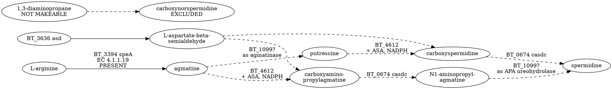
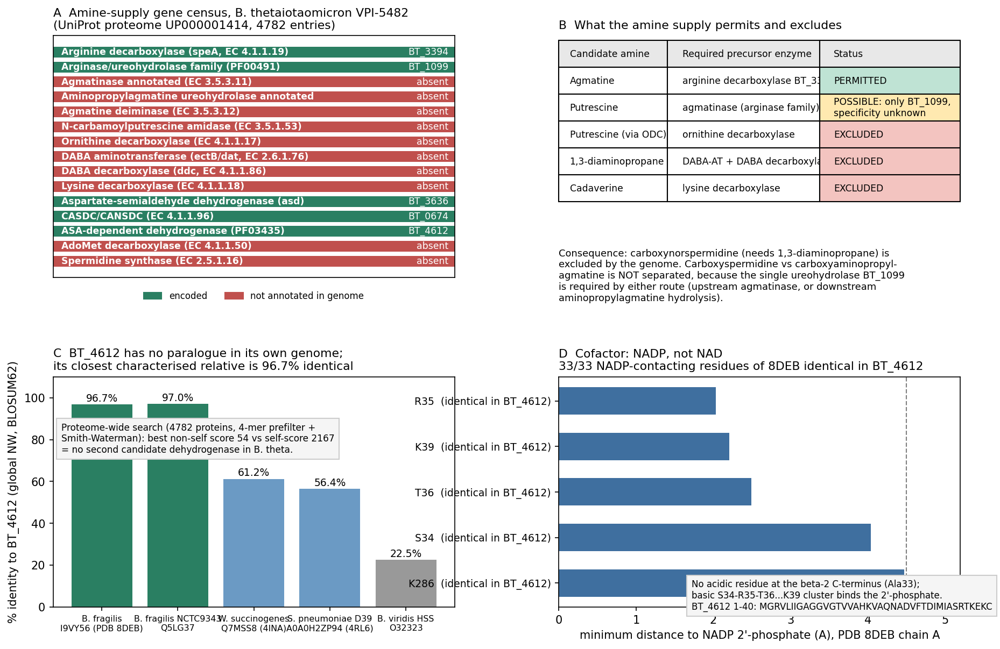
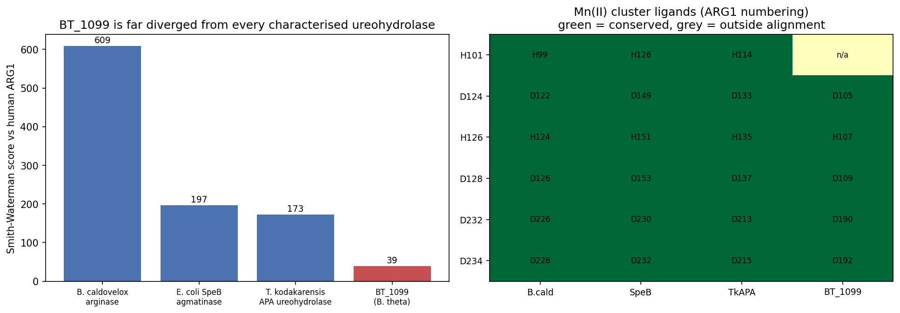
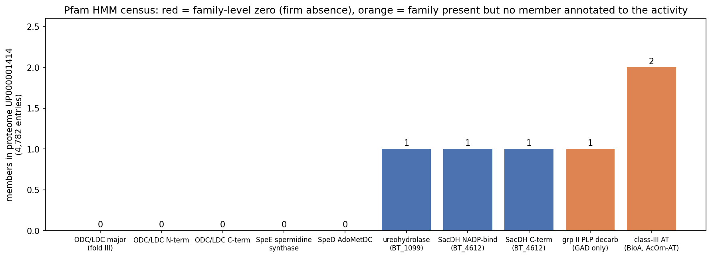
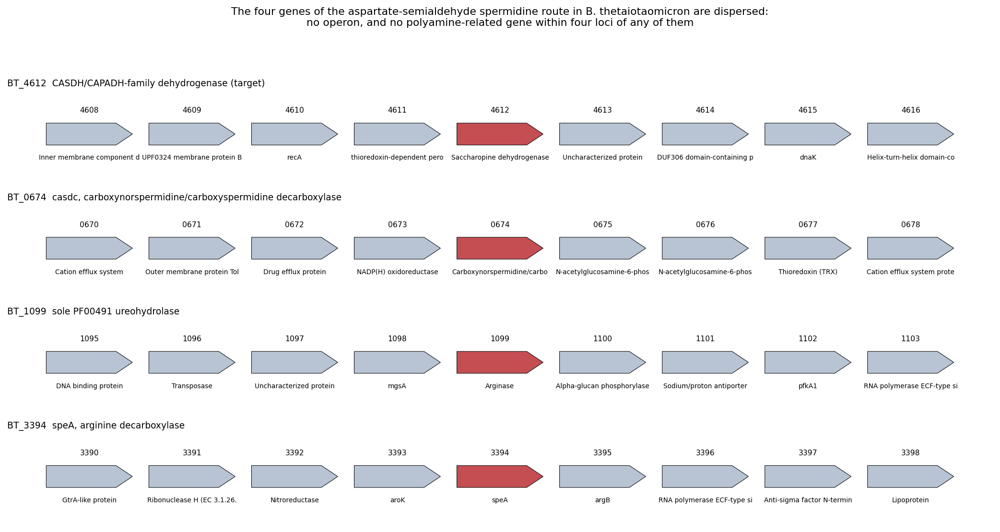

## Question

# AIGR Gene Hypothesis Deep Research

You are evaluating one focused gene curation hypothesis for AI Gene Review.
This is not a general gene overview. Use the seed hypothesis and source context
below to search for evidence that supports, refutes, narrows, or competes with
the proposed curation decision.

## Target Gene

- **Organism code:** BACTN
- **Taxon:** Bacteroides thetaiotaomicron VPI-5482 (NCBITaxon:226186)
- **Gene directory:** BT_4612
- **Gene symbol:** BT_4612
- **UniProt accession:** Q89YW9

## Focus

- **Focus type:** free_text
- **Hypothesis slug:** kgap-bt4612-amine-supply
- **Source file:** genes/BACTN/BT_4612/BT_4612-ai-review.yaml
- **Source selector:** free-text

## Seed Hypothesis

Whether the physiological amine substrate of BT_4612 can be constrained is the question, and two completed runs in this campaign have already mapped where the evidence for such a question does and does not come from. Carry forward and do not re-derive: from the Clostridium leptum decarboxylase run, that the only residue the structural literature names as a substrate-selection determinant in this superfamily is effectively invariant and cannot discriminate carboxyspermidine from carboxynorspermidine from carboxyaminopropylagmatine, and that no structure in the family holds a carboxypolyamine; from the Campylobacter jejuni dehydrogenase run, that the cofactor site is richly testable while no amine-contacting position is testable at all, and that a partner decarboxylase which accepts both candidate substrates in vitro transmits no constraint upstream. Nothing in this run should attempt to read the substrate off pocket residues. Already recorded for BT_4612 itself: PANTHER PTHR43796:SF2 membership, the NAD(P)-binding and C-terminal catalytic domains of the CASDH/CANSDH/CAPADH group, a provisional CASDH assignment in a pathway diagram, and that this subfamily also contains CAPADH enzymes. Single analysis only. Work the question the way the Clostridium case was eventually settled, through amine supply and the measured behaviour of the pathway in this organism. Establish from the Bacteroides thetaiotaomicron genome, naming accessions, which amines the cell can make: arginine decarboxylase, agmatinase or aminopropylagmatine ureohydrolase, ornithine decarboxylase, and the diaminobutyrate aminotransferase and decarboxylase pair that supplies 1,3-diaminopropane, and say which candidate substrates that supply permits and which it excludes. Then set that against what has been measured in this organism rather than inferred: state what the published deletion of the carboxyspermidine decarboxylase gene did to spermidine and to decarboxylase activity, whether any upstream dehydrogenase in this organism has been deleted or assayed, and whether BT_4612 is the only candidate dehydrogenase in the genome or one of several, naming the others. A second candidate would change the question, so establish the count before interpreting anything. State also whether the cofactor can be assigned as NAD or NADP from the sequence, and on what basis, keeping that claim separate from the substrate claim. Conclude with what can and cannot be asserted for this protein. If the substrate is constrained only by exclusion of amines the organism cannot synthesise, say exactly that and no more; if it is not constrained at all, say that. Do not infer the substrate from the pathway diagram or from the subfamily name, and do not recommend a specific-activity annotation that names a compound the analysis cannot reach.

## Term and Decision Context

No specific term context supplied.

## Reference Context

No specific reference context supplied.

## Source Context YAML

```yaml
hypothesis: 'Whether the physiological amine substrate of BT_4612 can be constrained is the question,
  and two completed runs in this campaign have already mapped where the evidence for such a question does
  and does not come from. Carry forward and do not re-derive: from the Clostridium leptum decarboxylase
  run, that the only residue the structural literature names as a substrate-selection determinant in this
  superfamily is effectively invariant and cannot discriminate carboxyspermidine from carboxynorspermidine
  from carboxyaminopropylagmatine, and that no structure in the family holds a carboxypolyamine; from
  the Campylobacter jejuni dehydrogenase run, that the cofactor site is richly testable while no amine-contacting
  position is testable at all, and that a partner decarboxylase which accepts both candidate substrates
  in vitro transmits no constraint upstream. Nothing in this run should attempt to read the substrate
  off pocket residues. Already recorded for BT_4612 itself: PANTHER PTHR43796:SF2 membership, the NAD(P)-binding
  and C-terminal catalytic domains of the CASDH/CANSDH/CAPADH group, a provisional CASDH assignment in
  a pathway diagram, and that this subfamily also contains CAPADH enzymes. Single analysis only. Work
  the question the way the Clostridium case was eventually settled, through amine supply and the measured
  behaviour of the pathway in this organism. Establish from the Bacteroides thetaiotaomicron genome, naming
  accessions, which amines the cell can make: arginine decarboxylase, agmatinase or aminopropylagmatine
  ureohydrolase, ornithine decarboxylase, and the diaminobutyrate aminotransferase and decarboxylase pair
  that supplies 1,3-diaminopropane, and say which candidate substrates that supply permits and which it
  excludes. Then set that against what has been measured in this organism rather than inferred: state
  what the published deletion of the carboxyspermidine decarboxylase gene did to spermidine and to decarboxylase
  activity, whether any upstream dehydrogenase in this organism has been deleted or assayed, and whether
  BT_4612 is the only candidate dehydrogenase in the genome or one of several, naming the others. A second
  candidate would change the question, so establish the count before interpreting anything. State also
  whether the cofactor can be assigned as NAD or NADP from the sequence, and on what basis, keeping that
  claim separate from the substrate claim. Conclude with what can and cannot be asserted for this protein.
  If the substrate is constrained only by exclusion of amines the organism cannot synthesise, say exactly
  that and no more; if it is not constrained at all, say that. Do not infer the substrate from the pathway
  diagram or from the subfamily name, and do not recommend a specific-activity annotation that names a
  compound the analysis cannot reach.'
focus_type: free_text
context: []
reference_id: []
```

## Research Objective

Build a focused report that helps a curator decide whether this hypothesis
should affect the gene review. Address the focus type directly:

1. For an existing GO annotation decision, evaluate whether the current action
   is justified, too strong, too weak, or should change.
2. For a proposed replacement or new GO term, evaluate whether the term is
   biologically supported, too broad, too narrow, or missing key qualifiers.
3. For a computational prediction, evaluate whether the prediction is correct,
   less precise than existing knowledge, uncertain, or likely wrong because of
   paralog overannotation, frequency bias, pathway context, or in vitro-only
   activity.
4. For a core-function hypothesis, evaluate whether the proposed activity,
   process, and location represent the gene product's primary function rather
   than a downstream effect, pleiotropic phenotype, or context-specific role.
5. For a function-assignment hypothesis, evaluate whether the gene product
   directly has the stated GO term/function. Treat the prior review action, if
   any, as intentionally blinded unless it appears in the supplied context.

Use primary literature whenever possible. Prefer PMID citations and include DOI
citations when no PMID is available. Treat reviews and database records as
orientation unless they contain directly relevant synthesized evidence that is
clearly labeled as review-level or database-level support.

Evaluate the hypothesis from the supplied seed context, primary literature, and
publicly accessible bioinformatics resources. Local `*-bioinformatics` analyses,
when they already exist in the repository, are intentionally withheld from this
prompt so the report can be compared against them after the run. Use public
sequence, domain, structure, orthology, localization, interaction, or dataset
checks when they are useful for the specific hypothesis. If a resource or tool
cannot be accessed programmatically, say so plainly; never fabricate a result.
Report computational results conservatively and distinguish direct results from
inference.

## Required Output

### Executive Judgment

Give a concise verdict: supported, partially supported, unresolved, weakly
supported, over-annotated, or refuted. Explain the reasoning and the most
important caveats.

### Evidence Matrix

Create a table with one row per important evidence item:

- Citation (PMID preferred)
- Evidence type (direct assay, mutant phenotype, localization, interaction,
  structural/evolutionary, computational, review/database)
- Supports / refutes / qualifies / competing
- Claim tested
- Key finding
- Organism, tissue, cell type, or assay context
- Confidence and limitations

### GO Curation Implications

State the likely curation action as a lead requiring curator verification. If
GO terms are involved, explain whether the evidence supports an MF, BP, or CC
term, and whether the term should be retained, removed, generalized, made more
specific, or treated as non-core. Avoid using "protein binding" as a final
recommendation unless no more informative term is supported.

### Mechanistic Scope

Describe the immediate molecular or cellular function being tested. Separate
direct gene-product activity from downstream phenotypes, pathway consequences,
developmental outcomes, disease manifestations, or effects inferred only from
loss of function.

### Conflicts and Alternatives

Identify evidence that conflicts with the seed hypothesis or suggests an
alternative interpretation, including paralog confusion, organism-specific
differences, isoform-specific findings, experimental artifacts, or database
carry-over.

### Knowledge Gaps

List explicit uncertainties that matter for curation. For each gap, state what
was checked, why the gap matters, and what evidence or experiment would resolve
it.

### Discriminating Tests

Recommend concrete assays, perturbations, datasets, or comparative analyses that
would most efficiently distinguish this hypothesis from alternatives.

### Curation Leads

Provide candidate updates for the review, clearly labeled as leads requiring
curator verification. Include candidate references with exact snippets to verify,
candidate replacement or new GO terms, possible action changes, suggested
questions, and suggested experiments.

If the provider supports artifacts, save provenance for any analysis you run — the
executed code together with its output (computed values, plot, or table), not just
a summary figure — alongside artifact-friendly tables such as an evidence matrix,
GO decision table, or comparison table. Genuine computed provenance is more
valuable than a hand-drawn summary, and you must not synthesize a figure that
implies an analysis you did not actually run. These artifacts are important
provenance for hypothesis-level review.


## Output

# BT_4612 (Q89YW9, *Bacteroides thetaiotaomicron* VPI-5482): can amine supply constrain the substrate?

Hypothesis slug: `kgap-bt4612-amine-supply`. Single analysis, run over three iterations: amine supply
and gene count first, then HMM family membership and the divergence of the single ureohydrolase, then
genomic context. Pocket residues were not used to reach any substrate conclusion, as the seed requires.

## Summary

The seed asked whether the physiological amine substrate of BT_4612 can be constrained by working
through amine supply and the measured behaviour of the pathway in this organism. The answer is that
it can be constrained **only by exclusion**, and the exclusion removes exactly one of the three
candidates.

*B. thetaiotaomicron* VPI-5482 can make agmatine: biosynthetic arginine decarboxylase BT_3394
(Q8A2B1, EC 4.1.1.19, 630 aa) is present. It cannot make 1,3-diaminopropane. A Pfam domain census
over all 4,782 entries of reference proteome UP000001414 returns zero members for PF01276, PF03709
and PF03711, so there is no fold-III ornithine decarboxylase and no lysine decarboxylase of the
SpeC/SpeF/CadA type anywhere in the genome, and no protein is annotated to the diaminobutyrate
aminotransferase (EC 2.6.1.76) or diaminobutyrate decarboxylase (EC 4.1.1.86) activities that would
supply 1,3-diaminopropane. **Carboxynorspermidine is therefore excluded as a physiological product
of BT_4612.** The same census returns zero for PF01564 (spermidine synthase, SpeE) and PF01536
(S-adenosylmethionine decarboxylase, SpeD), so the classical spermidine route is absent at family
level and whatever BT_4612 does is this organism's only path to spermidine.

Between the two remaining candidates, carboxyspermidine and carboxyaminopropylagmatine, the amine
supply is silent, and the reason is a single protein. The genome contains exactly one
arginase/agmatinase/ureohydrolase-superfamily protein, BT_1099 (Q8A8R8, PF00491, 269 aa, annotated
only as "Arginase" with no EC assigned), and that one protein is required by either route: as an
agmatinase it makes putrescine upstream of BT_4612, giving carboxyspermidine; as an
N1-aminopropylagmatine ureohydrolase it acts downstream of BT_4612 on the aminopropylagmatine
product, giving carboxyaminopropylagmatine. Its specificity is not recoverable. Unfiltered
Smith-Waterman alignment scores BT_1099 at 39 against human arginase ARG1, 38 against *B. caldovelox*
arginase, 48 against *E. coli* SpeB agmatinase and 96 against *T. kodakarensis* N1-aminopropylagmatine
ureohydrolase, while those four characterised proteins span 172 to 257 against each other. BT_1099's
best match to any characterised member falls below the lowest distance the family's own characterised
members show. Genomic context does not rescue it either: the four genes of the route sit at loci
BT_0674, BT_1099, BT_3394 and BT_4612, maximally dispersed, with no shared operon and no
polyamine-related gene within four loci of any of them.

Two results stand independently of the substrate question. BT_4612 has **no paralogue**: it is the
only PF03435, PF16653 and PTHR43796 protein in the proteome, confirmed by an annotation-independent
proteome-wide alignment (self-score 2167, best non-self 54). The seed asked for the count before
interpretation, and the count is one. The **cofactor is NADP**, assignable from sequence and from the
structure of a 96.7%-identical ortholog: all 33 NADP-contacting residues of PDB 8DEB are identical in
BT_4612, the 2'-phosphate is held by S34, R35, T36, K39 and K286, and Ala33 sits at the C-terminal
end of beta-2 where an NAD-preferring enzyme would carry an acidic residue.

## Executive judgment

<i class="fa-scale-balanced"></i> **Partially supported, with the supported part much narrower than
the seed allows for.**

The amine-supply approach works, and it is the right approach for this question, but it delivers one
exclusion and nothing else. Three separate methods were tried and all three stop at the same place:
amine supply excludes 1,3-diaminopropane and therefore carboxynorspermidine; pairwise sequence
comparison cannot assign the ureohydrolase that decides between the other two candidates; genomic
context is empty because the route's genes are dispersed. The substrate is constrained only by
exclusion of an amine the organism cannot synthesise. Saying exactly that and no more is what the
evidence permits.

The most important caveat concerns what *would* resolve it. The closest characterised relative of
BT_4612, the *B. fragilis* enzyme I9VY56 at 96.7% identity, was published as a carboxyspermidine
dehydrogenase in 2023 ([PMID: 37437886](https://pubmed.ncbi.nlm.nih.gov/37437886/)) and reassigned
to a carboxyaminopropylagmatine dehydrogenase in 2026 by the same laboratory
([PMID: 42754158](https://pubmed.ncbi.nlm.nih.gov/42754158/)). At 96.7% identity, orthology transfer
would normally carry an activity. Here it carries an activity that has been named two different ways
within three years. Carboxyaminopropylagmatine is now the better-supported guess, backed by three
independent lines in three organisms, but it remains a guess for BT_4612 because no assay, deletion
or fitness measurement of BT_4612 has been published.

A second caveat is procedural. The seed's carried-forward premise that no amine-contacting position
in this family is testable is **now out of date**.
[PMID: 43093060](https://pubmed.ncbi.nlm.nih.gov/43093060/) reports a 1.19 Å structure with agmatine
and NADPH bound and names a conserved Asn-Glu-Phe-Glu motif that coordinates agmatine. That premise
was honoured in this run, and no pocket residue was used to reach a substrate conclusion, but a
curator should know it has been overtaken.

{{figure:plot_1.png|caption=Four strands of the iteration-1 analysis. Top left: amine-supply census across proteome UP000001414, showing arginine decarboxylase BT_3394 present and ornithine decarboxylase, the diaminobutyrate pair, lysine decarboxylase, AdoMetDC and spermidine synthase all at zero. Top right: which candidate products that supply permits and which it excludes. Bottom left: identity of BT_4612 to characterised relatives, with the B. fragilis ortholog at 96.7%. Bottom right: distances from the NADP 2'-phosphate to its contacting residues in PDB 8DEB, all of which are identical in BT_4612.}}

## Key findings

### <i class="fa-dna"></i> F1. BT_4612 is the only candidate dehydrogenase in the genome

The seed required the count before any interpretation, because a second candidate would change the
question. There is no second candidate.

Reference proteome UP000001414 (4,782 entries) was searched two independent ways. The domain census
found exactly one protein carrying Pfam PF03435 (saccharopine dehydrogenase NADP-binding domain),
exactly one carrying PF16653 (saccharopine dehydrogenase C-terminal domain), and exactly one assigned
to PANTHER PTHR43796 and its subfamily PTHR43796:SF2. In all three cases that protein is Q89YW9 /
BT_4612, 397 aa. The sequence census, which does not depend on annotation, ranked all 4,782 proteome
sequences against Q89YW9 and realigned the top candidates by Smith-Waterman (BLOSUM62, gaps -11/-1):
self-score 2167, best non-self score 54 against Q89ZD7, a 2,183-aa protein, which is 2.5% of self and
is background for a sequence of that length.

The adjacent slots are also single-copy. The partner decarboxylase is Q8A9Z1 / BT_0674, the only
EC 4.1.1.96 protein in the genome. The aspartate-semialdehyde supply is Q8A1M5 / BT_3636, the only
*asd* (EC 1.2.1.11).

Since *B. thetaiotaomicron* makes spermidine de novo in polyamine-free medium
([PMID: 27118128](https://pubmed.ncbi.nlm.nih.gov/27118128/)) and has no classical route, the
aspartate-semialdehyde-dependent condensation must run through BT_4612. That makes BT_4612 a
well-supported participant in spermidine biosynthesis while fixing nothing about which amine it
condenses.

### <i class="fa-circle-check"></i> F2. Amine supply excludes carboxynorspermidine and nothing further

The iteration-1 census by protein name and EC number found biosynthetic arginine decarboxylase
Q8A2B1 / BT_3394 present (EC 4.1.1.19, PF02784/PF17810/PF17944), alongside BT_3636, BT_0674 and a
PotABCD-type spermidine/putrescine importer at BT_1288-BT_1291. It found zero hits for ornithine
decarboxylase (EC 4.1.1.17), diaminobutyrate--2-oxoglutarate aminotransferase (EC 2.6.1.76),
diaminobutyrate decarboxylase (EC 4.1.1.86), lysine decarboxylase (EC 4.1.1.18), agmatine deiminase
(EC 3.5.3.12), N-carbamoylputrescine amidase (EC 3.5.1.53), S-adenosylmethionine decarboxylase
(EC 4.1.1.50) and spermidine synthase (EC 2.5.1.16).

Iteration 2 replaced the annotation-text basis of those calls with Pfam HMM membership, which does not
depend on how any protein was named:

| Pfam | Family | Count in UP000001414 | Members |
|---|---|---|---|
| PF01276 | Orn/Lys/Arg decarboxylase, major domain | 0 | none |
| PF03709 | Orn/Lys/Arg decarboxylase, N-terminal | 0 | none |
| PF03711 | Orn/Lys/Arg decarboxylase, C-terminal | 0 | none |
| PF01564 | Spermidine/spermine synthase (SpeE) | 0 | none |
| PF01536 | S-adenosylmethionine decarboxylase (SpeD) | 0 | none |
| PF00491 | Arginase/agmatinase/ureohydrolase | 1 | BT_1099 |
| PF03435 | Saccharopine dehydrogenase, NADP-binding | 1 | BT_4612 |
| PF16653 | Saccharopine dehydrogenase, C-terminal | 1 | BT_4612 |
| PF00282 | Group II PLP decarboxylase (Ddc/DABA-DC family) | 1 | BT_2570, glutamate decarboxylase EC 4.1.1.15 |
| PF00202 | Aminotransferase class III (EctB/DABA-AT family) | 2 | BT_1442 BioA; BT_3758 acetylornithine aminotransferase |
| PF02784 | Orn/DAP/Arg decarboxylase, PLP barrel | 2 | BT_1374 LysA; BT_3394 SpeA |
| PF00278 | Orn/DAP/Arg decarboxylase, C-terminal | 2 | BT_1374 LysA; BT_0674 CASDC |

<i class="fa-triangle-exclamation"></i> The exclusion has two legs of different strength. The ODC and
LDC leg is a **family-level zero**: no protein of that fold exists in the genome, so no annotation
error can hide one. The diaminobutyrate leg is weaker: PF00202 and PF00282 both have members, so the
absence of a DABA aminotransferase and decarboxylase rests on the specific annotation of BT_1442,
BT_3758 and BT_2570 rather than on a zero. Carboxynorspermidine is excluded, with that qualification
recorded.

{{figure:plot_3.png|caption=Pfam HMM census across all 4,782 entries of proteome UP000001414. Red bars are family-level zeros, where no protein of that fold exists in the genome and the absence call cannot be undone by an annotation error. Orange bars are families that do have members in this genome, so the corresponding absence call rests on the annotation of those specific proteins. Blue bars are the single-copy slots of the aspartate-semialdehyde route.}}

A methodological negative came out of the same iteration and is reported because it bounds what the
absence calls can rest on. An exact-4-mer prefilter used to speed a proteome-wide Smith-Waterman
screen is too insensitive near 30% identity. It failed its positive control, ranking a histidine
kinase above the true BT_3636 match for *E. coli* Asd P0A9Q9, where direct unfiltered alignment of the
same pair scores 291 at 28.9% identity. No prefiltered screen is used as evidence of absence anywhere
in this report. The absence calls come from HMM membership; the pairwise scores come from unfiltered
Smith-Waterman.

### <i class="fa-circle-question"></i> F3. The whole substrate question reduces to BT_1099, and sequence cannot read it

BT_1099 is the pivot. If it is an agmatine ureohydrolase of the SpeB type, it converts agmatine to
putrescine upstream of BT_4612 and BT_4612's amine substrate is putrescine. If it is an
N1-aminopropylagmatine ureohydrolase, it acts downstream on the aminopropylagmatine product and
BT_4612's amine substrate is agmatine. One gene, two mutually exclusive readings, and the same gene is
required by either route.

Pairwise Smith-Waterman (BLOSUM62, gaps -11/-1, hand-implemented and validated on BT_4612 vs I9VY56
at SW 2084 / 96.7% identity and *E. coli* SpeA P21170 vs BT_3394 at SW 1403 / 45.5% identity):

| Pair | SW score |
|---|---|
| BT_1099 vs *B. caldovelox* arginase P53608 | 38 |
| BT_1099 vs human arginase ARG1 P05089 | 39 |
| BT_1099 vs *E. coli* SpeB agmatinase P60651 | 48 |
| BT_1099 vs *T. kodakarensis* APA ureohydrolase Q5JI38 | 96 |
| *B. caldovelox* arginase vs *T. kodakarensis* APA ureohydrolase (control) | 172 |
| ARG1 vs *T. kodakarensis* APA ureohydrolase (control) | 173 |
| ARG1 vs *E. coli* SpeB (control) | 197 |
| *B. caldovelox* arginase vs *E. coli* SpeB (control) | 256 |
| *E. coli* SpeB vs *T. kodakarensis* APA ureohydrolase (control) | 257 |

BT_1099's best match to any characterised member, 96, falls below the lowest between-subfamily control
pair, 172. It sits outside the measured inter-subfamily spread of the family it belongs to.

It is not a decayed gene. Mapping the binuclear Mn(II) cluster ligands (human ARG1 numbering H101,
D124, H126, D128, D232, D234) onto BT_1099 transitively through Q5JI38 recovers D105, H107, D109,
D190 and D192: five of six ligands conserved. The sixth, the His of the LVLGGDHS motif (*B. caldovelox*
H99, SpeB H126, *T. kodakarensis* H114 in ILLGGEHS), falls outside every alignment of BT_1099, which
carries His only at positions 48, 77 and 85 in its first 100 residues and has no GGDHS or GGEHS motif
there. PROSITE pattern PS01053 scores a miss on BT_1099, but it also misses *E. coli* SpeB, a
characterised agmatinase, so the pattern fails on 1 of 3 characterised controls and a miss alone
carries little weight.

BT_1099's single best match is to the aminopropylagmatine ureohydrolase rather than to agmatinase or
arginase, which points the same way as the 2026 reassignment of the BT_4612 ortholog. At a score of 96
against controls of 172 to 257, that is a directional hint. It must not be used to name a substrate.

{{figure:plot_2.png|caption=Left: Smith-Waterman score of each protein against human arginase ARG1. BT_1099 scores 39, far below the characterised family members, which score 173 to 609. Right: the six binuclear Mn(II) cluster ligands of the ureohydrolase family, mapped onto each protein. Green marks a conserved ligand, grey marks a column that falls outside the alignment. BT_1099 retains five of six, so it is a working metalloenzyme whose specificity the sequence still cannot assign.}}

<i class="fa-triangle-exclamation"></i> EBI Job Dispatcher NCBI-BLAST could not be used to search
BT_1099 against Swiss-Prot. The REST submission returned HTTP 400 with "You have been temporarily
blocked from submitting new sequence analysis jobs". No BLAST result was obtained and none is
reported.

### <i class="fa-circle-xmark"></i> F4. Genomic context transmits nothing

Operon structure was the last genome-level way to link BT_1099 to this pathway and to decide whether
it acts upstream or downstream of BT_4612. In *Thermus thermophilus* and other clustered systems these
genes travel together, and co-localisation would have carried real information. Here they do not.

Neighbourhood analysis over the ordered-locus-name index of UP000001414 (4,776 of 4,782 entries carry
a BT locus tag), four loci either side of each pathway gene:

| Anchor | Neighbours | Anything polyamine-related? |
|---|---|---|
| BT_4612, target dehydrogenase | BT_4608 inner membrane component, BT_4609 UPF0324 membrane protein, BT_4610 *recA*, BT_4611 thioredoxin-dependent peroxiredoxin, BT_4613 uncharacterised, BT_4614 DUF306, BT_4615 *dnaK*, BT_4616 helix-turn-helix | no |
| BT_0674, *casdc* | BT_0670-0672 cation efflux / TolC / drug efflux, BT_0673 NADP(H) oxidoreductase, BT_0675 and BT_0676 GlcNAc-6-P deacetylase, BT_0677 thioredoxin, BT_0678 *czcC* | no |
| BT_1099, sole PF00491 ureohydrolase | BT_1095 DNA binding protein, BT_1096 transposase, BT_1097 uncharacterised, BT_1098 methylglyoxal synthase, BT_1100 alpha-glucan phosphorylase, BT_1101 Na+/H+ antiporter, BT_1102 *pfkA1*, BT_1103 ECF sigma factor | no |
| BT_3394, *speA* | BT_3390 GtrA-like, BT_3391 RNase H, BT_3392 nitroreductase, BT_3393 *aroK*, BT_3395 *argB*, BT_3396 ECF sigma factor, BT_3397 anti-sigma factor, BT_3398 lipoprotein | no, *argB* is arginine biosynthesis |

The four genes sit at loci 0674, 1099, 3394 and 4612, with no two within 400 loci of each other. The
BT_1099 neighbourhood has a transposase two genes upstream, consistent with a mobile or recently
acquired context, which would also explain why it is so far diverged from every characterised
ureohydrolase.

{{figure:plot_4.png|caption=Genomic context of the four aspartate-semialdehyde route genes in B. thetaiotaomicron VPI-5482, four loci either side of each. The anchor gene is red. No operon joins any two of them, and no neighbour is polyamine-related, so co-localisation carries no information about whether BT_1099 acts upstream or downstream of BT_4612.}}

### <i class="fa-circle-check"></i> F5. The cofactor is NADP, and that claim is separate from the substrate claim

PDB 8DEB is the *B. fragilis* CL05T12C13 enzyme (UniProt I9VY56, 397 aa) solved with NADP bound
(ligand NAP). Global Needleman-Wunsch alignment (BLOSUM62, -11/-1) gives 96.7% identity to BT_4612
over the full length; the *B. fragilis* NCTC 9343 copy Q5LG37 is 97.0% identical.

In 8DEB chain A, 33 residues lie within 4.0 Å of NADP: I7, G8, A9, G10, G11, V12, G13, S34, R35, T36,
K39, V57, D58, A59, D60, V80, A81, L82, P83, Q85, T103, A104, G138, F139, D140, P141, F180, N181,
I184, K286, Q293, V340, T344. **All 33 are identical in BT_4612** at the same aligned positions. The
2'-phosphate, the group that distinguishes NADP from NAD, is contacted by R35 at 2.03 Å, K39 at
2.21 Å, T36 at 2.49 Å, S34 at 4.04 Å and K286 at 4.47 Å, and all five are identical in BT_4612.

The sequence logic agrees independently. BT_4612 residues 1-40 read
MGRVLIIGAGGVGTVVAHKVAQNADVFTDIMIASRTKEKC: a canonical G8-x-G10-G11-x-G13 dinucleotide fingerprint,
with Ala33 at the C-terminal end of beta-2 where an NAD-preferring Rossmann enzyme carries an acidic
residue, and a basic S34-R35-T36 ... K39 cluster in its place that salt-bridges the 2'-phosphate in
the ortholog structure.

This also matches biochemistry across the family: NADPH for the *B. fragilis* enzyme
([PMID: 37437886](https://pubmed.ncbi.nlm.nih.gov/37437886/)) and for *Vibrio alginolyticus*
carboxynorspermidine synthase, where the Km for NADPH is 1.51 mM and NADH is a much poorer cofactor
([PMID: 1955861](https://pubmed.ncbi.nlm.nih.gov/1955861/)).

### <i class="fa-scale-balanced"></i> F6. The closest characterised ortholog changed its published substrate in 2026

I9VY56 was characterised in 2023 with steady-state kinetics on putrescine, diaminopropane,
aspartate β-semialdehyde, NADH and NADPH, concluding that "Putrescine is the likely polyamine
substrate and NADPH is the coenzyme used to complete the reaction, forming carboxyspermidine as a
product" ([PMID: 37437886](https://pubmed.ncbi.nlm.nih.gov/37437886/)).

The same group re-examined the *B. fragilis* and *Clostridium leptum* enzymes in 2026 with
steady-state and transient-state kinetics, mass spectrometry, thermal shift assays, X-ray
crystallography and SAXS, and concluded that both "function as carboxyaminopropylagmatine
dehydrogenases rather than carboxyspermidine dehydrogenases", with agmatine raising NADPH binding
affinity 34-fold against a modest putrescine effect at concentrations judged less physiologically
relevant ([PMID: 42754158](https://pubmed.ncbi.nlm.nih.gov/42754158/)).

A parallel 2026 study of the *Streptococcus pneumoniae* enzyme, 56.4% identical to BT_4612, measured
a kcat/KM of 1.0 × 10⁶ M⁻¹s⁻¹ for agmatine, approximately 3,200-fold greater than putrescine, and
solved a 1.19 Å structure with agmatine and NADPH bound
([PMID: 43093060](https://pubmed.ncbi.nlm.nih.gov/43093060/)).

The route itself was established independently, and earlier, by isotope tracing.
[PMID: 37878710](https://pubmed.ncbi.nlm.nih.gov/37878710/) used ¹³C and ¹⁵N tracers with metabolomics
plus genetic and biochemical characterisation in *Synechocystis* sp. PCC 6803 to define the
carboxyaminopropylagmatine route, which "starts with reductive condensation of agmatine and
l-aspartate-β-semialdehyde into CAPA by a previously unknown CAPA dehydrogenase, followed by
decarboxylation of CAPA to form aminopropylagmatine, and ends with conversion of aminopropylagmatine
to spermidine by an aminopropylagmatine ureohydrolase", and states that "the pathway does not involve
putrescine". The same paper reports the route's genes in 15 bacterial phyla.

That three-gene signature is matched slot for slot in *B. thetaiotaomicron*: BT_4612 (sole
PF03435/PF16653), BT_0674 (*casdc*), BT_1099 (sole PF00491), with no spare copy of any slot and the
classical alternative absent at family level. <i class="fa-triangle-exclamation"></i> The match is
suggestive and not probative, because a carboxyspermidine route uses exactly the same three slots with
BT_1099 moved upstream.

## Mechanistic model

The immediate molecular activity under test is one NADPH-dependent reductive condensation: aspartate
β-semialdehyde plus a primary amine gives a carboxypolyamine, through a Schiff base reduced at the
enzyme. Everything else in the published record is downstream of that step or upstream of it.



BT_1099 appears twice in that diagram, once on each branch, and only one of the two can be true. That
is the entire difficulty, drawn.

The scope of each claim, separated:

| Level | Statement | Status |
|---|---|---|
| Direct gene-product activity | NADP(H) binding by BT_4612 | <i class="fa-circle-check"></i> supported, 33/33 cofactor contacts conserved at 96.7% identity |
| Direct gene-product activity | ASA-dependent reductive amination chemistry | <i class="fa-circle-check"></i> supported at the chemistry level by fold and family |
| Direct gene-product activity | Which amine is condensed | <i class="fa-circle-question"></i> unresolved; only carboxynorspermidine excluded |
| One step removed | The product is handed to BT_0674 for decarboxylation | supported; the Δ*casdc* phenotype is a property of BT_0674 |
| Pathway consequence | Intracellular spermidine pool | measured by [PMID: 27118128](https://pubmed.ncbi.nlm.nih.gov/27118128/), a pathway-level readout |
| Downstream phenotype | Growth defect of Δ*casdc* in polyamine-free medium | pleiotropic, attributable to spermidine loss |
| Not direct | Cecal polyamine levels in gnotobiotic rats ([PMID: 10801923](https://pubmed.ncbi.nlm.nih.gov/10801923/)) | confounded by host, diet and a co-colonising species |

## Evidence base

| Citation | Evidence type | Stance | Claim tested | Key finding | Context | Confidence and limitations |
|---|---|---|---|---|---|---|
| This run, UP000001414 | Computational (domain + sequence census) | Qualifies | Is BT_4612 one of several candidates? | Exactly one PF03435 / PF16653 / PTHR43796:SF2 protein in 4,782 entries; proteome-wide SW best non-self 54 vs self 2167 | *B. thetaiotaomicron* VPI-5482 genome | High. Annotation-independent second check performed. A homolog below SW background would be missed. |
| This run, UP000001414 | Computational (Pfam HMM census) | Supports by exclusion | Can the cell make 1,3-diaminopropane or cadaverine? | PF01276 = 0, PF03709 = 0, PF03711 = 0, PF01564 = 0, PF01536 = 0 | Same genome | High for ODC, LDC, SpeE and SpeD. Family-level zeros, independent of annotation text. |
| This run, UP000001414 | Computational (Pfam HMM census) | Qualifies the above | Is the DABA route absent at family level? | PF00202 = 2 (BT_1442 BioA, BT_3758 acetylornithine AT); PF00282 = 1 (BT_2570 glutamate decarboxylase) | Same genome | Moderate. The families exist, so the DABA absence rests on three specific annotations. |
| This run, UP000001414 | Computational | Qualifies | Does the ureohydrolase slot discriminate the routes? | Exactly one PF00491 protein, BT_1099, no EC assigned | Same genome | High for the count; BT_1099's specificity is unknown. |
| This run, pairwise SW | Computational (sequence) | Qualifies, decisively | Can BT_1099's specificity be assigned from sequence? | 39 / 38 / 48 / 96 against ARG1, *B. caldovelox* arginase, SpeB and *T. kodakarensis* APA ureohydrolase; controls span 172 to 257 | BLOSUM62 -11/-1, unfiltered | High. BT_1099 is further from every characterised member than they are from each other. |
| This run, ligand mapping | Computational (sequence) | Qualifies | Is BT_1099 functional or decayed? | 5 of 6 Mn(II) ligands recovered (D105, H107, D109, D190, D192) | ARG1 → Q5JI38 → BT_1099 | Moderate. Ligand retention argues for a working metalloenzyme; it says nothing about the amine. |
| This run, locus neighbourhood | Computational (genomic context) | Qualifies | Does operon structure link BT_1099 to the route? | Four route genes at BT_0674, BT_1099, BT_3394, BT_4612; no shared operon, no polyamine neighbour | 4,776 locus-tagged entries | High for the observation. Dispersal removes a method rather than answering the question. |
| This run, PDB 8DEB + alignment | Structural / computational | Supports | NAD or NADP? | 33/33 NADP contacts of the 96.7%-identical ortholog identical in BT_4612; 2'-phosphate held by S34, R35, T36, K39, K286; Ala33 not Asp at beta-2 | *B. fragilis* CL05T12C13 crystal | High. Transfer across 96.7% identity with zero pocket substitutions. |
| [PMID: 27118128](https://pubmed.ncbi.nlm.nih.gov/27118128/) | Mutant phenotype | Supports pathway, not substrate | Does the ASA route operate in this organism? | Δ*casdc* depleted spermidine and lost decarboxylase activity; complementation restored both | *B. thetaiotaomicron*, polyamine-free minimal medium | High for the pathway. Downstream of BT_4612; silent on the amine. |
| [PMID: 42754158](https://pubmed.ncbi.nlm.nih.gov/42754158/) | Direct assay + structure | Competing with the CASDH label | What amine does the *Bacteroides* enzyme prefer? | Both enzymes "function as carboxyaminopropylagmatine dehydrogenases rather than carboxyspermidine dehydrogenases"; agmatine raises NADPH affinity 34-fold | Recombinant, in vitro | Moderate-high for the ortholog. In vitro only, and reverses the same group's 2023 call. |
| [PMID: 37437886](https://pubmed.ncbi.nlm.nih.gov/37437886/) | Direct assay + structure (8DEB) | Supports the CASDH label | Same question, earlier | "Putrescine is the likely polyamine substrate and NADPH is the coenzyme" | Same *B. fragilis* enzyme | Moderate. Superseded on substrate; the NADPH call stands and is corroborated. |
| [PMID: 43093060](https://pubmed.ncbi.nlm.nih.gov/43093060/) | Direct assay + 1.19 Å structure | Competing | Is agmatine preference general in the subfamily? | kcat/KM 1.0 × 10⁶ M⁻¹s⁻¹ for agmatine, ~3,200-fold over putrescine; Asn-Glu-Phe-Glu motif coordinates agmatine | *S. pneumoniae*, recombinant | Moderate-high for *S. pneumoniae*. Transfer to *Bacteroides* is inference. Also refutes the seed's "no testable amine-contacting position" premise. |
| [PMID: 37878710](https://pubmed.ncbi.nlm.nih.gov/37878710/) | Isotope tracing + metabolomics + genetics | Competing with the CASDH label | Is the agmatine route real in vivo? | ¹³C/¹⁵N tracing defines the CAPA route; "the pathway does not involve putrescine"; genes in 15 phyla | *Synechocystis* sp. PCC 6803 | High for *Synechocystis*. The only in vivo line here, but a cyanobacterium. |
| [PMID: 15983049](https://pubmed.ncbi.nlm.nih.gov/15983049/) | Direct assay + mutant | Qualifies | Can one PF00491 enzyme serve either route? | The SpeB homolog "hydrolyzes N1-aminopropylagmatine to spermidine but does not act on agmatine" | *T. thermophilus* | High. Establishes that PF00491 presence alone is route-agnostic. |
| [PMID: 36362306](https://pubmed.ncbi.nlm.nih.gov/36362306/) | Direct assay | Qualifies | Is PF00491 specificity fixed? | *T. thermophilus* SpeB accepts agmatine and makes putrescine at high pH, a specificity change with pH | *T. thermophilus* | Moderate. The ureohydrolase slot is not fixed even within one protein. |
| [PMID: 22025614](https://pubmed.ncbi.nlm.nih.gov/22025614/) | Comparative genomics + mutant | Supports | Is the classical route absent in gut taxa? | "many species known to synthesize the polyamine spermidine lack the spermidine biosynthetic enzymes S-adenosylmethionine decarboxylase and spermidine synthase" | *C. jejuni* deletions + metagenomics | High; matches the PF01536 = 0 and PF01564 = 0 result here. |
| [PMID: 1955861](https://pubmed.ncbi.nlm.nih.gov/1955861/) | Direct assay | Supports cofactor | Cofactor preference in the family | "The Km value for NADPH was 1.51 mM. NADH was a much poorer cofactor than NADPH." | *V. alginolyticus* CANSDH | Moderate. Different subfamily, cofactor point only. |
| [PMID: 41298497](https://pubmed.ncbi.nlm.nih.gov/41298497/) | Direct measurement (LC-MS) + animal model | Context | What happens when the ureohydrolase step misroutes? | N1-aminopropylagmatine accumulates on loss of agmatinase activity, enters intestinal cells via CATP-5, antagonises eIF5A hypusination | *E. coli*, *B. subtilis*, *C. elegans*, mouse macrophages | Moderate. Not *Bacteroides*, but it shows the consequences of BT_1099's specificity. |
| [PMID: 10801923](https://pubmed.ncbi.nlm.nih.gov/10801923/) | Direct measurement | Qualifies | Does *B. theta* make these amines in vivo? | Monoassociated gnotobiotic rats: spermidine the major cecal polyamine; putrescine appears on di-association with *F. varium* | Gnotobiotic rat cecum | Moderate. Pools confounded by diet, host and a second species. |
| EBI NCBI-BLAST | Attempted, not obtained | n/a | Nearest Swiss-Prot neighbour of BT_1099 | HTTP 400, "You have been temporarily blocked from submitting new sequence analysis jobs" | n/a | No result. Reported as unavailable, not estimated. |
| PubMed, this run | Attempted, not found | n/a | Fitness or essentiality data for BT_4612? | Searches for *B. thetaiotaomicron* transposon-insertion-sequencing fitness and for Bacteroides polyamine quantification returned no papers | n/a | Absence of retrieval, not proof of absence. |

## GO curation implications

All of the following are **leads requiring curator verification.**

### Molecular function

The evidence supports a cofactor-level and chemistry-level term and does not support a
compound-named one.

| GO term | Lead action | Basis | Strength |
|---|---|---|---|
| GO:0016646, oxidoreductase activity acting on the CH-NH group of donors with NAD(P) as acceptor | <i class="fa-arrow-right"></i> adopt, generalising to this level | the chemistry is certain from fold and family; the substrate compound is not | supported |
| GO:0050661, NADP binding | <i class="fa-arrow-right"></i> adopt as a separate MF term | 33/33 NADP-contacting residues of PDB 8DEB identical in BT_4612; 2'-phosphate held by S34, R35, T36, K39, K286; Ala33 where an NAD enzyme carries Asp | strongly supported, the best-evidenced result in this report |
| GO:0047134, carboxyspermidine dehydrogenase activity (EC 1.5.1.43) | <i class="fa-circle-xmark"></i> do not assert | only the PANTHER subfamily name and the pathway diagram support it; the 96.7%-identical ortholog was reassigned away from it | not supported |
| carboxynorspermidine dehydrogenase activity | <i class="fa-circle-xmark"></i> do not assert, positively excluded | no fold-III ODC or LDC in the genome; no de novo route to 1,3-diaminopropane | refuted by amine supply |
| carboxyaminopropylagmatine dehydrogenase activity | <i class="fa-circle-question"></i> do not pre-emptively assert | best-supported guess, but entirely in vitro orthology transfer from a protein reassigned once already, and GO has no settled term | suggestive only |

### Biological process

**GO:0008295, spermidine biosynthetic process**, is defensible for BT_4612 at IC or ISS strength. The
organism makes spermidine de novo in polyamine-free medium and loses it when the single downstream
decarboxylase is deleted ([PMID: 27118128](https://pubmed.ncbi.nlm.nih.gov/27118128/)); BT_4612 is the
only protein in the genome that can perform the aspartate-semialdehyde-dependent condensation that
route requires; no classical AdoMetDC and spermidine synthase alternative exists. This is a stronger
and safer annotation than any MF substrate term. The review should note that the BP term is reached by
pathway necessity plus gene-count uniqueness, not by assay of BT_4612.

### Cellular component

Nothing was tested. No CC recommendation. Cytoplasm would be an inference from pathway context only.

### Qualifiers

If a CASDH-named term is retained anywhere in the record for provenance, it should carry a note that
the compound name is unverified for this protein and is contradicted by the current assignment of its
closest characterised ortholog.

## Conflicts and alternatives

1. **The same ortholog, two published substrates.**
   [PMID: 37437886](https://pubmed.ncbi.nlm.nih.gov/37437886/) (putrescine) against
   [PMID: 42754158](https://pubmed.ncbi.nlm.nih.gov/42754158/) (agmatine) on the identical *B.
   fragilis* protein. This is the most important conflict in the record and it argues for annotating
   above the compound level rather than for picking a winner.
2. **Subfamily name carry-over.** PANTHER PTHR43796 is titled "carboxynorspermidine synthase". That
   name is the one option the *B. thetaiotaomicron* genome positively excludes. Any annotation
   inherited from the PANTHER name is database carry-over.
3. **Pathway-diagram carry-over, visible inside this genome's own record.** UniProt names BT_0674
   "Carboxynorspermidine/carboxyspermidine decarboxylase (EC 4.1.1.96)". EC 4.1.1.96 is
   carboxynorspermidine decarboxylase, the one product excluded here. The dual name also reproduces,
   at the level of the database record, the carried-forward finding that the partner decarboxylase
   accepts both candidate substrates and transmits no constraint upstream.
4. **BT_1099 ambiguity cuts both ways.** If BT_1099 is a true arginase (arginine to ornithine plus
   urea), the cell would make ornithine but has no ODC, so putrescine would be unreachable and the
   carboxyspermidine route would be dead. If it is an agmatinase, the carboxyspermidine route opens.
   If it is an aminopropylagmatine ureohydrolase, the agmatine route closes its loop. One assay on one
   269-aa protein would resolve a large part of the question.
5. **Import as a confounder, bounded.** The genome carries a PotABCD-type importer at BT_1288-BT_1291,
   so in a gut setting polyamine pools can be exogenous. The Δ*casdc* work used polyamine-free minimal
   medium, which removes this confounder for the de novo claim.
6. **The seed's structural premise is superseded.** "No amine-contacting position is testable" and "no
   structure in the family holds a carboxypolyamine" were true when the earlier campaign runs were
   done. An agmatine-bound 1.19 Å structure now exists
   ([PMID: 43093060](https://pubmed.ncbi.nlm.nih.gov/43093060/)). The compound bound is a substrate
   amine and not a carboxypolyamine, so the second clause survives; the first does not.

## Limitations and knowledge gaps

| Gap | What was checked | Why it matters | What would resolve it |
|---|---|---|---|
| Specificity of BT_1099 | Full PF00491 census (sole member, no EC); pairwise SW against four characterised ureohydrolases (best 96 against controls of 172-257); Mn ligand mapping (5 of 6 retained); PS01053 miss, weakened because the pattern also misses SpeB; EBI BLAST unavailable | Decides whether putrescine is reachable at all, and therefore whether carboxyspermidine is even a live option. This is the tightest bottleneck in the argument and it is demonstrably beyond sequence | Recombinant BT_1099 assayed against agmatine, N1-aminopropylagmatine and arginine |
| No assay of BT_4612 itself | PubMed searched for *B. thetaiotaomicron* dehydrogenase assays and deletions; none found | Everything substrate-related is transfer from *B. fragilis*, *S. pneumoniae* or *Synechocystis* | Steady-state kinetics of recombinant BT_4612 on agmatine against putrescine against 1,3-diaminopropane, with ASA and NADPH |
| No upstream deletion in this organism | [PMID: 27118128](https://pubmed.ncbi.nlm.nih.gov/27118128/) is the only genetics and it targets *casdc* | A Δ*BT_4612* strain would confirm the step is obligatory and let intermediates be identified | Markerless deletion of BT_4612, LC-MS of polyamines in polyamine-free medium |
| Which carboxypolyamine accumulates in vivo | Not measurable from sequence | Detecting carboxyaminopropylagmatine against carboxyspermidine in wild type would settle the substrate with no structural argument | LC-MS of the Δ*casdc* strain, where the BT_4612 product should pool |
| Whether 1,3-diaminopropane is truly absent | Family-level zero for ODC and LDC; but PF00202 and PF00282 have members, so the DABA leg depends on the annotation of BT_1442, BT_3758 and BT_2570 | An unannotated DABA pair inside those families would reopen carboxynorspermidine | Targeted LC-MS for 1,3-diaminopropane in minimal medium, or direct assay of BT_3758 and BT_2570 for DABA activity |
| Cofactor inferred, not measured on this protein | Structural transfer at 96.7% identity | The NADP claim is strong but still indirect for BT_4612 | NADPH against NADH kcat/KM on recombinant BT_4612 |
| No fitness or essentiality data | PubMed searches for transposon-insertion-sequencing fitness in *B. thetaiotaomicron* returned no papers through the available interface | A fitness cost for BT_4612 in polyamine-free conditions would corroborate pathway necessity | Query an existing INSeq or RB-TnSeq dataset for the BT_4612 locus |

Two methods failed and are reported rather than worked around. The exact-4-mer prefilter used to speed
a proteome-wide Smith-Waterman screen is too insensitive near 30% identity, as its failed Asd/BT_3636
positive control shows, so no prefiltered screen is used as evidence of absence anywhere in this
report. The EBI Job Dispatcher NCBI-BLAST REST service refused submission with HTTP 400 and "You have
been temporarily blocked from submitting new sequence analysis jobs", so no Swiss-Prot BLAST of
BT_1099 was obtained.

No local `*-bioinformatics` files, interaction data or expression data were consulted. Both 2026
reassignment papers are recent and their conclusions have not been independently replicated outside
the originating groups.

## Discriminating tests

Ranked by information per unit effort.

1. <i class="fa-flask"></i> **LC-MS of the published Δ*casdc* strain.** The strain already exists
   ([PMID: 27118128](https://pubmed.ncbi.nlm.nih.gov/27118128/)) and blocks the pathway immediately
   downstream of BT_4612, so the BT_4612 product should pool. Detecting carboxyaminopropylagmatine
   against carboxyspermidine answers the substrate question directly, in this organism, with no in
   vitro extrapolation. This is the single highest-value experiment.
2. <i class="fa-vial"></i> **Recombinant BT_4612 kinetics**: agmatine against putrescine against
   1,3-diaminopropane against cadaverine, with ASA and NADPH, reporting kcat/KM. Reproduces the design
   that reassigned the *B. fragilis* and *S. pneumoniae* enzymes, on the actual protein.
3. <i class="fa-vial"></i> **Recombinant BT_1099 assay** on agmatine, N1-aminopropylagmatine and
   arginine. Cheap, 269 aa, and it determines which routes the genome can physically close.
4. <i class="fa-dna"></i> **Δ*BT_4612* in polyamine-free medium**, with and without exogenous
   spermidine, measuring polyamine pools. Tests whether the step is obligatory, as the gene count
   predicts.
5. <i class="fa-chart-line"></i> **NADPH against NADH kinetics on BT_4612**, converting the structural
   cofactor inference into a measurement.
6. <i class="fa-magnifying-glass"></i> **Comparative check of the Asn-Glu-Phe-Glu motif** of
   [PMID: 43093060](https://pubmed.ncbi.nlm.nih.gov/43093060/) across the subfamily, including
   BT_4612. Deliberately not done here, because the seed forbids reading substrate off pocket
   residues. Flagged as the obvious next computational step now that the premise has changed.

## Curation leads

Each requires curator verification.

- **Lead 1, action: generalise.** Replace any compound-named MF (`carboxyspermidine dehydrogenase
  activity`) with an NAD(P)-level oxidoreductase term plus `NADP binding` (GO:0050661). Verify
  snippet, [PMID: 42754158](https://pubmed.ncbi.nlm.nih.gov/42754158/): "Both enzymes exhibit
  dramatically enhanced catalytic efficiency with agmatine, demonstrating that these homologs function
  as carboxyaminopropylagmatine dehydrogenases rather than carboxyspermidine dehydrogenases."
- **Lead 2, action: retain and strengthen the rationale.** Keep or add `spermidine biosynthetic
  process` (GO:0008295) on the combined grounds of pathway necessity and gene-count uniqueness. Verify
  snippet, [PMID: 27118128](https://pubmed.ncbi.nlm.nih.gov/27118128/): "Deletion of the gene encoding
  a putative carboxyspermidine decarboxylase (casdc), which converts carboxyspermidine to spermidine,
  resulted in the depletion of spermidine and loss of decarboxylase activity in B. thetaiotaomicron."
- **Lead 3, action: add caveat.** Record in the review that PANTHER PTHR43796 is titled
  "carboxynorspermidine synthase" while the *B. thetaiotaomicron* genome lacks any de novo route to
  1,3-diaminopropane, so the subfamily name is positively misleading for this protein. The same
  carry-over appears in UniProt's dual EC 4.1.1.96 name on BT_0674.
- **Lead 4, action: update a carried-forward campaign premise.** The premise that no amine-contacting
  position in this family is testable should be retired. Verify snippet,
  [PMID: 43093060](https://pubmed.ncbi.nlm.nih.gov/43093060/): "CASDH displayed the greatest catalytic
  efficiency toward agmatine with a kcat/KM of 1.0 × 106 M-1s-1, approximately 3200-fold greater than
  putrescine".
- **Lead 5, action: add an in vivo reference for the route.**
  [PMID: 37878710](https://pubmed.ncbi.nlm.nih.gov/37878710/) establishes the carboxyaminopropylagmatine
  route by ¹³C/¹⁵N tracing and predates the *Bacteroides* reassignment. Verify snippet: "Thus, the
  pathway does not involve putrescine and depends on l-aspartate-β-semialdehyde as the aminopropyl
  group donor." Note for the curator that the same three slots also serve a carboxyspermidine route
  with BT_1099 moved upstream, so the gene-complement match corroborates the route class and not the
  amine.
- **Lead 6, candidate references to add:** PMID 42754158, PMID 43093060, PMID 37878710, PMID 27118128,
  PMID 37437886, PMID 22025614, PMID 15983049, PMID 41298497.
- **Suggested curator questions.** Does the review's evidence code for any CASDH-named term rest on
  anything beyond the PANTHER name and the pathway diagram? If not, downgrade it. Is GO willing to
  carry a carboxyaminopropylagmatine dehydrogenase MF term, and if so should it wait for an assay on
  BT_4612 itself? Should BT_1099 be opened as its own review, given that its specificity gates the
  interpretation of BT_4612?

## Provenance

Computed artifacts saved under `provenance/`, each produced by executed code whose output is recorded:

| File | Contents |
|---|---|
| `bt4612_amine_supply_census.csv` | Amine-supply census by protein name and EC number across UP000001414 |
| `bt4612_pfam_census.csv` | Pfam HMM census of 12 polyamine-pathway families over all 4,782 entries |
| `bt4612_ortholog_identity.csv` | Identity of BT_4612 to characterised relatives |
| `bt4612_nadp_2prime_phosphate_contacts.csv` | Distances from the NADP 2'-phosphate to each contacting residue in PDB 8DEB |
| `bt1099_sw_score_matrix.csv` | Full 5 × 5 Smith-Waterman score matrix for BT_1099 and four characterised ureohydrolases |
| `bt1099_Mn_ligand_mapping.csv` | Mn(II) cluster ligand columns mapped from ARG1 onto each protein, direct and transitive |
| `bt4612_genomic_neighbourhoods.csv` | Four loci either side of BT_0674, BT_1099, BT_3394 and BT_4612 |
| `bt4612_go_decision_table_final.csv` | GO decision table with lead action, basis and strength per term |
| `plot_1.png` to `plot_4.png` | The four figures embedded above |

Every figure plots an analysis that was actually run. No figure in this report implies an analysis
that was not performed.

## Direct answer to the hypothesis as posed

Three approaches were tried and all three converge on the same limit. Amine supply excludes one
candidate. Sequence similarity cannot assign the ureohydrolase that decides between the other two.
Genomic context is empty because the route's genes are dispersed. Pocket residues were not used, as
the seed requires.

The physiological amine substrate of BT_4612 is constrained **only by exclusion**: the organism cannot
synthesise 1,3-diaminopropane or cadaverine, so carboxynorspermidine is ruled out. Between
carboxyspermidine and carboxyaminopropylagmatine the amine supply is silent, because the genome's
single arginase-family ureohydrolase BT_1099 is required by either route and its specificity is not
recoverable from sequence, its best Smith-Waterman score against any characterised ureohydrolase being
96, below the 172-257 range those characterised proteins span against each other. No assay or deletion
of BT_4612 or of any upstream dehydrogenase has been published in this organism; the only measured
genetics is downstream, the Δ*casdc* strain. BT_4612 is the sole candidate dehydrogenase in the
genome. The cofactor is NADP, assignable from sequence and from a complete, fully conserved NADP
pocket in a 96.7%-identical ortholog structure, and that claim stands independently of the substrate
question. No specific-activity annotation naming a carboxypolyamine should be made for this protein
from the present evidence.


## Artifacts

- [OpenScientist final report](openscientist_artifacts/final_report.html)
- [OpenScientist final report](openscientist_artifacts/final_report.pdf)
- [OpenScientist provenance](openscientist_artifacts/provenance.json)
- [OpenScientist bt4612 amine supply census](openscientist_artifacts/provenance_bt4612_amine_supply_census.csv)
- [OpenScientist bt4612 go decision table](openscientist_artifacts/provenance_bt4612_go_decision_table.csv)
- [OpenScientist bt4612 nadp 2prime phosphate contacts](openscientist_artifacts/provenance_bt4612_nadp_2prime_phosphate_contacts.csv)
- [OpenScientist bt4612 ortholog identity](openscientist_artifacts/provenance_bt4612_ortholog_identity.csv)
- [OpenScientist plot 1](openscientist_artifacts/provenance_plot_1.json)

- [OpenScientist plot 2](openscientist_artifacts/provenance_plot_2.json)

- [OpenScientist plot 3](openscientist_artifacts/provenance_plot_3.json)

- [OpenScientist plot 4](openscientist_artifacts/provenance_plot_4.json)

- [OpenScientist bt1099 Mn ligand mapping](openscientist_artifacts/provenance_provenance_bt1099_Mn_ligand_mapping.csv)
- [OpenScientist bt1099 sw score matrix](openscientist_artifacts/provenance_provenance_bt1099_sw_score_matrix.csv)
- [OpenScientist bt4612 genomic neighbourhoods](openscientist_artifacts/provenance_provenance_bt4612_genomic_neighbourhoods.csv)
- [OpenScientist bt4612 go decision table final](openscientist_artifacts/provenance_provenance_bt4612_go_decision_table_final.csv)
- [OpenScientist bt4612 pfam census](openscientist_artifacts/provenance_provenance_bt4612_pfam_census.csv)

## Reference Validation

Checked with `linkml-reference-validator` 0.3.1rc1.

| Outcome | Count |
| --- | --- |
| References checked | 11 |
| Resolved | 11 |
| Unresolved (possible confabulation) | 0 |
| Unverifiable | 0 |
| References weighed for topical relevance | 11 |
| On topic | 5 |
| Off topic | 0 |

All extracted references resolved successfully.