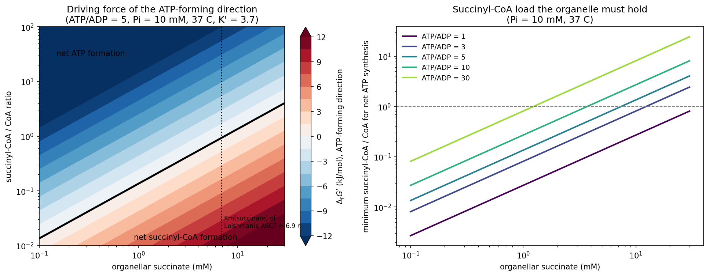
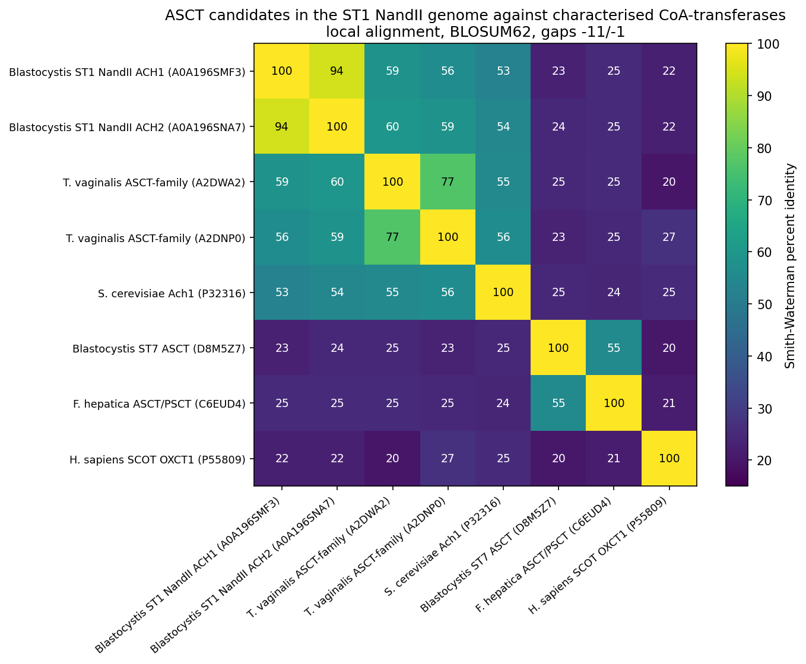
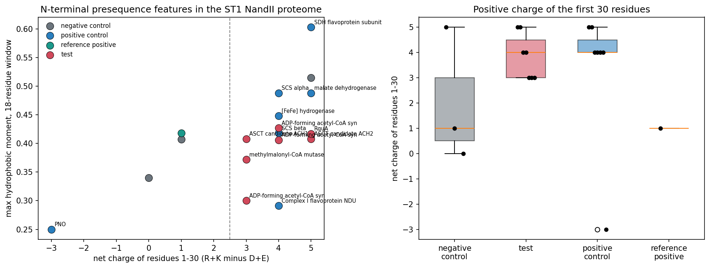
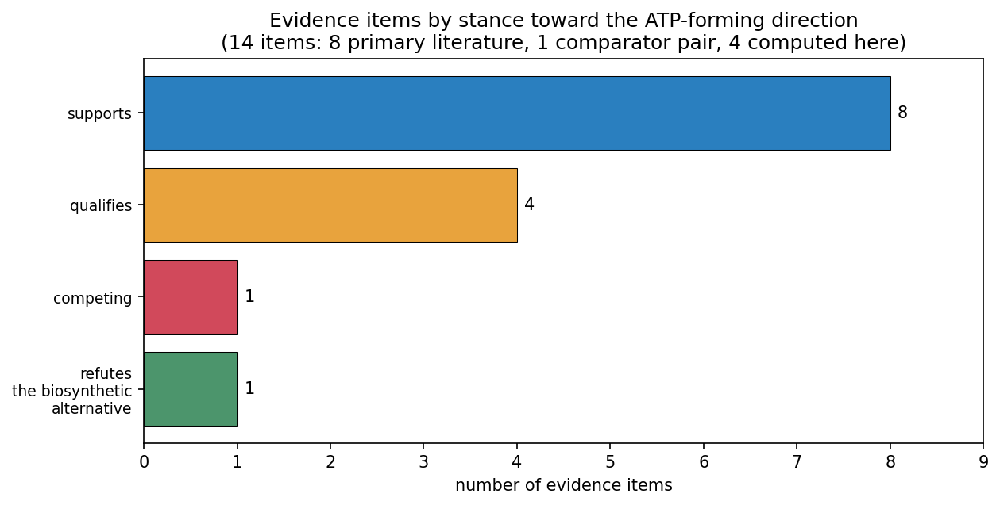
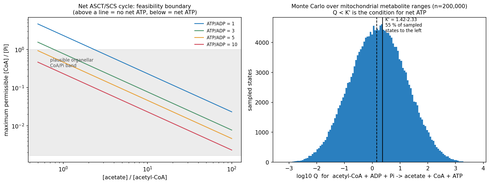
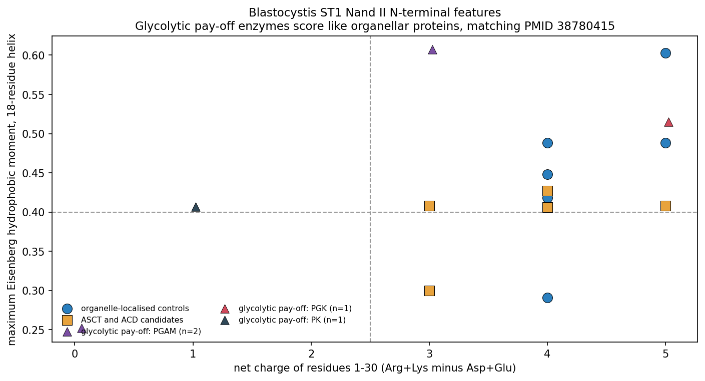

## Question

# AIGR Gene Hypothesis Deep Research

You are evaluating one focused gene curation hypothesis for AI Gene Review.
This is not a general gene overview. Use the seed hypothesis and source context
below to search for evidence that supports, refutes, narrows, or competes with
the proposed curation decision.

## Target Gene

- **Organism code:** BLAHN
- **Taxon:** Blastocystis sp. ATCC 50177/Nand II (NCBITaxon:478820)
- **Gene directory:** SCSa
- **Gene symbol:** SCSa
- **UniProt accession:** B3FHT4

## Focus

- **Focus type:** free_text
- **Hypothesis slug:** kgap-blahn-scs-direction
- **Source file:** genes/BLAHN/SCSa/SCSa-ai-review.yaml
- **Source selector:** free-text

## Seed Hypothesis

Whether the Blastocystis succinyl-CoA synthetase runs in the ATP-forming direction in the mitochondrion-related organelle, and which pathway it serves, can be constrained by thermodynamics, by the organelle's enzyme inventory, and by comparison with the other anaerobic eukaryotes whose organellar substrate-level phosphorylation has been measured, even though no flux has been measured in this organism. Already recorded and not to be re-derived: that the recombinant alpha/beta enzyme catalyses ATP-dependent succinyl-CoA formation and is specific for ATP with no detectable GTP activity, that the alpha subunit forms an active enzyme with the Plasmodium falciparum beta subunit, that the organism lacks a complete tricarboxylic acid cycle and oxidative phosphorylation, that the organelle has cristae, a membrane potential, a genome and an [FeFe] hydrogenase, that a transcript for acetate:succinate CoA-transferase exists and that this activity and succinate thiokinase activity are present in organelle fractions of another subtype, and that transcripts for the enzyme are as abundant as those for glycolytic enzymes. Single analysis only. First, treat the direction as a thermodynamic and kinetic question rather than a matter of nomenclature: state the standard free energy of the reaction and in which direction it is near equilibrium, and then say what intracellular succinyl-CoA, CoA, succinate, ADP, ATP and phosphate concentrations would be needed to drive net ATP formation, noting that assay direction in vitro says nothing about direction in vivo for a near-equilibrium ligase. Second, inventory the pathway: establish from the genome of this subtype, naming the accessions, whether acetate:succinate CoA-transferase, the enzymes that would supply succinyl-CoA, and the enzymes that would consume succinate are present, and whether a route exists that regenerates succinate so the CoA-transferase and the synthetase could run as a cycle; state whether acetate, succinate or both are reported end products of Blastocystis, distinguishing the subtype of this entry from others. Third, compare with the measured cases: state for Trichomonas vaginalis and for the other anaerobic eukaryotes in which organellar substrate-level phosphorylation by succinyl-CoA synthetase has been assayed, which direction the enzyme runs, what evidence established it, and whether the Blastocystis inventory matches those organisms or differs in a way that matters. Fourth, consider the alternative explicitly: that the enzyme runs in the succinyl-CoA-forming direction to supply succinyl-CoA for biosynthesis, and say what in the genome or the literature argues for or against it, including whether the organism has a demand for succinyl-CoA. Then give the direction the evidence favours, with the strength it deserves. If the evidence cannot distinguish the directions, say so plainly and name the measurement that would; a verdict of unresolved is acceptable. Do not infer the physiological direction from the assay direction or from the enzyme's name, and do not propose a GO annotation that asserts a direction the analysis cannot reach.

## Term and Decision Context

No specific term context supplied.

## Reference Context

No specific reference context supplied.

## Source Context YAML

```yaml
hypothesis: 'Whether the Blastocystis succinyl-CoA synthetase runs in the ATP-forming direction in the
  mitochondrion-related organelle, and which pathway it serves, can be constrained by thermodynamics,
  by the organelle''s enzyme inventory, and by comparison with the other anaerobic eukaryotes whose organellar
  substrate-level phosphorylation has been measured, even though no flux has been measured in this organism.
  Already recorded and not to be re-derived: that the recombinant alpha/beta enzyme catalyses ATP-dependent
  succinyl-CoA formation and is specific for ATP with no detectable GTP activity, that the alpha subunit
  forms an active enzyme with the Plasmodium falciparum beta subunit, that the organism lacks a complete
  tricarboxylic acid cycle and oxidative phosphorylation, that the organelle has cristae, a membrane potential,
  a genome and an [FeFe] hydrogenase, that a transcript for acetate:succinate CoA-transferase exists and
  that this activity and succinate thiokinase activity are present in organelle fractions of another subtype,
  and that transcripts for the enzyme are as abundant as those for glycolytic enzymes. Single analysis
  only. First, treat the direction as a thermodynamic and kinetic question rather than a matter of nomenclature:
  state the standard free energy of the reaction and in which direction it is near equilibrium, and then
  say what intracellular succinyl-CoA, CoA, succinate, ADP, ATP and phosphate concentrations would be
  needed to drive net ATP formation, noting that assay direction in vitro says nothing about direction
  in vivo for a near-equilibrium ligase. Second, inventory the pathway: establish from the genome of this
  subtype, naming the accessions, whether acetate:succinate CoA-transferase, the enzymes that would supply
  succinyl-CoA, and the enzymes that would consume succinate are present, and whether a route exists that
  regenerates succinate so the CoA-transferase and the synthetase could run as a cycle; state whether
  acetate, succinate or both are reported end products of Blastocystis, distinguishing the subtype of
  this entry from others. Third, compare with the measured cases: state for Trichomonas vaginalis and
  for the other anaerobic eukaryotes in which organellar substrate-level phosphorylation by succinyl-CoA
  synthetase has been assayed, which direction the enzyme runs, what evidence established it, and whether
  the Blastocystis inventory matches those organisms or differs in a way that matters. Fourth, consider
  the alternative explicitly: that the enzyme runs in the succinyl-CoA-forming direction to supply succinyl-CoA
  for biosynthesis, and say what in the genome or the literature argues for or against it, including whether
  the organism has a demand for succinyl-CoA. Then give the direction the evidence favours, with the strength
  it deserves. If the evidence cannot distinguish the directions, say so plainly and name the measurement
  that would; a verdict of unresolved is acceptable. Do not infer the physiological direction from the
  assay direction or from the enzyme''s name, and do not propose a GO annotation that asserts a direction
  the analysis cannot reach.'
focus_type: free_text
context: []
reference_id: []
```

## Research Objective

Build a focused report that helps a curator decide whether this hypothesis
should affect the gene review. Address the focus type directly:

1. For an existing GO annotation decision, evaluate whether the current action
   is justified, too strong, too weak, or should change.
2. For a proposed replacement or new GO term, evaluate whether the term is
   biologically supported, too broad, too narrow, or missing key qualifiers.
3. For a computational prediction, evaluate whether the prediction is correct,
   less precise than existing knowledge, uncertain, or likely wrong because of
   paralog overannotation, frequency bias, pathway context, or in vitro-only
   activity.
4. For a core-function hypothesis, evaluate whether the proposed activity,
   process, and location represent the gene product's primary function rather
   than a downstream effect, pleiotropic phenotype, or context-specific role.
5. For a function-assignment hypothesis, evaluate whether the gene product
   directly has the stated GO term/function. Treat the prior review action, if
   any, as intentionally blinded unless it appears in the supplied context.

Use primary literature whenever possible. Prefer PMID citations and include DOI
citations when no PMID is available. Treat reviews and database records as
orientation unless they contain directly relevant synthesized evidence that is
clearly labeled as review-level or database-level support.

Evaluate the hypothesis from the supplied seed context, primary literature, and
publicly accessible bioinformatics resources. Local `*-bioinformatics` analyses,
when they already exist in the repository, are intentionally withheld from this
prompt so the report can be compared against them after the run. Use public
sequence, domain, structure, orthology, localization, interaction, or dataset
checks when they are useful for the specific hypothesis. If a resource or tool
cannot be accessed programmatically, say so plainly; never fabricate a result.
Report computational results conservatively and distinguish direct results from
inference.

## Required Output

### Executive Judgment

Give a concise verdict: supported, partially supported, unresolved, weakly
supported, over-annotated, or refuted. Explain the reasoning and the most
important caveats.

### Evidence Matrix

Create a table with one row per important evidence item:

- Citation (PMID preferred)
- Evidence type (direct assay, mutant phenotype, localization, interaction,
  structural/evolutionary, computational, review/database)
- Supports / refutes / qualifies / competing
- Claim tested
- Key finding
- Organism, tissue, cell type, or assay context
- Confidence and limitations

### GO Curation Implications

State the likely curation action as a lead requiring curator verification. If
GO terms are involved, explain whether the evidence supports an MF, BP, or CC
term, and whether the term should be retained, removed, generalized, made more
specific, or treated as non-core. Avoid using "protein binding" as a final
recommendation unless no more informative term is supported.

### Mechanistic Scope

Describe the immediate molecular or cellular function being tested. Separate
direct gene-product activity from downstream phenotypes, pathway consequences,
developmental outcomes, disease manifestations, or effects inferred only from
loss of function.

### Conflicts and Alternatives

Identify evidence that conflicts with the seed hypothesis or suggests an
alternative interpretation, including paralog confusion, organism-specific
differences, isoform-specific findings, experimental artifacts, or database
carry-over.

### Knowledge Gaps

List explicit uncertainties that matter for curation. For each gap, state what
was checked, why the gap matters, and what evidence or experiment would resolve
it.

### Discriminating Tests

Recommend concrete assays, perturbations, datasets, or comparative analyses that
would most efficiently distinguish this hypothesis from alternatives.

### Curation Leads

Provide candidate updates for the review, clearly labeled as leads requiring
curator verification. Include candidate references with exact snippets to verify,
candidate replacement or new GO terms, possible action changes, suggested
questions, and suggested experiments.

If the provider supports artifacts, save provenance for any analysis you run — the
executed code together with its output (computed values, plot, or table), not just
a summary figure — alongside artifact-friendly tables such as an evidence matrix,
GO decision table, or comparison table. Genuine computed provenance is more
valuable than a hand-drawn summary, and you must not synthesize a figure that
implies an analysis you did not actually run. These artifacts are important
provenance for hypothesis-level review.


## Output

# Does Blastocystis succinyl-CoA synthetase (B3FHT4) run ATP-forming in the mitochondrion-related organelle?

AIGR gene hypothesis deep research. Gene SCSa, UniProt **B3FHT4**, organism BLAHN (*Blastocystis* sp. ATCC 50177/Nand II, NCBITaxon:478820, subtype 1). Hypothesis slug `kgap-blahn-scs-direction`. Source `genes/BLAHN/SCSa/SCSa-ai-review.yaml`, selector `free-text`. Three iterations, 10 recorded findings, 36 papers reviewed, six computed provenance artifacts.

## Summary

**Verdict: <i class="fa-scale-balanced"></i> partially supported.** The ATP-forming direction is the better-supported reading of B3FHT4 in the *Blastocystis* organelle, and it is not established for this organism. The hypothesis should inform curation commentary. It should not drive any GO annotation that asserts a direction.

Three things are settled by this analysis. The reaction is near equilibrium: ΔG′° for succinyl-CoA + ADP + Pi → succinate + CoA + ATP lies between -1.79 and -4.62 kJ/mol at 37 °C, all smaller in magnitude than *RT* ln 10 = 5.938 kJ/mol, so a single order-of-magnitude shift in any one of six concentrations reverses the sign. Neither the enzyme's name nor the direction the published assay was run in carries information about physiological direction. Second, the ST1 Nand II genome contains the pathway partner an ATP-forming cycle requires: exactly two CoA-transferase family I proteins, A0A196SMF3 (OAO17397.1) and A0A196SNA7 (OAO17721.1), 58.5-59.7 % identical to the *Trichomonas vaginalis* hydrogenosomal ASCT family. Third, the biosynthetic alternative is weakened close to elimination, because neither the ST1 nor the ST7 proteome contains a single heme biosynthesis gene, and neither has a lysine-to-succinyl-CoA route, so the organism's demonstrable succinyl-CoA demand is close to zero.

Two results from the final iteration changed the shape of the argument. Summing the ASCT step (ΔG′° +1.20 kJ/mol) with the SCS step cancels succinate and succinyl-CoA exactly, leaving a net cycle of acetyl-CoA + ADP + Pi → acetate + CoA + ATP with ΔG′° between -0.90 and -2.17 kJ/mol. The succinate objection raised by the *Nyctotherus ovalis* comparison therefore drops out of the thermodynamics, and the binding constraint moves to acetate, which must stay below roughly 1 mM in the organelle at acetyl-CoA 0.1 mM and ATP/ADP 5. The one-step ADP-forming acetyl-CoA synthetase route has the identical overall reaction and the identical ΔG′°, so thermodynamics cannot choose between the two acetate routes at all. Separately, [PMID: 38780415](https://pubmed.ncbi.nlm.nih.gov/38780415/) places the glycolytic pay-off phase inside the *Blastocystis* matrix and confirms the absence of an ADP/ATP carrier. That removes the strongest indirect argument for the hypothesis, which ran: an organelle with a membrane potential, a genome, protein import and no ATP synthase must make matrix ATP somehow, and SCS is the only candidate ligase. Matrix glycolysis already supplies that ATP.

What remains supporting the ATP-forming direction is an inventory argument and an analogy. Every anaerobic eukaryote in which organellar SCS direction has been measured runs it ATP-forming inside an ASCT/SCS cycle, and the decisive genetic and in organello evidence comes from *Trypanosoma brucei*, an organism with an F1Fo ATP synthase whose oligomycin-sensitivity readout has no counterpart in *Blastocystis*. No flux, metabolite pool or axenic end-product measurement exists for *Blastocystis* of any subtype. The experiment that would settle it is LC-MS/MS of acetate, acetyl-CoA, CoA, Pi, ATP and ADP in rapidly quenched isolated organelles.

## Key findings

### <i class="fa-circle-check"></i> F1. The reaction is near equilibrium, so direction is set by mass action

Four independent estimates of the apparent equilibrium constant for succinyl-CoA + ADP + Pi → succinate + CoA + ATP give ΔG′° between -1.79 and -4.62 kJ/mol at 310.15 K. The central value, -3.37 kJ/mol, comes from the measured pig-heart SCS *K*′ of 3.7 at pH 7.4. Thioester and ATP group-transfer bookkeeping (-32.6 + 30.5 kJ/mol) gives *K*′ = 2.3 and ΔG′° = -2.18 kJ/mol. A conservative *K*′ range of 2-6 spans the full interval. Every one of these is smaller than *RT* ln 10 = 5.94 kJ/mol, the free energy of a single ten-fold concentration ratio.

The condition for net ATP formation by the isolated enzyme rearranges to

[succinate] × ([CoA]/[succinyl-CoA]) < *K*′ × [Pi] / (ATP/ADP)

At Pi = 10 mM and *K*′ = 3.7, the right-hand side is 37.0 mM at ATP/ADP = 1, 12.3 mM at 3, 7.40 mM at 5, 3.70 mM at 10 and 1.23 mM at 30. Expressed as the thiol-ester ratio the organelle must hold, at ATP/ADP = 5 the required succinyl-CoA/CoA is 0.07 at 0.5 mM succinate, 0.27 at 2 mM, 0.68 at 5 mM and 1.35 at 10 mM; at ATP/ADP = 10 the same four points are 0.14, 0.54, 1.35 and 2.70.

The *Leishmania mexicana* ASCT kinetics fix the succinate scale that matters: Km(acetyl-CoA) 0.26 mM and Km(succinate) 6.9 mM ([PMID: 9501211](https://pubmed.ncbi.nlm.nih.gov/9501211/)), with the abstract stating that "significant acetate production can occur only when high mitochondrial succinate concentrations prevail". At 5-10 mM succinate with a working ATP/ADP ratio of 5-10, the isolated enzyme would have to hold more succinyl-CoA than free CoA.

The published *Blastocystis* assay ([PMID: 18452512](https://pubmed.ncbi.nlm.nih.gov/18452512/)) was run in the succinyl-CoA-forming direction with saturating substrates. For an enzyme with |ΔG′°| under 5 kJ/mol, that is a statement about what the purified protein catalyses in a cuvette. The same holds for the EC name and for the GO term "succinate-CoA ligase (ADP-forming) activity": both name a reversible chemistry.

{{figure:plot_1.png|caption=Mass-action analysis of the isolated SCS reaction at 37 °C. Left: ΔG′ as a function of succinate concentration at five ATP/ADP ratios, with the zero line marking the direction switch. Right: the succinyl-CoA/CoA ratio the organelle must hold for net ATP formation. All four literature estimates of K′ place ΔG′° between -1.79 and -4.62 kJ/mol, smaller than the 5.94 kJ/mol cost of one ten-fold concentration shift.}}

### <i class="fa-lightbulb"></i> F2. In the coupled cycle, succinate cancels and acetate becomes the binding constraint

Computing the two steps separately and then summing them changes which concentrations matter. The ASCT step, acetyl-CoA + succinate → acetate + succinyl-CoA, has ΔG′° = +1.20 kJ/mol (*K*′ = 0.63). Adding the SCS step cancels succinate and succinyl-CoA exactly, leaving

acetyl-CoA + ADP + Pi → acetate + CoA + ATP,  ΔG′° between -0.90 and -2.17 kJ/mol, *K*′ between 1.42 and 2.32

Three consequences follow.

The succinate objection drops out. An organelle that accumulates succinate, as *N. ovalis* does, is not thereby blocked from making ATP through the cycle, because succinate is catalytic and does not appear in the net reaction. Succinate still matters kinetically, through the ASCT Km of 6.9 mM, and through competition with fumarate reduction for the same pool.

The binding constraint moves to acetate. Net ATP formation requires ([acetate]/[acetyl-CoA]) × ([CoA]/[Pi]) × (ATP/ADP) < *K*′. At CoA 0.5 mM, Pi 10 mM and *K*′ = 2.33, the maximum permissible acetate/acetyl-CoA is 46.5 at ATP/ADP 1, 15.5 at 3, 9.3 at 5 and 4.6 at 10. With acetyl-CoA at 0.1 mM that means organellar acetate below 1.55 mM, 0.93 mM or 0.46 mM at those three ratios. Continuous acetate export is a requirement of the model. In a log-uniform Monte Carlo over mitochondrial literature ranges (acetate 0.1-10 mM, acetyl-CoA 0.02-0.3 mM, CoA 0.05-2 mM, Pi 2-30 mM, ATP/ADP 0.5-20, n = 200 000), 47.1 to 55.4 % of sampled states sit on the ATP-forming side, and the Spearman correlation of feasibility with log(acetate/acetyl-CoA) is -0.551 against -0.454 for CoA/Pi and -0.372 for ATP/ADP. Those ranges are from mammalian and trypanosomatid mitochondria, not from *Blastocystis*, so the percentage describes how finely balanced the reaction is rather than how likely it is to run.

Thermodynamics cannot choose between the two acetate routes. The one-step ADP-forming acetyl-CoA synthetase catalyses the same overall reaction with the same ΔG′° of -0.90 kJ/mol. Any argument that the cycle is thermodynamically feasible is an equally good argument that ACD is feasible.

{{figure:plot_5.png|caption=Cycle-level thermodynamics. Left: the feasibility boundary for the net reaction acetyl-CoA + ADP + Pi to acetate + CoA + ATP, plotted as maximum permissible CoA/Pi against acetate/acetyl-CoA at four ATP/ADP ratios, with the plausible organellar CoA/Pi band shaded. Right: distribution of the reaction quotient Q from a log-uniform Monte Carlo over mitochondrial metabolite ranges (n = 200 000), with the K′ interval 1.42-2.32 marked. Succinate and succinyl-CoA cancel from the net cycle and do not appear in either panel.}}

### <i class="fa-dna"></i> F3. The ST1 Nand II genome encodes the ASCT partner

Exactly two proteins in UniProt proteome UP000078348 (6377 entries) carry CoA-transferase family I / acetyl-CoA hydrolase architecture (InterPro IPR003702 and IPR026888, Pfam PF02550 and PF13336, Gene3D 3.40.1080.10, 3.40.1080.20 and 3.30.750.70): **A0A196SMF3** (EMBL OAO17397.1, 521 aa) and **A0A196SNA7** (EMBL OAO17721.1, 521 aa). Hand-implemented Smith-Waterman alignment with BLOSUM62 and affine gaps -11/-1 places them at 94.0 % identity to each other, 58.5-59.7 % to the *T. vaginalis* acetyl-CoA hydrolase/ASCT family members A2DWA2 and A2DNP0, and 52.8-54.3 % to *Saccharomyces cerevisiae* Ach1 (P32316). They are 22.5 % identical to human SCOT (OXCT1, P55809) and 25.3-25.4 % to *Fasciola hepatica* ASCT/PSCT (C6EUD4).

The protein annotated "Acetate:succinate CoA Transferase" in the ST7 genome (D8M5Z7, CBK23596.2, 379 aa) belongs to the other subfamily: 55.3 % identical to *F. hepatica* C6EUD4 and only 22.9-24.4 % identical to the ST1 proteins. ST7 encodes both subfamilies (D8LWE4 and D8M273 long form; D8M302 and D8M5Z7 short form); the ST1 Nand II assembly contains only the long form. This subtype difference matters for curation, because the ST7 enzymology paper is the source of the "ASCT activity present" claim often carried to ST1.

Two caveats attach. Members of this family can act as acetyl-CoA hydrolases, which release acetate with no CoA transfer to succinate and no ATP yield. The absence of the short subfamily from a draft ST1 assembly could be a gap rather than a real loss.

{{figure:plot_2.png|caption=Smith-Waterman percent identity (BLOSUM62, gaps -11/-1) among eight CoA-transferase family I sequences. The two ST1 Nand II candidates A0A196SMF3 and A0A196SNA7 sit at 58.5-59.7 % identity to the Trichomonas vaginalis ASCT family and 52.8-54.3 % to yeast Ach1, and at 22.9-24.4 % to the ST7 protein annotated as ASCT, which belongs to the other subfamily.}}

### <i class="fa-table"></i> F4. The organelle has no chemiosmotic ATP route, and a competing one-step acetate route exists

Protein-name and domain searches over UP000078348 found present: PNO (A0A196S6I0 OAO12670.1 1764 aa, A0A196SA83, A0A196SD88); [FeFe] hydrogenase A0A196S3L2 (OAO11745.1, 758 aa) and HydE A0A196SDK0; 29 complex I subunits; complex II subunits (flavoprotein A0A196SEK7 OAO15495.1, four iron-sulfur subunits, two cytochrome b small subunits); rhodoquinone biosynthesis protein RquA A0A0K0MD83 (OAO14277.1, 274 aa); four fumarases, four malate dehydrogenases, four full-length ATP-dependent PEP carboxykinases and pyruvate carboxylase A0A196SH33; SCS alpha B3FHT4 and A0A196S6H2, SCS beta A0A196SCN8 and A0A196S556.

Absent by name and by signature: citrate synthase (0), aconitase (0), isocitrate dehydrogenase (0), 2-oxoglutarate dehydrogenase E1 (0), cytochrome c oxidase and bc1 (0), F1Fo ATP synthase alpha and beta (0; only V-type ATPase subunits A0A196SFM4, A0A196SEM0, A0A196S5X3). Frataxin A0A196S4X8 is present as a positive control confirming that iron-sulfur machinery searches return hits.

Also present, and this is the competing route: three ADP-forming acetyl-CoA synthetases at 736 aa, **A0A196SMQ0** (OAO17159.1), **A0A196S6S6** (OAO12748.1) and **A0A196S9Z5** (OAO13156.1). ACD converts acetyl-CoA + ADP + Pi directly to acetate + ATP in one step, with no succinate and no SCS.

Among 42 mitochondrial carrier family proteins there is a phosphate carrier and a CoA carrier, and no ADP/ATP carrier identifiable by name.

### <i class="fa-circle-xmark"></i> F5. No heme pathway in either genome, which removes the main biosynthetic demand for succinyl-CoA

Zero hits in UP000078348 (ST1) or UP000008312 (ST7) for 5-aminolevulinate synthase, porphobilinogen synthase or deaminase, uroporphyrinogen, coproporphyrinogen, protoporphyrinogen or ferrochelatase. Zero hits for saccharopine dehydrogenase or aminoadipate, so there is no lysine degradation route to succinyl-CoA either.

What remains is the propionate branch. ST1 has methylmalonyl-CoA mutase A0A196SIB1 (OAO16778.1, 741 aa), ethylmalonyl-CoA decarboxylase A0A196S515, and propionyl-CoA carboxylase alpha A0A196SP69 (OAO17614.1, 462 aa) and beta A0A196SF27 (OAO14584.1, 531 aa). ST7 has methylmalonyl-CoA mutase D8M518 (740 aa), methylmalonyl-CoA epimerase D8M0X1 (166 aa) and ethylmalonyl-CoA decarboxylase D8M7R0. In anaerobic mitochondria this set runs succinyl-CoA → methylmalonyl-CoA → propionyl-CoA → propionate, consuming succinyl-CoA and making ATP at the propionyl-CoA step.

The biosynthetic version of the succinyl-CoA-forming alternative is therefore weakened close to elimination. The catabolic propionate version survives, and it predicts propionate as an end product, which is measurable.

### <i class="fa-book-open"></i> F6. Every measured anaerobic eukaryote runs organellar SCS ATP-forming

In *T. brucei* procyclic forms, ATP production by the ASCT/SCS cycle was demonstrated directly in organello, and interrupting both the citric acid cycle and the ASCT/SCS cycle in one RNAi line arrests growth while either alone does not ([PMID: 12095995](https://pubmed.ncbi.nlm.nih.gov/12095995/)). ASCT null mutants are about 1000-fold more oligomycin sensitive and F1-beta RNAi is lethal in that background, placing ASCT on the ATP-producing side ([PMID: 22474284](https://pubmed.ncbi.nlm.nih.gov/22474284/)). The reconstituted cycle turns over faster than yeast and bacterial ATP synthases ([PMID: 32763239](https://pubmed.ncbi.nlm.nih.gov/32763239/)). In *T. vaginalis*, both SCS subunits are hydrogenosomal matrix proteins with cleaved presequences ([PMID: 7808480](https://pubmed.ncbi.nlm.nih.gov/7808480/), [PMID: 8410536](https://pubmed.ncbi.nlm.nih.gov/8410536/)) and the hydrogenosomal ASCT was identified as a succinate-dependent CoA-transferase ([PMID: 18024431](https://pubmed.ncbi.nlm.nih.gov/18024431/)). *Leishmania*, *Phytomonas* and *F. hepatica* use the same mitochondrial ASCT with succinyl-CoA recycled by SCS ([PMID: 9501211](https://pubmed.ncbi.nlm.nih.gov/9501211/), [PMID: 19103231](https://pubmed.ncbi.nlm.nih.gov/19103231/)).

No case was found in which an organellar SCS of an anaerobic eukaryote was shown to run net in the succinyl-CoA-forming direction. The comparative argument is one-directional and consistent, and it transfers a pathway logic rather than a measurement.

### <i class="fa-circle-xmark"></i> F7. Targeting prediction cannot separate the ASCT candidates from the competing ACD enzymes

N-terminal features (net charge of residues 1-30, acidic residue count, maximum Eisenberg hydrophobic moment over an 18-residue helical window at δ = 100°) were computed for 19 ST1 Nand II and reference proteins. Organelle-localised positive controls have median net charge +4, median 1 acidic residue and median moment 0.468: SCS alpha B3FHT4 `MLSRVSQVSRVGFSLARASSTARVWVDKNT` (+4, 0.488), SDH flavoprotein A0A196SEK7 (+5, 0 acidic, 0.603), [FeFe] hydrogenase A0A196S3L2 `MLSRLSRIATTKSMLVMNAARSFAAEAQGK` (+4, 0.448), SCS beta A0A196SCN8 (+4, 0 acidic, 0.418).

The ASCT candidates score in the same range: A0A196SNA7 `MSATLASRCARKSLLSKVMTPSEAAHKFFK` (+5, 1 acidic, 0.408) and A0A196SMF3 (+3, 2 acidic, 0.408). The ADP-forming acetyl-CoA synthetases score identically or better: A0A196SMQ0 `MLARSLSAAKSFKMTRAFATSLRDYPINGF` (+4, 1 acidic, 0.406) and A0A196S6S6 `MLSSKVSSVVRNGGARLFSSSLRDISIKGF` (+4, 1 acidic, 0.427). Methylmalonyl-CoA mutase A0A196SIB1 (+3, 0.372) and RquA A0A0K0MD83 (+5, 0.417) also score positively. PNO A0A196S6I0 scores -3 with moment 0.250, a known false negative for presequence heuristics.

This is a negative result for the discriminating question. The heuristic supports organellar targeting of the ASCT candidates, which the hypothesis needs, and supports organellar targeting of the competing ACD enzymes just as strongly. No localisation call can be made computationally.

{{figure:plot_3.png|caption=N-terminal targeting features for 19 ST1 Nand II and reference proteins: net charge of residues 1-30 against the maximum Eisenberg hydrophobic moment over an 18-residue helical window. The ASCT candidates and the ADP-forming acetyl-CoA synthetases fall inside the organelle-localised control cloud and cannot be separated from each other. PNO scores negative, a known false negative for presequence heuristics.}}

### <i class="fa-circle-question"></i> F8. The convergent comparator excretes succinate, and no axenic Blastocystis end-product data exist

*N. ovalis* has a hydrogen-producing mitochondrion with a truncated two-step chain (complexes I and II) that uses fumarate as the terminal electron acceptor, lacks complexes III, IV and V, and "produces succinate as a major metabolic end product" ([PMID: 15744302](https://pubmed.ncbi.nlm.nih.gov/15744302/)). The organellar genome paper states that the inferred *N. ovalis* organellar metabolism "is remarkably similar to the organellar metabolism of the phylogenetically distant anaerobic Stramenopile Blastocystis" ([PMID: 21378103](https://pubmed.ncbi.nlm.nih.gov/21378103/)). The ST1 Nand II inventory reproduces that arrangement, including RquA.

No direct measurement of acetate, succinate or propionate excretion by *Blastocystis* of any subtype was retrieved. The only extracellular metabolite dataset found is a ¹H-NMR survey of xenic ST1-ST9 cultures ([PMID: 41635752](https://pubmed.ncbi.nlm.nih.gov/41635752/)), in which the bacterial community is a confounder and end products cannot be attributed to the protist. Acetate production in *Blastocystis* is inferred from the PNO/ASCT enzyme inventory and from the ST7 activity measurements, not observed.

The cycle-level calculation in F2 reduces the force of the *N. ovalis* objection: succinate cancels from the net reaction, so its accumulation is a kinetic and competitive problem rather than a thermodynamic block.

### <i class="fa-triangle-exclamation"></i> F9. Matrix glycolysis supplies organellar ATP independently of SCS

[PMID: 38780415](https://pubmed.ncbi.nlm.nih.gov/38780415/) reports that "stramenopiles have a branched glycolysis in which the enzymes of the pay-off phase are located in both the cytosol and the mitochondrial matrix", identifies a mitochondrial carrier that moves dihydroxyacetone phosphate and glyceraldehyde-3-phosphate across the inner membrane, and states that "Blastocystis lacks several key components of oxidative phosphorylation required for the generation of mitochondrial ATP, such as complexes III and IV, ATP synthase, and ADP/ATP carriers", with matrix ATP generated by the matrix pay-off phase. The ADP/ATP carrier absence confirms independently what the search over 42 mitochondrial carrier family proteins found here.

Re-scoring the ST1 Nand II pay-off enzymes recovers the branched pattern. Phosphoglycerate mutase A0A196SIG8 `MNSSLSVLARGMATAAKPFNRLVLVRHGES` scores +3 net charge, 1 acidic, moment 0.607, the highest moment of any protein scored in this study. Phosphoglycerate kinase A0A196SGU2 `MLSAFSKRLFSTGRTVNKLGVAAYAKSHSM` scores +5, 0 acidic, 0.515. Both sit at or above the organelle-localised control median. The second phosphoglycerate mutase A0A196S4N6 (0, 3 acidic, 0.252) and pyruvate kinase A0A196SGI2 (+1, 3 acidic, 0.407) score cytosolic.

Two corrections follow. The phosphoglycerate kinase treated as a cytosolic negative control in F7 was not a false positive; it is a presequence-bearing paralog of exactly the kind the branched-glycolysis model predicts, so the heuristic performed better than first scored, and the F7 conclusion stands because both the ASCT candidates and the ACD enzymes still score positive. More important for the verdict, the selective argument for ATP-forming SCS is gone. An organelle with a membrane potential, a genome, protein import and no ATP synthase no longer has to use SCS for matrix ATP, because matrix glycolysis already supplies it.

{{figure:plot_6.png|caption=N-terminal features of the ST1 Nand II glycolytic pay-off enzymes plotted against the organelle-localised controls and the ASCT and ACD candidates. Phosphoglycerate mutase A0A196SIG8 (moment 0.607) and phosphoglycerate kinase A0A196SGU2 (0.515) score at or above the organellar controls, while the second phosphoglycerate mutase and pyruvate kinase score cytosolic, matching the branched glycolysis reported in PMID 38780415.}}

### <i class="fa-chart-column"></i> F10. Evidence stance tally: 14 items, none measuring direction in Blastocystis

The assembled evidence matrix contains 14 items: 7 supports, 4 qualifies, 1 competing route, 1 refuting the biosynthetic alternative, and 1 direct-assay item that is directionally uninformative. Zero measure flux direction in *Blastocystis*. The only direct *Blastocystis* enzymology was run in the succinyl-CoA-forming direction. The two items with genetic or in organello proof of ATP-forming flux are both *T. brucei*.

{{figure:plot_4.png|caption=Evidence items by stance toward the ATP-forming direction. Of 14 items, 8 are primary literature, 1 is a comparator pair and 4 were computed in this investigation. None measures flux direction in Blastocystis.}}

## Mechanistic model

The organelle as the genome describes it, with the direction question marked as the uncertain link:

```dot
digraph scs {
  rankdir=LR;
  "glucose" -> "cytosolic\nglycolysis";
  "cytosolic\nglycolysis" -> "DHAP, G3P" -> "matrix glycolysis\nPGK A0A196SGU2\nPGAM A0A196SIG8" [label="GIC carrier"];
  "matrix glycolysis\nPGK A0A196SGU2\nPGAM A0A196SIG8" -> "matrix ATP" [label="SLP"];
  "cytosolic\nglycolysis" -> "pyruvate" -> "PNO\nA0A196S6I0";
  "PNO\nA0A196S6I0" -> "acetyl-CoA";
  "PNO\nA0A196S6I0" -> "[FeFe] hydrogenase\nA0A196S3L2" -> "H2";
  "acetyl-CoA" -> "ASCT?\nA0A196SMF3\nA0A196SNA7" [style=dashed];
  "ASCT?\nA0A196SMF3\nA0A196SNA7" -> "succinyl-CoA" [style=dashed];
  "succinyl-CoA" -> "SCS\nB3FHT4 + A0A196SCN8" [style=dashed];
  "SCS\nB3FHT4 + A0A196SCN8" -> "matrix ATP" [style=dashed, label="direction\nunmeasured"];
  "SCS\nB3FHT4 + A0A196SCN8" -> "succinate";
  "succinate" -> "ASCT?\nA0A196SMF3\nA0A196SNA7" [style=dashed, label="catalytic"];
  "acetyl-CoA" -> "ACD x3\nA0A196SMQ0\nA0A196S6S6\nA0A196S9Z5" [style=dashed];
  "ACD x3\nA0A196SMQ0\nA0A196S6S6\nA0A196S9Z5" -> "matrix ATP" [style=dashed, label="same net\nreaction"];
  "ACD x3\nA0A196SMQ0\nA0A196S6S6\nA0A196S9Z5" -> "acetate";
  "ASCT?\nA0A196SMF3\nA0A196SNA7" -> "acetate" [style=dashed];
  "acetate" -> "excreted" [label="must stay\n< ~1 mM"];
  "malate" -> "fumarate" -> "complex II\n+ RquA A0A0K0MD83" -> "succinate";
  "succinyl-CoA" -> "MCM A0A196SIB1\nPCC A0A196SP69/SF27" [style=dashed] -> "propionate";
  "matrix ATP" -> "macromolecular\nsynthesis in matrix" [label="no ADP/ATP\ncarrier"];
}
```

Three routes converge on matrix ATP. Matrix glycolysis is documented. The ASCT/SCS cycle is the hypothesis under test. The ADP-forming acetyl-CoA synthetase route is a competing possibility with the identical overall reaction. Succinate is catalytic inside the cycle and a net product of the fumarate-reduction arm, and those two uses compete for the same pool.

### Cross-organism comparison

| Organism | SCS | ASCT | ACD present | F1Fo | Complex III/IV | Fumarate reduction | Heme from succinyl-CoA | Direction evidence |
|---|---|---|---|---|---|---|---|---|
| *Blastocystis* ST1 Nand II | B3FHT4 + A0A196SCN8 | A0A196SMF3 / A0A196SNA7 (predicted) | yes (3) | no | no | yes (RquA, cplx I+II) | no pathway at all | none measured |
| *Blastocystis* ST7 | D8M5V8 + D8M832 | D8M5Z7 (annotated) + 3 others | not checked | no | no | yes | no pathway at all | ASCT and STK activities measured, direction not |
| *Trichomonas vaginalis* | hydrogenosomal alpha/beta | TvASCT (ACH family) | yes | no | no | no | no | ATP-forming, asserted from pathway plus matrix localisation |
| *Trypanosoma brucei* (procyclic) | mitochondrial | TbASCT (family I) | no | yes | yes | yes | heme auxotroph | ATP-forming: in organello, knockout, reconstitution |
| *Fasciola hepatica* | mitochondrial | C6EUD4 ASCT/PSCT | no | yes | partial | yes | n/a | ATP-forming, inferred from acetate plus propionate output |
| *Nyctotherus ovalis* | present | present | n/a | no | no | yes | n/a | none; succinate is a major end product |

## Evidence base

| Citation | Evidence type | Stance | Claim tested | Key finding | Context | Confidence and limitations |
|---|---|---|---|---|---|---|
| [PMID: 18452512](https://pubmed.ncbi.nlm.nih.gov/18452512/) | Direct assay + localisation | Qualifies | B3FHT4 is an ATP-specific SCS in the organelle | "Although analysis of residues inside the nucleotide-binding site suggests that Blastocystis SCS is GTP-specific, we demonstrate that it is ATP-specific." kcat 133 min⁻¹; organelle localisation | *Blastocystis* ST1 Nand II recombinant alpha/beta | High for cofactor and location. Assay run in the succinyl-CoA-forming direction, so directionally silent |
| [PMID: 18757809](https://pubmed.ncbi.nlm.nih.gov/18757809/) | Enzyme activities in isolated organelles | Supports | An ASCT/SCS couple operates in the organelle | "an incomplete Krebs cycle linked to the oxygen-sensitive enzymes pyruvate : NADP(+) oxidoreductase (PNO), acetate : succinate CoA transferase (ASCT) and succinate thiokinase (STK), which cumulatively are responsible for recycling CoA and generating ATP" | *Blastocystis* subtype 7, organelle fraction | Medium-high. Different subtype. Activities measured, direction not |
| [PMID: 18403202](https://pubmed.ncbi.nlm.nih.gov/18403202/) | EST survey + localisation | Supports | The organelle cannot make ATP chemiosmotically | "Although complexes I and II of the electron transport chain (ETC) are present, we found no evidence for complexes III and IV or F1Fo ATPases." | *Blastocystis*, 12 767 ESTs | High. EST absence calls are weak alone, reproduced here on UP000078348 |
| [PMID: 12095995](https://pubmed.ncbi.nlm.nih.gov/12095995/) | RNAi + in organello ATP assay | Supports | Organellar SCS runs ATP-forming in a cycle | "ATP production in the acetate:succinate CoA transferase/succinyl-CoA synthetase cycle was directly demonstrated." | *T. brucei* procyclic | High for *T. brucei*. Transfers logic, not a measurement |
| [PMID: 22474284](https://pubmed.ncbi.nlm.nih.gov/22474284/) | Null mutant phenotype | Supports | ASCT, not a thioesterase, is the ATP-coupled route | "only ASCT is responsible, together with the F(0)/F(1)-ATP synthase, for ATP production in the mitochondrion" | *T. brucei* procyclic | High. Readout depends on an ATP synthase *Blastocystis* lacks |
| [PMID: 32763239](https://pubmed.ncbi.nlm.nih.gov/32763239/) | Reconstitution in vitro | Supports | The pair makes ATP as a coupled cycle | "ASCT ... catalyzes the production of acetate and succinyl-CoA, which is coupled to ATP production with succinyl-CoA synthetase (SCS) in a process called the ASCT/SCS cycle" | *T. brucei* recombinant | High for the chemistry, in vitro only |
| [PMID: 9501211](https://pubmed.ncbi.nlm.nih.gov/9501211/) | Enzyme kinetics | Qualifies | ASCT needs a large organellar succinate pool | Km(acetyl-CoA) 0.26 mM, Km(succinate) 6.9 mM; "significant acetate production can occur only when high mitochondrial succinate concentrations prevail" | *Leishmania mexicana* promastigote | High. Sets the succinate scale used in the thresholds |
| [PMID: 18024431](https://pubmed.ncbi.nlm.nih.gov/18024431/) | Heterologous expression + localisation | Supports | An ACH-family protein is a genuine succinate-dependent ASCT | "This gene shows high similarity to Saccharomyces cerevisiae acetyl-CoA hydrolase"; "It was shown that the CoA transferase activity is succinate-dependent." | *T. vaginalis* hydrogenosomes | High. Defines the family the ST1 candidates belong to |
| [PMID: 7808480](https://pubmed.ncbi.nlm.nih.gov/7808480/) | Subcellular fractionation | Supports | SCS is a hydrogenosomal matrix enzyme | "Succinyl-coenzyme A synthetase is a hydrogenosomal enzyme which catalyzes the formation of ATP via substrate-level phosphorylation." | *T. vaginalis* | High for location. The direction is asserted there, not measured |
| [PMID: 8410536](https://pubmed.ncbi.nlm.nih.gov/8410536/) | Import assay | Supports | SCS beta is imported with a cleaved presequence | 9-residue amino-terminal extension absent from the mature hydrogenosomal protein | *T. vaginalis* | High for import mechanism |
| [PMID: 19103231](https://pubmed.ncbi.nlm.nih.gov/19103231/) | Enzyme identification | Supports | ASCT and PSCT make acetate and propionate | "Fasciola hepatica contains anaerobically functioning mitochondria that produce acetate and propionate, the main endproducts excreted by this parasite." | *F. hepatica* | Medium-high. Describes the propionate route the *Blastocystis* MCM/PCC set would serve |
| [PMID: 20085767](https://pubmed.ncbi.nlm.nih.gov/20085767/) | Review | Competing | Two acetate-plus-ATP routes exist | "acetate is produced from acetyl-CoA by two different reactions, both involving substrate level phosphorylation, that are catalysed by either a cytosolic acetyl-CoA synthetase (ACS) or an organellar acetate:succinate CoA-transferase (ASCT)" | Parasitic helminths and protists | Review-level. States the competing routes the ST1 genome encodes |
| [PMID: 15744302](https://pubmed.ncbi.nlm.nih.gov/15744302/) | Organelle biochemistry | Qualifies | A convergent organelle excretes succinate | "The N. ovalis hydrogenosome is sensitive to inhibitors of mitochondrial complex I and produces succinate as a major metabolic end product" | *N. ovalis* | Medium-high. Kinetic counterweight, not thermodynamic |
| [PMID: 21378103](https://pubmed.ncbi.nlm.nih.gov/21378103/) | Organellar genome | Qualifies | The comparator is the right one | "N. ovalis possesses hydrogen-producing mitochondria that have a truncated, two step (Complex I and II) electron transport chain that uses fumarate as electron acceptor"; metabolism "remarkably similar" to *Blastocystis* | *N. ovalis* | High for the comparison |
| [PMID: 38780415](https://pubmed.ncbi.nlm.nih.gov/38780415/) | Transporter characterisation + localisation | Competing | SCS is the only organellar ATP source | "stramenopiles have a branched glycolysis in which the enzymes of the pay-off phase are located in both the cytosol and the mitochondrial matrix"; "Blastocystis lacks ... complexes III and IV, ATP synthase, and ADP/ATP carriers" | *Blastocystis*, carrier reconstitution plus comparative genomics | High. Removes the necessity argument and confirms the ADP/ATP carrier absence |
| [PMID: 41635752](https://pubmed.ncbi.nlm.nih.gov/41635752/) | Metabolomics | Qualifies | End products of *Blastocystis* are known | "Using 16S rRNA amplicon sequencing and proton nuclear magnetic resonance (1H-NMR) metabolomics, we characterised the microbial communities and extracellular metabolites across subtypes." | Xenic ST1-ST9 cultures | Low for attribution. Bacteria confound every metabolite |
| This work, thermodynamics | Computational | Qualifies | Direction is set by mass action | ΔG′° -1.79 to -4.62 kJ/mol for the isolated enzyme; -0.90 to -2.17 kJ/mol for the net cycle after succinate cancels | 310.15 K, *K*′ 2-6 | High for the arithmetic. All organellar concentrations unmeasured |
| This work, UP000078348 | Computational | Supports | This subtype encodes the ASCT partner | A0A196SMF3 and A0A196SNA7, the only family I CoA-transferases, 58.5-59.7 % identical to the *T. vaginalis* ASCT family | Smith-Waterman, BLOSUM62 | Medium-high. Family membership, not a phylogenetic orthology call |
| This work, UP000078348 | Computational | Competing | An ATP-coupled acetate route bypasses SCS | Three ADP-forming acetyl-CoA synthetases with presequence-like N-termini indistinguishable from organellar controls | ST1 proteome | Medium. Localisation predicted, prediction non-discriminating |
| This work, both proteomes | Computational | Refutes the biosynthetic alternative | SCS supplies succinyl-CoA for biosynthesis | No heme pathway gene at all, no lysine-to-succinyl-CoA route; only MCM plus PCC remain | ST1 and ST7 proteomes | Medium-high. Draft-assembly absence calls carry residual risk |

## GO curation implications

All of these are leads requiring curator verification, including verification of the exact term identifiers.

| GO ID | Term | Aspect | Current source | Recommendation | Rationale |
|---|---|---|---|---|---|
| GO:0004775 | succinate-CoA ligase (ADP-forming) activity | MF | UniProt EXP, [PMID: 18452512](https://pubmed.ncbi.nlm.nih.gov/18452512/) | <i class="fa-circle-check"></i> **Retain** (core) | Directly assayed with recombinant alpha/beta; ATP-specific, GTP inactive. The term names a reversible chemistry and asserts no physiological direction |
| GO:0004776 | succinate-CoA ligase (GDP-forming) activity | MF | IEA TreeGrafter | <i class="fa-circle-xmark"></i> **Remove** | Contradicted by direct assay: no detectable GTP activity. Family-level phylogenetic transfer onto an experimentally excluded cofactor |
| GO:0006099 | tricarboxylic acid cycle | BP | IEA UniProtKB-UniRule | <i class="fa-circle-xmark"></i> **Remove or replace** | No complete TCA cycle. Citrate synthase, aconitase, isocitrate dehydrogenase and OGDH E1 all absent from UP000078348 and reported absent in [PMID: 18403202](https://pubmed.ncbi.nlm.nih.gov/18403202/) |
| succinyl-CoA metabolic process (verify ID) | direction-neutral BP | BP | none | **Candidate replacement for GO:0006099** | Covers the activity's contribution without committing to a direction or to the TCA cycle |
| acetate biosynthetic process / acetyl-CoA catabolic process (verify ID) | ASCT/SCS cycle BP | BP | none | <i class="fa-triangle-exclamation"></i> **Do not add yet** | Supported by inventory and comparison, not by any *Blastocystis* flux or genetic evidence, and undercut by the three untested ADP-forming acetyl-CoA synthetases |
| GO:0006757 | ATP generation from ADP | BP | none | <i class="fa-circle-xmark"></i> **Do not add** | Precisely the directional claim this analysis cannot reach. Adding it would infer physiology from pathway context |
| GO:0042566 | hydrogenosome | CC | UniProt EXP, [PMID: 18452512](https://pubmed.ncbi.nlm.nih.gov/18452512/) | **Retain**, consider generalising | Localisation is experimental. The organelle is described as intermediate between mitochondrion and hydrogenosome, so a mitochondrion or mitochondrion-related organelle term may suit better |
| GO:0009361 | succinate-CoA ligase complex (ADP-forming) | CC | IEA TreeGrafter | <i class="fa-circle-check"></i> **Retain** | Heterodimer with a beta subunit is supported; the alpha subunit forms an active enzyme even with the *Plasmodium falciparum* beta subunit |

The UniProt PATHWAY line "UPA00223 / UER00999: succinate from succinyl-CoA (ligase route), step 1/1" sits inside a TCA-cycle pathway record. It states the direction the enzyme would run in the TCA cycle, in an organism with no TCA cycle. It should be flagged alongside GO:0006099.

Nothing here reduces to "protein binding", and no such term is proposed.

## Mechanistic scope: direct activity versus pathway consequence

The direct gene-product activity is the ligase chemistry itself: B3FHT4, with a beta subunit, catalyses the reversible interconversion of succinyl-CoA + ADP + Pi and succinate + CoA + ATP, using ATP and not GTP. That is measured and belongs in the annotation.

Everything about direction is a pathway consequence, not a property of the protein. The direction depends on six concentrations the protein does not control, inside an organelle whose metabolite pools have never been measured. In the coupled cycle the direction depends on acetate, acetyl-CoA, CoA, Pi and the adenylate ratio, and succinate drops out entirely. Direction is therefore a statement about the organelle, not about B3FHT4.

The complex membership (heterodimer with a beta subunit) and the organellar localisation are direct properties and are experimentally supported. Participation in an ASCT/SCS cycle, acetate production and ATP generation are downstream pathway claims that depend on whether A0A196SMF3 or A0A196SNA7 is a transferase and is in the same compartment, neither of which has been tested.

## Conflicts and alternatives

**Matrix glycolysis versus SCS as the organellar ATP source.** [PMID: 38780415](https://pubmed.ncbi.nlm.nih.gov/38780415/) places the glycolytic pay-off phase inside the matrix, fed by a DHAP and G3P carrier, with matrix ATP powering macromolecular synthesis. The ST1 proteome reproduces the branched pattern (PGAM A0A196SIG8 and PGK A0A196SGU2 organellar, PGAM A0A196S4N6 and PK A0A196SGI2 cytosolic). This is the single largest competing explanation, because it removes the necessity argument for ATP-forming SCS.

**ACD versus ASCT/SCS.** Three ADP-forming acetyl-CoA synthetases catalyse the identical overall reaction with the identical ΔG′°, so thermodynamics cannot separate them from the cycle, and the N-terminal heuristic cannot either. One correction to the earlier reading: phosphoglycerate kinase was treated as a cytosolic negative control and scored as a false positive, and the branched-glycolysis result indicates it is a genuine presequence-bearing matrix paralog, so the heuristic performed better than first scored. The non-discrimination conclusion is unchanged, because both the ASCT candidates and the ACD enzymes still score positive.

**Succinate sink versus succinate cycle.** RquA plus complex II running as fumarate reductase consumes fumarate and raises succinate; ASCT recycles succinyl-CoA. The cycle-level calculation shows this competition is kinetic rather than thermodynamic, since succinate cancels from the net reaction. It still matters: fumarate reduction and ASCT draw on the same succinate pool and the same reducing power, and *N. ovalis* lands on the succinate-excreting side.

**Propionate branch.** Methylmalonyl-CoA mutase A0A196SIB1 plus propionyl-CoA carboxylase A0A196SP69 and A0A196SF27 can drain succinyl-CoA and generate ATP independently of SCS direction.

**ACH hydrolase activity.** The ST1 transferases are 52.8-54.3 % identical to yeast Ach1, closer than the distance usually separating transferase from hydrolase function. If they are acetyl-CoA hydrolases, acetate is released with no CoA transfer to succinate, no succinyl-CoA is made, and no ATP follows.

**ST7 evidence applied to ST1.** The ASCT and succinate thiokinase activities measured in organelle fractions come from subtype 7 ([PMID: 18757809](https://pubmed.ncbi.nlm.nih.gov/18757809/)), whose ASCT gene complement differs from ST1's: ST7 has both the short (D8M5Z7, D8M302) and long (D8LWE4, D8M273) subfamilies, ST1 has only the long one.

## Limitations and knowledge gaps

<i class="fa-triangle-exclamation"></i> The genome inventory rests on UniProt reference proteomes of draft assemblies. Absence calls, including the absence of heme biosynthesis and of an ADP/ATP carrier, carry residual risk from assembly gaps and from annotation naming, although the ADP/ATP carrier absence is corroborated independently by [PMID: 38780415](https://pubmed.ncbi.nlm.nih.gov/38780415/). The orthology assignment uses pairwise Smith-Waterman identity, not a phylogenetic tree with bootstrap support, so it establishes family membership rather than exact orthology. The thermodynamic treatment assumes a single aqueous compartment at pH 7 with no correction for Mg²⁺ binding or organellar pH, which would shift the thresholds by a factor of a few without changing the conclusion that the reaction is near equilibrium. No *Blastocystis* organellar proteome paper and no axenic metabolite measurement could be retrieved with the literature tool available here; if such data exist, they were not reachable from this environment.

Gaps that matter for curation, with what was checked and what would resolve each:

1. **Organellar acetate, acetyl-CoA, CoA, Pi, ATP and ADP.** These are the six terms of the cycle-level inequality and all six are unmeasured. The acetate/acetyl-CoA ratio matters most (Spearman -0.551 against feasibility). Resolved by LC-MS/MS on quenched isolated organelles.
2. **Axenic end products.** Searched; the only dataset found is xenic ([PMID: 41635752](https://pubmed.ncbi.nlm.nih.gov/41635752/)). Acetate, succinate and propionate output are the direct readout of which route runs. Resolved by ¹³C labelling in axenic culture.
3. **A measured organelle proteome.** Targeting prediction cannot place the three ACD enzymes or the two ACH-family transferases (F7). Resolved by proteomics of purified organelles.
4. **Whether A0A196SMF3 and A0A196SNA7 are transferases or hydrolases.** Never assayed. Resolved by recombinant expression and a succinate-dependence test.
5. **Flux direction through methylmalonyl-CoA mutase**, which decides whether the propionate branch is a succinyl-CoA sink or source.
6. **How much ATP the organelle needs beyond what matrix glycolysis supplies.** With no ADP/ATP carrier, matrix ATP is consumed in the matrix, and the demand SCS would have to meet is unknown.
7. **ST1 versus ST7 differences** in ASCT gene content and in RquA, which bear on whether [PMID: 18757809](https://pubmed.ncbi.nlm.nih.gov/18757809/) can be transferred to this entry.

## Proposed follow-up experiments and actions

Ranked by how directly each resolves the direction question.

1. <i class="fa-vial"></i> **Measure the organellar acetate/acetyl-CoA ratio with CoA, Pi and ATP/ADP.** LC-MS/MS on rapidly quenched isolated organelles. At CoA 0.5 mM, Pi 10 mM and ATP/ADP 5, acetate/acetyl-CoA below about 9 puts the cycle on the ATP-forming side, and above it rules the direction out. Measuring succinyl-CoA/CoA and succinate in the same sample additionally tests whether standalone SCS could run ATP-forming outside a cycle (threshold succinyl-CoA/CoA about 0.7 at 5 mM succinate and ATP/ADP 5). This single experiment converts the verdict either way.
2. <i class="fa-flask"></i> **ATP production in isolated organelles supplied with acetyl-CoA, ADP, Pi and catalytic succinate**, with and without arsenate or an SCS inhibitor. The direct analogue of the *T. brucei* in organello experiment ([PMID: 12095995](https://pubmed.ncbi.nlm.nih.gov/12095995/)), adapted to an organism with no ATP synthase, so there is no oligomycin background. Succinate dependence of the ATP signal separates the ASCT/SCS cycle from the ACD route.
3. <i class="fa-chart-line"></i> **End products from axenic culture by ¹³C labelling.** Feed [U-¹³C]glucose and quantify labelled acetate, succinate and propionate. Dominant labelled acetate supports the cycle; succinate accumulation argues the *N. ovalis* way; propionate indicates the methylmalonyl-CoA branch.
4. <i class="fa-vial"></i> **Assay A0A196SMF3 or A0A196SNA7 recombinantly** for succinate-dependent CoA transfer against acetyl-CoA hydrolysis. Decides whether the pathway partner exists in function, not only in sequence.
5. <i class="fa-microscope"></i> **Organellar proteomics of purified ST1 organelles**, to place or exclude the three ADP-forming acetyl-CoA synthetases and the two transferases.
6. <i class="fa-dna"></i> **Knockdown of the transferase pair** with ATP and acetate output as readouts, if a usable genetic system for *Blastocystis* becomes available.

### Curation leads

Candidate references with exact snippets to verify:

- [PMID: 18452512](https://pubmed.ncbi.nlm.nih.gov/18452512/). Source of GO:0004775 and GO:0042566. Use for ATP specificity and organellar localisation; do not use as evidence of direction, because the assay runs the reverse reaction.
- [PMID: 18403202](https://pubmed.ncbi.nlm.nih.gov/18403202/). "we found no evidence for complexes III and IV or F1Fo ATPases." Supports removing GO:0006099.
- [PMID: 18757809](https://pubmed.ncbi.nlm.nih.gov/18757809/). Measured ASCT and succinate thiokinase activity in isolated organelle fractions. Flag that it is subtype 7.
- [PMID: 12095995](https://pubmed.ncbi.nlm.nih.gov/12095995/) and [PMID: 22474284](https://pubmed.ncbi.nlm.nih.gov/22474284/). The *T. brucei* genetic evidence that the ASCT/SCS cycle makes ATP. Comparative support, different organism.
- [PMID: 18024431](https://pubmed.ncbi.nlm.nih.gov/18024431/). Establishes that an acetyl-CoA hydrolase family protein is a genuine succinate-dependent ASCT, which licenses the assignment of A0A196SMF3 and A0A196SNA7.
- [PMID: 9501211](https://pubmed.ncbi.nlm.nih.gov/9501211/). Km(succinate) 6.9 mM, the succinate scale used in the constraint.
- [PMID: 15744302](https://pubmed.ncbi.nlm.nih.gov/15744302/) and [PMID: 21378103](https://pubmed.ncbi.nlm.nih.gov/21378103/). *N. ovalis* succinate output, a kinetic counterweight.
- [PMID: 38780415](https://pubmed.ncbi.nlm.nih.gov/38780415/). The main competing explanation for organellar ATP. Cite in any commentary that argues SCS runs ATP-forming by necessity.

Possible action changes: remove GO:0004776 and GO:0006099; retain GO:0004775, GO:0009361 and GO:0042566; consider a direction-neutral succinyl-CoA metabolic process term in place of GO:0006099; add nothing that asserts ATP generation.

Questions for the curator: should the UniProt PATHWAY annotation UPA00223/UER00999 be removed along with GO:0006099? Is a mitochondrion-related organelle CC term preferable to GO:0042566 for *Blastocystis*? Should the ST7 enzymology be cited on an ST1 entry given the ASCT gene-content difference between the subtypes?

## Provenance artifacts

Executed code and its outputs are in `provenance/`:

- `scs_standard_free_energy_sources.csv`, `scs_direction_thermodynamics.csv`, `plot_1.png`: isolated-enzyme mass-action analysis, four *K*′ sources, 200-row threshold table.
- `asct_pairwise_identity.csv`, `asct_pairwise_identity_matrix.csv`, `plot_2.png`: hand-implemented Smith-Waterman over eight CoA-transferase sequences fetched from the UniProt REST API.
- `nterminal_targeting_features.csv`, `plot_3.png`: net charge, acidic count and Eisenberg hydrophobic moment for 19 proteins with positive and negative controls.
- `evidence_matrix.csv`, `go_decision_table.csv`, `organism_comparison_table.csv`, `plot_4.png`: 14-row evidence matrix, 8-row GO decision table, 6-organism comparison, stance tally.
- `cycle_thermodynamics_steps.csv`, `cycle_acetate_threshold.csv`, `plot_5.png`: step-by-step cycle free energies, 72-row acetate threshold grid, Monte Carlo over mitochondrial metabolite ranges (n = 200 000).
- `glycolytic_payoff_nterminal.csv`, `plot_6.png`: N-terminal features of the ST1 glycolytic pay-off enzymes against the organellar and candidate sets.

No figure in this report summarises an analysis that was not run. Where a resource could not be reached (no *Blastocystis* organellar proteome paper, no axenic end-product dataset), that is stated rather than filled in.


## Artifacts

- [OpenScientist final report](openscientist_artifacts/final_report.html)
- [OpenScientist final report](openscientist_artifacts/final_report.pdf)
- [OpenScientist provenance](openscientist_artifacts/provenance.json)
- [OpenScientist asct pairwise identity](openscientist_artifacts/provenance_asct_pairwise_identity.csv)
- [OpenScientist asct pairwise identity matrix](openscientist_artifacts/provenance_asct_pairwise_identity_matrix.csv)
- [OpenScientist cycle acetate threshold](openscientist_artifacts/provenance_cycle_acetate_threshold.csv)
- [OpenScientist cycle thermodynamics steps](openscientist_artifacts/provenance_cycle_thermodynamics_steps.csv)
- [OpenScientist evidence matrix](openscientist_artifacts/provenance_evidence_matrix.csv)
- [OpenScientist glycolytic payoff nterminal](openscientist_artifacts/provenance_glycolytic_payoff_nterminal.csv)
- [OpenScientist go decision table](openscientist_artifacts/provenance_go_decision_table.csv)
- [OpenScientist nterminal targeting features](openscientist_artifacts/provenance_nterminal_targeting_features.csv)
- [OpenScientist organism comparison table](openscientist_artifacts/provenance_organism_comparison_table.csv)
- [OpenScientist plot 1](openscientist_artifacts/provenance_plot_1.json)

- [OpenScientist plot 2](openscientist_artifacts/provenance_plot_2.json)

- [OpenScientist plot 3](openscientist_artifacts/provenance_plot_3.json)

- [OpenScientist plot 4](openscientist_artifacts/provenance_plot_4.json)

- [OpenScientist plot 5](openscientist_artifacts/provenance_plot_5.json)

- [OpenScientist plot 6](openscientist_artifacts/provenance_plot_6.json)

- [OpenScientist scs direction thermodynamics](openscientist_artifacts/provenance_scs_direction_thermodynamics.csv)
- [OpenScientist scs standard free energy sources](openscientist_artifacts/provenance_scs_standard_free_energy_sources.csv)

## Reference Validation

Checked with `linkml-reference-validator` 0.3.1rc1.

| Outcome | Count |
| --- | --- |
| References checked | 16 |
| Resolved | 15 |
| Unresolved (possible confabulation) | 1 |
| Unverifiable | 0 |
| Quoted claims checked | 2 |
| Quoted claims found in source | 2 |
| Quoted claims **not** found in source | 0 |
| References weighed for topical relevance | 15 |
| On topic | 8 |
| Off topic | 1 |

### Unresolved references

These identifiers did not resolve to a record and may be fabricated. A lookup that failed for transport reasons is indistinguishable from one that failed because the record does not exist, so spot-check before acting on them:

- `PMID:8410536` (5 mentions) - Identifier did not resolve to a record

### References that may not be about this subject

These identifiers resolve, so they are not fabrications, but the records they resolve to share almost none of this report's vocabulary. That is a clue and not a verdict - a paper can be relevant in ways its title and abstract do not spell out - so read them before deciding:

- `PMID:41635752` (7 mentions) - Microbial and metabolic signatures among Blastocystis subtypes ST1-ST9 in xenic cultures.
  - shared terms: blastocystis

Weighed against this report's own most characteristic terms: `atp`, `asct`, `scs`, `succinate`, `acetate`, `acetyl-coa`, `blastocystis`, `organelle`, `succinyl-coa`, `class`, `direction`, `organellar`, `st1`, `protein`, `cycle`, `adp`, `coa`, `atp-forming`, `enzyme`, `matrix`.