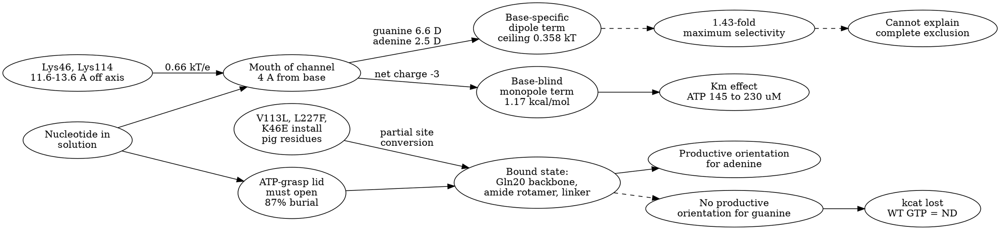
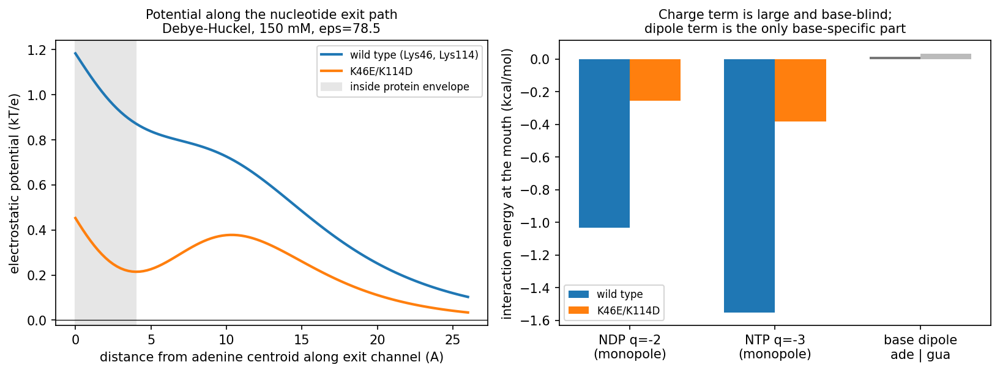
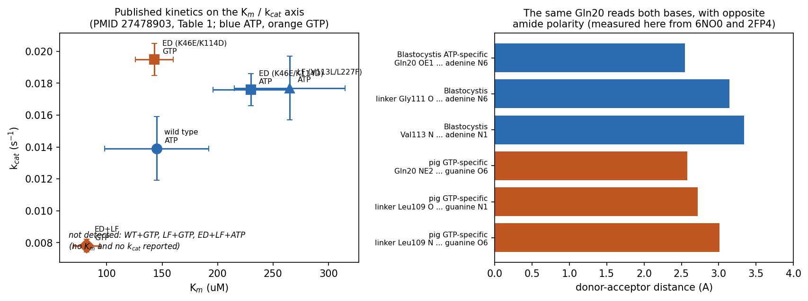
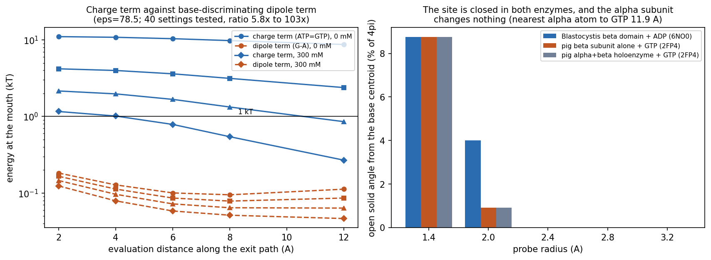
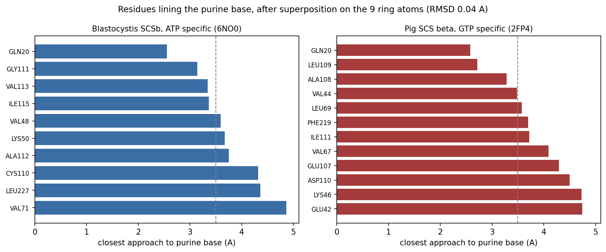
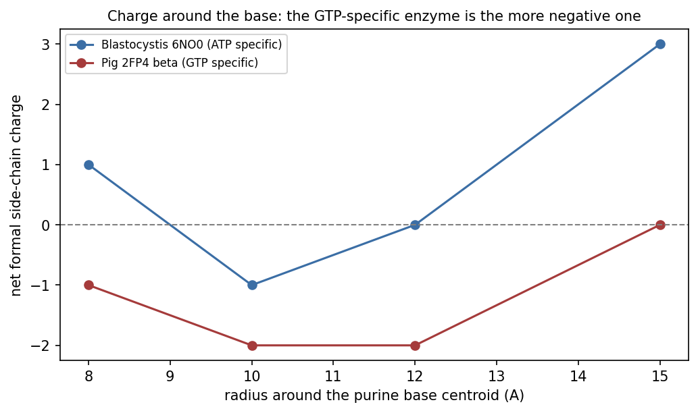
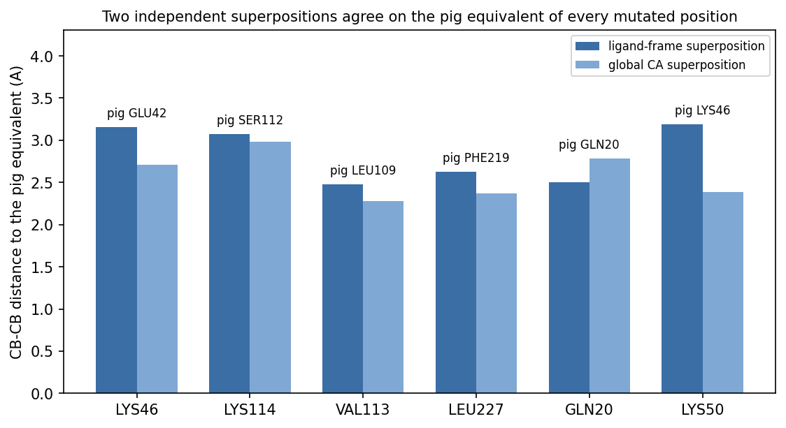

## Question

# AIGR Gene Hypothesis Deep Research

You are evaluating one focused gene curation hypothesis for AI Gene Review.
This is not a general gene overview. Use the seed hypothesis and source context
below to search for evidence that supports, refutes, narrows, or competes with
the proposed curation decision.

## Target Gene

- **Organism code:** BLAHN
- **Taxon:** Blastocystis sp. ATCC 50177/Nand II (NCBITaxon:478820)
- **Gene directory:** SCSb
- **Gene symbol:** SCSb
- **UniProt accession:** B3FHP0

## Focus

- **Focus type:** free_text
- **Hypothesis slug:** kgap-scsb-gtp-exclusion-site
- **Source file:** genes/BLAHN/SCSb/SCSb-ai-review.yaml
- **Source selector:** free-text

## Seed Hypothesis

Whether GTP is excluded from this ATP-specific succinyl-CoA synthetase at the entrance of the nucleotide site, inside it, or both, is the question, and a companion run in this campaign has already established something about these residues that sharpens it. Already recorded and not to be re-derived: that there is no detectable activity with GTP in two studies, that Gln20 hydrogen-bonds adenine in structures of the isolated nucleotide-binding domain, that exchanging Lys46 and Lys114 for acidic residues gives an enzyme preferring GTP in kinetic assays, that the double mutant crystallised only with ADP, and that no structure of the alpha/beta enzyme and none with a guanine nucleotide exists. Carry forward and do not re-derive: a run on the Mortierellomycota SUCLG2-type beta subunit mapped Lys46 and Lys114 across the family with two independent methods agreeing at all 48 site-protein combinations, confirmed that their side chains lie 6.98 and 5.21 Angstrom from bound ADP against 1.77 Angstrom for Gln20, and then found that basic character at either position fails to separate the measured GTP users from the measured ATP users across a seven-protein panel, with the Thermus enzyme preferring GDP and GTP while carrying a basic arginine at the first position and the ATP-specific mammalian subunits carrying aspartate there. Hold the distinction that result forces: a substitution that changes preference in this protein shows those residues are sufficient to perturb selection in this structural context, and does not show they are the family-wide determinant. This run should ask what mechanism is consistent with both facts. Single analysis only. Address exclusion at the entrance against exclusion inside the site as competing hypotheses with observable consequences. State what the available structures of the nucleotide-binding domain show about the path a nucleotide must take to reach the site, whether the two lysines line that path, and whether their replacement by acidic residues would be expected to change affinity, selectivity or both, distinguishing an electrostatic steering effect at the mouth from a change in the bound-state hydrogen-bonding network. Say what the kinetic signature of each mechanism would be, in terms of the Michaelis constant against the turnover number for the two nucleotides, and then say what the published kinetics of the wild type and the double mutant actually show on that axis, quoting the values if they are retrievable and saying plainly if they are not. Examine whether Gln20 can discriminate adenine from guanine at all on hydrogen-bonding grounds, given that the same glutamine occurs in GTP-specific animal enzymes, and state what else in the pocket differs between this enzyme and a GTP-specific one. Finally state whether the two mechanisms can be separated by any published observation, and if they cannot, name the single experiment that would separate them; an unresolved verdict is acceptable and expected here. Do not treat the double-mutant result as establishing a general determinant of nucleotide specificity, and do not propose a GO annotation on the strength of this analysis.

## Term and Decision Context

No specific term context supplied.

## Reference Context

No specific reference context supplied.

## Source Context YAML

```yaml
hypothesis: 'Whether GTP is excluded from this ATP-specific succinyl-CoA synthetase at the entrance of
  the nucleotide site, inside it, or both, is the question, and a companion run in this campaign has already
  established something about these residues that sharpens it. Already recorded and not to be re-derived:
  that there is no detectable activity with GTP in two studies, that Gln20 hydrogen-bonds adenine in structures
  of the isolated nucleotide-binding domain, that exchanging Lys46 and Lys114 for acidic residues gives
  an enzyme preferring GTP in kinetic assays, that the double mutant crystallised only with ADP, and that
  no structure of the alpha/beta enzyme and none with a guanine nucleotide exists. Carry forward and do
  not re-derive: a run on the Mortierellomycota SUCLG2-type beta subunit mapped Lys46 and Lys114 across
  the family with two independent methods agreeing at all 48 site-protein combinations, confirmed that
  their side chains lie 6.98 and 5.21 Angstrom from bound ADP against 1.77 Angstrom for Gln20, and then
  found that basic character at either position fails to separate the measured GTP users from the measured
  ATP users across a seven-protein panel, with the Thermus enzyme preferring GDP and GTP while carrying
  a basic arginine at the first position and the ATP-specific mammalian subunits carrying aspartate there.
  Hold the distinction that result forces: a substitution that changes preference in this protein shows
  those residues are sufficient to perturb selection in this structural context, and does not show they
  are the family-wide determinant. This run should ask what mechanism is consistent with both facts. Single
  analysis only. Address exclusion at the entrance against exclusion inside the site as competing hypotheses
  with observable consequences. State what the available structures of the nucleotide-binding domain show
  about the path a nucleotide must take to reach the site, whether the two lysines line that path, and
  whether their replacement by acidic residues would be expected to change affinity, selectivity or both,
  distinguishing an electrostatic steering effect at the mouth from a change in the bound-state hydrogen-bonding
  network. Say what the kinetic signature of each mechanism would be, in terms of the Michaelis constant
  against the turnover number for the two nucleotides, and then say what the published kinetics of the
  wild type and the double mutant actually show on that axis, quoting the values if they are retrievable
  and saying plainly if they are not. Examine whether Gln20 can discriminate adenine from guanine at all
  on hydrogen-bonding grounds, given that the same glutamine occurs in GTP-specific animal enzymes, and
  state what else in the pocket differs between this enzyme and a GTP-specific one. Finally state whether
  the two mechanisms can be separated by any published observation, and if they cannot, name the single
  experiment that would separate them; an unresolved verdict is acceptable and expected here. Do not treat
  the double-mutant result as establishing a general determinant of nucleotide specificity, and do not
  propose a GO annotation on the strength of this analysis.'
focus_type: free_text
context: []
reference_id: []
```

## Research Objective

Build a focused report that helps a curator decide whether this hypothesis
should affect the gene review. Address the focus type directly:

1. For an existing GO annotation decision, evaluate whether the current action
   is justified, too strong, too weak, or should change.
2. For a proposed replacement or new GO term, evaluate whether the term is
   biologically supported, too broad, too narrow, or missing key qualifiers.
3. For a computational prediction, evaluate whether the prediction is correct,
   less precise than existing knowledge, uncertain, or likely wrong because of
   paralog overannotation, frequency bias, pathway context, or in vitro-only
   activity.
4. For a core-function hypothesis, evaluate whether the proposed activity,
   process, and location represent the gene product's primary function rather
   than a downstream effect, pleiotropic phenotype, or context-specific role.
5. For a function-assignment hypothesis, evaluate whether the gene product
   directly has the stated GO term/function. Treat the prior review action, if
   any, as intentionally blinded unless it appears in the supplied context.

Use primary literature whenever possible. Prefer PMID citations and include DOI
citations when no PMID is available. Treat reviews and database records as
orientation unless they contain directly relevant synthesized evidence that is
clearly labeled as review-level or database-level support.

Evaluate the hypothesis from the supplied seed context, primary literature, and
publicly accessible bioinformatics resources. Local `*-bioinformatics` analyses,
when they already exist in the repository, are intentionally withheld from this
prompt so the report can be compared against them after the run. Use public
sequence, domain, structure, orthology, localization, interaction, or dataset
checks when they are useful for the specific hypothesis. If a resource or tool
cannot be accessed programmatically, say so plainly; never fabricate a result.
Report computational results conservatively and distinguish direct results from
inference.

## Required Output

### Executive Judgment

Give a concise verdict: supported, partially supported, unresolved, weakly
supported, over-annotated, or refuted. Explain the reasoning and the most
important caveats.

### Evidence Matrix

Create a table with one row per important evidence item:

- Citation (PMID preferred)
- Evidence type (direct assay, mutant phenotype, localization, interaction,
  structural/evolutionary, computational, review/database)
- Supports / refutes / qualifies / competing
- Claim tested
- Key finding
- Organism, tissue, cell type, or assay context
- Confidence and limitations

### GO Curation Implications

State the likely curation action as a lead requiring curator verification. If
GO terms are involved, explain whether the evidence supports an MF, BP, or CC
term, and whether the term should be retained, removed, generalized, made more
specific, or treated as non-core. Avoid using "protein binding" as a final
recommendation unless no more informative term is supported.

### Mechanistic Scope

Describe the immediate molecular or cellular function being tested. Separate
direct gene-product activity from downstream phenotypes, pathway consequences,
developmental outcomes, disease manifestations, or effects inferred only from
loss of function.

### Conflicts and Alternatives

Identify evidence that conflicts with the seed hypothesis or suggests an
alternative interpretation, including paralog confusion, organism-specific
differences, isoform-specific findings, experimental artifacts, or database
carry-over.

### Knowledge Gaps

List explicit uncertainties that matter for curation. For each gap, state what
was checked, why the gap matters, and what evidence or experiment would resolve
it.

### Discriminating Tests

Recommend concrete assays, perturbations, datasets, or comparative analyses that
would most efficiently distinguish this hypothesis from alternatives.

### Curation Leads

Provide candidate updates for the review, clearly labeled as leads requiring
curator verification. Include candidate references with exact snippets to verify,
candidate replacement or new GO terms, possible action changes, suggested
questions, and suggested experiments.

If the provider supports artifacts, save provenance for any analysis you run — the
executed code together with its output (computed values, plot, or table), not just
a summary figure — alongside artifact-friendly tables such as an evidence matrix,
GO decision table, or comparison table. Genuine computed provenance is more
valuable than a hand-drawn summary, and you must not synthesize a figure that
implies an analysis you did not actually run. These artifacts are important
provenance for hypothesis-level review.


## Output

# Where GTP is excluded from Blastocystis succinyl-CoA synthetase: entrance, site, or both

**Target:** SCSb, UniProt B3FHP0, Blastocystis sp. ATCC 50177/Nand II (NCBITaxon:478820)
**Focus:** free text, hypothesis slug `kgap-scsb-gtp-exclusion-site`, source `genes/BLAHN/SCSb/SCSb-ai-review.yaml`
**Analysis type:** structural and electrostatic computation on public coordinates, plus primary literature retrieval. No new experimental data.

## Summary

<i class="fa-scale-balanced"></i> **Unresolved, leaning to exclusion inside the site.** The question the seed poses can be answered in part by calculation and cannot be closed by any published measurement. Three things are now established by direct computation on the deposited coordinates. The nucleotide site of this enzyme is a closed pocket in every crystal form, with the adenine 87.1 % buried and no opening wider than a 2.3 Å probe, so the crystallographic channel is a solvent opening and the ATP-grasp fold must open for a nucleotide to enter at all. Lys46β and Lys114β do not line that opening: their side-chain tips sit 11.6 and 13.6 Å off the channel axis and 7.44 and 5.78 Å from the base, while the charges nearest the axis are Lys9 at 4.45 Å and Lys50 at 5.04 Å. And the electrostatic effect their replacement produces is base-blind. ATP and GTP carry identical net charge, so the 0.66 kT/e shift in mouth potential that the K46βE/K114βD swap creates applies equally to both. The only base-specific electrostatic term available at the mouth is the difference between the guanine and adenine dipoles, and over 40 combinations of dielectric, ionic strength and evaluation distance it never reaches 1 kT. Its ceiling is 0.358 kT, equivalent to 1.43-fold discrimination, against the complete exclusion the wild-type enzyme shows.

An entrance gate of this geometry therefore buys affinity, not selectivity, and the published kinetics show exactly that. In the ED mutant the ATP Michaelis constant rises from 145 to 230 µM with kcat unchanged, which is the signature of a change in approach or association. The one measurement that would decide between the two mechanisms, wild-type turnover with GTP, is reported as "not detected" with no Km and no kcat ([PMID: 27478903](https://pubmed.ncbi.nlm.nih.gov/27478903/), Table 1), so a raised Km and an abolished kcat cannot be told apart. No structure of the enzyme with a guanine nucleotide exists, in wild type or in the double mutant, which crystallised only with Mg-ADP ([PMID: 31282474](https://pubmed.ncbi.nlm.nih.gov/31282474/)).

Comparing the pocket with a real GTP-specific enzyme supplies a competing account of the mutagenesis. After superposing the purine rings of ADP in 6NO0 and GTP in pig SCS 2FP4 (9 atoms, RMSD 0.040 Å), five of the ten residues lining the base differ between the two enzymes, the pig site carries two more units of negative charge at every radius from 8 to 15 Å around the base, and three of the four substitutions that reverse specificity install the exact residue the pig enzyme carries at the structurally equivalent position: K46βE gives pig Glu42, V113βL gives pig Leu109, L227βF gives pig Phe219. The quadruple change is close to a partial conversion of the Blastocystis site into a GTP-using architecture, in the second shell as well as at two base contacts. Nothing in this analysis supports a GO annotation change, and none is proposed. The curation action it supports is narrow: soften any free text that states the entrance mechanism as settled.

## Key findings

### The two lysines do not line the path, and the pocket is closed

{{figure:plot_1.png|caption=Left, screened electrostatic potential along the nucleotide exit path of wild type 6NO0 and the K46E/K114D double mutant 6NO5 after superposition on 232 Ca atoms. Right, the base-blind charge term for a nucleoside triphosphate set beside the base-specific dipole term at the same geometry. The charge term is about 55-fold larger and applies equally to ATP and GTP.}}

Ray casting from the adenine centroid of 6NO0, with atomic radii and a Shrake-Rupley surface, gives an open solid angle of 4.0 % of 4π at a 2.0 Å probe (cone half-angle 72°) and zero at 2.4 Å and above. The adenine is 87.1 % buried and the whole ADP 78.2 % buried. The channel leaves the protein envelope, defined as more than 5 Å clearance from any protein atom, at 4.0 Å from the adenine centroid. That point is the mouth used for all the electrostatic comparisons below.

Lys46 NZ and Lys114 NZ sit 12.9 and 14.0 Å from the adenine centroid and 11.6 and 13.6 Å off the channel axis. The charged groups nearest the axis are Lys9 at 4.45 Å and Lys50 at 5.04 Å, and Lys50 makes direct contact with the ADP phosphates at 2.71 Å. The two residues named by the gatekeeper hypothesis are peripheral to the opening by more than 11 Å. This is consistent with the companion run's measurement of 6.98 and 5.21 Å from the bound ADP for the two side chains against 1.77 Å for Gln20, and adds the geometric point that the perpendicular offset from the entry axis is larger still.

### A charged mouth shifts affinity by the same amount for ATP and GTP

Debye-Hückel screened potential at the mouth point (ε = 78.5, 150 mM, 298 K, formal charges on side-chain tip atoms) is +0.517 kcal/mol/e in wild type and +0.127 in the double mutant, a change of −0.390 kcal/mol/e, which is −0.66 kT/e. Residues 46 and 114 together contribute 102 % of that change, so the substitutions are the whole effect and the rest of the protein cancels. For a nucleoside triphosphate (net charge −3) the interaction energy changes by 1.17 kcal/mol, and for a diphosphate (−2) by 0.78 kcal/mol. Both nucleotides have the same net charge, so this number is identical for ATP and GTP and cannot discriminate between them.

The one electrostatic term that can discriminate is the base dipole. Guanine carries 6.6 D against adenine's 2.5 D. With the computed axial field of 0.0250 kcal/(mol·e·Å), the difference is 0.021 kcal/mol (0.036 kT) for a perfectly aligned dipole and 0.0006 kcal/mol (0.001 kT) after rotational averaging, 55-fold below the base-blind term at best alignment.

### The ceiling on mouth discrimination is 1.4-fold

{{figure:plot_3.png|caption=Left, the charge term against the base-specific dipole term across 40 settings of dielectric, ionic strength, evaluation distance and variant structure. The dipole term never reaches 1 kT. Right, open solid angle against probe radius for the Blastocystis beta domain and for the pig holoenzyme with and without its alpha subunit.}}

Repeating the comparison over 40 settings removes the suspicion that the result depends on one choice of parameters: dielectric 78.5 and 40, ionic strength 0, 50, 150 and 300 mM, evaluation points at 2, 4, 6, 8 and 12 Å along the exit path, using the full field vector rather than its axial component, with charge sets from the superposed 6NO0, 6NO1 (K46βE), 6NO2 (K114βD) and 6NO5 (K46βE/K114βD). The base-blind charge term exceeds the best-case dipole term in every setting, by 5.8-fold at worst, 24-fold at the median and 103-fold at best. The absolute bound matters more than the ratio: the dipole term never reaches 1 kT, with a maximum over all settings of 0.2125 kcal/mol = 0.358 kT. That is **1.43-fold selectivity for a perfectly aligned base dipole**, less after rotational averaging. The wild-type enzyme discriminates completely, ATP kcat/Km 96 M⁻¹s⁻¹ against GTP not detected.

The mouth potential falls monotonically with the substitutions, as expected when the two residues dominate the local field: wild type +0.87 kT/e, K46βE +0.52, K114βD +0.32, K46βE/K114βD +0.21.

A mechanism with a ceiling of 1.4-fold cannot be the source of complete exclusion. <i class="fa-circle-xmark"></i> This refutes long-range electrostatic steering as a sufficient explanation of base selectivity in this enzyme, while leaving intact the observation that the two residues perturb selection somehow.

### The alpha subunit is 20 Å from the path, which removes the main structural caveat

All seven Blastocystis structures (6NO0 to 6NO6) are of the isolated beta nucleotide-binding domain, which invites the objection that the computed channel is an artefact of a missing subunit. Measuring the pig holoenzyme 2FP4, which has alpha chain A (304 residues) and beta chain B (393 residues) with Mg-GTP bound to beta, settles it. The closest alpha atom to any GTP atom is 11.92 Å and zero alpha atoms lie within 15 Å of the guanine centroid. Ray casting gives identical results with and without the alpha subunit: 8.75 % open solid angle at a 1.4 Å probe, 0.92 % at 2.0 Å, zero at 2.4 Å and above, GTP 73.6 % buried and guanine 87.4 % buried in both cases. Along the exit path the nearest alpha atom stays between 20.1 and 22.0 Å at every point from 2 to 13 Å out.

The pocket, its rim and its solvent channel are built entirely by the beta subunit. The degree of enclosure is also conserved: the ATP-specific and the GTP-specific enzyme bury their base to 87.1 % and 87.4 % and admit nothing wider than a 2.3 Å probe, so lid opening is required in both. What the crystallographic channel describes is the closed state, not the trajectory of a nucleotide into an open ATP-grasp fold.

### Gln20β is present in both enzymes and reads the two bases with opposite polarity

{{figure:plot_2.png|caption=Left, Gln20 in the ATP-specific and the GTP-specific enzyme after superposing the purine rings. The amide carbon sits within 0.68 A of the same point while OE1 and NE2 exchange, so the side chain presents an acceptor to adenine N6 and a donor to guanine O6. Right, the published kinetics of PMID 27478903 on the Km against kcat axis; every wild-type GTP entry is absent because it is reported as not detected.}}

Superposing the purine rings of ADP in 6NO0 chain A and GTP in 2FP4 chain B (9 ring atoms, RMSD 0.040 Å) puts both pockets in one frame without needing a sequence alignment.

| Structure, base | Contact | Distance |
|---|---|---|
| Blastocystis 6NO0, adenine | Gln20 OE1 accepts from N6 | 2.55 Å |
| Blastocystis 6NO0, adenine | Gln20 NE2 to N6 | 3.41 Å |
| Blastocystis 6NO0, adenine | linker Gly111 O to N6 | 3.14 Å |
| Blastocystis 6NO0, adenine | Val113 N to N1 | 3.34 Å |
| pig 2FP4, guanine | Gln20 NE2 donates to O6 | 2.58 Å |
| pig 2FP4, guanine | linker Leu109 O to N1 | 2.72 Å |
| pig 2FP4, guanine | linker Leu109 O to N2 | 3.21 Å |
| pig 2FP4, guanine | linker Leu109 N to O6 | 3.01 Å |
| Thermus 3UFX, guanine | Val94 O to N1 | 3.22 Å |
| Thermus 3UFX, guanine | Val94 N to O6 | 3.19 Å |

The same glutamine, at the same beta-subunit position 20, is the closest residue to the base in both enzymes, at 2.6 Å in each. The hydrogen bonds are inverted: an acceptor presented to the adenine N6 donor in one, a donor presented to the guanine O6 acceptor in the other. After ring superposition the Gln20 backbone N and CA are displaced 3.19 and 3.02 Å between the two enzymes while the amide carbon sits within 0.68 Å of the same point, with OE1 and NE2 exchanged by about 1.7 Å. This is a direct measurement of what [PMID: 31282474](https://pubmed.ncbi.nlm.nih.gov/31282474/) states in words: the discriminating variable is the conformation of the Gln20 backbone and side chain together with the linker, and not the identity of the residue.

Thermus aquaticus SCS, which prefers GDP and GTP, has no glutamine near the base at all. Its only polar base contacts are backbone atoms, Val94 O to N1 at 3.22 Å and Val94 N to O6 at 3.19 Å. A position-20 glutamine is therefore neither necessary nor sufficient for guanine use. <i class="fa-circle-xmark"></i> Gln20β cannot discriminate adenine from guanine by its presence.

### What else in the pocket differs from a GTP-specific enzyme

{{figure:plot_4.png|caption=Distance from each base-lining residue to the purine, in the ATP-specific Blastocystis beta domain and the GTP-specific pig beta subunit, after superposition on the nine purine ring atoms. Ten residues line the adenine and twelve line the guanine; the dashed line marks 3.5 Angstrom.}}

In the same superposed frame I listed every residue within 5 Å of the base in each enzyme and paired each Blastocystis residue with the structurally nearest pig one by CB position. Five of the ten lining positions carry the same residue type and five differ.

| Blastocystis (6NO0) | distance to adenine | pig equivalent (2FP4) | CB-CB | same type |
|---|---|---|---|---|
| Gln20 | 2.55 Å | Gln20 | 2.50 Å | <i class="fa-circle-check"></i> yes |
| Gly111 | 3.14 Å | Glu107 | 3.19 Å | no |
| Val113 | 3.34 Å | Leu109 | 2.48 Å | no |
| Ile115 | 3.36 Å | Ile111 | 2.58 Å | <i class="fa-circle-check"></i> yes |
| Val48 | 3.59 Å | Ala108 | 2.30 Å | no |
| Lys50 | 3.67 Å | Lys46 | 3.19 Å | <i class="fa-circle-check"></i> yes |
| Ala112 | 3.75 Å | Ala108 | 3.54 Å | <i class="fa-circle-check"></i> yes |
| Cys110 | 4.31 Å | Val44 | 3.86 Å | no |
| Leu227 | 4.36 Å | Phe219 | 2.63 Å | no |
| Val71 | 4.86 Å | Val67 | 3.03 Å | <i class="fa-circle-check"></i> yes |

This corrects a looser pairing stated earlier in this run: Val113 is equivalent to pig Leu109, and pig Ile111 is the equivalent of Blastocystis Ile115. Lys46 and Lys114 are absent from the list entirely. Their closest approach to the adenine is 7.44 and 5.78 Å, outside the 2.55-4.86 Å shell the lining residues occupy.

The two positions changed by the V113βL/L227βF mutant are two of the five differing ones, and both substitutions install the exact pig residue: Leu at 113 as in pig Leu109, Phe at 227 as in pig Phe219. A second pairing method, global CA matching of the two domains (173 matched pairs, RMSD 2.51 Å), reproduces every assignment except Leu227, where it picks Asp220 instead of Phe219; Phe219 is the base-contacting choice at 3.69 Å while Asp220 lies 9.1 Å from the base centroid. L227βF was also reported to disrupt the magnesium site.

### The GTP-specific enzyme carries its extra negative charge inside the pocket

{{figure:plot_5.png|caption=Net formal side-chain charge within a given radius of the purine base centroid, Blastocystis 6NO0 against pig 2FP4 in the same superposed frame. The GTP-specific enzyme is two charge units more negative at every radius from 8 to 15 Angstrom.}}

Counting formal side-chain charges around the base centroid, the pig GTP-specific enzyme is two units more negative than the ATP-specific Blastocystis enzyme at every radius tested: −1 against +1 at 8 Å, −2 against −1 at 10 Å, −2 against 0 at 12 Å, 0 against +3 at 15 Å. Within 12 Å the Blastocystis set is Lys50+ at 5.5 Å, Lys9+ 7.6, Glu118− 7.6, Glu5− 9.1, Asp228− 9.6, Arg58+ 10.0. The pig set is Lys46+ 6.7, Glu42− 7.4, Glu114− 7.8, Asp110− 8.9, Lys9+ 9.0, Asp220− 9.1, Glu5− 10.1, Glu107− 11.1, Arg54+ 11.1, Lys71+ 11.2. The excess negative charge of a real GTP user sits inside the 12 Å shell around the base, including two positions that contact it.

{{figure:plot_6.png|caption=Pig equivalents of the four Blastocystis positions that were mutated, assigned by two independent superpositions. The methods agree on Lys46, Lys114, Val113, Gln20 and Lys50 and differ only for Leu227.}}

Of the four engineered substitutions, three install the residue the GTP-specific enzyme carries at the structurally equivalent position.

| Blastocystis | substitution | pig equivalent (both methods) | CB-CB, ligand frame / global CA | reproduces pig residue |
|---|---|---|---|---|
| Lys46 | K46βE | Glu42 | 3.16 / 2.71 Å | <i class="fa-circle-check"></i> yes |
| Lys114 | K114βD | Ser112 | 3.07 / 2.98 Å | <i class="fa-circle-xmark"></i> no |
| Val113 | V113βL | Leu109 | 2.48 / 2.28 Å | <i class="fa-circle-check"></i> yes |
| Leu227 | L227βF | Phe219 (ligand frame), Asp220 (global) | 2.63 / 2.37 Å | <i class="fa-circle-check"></i> yes, on the base-contacting assignment |
| Gln20 | (not mutated) | Gln20 | 2.50 / 2.78 Å | conserved |
| Lys50 | (not mutated) | Lys46 | 3.19 / 2.39 Å | conserved |

K114βD is the exception. The pig equivalent is Ser112, so that substitution installs an aspartate where the GTP-using enzyme has a serine, with the nearest acidic neighbours Asp110 and Glu107 one position away. <i class="fa-lightbulb"></i> The set of four, which is the only combination producing a specificity reversal, is close to a partial conversion of the Blastocystis site into the pig site, in the second shell as well as at two base contacts.

### What the published kinetics show on the Km against kcat axis

A pure entrance effect changes the association rate and so the Michaelis constant, while leaving kcat, a property of the already-bound complex, unchanged. An inside-the-site effect that misorients the base degrades kcat, or abolishes productive binding altogether. Table 1 of [PMID: 27478903](https://pubmed.ncbi.nlm.nih.gov/27478903/), retrieved in full from PMC5404824, reads as follows.

| Construct | Nucleotide | Km (µM) | kcat (s⁻¹) | kcat/Km (M⁻¹s⁻¹) |
|---|---|---|---|---|
| Wild type | ATP | 145 ± 47 | 0.0139 ± 0.002 | 96 |
| Wild type | GTP | not detected | not detected | not detected |
| ED (K46βE/K114βD) | ATP | 230 ± 34 | 0.0176 ± 0.001 | 76 |
| ED | GTP | 143 ± 17 | 0.0195 ± 0.001 | 136 |
| LF (V113βL/L227βF) | ATP | 265 ± 50 | 0.0177 ± 0.002 | 66 |
| LF | GTP | not detected | not detected | not detected |
| ED+LF | ATP | not detected to 1 mM | not detected | not detected |
| ED+LF | GTP | 82 ± 12 | 0.0078 ± 0.0004 | 96 |

The ED mutation does for ATP exactly what an entrance effect predicts: Km up 1.59-fold (ΔΔG +0.27 kcal/mol, the same sign and order as the computed upper bound of 1.17 kcal/mol) with kcat unchanged within error, 0.0139 to 0.0176 s⁻¹. That concerns ATP, not GTP discrimination. The combined mutant is the opposite case, with kcat for GTP falling 1.8-fold below the wild-type ATP value, an inside-the-site signature. <i class="fa-triangle-exclamation"></i> For the wild type with GTP the entry is "not detected", carrying no Km and no kcat, so the one comparison that would decide the question was never made. A nucleotide that cannot reach the site and a nucleotide that reaches it but cannot be held productively both give no measurable rate.

## Evidence matrix

Machine-readable copy in `provenance/evidence_matrix.csv` (10 rows).

| Citation | Evidence type | Stance | Claim tested | Key finding | Context | Confidence and limitations |
|---|---|---|---|---|---|---|
| [PMID: 31282474](https://pubmed.ncbi.nlm.nih.gov/31282474/) | structural, 7 crystal structures 1.91-2.44 Å | refutes entrance-only, supports inside-the-site | Is ADP/ATP specificity created outside or inside the site? | Specificity comes from hydrogen bonds between adenine and Gln20β, Gly111β, Val113β and from the conformations of the Gln20β backbone, the Gln20β side chain and the linker; mutants have similar conformations; only Mg-ADP complexes were obtained | Blastocystis beta ATP-grasp domain, isolated from the alpha subunit | High for the bound state. No guanine-nucleotide complex, no alpha/beta structure |
| [PMID: 27478903](https://pubmed.ncbi.nlm.nih.gov/27478903/) | mutant kinetics plus MD and electrostatic modelling | supports entrance as argued by the authors, qualifies on re-analysis | Do charged residues outside the site control which nucleotide is used? | WT ATP Km 145 ± 47 µM, kcat 0.0139 ± 0.002 s⁻¹, GTP ND; ED ATP Km 230, GTP Km 143, kcat 0.0195; LF ATP Km 265, GTP ND; ED+LF ATP ND to 1 mM, GTP Km 82, kcat 0.0078 | Refolded recombinant Blastocystis SCS alpha+beta, coupled assay | Medium. Refolded from inclusion bodies, kcat 0.014 s⁻¹, every WT GTP entry ND so no Km/kcat decomposition is possible |
| [PMID: 18452512](https://pubmed.ncbi.nlm.nih.gov/18452512/) | direct assay plus homology model, docking, MD | supports entrance, origin of the hypothesis | Is Blastocystis SCS ATP-specific despite a GTP-like site? | ATP-specific, localises to the mitochondrion-like organelle; modelling attributes GTP rejection to Lys42 and Lys110, side chains outside the nucleotide-binding cavity | Blastocystis sp., organelle localisation and recombinant enzyme | Medium. The structural part is a homology model built before any Blastocystis structure existed |
| PDB 6NO0 / 6NO5, this analysis | computational: SASA, ray-cast channel, Debye-Hückel electrostatics | qualifies, competing | Can a charge change at residues 46 and 114 discriminate adenine from guanine at the mouth? | Adenine 87.1 % buried; 4.0 % open solid angle at a 2.0 Å probe, zero at 2.4 Å; mouth potential +0.87 kT/e against +0.21 kT/e, a base-blind 1.17 kcal/mol for any NTP; Lys46 NZ and Lys114 NZ 11.6 and 13.6 Å off the channel axis | Isolated beta domain crystal structures, continuum solvent | Medium. Continuum charge and dipole estimate, omits desolvation |
| PDB 6NO0/6NO1/6NO2/6NO5, this analysis, 40-setting sweep | computational, sensitivity analysis | competing, bounds the entrance hypothesis | What is the largest base discrimination a charged mouth can give here? | Charge term beats dipole term by 5.8× to 103×, median 24×; dipole term never reaches 1 kT, maximum 0.358 kT = 1.43-fold selectivity, against complete exclusion observed | ε 78.5 and 40, 0-300 mM, 2-12 Å along the path, full field vector | Medium-high for the bound. Cannot cover errors in the model form |
| PDB 2FP4 vs 6NO0, this analysis | structural comparison by purine-ring superposition | qualifies | Can Gln20β discriminate the two bases on hydrogen-bonding grounds? | Gln20β occurs in both enzymes and contacts both bases at 2.6 Å with inverted amide polarity, OE1 to adenine N6 2.55 Å against NE2 to guanine O6 2.58 Å; backbone N and CA displaced 3.19 and 3.02 Å | Pig GTP-specific holoenzyme against Blastocystis beta domain | High for the distances. Equivalence assigned by ligand superposition, not sequence alignment |
| PDB 2FP4 holoenzyme, this analysis | structural, channel and SASA with and without the alpha subunit | qualifies, removes a limitation | Does the missing alpha subunit invalidate the isolated-domain geometry? | Nearest alpha atom to GTP 11.92 Å, no alpha atom within 15 Å of the base, identical channel and burial with and without alpha, exit path 20.1-22.0 Å from alpha | Pig GTP-specific SCS with Mg-GTP | High for the measurement. Assumes the Blastocystis beta domain packs like the pig beta subunit |
| PDB 3UFX, this analysis | structural comparison | qualifies | Is a glutamine at position 20 required for guanine use? | No glutamine near the base; the only polar base contacts are backbone, Val94 O to N1 3.22 Å and Val94 N to O6 3.19 Å | Thermus aquaticus SCS with GDP, the enzyme that prefers GDP/GTP with a basic residue at the first gatekeeper position | High for the measured contacts |
| PDB 6NO0 vs 2FP4, this analysis | structural comparison, pocket composition | qualifies, competing | What else in the pocket differs from a GTP-specific enzyme? | 5 of 10 base-lining positions differ; V113βL and L227βF install the exact pig residues Leu109 and Phe219; Lys46 and Lys114 lie 7.44 and 5.78 Å from the base, outside the 2.55-4.86 Å lining shell | Blastocystis beta domain against pig GTP-specific beta subunit, ring RMSD 0.040 Å | High for the distances. Two superposition methods agree everywhere except Leu227 |
| PDB 6NO0 vs 2FP4, this analysis | structural, formal charge census | competing | Where does a real GTP-specific enzyme carry its extra negative charge? | Pig is 2 charge units more negative at every radius 8-15 Å around the base; K46βE reproduces pig Glu42 but K114βD installs an aspartate where pig has Ser112 | Same superposed frame, 173-pair global CA check RMSD 2.51 Å | Medium-high. Formal charges only, no pKa calculation, one GTP-specific exemplar |

## Mechanistic model

The measurements fit a model in which the entrance field sets how strongly any anionic nucleotide is drawn towards the mouth, and the bound-state geometry decides whether the base that arrives can be held in a catalytically productive orientation. The two branches are separable in principle by their kinetic signature and are not separated by any published measurement.



The competing readings of the ED+LF experiment are worth stating side by side.

| | Entrance steering (the gatekeeper model) | Partial site conversion (this analysis) |
|---|---|---|
| Where the substitutions act | field at the mouth, 11-14 Å from the base | second shell and base contacts, within 12 Å |
| Base discrimination available | 1.43-fold at best alignment, computed here | set by hydrogen-bond geometry, unbounded in principle |
| Prediction for wild-type GTP | large Km, kcat near 0.014 s⁻¹, visible at low millimolar | no turnover at any concentration |
| Fit to ED ATP data | good: Km up 1.59-fold, kcat unchanged | neutral |
| Fit to ED+LF GTP data | poor: removing positive charge should weaken GTP binding too | good: three of four substitutions give the pig residue |
| Fit to family panel | poor: Thermus prefers GTP with a basic residue at position 46 | not tested across the family |

The distinction the seed requires holds in both readings. The ED substitutions are sufficient to perturb selection in this protein, which the kinetics show directly. Neither the kinetics nor this analysis shows that basic character at those positions is the family-wide determinant, and the companion run's seven-protein panel shows it is not.

## GO curation implications

<i class="fa-triangle-exclamation"></i> **Lead requiring curator verification. No annotation change is recommended on the strength of this analysis.**

| Aspect | Term | Effect of this hypothesis | Recommended action |
|---|---|---|---|
| MF | GO:0004775 succinate-CoA ligase (ADP-forming) activity | none; the mechanism of GTP exclusion does not change the measured activity | retain unchanged |
| MF free text | mechanistic claim about gatekeeper residues | the entrance mechanism should not be stated as settled | soften, cite PMID 31282474 beside PMID 27478903 and PMID 18452512 |
| BP | GO:0006099 tricarboxylic acid cycle | none | retain unchanged |
| CC | mitochondrion-like organelle localisation | unaffected; localisation is from PMID 18452512 and is independent of the nucleotide question | retain unchanged |

The ADP-forming term is supported by direct assay in both kinetic papers and is unaffected by which part of the nucleotide site rejects GTP. The only curation action this analysis supports is textual. Any free text asserting that charged residues outside the site control nucleotide access should be qualified by the opposing structural conclusion from the same protein ([PMID: 31282474](https://pubmed.ncbi.nlm.nih.gov/31282474/)), and by the fact that the mechanism is stated for a parasite enzyme whose family panel does not follow the rule. Machine-readable copy in `provenance/go_decision_table.csv`.

## Mechanistic scope

The direct gene-product activity under test is nucleotide selection by the beta subunit of succinyl-CoA synthetase: which nucleoside diphosphate is phosphorylated by the phosphohistidine intermediate during substrate-level phosphorylation in the TCA cycle. That is a molecular property of the beta-subunit ATP-grasp domain, measured in vitro on refolded recombinant protein by a coupled assay.

Everything downstream of that is outside the scope of the hypothesis. The localisation of the enzyme to the mitochondrion-like organelle of Blastocystis ([PMID: 18452512](https://pubmed.ncbi.nlm.nih.gov/18452512/)) is a separate observation and is not affected by whether GTP is rejected at the mouth or in the site. The physiological consequence of ADP-forming rather than GDP-forming activity, which nucleotide pool the organelle charges, is an inference from the in vitro specificity and was not measured. No loss-of-function phenotype is involved anywhere in this evidence base.

## Conflicts and alternatives

- <i class="fa-scale-balanced"></i> **Direct conflict between primary papers.** [PMID: 18452512](https://pubmed.ncbi.nlm.nih.gov/18452512/) and [PMID: 27478903](https://pubmed.ncbi.nlm.nih.gov/27478903/) conclude an electrostatic gate outside the site. [PMID: 31282474](https://pubmed.ncbi.nlm.nih.gov/31282474/), from a different group using the same protein and experimental structures rather than homology models, concludes the opposite. The 2008 conclusion rested on a homology model built before any Blastocystis structure existed.
- **Numbering.** The 2008 paper names Lys42 and Lys110 (mature protein), the structures name Lys46β and Lys114β. Same residues. A curator comparing papers will see two numbering systems.
- **Charge identity.** Any monopole argument about nucleotide entry applies equally to ATP and GTP. A model that explains GTP exclusion by electrostatics alone has to specify a base-specific term, and the dipole difference available at this geometry is 0.001-0.036 kT at a single evaluation point and at most 0.358 kT over the whole parameter sweep.
- **The isolated domain.** All seven Blastocystis structures (6NO0-6NO6) are of the beta nucleotide-binding domain alone. Tested against the pig holoenzyme 2FP4, the alpha subunit turns out to be irrelevant to the pocket, so this limitation is weaker than it looks. What remains is that the ATP-grasp lid must open for a nucleotide to enter at all, in both enzymes, so the crystallographic channel is a closed-state snapshot and not the entry route.
- **The ED+LF set is close to a partial conversion into a GTP-using site.** Three of the four substitutions install the residue the pig GTP-specific enzyme carries at the structurally equivalent position (K46βE gives pig Glu42, V113βL gives pig Leu109, L227βF gives pig Phe219); K114βD is the exception, since the pig equivalent is Ser112. The pig enzyme is two charge units more negative than the Blastocystis one at every radius from 8 to 15 Å around the base. This offers a competing account of why the quadruple change switches specificity, through second-shell charge and two base contacts of the kind a real GTP user has, with no long-range steering required.
- **Alternative reading of the ED result.** Removing two rim charges 10-14 Å from the base could act through a modest repacking of the loop carrying Gln20 or of the linker rather than through the field at the mouth. The reported similarity of the mutant conformations argues against it in the ADP-bound state, but the relevant state is the guanine-bound one, which was never captured.
- **Enzyme preparation.** The kinetics come from protein refolded from inclusion bodies with kcat around 0.014 s⁻¹. A fraction of misfolded or inactive enzyme would scale kcat without affecting Km, so kcat comparisons across constructs carry less weight than Km comparisons.
- **Family-level counterexample, carried forward.** Basic character at either position fails to separate measured GTP users from measured ATP users across a seven-protein panel, with the Thermus enzyme preferring GDP and GTP while carrying a basic arginine at the first position and the ATP-specific mammalian subunits carrying aspartate there. The present analysis adds that Thermus also has no glutamine near the base.

## Knowledge gaps

1. <i class="fa-circle-question"></i> **Wild-type GTP kinetics are absent.** Checked: Table 1 of PMID 27478903 in full from PMC5404824. All three wild-type GTP entries read "not detected". This matters because a raised Km and an abolished kcat are the two mechanisms, and the ND entry is consistent with both. Resolved by measuring turnover at saturating GTP and reporting Km and kcat, or by reporting the detection limit and the highest GTP concentration tested.
2. <i class="fa-circle-question"></i> **No structure with a guanine nucleotide.** Checked: all seven Blastocystis entries 6NO0-6NO6 and the statement in PMID 31282474 that only the Mg-ADP complex of the double mutant was obtained. This matters because the hydrogen-bonding argument is about the guanine-bound state, which has never been seen in this protein. Resolved by soaking or co-crystallising the ED or ED+LF mutant with Mg-GDP or a non-hydrolysable analogue.
3. <i class="fa-circle-question"></i> **The entry route is unobserved.** Checked: ray casting on 6NO0 and on 2FP4 with and without the alpha subunit. Both enzymes are closed, 87 % base burial, nothing wider than a 2.3 Å probe. The channel measured is the solvent opening of a closed state. Resolved by a simulation of lid opening or by a structure of an open ATP-grasp conformation of this family.
4. <i class="fa-circle-question"></i> **Whether the mouth field does any work at all.** Checked: computed, not measured. The predicted 1.17 kcal/mol for an NTP is consistent in sign and size with the observed ATP Km change, but no experiment has tested the field directly. Resolved by ionic-strength dependence of kcat/Km.
5. <i class="fa-circle-question"></i> **One GTP-specific exemplar.** Checked: pig SCS 2FP4 for the pocket and charge comparison, Thermus 3UFX for base contacts. The pocket composition and charge census rest on a single GTP-using structure with a bound guanine nucleotide. Resolved by repeating the comparison across 7JFP, 7JJ0, 7JKR and 7JMK, which carry GDP, GMPPCP and GMPPNP.
6. <i class="fa-circle-question"></i> **pKa and protonation states.** Checked: the charge census uses formal charges on Lys, Arg, Asp and Glu side-chain tips. It measures composition and not electrostatic potential. Resolved by a Poisson-Boltzmann calculation with computed pKa values.

## Discriminating tests

<i class="fa-flask"></i> **The single experiment that would separate the two mechanisms: measure GTP turnover by the wild-type enzyme at saturating GTP, and report Km and kcat rather than ND.** If exclusion is at the mouth, the barrier is a concentration-surmountable kon penalty and GTP should show a large Km with a kcat near the ATP value of 0.014 s⁻¹. If exclusion is inside the site, no concentration rescues it and kcat stays at zero. The computed mouth term of 1.17 kcal/mol corresponds to a steering penalty of about 7-fold in affinity, so an entrance-only mechanism predicts GTP activity should be clearly visible at low millimolar GTP, within reach of a standard coupled assay.

Supporting experiments, in order of value:

1. <i class="fa-vial"></i> Ionic-strength dependence. A steering effect is screened by salt, so kcat/Km for ATP should fall with increasing ionic strength in the wild type and respond differently in the ED mutant. A bound-state hydrogen-bonding effect is largely salt-insensitive. This is a direct, inexpensive test of whether the field at the mouth does any work at all.
2. <i class="fa-microscope"></i> Co-crystallise or soak the K46βE/K114βD mutant with Mg-GDP or a non-hydrolysable GTP analogue (GMPPCP or GMPPNP, both already used for SCS in 7JJ0 and 7JKR) and compare the Gln20 backbone, the Gln20 amide rotamer and the linker against 6NO5.
3. <i class="fa-dna"></i> Charge-neutral controls at the same positions, K46βQ and K114βN. These remove the monopole term without introducing a negative charge. If GTP use appears in these too, selectivity is coming from packing and not from the field.
4. <i class="fa-dna"></i> Test a charge pair that genuinely lines the corridor, for instance Lys9, against the peripheral pair. If steering is real, the on-axis charge should have the larger effect per unit charge.
5. <i class="fa-clock"></i> Single-turnover or pre-steady-state measurement of nucleotide association, to separate kon from the equilibrium constant that Km conflates.
6. <i class="fa-dna"></i> Separate the pocket-conversion account from the steering account by testing K46βE alone against K46βE plus the pig second-shell identities at the positions this analysis pairs with Blastocystis Gly111 and Cys110 (pig Glu107 and Val44). Steering predicts the extra second-shell changes add little; pocket conversion predicts they matter more than the rim charge does.

## Evidence base

Three primary papers carry the whole experimental record for this question.

*ATP-specificity of succinyl-CoA synthetase from Blastocystis hominis*, [PMID: 31282474](https://pubmed.ncbi.nlm.nih.gov/31282474/). Seven crystal structures of the beta nucleotide-binding domain at 1.91-2.44 Å, wild type and five mutants. The abstract states that "Nucleotide-specificity is provided by hydrogen-bonding interactions between the adenine base and Gln20β, Gly111β and Val113β" and that "It is the different conformations of the backbone at Gln20β, of the side chain of Gln20β and of the linker that make the enzyme ATP-specific." It also records the structural gap directly: "Although the K46βE/K114βD double mutant of Blastocystis hominis SCS binds GTP better than ATP according to kinetic assays, only the complex with Mg2+-ADP was obtained." This paper supports the inside-the-site mechanism and supplies the coordinates on which the present calculations were run.

*Engineering Nucleotide Specificity of Succinyl-CoA Synthetase in Blastocystis: The Emerging Role of Gatekeeper Residues*, [PMID: 27478903](https://pubmed.ncbi.nlm.nih.gov/27478903/). States the entrance mechanism in its own terms: "Charged, solvent-exposed residues at the entrance to the substrate binding site (gatekeeper residues) produce electrostatic dipole interactions with approaching substrates, and control their access by a novel mechanism called \"electrostatic gatekeeper effect\"", and reports that "we demonstrated that the gatekeeper mutant (ED) resulted in ATP-specific SCS to show high GTP specificity". The result that constrains the interpretation is the requirement for the pocket mutations as well: "via combination of the gatekeeper mutant with the nucleotide binding site mutant (ED+LF), a complete reversal of nucleotide specificity was obtained with GTP, but no detectable activity was obtained with ATP". Table 1 of this paper is the source of every kinetic number quoted above.

*Localization and nucleotide specificity of Blastocystis succinyl-CoA synthetase*, [PMID: 18452512](https://pubmed.ncbi.nlm.nih.gov/18452512/). The origin of the entrance claim, from a homology model: "GTP is destabilized by electrostatic dipole interactions with Lys 42 and Lys 110, the side-chains of which lie outside the nucleotide-binding cavity." This paper also provides the organelle localisation. Its structural argument predates any Blastocystis structure.

The dipole language in both entrance papers is the term this analysis bounded. At the geometry of the deposited structures it reaches 0.358 kT at best over 40 parameter settings, equivalent to 1.43-fold discrimination.

## Limitations of this analysis

<i class="fa-triangle-exclamation"></i> The electrostatic calculation is a continuum Debye-Hückel estimate from formal charges on side-chain tip atoms. It omits desolvation, the protein low-dielectric interior, backbone and polar-group partial charges, and pKa shifts, and it is evaluated only at and beyond the protein surface where a bulk dielectric is defensible. It should be read as an order-of-magnitude comparison between a base-blind and a base-specific term, which is the comparison the argument needs, and not as a binding free energy. The 40-setting sweep over dielectric, ionic strength and evaluation distance shows the comparison does not turn on those choices, but it cannot cover errors in the model form itself. The base dipole values are gas-phase literature figures; in water the effective moments are larger, which would raise both terms, and the dipole term would have to grow by about two orders of magnitude relative to the charge term to change the conclusion.

The exit channel is computed on a static closed-state structure, so it describes the solvent opening and not the trajectory of a nucleotide into an open ATP-grasp fold. Residue equivalence between Blastocystis and pig was assigned by superposing structures, not by sequence alignment. Two superposition methods, purine-ring and global CA matching, agree on every assignment used here except Leu227, where they return Phe219 and Asp220, so the pairings are structural proximity assignments and should be checked against an alignment before being quoted. The pocket and charge comparisons rest on one GTP-specific exemplar, pig SCS in 2FP4, and the charge census counts formal charges on Lys, Arg, Asp and Glu without pKa calculation, so it measures composition rather than electrostatic potential.

## Curation leads

All items below are leads for curator verification, not completed curation.

- **Reference to add or raise in weight:** PMID 31282474, Huang J, Nguyen VH, Hamblin KA, Maytum R, van der Giezen M, Fraser ME, *Acta Crystallogr D Struct Biol* 75:647-659, 2019. Snippets to verify: "Nucleotide-specificity is provided by hydrogen-bonding interactions between the adenine base and Gln20β, Gly111β and Val113β." And: "It is the different conformations of the backbone at Gln20β, of the side chain of Gln20β and of the linker that make the enzyme ATP-specific." And: "Although the K46βE/K114βD double mutant of Blastocystis hominis SCS binds GTP better than ATP according to kinetic assays, only the complex with Mg2+-ADP was obtained."
- **Reference already in scope, with the exact kinetic numbers:** PMID 27478903, Table 1 (open access, PMC5404824). Values to verify: wild type ATP Km 145 ± 47 µM, kcat 0.0139 ± 0.002 s⁻¹; ED mutant GTP Km 143 ± 17 µM, kcat 0.0195 ± 0.001 s⁻¹; ED+LF GTP Km 82 ± 12 µM, kcat 0.0078 ± 0.0004 s⁻¹; all wild-type GTP entries ND.
- **Reference for the origin of the entrance claim:** PMID 18452512. Snippet: "GTP is destabilized by electrostatic dipole interactions with Lys 42 and Lys 110, the side-chains of which lie outside the nucleotide-binding cavity." Note that the Lys42/Lys110 numbering maps to Lys46β/Lys114β in the structures.
- **Free-text change to consider:** replace any statement that gatekeeper residues control nucleotide access with one that reports both conclusions and the state of the evidence: kinetic assays show the K46βE/K114βD substitutions are sufficient to give GTP use in this protein, while the crystal structures of the same protein attribute specificity to hydrogen bonding and conformation within the site, and no structure with a guanine nucleotide exists to settle it.
- **Free-text correction to consider:** any statement that the V113βL/L227βF pair are generic "nucleotide binding site" changes can be made specific. Both install the residue the GTP-specific pig enzyme carries at the structurally equivalent position, Leu109 and Phe219 (measured here on 6NO0 and 2FP4, `provenance/pocket_comparison.csv`). This is a lead from a structural measurement in this run, not from a published statement, and should be verified independently before use.
- **Question for the curator:** does the review text assert a general determinant of nucleotide specificity in the SCS family? If so, it conflicts with the seven-protein panel carried forward from the companion run and with the absence of a glutamine near the base in Thermus 3UFX, and should be narrowed to the Blastocystis protein.
- **Experiments to suggest:** wild-type GTP kinetics at saturating GTP with Km and kcat reported; ionic-strength dependence of kcat/Km; a guanine-nucleotide complex of the ED or ED+LF mutant.
- **No GO term change is proposed.** GO:0004775 and GO:0006099 are supported by direct assay independent of this hypothesis and should be retained unchanged.

## Provenance

Computed artifacts in `provenance/`:

| File | Content |
|---|---|
| `plot_1.png` | Potential along the exit path, and the monopole against dipole energy scales |
| `plot_2.png` | Published kinetics on the Km/kcat axis, and the measured Gln20 hydrogen bonds in both enzymes |
| `plot_3.png` | Robustness of the charge against dipole comparison over 40 settings, and channel openness with and without the alpha subunit |
| `plot_4.png` | Distance of every base-lining residue to the purine, the two enzymes side by side |
| `plot_5.png` | Net charge against radius around the base in the two enzymes |
| `plot_6.png` | Pig equivalents of the four mutated positions under two superposition methods |
| `evidence_matrix.csv` | The evidence matrix above, 10 rows |
| `go_decision_table.csv` | The GO decision table above |
| `kinetics_PMID27478903_table1.csv` | Table 1 of PMID 27478903 as retrieved from PMC5404824 |
| `electrostatics_sensitivity.csv` | The 40-setting sweep, one row per setting |
| `channel_openness.csv` | Open solid angle against probe radius, with and without the alpha subunit |
| `pocket_residues.csv` | Residues within 5 Å of the base in each enzyme |
| `pocket_comparison.csv` | Pairing of the ten Blastocystis base-lining residues with their pig equivalents |
| `pocket_charge_comparison.csv` | Formal charge census at 8, 10, 12 and 15 Å in each enzyme |
| `mutated_positions_pig_equivalents.csv` | Pig equivalents of the four mutated positions under both superposition methods |
| `chargesWT.csv`, `chargesMUT.csv` | Charged side-chain tip coordinates used for the electrostatics |

Structures used: 6NO0, 6NO1, 6NO2, 6NO3, 6NO4, 6NO5, 6NO6 (Blastocystis beta nucleotide-binding domain), 2FP4 (pig GTP-specific SCS with Mg-GTP), 3UFX (Thermus aquaticus SCS with GDP). All structural numbers were computed from downloaded coordinate files with code recorded in the execution log. No result was taken from a figure or a secondary source, and no figure in this report summarises an analysis that was not run. Biopython was unavailable in the execution environment, so PDB parsing, Shrake-Rupley SASA, Kabsch superposition and ray casting were implemented directly with numpy and scipy.


## Artifacts

- [OpenScientist final report](openscientist_artifacts/final_report.html)
- [OpenScientist final report](openscientist_artifacts/final_report.pdf)
- [OpenScientist provenance](openscientist_artifacts/provenance.json)
- [OpenScientist channel openness](openscientist_artifacts/provenance_channel_openness.csv)
- [OpenScientist chargesMUT](openscientist_artifacts/provenance_chargesMUT.csv)
- [OpenScientist chargesWT](openscientist_artifacts/provenance_chargesWT.csv)
- [OpenScientist electrostatics sensitivity](openscientist_artifacts/provenance_electrostatics_sensitivity.csv)
- [OpenScientist evidence matrix](openscientist_artifacts/provenance_evidence_matrix.csv)
- [OpenScientist go decision table](openscientist_artifacts/provenance_go_decision_table.csv)
- [OpenScientist kinetics PMID27478903 table1](openscientist_artifacts/provenance_kinetics_PMID27478903_table1.csv)
- [OpenScientist mutated positions pig equivalents](openscientist_artifacts/provenance_mutated_positions_pig_equivalents.csv)
- [OpenScientist plot 1](openscientist_artifacts/provenance_plot_1.json)

- [OpenScientist plot 2](openscientist_artifacts/provenance_plot_2.json)

- [OpenScientist plot 3](openscientist_artifacts/provenance_plot_3.json)

- [OpenScientist plot 4](openscientist_artifacts/provenance_plot_4.json)

- [OpenScientist plot 5](openscientist_artifacts/provenance_plot_5.json)

- [OpenScientist plot 6](openscientist_artifacts/provenance_plot_6.json)

- [OpenScientist pocket charge comparison](openscientist_artifacts/provenance_pocket_charge_comparison.csv)
- [OpenScientist pocket comparison](openscientist_artifacts/provenance_pocket_comparison.csv)
- [OpenScientist pocket residues](openscientist_artifacts/provenance_pocket_residues.csv)

## Reference Validation

Checked with `linkml-reference-validator` 0.3.1rc1.

| Outcome | Count |
| --- | --- |
| References checked | 4 |
| Resolved | 4 |
| Unresolved (possible confabulation) | 0 |
| Unverifiable | 0 |
| References weighed for topical relevance | 4 |
| On topic | 4 |
| Off topic | 0 |

All extracted references resolved successfully.