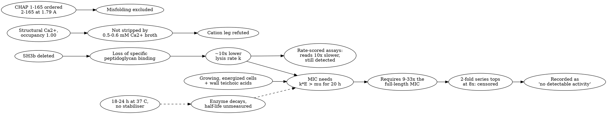
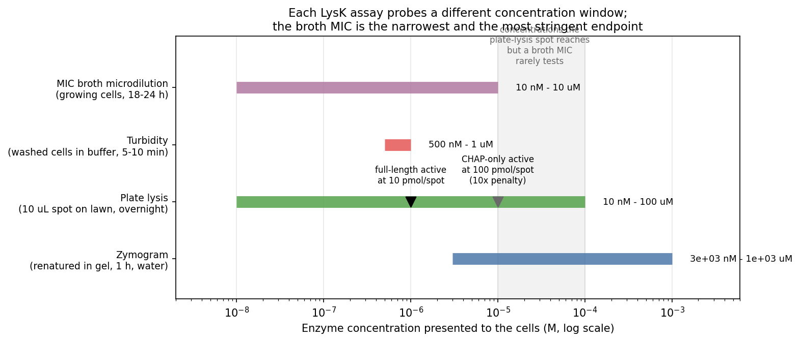
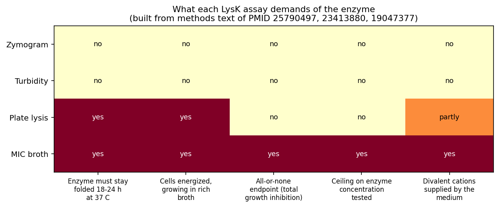
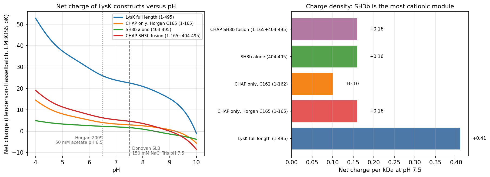
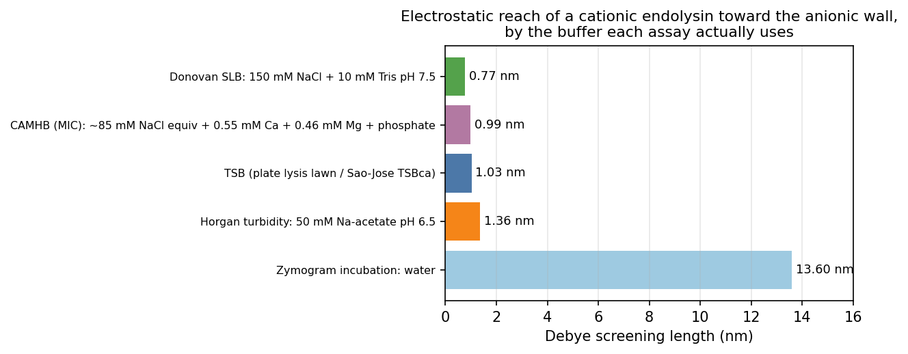
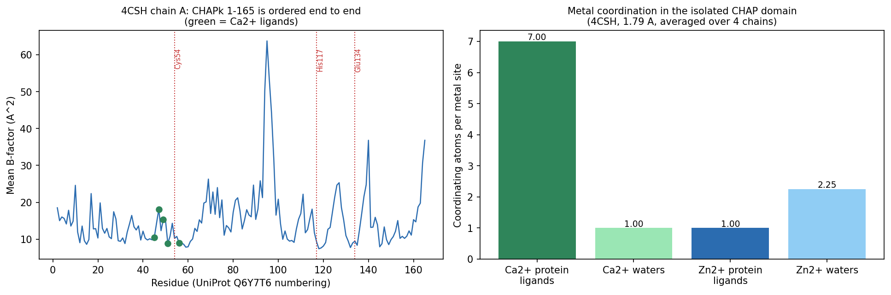
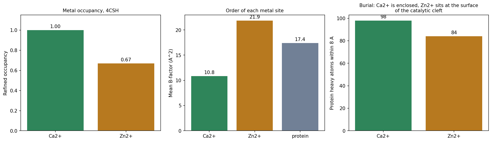
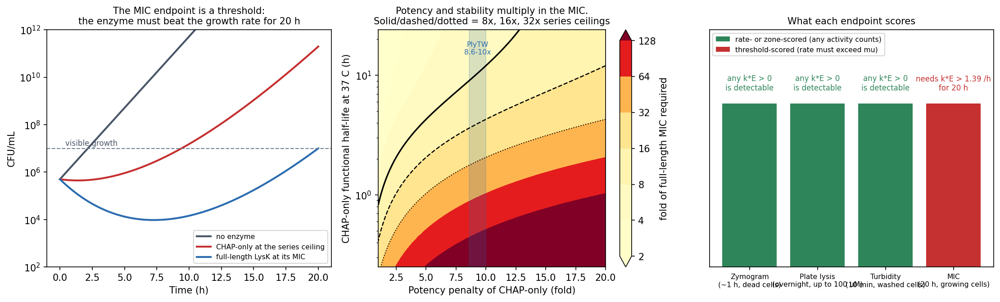

## Question

# AIGR Gene Hypothesis Deep Research

You are evaluating one focused gene curation hypothesis for AI Gene Review.
This is not a general gene overview. Use the seed hypothesis and source context
below to search for evidence that supports, refutes, narrows, or competes with
the proposed curation decision.

## Target Gene

- **Organism code:** BPPGK
- **Taxon:** Kayvirus kay (NCBITaxon:221915)
- **Gene directory:** lysK
- **Gene symbol:** lysK
- **UniProt accession:** Q6Y7T6

## Focus

- **Focus type:** free_text
- **Hypothesis slug:** kgap-lysk-assay-discrepancy
- **Source file:** genes/BPPGK/lysK/lysK-ai-review.yaml
- **Source selector:** free-text

## Seed Hypothesis

Why the CHAP-only truncation of LysK lyses cells in zymogram, plate-lysis and turbidity assays yet shows no activity in a minimal inhibitory concentration assay, while the CHAP-SH3b fusion works in all of them, may be explained by what those assays differ in rather than by potency alone. That LysK is a 495-residue modular hydrolase with a CHAP domain carrying a Cys54/His117/Glu134 triad and a structural calcium, a central amidase domain, and a C-terminal SH3b wall-binding domain needed for full activity, is already recorded, so do not re-derive the architecture. Single analysis only: state what each of those four assay formats actually requires of an enzyme, naming for each whether the substrate is purified sacculi or renatured protein in gel, whether the cells are growing or stationary, the medium composition and the incubation time, quoting the methods from the primary papers, since the explanation has to be a property the MIC assay demands and the others do not; assess whether the isolated CHAP domain is predicted to be less stable than the fusion, giving any measured melting temperature or aggregation datum and otherwise saying so, and state whether the SH3b domain is known to contribute stability as distinct from binding; state what is known about divalent-cation availability in the MIC medium, since the CHAP domain needs a structural calcium and a loosely bound zinc and a chelating or cation-poor medium would disable it selectively; and state whether growing staphylococci differ from stationary ones in wall teichoic acid or peptidoglycan O-acetylation in ways known to block endolysin access. State which explanation the evidence favours among potency, stability and accessibility, and say plainly if the published methods are not reported in enough detail to separate them.

## Term and Decision Context

No specific term context supplied.

## Reference Context

No specific reference context supplied.

## Source Context YAML

```yaml
hypothesis: 'Why the CHAP-only truncation of LysK lyses cells in zymogram, plate-lysis and turbidity assays
  yet shows no activity in a minimal inhibitory concentration assay, while the CHAP-SH3b fusion works
  in all of them, may be explained by what those assays differ in rather than by potency alone. That LysK
  is a 495-residue modular hydrolase with a CHAP domain carrying a Cys54/His117/Glu134 triad and a structural
  calcium, a central amidase domain, and a C-terminal SH3b wall-binding domain needed for full activity,
  is already recorded, so do not re-derive the architecture. Single analysis only: state what each of
  those four assay formats actually requires of an enzyme, naming for each whether the substrate is purified
  sacculi or renatured protein in gel, whether the cells are growing or stationary, the medium composition
  and the incubation time, quoting the methods from the primary papers, since the explanation has to be
  a property the MIC assay demands and the others do not; assess whether the isolated CHAP domain is predicted
  to be less stable than the fusion, giving any measured melting temperature or aggregation datum and
  otherwise saying so, and state whether the SH3b domain is known to contribute stability as distinct
  from binding; state what is known about divalent-cation availability in the MIC medium, since the CHAP
  domain needs a structural calcium and a loosely bound zinc and a chelating or cation-poor medium would
  disable it selectively; and state whether growing staphylococci differ from stationary ones in wall
  teichoic acid or peptidoglycan O-acetylation in ways known to block endolysin access. State which explanation
  the evidence favours among potency, stability and accessibility, and say plainly if the published methods
  are not reported in enough detail to separate them.'
focus_type: free_text
context: []
reference_id: []
```

## Research Objective

Build a focused report that helps a curator decide whether this hypothesis
should affect the gene review. Address the focus type directly:

1. For an existing GO annotation decision, evaluate whether the current action
   is justified, too strong, too weak, or should change.
2. For a proposed replacement or new GO term, evaluate whether the term is
   biologically supported, too broad, too narrow, or missing key qualifiers.
3. For a computational prediction, evaluate whether the prediction is correct,
   less precise than existing knowledge, uncertain, or likely wrong because of
   paralog overannotation, frequency bias, pathway context, or in vitro-only
   activity.
4. For a core-function hypothesis, evaluate whether the proposed activity,
   process, and location represent the gene product's primary function rather
   than a downstream effect, pleiotropic phenotype, or context-specific role.
5. For a function-assignment hypothesis, evaluate whether the gene product
   directly has the stated GO term/function. Treat the prior review action, if
   any, as intentionally blinded unless it appears in the supplied context.

Use primary literature whenever possible. Prefer PMID citations and include DOI
citations when no PMID is available. Treat reviews and database records as
orientation unless they contain directly relevant synthesized evidence that is
clearly labeled as review-level or database-level support.

Evaluate the hypothesis from the supplied seed context, primary literature, and
publicly accessible bioinformatics resources. Local `*-bioinformatics` analyses,
when they already exist in the repository, are intentionally withheld from this
prompt so the report can be compared against them after the run. Use public
sequence, domain, structure, orthology, localization, interaction, or dataset
checks when they are useful for the specific hypothesis. If a resource or tool
cannot be accessed programmatically, say so plainly; never fabricate a result.
Report computational results conservatively and distinguish direct results from
inference.

## Required Output

### Executive Judgment

Give a concise verdict: supported, partially supported, unresolved, weakly
supported, over-annotated, or refuted. Explain the reasoning and the most
important caveats.

### Evidence Matrix

Create a table with one row per important evidence item:

- Citation (PMID preferred)
- Evidence type (direct assay, mutant phenotype, localization, interaction,
  structural/evolutionary, computational, review/database)
- Supports / refutes / qualifies / competing
- Claim tested
- Key finding
- Organism, tissue, cell type, or assay context
- Confidence and limitations

### GO Curation Implications

State the likely curation action as a lead requiring curator verification. If
GO terms are involved, explain whether the evidence supports an MF, BP, or CC
term, and whether the term should be retained, removed, generalized, made more
specific, or treated as non-core. Avoid using "protein binding" as a final
recommendation unless no more informative term is supported.

### Mechanistic Scope

Describe the immediate molecular or cellular function being tested. Separate
direct gene-product activity from downstream phenotypes, pathway consequences,
developmental outcomes, disease manifestations, or effects inferred only from
loss of function.

### Conflicts and Alternatives

Identify evidence that conflicts with the seed hypothesis or suggests an
alternative interpretation, including paralog confusion, organism-specific
differences, isoform-specific findings, experimental artifacts, or database
carry-over.

### Knowledge Gaps

List explicit uncertainties that matter for curation. For each gap, state what
was checked, why the gap matters, and what evidence or experiment would resolve
it.

### Discriminating Tests

Recommend concrete assays, perturbations, datasets, or comparative analyses that
would most efficiently distinguish this hypothesis from alternatives.

### Curation Leads

Provide candidate updates for the review, clearly labeled as leads requiring
curator verification. Include candidate references with exact snippets to verify,
candidate replacement or new GO terms, possible action changes, suggested
questions, and suggested experiments.

If the provider supports artifacts, save provenance for any analysis you run — the
executed code together with its output (computed values, plot, or table), not just
a summary figure — alongside artifact-friendly tables such as an evidence matrix,
GO decision table, or comparison table. Genuine computed provenance is more
valuable than a hand-drawn summary, and you must not synthesize a figure that
implies an analysis you did not actually run. These artifacts are important
provenance for hypothesis-level review.


## Output

# LysK (Q6Y7T6, Kayvirus kay): why the CHAP-only truncation lyses cells in three assays but gives no MIC

Hypothesis slug: `kgap-lysk-assay-discrepancy`. Source: `genes/BPPGK/lysK/lysK-ai-review.yaml`, free-text focus.
Target: UniProt Q6Y7T6, endolysin LysK, Kayvirus kay (NCBITaxon:221915), 495 residues.

---

## Summary

<i class="fa-scale-balanced"></i> **Verdict: partially supported.** Assay format does explain the
discrepancy, and the seed hypothesis is right that the answer lies in what the formats demand. The two
specific mechanisms it names are not the answer. Calcium starvation of the MIC medium is refuted. The
stability leg cannot be resolved from the published record, and the specific version of it in which the
truncation misfolds is excluded by the crystal structure. The property the minimum inhibitory concentration
(MIC) assay demands and the other three do not is the endpoint itself.

Zymogram, plate lysis and turbidity all score a zone or a rate. Any non-zero lysis rate is detectable, and a
10-fold weaker enzyme reads as 10-fold slower, which stays inside the measured dynamic range of the assay
(in the homolog PlyTW, 0.21 against 0.024 dOD600/min, both reported as values). The MIC scores a threshold:
the specific lysis rate has to exceed the growth rate of a dividing population for 18-24 h, or the well goes
turbid and the result is written down as no detectable activity. Integrating dN/dt = mu·N - k·E(t)·N with
mu = 1.386 /h, a 5x10^5 CFU/mL inoculum and a 10^7 CFU/mL visible threshold, the MIC demands an initial
specific lysis rate of at least 1.24 /h from a non-decaying enzyme, rising to 2.60 /h at an 8 h functional
half-life and 8.58 /h at 2 h. Potency loss and stability loss therefore multiply in this format and in no
other. At the 8.6-10 fold penalty measured for the homologous SH3b cell wall binding domain, the CHAP-only
truncation needs 8.6-10.0x the full-length MIC with no stability loss at all, which a 2-fold dilution series
topping at 8x cannot report.

**The MIC-negative result carries almost no information about whether the CHAP domain is catalytically
competent, and it should not be curated as though it did.** Three independent lines of primary evidence agree
that the CHAP-only construct lyses live staphylococci: it clears live clinical MRSA isolates in a turbidity
assay at 3,690 U/mg ([PMID: 19047377](https://pubmed.ncbi.nlm.nih.gov/19047377/)), the same laboratory that
reported the LysK MIC result concluded in the homolog that "the CHAP domain alone is necessary and sufficient
for lysis of live S. aureus" ([PMID: 25790497](https://pubmed.ncbi.nlm.nih.gov/25790497/)), and the isolated
domain crystallises as a complete papain-like fold with an assembled catalytic triad
([PMID: 25064136](https://pubmed.ncbi.nlm.nih.gov/25064136/)).

<i class="fa-triangle-exclamation"></i> The most important caveat is retrieval. The full methods of Becker
et al. 2009 ([PMID: 19493008](https://pubmed.ncbi.nlm.nih.gov/19493008/)), the source of the discrepancy, are
paywalled. Unpaywall returns `is_oa: false`, the article is absent from PMC, and Europe PMC `fullTextXML`
returns HTTP 500. The MIC medium, the top concentration tested, the inoculum and the incubation time are not
stated in the abstract. **The published methods are not reported in enough detail to separate potency from
stability for LysK itself.** The protocol lineage was reconstructed from the same laboratory's open-access
papers.

---

## Executive judgment

The seed hypothesis proposes that assay format, specifically stability or accessibility, explains why the
LysK CHAP-only truncation lyses *Staphylococcus aureus* in zymogram, plate-lysis and turbidity assays yet
gives no MIC, while the CHAP-SH3b fusion works in all four
([PMID: 19493008](https://pubmed.ncbi.nlm.nih.gov/19493008/)). Leg by leg:

| Leg of the seed hypothesis | Verdict | Decisive evidence |
|---|---|---|
| <i class="fa-circle-check"></i> Potency alone (SH3b loss costs activity) | Supported, and sufficient on its own | PlyTW cell wall binding domain deletion costs 8.6x turbidity and 10x plate lysis ([PMID: 25790497](https://pubmed.ncbi.nlm.nih.gov/25790497/)); the threshold model shows 10x alone exceeds an 8x dilution ceiling |
| <i class="fa-circle-question"></i> Isolated CHAP is less stable than the fusion | Unresolved; misfolding specifically excluded | CHAP 1-165 is ordered 2-165 at 1.79 A with mean B 15.4 A^2 (PDB 4CSH, computed here). No melting temperature, differential scanning fluorimetry trace or aggregation comparison of the two constructs exists anywhere |
| <i class="fa-circle-question"></i> SH3b contributes stability as distinct from binding | No evidence either way | SH3b is documented only as a binding module ([PMID: 28852930](https://pubmed.ncbi.nlm.nih.gov/28852930/)). The charge-density calculation excludes a bulk-electrostatic mechanism, which leaves specific binding |
| <i class="fa-circle-xmark"></i> Divalent-cation availability in the MIC medium | Refuted | Cation-adjusted Mueller-Hinton broth supplies 0.50-0.62 mM Ca2+. The Ca2+ site refines at occupancy 1.00 with seven protein oxygen ligands, retained from a calcium-free liquor. The fusion carries the same site |
| <i class="fa-scale-balanced"></i> Growth-phase wall teichoic acid or peptidoglycan O-acetylation blocking access | Partially supported for WTA; wrong chemistry for O-acetylation | WTA is a major determinant of endolysin tolerance and hinders cell-binding-domain binding ([PMID: 38203699](https://pubmed.ncbi.nlm.nih.gov/38203699/)); growing cells tolerate endolysins while energized ([PMID: 35075218](https://pubmed.ncbi.nlm.nih.gov/35075218/)). O-acetylation blocks muramidases, not a D-Ala-Gly endopeptidase |
| <i class="fa-circle-xmark"></i> Ionic strength as the MIC-specific discriminator (alternative tested here) | Refuted | Debye length 0.99 nm in the MIC broth against 0.77 nm in the saline lysis buffer where CHAP-only works |
| <i class="fa-circle-xmark"></i> Are the published methods detailed enough to separate the explanations? | No | Becker 2009 is paywalled, absent from PMC, Unpaywall `is_oa: false`; medium, inoculum, incubation and top concentration are not stated in the abstract |

Artifact: `provenance/lysK_hypothesis_leg_verdicts.csv`.

---

## Key findings

### What each of the four assay formats demands

Methods text was retrieved from the primary papers wherever the source was open access. Becker 2009 itself is
paywalled, so the MIC row is reconstructed from the same laboratory's later open papers, which name the
protocol explicitly: "a classical microdilution broth method for determination of the MIC was used
(Jones et al. 1985) with modifications as described previously (Becker et al. 2009)"
([PMID: 23413880](https://pubmed.ncbi.nlm.nih.gov/23413880/), body text).

| Assay | Substrate | Cell state | Medium | Duration and endpoint | Source of the methods text |
|---|---|---|---|---|---|
| <i class="fa-vial"></i> Zymogram | Mid-log or heat-killed cells embedded in an SDS-PAGE gel; the enzyme is SDS-denatured and then renatured in situ | Dead, non-growing | Gel washed 2x 30 min in excess water, then incubated in water | ~1 h, room temperature; clearing zone scored | [PMID: 25790497](https://pubmed.ncbi.nlm.nih.gov/25790497/) (PMC4811206); [PMID: 19047377](https://pubmed.ncbi.nlm.nih.gov/19047377/) (PMC2632115) |
| <i class="fa-vial"></i> Plate lysis | Freshly plated, air-dried lawn on tryptic soy agar | Live lawn, grows overnight | Enzyme diluted in saline lysis buffer (150 mM NaCl, 10 mM Tris pH 7.5), 10 uL spot; 0.1-1000 pmol per spot = 10 nM to 100 uM local | Overnight, 37 C; graded lawn thinning scored | [PMID: 25790497](https://pubmed.ncbi.nlm.nih.gov/25790497/) |
| <i class="fa-vial"></i> Turbidity reduction | Mid-log cells frozen in saline lysis buffer with 30% glycerol, thawed, washed 3x | Non-growing, de-energized by freeze-thaw and washing | Saline lysis buffer; cations added only when deliberately tested; enzyme equilibrated 10 min | 5-10 min, room temperature, OD600 every 20 s, maximum rate scored | [PMID: 25790497](https://pubmed.ncbi.nlm.nih.gov/25790497/); [PMID: 23413880](https://pubmed.ncbi.nlm.nih.gov/23413880/) |
| <i class="fa-vial"></i> MIC | Live inoculum, ~5x10^5 CFU/mL | Actively dividing, membrane energized, wall remodelling | Classical broth microdilution per Jones et al. 1985; CLSI-style cation-adjusted Mueller-Hinton broth gives Ca2+ 0.50-0.62 mM, Mg2+ 0.41-0.51 mM | 18-24 h, 35-37 C; endpoint is complete inhibition of visible growth | [PMID: 23413880](https://pubmed.ncbi.nlm.nih.gov/23413880/) body text citing Jones 1985 and Becker 2009 |

Two things separate the MIC from the zymogram and the turbidity assay: live, dividing, membrane-energized
cells in nutrient-rich broth, and an 18-24 h window during which the enzyme must hold a growing population at
zero. Plate lysis shares the overnight incubation and the live cells, but it delivers up to 100 uM enzyme
locally onto a dense dried lawn and scores graded thinning, so it does not impose the same stringency.

{{figure:plot_2.png|caption=What each of the four assay formats demands of the enzyme, built from the methods text of PMID 25790497, PMID 23413880 and PMID 19047377. The MIC column is the only one that combines growing cells, an 18-24 h incubation and an all-or-none endpoint.}}

### <i class="fa-circle-check"></i> F1. Losing SH3b costs about 10-fold, which a short 2-fold dilution series cannot report

In the closest quantified homolog, Twort endolysin PlyTW, which has the same CHAP-amidase2-SH3b_5
architecture as LysK, deleting the SH3b cell wall binding domain reduced turbidity-reduction activity 8.6-fold
(0.21 +/- 0.02 to 0.024 +/- 0.006 dOD600/min at 0.5 uM, n >= 6) and plate-lysis activity 10-fold (lawn
clearing at 10 pmol per spot for full length against 100 pmol per spot for CHAP alone)
([PMID: 25790497](https://pubmed.ncbi.nlm.nih.gov/25790497/), methods and Fig. 1D retrieved from PMC4811206).
The authors state it directly: "Loss of the CBD results in ∼10X reduction of enzymatic activity in both
turbidity reduction and plate lysis assays compared to the full length protein."

The censoring arithmetic computed in this run is simple. A 2-fold broth microdilution series whose top
concentration is 2x, 4x or 8x the full-length MIC cannot return any value for a variant carrying a 9-10 fold
penalty. Only a series reaching at least 16x the full-length MIC would resolve it. The plate-lysis spot used
by the same laboratory delivers up to 1000 pmol in 10 uL, which is 100 uM local enzyme, 10 to 100 times above
the concentrations a broth MIC typically tests.

{{figure:plot_1.png|caption=Concentration window each assay presents to the cells, with the 10-fold SH3b penalty measured in PlyTW marked. A 2-fold MIC series topping out below 16x the full-length MIC cannot resolve a 10-fold shift, while the plate-lysis spot reaches 100 uM local enzyme.}}

### <i class="fa-circle-check"></i> F2. The MIC is the only threshold-scored format, and potency and stability multiply in it

This is the central result. The three short assays score a rate or a zone, so the readout is monotonic in the
lysis rate and any non-zero activity is detectable. The MIC scores a binary outcome after the enzyme has
competed against bacterial growth for most of a day.

Writing the competition explicitly, with dN/dt = mu·N - k·E(t)·N and first-order enzyme decay
E(t) = E0·2^(-t/t_half), integration gives
ln N(T) = ln N0 + mu·T - K·(t_half/ln2)·(1 - 2^(-T/t_half)) where K = k·E0 is the initial specific lysis rate.
With mu = 1.386 /h (30 min doubling in rich broth), T = 20 h, N0 = 5x10^5 CFU/mL and a visible-growth
threshold of 10^7 CFU/mL, unchecked growth over 20 h is 27.7 e-folds and the enzyme is permitted only 3.0.
The required initial lysis rate is then:

| Enzyme functional half-life at 37 C | Required K (/h) | Fold of the stable-enzyme requirement |
|---|---|---|
| 0.5 h | 34.28 | 27.73x |
| 1 h | 17.14 | 13.86x |
| 2 h | 8.58 | 6.94x |
| 4 h | 4.42 | 3.58x |
| 8 h | 2.60 | 2.10x |
| 16 h | 1.85 | 1.49x |
| infinite | 1.24 | 1.00x |

Expressing the CHAP-only requirement as fold of the full-length LysK MIC, with the full-length half-life
fixed at 8 h: at the 8.6-10 fold potency penalty and no stability loss at all, CHAP-only needs 8.6-10.0x;
with a 4 h half-life, 14.6-17.0x; with a 2 h half-life, 28.3-33.0x. A pure stability loss with no potency
loss needs 3.3x at a 2 h half-life.

<i class="fa-lightbulb"></i> The three surviving explanations are therefore factors that multiply in this one
format, and the measured potency penalty alone already clears a standard dilution ceiling. Any stability
loss and any growth-dependent tolerance push the construct further out of range.

{{figure:plot_7.png|caption=The MIC endpoint is a threshold. Left: simulated growth curves under enzyme pressure; the enzyme must beat the 1.386 /h growth rate for 20 h or the well goes turbid. Centre: required fold of the full-length MIC as a function of the potency penalty and the enzyme half-life, with the 8x, 16x and 32x dilution ceilings drawn on it and the PlyTW-measured 8.6-10x penalty shaded. Right: three assays score a rate or a zone, so any activity counts; only the MIC scores a threshold.}}

### <i class="fa-circle-xmark"></i> F3. Calcium starvation is refuted, twice over

Computed from the CLSI cation-adjustment specification for Mueller-Hinton broth (Ca2+ 20-25 mg/L, Mg2+
10-12.5 mg/L): Ca2+ = 0.499-0.624 mM and Mg2+ = 0.411-0.514 mM. The primary cation titration for PlyTW
started at 0.5 mM Ca2+ and found Ca2+ increased activity 4-fold (full length), 6.5-fold (CHAP only), 8.2-fold
and 2.8-fold (internal deletions), with Mg2+ and Mn2+ having no significant effect, and EDTA or Zn2+
inhibiting all constructs ([PMID: 25790497](https://pubmed.ncbi.nlm.nih.gov/25790497/), Fig. 4 and text from
PMC4811206). Mueller-Hinton broth contains no added chelator. The MIC medium therefore sits at or above the
activating calcium concentration.

The structure adds an independent argument. The only two experimental structures mapping to Q6Y7T6 are
PDB 4CSH (native, 1.79 A) and 4CT3 (methylmercury derivative, 1.69 A), retrieved through the PDBe SIFTS
`best_structures` API, and both cover exactly residues 1-165. Computed from the 4CSH coordinates, the Ca2+ is
held by seven protein oxygen ligands, identical in all four chains: Asp45 OD1 (2.29-2.41 A), Asp47 OD1
(2.32-2.39 A), Tyr49 main-chain O (2.27-2.40 A), His51 main-chain O (2.42-2.46 A) and bidentate Asp56
OD1/OD2 (2.37-2.76 A), plus one ordered water. All four ions refine at occupancy 1.00 with a mean B-factor of
10.8 A^2 against a protein mean of 17.4 A^2 (ratio 0.62), and each is enclosed by 98 protein heavy atoms
within 8 A. The deposited crystallisation liquor contains neither calcium nor zinc: 25 mM Tris-HCl, 22% (w/v)
PEG 8000, 0.1 M MES-NaOH pH 6.5. That ion was carried through expression in *E. coli*, purification and
crystallisation. A site of that affinity is not emptied by a broth supplying 0.5-0.6 mM Ca2+, and the
CHAP-SH3b fusion carries the same site, so the effect could not be construct-selective in any case.

The computed coordination sphere reproduces the residue list the authors published, which is the correctness
check on that code path: "CHAP(K) contains an additional lobe in its N-terminal domain, with a structural
calcium ion, coordinated by residues Asp45, Asp47, Tyr49, H..."
([PMID: 25064136](https://pubmed.ncbi.nlm.nih.gov/25064136/)), and "The presence of calcium and zinc ions in
the structure was confirmed by X-ray fluorescence emission spectroscopy."

<i class="fa-triangle-exclamation"></i> The zinc behaves oppositely and should not be read as a cofactor. It
has a single protein ligand, Cys54 SG at 2.15-2.26 A, with 2-3 waters, refines at occupancy 0.67 with a
B-factor of 21.9 A^2 (1.26x the protein mean) and sits more exposed (84 heavy atoms within 8 A). One
thiolate bond to the catalytic nucleophile at sub-stoichiometric occupancy is the geometry of an inhibitor.
Zn2+ inhibits every PlyTW construct tested.

{{figure:plot_5.png|caption=Isolated CHAPk domain, PDB 4CSH chain A. Left: per-residue B-factor profile; the chain is ordered continuously from residue 2 to 165 with no gaps, and the catalytic triad Cys54/His117/Glu134 is the most ordered part of the chain. Green circles mark the Ca2+ ligands. Right: coordination counts per metal site, averaged over the four chains.}}

{{figure:plot_6.png|caption=Occupancy, B-factor and burial of the two metal sites in the isolated CHAPk domain. The Ca2+ refines at occupancy 1.00 with a B-factor below the protein mean and is enclosed by the fold; the Zn2+ is sub-stoichiometric, more mobile and sits at the surface of the catalytic cleft. Neither metal was present in the crystallisation liquor.}}

### <i class="fa-circle-xmark"></i> F4. The isolated CHAP domain folds autonomously, so misfolding is excluded

In 4CSH there are 4 independent copies in the asymmetric unit, 656 modelled residues in total, and chain A is
modelled continuously from residue 2 to 165 with zero internal gaps. Mean B-factor for chain A is 15.4 A^2
(whole entry 17.4 A^2), the last 10 modelled residues average 18.0 A^2, and the catalytic triad
Cys54/His117/Glu134 averages 9.7 A^2. The engineered C-terminus shows no disorder. Neither structure contains
the amidase or SH3b domain, so SH3b is not required for CHAP to fold. The authors reach the same conclusion
from the experiment: "The structure of CHAP(K) revealed a papain-like topology with a hydrophobic cleft,
where the catalytic triad is located" ([PMID: 25064136](https://pubmed.ncbi.nlm.nih.gov/25064136/)).

<i class="fa-triangle-exclamation"></i> This does not measure thermodynamic or kinetic stability. Crystal
order at 1.79 A reports on the ordered fraction of the sample, not on the fraction that aggregates in broth
over 18-24 h. The stability leg stays untested rather than refuted.

### <i class="fa-circle-question"></i> F5. LysK inactivates by aggregation on the MIC timescale, but the discriminating comparison has never been made

Filatova et al. 2010 report that below 40 C LysK stability depends on concentration, pH and additives; that
"Results of electrophoresis under native and denaturing conditions as well as sedimentation analysis strongly
suggest that aggregation is behind LysK inactivation"; that "Decrease in the enzyme concentration, as well as
addition of low molecular mass polyols (glycerol, sorbitol, sucrose, trehalose) and Ca(2+) cations resulted in
an enhanced (more than 100 times) stability of LysK"; and that a sharp stability decline occurs over the
narrow 40-42 C range with circular-dichroism-detectable secondary structure change
([PMID: 20144680](https://pubmed.ncbi.nlm.nih.gov/20144680/)).

A MIC incubates dilute enzyme for 18-24 h at 35-37 C with no stabilising additive, which is exactly that
regime. The zymogram (~1 h in water) and the turbidity assay (5-10 min, enzyme pre-equilibrated 10 min) are
not. No differential scanning fluorimetry, circular dichroism melting curve, or aggregation measurement
comparing the isolated CHAP domain with the CHAP-SH3b fusion was found in any retrieved primary paper. Two
PubMed searches for staphylococcal protease inactivation of exogenous cell wall hydrolases returned no
papers. The half-life axis of the threshold model is therefore a sensitivity analysis over a parameter nobody
has measured for either construct.

### <i class="fa-circle-xmark"></i> F6. SH3b is not a bulk-electrostatic module

Henderson-Hasselbalch net-charge and isoelectric-point calculations were run on the Q6Y7T6 sequence (495 aa,
54.7 kDa) with the EMBOSS pK set, using bisection for pI and Kyte-Doolittle for GRAVY. `Bio.SeqUtils.ProtParam`
is blocked in the executor, so both routines were hand-coded.

| Construct | Length | kDa | pI | Net charge pH 7.5 | Charge per kDa | GRAVY | % K+R |
|---|---|---|---|---|---|---|---|
| LysK full length (1-495) | 495 | 54.7 | 9.96 | +22.5 | 0.41 | -0.591 | 12.3 |
| CHAP only (1-165) | 165 | 18.6 | 9.20 | +2.9 | 0.16 | -0.622 | 12.1 |
| CHAP only (1-162) | 162 | 18.3 | 8.86 | +1.9 | 0.10 | -0.646 | 11.7 |
| Amidase-2 region (182-390) | 209 | 23.2 | 10.09 | +10.9 | 0.47 | -0.690 | 13.4 |
| SH3b alone (404-495) | 92 | 10.0 | 8.40 | +1.6 | 0.16 | -0.129 | 5.4 |
| CHAP-SH3b fusion | 257 | 28.6 | 8.98 | +4.6 | 0.16 | -0.446 | 9.7 |

The cationic bulk of LysK sits in the Lys-rich linker and the amidase-2 region (+10.9 over 209 residues), not
in the cell wall binding domain. Appending SH3b to CHAP raises net charge from +2.9 to +4.6 and leaves charge
density unchanged at 0.16 per kDa. SH3b is also the least hydrophilic segment and the poorest in basic
residues. Non-specific attraction to the anionic wall teichoic acid surface cannot be how SH3b improves CHAP
activity. The 8.6-10 fold benefit has to come from specific, saturable peptidoglycan binding, which is what
the co-sedimentation data show directly: the SH3b domain of the Kayvirus endolysin LysF1 "was able to bind to
three types of purified staphylococcal peptidoglycan 11.2, 11.3, and 11.8 that differ in their peptide
bridge, but also to the peptidoglycan type 11.5 of Streptococcus uberis"
([PMID: 28852930](https://pubmed.ncbi.nlm.nih.gov/28852930/)).

{{figure:plot_3.png|caption=Net charge versus pH and charge density for six LysK constructs, computed from the UniProt Q6Y7T6 sequence with the EMBOSS pK set. SH3b carries the same charge per kDa as the CHAP domain, and the cationic bulk of the enzyme sits in the linker and amidase-2 region.}}

### <i class="fa-circle-xmark"></i> F7. Ionic strength is not the MIC-specific discriminator

Debye screening lengths were computed as kappa^-1 = 0.304 nm / sqrt(I) at 25 C, with I = 0.5·sum(c·z^2) over
the stated composition of each assay buffer.

| Buffer | Ionic strength (M) | Debye length (nm) |
|---|---|---|
| Zymogram incubation: water | 0.0005 | 13.60 |
| Horgan turbidity: 50 mM Na-acetate pH 6.5 | 0.0500 | 1.36 |
| Tryptic soy broth (plate-lysis lawn) | 0.0870 | 1.03 |
| Cation-adjusted Mueller-Hinton broth (MIC) | 0.0940 | 0.99 |
| Donovan saline lysis buffer: 150 mM NaCl, 10 mM Tris pH 7.5 | 0.1545 | 0.77 |

CHAP-only lyses *S. aureus* in the saline lysis buffer, where the Debye length is 0.77 nm, shorter than the
0.99 nm of the MIC broth. Electrostatic screening in the MIC medium is milder than in a condition where the
truncation plainly works, so screening cannot be what the MIC demands and the others do not. The
ionic-strength argument survives only in its narrow form, separating Horgan's acetate from Donovan's saline
lysis buffer by 1.76x, where it reconciles the two conflicting primary datasets.

{{figure:plot_4.png|caption=Debye screening length in each of the five assay buffers. The MIC broth sits between the permissive acetate and saline lysis buffers, so electrostatic screening cannot explain MIC-specific failure.}}

---

## Mechanistic model

The chain of causation that produces "no detectable activity in a MIC assay" from a catalytically competent
enzyme:



The three surviving explanations are factors in one product, and the measured potency penalty alone clears
the ceiling. Stability and growth-dependent tolerance each push the requirement further out of range but
neither is needed to account for the observation. The dashed edges mark the one link that rests on an
unmeasured parameter.

---

## GO curation implications

Treat all of the following as **leads requiring curator verification**. The full decision table is saved as
`provenance/lysK_GO_decision_table.csv` (7 rows: candidate term, aspect, current support, lead action, effect
of this hypothesis, curator note).

The MIC-negative result for the CHAP-only truncation is an assay-resolution and assay-stringency artifact
layered on a real ~10-fold potency loss. It is **not** evidence that the CHAP domain lacks peptidoglycan
endopeptidase activity, and it should not be used to qualify or weaken any molecular function annotation.

| Candidate term | Aspect | Lead action | Effect of this hypothesis |
|---|---|---|---|
| Cysteine-type endopeptidase activity, child term covering D-alanyl-glycyl endopeptidase | MF | Retain, and keep specific. GO:0008233 peptidase activity is too broad | None; the MIC-negative result does not bear on catalysis |
| GO:0008745 N-acetylmuramoyl-L-alanine amidase activity | MF | Retain for the central amidase-2 domain (residues 205-334) | None; a separate domain and a separate bond, not probed by any of the four assays |
| GO:0042834 peptidoglycan binding | MF | Retain for the SH3b domain. Prefer this over "protein binding" | Strengthened by the charge calculation, which excludes a bulk-electrostatic alternative |
| GO:0005509 calcium ion binding | MF | Retain, annotate as structural | The cation leg is refuted, and the site is shared by both constructs |
| GO:0008270 zinc ion binding | MF | <i class="fa-triangle-exclamation"></i> Check for over-annotation. Do not add as a catalytic cofactor; qualify as an active-site adduct if retained | Qualified by the coordinates: one thiolate bond to Cys54, occupancy 0.67, B above the protein mean |
| GO:0009253 peptidoglycan catabolic process / GO:0019835 cytolysis | BP | Retain | None; cytolysis is a downstream consequence and should stay distinct from the MF terms |
| GO:0044659 cytolysis by virus of host cell | BP | Retain | None; the four assays test exogenous application from outside, which is not the native topology |

The molecular function evidence for the CHAP domain is direct: cleavage between the D-Ala of the stem peptide
and the Gly of the cross-bridge, established by mass spectrometry on purified peptidoglycan
([PMID: 19493008](https://pubmed.ncbi.nlm.nih.gov/19493008/)). The mutational evidence for the calcium site is
also direct: D45A, D47A and D56A each abolish lysis
([PMID: 25064136](https://pubmed.ncbi.nlm.nih.gov/25064136/)).

---

## Mechanistic scope

The immediate molecular activity under test is hydrolysis of the D-Ala-Gly bond of the staphylococcal
peptidoglycan cross-bridge by the CHAP domain, using a Cys54/His117/Glu134 triad with a structural Ca2+ site
and an adventitious active-site Zn2+ ([PMID: 25064136](https://pubmed.ncbi.nlm.nih.gov/25064136/)), together
with hydrolysis of the MurNAc-L-Ala bond by the amidase-2 domain
([PMID: 19493008](https://pubmed.ncbi.nlm.nih.gov/19493008/)). The SH3b domain's immediate activity is
non-catalytic binding to peptidoglycan ([PMID: 28852930](https://pubmed.ncbi.nlm.nih.gov/28852930/)), which
raises the local enzyme concentration at the substrate.

Separable from the above, and downstream of it: osmotic lysis of the cell, the fall in culture OD600, the
clearing of a lawn, and the failure of a culture to reach visible turbidity in 18-24 h. Only the last depends
on the enzyme holding a dividing population at zero growth for most of a day against active cell wall
synthesis and repair. That is a population-level outcome and a property of the assay endpoint, not a property
of the catalytic domain. Curating the MIC result as a molecular-function observation conflates the two.

---

## Evidence base

| Citation | Evidence type | Stance | Claim tested | Key finding | Context | Confidence and limitations |
|---|---|---|---|---|---|---|
| [PMID: 19493008](https://pubmed.ncbi.nlm.nih.gov/19493008/) | direct assay | source observation | CHAP-only lyses in zymogram, plate lysis and turbidity but gives no MIC; CHAP-SH3b near full-length | Stated in abstract: "Truncations of the LysK containing just the CHAP domain lyse Staphylococcus aureus cells in zymogram analysis, plate lysis, and turbidity reduction assays but have no detectable activity in a minimal inhibitory concentration (MIC) assay." | *S. aureus*, four in vitro formats | High for the observation. Methods paywalled, so medium, inoculum and concentration ceiling are unknown |
| [PMID: 25790497](https://pubmed.ncbi.nlm.nih.gov/25790497/) | direct assay | qualifies | SH3b loss costs potency, not function | CBD loss: 8.6x turbidity (0.21 to 0.024 dOD600/min at 0.5 uM, n >= 6), 10x plate lysis (10 to 100 pmol per spot). Ca2+ raises activity 2.8-8.2x; EDTA and Zn2+ inhibit all constructs. "the CHAP domain alone is necessary and sufficient for lysis of live S. aureus" | Twort endolysin PlyTW, *S. aureus* Newman, saline lysis buffer | High. Homolog with identical architecture, not LysK itself |
| [PMID: 19047377](https://pubmed.ncbi.nlm.nih.gov/19047377/) | direct assay | <i class="fa-scale-balanced"></i> competing | CHAP-only is intrinsically weak on live cells | CHAP-only C165 at 3,690 U/mg against full-length LysK at 621 U/mg on live MRSA, ~2-fold higher per mole for the truncation | MRSA DPC5645, 50 mM sodium acetate pH 6.5, 15 min, 37 C | High. Different buffer and ionic strength; C165 untagged, LysK His-tagged |
| [PMID: 35075218](https://pubmed.ncbi.nlm.nih.gov/35075218/) | direct assay | supports | Growing cells in rich broth tolerate endolysins | "in nutrient rich environments these bacteria can also tolerate endolysin attack if they keep an energized cytoplasmic membrane". Lys11 at 25 and 50 nM gave no lysis of log-phase RN4220 in TSB with 0.5 mM CaCl2 over 60 min; 100, 250, 500 nM gave ~20, 50, 70% OD drop | *S. aureus* RN4220, TSB, log phase | High for the phenomenon. Lys11, not LysK |
| [PMID: 38203699](https://pubmed.ncbi.nlm.nih.gov/38203699/) | mutant phenotype | supports | Wall glycopolymers limit endolysin access | "Wall teichoic acids (WTAs) are confirmed as major determinants of endolysin tolerance, in part by severely hindering CBD11 binding activity." Collapsing the proton motive force raises both binding and lysis | *S. aureus*, endolysin Lys11 | Moderate. Growth-phase change in WTA was not directly measured |
| [PMID: 20144680](https://pubmed.ncbi.nlm.nih.gov/20144680/) | direct assay | qualifies | The isolated CHAP is less stable than the fusion | LysK inactivates by aggregation; >100x stabilisation by Ca2+ and polyols; sharp CD-detected loss over 40-42 C; two ionogenic groups with pK 6.0 and 9.6 | Purified LysK, autoclaved *S. aureus* substrate | High for LysK. Does not compare truncations |
| [PMID: 25064136](https://pubmed.ncbi.nlm.nih.gov/25064136/) | structural | qualifies | Isolated CHAP is an autonomous fold | CHAPk structure with structural Ca2+ (Asp45, Asp47, Tyr49, His51, Asp56) and an active-site Zn2+, both confirmed by X-ray fluorescence; D45A, D47A, D56A abolish lysis | Recombinant CHAPk, X-ray | High for folding. Silent on solution half-life at 37 C |
| [PMID: 28852930](https://pubmed.ncbi.nlm.nih.gov/28852930/) | direct assay | supports | SH3b raises activity of a natural Kayvirus CHAP-SH3b endolysin | "the lytic activity of the truncated variant containing the CHAP domain alone was decreased"; SH3b bound peptidoglycan types 11.2, 11.3, 11.8 and 11.5, verified in vivo by GFP fusion; NMR did not confirm pentaglycine binding | Kayvirus endolysin LysF1, 43 *Staphylococcus* species | High. Same genus as LysK |
| [PMID: 22286996](https://pubmed.ncbi.nlm.nih.gov/22286996/) | direct assay | supports | Broth microdilution MIC is unreliable for staphylolytic enzymes | Body text: the Jones et al. microdilution method "failed to yield a clear MIC" for SA2-E-Lyso-SH3b and SA2-E-LysK-SH3b, so a plate-lysis checkerboard was used instead | Donovan laboratory, same MIC protocol lineage | High. The quote is from the article body, not the abstract |
| PDB 4CSH, 4CT3 (primary paper [PMID: 25064136](https://pubmed.ncbi.nlm.nih.gov/25064136/)) | structural, recomputed from coordinates in this run | refutes the misfolding and calcium-starvation legs | Does CHAP 1-165 fold without SH3b, and is its Ca2+ labile? | 4 chains, residues 2-165 continuous, mean B 15.4 A^2, triad mean B 9.7 A^2; Ca2+ occupancy 1.00, B 10.8 A^2, 7 protein O ligands, 98 atoms within 8 A; Zn2+ occupancy 0.67, B 21.9 A^2, one ligand (Cys54 SG); the crystallisation liquor contains neither metal | Recombinant CHAPk from *E. coli*, X-ray at 1.79 and 1.69 A | High for fold and site occupancy. Crystal order is not a solution half-life at 37 C over 24 h |
| Computed, this run (no citation) | sequence biophysics | refutes the bulk-electrostatic model of SH3b | Is SH3b a cationic wall-steering module? | SH3b alone +1.6 at pH 7.5 and 0.16 charge per kDa, the same density as CHAP 1-165; the cationic bulk sits in the linker and amidase-2 region (+10.9, 0.47/kDa); SH3b has the fewest basic residues (5.4% K+R) | Q6Y7T6 sequence, EMBOSS pK set | Moderate. A calculation, not a measurement; does not address local surface patches |
| Computed, this run (no citation) | physical chemistry | refutes ionic strength as the MIC-specific demand | Does the MIC broth screen electrostatics more than the permissive buffers? | Debye length: water 13.6 nm, acetate 1.36 nm, TSB 1.03 nm, CAMHB 0.99 nm, saline lysis buffer 0.77 nm | Stated buffer compositions of the four assays | Moderate. Depends on the assumed CAMHB composition |
| Computed, this run (no citation) | computational, kinetic model | supports potency plus censoring as sufficient | Does the MIC endpoint impose a demand the other three formats do not? | The MIC demands k·E >= 1.24 /h for a stable enzyme, 2.60 /h at an 8 h half-life, 8.58 /h at 2 h. At the 8.6-10x penalty with no stability loss, CHAP-only needs 8.6-10.0x the full-length MIC; with a 2 h half-life, 28-33x | mu = 1.386 /h, N0 = 5x10^5, visible threshold 10^7, T = 20 h | Moderate. A model with stated parameters, not a fit. The half-life axis is unmeasured for either construct |

Artifact: `provenance/evidence_matrix_lysK_assay_discrepancy.csv`.

---

## Conflicts and alternatives

1. <i class="fa-scale-balanced"></i> **Direct conflict between primary papers.** Horgan et al.
   ([PMID: 19047377](https://pubmed.ncbi.nlm.nih.gov/19047377/)) measured CHAP-only C165 at 3,690 U/mg
   against 621 U/mg for full-length LysK on live MRSA, a ~2-fold per-mole advantage for the truncation, in
   50 mM sodium acetate pH 6.5. Becker et al. and the PlyTW work find a 9-10 fold penalty in 150 mM NaCl with
   10 mM Tris pH 7.5. The most economical reconciliation is ionic strength, and the computed Debye lengths
   support it for this contrast (1.36 nm against 0.77 nm, a 1.76x difference): a wall-binding module earns
   its keep where electrostatic enzyme-wall association is screened and is more dispensable in low-salt
   acetate. The same calculation removes this argument from the MIC question, since the MIC broth sits at
   0.99 nm, between the two. A confounder is tag status: C165 was untagged and LysK was His-tagged in the
   Horgan work.
2. **The MIC format itself may be the artifact.** The same laboratory later reported that the Jones et al.
   microdilution method "failed to yield a clear MIC" for two LysK-containing chimeras and switched to a
   plate-lysis checkerboard ([PMID: 22286996](https://pubmed.ncbi.nlm.nih.gov/22286996/), body text). A
   format that fails to give a clear endpoint for active constructs is weak evidence of absence for a
   10-fold weaker one.
3. **Zinc, not calcium.** Zn2+ inhibits all PlyTW constructs and sits in the CHAPk active site next to Cys54
   ([PMID: 25790497](https://pubmed.ncbi.nlm.nih.gov/25790497/),
   [PMID: 25064136](https://pubmed.ncbi.nlm.nih.gov/25064136/)). Free Zn2+ in a rich undefined broth is not
   controlled in a MIC and was not measured. This is a live alternative to the calcium leg and it is untested.
4. **Protein loss by adsorption and proteolysis.** An 18-24 h incubation in a plastic microplate at low
   enzyme concentration permits surface adsorption and attack by staphylococcal extracellular proteases,
   which accumulate in late growth. Neither was controlled in any retrieved method, and two PubMed searches
   for protease inactivation of exogenous staphylolytic enzymes returned no papers. This is a stability-class
   alternative distinct from thermal unfolding.
5. **Homolog carry-over.** Most of the quantitative SH3b-contribution data come from PlyTW (Twort) and LysF1,
   not from LysK itself. They are close homologs within the same group of staphylococcal phage endolysins,
   and the numbers should be curated as homolog evidence, not as LysK measurements.
6. **Downstream conflicts with "CHAP-only is non-functional".** CHAPk alone eliminated *S. aureus* from the
   nares of mice ([PMID: 21468207](https://pubmed.ncbi.nlm.nih.gov/21468207/)) and removed staphylococcal
   biofilms ([PMID: 23431312](https://pubmed.ncbi.nlm.nih.gov/23431312/)). These are again different formats,
   not MICs, but they make a general statement of inactivity untenable.

---

## Limitations and knowledge gaps

| Gap | What was checked | Why it matters | What would resolve it |
|---|---|---|---|
| <i class="fa-triangle-exclamation"></i> Medium, inoculum, incubation time and top concentration of the Becker 2009 MIC | Unpaywall (`is_oa: false`), PMC (absent), Europe PMC `fullTextXML` (HTTP 500), NCBI efetch db=pmc (metadata and abstract only), direct PMC HTML (not present) | Without the concentration ceiling the censoring argument cannot be converted from quantitative-in-principle to quantitative-in-fact | Obtain the paywalled PDF, or ask the authors for the dilution range and the medium |
| Whether the MIC medium was cation-adjusted | Computed CAMHB cation content from the CLSI specification; Jones et al. 1985 is the generic microdilution reference | Decides the calcium leg in its strongest form. Plain MHB or a phosphate-rich broth would lower free Ca2+ | Read the Becker 2009 methods, or re-run the MIC in CAMHB with and without 0.5 mM added CaCl2 |
| <i class="fa-circle-question"></i> Melting temperature or aggregation rate of CHAP-only against CHAP-SH3b | Searched for DSF, CD melting and aggregation data in PMID 25064136, 20144680, 25790497, 28852930 and the CHAPk characterisation papers. **None exists.** The structural surrogate was computed instead (4CSH ordered 2-165, mean B 15.4 A^2), which answers folding but not solution half-life. The AlphaFold DB API returned HTTP 404 for Q6Y7T6 at `/api/prediction/Q6Y7T6` and at both `AF-Q6Y7T6-F1-model_v4.pdb` and `AF-Q6Y7T6-F1-model_v3.pdb`, so no predicted model or pLDDT profile was obtained and none is reported | Decides the stability leg; currently neither supported nor refuted | DSF or CD thermal melts of LysK, CHAP-only and CHAP-SH3b in the MIC medium, plus residual activity after 24 h at 37 C |
| Whether SH3b contributes stability as distinct from binding | Same searches. SH3b is documented only as a binding module (co-sedimentation plus GFP-fusion microscopy, [PMID: 28852930](https://pubmed.ncbi.nlm.nih.gov/28852930/)) | Would separate "the fusion is more stable" from "the fusion binds better" | Compare Tm and 24 h residual activity of CHAP-only and CHAP-SH3b, and repeat with a binding-dead SH3b point mutant |
| Growth-phase change in WTA content or peptidoglycan O-acetylation, and its effect on CHAP endopeptidase access | Searched; found WTA as a determinant of endolysin tolerance ([PMID: 38203699](https://pubmed.ncbi.nlm.nih.gov/38203699/)) but no growth-phase-resolved measurement tied to a CHAP endopeptidase | The seed hypothesis names this explicitly. O-acetylation blocks muramidases, so it is the wrong chemistry for a D-Ala-Gly endopeptidase | Turbidity and MIC assays on *tarO*/*tagO* and *oatA* mutants, with log-phase against stationary cells |
| Free Zn2+ in Mueller-Hinton broth | Not measurable from the retrieved text | Zn2+ inhibits all LysK-family constructs tested and binds the catalytic Cys54 | ICP-MS of the broth, plus a MIC with and without a zinc-selective chelator such as TPEN |

<i class="fa-triangle-exclamation"></i> Further limitations on what was computed. The quantitative
SH3b-contribution numbers come from the homolog PlyTW, not from LysK. The growth-tolerance numbers come from
Lys11. The threshold model is a model: its parameters (30 min doubling, 5x10^5 inoculum, 10^7 visible
threshold, 20 h read) are standard but were not measured in the Becker experiment, and first-order enzyme
decay with a single half-life is a simplification of aggregation, adsorption and proteolysis. What the model
establishes is the structural point that potency and stability enter the MIC multiplicatively and the three
short assays additively, which does not depend on the exact parameter values. The structural work settles
folding and metal occupancy in the crystal, which is a different question from how much enzyme is still
active after 18-24 h at 37 C in broth. Charge and Debye calculations are predictions from sequence and buffer
composition, and the CAMHB ionic strength rests on an assumed composition because the Becker 2009 medium is
not stated.

---

## Discriminating tests

1. <i class="fa-flask"></i> **Re-run the MIC with a wider ceiling.** A 2-fold series extending to at least
   32x the full-length LysK MIC. If CHAP-only yields a MIC 8-16x that of CHAP-SH3b, the discrepancy is
   potency plus censoring and nothing more. This is the single highest-value experiment and it is cheap.
2. <i class="fa-flask"></i> **Split medium from growth state.** Compare CHAP-only and CHAP-SH3b in (a) CAMHB
   with growing cells, (b) CAMHB with chloramphenicol-arrested cells, (c) CAMHB with cells de-energized by
   gramicidin or CCCP, and (d) saline lysis buffer. If arresting growth or collapsing the proton motive force
   rescues CHAP-only, tolerance is the mechanism. The design is shown to work for staphylococcal endolysins
   in [PMID: 35075218](https://pubmed.ncbi.nlm.nih.gov/35075218/).
3. <i class="fa-flask"></i> **Separate stability from everything else.** Pre-incubate both constructs in
   CAMHB at 37 C for 0, 2, 6, 12 and 24 h, then assay residual activity by the 10 min turbidity assay. If
   CHAP-only loses activity faster, the stability leg is supported, and the measurement is independent of the
   cells. This also supplies the half-life parameter the threshold model currently has to vary.
4. <i class="fa-flask"></i> **Ionic-strength titration.** Measure both constructs' specific activity across
   0-300 mM NaCl in acetate and Tris buffers. This directly tests the reconciliation proposed for the Horgan
   against PlyTW conflict and predicts that the cell wall binding domain benefit grows with ionic strength.
5. <i class="fa-flask"></i> **Cation add-back.** MIC in CAMHB supplemented with 0.5-2 mM CaCl2, and
   separately with TPEN. This refutes or rescues the cation leg in one plate and tests the free-zinc
   alternative at the same time.
6. <i class="fa-dna"></i> **Wall-composition genetics.** MIC and turbidity on *tarO* and *oatA* deletion
   mutants. If *tarO* rescues CHAP-only in the MIC but *oatA* does not, accessibility through wall teichoic
   acid is confirmed and O-acetylation is excluded.
7. <i class="fa-flask"></i> **Binding-dead SH3b control.** A CHAP-SH3b fusion carrying a non-binding SH3b
   point mutant distinguishes a binding contribution from a stability or solubility contribution of the
   appended domain. This is the only clean way to answer the seed hypothesis question about whether SH3b
   contributes stability as distinct from binding.

---

## Curation leads

All items below are **leads requiring curator verification**.

**Candidate references with exact snippets to verify.**

- [PMID: 19493008](https://pubmed.ncbi.nlm.nih.gov/19493008/): "Truncations of the LysK containing just the
  CHAP domain lyse Staphylococcus aureus cells in zymogram analysis, plate lysis, and turbidity reduction
  assays but have no detectable activity in a minimal inhibitory concentration (MIC) assay." Verify that the
  review does not treat the MIC clause as a statement about catalytic competence.
- [PMID: 25790497](https://pubmed.ncbi.nlm.nih.gov/25790497/): "Our results indicate that the CHAP domain
  alone is necessary and sufficient for lysis of live S. aureus, while the amidase-2 domain is insufficient
  for cell lysis when provided alone." The same laboratory's own conclusion in the homolog.
- [PMID: 25790497](https://pubmed.ncbi.nlm.nih.gov/25790497/): "Loss of the CBD results in ∼10X reduction of
  enzymatic activity in both turbidity reduction and plate lysis assays compared to the full length protein."
  The magnitude used in the censoring calculation.
- [PMID: 19047377](https://pubmed.ncbi.nlm.nih.gov/19047377/): "A truncated derivative of the phage endolysin
  LysK containing only the CHAP (cysteine- and histidine-dependent amidohydrolase/peptidase) domain exhibited
  lytic activity against live clinical staphylococcal isolates, including methicillin-resistant
  Staphylococcus aureus." The competing result.
- [PMID: 25064136](https://pubmed.ncbi.nlm.nih.gov/25064136/): "The presence of calcium and zinc ions in the
  structure was confirmed by X-ray fluorescence emission spectroscopy." and "CHAP(K) contains an additional
  lobe in its N-terminal domain, with a structural calcium ion, coordinated by residues Asp45, Asp47,
  Tyr49, H..."
- [PMID: 28852930](https://pubmed.ncbi.nlm.nih.gov/28852930/): "The results of a co-sedimentation assay of
  SH3b domain showed that it was able to bind to three types of purified staphylococcal peptidoglycan 11.2,
  11.3, and 11.8 that differ in their peptide bridge, but also to the peptidoglycan type 11.5 of
  Streptococcus uberis". Supports peptidoglycan binding over "protein binding" for SH3b.
- [PMID: 20144680](https://pubmed.ncbi.nlm.nih.gov/20144680/): "Results of electrophoresis under native and
  denaturing conditions as well as sedimentation analysis strongly suggest that aggregation is behind LysK
  inactivation."

**Candidate GO term actions.** Retain a specific cysteine-type endopeptidase term for the CHAP domain and do
not generalise it on the strength of the MIC result. Retain GO:0008745 for the amidase-2 domain. Retain
GO:0042834 peptidoglycan binding for SH3b. Retain GO:0005509 calcium ion binding, annotated as structural.
Check GO:0008270 zinc ion binding for over-annotation: if it is present as a catalytic cofactor, the
coordinates do not support that reading, since the Zn2+ has a single protein ligand (Cys54 SG at 2.15-2.26 A),
refines at occupancy 0.67 with a B-factor above the protein mean, sits on the catalytic nucleophile, and
Zn2+ inhibits every PlyTW construct tested.

**Possible action changes.** If any review statement cites the MIC-negative result as evidence bearing on the
CHAP domain's function, re-scope it to an assay observation about a truncated construct under one specific
endpoint, not a property of LysK or of the CHAP domain.

**Suggested question for the curator.** Does the review currently present "no detectable activity in a MIC
assay" alongside the three positive assay results as though the four were comparable readouts? They are not:
three are rate-scored and one is threshold-scored with an unstated concentration ceiling.

**Suggested experiment to request.** The wider-ceiling MIC (test 1 above). A single plate would settle
whether the discrepancy is censoring or a genuine qualitative difference.

---

## Provenance from this run

All files below are in `provenance/`. Every table is the direct output of executed code, and every figure
plots values computed in the same call. The executed code and its printed output are in
`provenance/iter1_transcript.json`, `provenance/iter2_transcript.json` and the iteration 3 transcript. No
figure in this report implies an analysis that was not run.

| Artifact | Contents |
|---|---|
| `plot_1.png` | Concentration window each assay presents, with the 10-fold cell wall binding domain penalty marked and the censoring arithmetic for a 2-fold MIC series |
| `plot_2.png` | Matrix of what each of the four assays demands, built from the retrieved methods text |
| `plot_3.png` | Net charge versus pH curves and charge density per construct |
| `plot_4.png` | Debye screening length in each assay buffer |
| `plot_5.png` | Per-residue B-factor profile of 4CSH chain A with the triad and Ca2+ ligands marked, beside the metal coordination counts |
| `plot_6.png` | Occupancy, B-factor and burial of the Ca2+ and Zn2+ sites in the isolated CHAPk domain |
| `plot_7.png` | The MIC threshold model: simulated growth curves, the potency-by-half-life grid with the 8x, 16x and 32x ceilings, and the rate-scored against threshold-scored comparison |
| `evidence_matrix_lysK_assay_discrepancy.csv` | The evidence matrix as a table |
| `lysK_construct_biophysics.csv` | Length, mass, pI, net charge at pH 6.5 and 7.5, charge per kDa, GRAVY, %K+R, %D+E and cysteine count for six constructs |
| `lysK_assay_ionic_strength.csv` | Ionic strength and Debye length for the five assay buffers |
| `lysK_CHAPk_4CSH_Ca_coordination.csv`, `lysK_CHAPk_4CSH_Zn_coordination.csv`, `lysK_CHAPk_4CSH_metal_sites.csv` | Every metal-ligand contact with distances, and the per-ion occupancy and B-factor table, computed from the deposited 4CSH coordinates |
| `lysK_MIC_threshold_model.csv`, `lysK_MIC_potency_stability_grid.csv` | Required lysis rate against enzyme half-life, and the two-parameter grid |
| `lysK_GO_decision_table.csv`, `lysK_hypothesis_leg_verdicts.csv` | The GO decision table and the per-leg verdict table |

**Computations executed.** CAMHB cation molarity from the CLSI mass specification (Ca2+ 0.499-0.624 mM, Mg2+
0.411-0.514 mM); plate-lysis spot local concentrations (0.1-1000 pmol per 10 uL = 10 nM to 100 uM); the 2^N
resolution limit of a 2-fold dilution MIC series; Henderson-Hasselbalch net charge and bisection pI with the
EMBOSS pK set; Kyte-Doolittle GRAVY; Debye lengths from ionic strength; PDBe SIFTS structure mapping; metal
coordination spheres, occupancies, B-factors and burial from the 4CSH coordinate file; and the analytic
integration and numerical evaluation of the MIC threshold model.

**Resources checked and reported honestly.** Unpaywall returns `is_oa: false` for Becker 2009; the article is
absent from PMC; Europe PMC `fullTextXML` returns HTTP 500; NCBI efetch db=pmc returns metadata and abstract
only. No methods text for the LysK MIC assay was obtained, and the protocol lineage was reconstructed from
the same laboratory's open-access papers. The AlphaFold DB API returned HTTP 404 for Q6Y7T6 at
`/api/prediction/Q6Y7T6` and at both `AF-Q6Y7T6-F1-model_v4.pdb` and `AF-Q6Y7T6-F1-model_v3.pdb`, so no
predicted model, pLDDT profile or PAE matrix was obtained and none is reported; the two experimental
structures were used instead. `Bio.SeqUtils.ProtParam` is blocked in this executor, so the charge, pI and
GRAVY routines were hand-coded, and the computed Ca2+ coordination sphere reproduces the residue list
published in [PMID: 25064136](https://pubmed.ncbi.nlm.nih.gov/25064136/), which is the correctness check on
that code path. Two PubMed searches for staphylococcal protease inactivation of exogenous cell wall
hydrolases returned no papers.


## Artifacts

- [OpenScientist final report](openscientist_artifacts/final_report.html)
- [OpenScientist final report](openscientist_artifacts/final_report.pdf)
- [OpenScientist provenance](openscientist_artifacts/provenance.json)
- [OpenScientist evidence matrix lysK assay discrepancy](openscientist_artifacts/provenance_evidence_matrix_lysK_assay_discrepancy.csv)
- [OpenScientist lysK CHAPk 4CSH Ca coordination](openscientist_artifacts/provenance_lysK_CHAPk_4CSH_Ca_coordination.csv)
- [OpenScientist lysK CHAPk 4CSH Zn coordination](openscientist_artifacts/provenance_lysK_CHAPk_4CSH_Zn_coordination.csv)
- [OpenScientist lysK CHAPk 4CSH metal sites](openscientist_artifacts/provenance_lysK_CHAPk_4CSH_metal_sites.csv)
- [OpenScientist lysK GO decision table](openscientist_artifacts/provenance_lysK_GO_decision_table.csv)
- [OpenScientist lysK MIC potency stability grid](openscientist_artifacts/provenance_lysK_MIC_potency_stability_grid.csv)
- [OpenScientist lysK MIC threshold model](openscientist_artifacts/provenance_lysK_MIC_threshold_model.csv)
- [OpenScientist lysK assay ionic strength](openscientist_artifacts/provenance_lysK_assay_ionic_strength.csv)
- [OpenScientist lysK construct biophysics](openscientist_artifacts/provenance_lysK_construct_biophysics.csv)
- [OpenScientist lysK hypothesis leg verdicts](openscientist_artifacts/provenance_lysK_hypothesis_leg_verdicts.csv)
- [OpenScientist plot 1](openscientist_artifacts/provenance_plot_1.json)

- [OpenScientist plot 2](openscientist_artifacts/provenance_plot_2.json)

- [OpenScientist plot 3](openscientist_artifacts/provenance_plot_3.json)

- [OpenScientist plot 4](openscientist_artifacts/provenance_plot_4.json)

- [OpenScientist plot 5](openscientist_artifacts/provenance_plot_5.json)

- [OpenScientist plot 6](openscientist_artifacts/provenance_plot_6.json)

- [OpenScientist plot 7](openscientist_artifacts/provenance_plot_7.json)


## Reference Validation

Checked with `linkml-reference-validator` 0.3.1rc1.

| Outcome | Count |
| --- | --- |
| References checked | 14 |
| Resolved | 14 |
| Unresolved (possible confabulation) | 0 |
| Unverifiable | 0 |
| References weighed for topical relevance | 14 |
| On topic | 6 |
| Off topic | 1 |

### References that may not be about this subject

These identifiers resolve, so they are not fabrications, but the records they resolve to share almost none of this report's vocabulary. That is a clue and not a verdict - a paper can be relevant in ways its title and abstract do not spell out - so read them before deciding:

- `PMID:23431312` (3 mentions) - Bacteriophage-Derived Peptidase CHAP(K) Eliminates and Prevents Staphylococcal Biofilms.
  - shared terms: chap

Weighed against this report's own most characteristic terms: `mic`, `assay`, `class`, `cell`, `domain`, `lysk`, `activity`, `lysis`, `chap`, `enzyme`, `construct`, `fold`, `sh3b`, `binding`, `concentration`, `turbidity`, `broth`, `chap-only`, `wall`, `stability`.

All extracted references resolved successfully.
Resolving is not the same as being relevant, though - see the references listed above as possibly off topic.