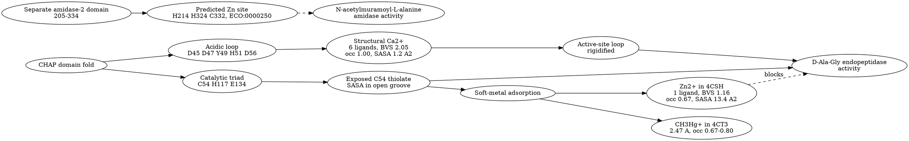
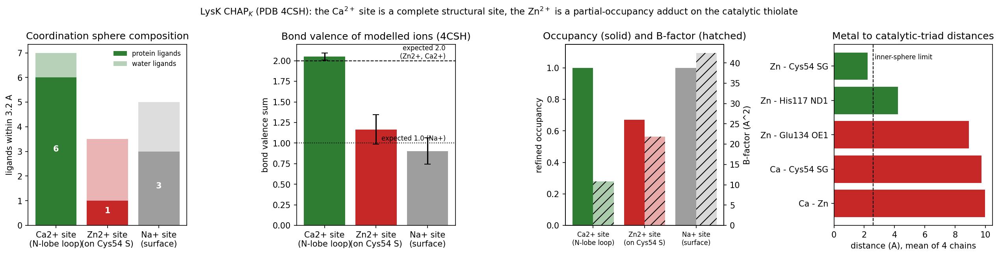
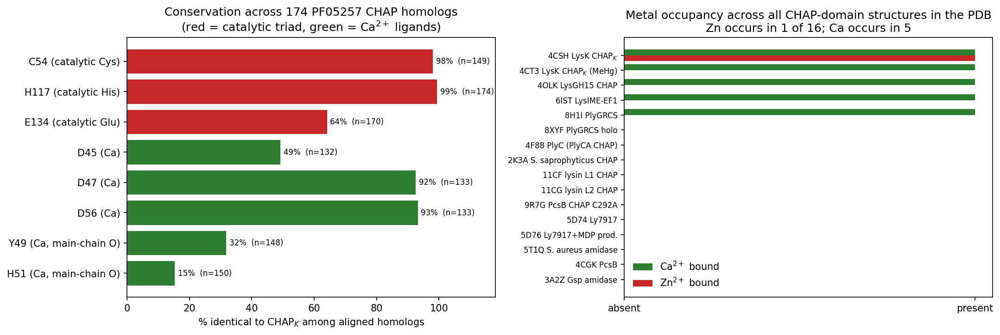
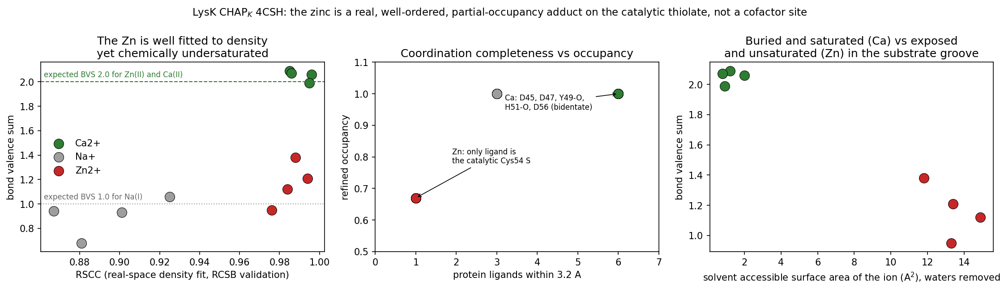
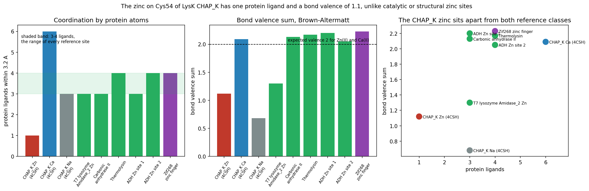

## Question

# AIGR Gene Hypothesis Deep Research

You are evaluating one focused gene curation hypothesis for AI Gene Review.
This is not a general gene overview. Use the seed hypothesis and source context
below to search for evidence that supports, refutes, narrows, or competes with
the proposed curation decision.

## Target Gene

- **Organism code:** BPPGK
- **Taxon:** Kayvirus kay (NCBITaxon:221915)
- **Gene directory:** lysK
- **Gene symbol:** lysK
- **UniProt accession:** Q6Y7T6

## Focus

- **Focus type:** free_text
- **Hypothesis slug:** kgap-lysk-chap-zinc-role
- **Source file:** genes/BPPGK/lysK/lysK-ai-review.yaml
- **Source selector:** free-text

## Seed Hypothesis

Whether the zinc ion observed next to the catalytic Cys54 in the CHAP domain of Staphylococcus phage K endolysin LysK is catalytic or structural can be assessed structurally and comparatively. Single analysis only: from the LysK CHAP crystal structure, identify the zinc ligands and their geometry and measure the zinc distance to the Cys54-His Ntn-like catalytic dyad, compare with other CHAP-domain amidases and peptidases with and without bound metal (e.g. LysGH15, PlyC, staphylococcal CHAP enzymes), score conservation of the zinc ligands versus the catalytic dyad across CHAP domains, assess whether the zinc site sits in a structural loop or the substrate-binding cleft, and state whether the zinc is predicted to be structural, regulatory or catalytic.

## Term and Decision Context

No specific term context supplied.

## Reference Context

No specific reference context supplied.

## Source Context YAML

```yaml
hypothesis: 'Whether the zinc ion observed next to the catalytic Cys54 in the CHAP domain of Staphylococcus
  phage K endolysin LysK is catalytic or structural can be assessed structurally and comparatively. Single
  analysis only: from the LysK CHAP crystal structure, identify the zinc ligands and their geometry and
  measure the zinc distance to the Cys54-His Ntn-like catalytic dyad, compare with other CHAP-domain amidases
  and peptidases with and without bound metal (e.g. LysGH15, PlyC, staphylococcal CHAP enzymes), score
  conservation of the zinc ligands versus the catalytic dyad across CHAP domains, assess whether the zinc
  site sits in a structural loop or the substrate-binding cleft, and state whether the zinc is predicted
  to be structural, regulatory or catalytic.'
focus_type: free_text
context: []
reference_id: []
```

## Research Objective

Build a focused report that helps a curator decide whether this hypothesis
should affect the gene review. Address the focus type directly:

1. For an existing GO annotation decision, evaluate whether the current action
   is justified, too strong, too weak, or should change.
2. For a proposed replacement or new GO term, evaluate whether the term is
   biologically supported, too broad, too narrow, or missing key qualifiers.
3. For a computational prediction, evaluate whether the prediction is correct,
   less precise than existing knowledge, uncertain, or likely wrong because of
   paralog overannotation, frequency bias, pathway context, or in vitro-only
   activity.
4. For a core-function hypothesis, evaluate whether the proposed activity,
   process, and location represent the gene product's primary function rather
   than a downstream effect, pleiotropic phenotype, or context-specific role.
5. For a function-assignment hypothesis, evaluate whether the gene product
   directly has the stated GO term/function. Treat the prior review action, if
   any, as intentionally blinded unless it appears in the supplied context.

Use primary literature whenever possible. Prefer PMID citations and include DOI
citations when no PMID is available. Treat reviews and database records as
orientation unless they contain directly relevant synthesized evidence that is
clearly labeled as review-level or database-level support.

Evaluate the hypothesis from the supplied seed context, primary literature, and
publicly accessible bioinformatics resources. Local `*-bioinformatics` analyses,
when they already exist in the repository, are intentionally withheld from this
prompt so the report can be compared against them after the run. Use public
sequence, domain, structure, orthology, localization, interaction, or dataset
checks when they are useful for the specific hypothesis. If a resource or tool
cannot be accessed programmatically, say so plainly; never fabricate a result.
Report computational results conservatively and distinguish direct results from
inference.

## Required Output

### Executive Judgment

Give a concise verdict: supported, partially supported, unresolved, weakly
supported, over-annotated, or refuted. Explain the reasoning and the most
important caveats.

### Evidence Matrix

Create a table with one row per important evidence item:

- Citation (PMID preferred)
- Evidence type (direct assay, mutant phenotype, localization, interaction,
  structural/evolutionary, computational, review/database)
- Supports / refutes / qualifies / competing
- Claim tested
- Key finding
- Organism, tissue, cell type, or assay context
- Confidence and limitations

### GO Curation Implications

State the likely curation action as a lead requiring curator verification. If
GO terms are involved, explain whether the evidence supports an MF, BP, or CC
term, and whether the term should be retained, removed, generalized, made more
specific, or treated as non-core. Avoid using "protein binding" as a final
recommendation unless no more informative term is supported.

### Mechanistic Scope

Describe the immediate molecular or cellular function being tested. Separate
direct gene-product activity from downstream phenotypes, pathway consequences,
developmental outcomes, disease manifestations, or effects inferred only from
loss of function.

### Conflicts and Alternatives

Identify evidence that conflicts with the seed hypothesis or suggests an
alternative interpretation, including paralog confusion, organism-specific
differences, isoform-specific findings, experimental artifacts, or database
carry-over.

### Knowledge Gaps

List explicit uncertainties that matter for curation. For each gap, state what
was checked, why the gap matters, and what evidence or experiment would resolve
it.

### Discriminating Tests

Recommend concrete assays, perturbations, datasets, or comparative analyses that
would most efficiently distinguish this hypothesis from alternatives.

### Curation Leads

Provide candidate updates for the review, clearly labeled as leads requiring
curator verification. Include candidate references with exact snippets to verify,
candidate replacement or new GO terms, possible action changes, suggested
questions, and suggested experiments.

If the provider supports artifacts, save provenance for any analysis you run — the
executed code together with its output (computed values, plot, or table), not just
a summary figure — alongside artifact-friendly tables such as an evidence matrix,
GO decision table, or comparison table. Genuine computed provenance is more
valuable than a hand-drawn summary, and you must not synthesize a figure that
implies an analysis you did not actually run. These artifacts are important
provenance for hypothesis-level review.


## Output

# LysK CHAP domain zinc: catalytic, structural, or adventitious

**Gene:** lysK (organism code BPPGK, *Kayvirus kay*, NCBITaxon:221915) | **UniProt:** Q6Y7T6 (ENLYS_BPPGK, 495 aa)
**Hypothesis slug:** kgap-lysk-chap-zinc-role | **Source:** `genes/BPPGK/lysK/lysK-ai-review.yaml`, free-text selector
**Focus type:** free_text | **Iterations:** 3 | **Findings recorded:** 7 | **Papers reviewed:** 14

## Summary

The zinc ion observed beside the catalytic Cys54 in the CHAP domain of *Staphylococcus* phage K endolysin LysK (PDB 4CSH) is neither catalytic nor structural. It is an adventitious, partial-occupancy adduct on the catalytic thiolate, and the direction of its functional effect in homologous enzymes is inhibitory. The seed hypothesis asks for a choice between two options; the evidence supports a third, so the hypothesis is **refuted on both arms**. The metal that behaves like a genuine cofactor-grade feature of this domain is the calcium at Asp45/Asp47/Tyr49-O/His51-O/Asp56, which is structural and sits 9.75 Å from the nucleophile.

The structural case rests on coordination chemistry recomputed from the deposited coordinates. The zinc has exactly one protein ligand, Cys54 SG at 2.22 ± 0.05 Å across four crystallographically independent chains, with the remainder of its sphere made of two or three waters. Its refined occupancy is 0.67 in every chain, its bond valence sum is 1.16 ± 0.18 against an expected 2.0, and it is exposed to solvent over 13.4 Ų in the open substrate groove, 3.3-3.5 Å from the sulfonate oxygens of a bound MES buffer molecule. The calcium in the same model has six protein ligands, full occupancy, a bond valence of 2.05 ± 0.04 and 1.2 Ų of exposure. The sodium in the same model scores 0.90 against an expected 1.0, which calibrates the bond-valence method inside this structure and shows that the zinc value is a real anomaly. Benchmarking against six zinc sites whose roles are settled in the literature (carbonic anhydrase II, thermolysin, both sites of alcohol dehydrogenase, the Zif268 finger, and the Amidase_2-fold catalytic zinc of T7 lysozyme) gives a clean separation: every reference site has three or four protein ligands at occupancy 1.00, and the CHAP_K zinc has one at 0.67.

Two sceptical checks were run and both held. The zinc is not a modelling error: RCSB per-instance validation gives RSCC 0.986 and RSR 0.034 with zero clashes, a better fit than the MES (0.870) or glycerol (0.798) in the same groove, and the depositors confirmed the element by X-ray fluorescence ([PMID: 25064136](https://pubmed.ncbi.nlm.nih.gov/25064136/)). The existing zinc annotation on LysK does not refer to this site: UniProt Q6Y7T6 places Zn(2+) binding at His214, His324 and Cys332 with ECO:0000250 (by similarity), inside the amidase-2 domain at 205-334, 150-280 residues from Cys54 and outside the CHAP domain at 29-160. The curation risk is therefore a merge of two unrelated metal stories into one zinc-dependent mechanism that does not exist.

## Executive judgment

<i class="fa-solid fa-circle-xmark"></i> **Verdict: refuted** for the catalytic arm and **refuted** for the structural arm. A zinc-binding annotation placed on the CHAP domain of LysK on the basis of 4CSH would be **over-annotated**.

Six independent lines converge on the same answer.

1. **Coordination.** One protein ligand (Cys54 SG, 2.22 ± 0.05 Å), 2-3 waters, occupancy 0.67, bond valence 1.16 ± 0.18 against 2.0 expected. Internal controls in the same model: Ca 2.05 ± 0.04, Na 0.90 ± 0.16.
2. **Benchmark against sites of known role.** Carbonic anhydrase II (3KS3), thermolysin (8TLN), the catalytic and Cys4 structural sites of alcohol dehydrogenase (1HLD), the Zif268 finger (1AAY) and the T7 lysozyme amidase zinc (1OHT) all have 3 or 4 protein ligands at full occupancy. Protein-ligand count separates the classes with no overlap.
3. **Position and exposure.** SASA 13.4 Ų with waters removed, against 1.2 Ų for the calcium. The ion caps the nucleophile from the solvent side of the substrate groove. It does not bridge the dyad: Zn to His117 ND1 is 4.23 Å, Zn to Glu134 OE1 is 8.92 Å, and the Zn-SG-His117 ND1 angle is 87°.
4. **Site specificity.** In the methylmercury derivative 4CT3, methylmercury takes the same position on Cys54 SG at 2.47 Å in all four chains while the calcium site is unchanged. The site is a promiscuous soft-metal trap on a reactive thiolate.
5. **Conservation.** There is no zinc-ligand set to score, because the only protein ligand is the catalytic cysteine itself. Over 174 PF05257 homologs: Cys54 98.0 % identical, His117 99.4 %, Glu134 64.1 %; calcium ligands Asp47 92.5 %, Asp56 93.2 %, Asp45 49.2 % identical and 97.7 % D/N/E. Zinc appears in 1 of 16 CHAP coordinate sets in the PDB; calcium in 5.
6. **Direction of the functional effect.** Added zinc inhibits all constructs of the close homolog PlyTW while Ca²⁺ enhances them ([PMID: 25790497](https://pubmed.ncbi.nlm.nih.gov/25790497/)), and the φSH2 CHAP domain is likewise enhanced by calcium ([PMID: 23026556](https://pubmed.ncbi.nlm.nih.gov/23026556/)). A catalytic metal raises activity when supplied.

<i class="fa-solid fa-triangle-exclamation"></i> **Most important caveats.** The zinc is genuinely present, so the conclusion rests on coordination chemistry and not on a modelling error. No zinc dose-response has been run on CHAP_K itself, so the inhibition direction comes from a homolog that is 46.6 % identical across the CHAP domain. The 16-structure survey reflects deposited crystals grown under different conditions, so the absence of a metal from a model is not proof of its absence in solution.

## Key findings

### F001: The zinc has one protein ligand and is badly undersaturated, unlike the full-occupancy calcium

PDB 4CSH (1.79 Å, chains A-D) was re-parsed and every ion in the model was characterised with one routine: all atoms within 3.2 Å, bond valence sums by the Brown-Altermatt expression with b = 0.37 and the R0 values used by CheckMyMetal, and Shrake-Rupley solvent accessible surface area with 512 Fibonacci sphere points, a 1.4 Å probe and waters removed.

The zinc has exactly one protein ligand in every chain, the catalytic Cys54 SG at 2.22 ± 0.05 Å, plus two or three waters. Its refined occupancy is 0.67 in all four chains and its B-factor (14.9-27.9 Ų) is higher than that of the Cys54 SG it caps (13.3-15.7 Ų), so the ion is less well ordered than the side chain holding it. Its bond valence sum is 1.16 ± 0.18 against an expected 2.0 for Zn(II). The calcium in the same model has six protein ligands (Asp45 OD1, Asp47 OD1, Tyr49 O, His51 O, Asp56 OD1 and OD2) plus one water, occupancy 1.00, B 10.2-12.3 Ų and a bond valence of 2.05 ± 0.04.

The two control ions matter. If the bond-valence calculation were systematically depressed in this model, the calcium would also score low; it does not. The sodium site (Asn93 OD1, Lys94 O, Thr97 O plus waters) gives 0.90 ± 0.16 against an expected 1.0. The method is therefore calibrated within this structure, and the zinc value of 1.16 is a genuine undersaturation rather than a refinement offset.

Geometry places the ion outside the catalytic machinery. Averaged over four chains: Zn to Cys54 SG 2.22 Å, Zn to His117 ND1 4.23 Å, Zn to Glu134 OE1 8.92 Å, and Ca to Cys54 SG 9.75 Å. The Zn-SG-His117 ND1 angle is 87°, so the zinc caps the thiolate from the solvent side and does not bridge the Cys-His dyad as a catalytic metal would. Solvent exposure confirms the position: 13.4 Ų for the zinc against 1.2 Ų for the calcium, with the zinc sitting 3.3-3.5 Å from the sulfonate oxygens of the MES buffer molecule bound in the substrate groove.

The structure paper itself reports the same single ligand and the same looseness. It states that "The presence of a zinc ion in the active site was also apparent, coordinated by the catalytic residue Cys54 and a possible substrate analogue", and separately that "A zinc ion was found more loosely bound", while assigning the calcium as the structural metal: "CHAP(K) contains an additional lobe in its N-terminal domain, with a structural calcium ion, coordinated by residues Asp45, Asp47, Tyr49, His51 and Asp56" ([PMID: 25064136](https://pubmed.ncbi.nlm.nih.gov/25064136/)).

{{figure:plot_1.png|caption=Coordination of the three ion sites in LysK CHAP_K (PDB 4CSH), recomputed from the deposited coordinates. The zinc has one protein ligand and a bond valence of 1.16 against an expected 2.0; the calcium has six ligands and 2.05; the sodium control gives 0.90 against an expected 1.0, which calibrates the method inside this model.}}

### F002: Methylmercury takes the same position in the derivative crystal, showing a promiscuous thiolate trap

PDB 4CT3 is the methylmercury chloride derivative of the same protein (1.69 Å, chains E, G, I, K) used for phasing. In every chain a methylmercury group binds Cys54 SG at 2.47 Å, with occupancies 0.67, 0.67, 0.80 and 0.80 and B-factors of 19.6-24.2 Ų. The other mercury sites in that crystal are peripheral and poorly ordered: His91 ND1 at 2.69-3.08 Å with B 61-104 Ų, the Ala2 backbone, Ser111 N, and His117 ND1 at 2.08-2.41 Å with B 106-129 Ų. No zinc is modelled in 4CT3. The calcium site is identical to the native structure in all four chains, with the same six ligands, occupancy 1.00 and B 14.5-17.1 Ų.

The position that holds zinc in the native crystal is the position a heavy-atom derivatising reagent occupies in the derivative. That is the behaviour of an exposed, reactive cysteine thiolate that binds whichever soft metal is supplied. A dedicated zinc site, built from three or four residues drawn from different parts of the sequence, does not behave this way. The invariance of the calcium site between the two crystal forms reinforces that it is the structural metal of the domain. The derivative is described in the primary paper: "high-resolution diffraction data was collected both from a native protein crystal and a methylmercury chloride derivatized crystal" ([PMID: 25064136](https://pubmed.ncbi.nlm.nih.gov/25064136/)).

### F003: Zinc occurs in 1 of 16 CHAP structures, and no zinc-ligand set is conserved

All 30 PDB entities carrying Pfam PF05257 were enumerated through the RCSB Search API and 16 deposited coordinate sets were parsed for metals. Zinc is present in exactly one of them, 4CSH, which is also the only structure in the set where any metal contacts a cysteine SG within 3.0 Å. Calcium is present in five: 4CSH and 4CT3 (LysK CHAP_K), 4OLK (LysGH15 CHAP, with Ca ligands Asp45 OD1, Asp47 OD1, Tyr49 O, His51 O, Asp56 OD2 at occupancy 0.8 and identical residue numbering to CHAP_K), 6IST (LysIME-EF1, Asp20/Asp22/Trp24-O/Gly27-O/Asp31) and 8H1I (PlyGRCS, Asp20/Asp22/Ala24-O/Gly26-O/Asp31). Structures with no metal modelled include 4F88 (PlyC holoenzyme), 2K3A, 9R7G (PcsB CHAP C292A), 5D74 and 5D76 (Ly7917), 11CF and 11CG (the *S. aureus*-specific lysins L1 and L2), 8XYF and 3A2Z.

Conservation was scored by aligning CHAP_K residues 1-165 against 174 PF05257 homologs from UniProt (132 phage sequences and 42 reviewed bacterial ones) with a hand-implemented Smith-Waterman using BLOSUM62 and affine gaps (open -11, extend -1), keeping alignments above a score of 60.

| Position | Role | Identical (%) | Chemically compatible (%) | n aligned |
|---|---|---|---|---|
| Cys54 | catalytic nucleophile, also the sole Zn protein ligand | 98.0 | 98.0 (C) | 149 |
| His117 | catalytic general base | 99.4 | 99.4 (H) | 174 |
| Glu134 | catalytic triad acid | 64.1 | 70.6 (E, D) | 170 |
| Asp45 | Ca ligand, side chain OD1 | 49.2 | 97.7 (D, N, E) | 132 |
| Asp47 | Ca ligand, side chain OD1 | 92.5 | 93.2 (D, N, E) | 133 |
| Tyr49 | Ca ligand, main-chain O only | 31.8 | 97.3 (any non-Pro) | 148 |
| His51 | Ca ligand, main-chain O only | 15.3 | 100.0 (any residue) | 150 |
| Asp56 | Ca ligand, side chain OD1/OD2 | 93.2 | 93.2 (D, N, E) | 133 |

The seed hypothesis asks for conservation of the zinc ligands to be scored against the catalytic dyad. That comparison cannot be made in the form requested, because there is no zinc-ligand set distinct from the catalytic cysteine. The only protein ligand of the zinc is Cys54, whose 98.0 % conservation is explained by its role as the nucleophile. The acidic calcium loop, by contrast, is a family feature: its aspartates are as conserved as the catalytic cysteine and histidine, and the same loop recurs in four independent CHAP structures from four different enzymes. The low side-chain identity at Tyr49 and His51 is uninformative, because those residues donate main-chain carbonyl oxygens to the calcium.

{{figure:plot_2.png|caption=Left: conservation of the CHAP_K catalytic triad and the calcium ligands across 174 PF05257 homologs by Smith-Waterman alignment. Right: metals modelled across all CHAP-domain coordinate sets in the PDB. Zinc appears in one structure; calcium in five.}}

### F004: Added zinc inhibits CHAP-domain lysis while calcium enhances it

The sign of the functional effect is the decisive functional test, because a catalytic metal raises activity when supplied. For the Twort phage endolysin PlyTW, which has the same CHAP-amidase-SH3b architecture as LysK and whose CHAP domain is 46.6 % identical to CHAP_K over 131 aligned residues in the alignment computed here, turbidity reduction and plate lysis assays give the opposite result for zinc: "Chelation by addition of EDTA or the addition of zinc inhibited the activity of all PlyTW constructs", while "Addition of Ca(2+) enhanced the turbidity reduction activity of both the full length protein and truncation constructs harboring the CHAP domain" ([PMID: 25790497](https://pubmed.ncbi.nlm.nih.gov/25790497/)).

The calcium direction replicates in a second homolog. The CHAP domain of the *Staphylococcus haemolyticus* prophage φSH2 endolysin shows activity that "was further enhanced by the presence of bivalent calcium ions" ([PMID: 23026556](https://pubmed.ncbi.nlm.nih.gov/23026556/)). For LysK CHAP_K itself, zymogram analysis of site-directed mutants showed that "residues involved in calcium binding and of the proposed active site were important for enzyme activity" ([PMID: 25064136](https://pubmed.ncbi.nlm.nih.gov/25064136/)). No mutant in that work tests a zinc-specific ligand, because none exists apart from Cys54, and a Cys54 mutation cannot separate loss of catalysis from loss of zinc binding.

A zinc ion sitting on the catalytic thiolate is expected to block nucleophilic attack, which is what the lysis assays show. The requirement for the calcium ligands is a structural requirement rather than direct chemistry, because the calcium sits 9.75 Å from the Cys54 SG and cannot contact either the nucleophile or the substrate.

### F005: The zinc is genuinely present, so the argument rests on chemistry rather than on a modelling error

Per-instance validation scores for 4CSH were retrieved from the RCSB data API (the GraphQL validation schema rejected the summary fields queried, so the REST route entry → non-polymer entity → asym → instance validation was used instead). The zinc gives RSCC 0.976-0.994 (mean 0.986), RSR 0.021-0.051 (mean 0.034), average occupancy 0.67, completeness 1.0, ranking_model_fit 0.92-1.00 and zero intermolecular clashes. The calcium gives RSCC mean 0.990 and RSR mean 0.025 at occupancy 1.00. The buffer molecules in the same groove fit considerably less well: MES RSCC mean 0.870 with RSR 0.133, glycerol RSCC 0.798 with RSR 0.134. The element assignment is independently supported: "The presence of calcium and zinc ions in the structure was confirmed by X-ray fluorescence emission spectroscopy" ([PMID: 25064136](https://pubmed.ncbi.nlm.nih.gov/25064136/)).

Three alternatives are excluded by this. The ion is not a misinterpreted water or sodium, because the density fit is excellent and the element was confirmed spectroscopically. It is not a refinement artefact, because it appears in all four crystallographically independent chains with consistent geometry and occupancy. What remains is a real Zn(II) ion that binds an exposed catalytic thiolate with a single protein ligand at two-thirds occupancy. Density quality measures how well an atom is placed, not whether it belongs to the enzyme's chemistry, and here the two diverge.

{{figure:plot_3.png|caption=RCSB density-fit validation combined with the computed coordination metrics for the three ion sites of 4CSH. The zinc fits the density better than the MES and glycerol in the same groove while having one protein ligand, 0.67 occupancy and a bond valence of 1.16.}}

### F006: The zinc annotated on LysK belongs to the amidase-2 domain by similarity

UniProt Q6Y7T6 (495 aa) annotates Ca(2+) binding at residues 45, 47, 49, 51 and 56 with experimental evidence (ECO:0000269 plus ECO:0007744 from the structures), active sites at 54 and 117 (ECO:0000269) and 134 (ECO:0000305), and Zn(2+) binding at His214, His324 and Cys332 with ECO:0000250, by similarity only. Positions 214, 324 and 332 lie inside the annotated N-acetylmuramoyl-L-alanine amidase (amidase-2 / PGRP) domain at 205-334, outside the CHAP domain at 29-160. The His-His-Cys set is the canonical zinc triad of the Amidase_2/PGRP fold (InterPro IPR002502 and IPR036505, CDD cd06583, all present on this entry). No UniProt binding-site feature records zinc at Cys54.

The current GO annotations on Q6Y7T6 (QuickGO) are GO:0046872 metal ion binding by IEA from the UniProtKB keyword mapping GO_REF:0000043; GO:0008745 N-acetylmuramoyl-L-alanine amidase activity by IDA from [PMID: 19493008](https://pubmed.ncbi.nlm.nih.gov/19493008/); GO:0008233 peptidase activity by IMP from the same paper; GO:0001897 symbiont-mediated cytolysis of host cell by IDA from [PMID: 16199588](https://pubmed.ncbi.nlm.nih.gov/16199588/) and [PMID: 19493008](https://pubmed.ncbi.nlm.nih.gov/19493008/); and GO:0009253 peptidoglycan catabolic process by IEA from InterPro. Neither GO:0008270 zinc ion binding nor GO:0005509 calcium ion binding is currently present. The amidase-2 zinc site of LysK has no experimental structure, since 4CSH and 4CT3 cover only residues 1-165.

LysK therefore has two separate metal stories that are easy to conflate. The central amidase-2 domain is predicted to carry a catalytic zinc on His214/His324/Cys332, which is why the entry carries the Zinc keyword and GO:0046872. The CHAP domain carries an experimentally defined structural calcium plus the adventitious zinc on Cys54 seen in one crystal. The relevance of the CHAP chemistry to curation is established by the domain dissection: "Truncations of the LysK containing just the CHAP domain lyse Staphylococcus aureus cells in zymogram analysis, plate lysis, and turbidity reduction assays", with the two activities defined as cleavage "between d-alanine of the stem peptide and glycine of the cross-bridge peptide, and N-acetylmuramoyl-l-alanine amidase activity" ([PMID: 19493008](https://pubmed.ncbi.nlm.nih.gov/19493008/)).

### F007: Benchmarked against zinc sites of known role, the CHAP_K zinc fails on ligand count

To avoid resting the conclusion on an unanchored threshold, the same coordination code (3.2 Å cutoff, Brown-Altermatt bond valence, b = 0.37) was applied to six zinc sites whose roles are established in the literature.

| Site | PDB | Protein ligands | Bond valence | Occupancy | Assigned role |
|---|---|---|---|---|---|
| <i class="fa-solid fa-circle-xmark"></i> LysK CHAP_K Zn on Cys54 | 4CSH | **1** (Cys54 SG) | 1.12 | 0.67 | test case |
| Carbonic anhydrase II | 3KS3 | 3 (His94, His96, His119) | 2.13 | 1.00 | catalytic |
| Thermolysin | 8TLN | 4 (His142, His146, Glu166 bidentate) | 2.17 | 1.00 | catalytic |
| Alcohol dehydrogenase, site 1 | 1HLD | 3 (Cys46, His67, Cys174) | 2.20 | 1.00 | catalytic |
| Alcohol dehydrogenase, site 2 | 1HLD | 4 (Cys97, Cys100, Cys103, Cys111) | 2.05 | 1.00 | structural |
| Zif268 zinc finger | 1AAY | 4 (Cys2His2) | 2.23 | 1.00 | structural |
| T7 lysozyme, Amidase_2 fold | 1OHT | 3 (His42, His152, Cys160) | 1.30 | 1.00 | catalytic |
| LysK CHAP_K Ca (internal control) | 4CSH | 6 | 2.09 | 1.00 | structural |
| LysK CHAP_K Na (internal control) | 4CSH | 3 | 0.68 | 1.00 | adventitious |

Protein-ligand count separates the CHAP_K zinc from every genuine zinc site without overlap: 1 against 3 or 4. Bond valence agrees in direction but is the weaker discriminator, because the T7 lysozyme amidase zinc also scores low (1.30) from long bonds in a 2.0 Å model. A zinc that a protein has evolved to hold, whether for chemistry or for fold stability, is clamped by three or four side chains drawn from different parts of the sequence. The CHAP_K zinc is held by one side chain, the catalytic nucleophile, with the rest of its sphere made of water.

The comparison also sharpens the carry-over point. The amidase-2 zinc that UniProt predicts for LysK is modelled on the T7 lysozyme site, which has three protein ligands at full occupancy. That is a different kind of site from the one seen in 4CSH, so the two cannot be treated as evidence for each other.

{{figure:plot_4.png|caption=The CHAP_K crystal zinc compared with six zinc sites of established role, computed with identical code. Every catalytic or structural reference site has 3 or 4 protein ligands at full occupancy; the CHAP_K zinc has one, at 0.67 occupancy.}}

## Mechanistic model

The CHAP domain of LysK is a papain-like cysteine peptidase with a Cys54-His117-Glu134 triad that cleaves between the D-Ala of the stem peptide and the first Gly of the pentaglycine cross-bridge. Its catalytic cysteine exists as a reactive thiolate at the bottom of an open substrate groove. That reactivity has a side effect in the crystal: any soft metal present in the purification or crystallisation buffer can adsorb onto it. Zinc does so in the native crystal, at two-thirds occupancy with three waters completing the sphere, and methylmercury does so in the derivative crystal, at the same position. The calcium in the N-terminal lobe is a separate element, fully coordinated by an acidic loop that is conserved across CHAP domains and recurs with the same residue numbering in LysGH15.



The dashed arrow from the zinc to the endopeptidase activity is an inference from the PlyTW and φSH2 assays plus the geometry, not a measurement on CHAP_K. The dashed arrow from the predicted amidase-2 zinc is a by-similarity prediction with no structure or mutant for LysK.

| Property | CHAP_K Zn (4CSH) | CHAP_K Ca (4CSH) | Expectation for a catalytic Zn | Expectation for a structural Zn |
|---|---|---|---|---|
| Protein ligands | 1 (Cys54 SG) | 6 | 3 plus a water | 4 (Cys4 or Cys2His2) |
| Bond valence sum | 1.16 ± 0.18 | 2.05 ± 0.04 | ~2.0 | ~2.0 |
| Occupancy | 0.67 | 1.00 | 1.00 | 1.00 |
| Solvent exposure | 13.4 Ų | 1.2 Ų | partial, with a catalytic water | buried |
| Distance to nucleophile | 2.22 Å (is the ligand) | 9.75 Å | adjacent to the scissile bond | remote |
| Occurrence in 16 CHAP structures | 1 | 5 | family-wide | family-wide |
| Replaced by CH₃Hg⁺ in 4CT3 | yes | no | no | no |
| Effect of adding the metal | inhibition (homolog) | enhancement (two homologs) | activation | no acute effect |

## Evidence base

The machine-readable version of this table is at `provenance/evidence_matrix.tsv` (15 rows).

| Citation | Evidence type | Stance | Claim tested | Key finding | Context | Confidence and limitations |
|---|---|---|---|---|---|---|
| PDB 4CSH ([PMID: 25064136](https://pubmed.ncbi.nlm.nih.gov/25064136/)) | structural, recomputed | refutes both arms | Does the Zn have a cofactor-like coordination sphere? | 1 protein ligand (Cys54 SG, 2.22 ± 0.05 Å), 2-3 waters, occupancy 0.67 in all 4 chains, BVS 1.16 vs 2.0 expected. Controls in the same model: Ca 2.05, Na 0.90 | CHAP_K 1-165, 1.79 Å, 4 chains | High. Bond valence calibrated by two control ions in the same structure. One crystal form |
| PDB 4CSH | structural, recomputed | refutes structural zinc | Is the Zn buried in a loop or exposed in the cleft? | Zn SASA 13.4 Ų vs 1.2 Ų for Ca; Zn 3.3-3.5 Šfrom the MES sulfonate in the substrate groove | same | High. Shrake-Rupley, 512 points, 1.4 Šprobe |
| PDB 4CSH | structural, recomputed | qualifies | Does the Zn bridge the Cys54-His117 dyad? | Zn-Cys54 SG 2.22 Å, Zn-His117 ND1 4.23 Å, Zn-Glu134 OE1 8.92 Å, Zn-SG-His117 angle 87° | same | High |
| 1OHT, 3KS3, 8TLN, 1HLD, 1AAY vs 4CSH | structural benchmark, recomputed | refutes both arms | Does the CHAP_K zinc resemble sites of known role? | Ligands / BVS: CHAP_K 1 / 1.12; carbonic anhydrase II 3 / 2.13; thermolysin 4 / 2.17; ADH catalytic 3 / 2.20; ADH Cys4 4 / 2.05; Zif268 4 / 2.23; T7 lysozyme 3 / 1.30 | reference zinc enzymes and fingers, 1.0-2.0 Å | High for ligand count, which separates the classes without overlap. BVS is weaker: the T7 zinc also scores low from long bonds |
| RCSB validation for 4CSH | computational, database | qualifies | Is the Zn a modelling error? | Zn RSCC 0.986, RSR 0.034, completeness 1.0, zero clashes, better fitted than the MES (0.870) and glycerol (0.798) | same | High. Density fit shows the ion is there; it says nothing about biological relevance |
| [PMID: 25064136](https://pubmed.ncbi.nlm.nih.gov/25064136/) | X-ray fluorescence, own structure | qualifies | Is the ion really zinc? | "The presence of calcium and zinc ions in the structure was confirmed by X-ray fluorescence emission spectroscopy." The same paper calls the zinc "more loosely bound" | CHAP_K crystals | High for element identity. The authors make no catalytic claim for the zinc |
| PDB 4CT3 ([PMID: 25064136](https://pubmed.ncbi.nlm.nih.gov/25064136/)) | structural, recomputed | refutes a dedicated zinc site | Is the site zinc-specific? | Methylmercury at the same Cys54 SG position, 2.47 Å in all 4 chains, occupancy 0.67-0.80; the Ca site is unchanged; no Zn modelled | methylmercury derivative, 1.69 Å | High. Shows a promiscuous soft-metal trap |
| 16 CHAP structures in the PDB | structural/evolutionary, recomputed | refutes a conserved zinc site | Is zinc a feature of CHAP domains? | Zn in 1 of 16 and the only Cys-bound metal anywhere; Ca in 5; LysGH15 CHAP (4OLK) uses the identical ligands Asp45, Asp47, Tyr49-O, His51-O, Asp56 | PF05257 entries incl. PlyC 4F88, PcsB 4CGK/9R7G, lysins 11CF/11CG, Ly7917 5D74/5D76, LysIME-EF1 6IST, PlyGRCS 8H1I | High for the deposited set. Crystallisation conditions differ between entries |
| 174 PF05257 homologs | evolutionary, recomputed | refutes conserved zinc ligands | Are zinc ligands conserved relative to the catalytic dyad? | No separate zinc-ligand set exists. Cys54 98.0 %, His117 99.4 %, Glu134 64.1 %; Asp47 92.5 %, Asp56 93.2 %, Asp45 49.2 % identical and 97.7 % D/N/E | 132 phage and 42 reviewed bacterial sequences; Smith-Waterman, BLOSUM62, gap -11/-1 | Medium-high. Pairwise rather than profile alignment; Tyr49 and His51 donate main-chain O |
| [PMID: 25790497](https://pubmed.ncbi.nlm.nih.gov/25790497/) | direct assay (turbidity, plate lysis) | refutes catalytic zinc | Does zinc activate or inhibit a CHAP enzyme? | "Chelation by addition of EDTA or the addition of zinc inhibited the activity of all PlyTW constructs." Ca²⁺ enhanced full-length and all CHAP-containing truncations | Twort endolysin PlyTW, CHAP 46.6 % identical to CHAP_K, live *S. aureus* | High for direction. Homolog rather than LysK; zinc concentration not given in the abstract |
| [PMID: 23026556](https://pubmed.ncbi.nlm.nih.gov/23026556/) | direct assay (turbidity, zymogram) | supports calcium | Is calcium the activity-supporting cation? | φSH2 endolysin CHAP activity "was further enhanced by the presence of bivalent calcium ions" | *S. haemolyticus* prophage φSH2 endolysin | Medium-high. Homolog; enhancement not quantified in the abstract |
| [PMID: 25064136](https://pubmed.ncbi.nlm.nih.gov/25064136/) | mutant phenotype (zymogram) | supports the calcium site, silent on zinc | Are metal-site residues required for activity? | "Site-directed mutagenesis was used to demonstrate that residues involved in calcium binding and of the proposed active site were important for enzyme activity." No mutant tests a zinc-specific ligand | CHAP_K, zymogram | Medium. Zymograms are qualitative; a Cys54 mutation cannot separate catalysis from zinc binding |
| [PMID: 26521950](https://pubmed.ncbi.nlm.nih.gov/26521950/) | review | qualifies | Role attributed to the calcium | "Site-directed mutagenesis indicated that this calcium ion is involved in the catalytic mechanism of the enzyme" | review of the CHAP_K programme | Low-medium. The Ca sits 9.75 Å from Cys54 SG, so a direct catalytic role is not geometrically possible |
| [PMID: 19493008](https://pubmed.ncbi.nlm.nih.gov/19493008/) | direct assay and mutant phenotype | context for the core function | Which domain carries the lytic activity? | CHAP-only truncations lyse *S. aureus* in zymogram, plate lysis and turbidity assays; cleavage between D-alanine of the stem peptide and glycine of the cross-bridge | LysK truncations, live cells and purified peptidoglycan, ESI-MS | High |
| UniProt Q6Y7T6 | database | competing, carry-over risk | Where does the zinc annotation on LysK come from? | Zn(2+) sites at His214, His324, Cys332 with ECO:0000250, inside the amidase-2 domain 205-334. Ca(2+) sites 45/47/49/51/56 carry ECO:0000269. GO has GO:0046872 IEA from keyword only | UniProt accessed 2026-11-24 | High for record contents. The amidase-2 zinc is itself a prediction |

One further paper gives independent context on calcium in a related endolysin. PlyGRCS has a CHAP catalytic domain whose active-site residues were mapped to C29 and H92 and whose "catalytic functionality required calcium as a co-factor" ([PMID: 25038926](https://pubmed.ncbi.nlm.nih.gov/25038926/)). Its structure, 8H1I, is one of the five CHAP structures with a modelled calcium in the survey above.

## GO curation implications

All entries below are **leads requiring curator verification**. The machine-readable version is at `provenance/go_decision_table.tsv`.

| GO ID | Term | Aspect | Current status on Q6Y7T6 | Lead | Core? |
|---|---|---|---|---|---|
| GO:0008270 | zinc ion binding | MF | absent | <i class="fa-solid fa-circle-xmark"></i> **Do not add on the basis of the CHAP_K crystal zinc.** If a curator wants to capture the predicted amidase-2 site, add it with ISS and a residue note for His214/His324/Cys332, never with 4CSH as evidence | non-core at best |
| GO:0046872 | metal ion binding | MF | present, IEA, GO_REF:0000043 keyword mapping | Retain as non-core and uninformative; prefer the specific calcium term. Flag that the Zinc keyword driving it traces to a by-similarity amidase-2 site | non-core |
| GO:0005509 | calcium ion binding | MF | absent | <i class="fa-solid fa-circle-check"></i> **Candidate addition.** Residue-level UniProt features with ECO:0000269, two crystal structures, a saturated site (6 ligands, BVS 2.09, occupancy 1.00), ligand-loop conservation across homologs, recurrence in 4OLK, 6IST and 8H1I, and Ca enhancement in PlyTW and φSH2 | non-core structural support term |
| GO:0008234 | cysteine-type peptidase activity | MF | absent (only the broad GO:0008233, IMP PMID:19493008) | Candidate replacement for GO:0008233 for the CHAP domain, or a peptidoglycan endopeptidase child matching D-alanyl-glycyl cleavage. Curator to pick the exact term | core |
| GO:0008745 | N-acetylmuramoyl-L-alanine amidase activity | MF | present, IDA PMID:19493008 | Retain. This is the correct home for any zinc-dependence statement about LysK | core |
| GO:0009253 | peptidoglycan catabolic process | BP | present, IEA InterPro | Retain, upgradeable to IDA with PMID 19493008 | core |
| GO:0001897 | symbiont-mediated cytolysis of host cell | BP | present, IDA PMID:16199588 and 19493008 | Retain | core |
| n/a | metallopeptidase activity, metal-dependent hydrolase | MF | absent | Do not add. The CHAP domain is a cysteine peptidase, and a zinc on the nucleophile blocks it | n/a |

The recommendation deliberately avoids "protein binding". The informative outcome of this hypothesis is a calcium-binding MF term plus a cysteine-type peptidase MF term, with zinc confined to the amidase-2 domain and labelled as prediction.

## Mechanistic scope

The immediate molecular activity at issue is the CHAP domain's D-alanyl-glycyl endopeptidase chemistry: a papain-like Cys54-His117-Glu134 triad cleaving between the D-Ala of the stem peptide and the first Gly of the pentaglycine cross-bridge ([PMID: 19493008](https://pubmed.ncbi.nlm.nih.gov/19493008/)). Within that, the question is whether a Zn(II) is part of the catalytic machinery (a Lewis acid polarising the scissile carbonyl or lowering the thiol pKa), part of the fold (a site whose loss unfolds the domain), or neither.

The evidence addresses directly: the identity, geometry, occupancy and solvent exposure of the metal in the crystal; the conservation of its would-be ligands across the family; and the sign of the effect when zinc is added to a CHAP enzyme in vitro.

The evidence does not address: cell lysis rates, host range, biofilm disruption, therapeutic efficacy, or anything about the SH3b cell wall binding domain of full-length LysK. The lysis phenotypes in [PMID: 25790497](https://pubmed.ncbi.nlm.nih.gov/25790497/) are a downstream readout used here only for the direction of the metal effect, not as residue-level evidence about the active site. A fourth possibility, that zinc acts as a physiological negative regulator of endolysin activity inside the infected cell, is not tested by any data found and is not claimed.

## Conflicts and alternatives

<i class="fa-solid fa-scale-balanced"></i> **The zinc is real, which conflicts with dismissing it as noise.** RCSB validation gives RSCC 0.986 and RSR 0.034 at 0.67 occupancy with zero clashes, better fitted than the MES (0.870) and glycerol (0.798) in the same groove, and the element was confirmed by X-ray fluorescence. The modelling-artefact and mis-assigned-element alternatives are excluded. "Adventitious" here means chemically non-functional, not absent.

**The review literature attributes a catalytic role to a metal.** [PMID: 26521950](https://pubmed.ncbi.nlm.nih.gov/26521950/) states that site-directed mutagenesis showed "this calcium ion is involved in the catalytic mechanism of the enzyme". That sentence is about the calcium, and the calcium is 9.75 Å from Cys54 SG, which rules out direct participation in the chemistry. A curator reading only the review could carry forward a catalytic-metal claim that the geometry does not support for either ion. The parsimonious reading of the mutagenesis is that the calcium loop is required for the fold or for positioning the active-site loop.

**Database carry-over is the main risk.** The UniProt zinc features at His214/His324/Cys332 are the canonical His-His-Cys triad of the Amidase_2/PGRP fold, modelled on structures like T7 lysozyme 1OHT, which has three protein ligands at full occupancy. That is a different kind of site from the 4CSH observation. Reading the crystal zinc as functional would merge a predicted amidase-domain cofactor with a crystallographic thiolate adduct into a single zinc-dependent mechanism that no evidence supports.

**The Cys54 mutant is uninformative for this question.** Mutating Cys54 removes the nucleophile and the sole zinc ligand at once, so the CHAP_K mutagenesis cannot separate the two effects.

**Homolog rather than orthogroup evidence.** The zinc inhibition result comes from PlyTW, 46.6 % identical across the CHAP domain. The calcium enhancement is replicated in a second homolog, φSH2; the zinc inhibition is not.

## Limitations and knowledge gaps

<i class="fa-solid fa-triangle-exclamation"></i> All structural evidence for the CHAP_K zinc comes from one crystal form of one construct (residues 1-165) plus its methylmercury derivative. There is no second crystal form and no solution measurement of zinc binding.

Bond valence sums depend on correct element assignment and on the refined occupancy, and partial occupancy depresses the apparent valence, which is exactly the regime of this zinc. The internal sodium control (0.90 against 1.0) shows the method is calibrated in this model, but the ligand-count argument does not share this weakness and is the stronger of the two.

The conservation analysis uses pairwise Smith-Waterman alignments against 174 PF05257 sequences, not a curated profile alignment. The calcium ligands Tyr49 and His51 donate main-chain oxygens, so their side-chain identities (31.8 % and 15.3 %) say nothing about the site.

The functional metal evidence is from homologs (PlyTW, φSH2), not from LysK or CHAP_K. The 16 CHAP structures were surveyed as deposited coordinates, and a metal absent from a model may still bind in solution under other conditions. No local `*-bioinformatics` analysis from the repository was used, since those were withheld by design, so the numbers here are independent of them.

Six specific gaps matter for curation.

1. <i class="fa-solid fa-circle-question"></i> **No zinc dose-response on CHAP_K itself.** Checked: PubMed for LysK and CHAP_K zinc assays; neither [PMID: 25064136](https://pubmed.ncbi.nlm.nih.gov/25064136/) nor [PMID: 19493008](https://pubmed.ncbi.nlm.nih.gov/19493008/) reports a zinc titration. This matters because the inhibition direction currently rests on PlyTW. A turbidity reduction assay on purified CHAP_K across 0-1 mM ZnCl₂ with an IC₅₀ would resolve it.
2. **No thermal stability data on the zinc.** Checked: no DSF or CD melting in the primary papers. A structural role predicts a Tm shift with zinc. Nano-DSF of CHAP_K with and without Zn²⁺, Ca²⁺ and EDTA would resolve it.
3. **Zinc provenance in the crystal.** Checked: the 4CSH header. The crystallisation condition is not decisive about the zinc source and the paper does not state whether zinc was added. This matters for how firmly "adventitious" can be stated. The deposition records, correspondence with the depositors, or ICP-MS on freshly purified protein would resolve it.
4. **The amidase-2 zinc of LysK has never been observed.** Checked: 4CSH and 4CT3 cover residues 1-165 only, and no structure spans 205-334. This matters because a GO:0008270 lead for that domain would rest on ISS alone. A structure, or His214Ala/His324Ala/Cys332Ala mutants with an amidase assay, would resolve it.
5. **Whether the CHAP_K calcium is structural or substrate-orienting.** Checked: geometry (9.75 Å from the nucleophile) excludes direct chemistry, but the loop it rigidifies, Asp45-Asp56, is adjacent to the groove. This determines whether GO:0005509 is annotated as structural or mechanism-linked. An Asp47Asn/Asp56Asn pair tested for both activity and Tm would resolve it.
6. **No solution evidence that CHAP_K binds zinc at all.** Checked: no ITC or competition data found in the literature. A 0.67-occupancy crystal site may have no measurable solution affinity. ITC, or a DTNB thiol-reactivity assay under zinc titration, would resolve it.

## Proposed follow-up experiments and discriminating tests

Ranked by how cleanly each separates the three hypotheses.

1. <i class="fa-solid fa-flask"></i> **Zinc titration of CHAP_K staphylolytic activity** (turbidity reduction against live *S. aureus*). A catalytic zinc predicts a bell-shaped activation curve; an adventitious inhibitory zinc predicts monotonic inhibition with an IC₅₀ in the µM range. This one experiment resolves the seed hypothesis for LysK itself.
2. <i class="fa-solid fa-vial"></i> **Nano-DSF or CD melting of CHAP_K** in apo, +Ca²⁺, +Zn²⁺ and +EDTA conditions. A structural zinc predicts a Tm increase with zinc; the prediction from this analysis is a Tm increase with calcium and little or none with zinc.
3. **Calcium ligand mutants Asp47Asn and Asp56Asn assayed for activity and Tm together.** This separates a structural calcium (Tm drop plus activity loss) from a mechanism-linked one (activity loss with Tm preserved), and settles how GO:0005509 should be worded.
4. <i class="fa-solid fa-microscope"></i> **Soak or co-crystallise CHAP_K with Zn²⁺ and a peptide substrate analogue.** If the zinc still occupies the Cys54 cap with substrate present, it is a competitive block on the nucleophile.
5. **ICP-MS or X-ray fluorescence on freshly purified CHAP_K with no added zinc.** Sub-stoichiometric zinc supports a buffer-derived adduct; stoichiometric zinc would force a reassessment.
6. <i class="fa-solid fa-dna"></i> **His214Ala, His324Ala and Cys332Ala in full-length LysK with an amidase-specific assay.** This tests the only zinc claim about LysK that remains plausible, in the amidase-2 domain.

## Curation leads

All items below require curator verification.

### Candidate references with exact snippets to verify

- [PMID: 25064136](https://pubmed.ncbi.nlm.nih.gov/25064136/) (CHAP_K structure): "The presence of calcium and zinc ions in the structure was confirmed by X-ray fluorescence emission spectroscopy." and "Site-directed mutagenesis was used to demonstrate that residues involved in calcium binding and of the proposed active site were important for enzyme activity." and "A zinc ion was found more loosely bound." Use for the calcium site and for element identity; do not use as evidence for a zinc function.
- [PMID: 25790497](https://pubmed.ncbi.nlm.nih.gov/25790497/) (PlyTW): "Chelation by addition of EDTA or the addition of zinc inhibited the activity of all PlyTW constructs." and "Addition of Ca(2+) enhanced the turbidity reduction activity of both the full length protein and truncation constructs harboring the CHAP domain." Use as homolog evidence for the direction of the metal effect.
- [PMID: 23026556](https://pubmed.ncbi.nlm.nih.gov/23026556/) (φSH2 endolysin): "This activity was further enhanced by the presence of bivalent calcium ions."
- [PMID: 19493008](https://pubmed.ncbi.nlm.nih.gov/19493008/) (LysK domain dissection): "Truncations of the LysK containing just the CHAP domain lyse Staphylococcus aureus cells in zymogram analysis, plate lysis, and turbidity reduction assays" and "with cleavage between d-alanine of the stem peptide and glycine of the cross-bridge peptide, and N-acetylmuramoyl-l-alanine amidase activity".
- [PMID: 26521950](https://pubmed.ncbi.nlm.nih.gov/26521950/) (review): "Site-directed mutagenesis indicated that this calcium ion is involved in the catalytic mechanism of the enzyme." Label as review-level, and note the 9.75 Å geometry that argues against a direct catalytic role.
- [PMID: 25038926](https://pubmed.ncbi.nlm.nih.gov/25038926/) (PlyGRCS): "its catalytic functionality required calcium as a co-factor". Supporting context from a second CHAP endolysin with a modelled calcium (PDB 8H1I).

### Candidate GO terms

- Add GO:0005509 calcium ion binding as non-core, with evidence from the structures (ECO:0007744) and the CHAP_K mutagenesis (IMP, PMID 25064136), after the curator confirms which mutants were tested.
- Replace the broad GO:0008233 peptidase activity with GO:0008234 cysteine-type peptidase activity, or a peptidoglycan endopeptidase child matching D-alanyl-glycyl cleavage, as core, IMP/IDA from PMID 19493008.
- Do not add GO:0008270 zinc ion binding on the basis of 4CSH. If added at all, scope it to the amidase-2 domain with ISS and a residue note for His214/His324/Cys332.
- Retain GO:0046872 as non-core, with a comment that it comes from keyword mapping and that the Zinc keyword traces to a by-similarity amidase-2 site.
- Retain GO:0008745, GO:0009253 and GO:0001897. GO:0009253 is upgradeable from IEA to IDA with PMID 19493008.

### Suggested action changes for the review text

- Replace any statement that the CHAP domain has a zinc site with: a Zn(II) is observed at 0.67 occupancy capping the catalytic Cys54 thiolate in one crystal form; it has a single protein ligand, is replaced by methylmercury in the derivative crystal, is absent from all other CHAP structures, and added zinc inhibits CHAP-domain enzymes.
- State explicitly that the UniProt zinc-binding features at residues 214, 324 and 332 belong to the amidase-2 domain and carry ECO:0000250.

### Suggested questions for the curator

- Which CHAP_K mutants were tested in PMID 25064136, and does any of them touch a residue other than Cys54 that contacts the zinc? The analysis here says none exists.
- Should the LysK review carry an ISS zinc annotation for the amidase-2 domain, given that there is no LysK structure or mutant for it?
- Is a peptidoglycan-specific endopeptidase child term available that matches D-alanyl-glycyl cleavage better than GO:0008234?

## Supported and refuted hypotheses

| Hypothesis | Outcome |
|---|---|
| The CHAP_K zinc is catalytic | <i class="fa-solid fa-circle-xmark"></i> **Refuted.** One protein ligand, BVS 1.16, 0.67 occupancy, solvent exposed, not conserved, does not bridge the dyad, replaced by methylmercury, and added zinc inhibits CHAP enzymes |
| The CHAP_K zinc is structural | <i class="fa-solid fa-circle-xmark"></i> **Refuted.** Structural zinc sites in the benchmark have 3-4 buried protein ligands at full occupancy; this one has 1 ligand and 13.4 Ų of exposure, and zinc occurs in 1 of 16 CHAP structures |
| The CHAP_K zinc is a modelling error or mis-assigned element | <i class="fa-solid fa-circle-xmark"></i> **Refuted.** RSCC 0.986, RSR 0.034, zero clashes, present in all four chains, element confirmed by X-ray fluorescence |
| The CHAP_K zinc is an adventitious inhibitory adduct on the catalytic thiolate | <i class="fa-solid fa-circle-check"></i> **Supported** by coordination, exposure, promiscuity, non-conservation and the inhibition direction in PlyTW. Not yet tested on CHAP_K itself |
| The CHAP_K calcium is the structural metal of the domain | <i class="fa-solid fa-circle-check"></i> **Supported.** 6 protein ligands, BVS 2.09, occupancy 1.00, SASA 1.2 Ų, ligand loop conserved across homologs, same ligands in LysGH15 4OLK, Ca enhances activity in two homologs |
| The calcium participates directly in catalysis (review claim) | <i class="fa-solid fa-circle-xmark"></i> **Refuted on geometry.** Ca to Cys54 SG is 9.75 Å |
| The zinc annotated on LysK in UniProt refers to the CHAP site | <i class="fa-solid fa-circle-xmark"></i> **Refuted.** It is at His214/His324/Cys332 in the amidase-2 domain, ECO:0000250 |

## Provenance

| File | Contents |
|---|---|
| `provenance/lysk_chap_metal_analysis.py` | PDB fetch and parse, PF05257 entry enumeration and metal survey, 4CSH coordination, bond valence, triad distances, Shrake-Rupley SASA, Smith-Waterman conservation |
| `provenance/zinc_benchmark.py` | Benchmark of the 4CSH zinc against 1OHT, 3KS3, 8TLN, 1HLD (two sites) and 1AAY with identical code |
| `provenance/table_metal_sites_4CSH.csv` | Per-chain coordination and bond valence for all 12 ions in 4CSH |
| `provenance/table_chap_structures_metals.csv` | Metals modelled in 18 CHAP/PF05257 coordinate sets and any metal within 3.0 Å of a Cys SG |
| `provenance/table_chap_conservation.csv` | Identity and chemical compatibility at the triad and calcium ligand positions over 174 homologs |
| `provenance/table_zinc_benchmark_sites.csv`, `provenance/table_zinc_benchmark_summary.csv` | Per-ion and per-site coordination, bond valence and SASA for the benchmark set |
| `provenance/evidence_matrix.tsv` | 15-row evidence matrix |
| `provenance/go_decision_table.tsv` | 8-row GO decision table |
| `provenance/plot_1.png` to `plot_4.png` | The four figures embedded above |

Resources accessed programmatically: the RCSB Search API v2, the RCSB Data REST API and its validation scores, RCSB coordinate files, UniProt REST, QuickGO and NCBI eutils. Two access problems are reported rather than worked around silently. The RCSB GraphQL validation schema rejected the summary fields queried (`PDB_resolution`, `Rfree`, `clashscore`, `percent_RSRZ_outliers` on `PdbxVrptSummary`), so per-instance validation was obtained by walking the REST API instead. The provided PubMed search tool returned abstracts truncated near 1500 characters, so full abstracts were fetched from eutils to recover the quoted sentences.


## Artifacts

- [OpenScientist final report](openscientist_artifacts/final_report.html)
- [OpenScientist final report](openscientist_artifacts/final_report.pdf)
- [OpenScientist provenance](openscientist_artifacts/provenance.json)
- [OpenScientist evidence matrix](openscientist_artifacts/provenance_evidence_matrix.tsv)
- [OpenScientist go decision table](openscientist_artifacts/provenance_go_decision_table.tsv)
- [OpenScientist plot 1](openscientist_artifacts/provenance_plot_1.json)

- [OpenScientist plot 2](openscientist_artifacts/provenance_plot_2.json)

- [OpenScientist plot 3](openscientist_artifacts/provenance_plot_3.json)

- [OpenScientist plot 4](openscientist_artifacts/provenance_plot_4.json)

- [OpenScientist table zinc benchmark sites](openscientist_artifacts/provenance_provenance_table_zinc_benchmark_sites.csv)
- [OpenScientist table zinc benchmark summary](openscientist_artifacts/provenance_provenance_table_zinc_benchmark_summary.csv)
- [OpenScientist table chap conservation](openscientist_artifacts/provenance_table_chap_conservation.csv)
- [OpenScientist table chap structures metals](openscientist_artifacts/provenance_table_chap_structures_metals.csv)
- [OpenScientist table metal sites 4CSH](openscientist_artifacts/provenance_table_metal_sites_4CSH.csv)

## Reference Validation

Checked with `linkml-reference-validator` 0.3.1rc1.

| Outcome | Count |
| --- | --- |
| References checked | 7 |
| Resolved | 7 |
| Unresolved (possible confabulation) | 0 |
| Unverifiable | 0 |
| Quoted claims checked | 9 |
| Quoted claims found in source | 8 |
| Quoted claims **not** found in source | 1 |
| References weighed for topical relevance | 7 |
| On topic | 5 |
| Off topic | 0 |

### Quotes not found in the cited source

Searched the abstract, any retrieved full text, and the title. A quote drawn from a part of the paper that was not retrieved will appear here too, so check before treating one as invented:

Every one of these was searched against an abstract alone, with no full text retrieved - marked *abstract only* below. Where full text can be fetched, re-running with it will settle them; where the source publishes only a summary to PubMed, as GeneReviews chapters do, it will not, and the quote has to be checked by hand against the chapter itself.

- `PMID:19493008` *(abstract only)*: "This activity was further enhanced by the presence of bivalent calcium ions."
  - closest text in source: "A fusion of the CHAP domain to the SH3b domain has near full-length LysK lytic activity, suggesting the need for a C-terminal binding domain"