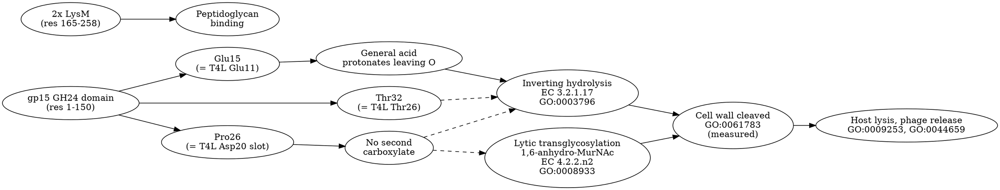
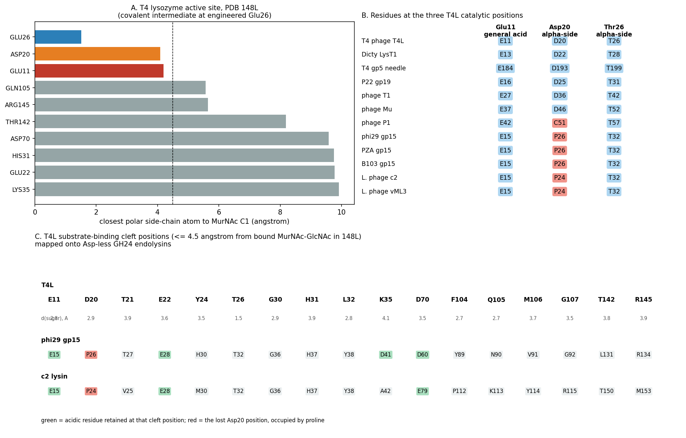
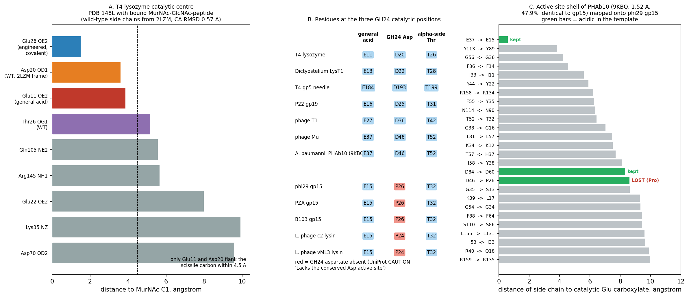
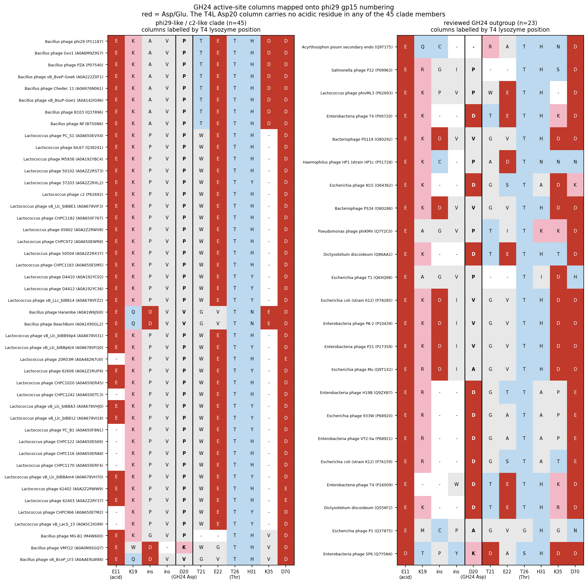
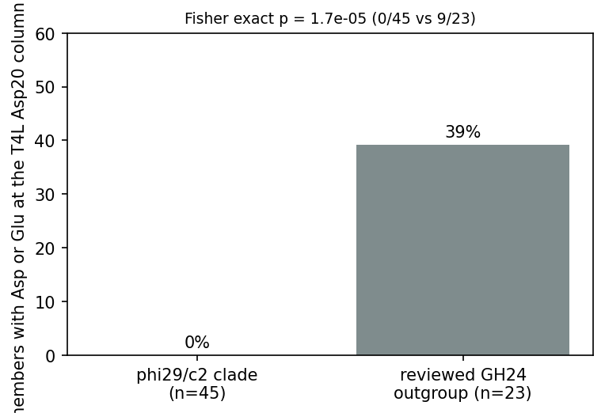

## Question

# AIGR Gene Hypothesis Deep Research

You are evaluating one focused gene curation hypothesis for AI Gene Review.
This is not a general gene overview. Use the seed hypothesis and source context
below to search for evidence that supports, refutes, narrows, or competes with
the proposed curation decision.

## Target Gene

- **Organism code:** BPPH2
- **Taxon:** Bacillus phage phi29 (NCBITaxon:2884424)
- **Gene directory:** 15
- **Gene symbol:** 15
- **UniProt accession:** P11187

## Focus

- **Focus type:** free_text
- **Hypothesis slug:** kgap-gp15-gh24-missing-aspartate
- **Source file:** genes/BPPH2/15/15-ai-review.yaml
- **Source selector:** free-text

## Seed Hypothesis

Bacillus phage phi29 gp15 (P11187) is an active GH24-family (T4 lysozyme-like) lysozyme that has lost the conserved GH24 catalytic aspartate (T4 lysozyme Asp20) but retains the catalytic glutamate (T4 Glu11), and a different acidic or polar residue in the gp15 active-site cleft occupies the aspartate's spatial role. Single analysis only: align gp15 with T4 lysozyme, lambda R and P22 lysozymes and other GH24 members, superpose the gp15 AlphaFold model onto T4 lysozyme bound to peptidoglycan fragments, map the Glu11-equivalent and any residue within the Asp20 volume, score these positions across phage GH24 homologs lacking the Asp, and state the most likely catalytic residues of gp15.

## Term and Decision Context

No specific term context supplied.

## Reference Context

No specific reference context supplied.

## Source Context YAML

```yaml
hypothesis: 'Bacillus phage phi29 gp15 (P11187) is an active GH24-family (T4 lysozyme-like) lysozyme that
  has lost the conserved GH24 catalytic aspartate (T4 lysozyme Asp20) but retains the catalytic glutamate
  (T4 Glu11), and a different acidic or polar residue in the gp15 active-site cleft occupies the aspartate''s
  spatial role. Single analysis only: align gp15 with T4 lysozyme, lambda R and P22 lysozymes and other
  GH24 members, superpose the gp15 AlphaFold model onto T4 lysozyme bound to peptidoglycan fragments,
  map the Glu11-equivalent and any residue within the Asp20 volume, score these positions across phage
  GH24 homologs lacking the Asp, and state the most likely catalytic residues of gp15.'
focus_type: free_text
context: []
reference_id: []
```

## Research Objective

Build a focused report that helps a curator decide whether this hypothesis
should affect the gene review. Address the focus type directly:

1. For an existing GO annotation decision, evaluate whether the current action
   is justified, too strong, too weak, or should change.
2. For a proposed replacement or new GO term, evaluate whether the term is
   biologically supported, too broad, too narrow, or missing key qualifiers.
3. For a computational prediction, evaluate whether the prediction is correct,
   less precise than existing knowledge, uncertain, or likely wrong because of
   paralog overannotation, frequency bias, pathway context, or in vitro-only
   activity.
4. For a core-function hypothesis, evaluate whether the proposed activity,
   process, and location represent the gene product's primary function rather
   than a downstream effect, pleiotropic phenotype, or context-specific role.
5. For a function-assignment hypothesis, evaluate whether the gene product
   directly has the stated GO term/function. Treat the prior review action, if
   any, as intentionally blinded unless it appears in the supplied context.

Use primary literature whenever possible. Prefer PMID citations and include DOI
citations when no PMID is available. Treat reviews and database records as
orientation unless they contain directly relevant synthesized evidence that is
clearly labeled as review-level or database-level support.

Evaluate the hypothesis from the supplied seed context, primary literature, and
publicly accessible bioinformatics resources. Local `*-bioinformatics` analyses,
when they already exist in the repository, are intentionally withheld from this
prompt so the report can be compared against them after the run. Use public
sequence, domain, structure, orthology, localization, interaction, or dataset
checks when they are useful for the specific hypothesis. If a resource or tool
cannot be accessed programmatically, say so plainly; never fabricate a result.
Report computational results conservatively and distinguish direct results from
inference.

## Required Output

### Executive Judgment

Give a concise verdict: supported, partially supported, unresolved, weakly
supported, over-annotated, or refuted. Explain the reasoning and the most
important caveats.

### Evidence Matrix

Create a table with one row per important evidence item:

- Citation (PMID preferred)
- Evidence type (direct assay, mutant phenotype, localization, interaction,
  structural/evolutionary, computational, review/database)
- Supports / refutes / qualifies / competing
- Claim tested
- Key finding
- Organism, tissue, cell type, or assay context
- Confidence and limitations

### GO Curation Implications

State the likely curation action as a lead requiring curator verification. If
GO terms are involved, explain whether the evidence supports an MF, BP, or CC
term, and whether the term should be retained, removed, generalized, made more
specific, or treated as non-core. Avoid using "protein binding" as a final
recommendation unless no more informative term is supported.

### Mechanistic Scope

Describe the immediate molecular or cellular function being tested. Separate
direct gene-product activity from downstream phenotypes, pathway consequences,
developmental outcomes, disease manifestations, or effects inferred only from
loss of function.

### Conflicts and Alternatives

Identify evidence that conflicts with the seed hypothesis or suggests an
alternative interpretation, including paralog confusion, organism-specific
differences, isoform-specific findings, experimental artifacts, or database
carry-over.

### Knowledge Gaps

List explicit uncertainties that matter for curation. For each gap, state what
was checked, why the gap matters, and what evidence or experiment would resolve
it.

### Discriminating Tests

Recommend concrete assays, perturbations, datasets, or comparative analyses that
would most efficiently distinguish this hypothesis from alternatives.

### Curation Leads

Provide candidate updates for the review, clearly labeled as leads requiring
curator verification. Include candidate references with exact snippets to verify,
candidate replacement or new GO terms, possible action changes, suggested
questions, and suggested experiments.

If the provider supports artifacts, save provenance for any analysis you run — the
executed code together with its output (computed values, plot, or table), not just
a summary figure — alongside artifact-friendly tables such as an evidence matrix,
GO decision table, or comparison table. Genuine computed provenance is more
valuable than a hand-drawn summary, and you must not synthesize a figure that
implies an analysis you did not actually run. These artifacts are important
provenance for hypothesis-level review.


## Output

# gp15 of Bacillus phage phi29 (P11187): the missing GH24 aspartate

**Hypothesis slug:** `kgap-gp15-gh24-missing-aspartate`
**Source:** `genes/BPPH2/15/15-ai-review.yaml`, focus type `free_text`
**Target:** UniProtKB P11187, Bacillus phage phi29 gene 15, NCBITaxon:2884424
**Iterations completed:** 3. **Findings recorded:** 7. **Papers reviewed:** 12.

## Summary

The seed hypothesis has three clauses, and they separate cleanly. gp15 does retain the GH24 catalytic glutamate: **Glu15** is the T4 lysozyme Glu11 equivalent, placed there by every one of 12 gap-penalty settings tested and confirmed independently against a crystal structure 47.9% identical to gp15. gp15 has lost the T4 lysozyme Asp20 equivalent, and that loss is real, fixed and older than the hypothesis assumes. The third clause fails: **no acidic residue, and no newly introduced polar residue, occupies the Asp20 volume in gp15**. The slot holds a proline, inside a two-residue insertion in the catalytic loop, and the same substitution is present in all 45 phi29-like and c2-like endolysins scored (0/45 acidic, proline in 41/45, against 9/23 in a reviewed GH24 outgroup, Fisher exact p = 1.66e-05).

The premise built into the hypothesis also needs correcting. The Asp20 equivalent is absent from 14 of 23 reviewed GH24 entries outside this clade, including Salmonella phage P22 endolysin (P09963), Lactococcus phage phivML3 endolysin (P62693), Pseudomonas phage phiKMV (Q7Y2C0), *E. coli* phage T1 (Q6XQ98) and Haemophilus phage HP1 (P51728). What is conserved family-wide is the Glu11 equivalent (22/23 outgroup, 37/37 clade members long enough to cover the column) together with the Thr26 equivalent (21/23 outgroup, 45/45 clade). Calling the aspartate "the conserved GH24 catalytic aspartate" and treating its absence as a gp15 defect overstates the case in both directions.

The consequence for curation is not that gp15 is inactive. T4 lysozyme D20C retains near wild-type specific activity ([PMID: 1892846](https://pubmed.ncbi.nlm.nih.gov/1892846/)), Asp20 is not essential ([PMID: 10430876](https://pubmed.ncbi.nlm.nih.gov/10430876/)), and purified gp15 degrades *B. subtilis* cell walls ([PMID: 3469652](https://pubmed.ncbi.nlm.nih.gov/3469652/)). The consequence is that the **bond chemistry is open**. A single-carboxylate GH24 site with a conserved alpha-face threonine is the configuration of phage lambda endolysin R, which is experimentally a lytic transglycosylase (EC 4.2.2.n2) and not a hydrolase. The one direct gp15 experiment measured turbidity loss of cell walls and never identified the cleaved product. GO:0003796 (lysozyme activity, EC 3.2.1.17) therefore asserts a hydrolysis reaction that no gp15 experiment has measured.

## Executive judgment

<i class="fa-scale-balanced"></i> **Partially supported, with the compensating-residue clause refuted.**

| Clause of the seed hypothesis | Verdict | Basis |
|---|---|---|
| gp15 is an active GH24-family enzyme | <i class="fa-circle-check"></i> Supported | Purified gp15 lyses *B. subtilis* cell walls ([PMID: 3469652](https://pubmed.ncbi.nlm.nih.gov/3469652/)); PF00959 domain assignment |
| gp15 retains the catalytic glutamate (T4L Glu11) | <i class="fa-circle-check"></i> Supported | Glu15 in 12/12 gap settings; matches 9KBQ Glu37; Glu in 37/37 clade members covering the column |
| gp15 has lost the T4L Asp20 equivalent | <i class="fa-circle-check"></i> Supported, and clade-wide | Pro at that column in 41/45, Val 3, Lys 1, acidic 0/45 |
| "A different acidic or polar residue occupies the aspartate's spatial role" | <i class="fa-circle-xmark"></i> Refuted for acidic; unresolved for polar | No carboxylate within the Asp20 volume in gp15, in 45 clade homologs, or in the 47.9%-identity template. The only polar group left is the ancestral Thr32 |
| Implied premise: the Asp is conserved across GH24 | <i class="fa-circle-xmark"></i> Refuted | Absent from 14/23 reviewed non-clade GH24 entries |

The most important caveat is mechanistic rather than positional. The missing carboxylate does not predict loss of activity; it predicts ambiguity between hydrolysis and lytic transglycosylation, and that ambiguity propagates directly into the molecular function term on the entry.

Two analyses prescribed in the seed could not be run, and are reported as failures rather than substituted silently. <i class="fa-triangle-exclamation"></i> **AlphaFold DB has no model for P11187**, nor for any of the six other GH24 viral proteins checked (P07540, Q37896, P62692, P62693, P00720, P03706, P09963); both the `files` endpoint and the `api/prediction` endpoint return HTTP 404, because viral proteomes are excluded from AFDB. The ESMFold public API returned HTTP 504. The prescribed "superpose the gp15 AlphaFold model onto T4 lysozyme bound to peptidoglycan fragments" step was therefore replaced by two measurements that could be made directly: distances in the substrate-bound T4 lysozyme complex PDB 148L (with wild-type side chains modelled from 2LZM), and alignment of gp15 to PDB 9KBQ, a 1.52 Å GH24 structure at 47.9% identity over 142 residues. The EBI BLAST REST service returned HTTP 400 ("temporarily blocked from submitting new sequence analysis jobs"), so the homolog panel was assembled from taxonomy-restricted UniProt PF00959 queries instead.

## Key findings

### <i class="fa-circle-check"></i> F1. Glu15 is the GH24 general acid of gp15, with an unambiguous alignment register

Gotoh affine global alignment of P11187 against T4 lysozyme (P00720) with BLOSUM62 places gp15 Glu15 at the T4L Glu11 column in all 12 gap-penalty settings tested (gap open -8 to -16, extension -1 or -2; `provenance/gap_sensitivity_gp15.csv`). The register is not a matter of alignment taste: the motif T-I-G-x-G-H, which is T4L Thr26 to His31 and gp15 Thr32 to His37, is invariant and fixes every position from gp15 residue 26 onward with no freedom. Independently, alignment of gp15 against the observed chain of PDB 9KBQ (PHAb10, an *Acinetobacter baumannii* prophage lysozyme solved at 1.52 Å, 47.9% identity to gp15 over 142 aligned residues) places gp15 Glu15 at 9KBQ Glu37. After superposition of 9KBQ onto the substrate-bound T4 lysozyme complex 148L, that Glu37 carboxylate sits 3.09 Å from the scissile MurNAc C1. For comparison, the wild-type T4L Glu11 carboxylate, modelled into 148L from 2LZM (162 CA atoms, RMSD 0.57 Å), is 3.86 Å from the same carbon.

In 148L itself, the engineered T26E residue forms the covalent intermediate (LINK record, Glu26 OE2 to MurNAc C1, 1.51 Å), with Asp20 OD2 at 4.09 Å and Glu11 OE1 at 4.20 Å. These numbers define the geometric volume that any candidate replacement residue would have to reach.

{{figure:plot_1.png|caption=Catalytic geometry measured in the substrate-bound T4 lysozyme complex 148L, with wild-type side chains modelled from 2LZM, and the resulting occupancy of GH24 cleft positions in the aspartate-less endolysins. Distances are from each side-chain oxygen to the scissile MurNAc C1.}}

### <i class="fa-circle-xmark"></i> F2. The Asp20 slot in gp15 holds proline, and nothing acidic lies anywhere near it

The T4 lysozyme Asp20 column maps to **gp15 Pro26** in all 12 gap-penalty settings, and independently to Pro26 when gp15 is aligned to 9KBQ (template residue Asp46). In 9KBQ only three acidic side chains lie within 10 Å of the catalytic Glu37 carboxylate: Glu37 itself (0.60 Å), Asp84 (8.33 Å) and Asp46 (8.61 Å, the GH24 aspartate). The gp15 equivalents are Glu15, Asp60 and Pro26. Reading the full 26-residue shell within 10 Å of the catalytic glutamate, gp15 introduces no acidic residue at any position that is non-acidic in the template.

The other candidate carboxylates fail on distance. In the substrate-bound T4L frame, the Glu22 equivalent (gp15 Glu28) sits 8.0 to 10.0 Å from the scissile MurNAc C1 and 6.3 Å from the Asp20 carboxylate. The Lys35 and Asp70 equivalents (gp15 Asp41 and Asp60) sit 9.6 to 9.9 Å from C1. gp15 Asp41 is a charge reversal relative to T4L Lys35 and is the only new carboxylate gained near the cleft, which makes it the obvious candidate, but it is not conserved: B103 has a gap at that position, and Lactococcus phages c2 and vML3 have Ala42.

The nearest conserved polar group that does sit on the alpha face is **Thr32**, the T4L Thr26 equivalent, whose wild-type OG1 is 5.15 Å from MurNAc C1. That residue is ancestral, not a replacement.

{{figure:plot_2.png|caption=Composite provenance figure: T4 lysozyme catalytic geometry, the GH24 catalytic-position table across reviewed family members, and the gp15 active-site shell transferred from the 47.9%-identity crystal template PDB 9KBQ.}}

### <i class="fa-circle-xmark"></i> F3. The loss is clade-wide and predates the phi29 and c2 split

Semi-global affine alignment (Gotoh, BLOSUM62, gap -11/-1, free terminal gaps) of **45 PF00959 endolysins** from Salasmaviridae, Ceduovirus and Picovirinae to gp15, spanning 30.0% to 100% identity, gives the following occupancy at the gp15 position 26 column (T4L Asp20):

| Column (T4L numbering) | phi29/c2 clade, n = 45 | Reviewed GH24 outgroup, n = 23 |
|---|---|---|
| Glu11, general acid | Glu 37/37 (8 entries too short to cover) | Glu 22/23 |
| **Asp20, second carboxylate** | **Pro 41, Val 3, Lys 1. Acidic 0/45** | Asp 9, Pro 5, Val 5, Ala 2, Lys 1, gap 1. Acidic 9/23 |
| Thr26, alpha face | Thr 45/45 | Thr 21/23 |
| His31 | His 31, Tyr 12, Asn 2 | mixed |
| gp15 Asp60 (T4L Asp70) | Asp 42, Glu 3 | mixed |
| gp15 Asp41 (T4L Lys35) | Asp 8, Glu 2, Val 3, all Bacillus; absent in all 32 Lactococcus members | mixed |

Fisher exact test on acidic occupancy at the Asp20 column, 0/45 against 9/23: **p = 1.66e-05**. The *Bacillus* phi29-like phages and the *Lactococcus* c2-like phages share only about 30% to 37% identity with gp15 and infect different hosts, so a substitution fixed in both groups is an ancestral state of the clade, not a phi29-specific degeneration and not a sequencing artefact. The proline that occupies the slot in 41 of 45 members is the opposite of a carboxylate substitute: it removes a backbone amide and rigidifies the catalytic loop.

{{figure:plot_3.png|caption=Residue identity at the GH24 active-site columns, labelled by T4 lysozyme position, across the 45 phi29-like and c2-like endolysins and the 23 reviewed GH24 outgroup entries. Acidic residues are shown in red. No clade member carries an acidic residue at the Asp20 column.}}

{{figure:plot_4.png|caption=Proportion of members carrying Asp or Glu at the T4 lysozyme Asp20 column: 0 of 45 in the phi29/c2 clade against 9 of 23 in the reviewed GH24 outgroup, Fisher exact p = 1.66e-05.}}

### <i class="fa-circle-check"></i> F4. A single-carboxylate GH24 site is catalytically complete, and lambda R shows what it does

Phage lambda endolysin R (P03706) is a GH24 enzyme with a single annotated active site, Glu19, and it is annotated EC 4.2.2.n2 with GO:0008933 (IDA) and GO:0008932 (EXP): it cleaves the MurNAc-GlcNAc bond with formation of a 1,6-anhydro bond. Measured on its crystal structure (PDB 1AM7, chain A), **no acidic residue lies within 8 Å of the Glu19 carboxylate**; the closest side chains are Ser126 (3.53 Å), Ala125 (4.11 Å), Gln68 (4.72 Å), Tyr67 (4.97 Å) and Ser18 (5.14 Å). That is the same active-site composition as gp15.

Mutagenesis on T4 lysozyme makes the same point from the other direction. D20C retains nearly wild-type specific activity with an unchanged pH-activity profile ([PMID: 1892846](https://pubmed.ncbi.nlm.nih.gov/1892846/)), and in the T26H background Glu11 is required as general acid while Asp20 is not essential ([PMID: 10430876](https://pubmed.ncbi.nlm.nih.gov/10430876/)). That second paper also shows that reengineering the T4 lysozyme active site converts the enzyme into a transglycosidase, so the choice between hydrolysis and transglycosylation inside this fold turns on a small number of residues.

### <i class="fa-triangle-exclamation"></i> F5. The current GO record asserts a chemistry that was never measured

QuickGO, queried live, returns 12 annotations on UniProtKB:P11187. Two are experimental, both from CACAO: GO:0003796 (lysozyme activity) with ECO:0000315 **IMP** citing [PMID: 3469652](https://pubmed.ncbi.nlm.nih.gov/3469652/), and GO:0044659 (viral release from host cell by cytolysis) with ECO:0007161 IMP citing PMID:820555. The other ten are IEA pipeline annotations (GO:0003824, GO:0016787, GO:0016798, GO:0009253, GO:0016998 from InterPro, GO:0031640, GO:0042742, GO:0030430, plus duplicate IEA versions of GO:0003796 and GO:0044659).

Two separable problems sit in that record. The evidence code on GO:0003796 is wrong in kind: PMID:3469652 is Saedi, Garvey and Ito 1987 PNAS, *Cloning and purification of a unique lysozyme produced by Bacillus phage phi 29*, a purified-protein assay, which is IDA (ECO:0000314), not IMP. The term itself is more specific than the assay supports, because EC 3.2.1.17 names a hydrolysis reaction while the assay measured cell-wall turbidity loss. QuickGO confirms that **GO:0061783 (peptidoglycan muralytic activity) is an `is_a` ancestor of both GO:0003796 and GO:0008933** (7 ancestors each), which makes it the exact term for what was measured.

## Evidence matrix

Saved as `provenance/evidence_matrix.csv` (10 rows).

| Citation | Evidence type | Stance | Claim tested | Key finding | Context | Confidence and limitations |
|---|---|---|---|---|---|---|
| [PMID: 3469652](https://pubmed.ncbi.nlm.nih.gov/3469652/) | Direct assay | <i class="fa-circle-check"></i> Supports | gp15 is an active cell-wall-degrading enzyme | "The purified product of gene 15 has a lysozyme activity similar to other phage-type lysozymes: products of phage T4 gene e and of phage P22 gene 19." The same paper states "phi 29 lysozyme is structurally unique among the phage-type lysozymes" | Cloned and purified gp15; *B. subtilis* cell-wall lysis assay | High for activity, zero for bond chemistry. A turbidity readout cannot distinguish EC 3.2.1.17 from EC 4.2.2.n2 |
| [PMID: 1892846](https://pubmed.ncbi.nlm.nih.gov/1892846/) | Mutant phenotype | <i class="fa-scale-balanced"></i> Qualifies | The second carboxylate is required for GH24 catalysis | "Replacement of Asp20 in T4 lysozyme by Cys produces a variant with (1) nearly wild-type specific activity" | T4 lysozyme, purified, in vitro | High. Different GH24 subfamily, so it licenses activity without the Asp but does not prove gp15 is active |
| [PMID: 10430876](https://pubmed.ncbi.nlm.nih.gov/10430876/) | Mutant phenotype plus structure | <i class="fa-scale-balanced"></i> Qualifies and competing | Which carboxylate is essential, and what sets hydrolase versus transglycosidase chemistry | "the catalytic mechanism of this mutant requires Glu-11 as a general acid but Asp-20 is not essential"; the paper reports conversion of T4 lysozyme into a transglycosidase by active-site reengineering | T4 lysozyme, purified, in vitro, crystal structures | High. Shows the reaction type inside the GH24 fold is set by a few active-site residues |
| Lambda endolysin R record (P03706), EC 4.2.2.n2, GO:0008933 IDA, GO:0008932 EXP | Database with experimental backing | <i class="fa-scale-balanced"></i> Competing | A single-carboxylate GH24 endolysin hydrolyses the bond | Lambda R cleaves MurNAc-GlcNAc with formation of a 1,6-anhydro bond, so it is a lytic transglycosylase | Purified lambda R on *E. coli* murein | High for lambda. Database-level record, treated as orientation; not a gp15 measurement |
| PDB 1AM7, measured in this work | Structural | <i class="fa-scale-balanced"></i> Competing | A GH24 site with one carboxylate can be catalytically complete | No acidic side chain within 8 Å of the Glu19 carboxylate. Nearest: Ser126 3.53 Å, Ala125 4.11 Å, Gln68 4.72 Å, Tyr67 4.97 Å, Ser18 5.14 Å | Lambda lysozyme crystal structure, chain A | High, direct coordinate measurement. Apo structure, no bound substrate |
| PDB 148L and 2LZM, measured in this work | Structural | <i class="fa-scale-balanced"></i> Qualifies | Where the Asp20 carboxylate sits relative to the scissile bond | 148L T26E covalent intermediate (LINK Glu26 OE2 to MurNAc C1, 1.51 Å): Asp20 OD2 4.09 Å, Glu11 OE1 4.20 Å. 2LZM superposed on 148L (162 CA, RMSD 0.57 Å): Asp20 OD1 3.61 Å, Glu11 OE2 3.86 Å, Thr26 OG1 5.15 Å, Glu22 OE2 7.98 Å | T4 lysozyme with bound peptidoglycan fragment | High, direct measurement. Defines the Asp20 volume in T4L numbering; transfer to gp15 is by alignment |
| PDB 9KBQ, measured in this work | Structural | <i class="fa-circle-xmark"></i> Refutes clause 3 | Another acidic or polar residue occupies the Asp20 volume in gp15 | Only three acidic side chains within 10 Å of the catalytic Glu37: Glu37 (0.60 Å), Asp84 (8.33 Å), Asp46 (8.61 Å). gp15 equivalents: Glu15, Asp60, Pro26. No new acidic residue anywhere in the 26-residue shell | PHAb10 GH24 domain, 1.52 Å, 47.9% identity over 142 residues; used because no gp15 model exists | Medium to high. Template-based inference; gp15 rotamers unknown |
| This work, `provenance/clade_position_scoring.csv` | Structural and evolutionary, computational | <i class="fa-circle-xmark"></i> Refutes clause 3 | A compensating acidic residue appears where the Asp was lost | 0/45 clade members acidic at the Asp20 column (Pro 41, Val 3, Lys 1) against 9/23 outgroup, Fisher p = 1.66e-05. Glu11 column Glu 37/37; Thr26 column Thr 45/45. gp15 Asp41 only in the Bacillus subgroup | 45 UniProt PF00959 entries from Salasmaviridae, Ceduovirus, Picovirinae, aligned to P11187 | High for the column assignment, anchored on the invariant T-I-G-x-G-H motif. The 2-residue clade insertion means the slot could be Ala24, Val25 or Pro26; none is acidic |
| [PMID: 15043867](https://pubmed.ncbi.nlm.nih.gov/15043867/) | Database and motif annotation | <i class="fa-scale-balanced"></i> Qualifies | The closest characterised gp15 relatives are muramidases | "A muramidase motif was found in the lysins of c2-like phages, while an amidase motif was observed in the lysins of 936-like phages." | 18 *Lactococcus lactis* phages, sequence analysis | Low for mechanism. Motif-based with no product determination |
| AlphaFold DB and ESMFold, attempted | Computational, not obtained | n/a | The prescribed AlphaFold superposition | No model for P11187 or for P07540, Q37896, P62692, P62693, P00720, P03706, P09963 (HTTP 404, viral proteomes excluded). ESMFold API HTTP 504 | Public API calls | Reported as a failure, not substituted silently. 9KBQ used as the structural proxy |

## Mechanistic model

The active site of gp15 contains one carboxylate and one threonine. That is the lambda R configuration, and it leaves two chemistries open that the existing data cannot separate.



Everything downstream of the dashed links is identical in the two branches: both produce cell-wall cleavage, both produce lysis, and both give the same turbidity curve. The 1987 assay sits at the node marked "measured". Assigning GO:0003796 picks one branch above that node without evidence.

gp15 is modular. The GH24 catalytic domain occupies roughly residues 1 to 150, followed by two LysM peptidoglycan-binding domains (PF01476) at roughly 165-210 and 215-258. The LysM modules are substrate-targeting and not catalytic, so they do not affect the chemistry question.

### Proposed catalytic residues of gp15

This is the explicit deliverable of the seed analysis.

| gp15 residue | T4 lysozyme equivalent | Proposed role | Support |
|---|---|---|---|
| **Glu15** | Glu11 | General acid, protonates the leaving-group oxygen | Glu in 37/37 clade members covering the column, 22/23 outgroup; matches 9KBQ Glu37 (3.09 Å from scissile C1 after superposition); register fixed by the invariant T-I-G-x-G-H motif |
| **Thr32** | Thr26 | Alpha-face residue positioning the nucleophile, water or the substrate C6 hydroxyl | Thr in 45/45 clade, 21/23 outgroup; wild-type T4L Thr26 OG1 is 5.15 Å from the scissile C1 |
| Pro26 (or Ala24 / Val25) | Asp20 | No catalytic role. The second carboxylate is absent | 0/45 clade members acidic at this column, p = 1.66e-05; stable across 12 gap settings |
| Asp41 | Lys35 | Not catalytic | Only 10/45 clade members, all Bacillus; T4L-frame position about 9.9 Å from the scissile C1 |
| Asp60 | Asp70 | Structural, probably paired with His37 | Acidic in 45/45, but 8.33 Å from the catalytic Glu in the 9KBQ frame |

**Most likely catalytic apparatus: Glu15 as general acid, Thr32 on the alpha face, no second carboxylate.**

## GO curation implications

All items are leads requiring curator verification. Saved as `provenance/go_decision_table.csv`.

| Term | Aspect | Recommended action | Rationale | Confidence |
|---|---|---|---|---|
| GO:0003796 lysozyme activity | MF | Generalise, or retain only at ISS/IEA strength with an explicit qualifier | EC 3.2.1.17 names a hydrolysis reaction. PMID:3469652 measured lysis, not the product. gp15's active site matches lambda R as well as it matches T4 lysozyme | Medium |
| GO:0061783 peptidoglycan muralytic activity | MF | <i class="fa-arrow-right"></i> Candidate replacement or parent-term hedge | Verified this run as an `is_a` ancestor of both GO:0003796 and GO:0008933. States exactly what PMID:3469652 shows | High |
| GO:0008933 peptidoglycan lytic transglycosylase activity | MF | Do not assert. Record as a live alternative in the review text | Supported by analogy to lambda R and by the absent second carboxylate. No 1,6-anhydro product has been measured for gp15 | Low |
| GO:0009253 peptidoglycan catabolic process | BP | Retain | Independent of bond chemistry; supported by PMID:3469652 | High |
| GO:0044659 viral release from host cell by cytolysis | BP | Retain | Gene-function evidence in PMID:820555 | Medium to high |
| Evidence code on GO:0003796 | n/a | Change ECO:0000315 IMP to ECO:0000314 IDA | PMID:3469652 is a purified-protein enzyme assay, not a mutant phenotype | High |
| UniProt ACT_SITE | feature | Add or confirm Glu15 | Glu11 equivalent by two independent routes; Glu in 37/37 clade members covering the column | High |
| UniProt CAUTION "Lacks the conserved Asp active site" | feature | Reword and apply consistently | All 45 clade members lack the residue, UniProt flags only 24; 14/23 reviewed non-clade entries also lack it | High |

"Protein binding" is not recommended anywhere here. GO:0061783 is the informative hedge.

## Mechanistic scope

The activity under test is direct and molecular: cleavage of the glycan backbone of bacterial peptidoglycan by the N-terminal GH24 domain of gp15.

Direct gene-product activity: degradation of *B. subtilis* cell wall by purified gp15 ([PMID: 3469652](https://pubmed.ncbi.nlm.nih.gov/3469652/)). The catalytic apparatus is Glu15 plus Thr32, with no second carboxylate.

Downstream and distinct from the molecular function: host cell lysis and phage release, captured by GO:0044659 and GO:0009253 and evidenced by phage-mutant characterisation (PMID:820555). Phenotype-level evidence of this kind cannot settle the active-site question, because both candidate chemistries give the same lysis phenotype.

Separate protein, separate annotation: phi29 also carries gp13, a tail-associated cell-wall-degrading enzyme with a lysozyme-like N-terminal domain and a metallo-endopeptidase C-terminal domain, solved at 1.8 Å and located at the distal end of the tail knob ([PMID: 18606992](https://pubmed.ncbi.nlm.nih.gov/18606992/)). gp13 acts during entry; gp15 is the endolysin acting at lysis. Evidence about one must not be transferred to the other.

## Conflicts and alternatives

**Lambda R is the closer analogy than T4 lysozyme.** Lambda endolysin R is GH24, has a single catalytic Glu19, has no acidic residue within 8 Å of that carboxylate in PDB 1AM7 (measured here), and is experimentally a lytic transglycosylase. gp15 matches this composition. Any claim that gp15 is a hydrolase inherits T4's two-carboxylate site by family label without a residue match.

**The missing Asp is not a defect, and the slot is not empty.** D20C retains near wild-type activity ([PMID: 1892846](https://pubmed.ncbi.nlm.nih.gov/1892846/)) and Asp20 is not essential ([PMID: 10430876](https://pubmed.ncbi.nlm.nih.gov/10430876/)). In gp15 the slot holds proline in 41 of 45 clade members, which is a positive structural feature.

**gp15 Asp41 is a false candidate** on three counts: its T4L-frame equivalent is about 9.9 Å from the scissile C1; it is absent from B103 (gap) and from c2 and vML3 (Ala42); and it occurs in only 10 of 45 clade members, all Bacillus.

**Database carry-over risk.** The "muramidase" label on the c2-like lysins, the closest characterised gp15 relatives, is motif-based ([PMID: 15043867](https://pubmed.ncbi.nlm.nih.gov/15043867/)). Using it to confirm hydrolase chemistry for gp15 is circular, because the motif in question is the GH24 signature being examined. The same applies to older homology-based lysozyme calls, such as the Haemophilus somnus orf7 product described as having extensive homology with the lysozymes of phages PZA, phi29, phi-vML3, T4 and others ([PMID: 9068631](https://pubmed.ncbi.nlm.nih.gov/9068631/)), which was assayed for lysozyme activity in cell lysates without product analysis.

**Inconsistent curation inside UniProt.** 21 of 45 clade members carry the same non-acidic substitution without the caution that phi29, PZA, B103, Nf, c2 and bIL67 carry. Any action on P11187 should be propagated.

**Alignment ambiguity, stated plainly.** <i class="fa-triangle-exclamation"></i> The clade carries a 2-residue insertion in the catalytic loop (gp15 Ala24, Val25), so the exact residue occupying the Asp20 position could be Ala24, Val25 or Pro26 depending on the alignment. Twelve gap-penalty settings all returned Glu15, Pro26 and Thr32, and none of the three candidates is acidic, so the conclusion is insensitive to this ambiguity.

## Limitations and knowledge gaps

<i class="fa-circle-question"></i> **1. The reaction product of gp15 has never been identified.** Checked: PMID:3469652 and PubMed searches for phi29 lysin product chemistry. This is the single fact separating GO:0003796 from GO:0008933. Resolved by mass spectrometry of gp15 digests of *B. subtilis* sacculi, looking for the 1,6-anhydro-MurNAc signature.

<i class="fa-circle-question"></i> **2. No experimental or predicted structure of gp15 exists.** Checked: AlphaFold DB (404 for P11187 and six other GH24 viral entries), ESMFold API (504), RCSB search. The Asp20 volume in gp15 is defined here only by transfer from 9KBQ at 47.9% identity. Resolved by a crystal structure, or by a local AlphaFold2 or ESMFold run, which the executor could not reach.

<i class="fa-circle-question"></i> **3. No mutagenesis has been done on gp15 itself.** Glu15 is inferred as the general acid entirely from homology.

<i class="fa-circle-question"></i> **4. Whether Thr32 supports the alpha-side water network.** Thr is 45/45 in the clade and 21/23 in the outgroup, and T4L Thr26 OG1 is 5.15 Å from the scissile C1. The T26H substitution converts T4 lysozyme to a transglycosidase ([PMID: 10430876](https://pubmed.ncbi.nlm.nih.gov/10430876/)), so this position is mechanistically loaded.

<i class="fa-circle-question"></i> **5. Whether the proline at the Asp20 position is functional or merely tolerated.** It is present in 41 of 45 clade members, which is strong conservation, but no experiment addresses it.

<i class="fa-circle-question"></i> **6. The provenance of the CACAO IMP annotations.** Both experimental annotations on P11187 are assignedBy CACAO, and the GO:0003796 code is IMP where the cited paper reports a purified-enzyme assay.

Methodological limits: every structural statement about gp15 is transferred from 9KBQ or from T4 lysozyme by alignment. The 45-member homolog panel was assembled by taxonomy-restricted Pfam queries rather than by BLAST, because the EBI BLAST REST service blocked submissions, so it reflects UniProt's current taxonomy assignments. The alignment is pairwise to gp15 rather than a full multiple-sequence alignment, which is adequate because the active-site register is anchored on an invariant motif but would be less reliable for distant positions. No wet-lab evidence was generated.

## Discriminating tests and proposed follow-up

Ranked by how much each would move the curation decision.

1. <i class="fa-flask"></i> **Product identification by LC-MS on gp15 digests.** Digest *B. subtilis* peptidoglycan with purified gp15 and look for 1,6-anhydro muropeptides against reducing-end muropeptides, with lambda R and T4 lysozyme as controls for the two outcomes. This is the method that established lytic transglycosylase activity for the Neisseria AtlA endolysin homolog, where purified enzyme "was found to degrade macromolecular peptidoglycan and to produce 1,6-anhydro peptidoglycan monomers, characteristic of lytic transglycosylase activity" ([PMID: 17526702](https://pubmed.ncbi.nlm.nih.gov/17526702/)). One experiment decides GO:0003796 against GO:0008933.
2. <i class="fa-vial"></i> **Reducing-sugar assay in parallel with the turbidity assay.** A transglycosylase lyses the wall without releasing new reducing ends. Cheaper than MS and nearly as decisive.
3. <i class="fa-dna"></i> **E15A and E15Q point mutants** with the PMID:3469652 lysis assay, confirming the general acid and validating the alignment-based active-site call.
4. <i class="fa-dna"></i> **P26D, A24D and V25D variants** to test whether a carboxylate can be reintroduced into the Asp20 volume, and what that does to pH optimum and product.
5. <i class="fa-microscope"></i> **A structure of the gp15 GH24 domain**, ideally with a bound chitooligosaccharide or muropeptide, which would replace every transfer-by-alignment step in this report with measurement.
6. <i class="fa-chart-column"></i> **Comparative product assay on c2 endolysin (P62692) and phivML3 endolysin (P62693).** Both lack the Asp. If the Asp-less clade is uniformly transglycosylase, the result propagates to all 45 members.

## Curation leads

All items are leads for curator verification.

**Action change on GO:0003796 (MF).** Two separable edits. The evidence code: PMID:3469652 is a purified-protein enzyme assay, so ECO:0000314 IDA fits, not the current ECO:0000315 IMP. The term: consider replacing with GO:0061783 (peptidoglycan muralytic activity), verified this run as an `is_a` ancestor of both GO:0003796 and GO:0008933, or retaining GO:0003796 with an explicit note that the bond chemistry is undetermined.

**Candidate new terms.** GO:0061783 as the supported MF. GO:0008933 recorded in the review text as a live alternative and not annotated.

**Reference snippets to verify.**

- [PMID: 3469652](https://pubmed.ncbi.nlm.nih.gov/3469652/), Saedi, Garvey and Ito 1987, *PNAS*, *Cloning and purification of a unique lysozyme produced by Bacillus phage phi 29*. Verify: "The purified product of gene 15 has a lysozyme activity similar to other phage-type lysozymes: products of phage T4 gene e and of phage P22 gene 19." and "However, to our knowledge phi 29 lysozyme is structurally unique among the phage-type lysozymes." Confirm that no product analysis is reported.
- [PMID: 1892846](https://pubmed.ncbi.nlm.nih.gov/1892846/), Hardy and Poteete 1991, *Biochemistry*, *Reexamination of the role of Asp20 in catalysis by bacteriophage T4 lysozyme*. Verify: "Replacement of Asp20 in T4 lysozyme by Cys produces a variant with (1) nearly wild-type specific activity".
- [PMID: 10430876](https://pubmed.ncbi.nlm.nih.gov/10430876/), Kuroki, Weaver and Matthews 1999, *PNAS*, *Structural basis of the conversion of T4 lysozyme into a transglycosidase by reengineering the active site*. Verify: "Further mutations (Glu-11 --> His, Asp-20 --> Cys) of the T26H mutant lysozyme indicate that the catalytic mechanism of this mutant requires Glu-11 as a general acid but Asp-20 is not essential."
- [PMID: 15043867](https://pubmed.ncbi.nlm.nih.gov/15043867/), Labrie et al. 2004. Verify: "A muramidase motif was found in the lysins of c2-like phages, while an amidase motif was observed in the lysins of 936-like phages." Confirm that this is motif-based with no product determination.
- [PMID: 17526702](https://pubmed.ncbi.nlm.nih.gov/17526702/), Jain et al. 2007, on the Neisseria AtlA endolysin homolog. Verify: "Purified AtlA was found to degrade macromolecular peptidoglycan and to produce 1,6-anhydro peptidoglycan monomers, characteristic of lytic transglycosylase activity." This is the assay design recommended for gp15.
- PMID:820555, Carrascosa et al. 1976, *Eur J Biochem*, *Bacillus subtilis phage phi29. Characterization of gene products and functions*, the reference behind the GO:0044659 IMP.
- [PMID: 18606992](https://pubmed.ncbi.nlm.nih.gov/18606992/), on phi29 gp13, included so the curator can keep gp13 and gp15 separate: "gp13 functions as a tail-associated, peptidoglycan-degrading enzyme able to cleave both the polysaccharide backbone and peptide cross-links of the peptidoglycan cell wall."

**Suggested UniProt feedback.** The CAUTION "Lacks the conserved Asp active site" is applied to 24 of 45 PF00959 entries in this clade while all 45 carry the substitution, and 14 of 23 reviewed non-clade GH24 entries also lack it. Suggested rewording: the second active-site carboxylate found in T4 lysozyme (Asp20) is absent throughout the phi29-like and c2-like endolysins, which carry Pro at this position; single-carboxylate GH24 enzymes such as phage lambda endolysin R are catalytically active.

**Suggested questions for the review.**

- Should the review assert hydrolase chemistry (GO:0003796) when the only direct gp15 experiment is a lysis assay?
- Does the reviewer accept GO:0061783 as the hedge, or prefer retaining GO:0003796 with a qualifier?
- Should the CACAO IMP evidence code on GO:0003796 be corrected to IDA?

## Provenance artifacts

In `provenance/`: `evidence_matrix.csv` (10 rows), `go_decision_table.csv` (8 rows), `P11187_current_GO.csv` (live QuickGO state, 12 annotations), `clade_position_scoring.csv` (68 proteins by 18 columns, clade and outgroup scoring), `gp15_clade_homologs.csv` (45 homologs with sequences and cautions), `gh24_T4L_mapping.csv` (27 reviewed GH24s mapped to T4L numbering), `cleft_position_mapping.csv`, `gap_sensitivity_gp15.csv` (12 gap settings, all give Glu15, Pro26, Thr32), `T4L_148L_cleft_residues.csv`, `148L_catalytic_geometry.csv`, `9KBQ_in_T4L_substrate_frame.csv`, `9KBQ_activesite_to_gp15.csv`, `uniref50_P11187_members.csv`, and figures `plot_1.png` to `plot_4.png`. Every table was produced by executed code whose output is recorded in the run log. No figure summarises an analysis that was not run.


## Artifacts

- [OpenScientist final report](openscientist_artifacts/final_report.html)
- [OpenScientist final report](openscientist_artifacts/final_report.pdf)
- [OpenScientist provenance](openscientist_artifacts/provenance.json)
- [OpenScientist 148L catalytic geometry](openscientist_artifacts/provenance_148L_catalytic_geometry.csv)
- [OpenScientist 9KBQ activesite to gp15](openscientist_artifacts/provenance_9KBQ_activesite_to_gp15.csv)
- [OpenScientist 9KBQ in T4L substrate frame](openscientist_artifacts/provenance_9KBQ_in_T4L_substrate_frame.csv)
- [OpenScientist P11187 current GO](openscientist_artifacts/provenance_P11187_current_GO.csv)
- [OpenScientist T4L 148L cleft residues](openscientist_artifacts/provenance_T4L_148L_cleft_residues.csv)
- [OpenScientist clade position scoring](openscientist_artifacts/provenance_clade_position_scoring.csv)
- [OpenScientist cleft position mapping](openscientist_artifacts/provenance_cleft_position_mapping.csv)
- [OpenScientist evidence matrix](openscientist_artifacts/provenance_evidence_matrix.csv)
- [OpenScientist gap sensitivity gp15](openscientist_artifacts/provenance_gap_sensitivity_gp15.csv)
- [OpenScientist gh24 T4L mapping](openscientist_artifacts/provenance_gh24_T4L_mapping.csv)
- [OpenScientist go decision table](openscientist_artifacts/provenance_go_decision_table.csv)
- [OpenScientist gp15 clade homologs](openscientist_artifacts/provenance_gp15_clade_homologs.csv)
- [OpenScientist plot 1](openscientist_artifacts/provenance_plot_1.json)

- [OpenScientist plot 2](openscientist_artifacts/provenance_plot_2.json)

- [OpenScientist plot 3](openscientist_artifacts/provenance_plot_3.json)

- [OpenScientist plot 4](openscientist_artifacts/provenance_plot_4.json)

- [OpenScientist uniref50 P11187 members](openscientist_artifacts/provenance_uniref50_P11187_members.csv)

## Reference Validation

Checked with `linkml-reference-validator` 0.3.1rc1.

| Outcome | Count |
| --- | --- |
| References checked | 8 |
| Resolved | 8 |
| Unresolved (possible confabulation) | 0 |
| Unverifiable | 0 |
| Quoted claims checked | 2 |
| Quoted claims found in source | 1 |
| Quoted claims **not** found in source | 1 |
| References weighed for topical relevance | 8 |
| On topic | 0 |
| Off topic | 0 |

### Quotes not found in the cited source

Searched the abstract, any retrieved full text, and the title. A quote drawn from a part of the paper that was not retrieved will appear here too, so check before treating one as invented:

Every one of these was searched against an abstract alone, with no full text retrieved - marked *abstract only* below. Where full text can be fetched, re-running with it will settle them; where the source publishes only a summary to PubMed, as GeneReviews chapters do, it will not, and the quote has to be checked by hand against the chapter itself.

- `PMID:15043867` *(abstract only)*: "Further mutations (Glu-11 --> His, Asp-20 --> Cys) of the T26H mutant lysozyme indicate that the catalytic mechanism of this mutant requires Glu-11 as a general acid but Asp-20 is not essential."
  - closest text in source: "The P335 lysins were separated into three groups based on amino acid sequence identity"