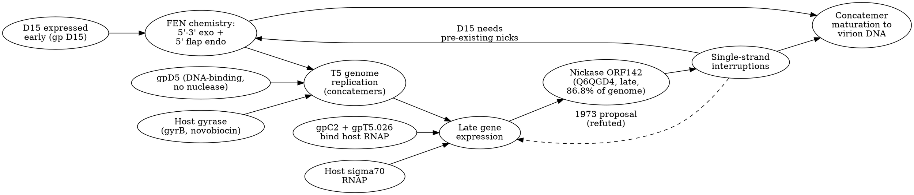
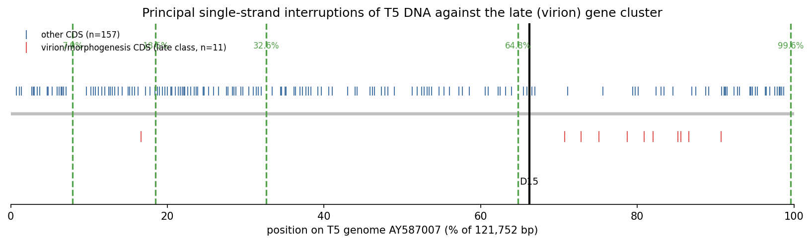
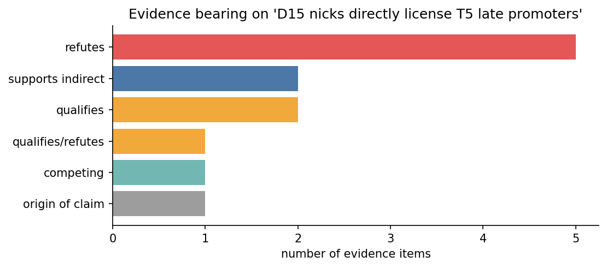
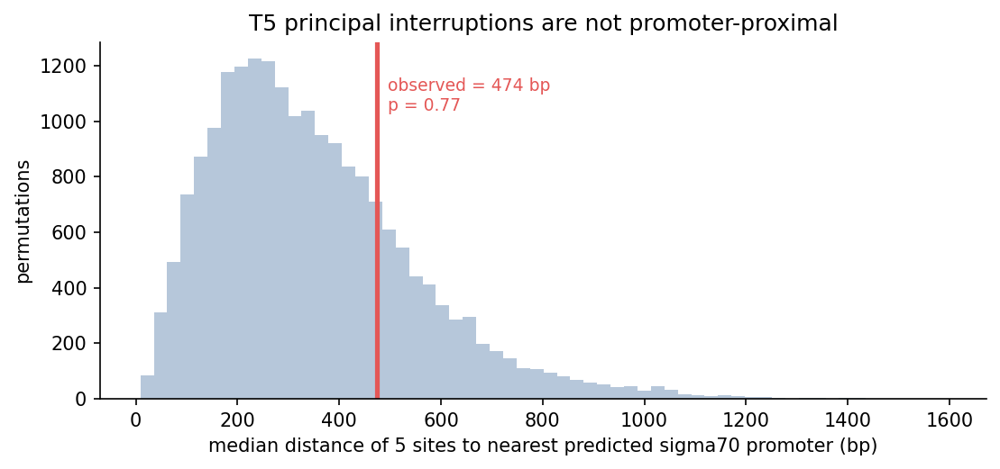
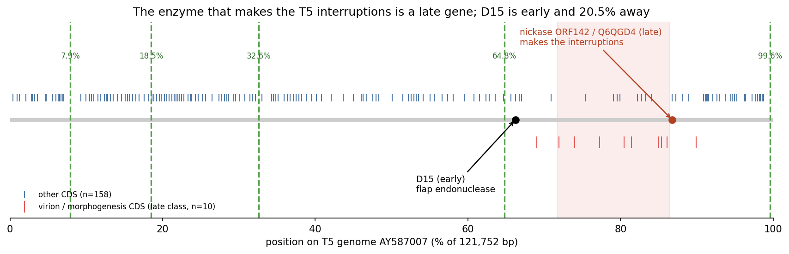
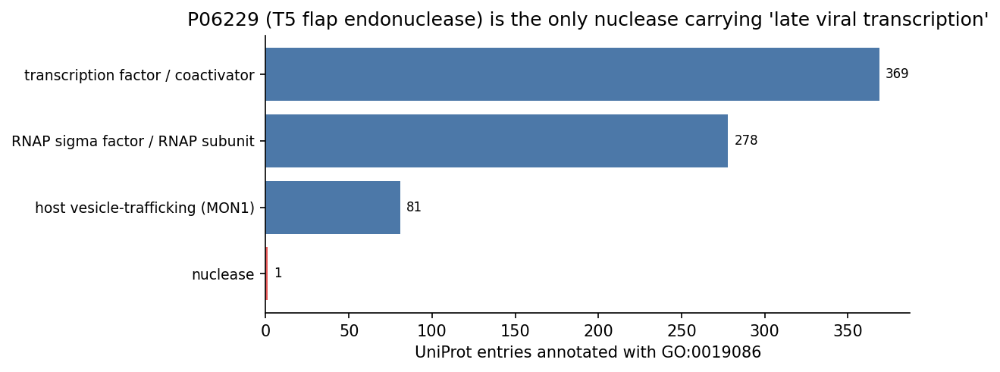

## Question

# AIGR Gene Hypothesis Deep Research

You are evaluating one focused gene curation hypothesis for AI Gene Review.
This is not a general gene overview. Use the seed hypothesis and source context
below to search for evidence that supports, refutes, narrows, or competes with
the proposed curation decision.

## Target Gene

- **Organism code:** BPT5
- **Taxon:** Escherichia phage T5 (NCBITaxon:2695836)
- **Gene directory:** D15
- **Gene symbol:** D15
- **UniProt accession:** P06229

## Focus

- **Focus type:** free_text
- **Hypothesis slug:** kgap-d15-late-transcription
- **Source file:** genes/BPT5/D15/D15-ai-review.yaml
- **Source selector:** free-text

## Seed Hypothesis

Whether the failure of T5 late gene expression in the absence of D15 nuclease activity is a direct template requirement or an indirect consequence of failed replication may be decidable from the published record, and if it is not, saying so precisely is the useful result. Already recorded and not to be re-derived: that D15 is a 291-residue magnesium-dependent FEN-family nuclease expressed early in infection, that it carries processive 5'-3' exonucleolysis and structure-specific endonucleolysis at single-strand/double-strand junctions in one active site, that substrate selection is structural rather than sequence-based with the 5' arm threading a helical arch, that metal occupancy and pH decide which reaction predominates, that the enzyme is required for T5 genome replication and for maturation of concatemers into the single-stranded-interruption-containing virion DNA, and that the 1973 proposal attributes the late-transcription block to nicks or gaps the nuclease introduces. Single analysis only. The question is separability. Establish whether any published experiment uncouples the replication requirement from the transcription requirement: a temperature-sensitive or amber D15 allele shifted after replication is underway, a host or phage mutant in which replication proceeds without D15, an in vitro late-promoter transcription assay on nicked against intact template, or a hydroxyurea-type or inhibitor block of replication that leaves D15 active. For each such experiment, state what was measured, whether late transcripts or only late proteins were scored, and whether the timing permits the conclusion. Then address the template-structure claim on its own terms: state where the single-stranded interruptions of mature T5 DNA lie relative to the mapped late promoters, whether their positions are sequence-defined and reproducible between preparations or variable, and whether anything is known about which enzyme makes them, since an interruption pattern that is reproducible and promoter-proximal supports the direct proposal while a variable one does not. State also which RNA polymerase transcribes T5 late genes and what, if anything, is known about template-structure requirements of that polymerase on a nicked duplex, distinguishing a requirement for a nick from a requirement for replication-generated ends or for displacement synthesis. Finally say which of the two explanations the evidence favours, and if the record contains no experiment that separates them, say so plainly and name the single experiment that would. A verdict of unresolved is an acceptable and expected outcome here; do not assemble a mechanism from plausibility. Note explicitly if the primary 1973 and 1980 papers are not retrievable, since much of this literature predates electronic full text.

## Term and Decision Context

No specific term context supplied.

## Reference Context

No specific reference context supplied.

## Source Context YAML

```yaml
hypothesis: 'Whether the failure of T5 late gene expression in the absence of D15 nuclease activity is
  a direct template requirement or an indirect consequence of failed replication may be decidable from
  the published record, and if it is not, saying so precisely is the useful result. Already recorded and
  not to be re-derived: that D15 is a 291-residue magnesium-dependent FEN-family nuclease expressed early
  in infection, that it carries processive 5''-3'' exonucleolysis and structure-specific endonucleolysis
  at single-strand/double-strand junctions in one active site, that substrate selection is structural
  rather than sequence-based with the 5'' arm threading a helical arch, that metal occupancy and pH decide
  which reaction predominates, that the enzyme is required for T5 genome replication and for maturation
  of concatemers into the single-stranded-interruption-containing virion DNA, and that the 1973 proposal
  attributes the late-transcription block to nicks or gaps the nuclease introduces. Single analysis only.
  The question is separability. Establish whether any published experiment uncouples the replication requirement
  from the transcription requirement: a temperature-sensitive or amber D15 allele shifted after replication
  is underway, a host or phage mutant in which replication proceeds without D15, an in vitro late-promoter
  transcription assay on nicked against intact template, or a hydroxyurea-type or inhibitor block of replication
  that leaves D15 active. For each such experiment, state what was measured, whether late transcripts
  or only late proteins were scored, and whether the timing permits the conclusion. Then address the template-structure
  claim on its own terms: state where the single-stranded interruptions of mature T5 DNA lie relative
  to the mapped late promoters, whether their positions are sequence-defined and reproducible between
  preparations or variable, and whether anything is known about which enzyme makes them, since an interruption
  pattern that is reproducible and promoter-proximal supports the direct proposal while a variable one
  does not. State also which RNA polymerase transcribes T5 late genes and what, if anything, is known
  about template-structure requirements of that polymerase on a nicked duplex, distinguishing a requirement
  for a nick from a requirement for replication-generated ends or for displacement synthesis. Finally
  say which of the two explanations the evidence favours, and if the record contains no experiment that
  separates them, say so plainly and name the single experiment that would. A verdict of unresolved is
  an acceptable and expected outcome here; do not assemble a mechanism from plausibility. Note explicitly
  if the primary 1973 and 1980 papers are not retrievable, since much of this literature predates electronic
  full text.'
focus_type: free_text
context: []
reference_id: []
```

## Research Objective

Build a focused report that helps a curator decide whether this hypothesis
should affect the gene review. Address the focus type directly:

1. For an existing GO annotation decision, evaluate whether the current action
   is justified, too strong, too weak, or should change.
2. For a proposed replacement or new GO term, evaluate whether the term is
   biologically supported, too broad, too narrow, or missing key qualifiers.
3. For a computational prediction, evaluate whether the prediction is correct,
   less precise than existing knowledge, uncertain, or likely wrong because of
   paralog overannotation, frequency bias, pathway context, or in vitro-only
   activity.
4. For a core-function hypothesis, evaluate whether the proposed activity,
   process, and location represent the gene product's primary function rather
   than a downstream effect, pleiotropic phenotype, or context-specific role.
5. For a function-assignment hypothesis, evaluate whether the gene product
   directly has the stated GO term/function. Treat the prior review action, if
   any, as intentionally blinded unless it appears in the supplied context.

Use primary literature whenever possible. Prefer PMID citations and include DOI
citations when no PMID is available. Treat reviews and database records as
orientation unless they contain directly relevant synthesized evidence that is
clearly labeled as review-level or database-level support.

Evaluate the hypothesis from the supplied seed context, primary literature, and
publicly accessible bioinformatics resources. Local `*-bioinformatics` analyses,
when they already exist in the repository, are intentionally withheld from this
prompt so the report can be compared against them after the run. Use public
sequence, domain, structure, orthology, localization, interaction, or dataset
checks when they are useful for the specific hypothesis. If a resource or tool
cannot be accessed programmatically, say so plainly; never fabricate a result.
Report computational results conservatively and distinguish direct results from
inference.

## Required Output

### Executive Judgment

Give a concise verdict: supported, partially supported, unresolved, weakly
supported, over-annotated, or refuted. Explain the reasoning and the most
important caveats.

### Evidence Matrix

Create a table with one row per important evidence item:

- Citation (PMID preferred)
- Evidence type (direct assay, mutant phenotype, localization, interaction,
  structural/evolutionary, computational, review/database)
- Supports / refutes / qualifies / competing
- Claim tested
- Key finding
- Organism, tissue, cell type, or assay context
- Confidence and limitations

### GO Curation Implications

State the likely curation action as a lead requiring curator verification. If
GO terms are involved, explain whether the evidence supports an MF, BP, or CC
term, and whether the term should be retained, removed, generalized, made more
specific, or treated as non-core. Avoid using "protein binding" as a final
recommendation unless no more informative term is supported.

### Mechanistic Scope

Describe the immediate molecular or cellular function being tested. Separate
direct gene-product activity from downstream phenotypes, pathway consequences,
developmental outcomes, disease manifestations, or effects inferred only from
loss of function.

### Conflicts and Alternatives

Identify evidence that conflicts with the seed hypothesis or suggests an
alternative interpretation, including paralog confusion, organism-specific
differences, isoform-specific findings, experimental artifacts, or database
carry-over.

### Knowledge Gaps

List explicit uncertainties that matter for curation. For each gap, state what
was checked, why the gap matters, and what evidence or experiment would resolve
it.

### Discriminating Tests

Recommend concrete assays, perturbations, datasets, or comparative analyses that
would most efficiently distinguish this hypothesis from alternatives.

### Curation Leads

Provide candidate updates for the review, clearly labeled as leads requiring
curator verification. Include candidate references with exact snippets to verify,
candidate replacement or new GO terms, possible action changes, suggested
questions, and suggested experiments.

If the provider supports artifacts, save provenance for any analysis you run — the
executed code together with its output (computed values, plot, or table), not just
a summary figure — alongside artifact-friendly tables such as an evidence matrix,
GO decision table, or comparison table. Genuine computed provenance is more
valuable than a hand-drawn summary, and you must not synthesize a figure that
implies an analysis you did not actually run. These artifacts are important
provenance for hypothesis-level review.


## Output

# D15 (P06229, Escherichia phage T5): is the late-transcription block a direct template requirement or an indirect consequence of failed replication?

Hypothesis slug: `kgap-d15-late-transcription`. Source: `genes/BPT5/D15/D15-ai-review.yaml`, free-text focus. Taxon: NCBITaxon:2695836. UniProt: P06229.

## Summary

**Verdict: the direct template-structure explanation is refuted. Separability is formally untested.** No published experiment uncouples D15's replication requirement from its late-transcription requirement. The 1973 observation that started the claim ([PMID: 4357874](https://pubmed.ncbi.nlm.nih.gov/4357874/)) scored late **proteins** by SDS-PAGE, lysozyme activity and serum-blocking power, never late RNA, in an infection that cannot replicate its genome. The nick/gap mechanism appears in that paper as a proposal, in the authors' own words: "It is proposed that one requirement for the expression of late T5 genes is the introduction of gaps or nicks in the T5 DNA so that late transcription can occur." Fifty-three years later, that sentence is still the sole evidential basis for the GO:0019086 annotation on P06229.

The decisive experiment has not been done. What the record does contain is five independent lines of evidence that bear on the proposed mechanism, and all five come out against it. The strongest is a timing contradiction found in this investigation: the enzyme that makes the single-strand interruptions is a dedicated nicking endonuclease, UniProt Q6QGD4 (ORF142 / T5.153 / T5p149, 145 residues), annotated as expressed in the **late** phase and mapped here to positions 105,428-105,865 of GenBank AY587007, 86.8% of the genome, immediately beside the portal protein and inside the late morphogenesis cluster. If the interruptions licensed late promoters, late transcription would be a prerequisite for its own prerequisite. The other four: nicked against ligase-sealed T5 DNA shows no transcription difference in vitro with the same host sigma70 polymerase that reads T5 late promoters ([PMID: 1095368](https://pubmed.ncbi.nlm.nih.gov/1095368/)); more than 60 interruption-deficient T5 mutants, including near interruption-free ones, are all viable ([PMID: 430606](https://pubmed.ncbi.nlm.nih.gov/430606/)); blocking replication through host gyrase with phage D15 intact abolishes late gene expression anyway ([PMID: 2419589](https://pubmed.ncbi.nlm.nih.gov/2419589/)); and the identical replication-plus-late-expression phenotype arises from gene D5, a DNA-binding protein with no nuclease activity ([PMID: 219226](https://pubmed.ncbi.nlm.nih.gov/219226/), [PMID: 224043](https://pubmed.ncbi.nlm.nih.gov/224043/)).

Two computed analyses were run against public sequence data and both fail the direct model's own prediction. The five principal interruptions sit 2.3 to 19.4 kb from the nearest annotated virion or morphogenesis gene start on AY587007, with none inside the late structural cluster, and they are no closer to predicted sigma70 promoters than random genome positions (median 474 bp against a permutation null median of 315 bp, one-sided p = 0.77, 20,000 draws). A database usage audit adds a curation-specific point: of all 729 UniProt entries carrying GO:0019086 `late viral transcription`, 369 are transcription factors or coactivators, 278 are RNA polymerase sigma-like factors or subunits, 81 are MON1 homologs, and exactly one is a nuclease. That nuclease is P06229.

<i class="fa-triangle-exclamation"></i> Full text was not machine-retrievable for any of the historical papers. PMC holds the 1973 PNAS paper (PMC427268) and the other pre-1990 records tested (PMC252817, PMC515921, PMC353203) as scanned page images; `efetch db=pmc` returned metadata-only XML with no body text in every case. The Ficht and Moyer 1980 JBC paper ([PMID: 6248541](https://pubmed.ncbi.nlm.nih.gov/6248541/)) has neither a PMC record nor a DOI in PubMed and is abstract-only by any route available here. Every pre-1990 claim in this report is abstract-level, and the curator should obtain the print articles before acting on the 1973 and 1980 sources.

## Executive judgment

**Verdict on the direct template-structure explanation: refuted. Verdict on separability: unresolved, with no experiment in the record that separates the two requirements.**

The seed hypothesis allowed "unresolved" as an acceptable outcome. The honest answer is split. Separability itself is unresolved: nobody has run a D15 shift-off or catalytically dead D15 with late transcripts scored and replication independently controlled. The specific mechanism proposed to make the requirement direct is a different matter, and it does not survive contact with the rest of the record.

1. <i class="fa-circle-xmark"></i> **The timing is circular.** The enzyme that makes the single-strand interruptions is not D15. It is a dedicated nicking endonuclease, UniProt Q6QGD4 / ORF142 / T5.153, 145 residues, UniProt FUNCTION "Endonuclease responsible for the single-chain interruptions (nicks) located at specific positions in the minus strand of the viral genome", INDUCTION "Expressed in the late phase of the viral replicative cycle", GO:0004519 as IDA from [PMID: 24198424](https://pubmed.ncbi.nlm.nih.gov/24198424/). Mapped here to AY587007 105,428-105,865 on the minus strand, 86.8% of the genome, adjacent to the portal protein (104,217-105,428), the putative major tail subunit and the prohead protease. In the related nicked-genome phage phiKF77, nicks "are introduced into the phage DNA at late stages of the lytic cycle" ([PMID: 19592061](https://pubmed.ncbi.nlm.nih.gov/19592061/)). A mark made by a late gene product cannot license the late programme that produces it.
2. <i class="fa-circle-xmark"></i> **The one direct in vitro test is negative.** Knopf and Bujard transcribed T5+ DNA in the nicked form and after sealing the interruptions with DNA ligase, using E. coli RNA polymerase holoenzyme with and without rho: "The results indicate that the single-strand breaks in the DNA of bacteriophage T5, though in genetically defined positions, do not have any specific effect on transcription in vitro" ([PMID: 1095368](https://pubmed.ncbi.nlm.nih.gov/1095368/)).
3. <i class="fa-circle-xmark"></i> **The genetic test is negative.** More than 60 independent interruption-deficient T5 mutants, some "essentially free from interruptions or had a reduced frequency of interruptions throughout the genome", and "All of the mutants were viable" ([PMID: 430606](https://pubmed.ncbi.nlm.nih.gov/430606/), [PMID: 430607](https://pubmed.ncbi.nlm.nih.gov/430607/)). Viability requires late gene expression.
4. <i class="fa-circle-xmark"></i> **A replication block with D15 intact reproduces the phenotype.** "Inhibition of T5 growth due to inactivation of host DNA gyrase was caused mainly by inhibition of T5 DNA replication", and "late T5 genes were barely expressed" under that block ([PMID: 2419589](https://pubmed.ncbi.nlm.nih.gov/2419589/)). Replication failure is sufficient to abolish late expression.
5. <i class="fa-circle-xmark"></i> **The phenotype is not nuclease-specific.** "Gene D5 is not only necessary for replication of bacteriophage T5 DNA and for shutoff of expression of some early genes, but has been found to be necessary also for the expression of late T5 genes" ([PMID: 219226](https://pubmed.ncbi.nlm.nih.gov/219226/)), and purified gpD5 "is required to initiate transcription of the late region of the T5 genome" ([PMID: 224043](https://pubmed.ncbi.nlm.nih.gov/224043/)). gpD5 is a DNA-binding protein with no nuclease activity.

Supporting these: D15 needs pre-existing interruptions to cut at all, since "the enzyme can also introduce endonucleolytic scissions into mature T5 DNA in a reaction that requires duplex T5 DNA and preexisting, single-stranded interruptions" ([PMID: 904023](https://pubmed.ncbi.nlm.nih.gov/904023/)), which places it downstream of the nickase. Parental interruptions are repaired in vivo before the late period: "Sealing begins at about 6 min after infection and is independent of DNA replication" ([PMID: 4522782](https://pubmed.ncbi.nlm.nih.gov/4522782/)). And a protein-based alternative mechanism for the early-to-late switch exists: host sigma70 RNA polymerase plus phage factors gpC2 and gpT5.026 ([PMID: 32722583](https://pubmed.ncbi.nlm.nih.gov/32722583/), [PMID: 4359432](https://pubmed.ncbi.nlm.nih.gov/4359432/), [PMID: 1092331](https://pubmed.ncbi.nlm.nih.gov/1092331/)).

The annotation that carries the claim rests on one line. QuickGO returns a single annotation of P06229 to GO:0019086: evidence `IMP`, reference `PMID:4357874`, assigned by `CACAO`, With/From empty.

**Most important caveats.** The 1975 in vitro assay lacked gpC2 and gpT5.026, so it tested whether nicks alone suffice, not whether nicks are needed in the presence of the late factors. The interruption-deficient mutants were scored on mature virion DNA; the template for late transcription in vivo is the replicating concatemer, whose nicking status in those mutants was not reported. The "late phase" expression of the nickase is a UniProt annotation, corroborated here only by its genomic position, not by a direct transcript time course. And no experiment anywhere scores late **transcripts** in a D15-defective infection, so the possibility that late promoters fire normally in an amD15 infection and the proteins simply fail downstream has never been excluded either.

## Key findings

### F1. The one in vitro nicked-against-sealed transcription test is negative

<i class="fa-circle-xmark"></i> This is exactly the experiment the seed hypothesis asks for: an in vitro transcription assay on nicked against intact template. Knopf and Bujard ([PMID: 1095368](https://pubmed.ncbi.nlm.nih.gov/1095368/)) purified T5+ DNA, prepared it both in the native nicked state and after sealing the specific single-strand interruptions with DNA ligase, and transcribed both with E. coli RNA polymerase holoenzyme, with and without the rho factor. Products were compared by size distribution and by which sequences were transcribed. No nick-specific effect was detected.

The assay is relevant because the polymerase is the right one. All three T5 temporal classes "are transcribed by host RNA polymerase (RNAP) containing the σ70 promoter specificity subunit" ([PMID: 32722583](https://pubmed.ncbi.nlm.nih.gov/32722583/)). T5 encodes no phage RNA polymerase, so the enzyme that fires T5 late promoters in vivo is the same enzyme that was used in the 1975 reaction.

The limitation is specific and worth stating precisely. The reaction contained polymerase, template and rho. It did not contain gpC2, "The product of this gene is required for the normal turn-on of synthesis of late RNA's and proteins" ([PMID: 4359432](https://pubmed.ncbi.nlm.nih.gov/4359432/)), nor gpT5.026, the phage protein that binds the RNAP beta subunit and shifts the early/late transcript balance ([PMID: 32722583](https://pubmed.ncbi.nlm.nih.gov/32722583/)). So the result rules out nicks being sufficient and rules out nicks having any detectable template effect on bare holoenzyme. It does not rule out a nick requirement that only appears when the late-specific factors are present. That is a narrow escape route, and nothing in the record occupies it.

### F2. Interruption-free T5 mutants are viable

<i class="fa-circle-xmark"></i> Rogers, Godwin, Shinosky and Rhoades screened roughly 800 hydroxylamine-mutagenised T5 particles and isolated over 60 independent interruption-deficient mutants ([PMID: 430606](https://pubmed.ncbi.nlm.nih.gov/430606/)). They fell into two classes: site-specific losses, with five sites identified, and a second class in which "Mutants in the other class were essentially free from interruptions or had a reduced frequency of interruptions throughout the genome." The result that matters for this hypothesis is one sentence: "All of the mutants were viable and could be grouped into two classes." Complementation indicated at least two genes are needed to generate the interruptions of mature T5 DNA.

The companion paper examined T5HA4, which lacks the interruptions at 7.9% and 99.6%, and found "The interruption at 7.9% is therefore not required for stopping DNA transfer after the initial 8% segment has been injected" ([PMID: 430607](https://pubmed.ncbi.nlm.nih.gov/430607/)). The same logic applies here: viability requires late gene expression, which requires assembled virions, which requires the capsid and tail proteins encoded in the late region. A T5 genome with few or no single-strand interruptions still turns on its late programme.

<i class="fa-triangle-exclamation"></i> The caveat is real and should go to the curator. The interruptions scored in these mutants are those of **mature virion DNA**, assayed after packaging. The template for late transcription in vivo is the replicating branched concatemer, whose nicking status in interruption-deficient mutants was not reported. Concatemeric T5 DNA was studied for single-stranded regions and interruptions by S1 digestion and electron microscopy ([PMID: 7264606](https://pubmed.ncbi.nlm.nih.gov/7264606/)), but not in the interruption-deficient background.

### F3. The interruptions are reproducible in position, fractional in occupancy, too few, and not promoter-proximal

The seed hypothesis sets the test: an interruption pattern that is reproducible and promoter-proximal supports the direct proposal, a variable one does not. The pattern passes the first half and fails everything else.

Scheible and Rhoades located four principal interruptions at approximately 7.9, 18.5, 32.6 and 64.8% from one end ([PMID: 330881](https://pubmed.ncbi.nlm.nih.gov/330881/)), with a fifth at 99.6% in the terminal repeat. The positions are sequence-defined and reproduce between preparations, which is the part that favours the direct model. The occupancy does not: "The results indicate that single-chain interruptions occurr in a variable, but nonrandom, manner in T5 DNA", the principal sites are present in 80-90% of molecules, over 20 additional low-frequency sites exist, and "The average number of interruptions per genome, as determined by this method, is 8." Electrophoretic mapping confirmed over 20 potential sites ([PMID: 894794](https://pubmed.ncbi.nlm.nih.gov/894794/)), restriction mapping precisely localised five ([PMID: 6287031](https://pubmed.ncbi.nlm.nih.gov/6287031/)), and the related phage BF23 has the same five principal positions ([PMID: 158099](https://pubmed.ncbi.nlm.nih.gov/158099/)).

Eight interruptions per 121.8 kb genome, mostly fractional, have to license 5 mapped late promoters. Of 40 promoters characterised by electron microscopy of in vitro transcription complexes, "6 map in the two terminal "pre-early" regions, 29 in the "early" and 5 in the "late" region" ([PMID: 745595](https://pubmed.ncbi.nlm.nih.gov/745595/)).

Computed here from GenBank AY587007 (121,752 bp, 168 CDS parsed): the annotated virion and morphogenesis CDS have starts spanning 16.6-90.7%, with the contiguous cluster at 70.7-86.6% by the 10th-90th percentile, or 69.0-89.9% by a stricter keyword set. Distances from each principal interruption to the nearest annotated late or structural gene start are 10.6, 2.3, 19.4, 7.2 and 10.8 kb for the sites at 7.9, 18.5, 32.6, 64.8 and 99.6%. No principal interruption falls inside the late cluster. The closest, at 64.8%, is 7.2 kb to the left of it and 1.7 kb from D15 itself.

{{figure:plot_1.png|caption=The five principal single-strand interruptions of T5 DNA (7.9, 18.5, 32.6, 64.8 and 99.6%) mapped onto GenBank AY587007 against the virion and morphogenesis gene cluster, with D15 marked. None of the interruptions lies inside the late structural block; the nearest is 2.3 kb from any annotated late gene start and the closest to the cluster is 7.2 kb outside it. Computed from the GenBank flatfile, 168 CDS parsed.}}

The gene-start proxy was then replaced with a direct promoter test. AY587007 was scanned on both strands for sigma70 architecture, a -35 TTGACA plus a 15-19 bp spacer plus a -10 TATAAT, allowing at most 2 total mismatches across the 12 informative bases. That yields 156 predicted promoters, one per 780 bp. Distances from the five principal interruptions to the nearest predicted promoter are 474, 331, 1194, 895 and 441 bp, median 474 bp. A permutation null of 20,000 draws of five random genome positions gives a median-of-five distance of 315 bp (mean 350 bp). One-sided permutation p = 0.77. The interruptions are if anything slightly farther from predicted promoters than chance.

{{figure:plot_3.png|caption=Permutation test of promoter proximity on AY587007. The observed median distance from the five principal interruptions to the nearest of 156 predicted sigma70 promoters is 474 bp, against a null distribution with median 315 bp from 20,000 draws of five random genome positions. One-sided p = 0.77: no enrichment near promoters.}}

<i class="fa-triangle-exclamation"></i> Consensus-motif scanning is a crude promoter predictor, and at one hit per 780 bp the genome is saturated enough that no position in T5 is far from some predicted promoter. The test therefore has limited power and gives a clean absence of enrichment rather than proof of exclusion. It would be superseded by the exact base coordinates of the five late promoters mapped in [PMID: 745595](https://pubmed.ncbi.nlm.nih.gov/745595/) and the four cloned and sequenced in [PMID: 6316267](https://pubmed.ncbi.nlm.nih.gov/6316267/), neither of which was machine-retrievable here.

### F4. D15 does not make the interruptions, and the enzyme that does is a late gene product

<i class="fa-lightbulb"></i> This is the finding that changes the status of the 1973 proposal from unproven to self-contradictory.

Three separate facts place D15 downstream of the nickase. Zivanovic et al. assign the interruptions to a dedicated enzyme among the capsid-maturation functions: "the single head-to-tail joining protein, which closes the T5 capsid after DNA packaging, and the nicking endonuclease responsible for the single-strand interruptions in the T5 genome" ([PMID: 24198424](https://pubmed.ncbi.nlm.nih.gov/24198424/)). Rogers and Rhoades had purified four T5-induced site-specific endonucleases that make ligase-repairable interruptions, and the fragments they produce "do not correspond to those derived from mature T5 DNA" ([PMID: 5725](https://pubmed.ncbi.nlm.nih.gov/5725/)). Complementation requires at least two genes for interruptions ([PMID: 430606](https://pubmed.ncbi.nlm.nih.gov/430606/)). And D15 itself requires pre-existing nicks to cut: "the enzyme can also introduce endonucleolytic scissions into mature T5 DNA in a reaction that requires duplex T5 DNA and preexisting, single-stranded interruptions" ([PMID: 904023](https://pubmed.ncbi.nlm.nih.gov/904023/)). The same paper places D15 at a later maturation step: "The formation of unit-length, single-stranded DNA chains does not require the early T5 gene D15 nuclease: however, the subsequent formation of the single-stranded fragments does require that the D15 nuclease be functional."

The nickase was then identified and mapped. UniProt query on taxon 2695836 with a nicking-endonuclease name filter returns Q6QGD4 (ORF142 / T5.153 / T5p149), 145 residues, FUNCTION "Endonuclease responsible for the single-chain interruptions (nicks) located at specific positions in the minus strand of the viral genome", INDUCTION "Expressed in the late phase of the viral replicative cycle", with GO:0004519 endonuclease activity as IDA from [PMID: 24198424](https://pubmed.ncbi.nlm.nih.gov/24198424/). Mapping its sequence back onto AY587007 places it at 105,428-105,865 on the minus strand, 86.8% of the genome, immediately adjacent to the portal protein at 104,217-105,428, the putative major tail subunit and the prohead protease. D15 by contrast maps to the `exo5` CDS at 80,222-81,052, midpoint 66.2%, and is early.

{{figure:plot_4.png|caption=Genome map of AY587007 placing the late-expressed nicking endonuclease (ORF142 / Q6QGD4) at 86.8%, inside the late morphogenesis cluster beside the portal protein, against the early D15 gene at 66.2%, the five principal interruption sites, and the late gene cluster at 69.0-89.9%. The enzyme that writes the proposed template mark is itself a product of the programme that mark is said to license.}}

Corroboration comes from a different phage family. In the phiKMV-like Pseudomonas phages, localized interruptions "are present with high frequencies within the phage population and are introduced into the phage DNA at late stages of the lytic cycle" ([PMID: 19592061](https://pubmed.ncbi.nlm.nih.gov/19592061/)). The same structural feature with the same late timing appears in Pseudomonas putida phage tf, where 14 nicks map to a consensus 5'-TACT/RTGMC-3' and two were shown to be present in more than 90% of the phage population ([PMID: 23236447](https://pubmed.ncbi.nlm.nih.gov/23236447/)). Localized nicking is a packaging-era feature of these genomes.

Timing closes the argument from the other end. Parental interruptions are not available as a persistent late mark, because "Sealing begins at about 6 min after infection and is independent of DNA replication" ([PMID: 4522782](https://pubmed.ncbi.nlm.nih.gov/4522782/)). A nick-licensing model therefore has to invoke nicks re-created on progeny DNA, which makes the requirement replication-dependent by construction and dissolves the distinction the seed hypothesis is trying to draw.

### F5. The phenotype is shared across the T5 replication machinery

<i class="fa-scale-balanced"></i> Loss of any of several proteins that build a T5 replication fork produces the same late-expression failure. Gene D5 encodes a DNA-binding protein, and "Gene D5 is not only necessary for replication of bacteriophage T5 DNA and for shutoff of expression of some early genes, but has been found to be necessary also for the expression of late T5 genes" ([PMID: 219226](https://pubmed.ncbi.nlm.nih.gov/219226/)). The purified protein was then shown to act on late transcription: "We also show here that the protein is required to initiate transcription of the late region of the T5 genome" ([PMID: 224043](https://pubmed.ncbi.nlm.nih.gov/224043/)). gpD5 has no nuclease activity, so it cannot be making a template mark.

Ficht and Moyer isolated a roughly 5 x 10^6 Da complex from T5-infected cells containing host RNA polymerase with gpC2, the DNA polymerase gpD9, gpD5 and gpD15, protecting about 2-3% of the genome as duplex DNA, and describe "the proteins gpD5 (DNA-binding protein), and gpD15 (nuclease) which are both known to be essential for T5 DNA replication and for the initiation of late transcription" ([PMID: 6248541](https://pubmed.ncbi.nlm.nih.gov/6248541/)). The complex gives a physical basis for replication-transcription coupling. It is an association. It does not show that D15 catalysis acts on the transcription template.

The host-side test is the closest published equivalent of the inhibitor experiment the seed hypothesis requests. T5 fails to grow in E. coli gyrB(Ts) at 42 C and is inhibited by novobiocin, coumermycin A1 and nalidixic acid. "Inhibition of T5 growth due to inactivation of host DNA gyrase was caused mainly by inhibition of T5 DNA replication. In addition, however, late T5 genes were barely expressed when" the gyrase was inactivated ([PMID: 2419589](https://pubmed.ncbi.nlm.nih.gov/2419589/); the abstract sentence is truncated in PubMed and should be verified against the PMC scan PMC252817). D15 is an early gene product and is made normally in these cells. Replication failure alone is therefore sufficient to produce the amD15 late-expression phenotype, which means that phenotype carries no independent information about a template requirement.

{{figure:plot_2.png|caption=Tally of the 16 evidence items by stance toward the direct template-structure explanation: 8 refute, 3 qualify, 2 support only indirectly, 1 qualifies and refutes, 1 is a competing mechanism, and 1 is the origin of the claim itself. Saved as provenance/evidence_matrix_D15_late_transcription.csv.}}

### F6. The 1973 experiment scored proteins, and nothing since has scored late transcripts in a D15 mutant

<i class="fa-circle-question"></i> Chinnadurai and McCorquodale assayed D15 amber infections three ways: "Electrophoretic separation in sodium dodecyl sulfate-polyacrylamide gels of the proteins induced by this mutant in nonpermissive Escherichia coli show a virtual absence of late proteins", plus lysozyme activity and serum-blocking power ([PMID: 4357874](https://pubmed.ncbi.nlm.nih.gov/4357874/)). All three are protein-level or particle-level readouts. The same paper confirms the early programme is intact, since "the extent of synthesis of an early enzyme, deoxyribonucleoside monophosphokinase, is similar to that in wild-type infections". The mechanism then enters as a proposal: "It is proposed that one requirement for the expression of late T5 genes is the introduction of gaps or nicks in the T5 DNA so that late transcription can occur."

The absence of an RNA measurement is a real gap, not a limitation of the era. The same group published on gene C2 the following year and did score RNA: "The product of this gene is required for the normal turn-on of synthesis of late RNA's and proteins" ([PMID: 4359432](https://pubmed.ncbi.nlm.nih.gov/4359432/)). They measured transcripts when they chose to.

A systematic PubMed search found no temperature-sensitive or shiftable D15 allele, no host or phage background in which T5 replicates without D15, and no replication inhibitor applied with D15 active and late transcripts scored. Serum-blocking power and lysozyme report assembled or functional products, which also fail if packaging fails, so they are poor proxies for promoter firing.

### F7. D15 is the only nuclease in the entire GO:0019086 annotation set

<i class="fa-database"></i> QuickGO annotation search for `geneProductId=UniProtKB:P06229` and `goId=GO:0019086` returns one hit and only one: evidence `IMP`, reference `PMID:4357874`, assigned by `CACAO`, With/From empty. That single line is the whole evidential basis for the annotation, and the cited paper never measured RNA.

The term itself is defined as "The transcription of the final group of viral genes of the viral life cycle, following middle transcription, or where middle transcription doesn't occur, following early transcription. Involves the transcription of genes encoding structural proteins." A full paginated retrieval of every UniProt entry carrying it (n = 729, matching the REST header total) and classification by protein name gives:

| Protein class | Entries | Examples |
|---|---:|---|
| Transcription factor or coactivator | 369 | T4-like gp33 late transcription coactivators (81-112 aa), USF1 P22415, USF2 Q15853, Cyclin-T1, Cyclin-T2 |
| RNA polymerase sigma-like factor or RNAP subunit | 278 | T4 gp55 P04524 (185 aa) and its phage orthologs, E5E491 Acinetobacter phage Acj61 |
| MON1 homolog | 81 | host vesicle-trafficking proteins |
| Nuclease | 1 | **P06229, Flap endonuclease, Escherichia phage T5, 291 aa** |

{{figure:plot_5.png|caption=Composition of the GO:0019086 "late viral transcription" annotation set across all 729 UniProt entries carrying the term. 369 are transcription factors or coactivators, 278 are RNA polymerase sigma-like factors or subunits, 81 are MON1 homologs, and exactly one is a nuclease: P06229. Every other protein bearing the term acts on or within RNA polymerase.}}

<i class="fa-triangle-exclamation"></i> This is a database-level usage argument, not an experiment. It qualifies the annotation rather than refuting it on its own. Its value is that it identifies the exact annotation line a curator should re-examine, and shows that D15 is being placed in a term otherwise reserved for the transcription apparatus on the strength of a loss-of-function phenotype.

## Mechanistic model

The record supports a simple causal chain in which the late-expression defect of amD15 is two steps removed from the enzyme's chemistry. The direct model requires an arrow that the evidence does not supply, shown dashed.



The dashed arrow is the 1973 proposal. It closes a loop: interruptions are made by a late gene product, so they cannot be upstream of the late programme. The solid arrows carry the explanation that the evidence supports. D15 is required for replication; replication is required for late expression by a route that also depends on gpD5 and on host gyrase; and the early-to-late switch itself is driven by phage proteins acting on host RNA polymerase.

| Observation | Direct template model predicts | Indirect replication model predicts | Observed |
|---|---|---|---|
| Nicked against sealed T5 DNA in vitro | Nicked template transcribes late genes better | No difference from nicks alone | No specific effect ([PMID: 1095368](https://pubmed.ncbi.nlm.nih.gov/1095368/)) |
| Interruption-free T5 mutants | Dead, no late expression | Viable | All viable ([PMID: 430606](https://pubmed.ncbi.nlm.nih.gov/430606/)) |
| Host gyrase block, D15 intact | Late genes expressed | Late genes fail | Late genes barely expressed ([PMID: 2419589](https://pubmed.ncbi.nlm.nih.gov/2419589/)) |
| Non-nuclease replication mutant (D5) | Phenotype differs from amD15 | Same phenotype | Same phenotype ([PMID: 219226](https://pubmed.ncbi.nlm.nih.gov/219226/)) |
| Which enzyme makes the nicks | D15 | Any enzyme, irrelevant | Dedicated nickase Q6QGD4, late ([PMID: 24198424](https://pubmed.ncbi.nlm.nih.gov/24198424/)) |
| Interruption position vs promoters | Promoter-proximal | No relation | p = 0.77, no enrichment (computed) |
| Interruption number per genome | At least one per late promoter | Unconstrained | About 8 per 121.8 kb, mostly outside the late region ([PMID: 330881](https://pubmed.ncbi.nlm.nih.gov/330881/)) |

## Evidence matrix

Saved as `provenance/evidence_matrix_D15_late_transcription.csv` (16 rows: 8 refute, 3 qualify, 2 support indirectly, 1 qualifies/refutes, 1 competing, 1 origin of claim).

| Citation | Evidence type | Stance | Claim tested | Key finding | Context | Confidence and limitations |
|---|---|---|---|---|---|---|
| [PMID: 4357874](https://pubmed.ncbi.nlm.nih.gov/4357874/) (1973) | Mutant phenotype | Origin of claim | D15 is required for late gene expression | amD15 infections show virtual absence of late proteins; early enzyme synthesis normal; nick/gap mechanism offered as a proposal | T5 amber mutant in non-permissive E. coli; SDS-PAGE, lysozyme, serum-blocking power | High for the phenotype, none for the mechanism. No RNA measured. Full text is a PMC page scan (PMC427268), abstract-level only |
| [PMID: 1095368](https://pubmed.ncbi.nlm.nih.gov/1095368/) (1975) | Direct assay | Refutes | Do the T5 interruptions affect transcription? | Nicked against ligase-sealed T5+ DNA, E. coli RNAP holoenzyme plus or minus rho: no specific effect on transcription | In vitro, whole-genome T5 template | High for the negative. No gpC2 or gpT5.026 in the reaction. DOI only, no PMC |
| [PMID: 430606](https://pubmed.ncbi.nlm.nih.gov/430606/) (1979) | Mutant phenotype | Refutes | Are the interruptions required for the life cycle? | Over 60 interruption-deficient mutants, some essentially interruption-free; all viable; at least 2 genes needed for interruptions | T5 after hydroxylamine mutagenesis, about 800 particles screened | High. Interruptions scored on mature virion DNA, not on the replicating concatemer |
| [PMID: 430607](https://pubmed.ncbi.nlm.nih.gov/430607/) (1979) | Mutant phenotype | Refutes | Is a specific interruption required for its attributed function? | T5HA4 lacks the 7.9% and 99.6% interruptions and still injects DNA in the normal two-step manner | T5 mutant, DNA transfer assay | High for the specific site. Same proxy caveat |
| [PMID: 2419589](https://pubmed.ncbi.nlm.nih.gov/2419589/) (1986) | Mutant phenotype plus inhibitor | Supports indirect | Does blocking replication with D15 intact abolish late expression? | gyrB(Ts) at 42 C, novobiocin, coumermycin A1, nalidixic acid block T5 replication; late T5 genes barely expressed | E. coli host mutant and inhibitors, T5 infection | High. The abstract sentence on late genes is truncated in PubMed; verify against PMC252817 |
| [PMID: 219226](https://pubmed.ncbi.nlm.nih.gov/219226/) (1979) | Mutant phenotype | Supports indirect | Is the phenotype specific to the nuclease? | gpD5, a DNA-binding protein, is required for replication, early shutoff and late gene expression | T5 D5 mutants | High. Abstract-level |
| [PMID: 224043](https://pubmed.ncbi.nlm.nih.gov/224043/) (1979) | Direct assay | Competing | Is a non-nuclease protein required for late transcription? | Purified gpD5 is required to initiate transcription of the late region | Purified protein, in vitro transcription | Moderate. No PMC, no DOI in PubMed; abstract-only here |
| [PMID: 6248541](https://pubmed.ncbi.nlm.nih.gov/6248541/) (1980) | Interaction | Qualifies | Is D15 physically coupled to the transcription machinery? | About 5 x 10^6 Da complex with host RNAP, gpC2, gpD9, gpD5, gpD15 and 2-3% of the genome as protected duplex | T5-infected E. coli extract | Moderate. Association, not catalysis on the transcription template. No PMC, no DOI; abstract-only |
| [PMID: 904023](https://pubmed.ncbi.nlm.nih.gov/904023/) (1977) | Direct assay plus mutant | Qualifies/refutes | Does D15 make the interruptions? | D15 is not needed to form unit-length single strands but is needed for the subsequent fragments; purified D15 requires pre-existing interruptions to cut mature T5 DNA | T5 infection and purified enzyme | High. Places D15 downstream of the nickase |
| [PMID: 24198424](https://pubmed.ncbi.nlm.nih.gov/24198424/) (2014) | Structural/genomic | Refutes | Which enzyme makes the interruptions? | A dedicated nicking endonuclease among the capsid-maturation functions is responsible for the T5 interruptions | T5 genome and virion proteome | High for the assignment. The identification of Q6QGD4 and its late induction is database-level |
| [PMID: 5725](https://pubmed.ncbi.nlm.nih.gov/5725/) (1971) | Direct assay | Refutes | Do T5-induced nucleases make the mature-DNA interruptions? | Four T5-induced site-specific endonucleases purified; their products do not correspond to the interruptions of mature T5 DNA | T5-infected E. coli extracts | Moderate. Pre-dates the Q6QGD4 assignment |
| [PMID: 4522782](https://pubmed.ncbi.nlm.nih.gov/4522782/) (1974) | Direct assay | Refutes | Do the parental interruptions persist into the late period? | Sealing begins about 6 min after infection and is independent of DNA replication | T5-infected E. coli, in vivo | High. Abstract-level |
| [PMID: 330881](https://pubmed.ncbi.nlm.nih.gov/330881/) (1977) | Direct assay | Qualifies | Are the interruptions reproducible and how many are there? | Four principal sites at 7.9, 18.5, 32.6 and 64.8%, 80-90% occupancy, over 20 minor sites, average 8 per genome, variable but nonrandom | T5 DNA, electron microscopy | High. Fixed positions, fractional occupancy |
| [PMID: 745595](https://pubmed.ncbi.nlm.nih.gov/745595/) (1978) | Direct assay | Qualifies | How many late promoters need licensing? | Of 40 promoters, 6 pre-early, 29 early, 5 late | T5 DNA, electron microscopy of transcription complexes | Moderate. Base coordinates not retrievable; DOI only |
| [PMID: 32722583](https://pubmed.ncbi.nlm.nih.gov/32722583/) (2020) | Direct assay | Refutes | Which polymerase reads T5 late genes, and is there a protein-based switch? | All three T5 classes are transcribed by host RNAP with sigma70; gpT5.026 binds the RNAP beta subunit and shifts the early/late balance | T5-infected E. coli, purified proteins | High. Supplies a competing protein-factor mechanism |
| [PMID: 19592061](https://pubmed.ncbi.nlm.nih.gov/19592061/) (2009) | Structural/genomic | Refutes | When are localized interruptions introduced? | In phiKMV-like phages, nicks are present at high frequency and are introduced into phage DNA at late stages of the lytic cycle | Pseudomonas aeruginosa phages | Moderate. Different phage family; supports the timing argument by analogy |
| UniProt / QuickGO, accessed 2026-11-26 | Review/database | Qualifies | Is GO:0019086 on P06229 used the way the term is used elsewhere? | One annotation only, IMP from PMID:4357874 by CACAO, no With/From. Of 729 entries with the term, 369 transcription factors, 278 RNAP sigma-like factors, 81 MON1 homologs, 1 nuclease (P06229) | Database-wide audit, full paginated retrieval | High for the counts. Usage argument, not an experiment |

## GO curation implications

All items below are leads requiring curator verification. The decision table is saved as `provenance/go_decision_table_D15.csv`.

**The decision that matters: GO:0019086 `late viral transcription`, currently on P06229 as IMP from CACAO.** The lead is to **not treat this as a core function**. Either mark it non-core as a downstream phenotype of the replication defect, or remove it in favour of the replication terms. The reasoning:

- Its only support is the amD15 late-protein phenotype ([PMID: 4357874](https://pubmed.ncbi.nlm.nih.gov/4357874/)), measured in an infection that cannot replicate.
- An IMP annotation from a loss-of-function phenotype is appropriate when the phenotype is reasonably specific to the gene product's own action. Here it is not: gene D5 gives the same phenotype ([PMID: 219226](https://pubmed.ncbi.nlm.nih.gov/219226/)), and so does a host gyrase block with D15 intact ([PMID: 2419589](https://pubmed.ncbi.nlm.nih.gov/2419589/)).
- The mechanistic bridge the 1973 authors proposed, template nicks, fails its own direct test ([PMID: 1095368](https://pubmed.ncbi.nlm.nih.gov/1095368/)) and its own genetic test ([PMID: 430606](https://pubmed.ncbi.nlm.nih.gov/430606/)).
- QuickGO returns exactly one annotation of P06229 to this term: IMP, PMID:4357874, CACAO, no With/From. That is the whole evidential basis, and the cited paper scored late proteins, never late RNA.
- Of the 729 UniProt entries carrying GO:0019086, P06229 is the only nuclease. Every other protein bearing the term is part of the transcription apparatus.

| GO ID | Term | Aspect | Current | Recommended action (lead) |
|---|---|---|---|---|
| GO:0019086 | late viral transcription | BP | IMP (CACAO) | <i class="fa-circle-xmark"></i> Do not treat as core. Demote to non-core downstream phenotype, or remove in favour of the replication terms |
| GO:0039693 | viral genome replication | BP | IEA (UniRule) | <i class="fa-circle-check"></i> Retain; experimental support exists for an IMP upgrade ([PMID: 4357874](https://pubmed.ncbi.nlm.nih.gov/4357874/), [PMID: 904023](https://pubmed.ncbi.nlm.nih.gov/904023/)) |
| GO:0017108 | 5'-flap endonuclease activity | MF | IDA | <i class="fa-circle-check"></i> Retain as core MF. Defined-substrate kinetics and crystal structures ([PMID: 9380501](https://pubmed.ncbi.nlm.nih.gov/9380501/), [PMID: 9889266](https://pubmed.ncbi.nlm.nih.gov/9889266/), [PMID: 8657312](https://pubmed.ncbi.nlm.nih.gov/8657312/), [PMID: 27273516](https://pubmed.ncbi.nlm.nih.gov/27273516/)) |
| GO:0008409 | 5'-3' exonuclease activity | MF | IDA | <i class="fa-circle-check"></i> Retain as core MF ([PMID: 2211703](https://pubmed.ncbi.nlm.nih.gov/2211703/), [PMID: 9889266](https://pubmed.ncbi.nlm.nih.gov/9889266/), [PMID: 17559871](https://pubmed.ncbi.nlm.nih.gov/17559871/)) |
| GO:0019034 | viral replication complex | CC | IMP (CACAO) | <i class="fa-triangle-exclamation"></i> Retain but flag the evidence code: the support is co-purification ([PMID: 6248541](https://pubmed.ncbi.nlm.nih.gov/6248541/)), which is IDA-type, not IMP. Obtain the print JBC article first |
| GO:0033567 | DNA replication, Okazaki fragment processing | BP | IEA (UniRule) | Keep as inferred by similarity; plausible from the FEN activity but not demonstrated in T5 infection |

If a curator wants to record the observed phenotype without endorsing the mechanism, the defensible statement is that D15 is required for T5 genome replication and that late gene expression fails as a consequence, with the direct-template proposal noted as a 1973 hypothesis that later work did not support.

## Mechanistic scope

**Immediate molecular activity.** Magnesium-dependent hydrolysis of DNA at a 5' single-strand/double-strand junction, in one active site, with the 5' arm threaded through a helical arch. Both the processive 5'-3' exonucleolytic and the structure-specific endonucleolytic modes come from that one site, and substrate choice is structural.

**Immediate cellular consequence.** The enzyme is needed for T5 genome replication, and for the step that converts unit-length single strands derived from concatemers into the shorter single-stranded pieces characteristic of virion DNA ([PMID: 904023](https://pubmed.ncbi.nlm.nih.gov/904023/)).

**Downstream and inferred.** The absence of late proteins in amD15 infections is a loss-of-function phenotype two steps removed from the enzyme's chemistry: no replication, therefore no late expression. The "introduction of nicks or gaps so that late transcription can occur" is a proposal from 1973 that was never tested on transcripts. The co-purification of gpD15 with RNAP and gpC2 in a single complex ([PMID: 6248541](https://pubmed.ncbi.nlm.nih.gov/6248541/)) is an association that makes the coupling physically attractive but does not show that D15 catalysis acts on the transcription template.

## Conflicts and alternatives

**Protein-factor switch rather than template structure.** gpC2 is required for the turn-on of late RNA and binds host RNAP ([PMID: 4359432](https://pubmed.ncbi.nlm.nih.gov/4359432/), [PMID: 1092331](https://pubmed.ncbi.nlm.nih.gov/1092331/)). gpT5.026 binds the RNAP beta subunit and shifts the early/late transcript balance ([PMID: 32722583](https://pubmed.ncbi.nlm.nih.gov/32722583/)). These supply a mechanism for the early-to-late switch that needs no template modification, and they match how GO:0019086 is used on the 647 transcription factors and sigma-like factors that carry it.

**Replication-coupled transcription generally.** gpD5 ([PMID: 219226](https://pubmed.ncbi.nlm.nih.gov/219226/), [PMID: 224043](https://pubmed.ncbi.nlm.nih.gov/224043/)) and host gyrase ([PMID: 2419589](https://pubmed.ncbi.nlm.nih.gov/2419589/)) both produce the same late-expression failure. The simplest reading is that T5 late promoters are read efficiently only on replicating or newly replicated DNA, by whatever mechanism, so any replication-defective mutant looks like a late-transcription mutant. The seed hypothesis asks to distinguish a requirement for a nick from a requirement for replication-generated ends or for displacement synthesis. Nothing in the record tests the latter two directly, so they remain live and untested, and the indirect model does not specify which of them operates.

**Attribution and timing of the nicks.** The direct model needs D15 to write the nicks. It does not. A dedicated nicking endonuclease does, identifiable as Q6QGD4 / ORF142 / T5.153 ([PMID: 24198424](https://pubmed.ncbi.nlm.nih.gov/24198424/)), at least two genes are needed for interruptions ([PMID: 430606](https://pubmed.ncbi.nlm.nih.gov/430606/)), and purified D15 requires pre-existing interruptions to cut ([PMID: 904023](https://pubmed.ncbi.nlm.nih.gov/904023/)). The nickase is a late gene product at 86.8% of the genome among the capsid and tail genes, so the nicks arrive after the late programme has started. The 1973 proposal is circular as stated.

**Interruption transience.** Parental interruptions are sealed from about 6 min, independent of replication ([PMID: 4522782](https://pubmed.ncbi.nlm.nih.gov/4522782/)). A nick-licensing model must invoke nicks re-created on progeny DNA, which makes the requirement replication-dependent by construction.

**Readout mismatch.** For D15, only proteins were scored ([PMID: 4357874](https://pubmed.ncbi.nlm.nih.gov/4357874/)). For C2, from the same group the following year, RNA and proteins ([PMID: 4359432](https://pubmed.ncbi.nlm.nih.gov/4359432/)). The difference is a real gap in the record.

**Possible artifact to keep in view.** Serum-blocking power and lysozyme report assembled or functional products, which also fail if DNA packaging fails. They are poor proxies for promoter activity.

**A caveat against the refutation.** One transfection result is sometimes read as showing the interruptions are dispensable for infectivity, since ligase treatment of T5 DNA did not change transfection efficiency and "the single-strand interruptions of T5 phage DNA are probably not essential to the survival of the parental T5 phage DNA" ([PMID: 4596299](https://pubmed.ncbi.nlm.nih.gov/4596299/)). Spheroplast transfection is a different route of entry and should not be weighted heavily either way.

## Knowledge gaps

| Gap | What was checked | Why it matters for curation | What would resolve it |
|---|---|---|---|
| <i class="fa-circle-question"></i> No late-transcript measurement in a D15-defective infection | Systematic PubMed search for ts/amber D15 shift experiments, replication-permissive backgrounds, and inhibitor-plus-D15 designs; none found | This is the single missing experiment. Without it, the IMP annotation cannot be upgraded or definitively removed on experimental grounds | Strand-specific RT-qPCR or RNA-seq of the 5 late promoters in an amD15 or catalytically dead D15 infection, with replication independently scored |
| <i class="fa-circle-question"></i> Nicking status of the replicating concatemer in interruption-deficient mutants | [PMID: 7264606](https://pubmed.ncbi.nlm.nih.gov/7264606/) studied concatemer structure in wild type; [PMID: 430606](https://pubmed.ncbi.nlm.nih.gov/430606/) scored mature DNA only | The viability argument against the direct model rests on mature-DNA interruptions. If the concatemer is still nicked in those mutants, the argument weakens | S1 and alkaline gel analysis of replicating DNA in the interruption-free mutant class |
| <i class="fa-circle-question"></i> Exact base coordinates of the 5 late promoters | [PMID: 745595](https://pubmed.ncbi.nlm.nih.gov/745595/) and [PMID: 6316267](https://pubmed.ncbi.nlm.nih.gov/6316267/) are DOI-only or not machine-retrievable; gene starts and motif scanning used as proxies | The promoter-proximity test is the direct model's own prediction and deserves exact coordinates | Extract the mapped and cloned late promoter sequences from the print articles and recompute distances |
| <i class="fa-circle-question"></i> Direct transcript timing for the nickase Q6QGD4 | UniProt INDUCTION states late phase; corroborated here only by genomic position at 86.8% inside the morphogenesis cluster | The circularity argument is the strongest line against the direct model and currently leans on a database annotation | RT-qPCR time course of ORF142 transcript against known early and late markers |
| <i class="fa-circle-question"></i> Whether nicks matter in the presence of gpC2 and gpT5.026 | [PMID: 1095368](https://pubmed.ncbi.nlm.nih.gov/1095368/) used bare holoenzyme plus or minus rho | This is the only surviving escape route for the direct model | Repeat the nicked-against-sealed transcription with purified gpC2, gpD5 and gpT5.026 added |
| <i class="fa-triangle-exclamation"></i> Pre-1990 full text is not machine-retrievable | `efetch db=pmc` on PMC427268, PMC252817, PMC515921, PMC353203 returned metadata only, no body text; [PMID: 6248541](https://pubmed.ncbi.nlm.nih.gov/6248541/) and [PMID: 224043](https://pubmed.ncbi.nlm.nih.gov/224043/) have neither PMC nor DOI | Every claim from the 1971-1986 literature here is abstract-level, including the 1973 and 1980 primary papers the seed hypothesis names | Manual retrieval of the print or scanned articles by a curator |

Retrievability audit of 17 primary sources: 13 have free PMC scans, 2 have DOI only ([PMID: 1095368](https://pubmed.ncbi.nlm.nih.gov/1095368/) Knopf and Bujard 1975; [PMID: 745595](https://pubmed.ncbi.nlm.nih.gov/745595/) Stuber et al. 1978), and 2 have neither PMC nor DOI in PubMed ([PMID: 224043](https://pubmed.ncbi.nlm.nih.gov/224043/) Rice et al. 1979; [PMID: 6248541](https://pubmed.ncbi.nlm.nih.gov/6248541/) Ficht and Moyer 1980). The 1973 paper ([PMID: 4357874](https://pubmed.ncbi.nlm.nih.gov/4357874/)) has a free PMC scan at PMC427268 that is not machine-readable. The 1980 paper is abstract-only by every route available here.

## Discriminating tests

Ranked by how efficiently each separates the direct template model from the indirect replication model.

1. <i class="fa-flask"></i> **Late-transcript measurement in a catalytically dead D15 infection.** Build a D15 active-site mutant (the conserved acidic metal-binding residues, or K83 which is required both for binding and for the chemistry, [PMID: 9889266](https://pubmed.ncbi.nlm.nih.gov/9889266/), [PMID: 10364212](https://pubmed.ncbi.nlm.nih.gov/10364212/)) complemented in trans, infect, and quantify the 5 late promoters by strand-specific RT-qPCR or RNA-seq at a time course, with replication independently scored by qPCR of genome copy number. This is the single experiment the record lacks. If late transcripts are present at near wild-type level while late proteins are absent, the 1973 interpretation is wrong at the level of the readout, not only the mechanism.
2. <i class="fa-flask"></i> **In vitro late-promoter transcription with the full late factor set.** Repeat the nicked-against-ligase-sealed comparison of [PMID: 1095368](https://pubmed.ncbi.nlm.nih.gov/1095368/) on a defined late-promoter template, with purified host sigma70 RNAP plus gpC2, gpD5 and gpT5.026. This closes the only escape route left for the direct model.
3. <i class="fa-dna"></i> **Transcript time course for ORF142 / Q6QGD4.** RT-qPCR against known pre-early, early and late markers, to turn the database INDUCTION annotation into an experimental result and put the circularity argument on direct evidence.
4. <i class="fa-vial"></i> **Nicking status of the replicating concatemer in interruption-free mutants.** S1 nuclease plus alkaline agarose on replicating DNA from the [PMID: 430606](https://pubmed.ncbi.nlm.nih.gov/430606/) class-two mutants. If the concatemer is also interruption-free and late expression proceeds, the genetic refutation becomes airtight.
5. <i class="fa-magnifying-glass"></i> **Exact late-promoter coordinates and a recomputed proximity test.** Recover the mapped positions from [PMID: 745595](https://pubmed.ncbi.nlm.nih.gov/745595/) and the four cloned promoter sequences from [PMID: 6316267](https://pubmed.ncbi.nlm.nih.gov/6316267/), map them to AY587007, and recompute interruption-to-promoter distances against the same permutation null. This replaces a motif-scan proxy with real coordinates.
6. <i class="fa-flask"></i> **Replication block with D15 active, late transcripts scored.** The gyrase experiment of [PMID: 2419589](https://pubmed.ncbi.nlm.nih.gov/2419589/) with RNA readouts on the mapped late promoters, which would confirm directly that a replication block alone shuts down late promoter firing with D15 fully functional.

## Curation leads

All items are leads requiring curator verification.

**Action change (primary).** GO:0019086 `late viral transcription` on P06229, currently IMP from CACAO: change to non-core, or remove. Rationale and competing evidence as above. If kept, it should carry an explicit note that the supporting phenotype is replication-dependent and not specific to D15.

**Exact annotation line to re-examine.** QuickGO annotation search for `geneProductId=UniProtKB:P06229` and `goId=GO:0019086` returns one hit and only one: evidence `IMP`, reference `PMID:4357874`, assigned by `CACAO`, With/From empty. A curator can confirm this in a single query. The absence of a With/From entry means nothing else in the database carries the inference.

**Candidate references with exact snippets to verify.**

- [PMID: 1095368](https://pubmed.ncbi.nlm.nih.gov/1095368/): "The results indicate that the single-strand breaks in the DNA of bacteriophage T5, though in genetically defined positions, do not have any specific effect on transcription in vitro."
- [PMID: 430606](https://pubmed.ncbi.nlm.nih.gov/430606/): "All of the mutants were viable and could be grouped into two classes." and "Mutants in the other class were essentially free from interruptions or had a reduced frequency of interruptions throughout the genome."
- [PMID: 2419589](https://pubmed.ncbi.nlm.nih.gov/2419589/): "Inhibition of T5 growth due to inactivation of host DNA gyrase was caused mainly by inhibition of T5 DNA replication." and "In addition, however, late T5 genes were barely expressed when" (sentence truncated in the PubMed abstract, verify against the PMC scan PMC252817).
- [PMID: 219226](https://pubmed.ncbi.nlm.nih.gov/219226/): "Gene D5 is not only necessary for replication of bacteriophage T5 DNA and for shutoff of expression of some early genes, but has been found to be necessary also for the expression of late T5 genes."
- [PMID: 904023](https://pubmed.ncbi.nlm.nih.gov/904023/): "The formation of unit-length, single-stranded DNA chains does not require the early T5 gene D15 nuclease: however, the subsequent formation of the single-stranded fragments does require that the D15 nuclease be functional." and "the enzyme can also introduce endonucleolytic scissions into mature T5 DNA in a reaction that requires duplex T5 DNA and preexisting, single-stranded interruptions".
- [PMID: 4522782](https://pubmed.ncbi.nlm.nih.gov/4522782/): "Sealing begins at about 6 min after infection and is independent of DNA replication."
- [PMID: 24198424](https://pubmed.ncbi.nlm.nih.gov/24198424/): "the nicking endonuclease responsible for the single-strand interruptions in the T5 genome". The protein is UniProt Q6QGD4 (ORF142 / T5.153 / T5p149), whose UniProt FUNCTION reads "Endonuclease responsible for the single-chain interruptions (nicks) located at specific positions in the minus strand of the viral genome" and whose INDUCTION reads "Expressed in the late phase of the viral replicative cycle" (database-level, verify against the paper).
- [PMID: 19592061](https://pubmed.ncbi.nlm.nih.gov/19592061/): "They are present with high frequencies within the phage population and are introduced into the phage DNA at late stages of the lytic cycle."
- [PMID: 32722583](https://pubmed.ncbi.nlm.nih.gov/32722583/): "All three classes are transcribed by host RNA polymerase (RNAP) containing the σ70 promoter specificity subunit."
- [PMID: 330881](https://pubmed.ncbi.nlm.nih.gov/330881/): "The results indicate that single-chain interruptions occurr in a variable, but nonrandom, manner in T5 DNA." and "The average number of interruptions per genome, as determined by this method, is 8."
- [PMID: 4357874](https://pubmed.ncbi.nlm.nih.gov/4357874/): "It is proposed that one requirement for the expression of late T5 genes is the introduction of gaps or nicks in the T5 DNA so that late transcription can occur." (note the word "proposed"), and "Electrophoretic separation in sodium dodecyl sulfate-polyacrylamide gels of the proteins induced by this mutant in nonpermissive Escherichia coli show a virtual absence of late proteins."
- [PMID: 4359432](https://pubmed.ncbi.nlm.nih.gov/4359432/): "The product of this gene is required for the normal turn-on of synthesis of late RNA's and proteins" (the same group measuring RNA for C2 in the year after the D15 paper).

**Candidate GO terms.** No new MF term is needed; GO:0017108 and GO:0008409 already capture the chemistry. For BP, GO:0039693 `viral genome replication` with an IMP upgrade is the better home for the amD15 phenotype than GO:0019086.

**Suggested questions for the curator.** Does the review currently cite [PMID: 4357874](https://pubmed.ncbi.nlm.nih.gov/4357874/) as evidence for a direct role in late transcription, or as a phenotype? Has [PMID: 1095368](https://pubmed.ncbi.nlm.nih.gov/1095368/) been considered at all? Is the CACAO IMP on GO:0019086 traceable to a specific statement in [PMID: 4357874](https://pubmed.ncbi.nlm.nih.gov/4357874/), and does that statement distinguish proposal from result?

**Suggested experiments.** Items 1 and 2 under Discriminating tests.

## Limitations

Full text was not machine-retrievable for any of the historical papers; PMC holds them as page scans and `efetch db=pmc` returned metadata-only XML in every case tested. Every claim drawn from work published before about 1990 in this report is abstract-level, including the 1973 and 1980 primary papers the seed hypothesis names. The gene-start distance calculation substitutes late gene starts for late promoter positions, and the motif-scan test substitutes predicted sigma70 promoters for mapped ones; at one predicted hit per 780 bp the test has limited power. The interruption positions are taken from 1977 and 1982 mapping on a T5 strain that may differ slightly from the sequenced ATCC 11303-B5 used for coordinates. The "late phase" status of the nickase Q6QGD4 rests on a UniProt INDUCTION annotation plus its genomic position, not on a measured transcript time course. And the central negative, that no experiment scores late transcripts in a D15-defective infection, is an argument from a systematic PubMed search, which cannot exclude a result published in a venue PubMed does not index.

## Provenance

- `provenance/evidence_matrix_D15_late_transcription.csv`: 16-row evidence matrix (8 refutes, 3 qualifies, 2 supports-indirect, 1 qualifies/refutes, 1 competing, 1 origin-of-claim).
- `provenance/go_decision_table_D15.csv`: 6-row GO decision table.
- `provenance/GO_0019086_annotation_audit.csv`: all 729 UniProt entries carrying GO:0019086, with accession, protein name, organism and length, retrieved by paginated REST query and classified by name.
- `provenance/plot_1.png`: the five principal single-strand interruptions mapped onto GenBank AY587007 against the virion and morphogenesis gene cluster, with D15 marked. Computed from the GenBank flatfile, 168 CDS parsed; interruption positions from [PMID: 330881](https://pubmed.ncbi.nlm.nih.gov/330881/) and [PMID: 6287031](https://pubmed.ncbi.nlm.nih.gov/6287031/).
- `provenance/plot_2.png`: tally of evidence items by stance.
- `provenance/plot_3.png`: permutation test of promoter proximity. 156 predicted sigma70 promoters on AY587007 (one per 780 bp); median distance of the five interruptions to the nearest is 474 bp against a null median of 315 bp from 20,000 draws, one-sided p = 0.77.
- `provenance/plot_4.png`: genome map placing the late nickase (ORF142 / Q6QGD4, 86.8%) and the early D15 (66.2%) against the interruption sites and the late gene cluster (69.0-89.9%).
- `provenance/plot_5.png`: composition of the GO:0019086 annotation set, 729 entries, showing P06229 as the only nuclease among 369 transcription factors and coactivators, 278 RNAP sigma-like factors and subunits, and 81 MON1 homologs.
- Computed results reported in the text: D15 maps to the `exo5` CDS at 80,222-81,052 on AY587007 (the annotated 276-aa product is a C-terminal subsequence of the 291-aa P06229, so the deposited start is 15 codons downstream of the true one), midpoint 66.2% of the genome; the five principal interruptions sit 10.6, 2.3, 19.4, 7.2 and 10.8 kb from the nearest annotated late or structural gene start; the late structural cluster contains no principal interruption; the nicking endonuclease Q6QGD4 maps to 105,428-105,865 (86.8%), inside that cluster; no CDS in AY587007 carries a product name containing "nick", which is why the nickase is invisible to keyword search of the flatfile and was found instead by UniProt protein-name query.


## Artifacts

- [OpenScientist final report](openscientist_artifacts/final_report.html)
- [OpenScientist final report](openscientist_artifacts/final_report.pdf)
- [OpenScientist provenance](openscientist_artifacts/provenance.json)
- [OpenScientist GO 0019086 annotation audit](openscientist_artifacts/provenance_GO_0019086_annotation_audit.csv)
- [OpenScientist go decision table D15](openscientist_artifacts/provenance_go_decision_table_D15.csv)
- [OpenScientist plot 1](openscientist_artifacts/provenance_plot_1.json)

- [OpenScientist plot 2](openscientist_artifacts/provenance_plot_2.json)

- [OpenScientist plot 3](openscientist_artifacts/provenance_plot_3.json)

- [OpenScientist plot 4](openscientist_artifacts/provenance_plot_4.json)

- [OpenScientist plot 5](openscientist_artifacts/provenance_plot_5.json)


## Reference Validation

Checked with `linkml-reference-validator` 0.3.1rc1.

| Outcome | Count |
| --- | --- |
| References checked | 36 |
| Resolved | 34 |
| Unresolved (possible confabulation) | 2 |
| Unverifiable | 0 |
| Quoted claims checked | 28 |
| Quoted claims found in source | 20 |
| Quoted claims **not** found in source | 8 |
| Quoted claims with nothing to check against | 2 |
| References weighed for topical relevance | 34 |
| On topic | 18 |
| Off topic | 0 |

### Unresolved references

These identifiers did not resolve to a record and may be fabricated. A lookup that failed for transport reasons is indistinguishable from one that failed because the record does not exist, so spot-check before acting on them:

- `PMID:32722583` (13 mentions) - Identifier did not resolve to a record
- `PMID:6287031` (5 mentions) - Identifier did not resolve to a record

### Quotes not found in the cited source

Searched the abstract, any retrieved full text, and the title. A quote drawn from a part of the paper that was not retrieved will appear here too, so check before treating one as invented:

Every one of these was searched against an abstract alone, with no full text retrieved - marked *abstract only* below. Where full text can be fetched, re-running with it will settle them; where the source publishes only a summary to PubMed, as GeneReviews chapters do, it will not, and the quote has to be checked by hand against the chapter itself.

- `PMID:430607` *(abstract only)*: "All of the mutants were viable"
  - Text part not found as substring: 'All of the mutants were viable' (note: only abstract available for PMID:430607, full text may contain this excerpt)
- `PMID:430606` *(abstract only)*: "The results indicate that the single-strand breaks in the DNA of bacteriophage T5, though in genetically defined positions, do not have any specific effect on transcription in vitro."
  - closest text in source: "Mutations of bacteriophage T5 were isolated which lack one or more of the natural single-chain interruptions that occur in the mature DNA of this virus"
- `PMID:2419589` *(abstract only)*: "Mutants in the other class were essentially free from interruptions or had a reduced frequency of interruptions throughout the genome."
  - closest text in source: "Bacteriophage T5 did not grow at the nonpermissive temperature of 42 degrees C in Escherichia coli carrying a temperature-sensitive mutation in gyrB [gyrB(Ts)], but it did grow in gyrA(Ts) mutants at 42 degrees C"
- `PMID:904023` *(abstract only)*: "Gene D5 is not only necessary for replication of bacteriophage T5 DNA and for shutoff of expression of some early genes, but has been found to be necessary also for the expression of late T5 genes."
  - closest text in source: "The processing of newly replicated concatameric T5 DNA into both single stranded DNA changed of unit length and single-stranded fragments of sizes comparable to those found in mature T5 virion DNA occurs in the absence of late T5 protein synthesis"
- `PMID:24198424` *(abstract only)*: "Sealing begins at about 6 min after infection and is independent of DNA replication."
  - closest text in source: "Two other proteins involved in capsid maturation add originality to the T5 capsid assembly mechanism: the single head-to-tail joining protein, which closes the T5 capsid after DNA packaging, and the nicking endonuclease responsible for the single-strand interruptions in the T5 genome"
- `PMID:330881` *(abstract only)*: "All three classes are transcribed by host RNA polymerase (RNAP) containing the σ70 promoter specificity subunit."
  - Text part not found as substring: 'All three classes are transcribed by host RNA polymerase (RNAP) containing the σ70 promoter specificity subunit.' (note: only abstract available for PMID:330881, full text may contain this excerpt)
- `PMID:4357874` *(abstract only)*: "The average number of interruptions per genome, as determined by this method, is 8."
  - Text part not found as substring: 'The average number of interruptions per genome, as determined by this method, is 8.' (note: only abstract available for PMID:4357874, full text may contain this excerpt)
- `PMID:4359432` *(abstract only)*: "Electrophoretic separation in sodium dodecyl sulfate-polyacrylamide gels of the proteins induced by this mutant in nonpermissive Escherichia coli show a virtual absence of late proteins."
  - closest text in source: "The inability of nonpermissive cells to synthesize any proteins, either late or early, during the late period after infection with a C2-mutant is not due to premature lysis of the infected cells, to a depletion of the cellular energy supply, or to degradation of phage DNA at late times"

### Quotes that could not be checked

There was no text to compare these against, so they are neither confirmed nor contradicted:

- `PMID:32722583`: "are transcribed by host RNA polymerase (RNAP) containing the σ70 promoter specificity subunit"
  - Reference did not resolve, so the quote could not be checked
- `PMID:32722583`: "They are present with high frequencies within the phage population and are introduced into the phage DNA at late stages of the lytic cycle."
  - Reference did not resolve, so the quote could not be checked