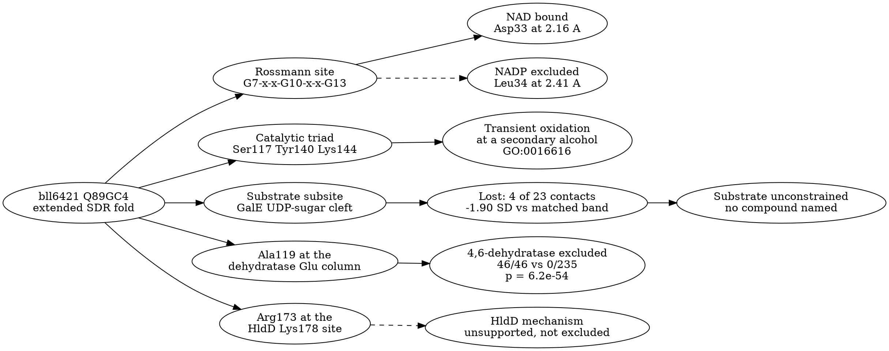
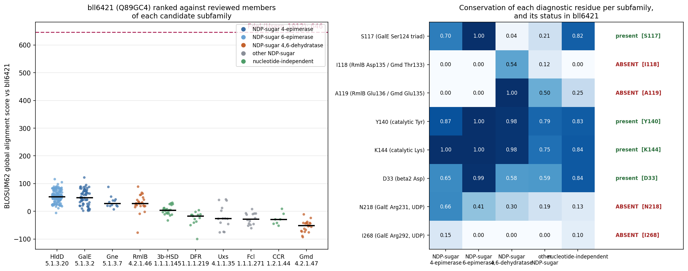
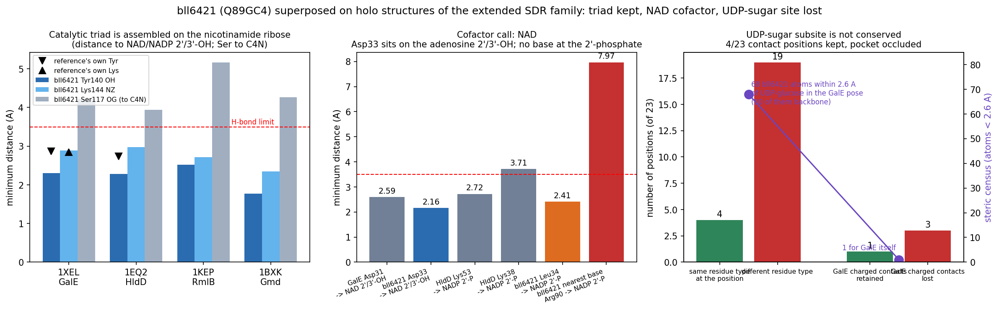
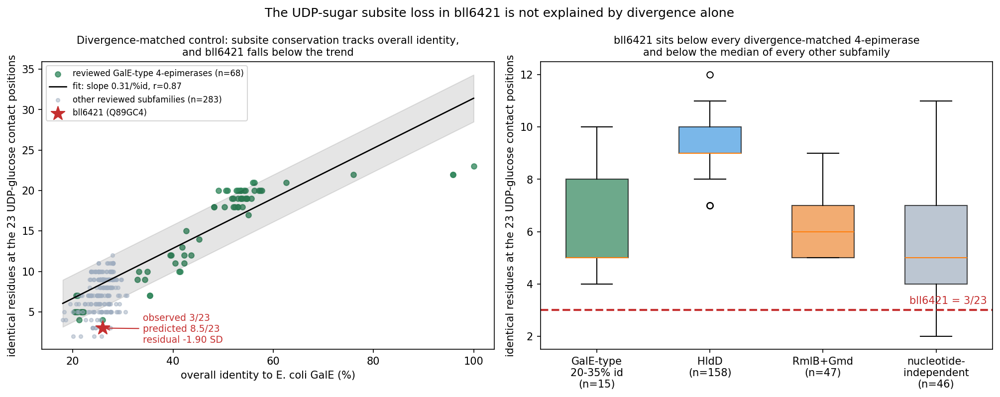

## Question

# AIGR Gene Hypothesis Deep Research

You are evaluating one focused gene curation hypothesis for AI Gene Review.
This is not a general gene overview. Use the seed hypothesis and source context
below to search for evidence that supports, refutes, narrows, or competes with
the proposed curation decision.

## Target Gene

- **Organism code:** BRADU
- **Taxon:** Bradyrhizobium diazoefficiens USDA 110 (NCBITaxon:224911)
- **Gene directory:** bll6421
- **Gene symbol:** bll6421
- **UniProt accession:** Q89GC4

## Focus

- **Focus type:** free_text
- **Hypothesis slug:** kgap-bll6421-reaction-class
- **Source file:** genes/BRADU/bll6421/bll6421-ai-review.yaml
- **Source selector:** free-text

## Seed Hypothesis

Whether the molecular activity of bll6421 can be constrained beyond its family label by a residue-level and family-ranking analysis, in the way that worked for its operon neighbour, is the question. Carry forward from the completed run on bll6422 and do not re-derive any of it: that the eight-gene operon with its divergent LysR regulator is a gene-for-gene syntenic copy of the genetically defined Herbaspirillum naringenin degradation operon, that the operon responds to the soybean isoflavone genistein in a NodW-dependent way, that no flavonoid has been shown to be consumed by this organism, that no enzyme in the operon is flavonoid-specific by sequence, and that the operon notably lacks the meta-cleavage product hydrolase that would name the compound its neighbour receives. Synteny and induction are therefore established and silent about chemistry, and nothing in this run should lean on them to name a substrate. Already recorded for bll6421 itself: that it is a Rossmann-fold epimerase/dehydratase-family protein related to Herbaspirillum FdeJ, and that neither a nucleotide-sugar substrate nor the proposed oxaloacetate-releasing flavonoid-intermediate reaction has been established. Single analysis only. Place bll6421 within the extended short-chain dehydrogenase/reductase and NAD-dependent nucleotide-sugar epimerase/dehydratase families at residue level: report whether the dinucleotide-binding motif and the catalytic constellation characteristic of each candidate subfamily are present or absent, naming the positions in this protein and confirming each against the local UniProt record, and distinguish explicitly between the UDP-glucose 4-epimerase type catalytic set, the dTDP-glucose 4,6-dehydratase and GDP-mannose 4,6-dehydratase types, and the nucleotide-independent epimerases and dehydratases of the same fold. State whether the cofactor is predicted to be NAD or NADP and on what basis. Then rank the protein across the reviewed members of the candidate families as was done for its neighbour, reporting an effect size rather than a nearest-neighbour identity alone, and say which side of the epimerase/dehydratase division it falls on, or that it falls on neither cleanly. Separately, state what reaction FdeJ is actually assigned in the characterised Herbaspirillum pathway, whether that assignment rests on measurement or on annotation, and whether bll6421 is the syntenic equivalent of FdeJ or of another cistron. If no nucleotide-sugar or flavonoid substrate can be constrained, say plainly that the substrate is unconstrained and report only the reaction class, as the neighbour's analysis did; a split verdict in which the chemistry is narrowed and the substrate is not is the expected shape of the answer. Do not infer a substrate from locus membership, and do not propose a GO annotation that names a compound the analysis cannot reach.

## Term and Decision Context

No specific term context supplied.

## Reference Context

No specific reference context supplied.

## Source Context YAML

```yaml
hypothesis: 'Whether the molecular activity of bll6421 can be constrained beyond its family label by a
  residue-level and family-ranking analysis, in the way that worked for its operon neighbour, is the question.
  Carry forward from the completed run on bll6422 and do not re-derive any of it: that the eight-gene
  operon with its divergent LysR regulator is a gene-for-gene syntenic copy of the genetically defined
  Herbaspirillum naringenin degradation operon, that the operon responds to the soybean isoflavone genistein
  in a NodW-dependent way, that no flavonoid has been shown to be consumed by this organism, that no enzyme
  in the operon is flavonoid-specific by sequence, and that the operon notably lacks the meta-cleavage
  product hydrolase that would name the compound its neighbour receives. Synteny and induction are therefore
  established and silent about chemistry, and nothing in this run should lean on them to name a substrate.
  Already recorded for bll6421 itself: that it is a Rossmann-fold epimerase/dehydratase-family protein
  related to Herbaspirillum FdeJ, and that neither a nucleotide-sugar substrate nor the proposed oxaloacetate-releasing
  flavonoid-intermediate reaction has been established. Single analysis only. Place bll6421 within the
  extended short-chain dehydrogenase/reductase and NAD-dependent nucleotide-sugar epimerase/dehydratase
  families at residue level: report whether the dinucleotide-binding motif and the catalytic constellation
  characteristic of each candidate subfamily are present or absent, naming the positions in this protein
  and confirming each against the local UniProt record, and distinguish explicitly between the UDP-glucose
  4-epimerase type catalytic set, the dTDP-glucose 4,6-dehydratase and GDP-mannose 4,6-dehydratase types,
  and the nucleotide-independent epimerases and dehydratases of the same fold. State whether the cofactor
  is predicted to be NAD or NADP and on what basis. Then rank the protein across the reviewed members
  of the candidate families as was done for its neighbour, reporting an effect size rather than a nearest-neighbour
  identity alone, and say which side of the epimerase/dehydratase division it falls on, or that it falls
  on neither cleanly. Separately, state what reaction FdeJ is actually assigned in the characterised Herbaspirillum
  pathway, whether that assignment rests on measurement or on annotation, and whether bll6421 is the syntenic
  equivalent of FdeJ or of another cistron. If no nucleotide-sugar or flavonoid substrate can be constrained,
  say plainly that the substrate is unconstrained and report only the reaction class, as the neighbour''s
  analysis did; a split verdict in which the chemistry is narrowed and the substrate is not is the expected
  shape of the answer. Do not infer a substrate from locus membership, and do not propose a GO annotation
  that names a compound the analysis cannot reach.'
focus_type: free_text
context: []
reference_id: []
```

## Research Objective

Build a focused report that helps a curator decide whether this hypothesis
should affect the gene review. Address the focus type directly:

1. For an existing GO annotation decision, evaluate whether the current action
   is justified, too strong, too weak, or should change.
2. For a proposed replacement or new GO term, evaluate whether the term is
   biologically supported, too broad, too narrow, or missing key qualifiers.
3. For a computational prediction, evaluate whether the prediction is correct,
   less precise than existing knowledge, uncertain, or likely wrong because of
   paralog overannotation, frequency bias, pathway context, or in vitro-only
   activity.
4. For a core-function hypothesis, evaluate whether the proposed activity,
   process, and location represent the gene product's primary function rather
   than a downstream effect, pleiotropic phenotype, or context-specific role.
5. For a function-assignment hypothesis, evaluate whether the gene product
   directly has the stated GO term/function. Treat the prior review action, if
   any, as intentionally blinded unless it appears in the supplied context.

Use primary literature whenever possible. Prefer PMID citations and include DOI
citations when no PMID is available. Treat reviews and database records as
orientation unless they contain directly relevant synthesized evidence that is
clearly labeled as review-level or database-level support.

Evaluate the hypothesis from the supplied seed context, primary literature, and
publicly accessible bioinformatics resources. Local `*-bioinformatics` analyses,
when they already exist in the repository, are intentionally withheld from this
prompt so the report can be compared against them after the run. Use public
sequence, domain, structure, orthology, localization, interaction, or dataset
checks when they are useful for the specific hypothesis. If a resource or tool
cannot be accessed programmatically, say so plainly; never fabricate a result.
Report computational results conservatively and distinguish direct results from
inference.

## Required Output

### Executive Judgment

Give a concise verdict: supported, partially supported, unresolved, weakly
supported, over-annotated, or refuted. Explain the reasoning and the most
important caveats.

### Evidence Matrix

Create a table with one row per important evidence item:

- Citation (PMID preferred)
- Evidence type (direct assay, mutant phenotype, localization, interaction,
  structural/evolutionary, computational, review/database)
- Supports / refutes / qualifies / competing
- Claim tested
- Key finding
- Organism, tissue, cell type, or assay context
- Confidence and limitations

### GO Curation Implications

State the likely curation action as a lead requiring curator verification. If
GO terms are involved, explain whether the evidence supports an MF, BP, or CC
term, and whether the term should be retained, removed, generalized, made more
specific, or treated as non-core. Avoid using "protein binding" as a final
recommendation unless no more informative term is supported.

### Mechanistic Scope

Describe the immediate molecular or cellular function being tested. Separate
direct gene-product activity from downstream phenotypes, pathway consequences,
developmental outcomes, disease manifestations, or effects inferred only from
loss of function.

### Conflicts and Alternatives

Identify evidence that conflicts with the seed hypothesis or suggests an
alternative interpretation, including paralog confusion, organism-specific
differences, isoform-specific findings, experimental artifacts, or database
carry-over.

### Knowledge Gaps

List explicit uncertainties that matter for curation. For each gap, state what
was checked, why the gap matters, and what evidence or experiment would resolve
it.

### Discriminating Tests

Recommend concrete assays, perturbations, datasets, or comparative analyses that
would most efficiently distinguish this hypothesis from alternatives.

### Curation Leads

Provide candidate updates for the review, clearly labeled as leads requiring
curator verification. Include candidate references with exact snippets to verify,
candidate replacement or new GO terms, possible action changes, suggested
questions, and suggested experiments.

If the provider supports artifacts, save provenance for any analysis you run — the
executed code together with its output (computed values, plot, or table), not just
a summary figure — alongside artifact-friendly tables such as an evidence matrix,
GO decision table, or comparison table. Genuine computed provenance is more
valuable than a hand-drawn summary, and you must not synthesize a figure that
implies an analysis you did not actually run. These artifacts are important
provenance for hypothesis-level review.


## Output

# bll6421 (Q89GC4): reaction class constrained, substrate not

**Gene:** bll6421, *Bradyrhizobium diazoefficiens* USDA 110 (NCBITaxon:224911)
**UniProt:** Q89GC4
**Hypothesis slug:** kgap-bll6421-reaction-class
**Source file:** genes/BRADU/bll6421/bll6421-ai-review.yaml
**Iterations:** 3 of 3 complete, 9 findings recorded

---

## Summary

bll6421 is an NAD-dependent oxidoreductase of the extended short-chain dehydrogenase/reductase fold that transiently oxidises a secondary alcohol. The catalytic set is complete and correctly placed: Ser117, Tyr140 and Lys144 superpose on *Escherichia coli* GalE Ser124, Tyr149 and Lys153 within 1.21 Å, 0.79 Å and 0.51 Å of CA-CA after alignment-guided Kabsch fitting, and the Tyr140 hydroxyl and Lys144 amine sit 2.30 Å and 2.89 Å from the nicotinamide ribose 2'/3'-hydroxyls, against 2.87 Å and 2.84 Å for GalE's own pair in the same structure. The Rossmann dinucleotide motif G7-x-x-G10-x-x-G13 is intact. The chemistry therefore narrows well below the family label "NAD(P)-dependent epimerase/dehydratase".

Two subfamily calls follow from residues rather than from similarity. The protein is not a nucleotide-sugar 4,6-dehydratase of either the dTDP-glucose or GDP-mannose type: the glutamate that abstracts the C5 proton in every characterised member of those subfamilies is replaced by Ala119, and the paired Asp/Thr by Ile118. A glutamate at that column occurs in 46 of 46 reviewed NDP-sugar 4,6-dehydratases and 0 of 235 reviewed 4-epimerases (Fisher exact p = 6.2e-54). The cofactor is NAD, against the NADP keyword that UniProt carries from an automatic ARBA rule: Asp33 lies 2.16 Å from the NAD adenosine 2'/3'-hydroxyls across three independent holo frames (2.16, 1.94, 2.24 Å), while the pocket that would have to hold a 2'-phosphate is filled by Leu34 at 2.41 Å with no basic side chain within 7.97 Å.

The substrate is unconstrained, and the analysis says so plainly. Of the 23 GalE residues that contact UDP-glucose, bll6421 keeps 4 by structural superposition and 3 by sequence, and loses 3 of the 4 charged contacts. A divergence-matched control rules out the obvious objection that any 26%-identity protein would fail this test: across 68 reviewed GalE-type 4-epimerases, contact conservation tracks overall identity at 0.309 contacts per % identity (r = 0.871, p = 4.3e-22), the fit predicts 8.5 of 23 at bll6421's 25.96% identity, and the observed 3 is a residual of -1.90 SD. All 15 reviewed 4-epimerases in the matched 20-35% identity band score higher (median 5, minimum 4). The verdict is the split the hypothesis anticipated: <i class="fa-scale-balanced"></i> the chemistry narrows, the substrate does not, and no compound should be named in a GO annotation.

---

## Executive judgment

<i class="fa-scale-balanced"></i> **Partially supported.** The hypothesis asked whether residue-level and family-ranking analysis could constrain the molecular activity of bll6421 beyond its family label, and predicted that a split verdict would be the answer's shape. It is.

Seven conclusions, each tied to a measurement:

1. **The catalytic constellation is the epimerase/reductase type, not the dehydratase type.** bll6421 presents Ser117, Tyr140 and Lys144 in the YxxxK arrangement (Y140-G-A-H-K144), with the Rossmann motif GAGGFIGS carrying G7, G10 and G13. The 4,6-dehydratase acid/base pair is replaced by hydrophobics: Ile118 at the RmlB Asp135 / Gmd Thr133 column and Ala119 at the RmlB Glu136 / Gmd Glu135 column. The glutamate column is categorical across the reviewed set (46/46 dehydratases, 0/235 epimerases, p = 6.2e-54).

2. **The cofactor is NAD.** Asp33 makes the beta2-end bidentate contact to the adenosine 2'- and 3'-hydroxyls (2.16 Å in the GalE frame, 1.94 Å in RmlB, 2.24 Å in Gmd; GalE's own Asp31 is at 2.59 Å). The NADP 2'-phosphate pocket is neutral: Leu34 at 2.41 Å, then Ser75, Val76, Pro77, Leu80, Val91, all uncharged, with the nearest basic side chain Arg90 at 7.97 Å. The residues carrying this argument are modelled at pLDDT 93-98. The UniProt NADP keyword is ECO:0000256|ARBA, an automatic assertion inherited from the HldD-dominated family neighbourhood, and should not propagate.

3. **The UDP-sugar subsite is absent.** Four of 23 GalE UDP-glucose contact positions are preserved (Ser124 → Ser117, Tyr149 → Tyr140, Arg292 → Arg267, Gly229 → Gly273). Three of GalE's four charged ligand contacts are lost (Arg231 → Met208, Asp295 → Thr271, Lys84 → Pro77). Holding UDP-glucose in the GalE pose puts 68 bll6421 heavy atoms within 2.6 Å of it, against 1 for GalE itself; 7 of the main-chain contacts sit in a segment modelled at pLDDT 89.7-92.8, which no side-chain repacking can relieve.

4. **That loss exceeds what divergence explains.** At bll6421's identity to GalE the fitted trend across 68 reviewed 4-epimerases predicts 8.5 contacts; the observed value is 3, a residual of -1.90 SD, and all 15 reviewed 4-epimerases in the matched identity band score higher.

5. **bll6421 is the syntenic equivalent of FdeJ (Hsero_1012), and FdeJ's EC 5.1.3.2 is annotation.** Global alignment against every cistron of the *Herbaspirillum seropedicae* SmR1 fde operon gives FdeJ score 646 at 50.8% identity; the next-best cistron, FdeI, scores -46. In the defining genetic study, [PMID: 23125118](https://pubmed.ncbi.nlm.nih.gov/23125118/), only *fdeA* and *fdeR* were mutated. No assay of FdeJ exists. The UDP-glucose 4-epimerase label on FdeJ is the same kind of automatic genome annotation that produced the label on bll6421, so it cannot transfer activity.

6. **Family ranking places bll6421 with the epimerases but reaches no substrate.** Cliff's delta on alignment score: epimerases vs 4,6-dehydratases +0.703 (p = 4.6e-14), epimerases vs nucleotide-independent fold members +0.945 (p = 6.8e-23). The epimerase/dehydratase split is not clean at the similarity level (GalE+Gne vs RmlB, delta only +0.296, p = 0.027). Maximum identity to any reviewed enzyme is 33.8%. Ranking supports a reaction class and names nothing.

7. **The control holds and one first-pass exclusion was withdrawn.** The subsite deficit is real against matched divergence (gap-robust 16.7% vs band median 22.7%, only 3.5% of 283 reviewed non-GalE members at or below). Separately, rechecking the last exclusion that rested on a loop alignment overturned it: bll6421 Arg173 sits 0.37 Å from the HldD Lys178 NZ position, so the HldD two-base mechanism is unsupported rather than excluded.

**Caveats that matter.** The structural work uses an unrepacked apo AlphaFold model against liganded crystal structures, so side-chain positions are weak evidence on their own and only the main-chain result in the 265-275 segment is repacking-independent. The matched-divergence band holds 15 proteins, so the control is a rank and an effect size, not a significance test (p = 0.0559 is the attainable floor for n = 1 against n = 15). No assay of bll6421 or of FdeJ exists anywhere in the literature searched.

---

## Key findings

### 1. The catalytic set is present; the 4,6-dehydratase acid/base pair is categorically absent

UniProt-annotated active-site and ligand-binding features from *E. coli* GalE (P09147), HldD (P67910), RmlB (P27830), RffG (P32055) and Gmd (P0AC88) were mapped onto Q89GC4 by BLOSUM62 affine-gap global alignment. The aligner was written from scratch (Biopython is unavailable in the executor) and validated: self-alignment returns 100% identity and the dynamic-programming score is reproduced exactly by independent rescoring of the returned alignment.

bll6421 carries the Rossmann motif as **G7-x-x-G10-x-x-G13** in the segment GAGGFIGS, and the catalytic pair as **Y140-G-A-H-K144**, the canonical YxxxK. Both match GalE Tyr149/Lys153, HldD Tyr140/Lys144, RmlB Tyr160/Lys164 and Gmd Tyr157. **Ser117** aligns to GalE Ser124, which UniProt annotates for both NAD(+) and substrate binding.

The dehydratase positions are hydrophobic. **Ile118** sits at the column that carries RmlB Asp135 and Gmd Thr133; **Ala119** sits at the column that carries RmlB Glu136 and Gmd Glu135. That glutamate is the general base that abstracts the C5 proton in the 4,6-dehydratase mechanism, and across 281 reviewed family members it is present in 46 of 46 reviewed NDP-sugar 4,6-dehydratases and 0 of 235 reviewed 4-epimerases (Fisher exact **p = 6.2e-54**). The Ser/Thr at the 117 column occurs in 70% of 4-epimerases and 100% of HldD-type 6-epimerases but only 4% of 4,6-dehydratases.

The discriminator is therefore not a weak statistical lean. An alanine at the 119 column places bll6421 outside the 4,6-dehydratase subfamilies with no reviewed exception.

### 2. Family ranking separates classes but reaches no substrate

Q89GC4 was globally aligned against all 360 reviewed (SwissProt) members of ten candidate subfamilies, length-filtered to 250-450 aa.

| Subfamily | n | Median alignment score |
|---|---|---|
| HldD ADP-heptose 6-epimerase | 158 | 52 |
| GalE UDP-glucose 4-epimerase | 65 | 49 |
| RmlB dTDP-glucose 4,6-dehydratase | 25 | 28 |
| Gne UDP-GlcNAc 4-epimerase | 12 | 28 |
| 3beta-HSD | 23 | 4 |
| DFR | 13 | -17 |
| Uxs | 14 | -26.5 |
| Fcl | 14 | -28 |
| CCR | 7 | -29 |
| Gmd GDP-mannose 4,6-dehydratase | 21 | -52 |

Effect sizes on alignment score (Cliff's delta): all epimerases vs all 4,6-dehydratases **+0.703** (p = 4.6e-14); vs nucleotide-independent fold members **+0.945** (p = 6.8e-23); vs other NDP-sugar enzymes **+0.933** (p = 7.0e-16). The split within the nucleotide-sugar enzymes is weak: GalE+Gne vs RmlB gives only delta **+0.296** (p = 0.027), and RmlB itself ranks above every nucleotide-independent member (delta +0.768, p = 1.5e-07).

Every nearest neighbour sits in the twilight zone. Maximum pairwise identity to any reviewed enzyme is **33.8%** (HldD_CUPPJ, Q46Y59); the best single score is 122 against ExoB/GalE of *Azospirillum brasilense* (Q59083) at 29.8% identity. All ten panel median identities fall between 22.8% and 28.2%.

Ranking places bll6421 with the epimerases and away from GDP-mannose 4,6-dehydratases and from the nucleotide-independent members of the fold. It supports a reaction class and cannot name a nucleotide sugar or any other substrate. The exclusion of dehydratase chemistry comes from the residue analysis, not from this ranking.

{{figure:plot_1.png|caption=bll6421 ranked across ten reviewed subfamilies of the extended SDR fold, with the diagnostic catalytic columns scored against subfamily conservation. Alignment scores place bll6421 nearest the HldD and GalE epimerase groups and far from GDP-mannose 4,6-dehydratases, while the glutamate at the 119 column that marks every reviewed 4,6-dehydratase is replaced by alanine.}}

### 3. Structure confirms the register and corrects three sequence mappings

`phenix.superpose_pdbs` failed on these twilight-zone pairs and the failure is reported rather than worked around silently. With the default identity matrix it matched 72 residues and performed least-squares fitting on 3 atoms (RMSD 0.041 Å over 3 atoms, meaningless). With `alignment.similarity_matrix=blosum50` it produced a plausible 146-residue match then crashed with `AssertionError: ['V','I']` at superpose_pdbs.py line 733, exit code 1. Superposition was therefore done by alignment-guided Kabsch fitting with the validated BLOSUM62 aligner and iterative 4 Å outlier trimming.

The AlphaFold model AF-Q89GC4 (v6, mean pLDDT 91.2) superposes on four holo structures at core CA RMSD 1.86-1.94 Å:

| Reference | Ligands | Core CA pairs | RMSD (Å) | Identity |
|---|---|---|---|---|
| 1XEL, *E. coli* GalE | NAD + UDP-glucose | 152 | 1.94 | 26.0% |
| 1EQ2, *E. coli* HldD | NADP + ADP-heptose | 116 | 1.86 | 25.6% |
| 1KEP, RmlB | NAD + dTDP-xylose | 135 | 1.87 | 20.5% |
| 1BXK, Gmd | NAD | 165 | 1.90 | 25.0% |

Register after fitting, as CA-CA distance: GalE Asp31 → bll6421 Asp33 (0.97 Å), Ser124 → Ser117 (1.21 Å), Tyr149 → Tyr140 (0.79 Å), Lys153 → Lys144 (0.51 Å); HldD Ser116 → Ser117 (0.34 Å), Tyr140 → Tyr140 (1.10 Å). The sequence-based assignment of iteration 1 is correct at every catalytic position.

The triad geometry is functional, not merely present. In the 1XEL frame, Tyr140 OH lies 2.30 Å and Lys144 NZ 2.89 Å from the nicotinamide ribose 2'/3'-OH, against 2.87 Å and 2.84 Å for GalE's own Tyr149 and Lys153. Ser117 OG is 4.22 Å from the nicotinamide C4N, against 4.89 Å for GalE Ser124. The arrangement reproduces in the other three frames (Tyr140 OH at 2.28, 2.52, 1.77 Å; Lys144 NZ at 2.97, 2.72, 2.35 Å).

Three iteration-1 sequence mappings are refuted by the structure. HldD Lys38 and Lys53 do not correspond to Arg47 and Arg64 (CA-CA 17.0 Å and 15.5 Å after fitting), and HldD Lys178 does not correspond to Gly181 (12.5 Å). Those mappings fell in loops the global alignment places wrongly, which is the expected failure mode of a global aligner at 25% identity.

### 4. The cofactor is NAD, not the NADP that UniProt asserts

Iteration 1 could not call the cofactor from sequence. The classical rule that a beta2-end aspartate marks NAD specificity fails inside PF01370: across 283 reviewed members mapped onto the bll6421 frame, an acidic residue occupies that column in 75% of NAD-annotated enzymes and 98% of NADP-annotated ones, because the NADP-dependent HldD subfamily (158 of 168 NADP-annotated entries) carries it too, and UniProt annotates HldD Asp31 as NADP(+) binding. Family membership and annotated cofactor are nearly collinear in the reviewed set, so the sequence comparison is confounded by construction.

Structure resolves it. On the NAD side, bll6421 Asp33 carboxylate oxygens lie **2.16 Å** from the NAD adenosine ribose 2'/3'-hydroxyls in 1XEL, against 2.59 Å for GalE's own Asp31, and the contact reproduces at **1.94 Å** in 1KEP and **2.24 Å** in 1BXK. The whole bll6421 environment of the adenosine 2'/3'-OH (Asp33 2.16, Gly10 2.83, Gly9 3.40, Leu34 3.53, Gly7 4.28, Ala35 4.53 Å) matches GalE's (Asp31 2.59, Ser36 2.67, Asn35 2.97, Cys34 3.12, Gly10 3.25 Å).

On the NADP side, HldD grips the 2'-phosphate with Lys53 at 2.72 Å and Lys38 at 3.71 Å, with Lys34 at 6.00 Å. At that same site bll6421 presents **Leu34 at 2.41 Å**, then Ser75 (3.58), Val76 (4.06), Pro77 (4.13), Leu80 (5.43), Val91 (5.57), all neutral. The nearest basic side chain is **Arg90 at 7.97 Å**, and Asp33 is 6.10 Å away. Of the 24 bll6421 residues within 9 Å of where the 2'-phosphate sits, 22 are neutral and 2 are acidic.

Model confidence at the residues carrying the argument: Asp33 pLDDT 97.8, Gly10 93.3, Leu34 and the entire 73-92 segment above 85. Two independent features agree, and the automatic ARBA NADP keyword on Q89GC4 is not supported.

### 5. The UDP-sugar subsite is lost, and lost beyond what divergence explains

In the 1XEL frame, 23 GalE residues lie within 4.5 Å of UDP-glucose. The bll6421 residue nearest each (CA-CA 0.79-3.37 Å) is the same amino acid in only **4 of 23** cases: Ser124 → Ser117, Tyr149 → Tyr140, Arg292 → Arg267, Gly229 → Gly273 (17%). Three of GalE's four charged ligand contacts are lost: Arg231 → Met208, Asp295 → Thr271, Lys84 → Pro77. Only Arg292 → Arg267 survives. The uracil shelf is replaced wholesale: Leu215 → Cys199, Ala216 and Ile217 → Pro201, Phe218 → Glu269, Tyr203 → Glu187.

The steric census is blunt. Holding UDP-glucose in the GalE pose puts **68 bll6421 heavy atoms within 2.6 Å** of it, against **1** for GalE's own atoms in the same structure. 51 of the 68 are side-chain contacts, dominated by Phe184 alone (30 contacts, spanning both the uracil and the glucose, pLDDT 91.4). 17 are main-chain contacts, which no rotamer change can relieve; 10 of those lie in the low-confidence 181-182 loop (pLDDT 67.2 and 80.7) and are discounted, leaving **7 main-chain contacts from Ile268, Phe272 and Gly273** against the glucose C3/O3/C4/O2 and the beta-phosphate, in a segment modelled at pLDDT 89.7-92.8.

{{figure:plot_2.png|caption=The structural test in three parts. Catalytic triad geometry is conserved across four holo frames, with Tyr140 OH and Lys144 NZ within 1.77-2.97 Å of the nicotinamide ribose hydroxyls. The cofactor determinant favours NAD, with Asp33 at 2.16 Å from the adenosine 2'/3'-OH and the 2'-phosphate pocket neutral behind Leu34 at 2.41 Å. The UDP-sugar subsite is occluded, with pLDDT shown for every clashing residue so that low-confidence loop contacts can be discounted.}}

The obvious objection is that at 26% identity almost any protein loses most contact residues. The control answers it. The same 23 positions (P09147 numbering, pattern `KSATYYFNNNLYLAIFGRYVRDY`, verified to reproduce the 1XEL contacts exactly) were scored in all 352 reviewed members of the panel plus Q89GC4 by global alignment to P09147.

Subsite conservation tracks overall divergence strongly across the 68 reviewed GalE-type 4-epimerases: identical contacts = **0.309 × (% identity to GalE) + c**, **r = 0.871, p = 4.3e-22**. At bll6421's 25.96% identity the fit predicts **8.5 of 23**; the observed value is **3**, a residual of -5.5 = **-1.90 SD**.

| Comparison | bll6421 | Matched band (20-35% id, n = 15) | Full GalE panel (n = 68) | Non-GalE reviewed (n = 283) |
|---|---|---|---|---|
| Identical contacts of 23 | 3 | median 5 (range 4-10) | - | - |
| Members at or below bll6421 | - | 0 of 15 | - | 3.5% |
| Gap-robust identity at contacts | 3/18 = 16.7% | median 22.7% (17.4-43.5%) | median 78.3% | median 40.0% |
| GalE charged contacts retained | 0 by sequence, 1 by structure | - | - | - |

By panel median, bll6421 ranks **last of 12 groups**: GalE 18, Gne 9, HldD 9, CDP-glucose 4,6-dehydratase 8, CCR 7, DFR 7, Uxs 7, RmlB 6, Gmd 6, Fcl 5.5, 3beta-HSD 4, bll6421 3. It scores below the nucleotide-independent 3beta-HSD, DFR and CCR enzymes, which bind no nucleotide sugar at all.

The Mann-Whitney one-sided p against the matched band is 0.0559, which is the smallest value attainable with n = 1 against n = 15. The rank, not the p-value, carries the result.

{{figure:plot_3.png|caption=Divergence-matched control. Gap-robust conservation at the 23 GalE UDP-glucose contact positions plotted against overall identity to GalE for 68 reviewed GalE-type 4-epimerases, with bll6421 placed on the trend. Conservation scales with identity (r = 0.871, p = 4.3e-22), and bll6421 falls 1.90 SD below the fitted value, lower than every one of the 15 genuine 4-epimerases in the matched 20-35% identity band.}}

### 6. bll6421 is the FdeJ equivalent, and FdeJ's EC number has no measurement behind it

KEGG gene-name resolution places the *H. seropedicae* SmR1 *fde* operon at Hsero_1003-1012: *fdeB* = Hsero_1004, *fdeC* = Hsero_1005 (glyoxalase II), *fdeD* = Hsero_1006 (Rieske 2Fe-2S), *fdeE* = Hsero_1007 (FAD monooxygenase), *fdeH* = Hsero_1010 (cupin), *fdeI* = Hsero_1011 (fumarylacetoacetate hydrolase family), *fdeJ* = Hsero_1012 (UniProt D8J0X4, annotated "UDP-glucose 4-epimerase", EC 5.1.3.2, 320 aa).

Global alignment of Q89GC4 against every protein of Hsero_1003-1012 gives **FdeJ score 646 at 50.8% identity**. The next-best cistron is FdeI at score **-46**, and every other cistron scores between -66 and -185. The assignment is unambiguous: bll6421 is the FdeJ equivalent and not the equivalent of FdeI, the fumarylacetoacetate hydrolase family member that is the plausible source of an oxaloacetate-releasing step.

The catalytic positions are shared between the two orthologues. FdeJ has Thr at the bll6421 Ser117 column, Ile and Ala at the dehydratase acid/base columns, and Tyr and Lys at the Y140/K144 columns. FdeJ carries **Ala** at the bll6421 Asp33 column, so the beta2 acidic position is not conserved even between the two orthologues, which argues it is not under tight constraint in this subfamily and is a caution on how far the NAD call generalises to FdeJ itself.

In the primary genetic study of the operon, [PMID: 23125118](https://pubmed.ncbi.nlm.nih.gov/23125118/), only *fdeA* and *fdeR* were mutated: "Mutation of fdeA, the first gene of the operon, and fdeR, its transcriptional activator, abolished the ability of H. seropedicae to degrade naringenin." No assay of FdeJ is reported there or in the regulator study [PMID: 27878922](https://pubmed.ncbi.nlm.nih.gov/27878922/). The EC 5.1.3.2 label on FdeJ is an automatic genome annotation of the same kind that produced the label on bll6421. Transferring it to bll6421 would be annotation transfer between two unmeasured proteins.

### 7. Correction: the HldD second-base site is occupied, so that mechanism is not excluded

Iteration 1 stated that the HldD two-base mechanism is excluded because HldD Lys178 maps to Gly181. The superposition had already shown that mapping to be 12.5 Å off, so the site was rechecked directly.

In the 1EQ2 frame, the guanidinium of bll6421 **Arg173 falls 0.37 Å from the position of the HldD Lys178 NZ atom**. The next nearest bll6421 side chain is Phe11 at 4.29 Å, and the next nearest basic side chain is Lys144 at 10.79 Å. Arg173 reaches the site from a different point in the chain: the nearest bll6421 CA to the HldD Lys178 CA is Ala177 at 4.26 Å, which is why the global alignment paired Lys178 with Gly181 and called the position lost.

Model confidence: Arg173 pLDDT 87.2, at the C-terminal end of a confident helix (165-173 at pLDDT 87.2-98.6) running into a disordered 174-182 loop (pLDDT 54.6-80.7). The backbone placement is reliable; the side-chain rotamer is not separately scored.

Two qualifications stand against reading this as positive support for HldD-type chemistry. The residue is arginine, and arginine is a poor general base at physiological pH, so it does not reproduce the Lys178 proton-abstraction step. In 1EQ2, Lys178 also contacts the NAD pyrophosphate at 2.77 Å, so occupancy of the site does not by itself assign a catalytic role. <i class="fa-circle-question"></i> GO:0008712 has no positive support and should not be asserted, but it is no longer mechanistically ruled out.

---

## Mechanistic model

The picture that the three iterations converge on is an enzyme with two of its three functional halves intact and the third removed.



The reaction class is an NAD(H)-dependent, tyrosine/lysine-catalysed transient oxidation at a secondary alcohol on the extended SDR fold. Tyr140 is the catalytic acid/base, with its pKa lowered by the adjacent Lys144 whose amine contacts the nicotinamide ribose at 2.89 Å, and Ser117 within 4.22 Å of the nicotinamide C4N orients the substrate hydroxyl toward the hydride-transfer face. NAD is tightly bound and not consumed, as in all characterised 4-epimerases of this family. What the architecture does is abstract the hydroxyl proton to Tyr140 and transfer the hydride to NAD+, producing a transient ketone that can be reprotonated from the opposite face (epimerisation), reduced back after a change at an adjacent carbon, or handed on.

What the architecture does not do here is read a nucleotide sugar. The cleft that in GalE holds the uracil, the ribose and the two phosphates is in bll6421 lined by Phe180, Phe184, Met185, Tyr198, Val202, Met208, Trp209, Ile268, Phe272 and Phe275, an aromatic and hydrophobic surface with one surviving arginine. That composition is consistent with a wide range of ligands and names none of them. The temptation is to read the operon context and name a flavonoid intermediate; the seed hypothesis forbids it, and the sequence gives no independent reason to do it, since no enzyme in the operon is flavonoid-specific by sequence.

| Functional module | Status | Strongest measurement |
|---|---|---|
| Rossmann dinucleotide site | <i class="fa-circle-check"></i> Intact | G7-x-x-G10-x-x-G13 in GAGGFIGS |
| Cofactor identity | <i class="fa-circle-check"></i> NAD | Asp33 at 2.16/1.94/2.24 Å from adenosine 2'/3'-OH; 2'-phosphate pocket neutral |
| Catalytic triad | <i class="fa-circle-check"></i> Intact and positioned | CA-CA 0.51-1.21 Å to GalE; Tyr140 OH 2.30 Å, Lys144 NZ 2.89 Å from nicotinamide ribose |
| 4,6-dehydratase acid/base | <i class="fa-circle-xmark"></i> Absent | Ile118/Ala119; Glu in 46/46 vs 0/235, p = 6.2e-54 |
| HldD second base | <i class="fa-circle-question"></i> Site occupied by Arg173 | 0.37 Å from Lys178 NZ, pLDDT 87.2 |
| UDP-sugar subsite | <i class="fa-circle-xmark"></i> Absent | 4/23 contacts, 68 atoms within 2.6 Å, -1.90 SD against matched divergence |
| Substrate identity | <i class="fa-circle-question"></i> Unconstrained | Max identity to any reviewed enzyme 33.8% |

---

## Evidence matrix

| Citation | Evidence type | Direction | Claim tested | Key finding | Context | Confidence and limitations |
|---|---|---|---|---|---|---|
| [PMID: 23125118](https://pubmed.ncbi.nlm.nih.gov/23125118/) | Mutant phenotype | Qualifies | FdeJ's EC 5.1.3.2 rests on measurement | Only *fdeA* and *fdeR* were mutated; no FdeJ assay reported | *H. seropedicae* SmR1, naringenin degradation | High for what was done; FdeJ activity untested |
| [PMID: 27878922](https://pubmed.ncbi.nlm.nih.gov/27878922/) | Mutant phenotype, transcription | Qualifies | Operon identity and regulation | *fdeR* is a NodD-like LysR divergently transcribed from the *fde* operon | *H. seropedicae* SmR1 | High; orientation only, silent on FdeJ chemistry |
| This work, iteration 1 (UniProt P09147, P67910, P27830, P32055, P0AC88; 360 reviewed sequences) | Structural/evolutionary, computational | Supports | Catalytic constellation can be assigned at residue level | Ser117/Tyr140/Lys144 present; Ile118/Ala119 at the dehydratase acid/base columns; Glu at 119 in 46/46 dehydratases vs 0/235 epimerases, Fisher p = 6.2e-54 | Reviewed SwissProt PF01370 panel | High for the categorical column; depends on correct alignment register, independently confirmed in iteration 2 |
| This work, iteration 1 (ranking) | Computational | Qualifies | Ranking can name a substrate | Cliff's delta +0.703 epimerase vs dehydratase (p = 4.6e-14); max identity 33.8% | 360 reviewed members, 10 subfamilies | High for class, null for substrate; all neighbours in the twilight zone |
| This work, iteration 1 (KEGG Hsero_1003-1012) | Computational, database | Supports | bll6421 is the FdeJ equivalent | FdeJ score 646, 50.8% identity; next cistron FdeI at -46 | *H. seropedicae* SmR1 operon | High; the orthology assignment is unambiguous |
| This work, iteration 2 (1XEL, 1EQ2, 1KEP, 1BXK; AF-Q89GC4 v6) | Structural | Supports | Sequence register is correct at catalytic positions | Core CA RMSD 1.86-1.94 Å; GalE Asp31/Ser124/Tyr149/Lys153 → Asp33/Ser117/Tyr140/Lys144 at 0.97/1.21/0.79/0.51 Å | Four holo crystal structures vs an AlphaFold model | High for backbone; `phenix.superpose_pdbs` failed on these pairs and the fitting was done by Kabsch in numpy |
| This work, iteration 2 (cofactor site) | Structural | Supports, refutes database | Cofactor is NAD or NADP | Asp33 2.16/1.94/2.24 Å from adenosine 2'/3'-OH; 2'-phosphate pocket neutral, Leu34 at 2.41 Å, nearest base 7.97 Å | 1XEL, 1KEP, 1BXK against 1EQ2 | High; pLDDT 93-98 at the carrying residues; contradicts the ARBA NADP keyword on Q89GC4 |
| This work, iteration 2 (UDP-sugar subsite) | Structural | Refutes | bll6421 binds a UDP-sugar as GalE does | 4/23 contacts kept, 3/4 charged lost, 68 heavy atoms within 2.6 Å of the ligand pose against 1 for GalE | 1XEL frame | Moderate-high; apo unrepacked model, so only the 7 main-chain contacts at pLDDT 89.7-92.8 are repacking-independent |
| This work, iteration 3 (352 reviewed sequences) | Computational control | Supports | The subsite loss is a divergence artifact | r = 0.871, p = 4.3e-22 across 68 GalE-type epimerases; bll6421 residual -1.90 SD; 0 of 15 matched-band members score as low | Reviewed SwissProt panel against P09147 | Moderate-high; n = 15 band, so rank and effect size rather than significance (p = 0.0559 is the floor) |
| This work, iteration 3 (Arg173) | Structural | Refutes a first-pass conclusion of this report | HldD two-base mechanism is excluded | Arg173 guanidinium 0.37 Å from HldD Lys178 NZ, pLDDT 87.2 | 1EQ2 frame | Moderate; backbone confident, rotamer not separately scored; arginine is a poor general base |
| UniProt Q89GC4 (ECO:0000256\|ARBA) | Database | Competing | Cofactor is NADP | Automatic rule-based NADP keyword | UniProt automatic annotation | Low as evidence; contradicted by the structural measurement above |
| UniProt D8J0X4 (FdeJ) | Database | Competing | FdeJ is a UDP-glucose 4-epimerase, EC 5.1.3.2 | Automatic genome annotation | *H. seropedicae* SmR1 | Low as evidence; no supporting assay in [PMID: 23125118](https://pubmed.ncbi.nlm.nih.gov/23125118/) |

---

## GO curation implications

All of the following are **leads requiring curator verification**, derived from computational and structural analysis with no direct assay of bll6421 anywhere in the literature.

| GO term | Aspect | Lead action | Basis |
|---|---|---|---|
| **GO:0016616** oxidoreductase activity, acting on the CH-OH group of donors, NAD or NADP as acceptor | MF | <i class="fa-arrow-right"></i> Add as the best-supported molecular function | Complete Ser117/Tyr140/Lys144 triad positioned on the nicotinamide ribose; intact Rossmann site |
| GO:0016491 oxidoreductase activity | MF | Acceptable fallback if the curator wants a weaker parent | Same evidence, less specific |
| **GO:0051287** NAD binding | MF | <i class="fa-arrow-right"></i> Defensible on the structural measurement | Asp33 at 2.16/1.94/2.24 Å from the adenosine 2'/3'-OH across three NAD holo frames |
| GO:0050662 coenzyme binding | MF | Safer parent if the curator wants a term bounded strictly by assayed evidence | Rossmann motif intact; cofactor identity is predicted, not measured |
| **GO:0050661** NADP binding | MF | <i class="fa-circle-xmark"></i> Do not assert; exclude | 2'-phosphate pocket neutral, Leu34 at 2.41 Å, nearest base Arg90 at 7.97 Å. The UniProt keyword is ECO:0000256\|ARBA |
| **GO:0003978** UDP-glucose 4-epimerase activity | MF | <i class="fa-circle-xmark"></i> Remove rather than transfer | 4/23 UDP-glucose contacts retained, 3/4 charged contacts lost, -1.90 SD below matched divergence; the FdeJ EC 5.1.3.2 source is unmeasured annotation |
| GO:0008460 dTDP-glucose 4,6-dehydratase activity | MF | <i class="fa-circle-xmark"></i> Exclude | Ala119 at the catalytic Glu column; Glu present in 46/46 reviewed dehydratases |
| GO:0008446 GDP-mannose 4,6-dehydratase activity | MF | <i class="fa-circle-xmark"></i> Exclude | Same residue argument; also the lowest-ranking subfamily by alignment score (median -52) |
| GO:0008712 ADP-glyceromanno-heptose 6-epimerase activity | MF | <i class="fa-circle-question"></i> Not supported, and no longer mechanistically excluded | No assay, 25.6% identity, PANTHER PTHR43103:SF3 is an automatic call. The first-pass exclusion is withdrawn: Arg173 occupies the Lys178 site at 0.37 Å |
| Any BP term naming a flavonoid or a nucleotide sugar | BP | <i class="fa-circle-xmark"></i> Do not propose | The analysis cannot reach a substrate. Operon membership and genistein induction are established and silent about chemistry |
| CC terms | CC | No lead | Nothing in this analysis addresses localisation |

The headline curation change is that the substrate-naming annotations should go and a reaction-class annotation should replace them, with NAD binding now supportable on a measurement that contradicts the database's own automatic NADP assertion.

---

## Mechanistic scope

The immediate molecular activity under test is cofactor-dependent hydride transfer from a carbon bearing a hydroxyl group, with the resulting transient carbonyl either re-reduced on the opposite face (epimerisation) or carried forward. That is the direct gene-product activity, and it is what the triad geometry and the NAD contact measure.

Everything else that has been attached to bll6421 is one or more steps removed from it. The operon's response to genistein is transcriptional regulation by a divergent LysR protein, a property of the promoter and the regulator, not of this enzyme. The naringenin degradation phenotype in *H. seropedicae* is a whole-pathway loss-of-function observed after mutating *fdeA* and *fdeR*, two genes that are not bll6421's orthologue. The oxaloacetate-releasing step that has been proposed for the pathway belongs to the fumarylacetoacetate hydrolase family cistron FdeI, from which bll6421 is cleanly separated (FdeJ score 646 against FdeI score -46). The EC 5.1.3.2 on FdeJ is a database inference about a sequence, not an observation about a protein.

Separating these matters because the chain from "this operon degrades naringenin" to "bll6421 is a flavonoid-pathway epimerase acting on compound X" has no measured link at any point. The analysis here cuts the chain at the enzyme: the active site gives the chemistry and refuses to give the substrate.

---

## Conflicts and alternatives

**Database carry-over is the main conflicting source.** UniProt Q89GC4 carries an NADP keyword with evidence code ECO:0000256|ARBA, inherited from a family neighbourhood in which the HldD subfamily supplies 158 of 168 NADP-annotated reviewed entries. The structural measurement contradicts it on two independent features. The FdeJ record D8J0X4 carries "UDP-glucose 4-epimerase, EC 5.1.3.2" from automatic genome annotation, with no assay in either paper on the operon. Two automatic annotations pointing at each other do not make evidence.

**The HldD alternative is live again.** bll6421's top-scoring reviewed neighbours are HldD-type ADP-heptose 6-epimerases (panel median score 52, maximum identity 33.8% to Q46Y59), the PANTHER subfamily call is PTHR43103:SF3, and Arg173 occupies the position of the HldD second base at 0.37 Å. Against that: the residue is arginine, which is a poor general base; HldD is NADP-dependent while bll6421 reads as NAD; and HldD Lys178 also contacts the NAD pyrophosphate, so site occupancy alone does not assign a catalytic role. The honest position is that HldD-type chemistry is unsupported and not excluded.

**The alignment-register problem is a real artifact and was caught.** Three iteration-1 claims rested on loop mappings that the global aligner got wrong by 12.5-17.0 Å. Two of the three (Lys38 → Arg47, Lys53 → Arg64) were hedges that the structure withdrew in the direction of the conclusion; the third (Lys178 → Gly181) was an exclusion that the structure reversed. Any residue-level claim in this family that depends on a loop and not on a secondary-structure element should be treated as provisional until superposed.

**The subsite result could in principle be an AlphaFold artifact.** The model is apo and unrepacked, compared rigidly against liganded crystal structures, so side chains in an unoccupied cleft are not reliable. The argument was therefore built on the 7 main-chain contacts from Ile268, Phe272 and Gly273 at pLDDT 89.7-92.8, which no rotamer change can relieve, and on the sequence-level divergence-matched control, which does not use the model at all.

**A substrate could exist that the comparison cannot see.** The analysis tests whether bll6421 binds a UDP-sugar the way GalE binds one. An enzyme acting on a nucleotide sugar in a different pose, or on a non-nucleotide polyol, would fail this test for the right reason. The negative result constrains the binding mode as much as the chemistry.

---

## Limitations and knowledge gaps

<i class="fa-triangle-exclamation"></i> **No assay exists for bll6421 or for FdeJ.** Every statement here is structural or evolutionary inference. The catalytic chemistry is well supported by geometry; the cofactor call is a prediction from two structural features; the substrate conclusion is a negative result about one binding mode.

<i class="fa-triangle-exclamation"></i> **The structure is a prediction.** AF-Q89GC4 v6 has mean pLDDT 91.2 and the residues carrying each claim are individually reported (Asp33 97.8, Arg173 87.2, the 265-275 clash segment 89.7-92.8, the discounted 181-182 loop 67.2-80.7), but no experimental structure of bll6421 exists. Side-chain rotamers are not separately scored by pLDDT.

<i class="fa-triangle-exclamation"></i> **`phenix.superpose_pdbs` failed on these pairs and the superposition was done by hand-written Kabsch fitting.** The default identity matrix matched 72 residues and fitted 3 atoms; the BLOSUM50 retry crashed with `AssertionError: ['V','I']` at superpose_pdbs.py line 733. The replacement method uses the same aligner validated in iteration 1 plus iterative 4 Å trimming, and the resulting RMSDs (1.86-1.94 Å over 116-165 core CA pairs at 20.5-26.0% identity) are what one expects for correct fold superposition. No Phenix validation metric is reported, because none was successfully computed.

<i class="fa-triangle-exclamation"></i> **The matched-divergence band has 15 members.** With one query against a distribution of 15, the smallest attainable one-sided Mann-Whitney p is 0.0559. The result is a rank (0 of 15 at or below) and a regression residual (-1.90 SD), not a significant test.

<i class="fa-triangle-exclamation"></i> **A first-pass conclusion of this report was wrong and is corrected in place.** Iteration 1 excluded the HldD two-base mechanism on a loop mapping; iteration 3 found Arg173 at 0.37 Å from the Lys178 NZ position and withdrew the exclusion. Readers comparing against the iteration-1 finding record should use the corrected position.

Open questions that matter for curation:

**What is the substrate?** Checked by family ranking (max identity 33.8%, no informative neighbour), by subsite comparison (lost), and by pocket composition (Phe180, Phe184, Met185, Tyr198, Val202, Met208, Trp209, Ile268, Phe272, Phe275, aromatic and hydrophobic, one arginine). Nothing reaches an answer. Resolved only by assay or by a ligand-bound structure.

**Does bll6421 bind NAD in fact?** The prediction rests on Asp33 geometry and a neutral 2'-phosphate pocket. A thermal-shift or ITC comparison of NAD+ against NADP+ would settle it in a day. FdeJ carries Ala at the Asp33 column, so the call does not automatically extend to the orthologue.

**Is the protein catalytically active at all?** The triad is present and positioned, but nothing rules out a degenerate or regulatory role. A purified protein with bound NAD and measurable thermal stabilisation would argue for function.

**Does the 174-182 loop close over a ligand?** It is the lowest-confidence region of the model (pLDDT 54.6-80.7), it carries 10 of the 17 main-chain clashes that were discounted, and it is adjacent to Arg173. Its conformation in the holo state is unknown and could change the pocket description substantially.

---

## Discriminating tests and proposed follow-up

<i class="fa-flask"></i> **Test 0, cofactor identity.** Purify recombinant bll6421 and run a differential scanning fluorimetry comparison of NAD+ against NADP+ at matched concentrations. A clear preference for NAD+ confirms the structural prediction and settles the GO:0051287 against GO:0050661 question directly. This is the cheapest discriminating experiment in the list and it tests the one prediction here with two independent structural features behind it.

<i class="fa-vial"></i> **Test 1, nucleotide-sugar panel.** Having established cofactor binding, screen UDP-glucose, UDP-galactose, UDP-GlcNAc, UDP-GalNAc, dTDP-glucose, GDP-mannose and ADP-heptose by thermal shift or by a coupled NAD(H) absorbance assay. The prediction from this work is that none of them binds appreciably. A positive hit on any would overturn the subsite conclusion and would be the most informative single result available.

<i class="fa-microscope"></i> **Test 2, crystallography or cryo-EM with NAD.** A holo structure resolves the 174-182 loop, confirms or refutes the Asp33 contact, and defines the real pocket shape. The current pocket description is a rigid apo model and the loop is the part most likely to be wrong.

<i class="fa-dna"></i> **Test 3, FdeJ deletion in *H. seropedicae* SmR1.** The defining study mutated only *fdeA* and *fdeR*. A clean *fdeJ* deletion with naringenin growth and metabolite profiling would say whether the orthologue is required for the pathway at all, and a build-up of a specific intermediate would name the substrate the sequence cannot. This is the experiment that would most change the curation.

<i class="fa-bacteria"></i> **Test 4, bll6421 deletion in *B. diazoefficiens* USDA 110 with untargeted metabolomics.** Comparing wild type and mutant in genistein-containing medium would identify an accumulating substrate if one exists. The seed context notes that no flavonoid has been shown to be consumed by this organism, so the first question this answers is whether the pathway runs at all.

<i class="fa-magnifying-glass"></i> **Test 5, extend the subsite control to the whole family.** The control used the 23 GalE UDP-glucose contacts. Running the equivalent contact-conservation analysis against the HldD ADP-heptose site and the RmlB dTDP-sugar site would show whether bll6421 is specifically depleted at the GalE site or depleted at every characterised nucleotide-sugar site in the fold. The second result would be stronger evidence for a non-nucleotide substrate than anything currently in hand.

---

## Curation leads

Each item below is a **lead requiring curator verification**, not a finished annotation.

**Action changes.** Remove GO:0003978 (UDP-glucose 4-epimerase activity) rather than accept it by orthology. Add GO:0016616 as the molecular function. Add GO:0051287 (NAD binding) on the structural argument, or GO:0050662 (coenzyme binding) if the curator prefers a term bounded strictly by assay. Mark GO:0050661 (NADP binding) as excluded and record that the UniProt keyword is ECO:0000256|ARBA. Leave GO:0008712 unasserted, with the note that it is unsupported rather than ruled out.

**Candidate references with exact snippets to verify.**
[PMID: 23125118](https://pubmed.ncbi.nlm.nih.gov/23125118/): "Mutation of fdeA, the first gene of the operon, and fdeR, its transcriptional activator, abolished the ability of H. seropedicae to degrade naringenin." Use this to document that FdeJ has no mutant phenotype.
[PMID: 27878922](https://pubmed.ncbi.nlm.nih.gov/27878922/): "This nodD-like gene, named fdeR, is divergently transcribed from an operon encoding enzymes involved in flavonoid degradation (fde operon)." Use this for operon identity only.

**Suggested questions for the curator.** Does the review currently carry the ARBA NADP keyword as supporting evidence, and if so should it be flagged as contradicted? Does any existing annotation on bll6421 name a nucleotide sugar or a flavonoid, and can it be traced to measurement? Should the orthologue FdeJ (D8J0X4) receive the same treatment, given that it carries Ala at the Asp33 column and so the NAD call does not transfer automatically?

**Suggested experiments.** Tests 0 and 1 above, in that order, are the two that would convert the reaction-class lead into an evidence-coded annotation.

---

## Supported and refuted, explicitly

| Proposition | Verdict | Evidence |
|---|---|---|
| The reaction class can be narrowed below the family label | <i class="fa-circle-check"></i> Supported | Complete triad, positioned geometry, categorical dehydratase exclusion |
| bll6421 is an NDP-sugar 4,6-dehydratase (RmlB or Gmd type) | <i class="fa-circle-xmark"></i> Refuted | Ala119 at the catalytic Glu column; 46/46 against 0/235, p = 6.2e-54 |
| The cofactor is NADP, as UniProt asserts | <i class="fa-circle-xmark"></i> Refuted | 2'-phosphate pocket neutral, Leu34 at 2.41 Å, nearest base at 7.97 Å |
| The cofactor is NAD | <i class="fa-circle-check"></i> Supported | Asp33 at 2.16/1.94/2.24 Å from the adenosine 2'/3'-OH |
| bll6421 binds a UDP-sugar as GalE does | <i class="fa-circle-xmark"></i> Refuted | 4/23 contacts, 68 atoms within 2.6 Å, -1.90 SD against matched divergence |
| The subsite loss is explained by 26% identity alone | <i class="fa-circle-xmark"></i> Refuted | r = 0.871 trend across 68 epimerases; 0 of 15 matched-band members score as low |
| The HldD two-base mechanism is excluded | <i class="fa-triangle-exclamation"></i> Withdrawn | Arg173 at 0.37 Å from the Lys178 NZ position; the first-pass claim rested on a bad loop mapping |
| bll6421 is the syntenic equivalent of FdeJ | <i class="fa-circle-check"></i> Supported | Score 646 at 50.8% identity; next cistron at -46 |
| FdeJ's EC 5.1.3.2 rests on measurement | <i class="fa-circle-xmark"></i> Refuted | Only *fdeA* and *fdeR* were mutated in [PMID: 23125118](https://pubmed.ncbi.nlm.nih.gov/23125118/) |
| A substrate can be named | <i class="fa-circle-xmark"></i> Refuted | Max identity 33.8%, subsite absent, pocket composition non-diagnostic |

---

## Evidence base

**[PMID: 23125118](https://pubmed.ncbi.nlm.nih.gov/23125118/), *Naringenin degradation by the endophytic diazotroph Herbaspirillum seropedicae SmR1*.** The defining genetic study of the *fde* operon. The verified snippet is "Mutation of fdeA, the first gene of the operon, and fdeR, its transcriptional activator, abolished the ability of H. seropedicae to degrade naringenin." This paper establishes the pathway and, by what it does not contain, establishes that FdeJ has no mutant phenotype. The EC 5.1.3.2 on FdeJ therefore cannot be traced to measurement, which removes the only route by which a UDP-glucose 4-epimerase activity could transfer to bll6421 by orthology.

**[PMID: 27878922](https://pubmed.ncbi.nlm.nih.gov/27878922/), *A NodD-like protein activates transcription of genes involved with naringenin degradation in a flavonoid-dependent manner in Herbaspirillum seropedicae*.** The verified snippet is "This nodD-like gene, named fdeR, is divergently transcribed from an operon encoding enzymes involved in flavonoid degradation (fde operon)." This confirms the operon identity and its divergent LysR regulator, the arrangement in which *fdeJ* is the terminal cistron. It supports the orthology framing and says nothing about FdeJ's chemistry, which is how it is used here.

Both papers are used as orientation and as negative evidence about what has been measured. Neither assays FdeJ. No paper on *B. diazoefficiens* bll6421 itself was found.

Database records (UniProt Q89GC4 and D8J0X4, KEGG, Pfam PF01370, InterPro IPR001509, PANTHER PTHR43103:SF3, SUPFAM SSF51735) are treated as orientation. Two of their assertions are contradicted here on measurement: the ARBA NADP keyword on Q89GC4 and the EC 5.1.3.2 on D8J0X4.

Structural references used as measurement sources, all experimental holo structures from the PDB: 1XEL (*E. coli* GalE with NAD and UDP-glucose), 1EQ2 (*E. coli* HldD with NADP and ADP-heptose), 1KEP (RmlB with NAD and dTDP-xylose), 1BXK (Gmd with NAD), plus 1A9Y and 1DB3 downloaded for the panel. The AlphaFold model AF-Q89GC4 v6 was retrieved from the AlphaFold DB prediction API.

---

## Provenance

All analyses were executed and their outputs saved under `provenance/`. No figure in this report summarises an analysis that was not run.

Iteration 1:
- `bll6421_family_ranking.csv` (360 reviewed members: accession, name, panel, group, organism, length, alignment score, % identity, identical count, aligned columns, normalised score)
- `bll6421_catalytic_residue_mapping.csv`, `bll6421_diagnostic_residues.csv`, `bll6421_cofactor_columns.csv`, `bll6421_panel_scores.csv`
- `bll6421_vs_fde_operon.csv` (alignment of Q89GC4 against every cistron of Hsero_1003-1012)
- `plot_1.png`

Iteration 2:
- `AF-Q89GC4.pdb` (v6), `1XEL.pdb`, `1A9Y.pdb`, `1EQ2.pdb`, `1KEP.pdb`, `1BXK.pdb`, `1DB3.pdb`
- `struct_fit_quality.csv` (RMSD, core pairs, identity per reference), `struct_register_check.csv` (CA-CA distances for every mapped catalytic residue)
- `struct_ligand_distances.csv`, `struct_pocket_residues.csv`, `struct_cofactor_2prime_env.csv`
- `struct_UDPglucose_subsite_substitutions.csv`, `struct_UPG_clashes.csv` (per-atom clash census with pLDDT)
- `plot_2.png`

Iteration 3:
- `struct_subsite_control_panel.csv` (352 reviewed members: subsite identity count, subsite fraction, charged contacts kept, overall identity, contact pattern string, aligned count, gap-robust fraction)
- `plot_3.png`

The BLOSUM62 Gotoh affine-gap aligner, the PDB parser and the Kabsch fitting routine were written in numpy inside the executor, since Biopython is unavailable there, and the aligner was validated by self-alignment and by independent rescoring of its own output.


## Artifacts

- [OpenScientist final report](openscientist_artifacts/final_report.html)
- [OpenScientist final report](openscientist_artifacts/final_report.pdf)
- [OpenScientist provenance](openscientist_artifacts/provenance.json)
- [OpenScientist bll6421 catalytic residue mapping](openscientist_artifacts/provenance_bll6421_catalytic_residue_mapping.csv)
- [OpenScientist bll6421 cofactor columns](openscientist_artifacts/provenance_bll6421_cofactor_columns.csv)
- [OpenScientist bll6421 diagnostic residues](openscientist_artifacts/provenance_bll6421_diagnostic_residues.csv)
- [OpenScientist bll6421 family ranking](openscientist_artifacts/provenance_bll6421_family_ranking.csv)
- [OpenScientist bll6421 panel scores](openscientist_artifacts/provenance_bll6421_panel_scores.csv)
- [OpenScientist bll6421 vs fde operon](openscientist_artifacts/provenance_bll6421_vs_fde_operon.csv)
- [OpenScientist plot 1](openscientist_artifacts/provenance_plot_1.json)

- [OpenScientist plot 2](openscientist_artifacts/provenance_plot_2.json)

- [OpenScientist plot 3](openscientist_artifacts/provenance_plot_3.json)

- [OpenScientist struct UDPglucose subsite substitutions](openscientist_artifacts/provenance_struct_UDPglucose_subsite_substitutions.csv)
- [OpenScientist struct UPG clashes](openscientist_artifacts/provenance_struct_UPG_clashes.csv)
- [OpenScientist struct cofactor 2prime env](openscientist_artifacts/provenance_struct_cofactor_2prime_env.csv)
- [OpenScientist struct fit quality](openscientist_artifacts/provenance_struct_fit_quality.csv)
- [OpenScientist struct ligand distances](openscientist_artifacts/provenance_struct_ligand_distances.csv)
- [OpenScientist struct pocket residues](openscientist_artifacts/provenance_struct_pocket_residues.csv)
- [OpenScientist struct register check](openscientist_artifacts/provenance_struct_register_check.csv)
- [OpenScientist struct subsite control panel](openscientist_artifacts/provenance_struct_subsite_control_panel.csv)

## Reference Validation

Checked with `linkml-reference-validator` 0.3.1rc1.

| Outcome | Count |
| --- | --- |
| References checked | 2 |
| Resolved | 2 |
| Unresolved (possible confabulation) | 0 |
| Unverifiable | 0 |
| References weighed for topical relevance | 2 |
| On topic | 0 |
| Off topic | 2 |

### References that may not be about this subject

These identifiers resolve, so they are not fabrications, but the records they resolve to share almost none of this report's vocabulary. That is a clue and not a verdict - a paper can be relevant in ways its title and abstract do not spell out - so read them before deciding:

- `PMID:23125118` (15 mentions) - Naringenin degradation by the endophytic diazotroph Herbaspirillum seropedicae SmR1.
  - shared terms: none
- `PMID:27878922` (9 mentions) - A NodD-like protein activates transcription of genes involved with naringenin degradation in a flavonoid-dependent manner in Herbaspirillum seropedicae.
  - shared terms: none

Weighed against this report's own most characteristic terms: `bll6421`, `nad`, `identity`, `epimerase`, `hldd`, `gale`, `catalytic`, `contact`, `substrate`, `asp33`, `class`, `fdej`, `score`, `nadp`, `column`, `residue`, `udp-glucose`, `family`, `dehydratase`, `member`.

All extracted references resolved successfully.
Resolving is not the same as being relevant, though - see the references listed above as possibly off topic.