## Question

# AIGR Gene Hypothesis Deep Research

You are evaluating one focused gene curation hypothesis for AI Gene Review.
This is not a general gene overview. Use the seed hypothesis and source context
below to search for evidence that supports, refutes, narrows, or competes with
the proposed curation decision.

## Target Gene

- **Organism code:** BRADU
- **Taxon:** Bradyrhizobium diazoefficiens USDA 110 (NCBITaxon:224911)
- **Gene directory:** bll6422
- **Gene symbol:** bll6422
- **UniProt accession:** Q89GC3

## Focus

- **Focus type:** free_text
- **Hypothesis slug:** kgap-bll6422-reaction-and-context
- **Source file:** genes/BRADU/bll6422/bll6422-ai-review.yaml
- **Source selector:** free-text

## Seed Hypothesis

What reaction Bradyrhizobium USDA110 bll6422 (Q89GC3) catalyses, and whether it acts in a flavonoid catabolic route, may be constrained by its family assignment and genomic neighbourhood. That conserved locus and protein-family evidence support only a candidate relationship to Fde proteins, without demonstrating a naringenin-specific route or interchangeable activity, is already recorded, so do not re-derive it. Single analysis only: assign the family and fold of bll6422 from sequence and predicted structure, naming the closest structurally characterised enzyme and its reaction, and state which catalytic and cofactor-binding residues of that enzyme are present or absent here; enumerate the genes flanking bll6422 in the USDA110 genome with their predicted functions, intergenic spacings and strand orientations, and state whether they form a plausible operon and whether that operon's content matches a flavonoid catabolic pathway, a different aromatic catabolic pathway, or neither; check which steps of the candidate pathway the genome encodes elsewhere and which are missing; and report any public transcriptomic evidence for induction by naringenin or related flavonoids. State what reaction and substrate class are predicted and how confidently, and say plainly if family and context cannot settle the substrate.

## Term and Decision Context

No specific term context supplied.

## Reference Context

No specific reference context supplied.

## Source Context YAML

```yaml
hypothesis: 'What reaction Bradyrhizobium USDA110 bll6422 (Q89GC3) catalyses, and whether it acts in a
  flavonoid catabolic route, may be constrained by its family assignment and genomic neighbourhood. That
  conserved locus and protein-family evidence support only a candidate relationship to Fde proteins, without
  demonstrating a naringenin-specific route or interchangeable activity, is already recorded, so do not
  re-derive it. Single analysis only: assign the family and fold of bll6422 from sequence and predicted
  structure, naming the closest structurally characterised enzyme and its reaction, and state which catalytic
  and cofactor-binding residues of that enzyme are present or absent here; enumerate the genes flanking
  bll6422 in the USDA110 genome with their predicted functions, intergenic spacings and strand orientations,
  and state whether they form a plausible operon and whether that operon''s content matches a flavonoid
  catabolic pathway, a different aromatic catabolic pathway, or neither; check which steps of the candidate
  pathway the genome encodes elsewhere and which are missing; and report any public transcriptomic evidence
  for induction by naringenin or related flavonoids. State what reaction and substrate class are predicted
  and how confidently, and say plainly if family and context cannot settle the substrate.'
focus_type: free_text
context: []
reference_id: []
```

## Research Objective

Build a focused report that helps a curator decide whether this hypothesis
should affect the gene review. Address the focus type directly:

1. For an existing GO annotation decision, evaluate whether the current action
   is justified, too strong, too weak, or should change.
2. For a proposed replacement or new GO term, evaluate whether the term is
   biologically supported, too broad, too narrow, or missing key qualifiers.
3. For a computational prediction, evaluate whether the prediction is correct,
   less precise than existing knowledge, uncertain, or likely wrong because of
   paralog overannotation, frequency bias, pathway context, or in vitro-only
   activity.
4. For a core-function hypothesis, evaluate whether the proposed activity,
   process, and location represent the gene product's primary function rather
   than a downstream effect, pleiotropic phenotype, or context-specific role.
5. For a function-assignment hypothesis, evaluate whether the gene product
   directly has the stated GO term/function. Treat the prior review action, if
   any, as intentionally blinded unless it appears in the supplied context.

Use primary literature whenever possible. Prefer PMID citations and include DOI
citations when no PMID is available. Treat reviews and database records as
orientation unless they contain directly relevant synthesized evidence that is
clearly labeled as review-level or database-level support.

Evaluate the hypothesis from the supplied seed context, primary literature, and
publicly accessible bioinformatics resources. Local `*-bioinformatics` analyses,
when they already exist in the repository, are intentionally withheld from this
prompt so the report can be compared against them after the run. Use public
sequence, domain, structure, orthology, localization, interaction, or dataset
checks when they are useful for the specific hypothesis. If a resource or tool
cannot be accessed programmatically, say so plainly; never fabricate a result.
Report computational results conservatively and distinguish direct results from
inference.

## Required Output

### Executive Judgment

Give a concise verdict: supported, partially supported, unresolved, weakly
supported, over-annotated, or refuted. Explain the reasoning and the most
important caveats.

### Evidence Matrix

Create a table with one row per important evidence item:

- Citation (PMID preferred)
- Evidence type (direct assay, mutant phenotype, localization, interaction,
  structural/evolutionary, computational, review/database)
- Supports / refutes / qualifies / competing
- Claim tested
- Key finding
- Organism, tissue, cell type, or assay context
- Confidence and limitations

### GO Curation Implications

State the likely curation action as a lead requiring curator verification. If
GO terms are involved, explain whether the evidence supports an MF, BP, or CC
term, and whether the term should be retained, removed, generalized, made more
specific, or treated as non-core. Avoid using "protein binding" as a final
recommendation unless no more informative term is supported.

### Mechanistic Scope

Describe the immediate molecular or cellular function being tested. Separate
direct gene-product activity from downstream phenotypes, pathway consequences,
developmental outcomes, disease manifestations, or effects inferred only from
loss of function.

### Conflicts and Alternatives

Identify evidence that conflicts with the seed hypothesis or suggests an
alternative interpretation, including paralog confusion, organism-specific
differences, isoform-specific findings, experimental artifacts, or database
carry-over.

### Knowledge Gaps

List explicit uncertainties that matter for curation. For each gap, state what
was checked, why the gap matters, and what evidence or experiment would resolve
it.

### Discriminating Tests

Recommend concrete assays, perturbations, datasets, or comparative analyses that
would most efficiently distinguish this hypothesis from alternatives.

### Curation Leads

Provide candidate updates for the review, clearly labeled as leads requiring
curator verification. Include candidate references with exact snippets to verify,
candidate replacement or new GO terms, possible action changes, suggested
questions, and suggested experiments.

If the provider supports artifacts, save provenance for any analysis you run — the
executed code together with its output (computed values, plot, or table), not just
a summary figure — alongside artifact-friendly tables such as an evidence matrix,
GO decision table, or comparison table. Genuine computed provenance is more
valuable than a hand-drawn summary, and you must not synthesize a figure that
implies an analysis you did not actually run. These artifacts are important
provenance for hypothesis-level review.


## Output

# bll6422 / Q89GC3 (Bradyrhizobium diazoefficiens USDA 110): what reaction it catalyses and what its genomic context does and does not settle

Hypothesis slug: `kgap-bll6422-reaction-and-context`. Source file: `genes/BRADU/bll6422/bll6422-ai-review.yaml`, selector `free-text`. Focus type: free text. Target: UniProt **Q89GC3**, 344 aa, NCBITaxon:224911.

## Summary

The seed hypothesis holds in one half and fails in the other. Family assignment and predicted structure constrain the chemistry of bll6422 sharply, more sharply than the hypothesis assumed. Genomic neighbourhood and flavonoid induction do not constrain the substrate at all.

bll6422 is a fumarylacetoacetate hydrolase (FAH) superfamily protein (Pfam PF18288 plus PF01557, SUPFAM SSF56529, Gene3D 3.90.850.10, eggNOG COG0179). The closest enzyme that has both an experimental structure and a measured reaction is **LRA6** (UniProt Q1NEI7, 2,4-didehydro-3-deoxy-L-rhamnonate hydrolase, EC 3.7.1.26, *Sphingomonas* sp. SKA58), solved with Mg2+ and pyruvate as PDB 8GSR. LRA6 is the top-scoring entry among all 99 reviewed Swiss-Prot PF01557 proteins scored against Q89GC3 (Smith-Waterman 151, 29.1 % identity over 165 columns), and the preference is a branch property: the C-C hydrolase branch (EC 3.7.1.x, n = 19) has median SW 84 against median SW 41 for the hydratase branch (EC 4.2.1.x, n = 29), Mann-Whitney one-sided p = 1.08e-07, common-language effect size 0.95. Superposing 8GSR on the AlphaFold model gives 232 equivalent CA at 1.65 Å and puts the catalytic His78 on His91, Glu119 on Glu140, Glu121 on Glu142, Asp150 on Asp171, Arg154 on Arg175, Lys168 on Lys192 and Thr238 on Thr264. The experimentally observed Mg2+ transfers to 2.06 Å from Glu142, 2.34 Å from Glu140, 2.73 Å from Asp84 and 3.39 Å from Asp171. An independent superposition of human FAH (PDB 1HYO, 266 CA at 1.55 Å) reproduces the same metal site and the same histidine. The predicted reaction is **metal-dependent hydrolysis of a carbon-carbon bond in a ketonic substrate, EC 3.7.1.-**, and the 2-oxopent-4-enoate hydratase assignment that RefSeq gives to two shorter FAH paralogs in the same genome should not be propagated here.

The substrate is not settled. bll6422 sits in an eight-gene operon (bll6428 to bll6421, minus strand, intergenic gaps 4, -4, 25, 79, 39, -17 and 25 bp, two overlapping stop/start pairs) with a divergent LysR regulator 117 bp upstream, and that operon is a gene-for-gene syntenic copy of the genetically defined *Herbaspirillum seropedicae* SmR1 naringenin degradation (*fde*) operon, with bll6422 corresponding to *fdeI* at 61.7 % identity over 326 columns. The operon responds to the soybean isoflavone genistein (mean log2FC +1.213 across the eight genes, sliding-window genomic null empirical P = 0.0072) and the response requires NodW. None of that measures a substrate. No flavonoid has been shown to be consumed by USDA110, no product of this locus has been assayed, no enzyme in the operon is flavonoid-specific by sequence, and the operon lacks the meta-cleavage product hydrolase that would name the compound bll6422 receives. Verdict: **partially supported**.

## Executive judgment

<i class="fa-scale-balanced"></i> **Verdict: partially supported.**

The seed hypothesis proposes that family assignment and genomic neighbourhood may constrain both the reaction and the flavonoid-catabolic role. The reaction side is constrained, and more tightly than a family label would give: three independent structural comparisons (LRA6/8GSR with Mg2+ and pyruvate, human FAH/1HYO with Ca2+, and the structural-genomics entry 3LZK with Ca2+) converge on the same four-carboxylate metal site and the same catalytic histidine in bll6422, and the family-wide alignment ranking places bll6422 on the C-C hydrolase side of the superfamily with a large effect size. The flavonoid side is not constrained. Synteny with *fde* and genistein induction are both real and both silent about chemistry.

Caveats that matter for curation. All structural statements rest on an AlphaFold model (mean pLDDT 94.7, active-site residues about 98.8), not on an experimental structure of bll6422. The closest characterised enzyme is at 29.1 % identity, which transfers chemistry and not substrate. The genistein induction is about 2.3-fold at operon level with no per-gene BH significance at n = 3, and it comes from one laboratory's series (GSE8570/8571/8572, aggregated as GSE8580). No public dataset tests naringenin on this organism. The one position with experimental bearing on substrate specificity, LRA6 position 84, reads Arg93 in bll6422 and points at the fumarylpyruvate hydrolase subfamily, but the operon encodes no gentisate-type ring cleavage that would make fumarylpyruvate, so that lead is not corroborated.

## Evidence matrix

Full machine-readable table: `provenance/table_evidence_matrix.csv`.

| ID | Citation or source | Evidence type | Stance | Claim tested | Key finding | Organism and assay context | Confidence and limitations |
|----|--------------------|---------------|--------|--------------|-------------|----------------------------|----------------------------|
| E1 | Computed from RefSeq NC_004463.1 and NC_014323.1; operon defined in [PMID: 27878922](https://pubmed.ncbi.nlm.nih.gov/27878922/) and [PMID: 27059806](https://pubmed.ncbi.nlm.nih.gov/27059806/) | computational, synteny | supports | bll6422 sits in a flavonoid catabolic operon | 10 of 11 *fde* genes have 1:1 counterparts in bll6421-bll6430 in the same order, 45.9-81.2 % identity; bll6422 corresponds to *fdeI* at 61.7 % over 326 columns; gaps 4, -4, 25, 79, 39, -17, 25 bp | USDA110 chromosome 7,069,951-7,079,542, minus strand, versus *H. seropedicae* SmR1 | High for the synteny. The *H. seropedicae* pathway is defined by mutants and growth, not by purified enzymes, so transferred function is twice removed from a biochemical measurement. |
| E2 | Computed: AlphaFold Q89GC3 v6 versus PDB 1HYO chain A | structural | qualifies (sharpens) | bll6422 is a C-C hydrolase rather than a hydratase | 266 equivalent CA at 1.55 Å, 19.5 % core identity. His133 to His91 0.93 Å, Glu199 to Glu140 0.87 Å, Glu201 to Glu142 0.55 Å, Asp233 to Asp171 1.14 Å, Asp126 to Asp84 0.76 Å, Thr350 to Thr264 0.98 Å. Arg142 to Lys101; Tyr128, Gln240, Tyr244 to Ser86, Gly178, Glu181 | in silico; model mean pLDDT 94.7, active site about 98.8 | Model-based, no ligand, no mutagenesis. A conserved dyad is necessary and not sufficient. |
| E3 | [PMID: 10508789](https://pubmed.ncbi.nlm.nih.gov/10508789/) | primary, crystallography | supports | the Glu-His dyad defines FAH-type C-C hydrolase chemistry | Product complex shows acetoacetate bound to an octahedrally coordinated calcium close to a Glu-His dyad; a Glu-His-water triad mechanism is proposed | human FAH | The mechanism is inferred from structure in that work and not dissected by mutagenesis there. |
| E4 | Computed: RCSB sequence search and superposition on PDB 3LZK | structural | qualifies | the nearest structural relative has a known reaction | Closest structural neighbour 3LZK, CA RMSD 0.94 Å over 297 residues, 44.6 % identity over 334 columns, but 3LZK is a structural-genomics deposition with no assayed activity | in silico | Refutes the premise that the nearest structure can supply a reaction. |
| E5 | Computed from GEO GSE8571 / GSE8580 | computational, transcriptomic | supports | the operon responds to a soybean isoflavone | Operon mean log2FC +1.213 (about 2.3-fold), sliding 8-gene genomic-null empirical P = 0.0072, 99.3rd percentile; Mann-Whitney p = 4.6e-12 in GSE8571; bll6422 alone +0.60 at raw p = 0.139; *nod* controls +3.6 to +6.5 | USDA110, AG medium, 8 h, genistein, n = 3 | Single laboratory. Every per-gene BH q > 0.05, so the signal is operon-level. Effect size modest. |
| E6 | Computed from GEO GSE8580 mutant arms | computational, transcriptomic | qualifies | the response is regulated and separable from *nod* induction | *nodW* mutant 613: operon +0.021, P = 0.338. *nodW nwsA* strain 901 (NwsB overexpressed): operon +0.193, P = 0.178, while *nod* probe blr2027 reaches +5.5 | USDA110 and derivatives, 8 h genistein | Mutant arms compared with the uninduced wild type because no uninduced mutant control exists, so genotype and treatment are partly confounded. |
| E7 | Computed from GEO GSE26380 | computational, transcriptomic | competing / null | the operon is a general phenolic or solvent response | Pterocarpan P6, 20 µM, 24 h: operon mean +0.026, empirical P = 0.434, Mann-Whitney p = 0.608 | USDA110, AG medium | Uninformative about flavonoid specificity: the *nod* genes also fail to respond (+0.35 to +0.45), so the perception circuitry was not engaged. |
| E8 | Computed from the RefSeq proteome of NC_004463.1 | computational, sequence | qualifies | bll6422 is interchangeable with the annotated hydratase paralogs | 21-30 % identity to every FAH-family paralog in USDA110; the two annotated hydratases are 259 and 268 aa against 344 aa | same genome | The paralog annotations are themselves computational, so this is a within-genome consistency argument. |
| E9 | Computed from RefSeq NC_004463.1 | computational, genomic | qualifies | the pathway gene set is complete and in one place | The *fdeG* cyclase has no counterpart in the locus. Its closest USDA110 relative, BJA_RS30665 (258 aa, 6,674,635-6,675,411, 69.3 % identity over 257 residues), lies 396 kb away among genes with no aromatic-catabolic annotation | same genome | Co-regulation of BJA_RS30665 with the operon is untested; it is not on the genistein-induced list. |
| E10 | [PMID: 27878922](https://pubmed.ncbi.nlm.nih.gov/27878922/), [PMID: 27059806](https://pubmed.ncbi.nlm.nih.gov/27059806/), [PMID: 23125118](https://pubmed.ncbi.nlm.nih.gov/23125118/) | primary, mutant phenotype | supports | the *fde* genes act in naringenin degradation | Genetic definition of the *fde* operon, its FdeR activator, and loss of naringenin degradation in *fdeA* and *fdeR* mutants | *H. seropedicae* SmR1 | Different organism and plant association. Transfer to USDA110 is inference from synteny only. |
| E11 | Computed: Smith-Waterman of Q89GC3 against all 99 reviewed Swiss-Prot PF01557 entries | computational, evolutionary | supports | bll6422 belongs to the C-C hydrolase branch | Top hit Q1NEI7 (LRA6, EC 3.7.1.26), SW 151, 29.1 % over 165 columns, catalytic activity with ECO:0000269; 24 of 99 reviewed entries carry experimentally evidenced activity | in silico, UniProt release of 2026-11 | The best characterised match is below 30 % identity, so substrate does not transfer. Ranking covers reviewed entries only. |
| E12 | Computed: PDB 8GSR chain A (Mg2+ and pyruvate) on AlphaFold Q89GC3; residue roles from [PMID: 36563174](https://pubmed.ncbi.nlm.nih.gov/36563174/) | structural | supports | the LRA6 catalytic machinery is present in bll6422 | 232 CA at 1.65 Å, 21.6 % core identity. His78→His91 1.35 Å, Glu119→Glu140 0.62 Å, Glu121→Glu142 0.30 Å, Asp150→Asp171 0.88 Å, Arg154→Arg175 0.64 Å, Lys168→Lys192 0.45 Å, Thr238→Thr264 2.11 Å. Experimental Mg2+ at 2.06, 2.34, 2.73 and 3.39 Å from Glu142, Glu140, Asp84 and Asp171. Not conserved: Glu81→Leu94, Gln157→Gly178, Lys158→Ala179 | in silico, against an experimental metal position | Independent of 1HYO and 3LZK in template and in metal species. Still a model on one side and no ligand complex for bll6422. |
| E13 | [PMID: 36563174](https://pubmed.ncbi.nlm.nih.gov/36563174/) plus the 8GSR superposition | primary plus computational | qualifies | the substrate class is aromatic rather than aliphatic | The authors identify LRA6 position 84 as the specificity switch between LRA6 (Leu84) and the fumarylpyruvate hydrolase subfamily (Arg86). bll6422 has Arg93 there, CA 1.98 Å from the projected Leu84 CA | *Sphingomonas* sp. structure plus in silico transfer | One position, assigned by structural equivalence. It discriminates subfamily and not compound. |
| E14 | Computed: bll6423 (Q89GC2, 194 aa) against 37 reviewed EC 1.13.11.4 / 1.13.11.27 / 1.13.11.15 proteins | computational, sequence | competing / null | the locus encodes a gentisate-type ring cleavage that would make fumarylpyruvate | Best SW 46 at 31.6 % over 95 columns (barley HPPD, 434 aa); all hits are short partial alignments to proteins of 348-434 aa | in silico | Limits the Arg93 inference. Rules out a gentisate route in this operon and not elsewhere in the genome. |
| E15 | Computed: the same 99 reviewed entries grouped by EC class | computational, evolutionary | supports | the hydrolase preference is a branch property | EC 3.7.1.x (n = 19, 8 with ECO:0000269) best SW 151, median 84, mean length 333 aa. EC 4.2.1.x (n = 29, 4 with ECO:0000269) best SW 68, median 41, mean length 267 aa. Mann-Whitney one-sided p = 1.08e-07, effect size 0.95. The 25 entries carrying EC 4.2.1.80 score SW 31-49; the two with experimental evidence (P77608 MHPD_ECOLI, P23107 XYLJ_PSEPU) score 41 and 40 | in silico | Local alignment scores are length-dependent and the hydratases are shorter, so part of the gap is length. Identity values are low on both sides (21-32 %). |
| E16 | Computed: bll6427 (Q89GB8, 317 aa) against 60 reviewed class-II extradiol dioxygenases | computational, sequence | supports | the operon performs extradiol ring cleavage | Best P17296 MPC2_CUPNE (3-methylcatechol 2,3-dioxygenase) SW 205 at 34.0 % over 153 columns; P17297 BPHC_PSES1 SW 143 at 27.4 % over 292 columns and P47228 BPHC_PARXL SW 121 at 26.9 % over 290 columns are near full-length | in silico | Confirms the annotation label by alignment. It does not identify the dihydroxylated substrate. |
| E17 | Computed: bll6428 (Q89GB7, 389 aa) against 35 reviewed meta-cleavage product hydrolases; bll6423 against 19 reviewed quercetin 2,3-dioxygenases | computational, sequence | competing / null | the operon is a canonical meta-cleavage lower pathway, or holds a flavonol dioxygenase | bll6428 best P23106 XYLF_PSEPU SW 53 at 32.0 % over 75 columns, all hits 47-53 over 56-75 columns against 281-291 aa proteins. bll6423 best P42106 QDOI_BACSU SW 53 at 32.0 % over 50 columns | in silico | Two negatives. They remove the pathway-logic argument for a hydratase, and they remove the only candidate flavonoid-specific enzyme in the operon. |

## Key findings

### 1. bll6422 is the syntenic one-to-one ortholog of FdeI, inside a tight eight-gene operon

Smith-Waterman all-against-all of the USDA110 bll6421-bll6430 locus (NC_004463.1, 7,069,951-7,079,542) against the *H. seropedicae* SmR1 *fdeR-fdeJ* locus (NC_014323.1, 1,109,847-1,120,278) gives a reciprocal best hit for every gene, at full-length coverage, in collinear order: bll6422 with Hsero_1011 (*fdeI*) at 61.7 % identity over 326 columns, which is 95 % of bll6422; bll6428 with *fdeB* at 81.2 % over 384; bll6427 with *fdeC* at 59.4 %; bll6426 with *fdeD* at 49.0 %; bll6425 with *fdeE* at 54.0 %; bll6424 with *fdeF* at 56.6 %; bll6423 with *fdeH* at 67.0 %; bll6421 with *fdeJ* at 48.9 %; bll6430 with *fdeA* at 45.9 %; and the LysR regulator blr6429 with *fdeR* at 48.0 %.

bll6421 to bll6428 all lie on the minus strand with intergenic spacings of 4, -4, 25, 79, 39, -17 and 25 bp. Two pairs overlap their stop and start codons. This is an operon by any spacing criterion, transcribed from bll6428 to bll6421. blr6429 sits 117 bp upstream of bll6428 on the opposite strand, which reproduces the divergent *fdeR* arrangement described for *H. seropedicae*.

{{figure:plot_5.png|caption=Synteny of the USDA110 bll6421-bll6430 locus against the H. seropedicae SmR1 fde naringenin degradation operon. Every gene has a reciprocal best hit at 45.9-81.2 % identity in collinear order. bll6422 corresponds to fdeI at 61.7 % over 326 columns. The fdeG cyclase (Hsero_1009) has no counterpart in the locus.}}

### 2. Genistein induces the operon about 2.3-fold, and the induction requires NodW

Reanalysis of GSE8571 (Affymetrix GPL3401, genistein-induced n = 3 against uninduced n = 3, median-centred log2) gives per-gene log2 fold changes of bll6421 +0.93, bll6422 +0.52, bll6423 +0.93, bll6424 +1.00, bll6425 +1.50, bll6426 +1.26, bll6427 +1.73, bll6428 +1.25, with the divergent regulator blr6429 flat at -0.11. The *nodYABCSU* region moves +3.6 to +6.5 in the same arrays. Per-probe Benjamini-Hochberg correction is uninformative at n = 3 across 18,968 probes (minimum q = 0.081, including the *nod* genes), so the interpretable statistic is the operon-level one: mean log2FC +1.141 against a genome mean of -0.052 (sd 0.412), sliding 8-gene contiguous-window empirical P = 0.0076 (rank 63 of 8,243 windows), Mann-Whitney one-sided p = 4.6e-12. bll6422 alone sits at the 95.1st percentile of the genome-wide distribution and bll6427 at the 99.6th.

{{figure:plot_1.png|caption=Operon-level test of genistein induction in GSE8571 against a sliding contiguous-window genomic null, which controls for chromosomal autocorrelation. The bll6421-bll6428 window ranks 63 of 8,243, empirical P = 0.0076.}}

The mutant arms of GSE8580 dissociate this response from *nod* induction. Against the uninduced wild type, the wild type plus genistein gives an operon mean of +1.213 (empirical P = 0.0072) with the *nod* reference probe blr2027 at +5.0. The *nodW* mutant 613 plus genistein gives +0.021 (P = 0.338) with blr2027 at +0.1. The *nodW nwsA* double mutant with NwsB overexpressed (strain 901) gives +0.193 (P = 0.178) while blr2027 reaches +5.5. Strain 901 therefore induces *nod* genes 45-fold through overexpressed NwsB while leaving the operon at the uninduced level, so the two responses sit under separate control and the operon needs NodW.

{{figure:plot_10.png|caption=Genistein induction of the bll6421-bll6428 operon in wild type, in the nodW mutant 613 and in the nodW nwsA strain 901, with the nod probe blr2027 as reference. Strain 901 induces nod genes by +5.5 while the operon stays flat, which separates the two responses.}}

{{figure:plot_9.png|caption=Per-gene view of the same comparison across the operon and the nod reference genes in the wild type and the two sensor mutants.}}

The one attempt at an independent replication is uninformative. In GSE26380 (pterocarpan P6, 20 µM, 24 h, three paired dye-swap arrays) the operon mean is +0.026, empirical P = 0.434, Mann-Whitney p = 0.608. The *nod* genes also fail to respond in that series (+0.35 to +0.45 against +3.6 to +6.5 under genistein), so the flavonoid-perception circuitry was not engaged and the null says nothing about flavonoid specificity. It does rule out one trivial reading of the genistein result, that the operon answers any hydrophobic plant phenolic or the DMSO carrier.

{{figure:plot_6.png|caption=The bll6421-bll6428 operon does not respond to the pterocarpan P6 in GSE26380 (mean +0.026, empirical P = 0.434). The nod genes also fail to respond in this series, so the experiment contains no working positive control.}}

### 3. The closest characterised FAH-superfamily enzyme is a C-C hydrolase, and the preference holds across the whole branch

Scoring Q89GC3 against all 99 reviewed Swiss-Prot PF01557 entries puts **Q1NEI7 (LRA6, 2,4-didehydro-3-deoxy-L-rhamnonate hydrolase, EC 3.7.1.26)** on top with SW 151 at 29.1 % identity over 165 columns. Its catalytic activity carries ECO:0000269 evidence from [PMID: 19187228](https://pubmed.ncbi.nlm.nih.gov/19187228/) and [PMID: 36563174](https://pubmed.ncbi.nlm.nih.gov/36563174/), and it is deposited as 8GSR and 8GST at 1.71-1.73 Å with Mg2+ and pyruvate. 24 of the 99 reviewed entries carry an experimentally evidenced reaction.

{{figure:plot_11.png|caption=How close bll6422 is to any experimentally characterised FAH-superfamily enzyme. Every one of the 99 reviewed Swiss-Prot PF01557 entries scored against Q89GC3, with LRA6 (Q1NEI7, EC 3.7.1.26) at the top.}}

Grouping the same 99 entries by EC class converts the single best hit into a branch statistic. The C-C hydrolase branch (EC 3.7.1.x, n = 19, 8 with ECO:0000269) has best SW 151, median 84 and mean length 333 aa. The hydratase branch (EC 4.2.1.x, n = 29, 4 with ECO:0000269) has best SW 68, median 41 and mean length 267 aa. Mann-Whitney one-sided U = 522, p = 1.08e-07, common-language effect size 0.95, so 95 of 100 random hydrolase-hydratase pairs put the hydrolase closer to bll6422. Restricting to the 25 reviewed entries that carry **EC 4.2.1.80**, the exact reaction behind GO:0008684, the scores run SW 31 to 49; the best is C1DRI8 MHPD_AZOVD at 23.0 % over 204 columns, and the two entries with experimental evidence, P77608 MHPD_ECOLI and P23107 XYLJ_PSEPU, score 41 and 40. bll6422 is 344 aa, matching the hydrolase branch mean of 333 aa and not the hydratase mean of 267 aa, which also matches the two USDA110 paralogs that RefSeq annotates as hydratases (259 and 268 aa).

{{figure:plot_14.png|caption=The 99 reviewed PF01557 entries scored against bll6422, coloured by EC branch, with large symbols for entries whose catalytic activity carries experimental evidence. The C-C hydrolase branch has median SW 84 against 41 for the hydratase branch (Mann-Whitney p = 1.08e-07, effect size 0.95).}}

### 4. The catalytic and metal-binding residues of LRA6 and of human FAH are both present in bll6422

Iterative Kabsch superposition of 8GSR chain A onto the AlphaFold model of Q89GC3, seeded on the metal triad and refined by mutual-nearest-neighbour CA pairing, gives 232 equivalent CA at 1.65 Å RMSD with 21.6 % identity over the structural core. Among the residues that LRA6 mutagenesis and structure implicate: His78 maps to His91 (1.35 Å between side-chain tips), Glu119 to Glu140 (0.62 Å), Glu121 to Glu142 (0.30 Å), Asp150 to Asp171 (0.88 Å), Arg154 to Arg175 (0.64 Å), Lys168 to Lys192 (0.45 Å) and Thr238 to Thr264 (2.11 Å). Not conserved: Glu81 to Leu94, Gln157 to Gly178, Lys158 to Ala179, Ser82 to Leu94. The experimentally observed Mg2+ of 8GSR, carried into the bll6422 frame by the same transformation, sits 2.06 Å from Glu142 OE1, 2.34 Å from Glu140 OE2, 2.73 Å from Asp84 OD2 and 3.39 Å from Asp171 OD2.

{{figure:plot_12.png|caption=Conservation in bll6422 of the residues that LRA6 structure and mutagenesis implicate, measured as the distance from each projected LRA6 side-chain tip to the nearest bll6422 side-chain atom. Green marks identity, red marks substitution.}}

{{figure:plot_13.png|caption=The bll6422 active site built by transferring LRA6 (PDB 8GSR) onto the model, ordered by distance to the experimental Mg2+. Glu142, Glu140, Asp84 and Asp171 fall at 2.06-3.39 Å. Arg93 sits at the LRA6 position-84 specificity switch, where LRA6 has Leu84 and the fumarylpyruvate hydrolase subfamily has Arg.}}

The human enzyme gives a second, independent reading of the same centre. Human FAH (PDB 1HYO) superposes with 266 CA at 1.55 Å and 19.5 % core identity, placing its Glu-His dyad on Glu140 and His91 (0.87 and 0.93 Å), its metal carboxylates on Asp84, Glu140, Glu142 and Asp171 (0.76, 0.87, 0.55 and 1.14 Å) and Thr350 on Thr264 (0.98 Å). Its substrate-reading positions are not conserved: Arg142 becomes Lys101, and Tyr128, Gln240 and Tyr244 become Ser86, Gly178 and Glu181. The arginine lost against the human enzyme is present against the bacterial one (Arg154 to Arg175), so the two templates agree on the metal site and the histidine and disagree on the pocket, which is what a 20-29 % identity comparison can resolve.

{{figure:plot_7.png|caption=Conservation of the human FAH catalytic and Ca2+-binding residues in the bll6422 model after a 266-CA, 1.55 Å superposition. Six of ten annotated functional positions are conserved in identity and position; the three substrate-pocket positions are not.}}

A control superposition against *E. coli* MhpD (2-keto-4-pentenoate hydratase, PDB 1SV6, apo) did not converge to a credible alignment (119 of 261 CA, 2.29 Å, 7.6 % core identity), so no residue-level claim is made about the hydratase branch from structure. The third template, 3LZK from *Ensifer meliloti*, superposes at 0.94 Å over 297 residues and places its Ca2+ 2.33, 2.68, 2.39 and 3.23 Å from the same four carboxylates, but 3LZK is a structural-genomics deposition with no assayed activity and therefore names no reaction.

### 5. The operon performs extradiol ring cleavage, lacks the canonical meta-cleavage product hydrolase, and contains no flavonoid-specific enzyme by sequence

Three annotation labels in the operon were checked against characterised references rather than taken on trust.

| Query | Reference set | Best hit | Score | Reading |
|---|---|---|---|---|
| bll6427 (Q89GB8, 317 aa, VOC family) | 60 reviewed class-II extradiol dioxygenases | P17296 MPC2_CUPNE, 3-methylcatechol 2,3-dioxygenase | SW 205, 34.0 % over 153 columns; P17297 BPHC_PSES1 SW 143 over 292 columns | <i class="fa-circle-check"></i> genuine extradiol dioxygenase |
| bll6428 (Q89GB7, 389 aa, alpha/beta hydrolase) | 35 reviewed meta-cleavage product hydrolases (EC 3.7.1.8/9/14/17) | P23106 XYLF_PSEPU | SW 53, 32.0 % over 75 columns | <i class="fa-circle-xmark"></i> not a BphD/MhpC-type hydrolase |
| bll6423 (Q89GC2, 194 aa cupin) | 19 reviewed quercetin 2,3-dioxygenases | P42106 QDOI_BACSU | SW 53, 32.0 % over 50 columns | <i class="fa-circle-xmark"></i> not a quercetinase |
| bll6423 (Q89GC2, 194 aa cupin) | 37 reviewed EC 1.13.11.4 / 1.13.11.27 / 1.13.11.15 | O48604 HPPD_HORVU (434 aa) | SW 46, 31.6 % over 95 columns | <i class="fa-circle-xmark"></i> not a gentisate-type dioxygenase |

The ring-cleavage step is therefore real and catecholic, which makes GO:0009712 a defensible operon-context lead supported by alignment and not only by an annotation string. The absence of an MCP hydrolase matters for the reaction question: in a canonical meta-cleavage lower pathway the FAH-superfamily member downstream of an extradiol dioxygenase is a 2-oxopent-4-enoate hydratase, and that hydratase needs an MCP hydrolase upstream to make its substrate. No such enzyme sits in this operon.

### 6. The pathway is complete at gene-content level, with one component displaced

Every step encoded by the *H. seropedicae fde* operon has a USDA110 counterpart. Ten lie in the locus. The eleventh, the *fdeG* cyclase (Hsero_1009), is **BJA_RS30665**, 258 aa at 6,674,635-6,675,411, 69.3 % identical over 257 residues, 396 kb away in a neighbourhood with no aromatic-catabolic annotation and not on the genistein-induced list. Nothing is missing at gene-content level. One component has moved out of the operon, which leaves open whether the USDA110 route runs end to end, recruits the distant cyclase, or is truncated.

## Mechanistic model

The chemistry and the pathway position separate cleanly into what is constrained and what is not.

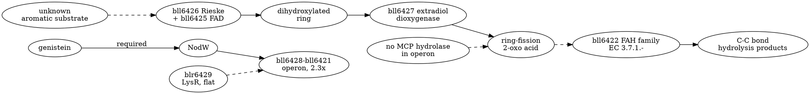

What the structure supports is an active site built for metal-assisted attack of a water molecule, activated by a Glu-His pair, on a carbonyl carbon adjacent to the scissile C-C bond. The metal site is preformed in the model: the four carboxylates already point into a coordination shell, at pLDDT 98.8-98.9, and they accept an experimentally measured Mg2+ from one template and an experimentally measured Ca2+ from two others. Which glutamate completes the dyad is open, because in LRA6 the dyad forms only when a lid-like region closes on the ligand, the lid glutamate Glu81 is Leu94 in bll6422, and the human FAH dyad glutamate maps onto the conserved Glu140.

What the structure does not support is a substrate. Against human FAH the three positions that read the fumarylacetoacetate moiety are all changed and Arg142 becomes a lysine. Against LRA6 the product-carboxylate Arg154 and Lys168 are present (Arg175, Lys192) while Gln157 and Lys158 become Gly178 and Ala179. Arg93 at the LRA6 position-84 switch assigns a subfamily, the fumarylpyruvate hydrolases, and not a compound. The locus contradicts the obvious reading of that assignment, because fumarylpyruvate comes from gentisate ring cleavage and no enzyme in the operon performs it.

What the context adds is a pathway position: bll6422 acts late, downstream of a verified extradiol dioxygenase, on a linearised ring-fission product, by analogy with FdeI. What the context does not add is the identity of the ring that was cleaved. The operon is induced by genistein, a 5-hydroxyisoflavone, while the orthologous operon is genetically defined for naringenin, a flavanone. An operon's inducer and its enzymes' substrates are not required to be the same molecule.

### Answers to the five sub-questions

**(a) Family, fold, closest characterised enzyme, catalytic residues.** FAH superfamily (PF18288 residues 1-78 plus PF01557 residues 82-322, SSF56529, Gene3D 3.90.850.10, COG0179), a mixed beta-sandwich roll with one divalent-metal site. Closest structural neighbour: 3LZK, 0.94 Å over 297 residues, no assayed reaction. Closest enzyme with both a structure and a measured reaction: LRA6 (Q1NEI7, EC 3.7.1.26, PDB 8GSR), which hydrolyses L-DKDR to pyruvate and L-lactate. Present in bll6422: His91, Glu140, Glu142, Asp171, Asp84, Arg175, Lys192, Thr264. Absent relative to LRA6: the lid Glu81 (Leu94), Gln157 (Gly178), Lys158 (Ala179). Absent relative to human FAH: Arg142 (Lys101), Tyr128, Gln240, Tyr244 (Ser86, Gly178, Glu181).

**(b) Flanking genes, spacings, orientation, operon status, pathway match.** bll6428 through bll6421 on the minus strand, gaps 4, -4, 25, 79, 39, -17 and 25 bp, two overlapping stop/start pairs, with the divergent LysR blr6429 117 bp upstream of bll6428. An operon by any spacing criterion. Content: MFS transporter (bll6424), Rieske 2Fe-2S protein (bll6426), FAD-dependent oxidoreductase (bll6425), VOC-family extradiol dioxygenase (bll6427, verified by alignment), alpha/beta hydrolase (bll6428, not an MCP hydrolase), cupin (bll6423, not a quercetinase and not a gentisate dioxygenase), FAH-superfamily protein (bll6422) and NAD-dependent epimerase/dehydratase (bll6421). The match is to a specific named operon, the *H. seropedicae fde* operon at 45.9-81.2 % identity in conserved order, and not to a family-level resemblance to a generic aromatic pathway. Taken on its own chemistry, the operon is an aromatic ring-fission module of unusual composition.

**(c) Pathway completeness elsewhere in the genome.** Complete at gene-content level. Ten of eleven components lie in the locus; the *fdeG* cyclase counterpart BJA_RS30665 lies 396 kb away.

**(d) Transcriptomic evidence for flavonoid induction.** Yes for genistein, at operon level, NodW-dependent, about 2.3-fold, n = 3, no per-gene FDR significance, from one series family (GSE8570/8571/8572, SuperSeries GSE8580). The pterocarpan series GSE26380 is null and uninformative. No public dataset tests naringenin on USDA110.

**(e) Predicted reaction and substrate class, with confidence.** Reaction: metal-dependent hydrolysis of a carbon-carbon bond in a ketonic substrate, EC 3.7.1.-, with Glu140 and His91 activating the attacking water and the divalent metal polarising the carbonyl. Confidence moderate to high, resting on two independent superpositions with bound metals, on a branch-level alignment separation at p = 1.08e-07, and on the ring-fission content of the operon. Substrate class: an acylpyruvate or 2-oxo acid from extradiol cleavage of a flavonoid-derived aromatic ring. Confidence low. Said plainly: **family assignment and genomic context cannot settle the substrate.** They fix the bond chemistry the active site is built for and the pathway position the gene order predicts, and that is the limit of the evidence.

## GO curation implications

All term names were verified against EBI QuickGO. Full table: `provenance/table_go_decisions.csv`. Every item below is a lead requiring curator verification.

| GO ID | Term | Aspect | Lead | Basis |
|---|---|---|---|---|
| GO:0046872 | metal ion binding | MF | recommend, high confidence | Preformed Asp84 / Glu140 / Glu142 / Asp171 site at pLDDT about 98.8. The experimental Mg2+ of 8GSR lands 2.06-3.39 Å away; the Ca2+ of 1HYO and 3LZK lands on the same four positions. ISS. |
| GO:0016787 | hydrolase activity | MF | recommend, high confidence | Catalytic histidine conserved against both templates (His133 to His91 at 0.93 Å; His78 to His91 at 1.35 Å) with the metal site intact in both frames. ISS. |
| GO:0016823 | hydrolase activity, acting on carbon-carbon bonds, in ketonic substances | MF | the specific molecular function lead, medium confidence | ISS from LRA6 (Q1NEI7, EC 3.7.1.26, PDB 8GSR), the closest characterised relative, with His78, Glu119, Glu121, Asp150, Arg154, Lys168 and Thr238 all conserved. Must carry a note that no assay exists for bll6422 or any homolog above 30 % identity. |
| GO:1905395 | response to flavonoid | BP | lead, medium confidence | IEP from GSE8571/GSE8580: operon mean log2FC +1.213, genomic-null P = 0.0072, NodW-dependent. The curator decides whether operon-level induction without per-gene FDR meets the local standard. |
| GO:0009712 | catechol-containing compound metabolic process | BP | lead, medium confidence | Operon context, now supported by alignment: bll6427 scores SW 205 at 34.0 % over 153 columns against 3-methylcatechol 2,3-dioxygenase and aligns over 290-292 columns to BphC enzymes. |
| GO:0046275 | flavonoid catabolic process | BP | lead only, do not assert | Rests on synteny with the *fde* operon plus genistein induction. No flavonoid has been shown to be consumed by USDA110 and no enzyme in the operon is flavonoid-specific by sequence. |
| GO:0005509 | calcium ion binding | MF | optional, metal identity unverified | Ca2+ in 1HYO and 3LZK, Mg2+ in 8GSR at the equivalent site. No metal measured for bll6422, so the generic term is safer. |
| GO:0004334 | fumarylacetoacetase activity | MF | reject, high confidence | 26.6 % identity to human FAH over 188 columns, the 120-residue N-terminal FAH domain is absent, and Tyr128, Gln240 and Tyr244 are replaced by Ser86, Gly178 and Glu181. |
| GO:0008684 | 2-oxopent-4-enoate hydratase activity | MF | do not propagate | The 25 reviewed EC 4.2.1.80 entries score SW 31-49 against bll6422 while LRA6 scores 151; the hydrolase branch beats the hydratase branch family-wide (median 84 against 41, p = 1.08e-07, effect size 0.95); the hydratases average 267 aa against 344 aa here; and the operon has no MCP hydrolase to supply 2-oxopent-4-enoate. The two USDA110 paralogs carrying this annotation are 259 and 268 aa and 21-30 % identical to bll6422. |
| GO:0034545, GO:0102054 | fumarylpyruvate hydrolase activity, maleylpyruvate hydrolase activity | MF | do not assert, record the subfamily instead | Arg93 matches the Arg86 of the FPH subfamily, but no gentisate-type ring cleavage is encoded in the operon (bll6423 scores at most SW 46 over 95 columns against 37 reviewed ring-cleavage enzymes of 348-434 aa). |
| (no GO term exists) | the LRA6 reaction, EC 3.7.1.26 | MF | do not propagate | QuickGO returns no term for 2,4-didehydro-3-deoxy-L-rhamnonate hydrolase activity. In any case the template is at 29.1 % identity, Arg93 is not the LRA6-type leucine, and no other gene of the nonphosphorylated L-rhamnose pathway sits in this locus. |
| GO:0009813 | flavonoid biosynthetic process | BP | reject | The locus content is transport, ring cleavage and hydrolysis. |
| GO:0005515 | protein binding | MF | avoid | Uninformative here. The structural evidence supports a catalytic function term. |

## Mechanistic scope

The immediate molecular function under test is a single enzymatic step: hydrolytic cleavage of a carbon-carbon bond in a metal-coordinated ketonic substrate, performed by one 344-residue cytoplasmic protein. Everything else in the evidence base is one or more steps removed from that.

Direct gene-product evidence: the fold, the metal site, the catalytic histidine and the pocket residues, all from sequence and from a model superposed on three experimental structures. There is no assay, no purified protein, no mutant of bll6422.

Pathway-level inference: the operon's gene order predicts that bll6422 acts late, on a product of extradiol ring fission made by bll6427. That is inference from gene neighbourhood, supported by the orthologous *fde* operon, and it does not establish that bll6422 touches any particular metabolite.

Transcriptional response: genistein induction is a measurement of mRNA abundance in free-living cells, under NodW control. It locates the operon in a flavonoid-responsive regulatory layer. It is not evidence of catalysis and not evidence that any flavonoid is consumed.

Organism-level phenotype: none exists for bll6422. The naringenin degradation phenotypes come from *H. seropedicae* mutants in *fdeA* and *fdeR* ([PMID: 23125118](https://pubmed.ncbi.nlm.nih.gov/23125118/)), a different organism with a different plant association, and *fdeI* itself has not been assayed in any organism.

## Conflicts and alternatives

<i class="fa-scale-balanced"></i> **Inducer against substrate.** Genistein induces the operon in USDA110; naringenin is the substrate of the orthologous operon in *H. seropedicae*. These are different compounds, and the naringenin-specific route in the seed hypothesis is not what the USDA110 data show. Competing readings: USDA110 degrades isoflavones; it degrades flavanones and merely senses isoflavones; the operon is a broad aromatic catabolic module under flavonoid control.

<i class="fa-scale-balanced"></i> **Hydrolase against hydratase.** Two arguments favour the hydratase reading. RefSeq annotates two other USDA110 FAH paralogs as hydratases, and pathway logic says that in a canonical meta-cleavage operon the FAH member downstream of an extradiol dioxygenase is a 2-oxopent-4-enoate hydratase, with bll6427 now verified as a genuine extradiol dioxygenase. Three computed results weigh against it. The canonical route needs a BphD/MhpC-type MCP hydrolase to make the hydratase substrate, and the operon has none (bll6428 scores at most SW 53 over 75 columns against 35 reviewed enzymes of that class). The reviewed EC 4.2.1.80 enzymes score SW 31-49 against bll6422 while LRA6 scores 151, and the branch difference is significant. The hydratases average 267 aa against 344 aa. The reading that fits is that bll6422 performs the hydrolytic C-C cleavage the missing MCP hydrolase would otherwise perform, or an equivalent step on a ring-fission product. No assay has tested either.

<i class="fa-circle-question"></i> **Operon integrity.** The *fdeG* cyclase counterpart is 396 kb from the operon. Either USDA110 recruits the distant cyclase, or it runs a shortened route, or the operon is retained mainly for its regulatory connection. The pterocarpan null does not discriminate.

<i class="fa-circle-question"></i> **Regulatory assignment.** The operon requires NodW, a two-component response regulator of the *nod* regulon, and it has its own divergent LysR gene, which is itself unchanged in every arm. Either both act at the promoter or NodW acts indirectly. The microarray arms cannot separate these because each mutant lacks an uninduced control, so genotype and treatment are partly confounded.

<i class="fa-triangle-exclamation"></i> **Database carry-over.** The hydratase annotations on the USDA110 paralogs are themselves computational. Any family-level propagation that reaches bll6422 through them is circular, which is why the direct comparison against reviewed characterised entries is the argument to record.

## Limitations and knowledge gaps

<i class="fa-triangle-exclamation"></i> The local `*-bioinformatics` analyses were withheld by design, so nothing from them is used here. All structural conclusions come from an AlphaFold model (mean pLDDT 94.7, median 98.2, 92.2 % of residues above 90, only the C-terminal tail 328-344 below 70), not an experimental structure of bll6422. Alignments were computed with a Smith-Waterman implementation written for this work (BLOSUM62, gap open 11, gap extend 1) rather than with BLAST; two NCBI BLAST URL-API jobs submitted as confirmation were still queued when the analysis closed and their results are not reported. The superpositions use an iterative Kabsch procedure seeded on the metal triad; `phenix.superpose_pdbs` on the same pair produced a degenerate alignment (33 atoms in the least-squares fit) and was discarded rather than reported. The MhpD comparison failed to converge and no conclusion is drawn from it. Microarray reanalysis used a sliding contiguous-window genomic null because per-probe BH FDR is uninformative at n = 3; this is a legitimate operon-level test and not a substitute for a per-gene result. One interim figure quoted during the investigation, that the characterised hydratases align over only 17-36 columns at SW 32-40, described the shortest alignments in that set and not all of them; the corrected range for the 25 reviewed EC 4.2.1.80 entries is SW 31-49 over 17-209 columns, and the conclusion rests on the branch-level comparison.

Gaps that matter for curation, with what was checked and what would close them:

- **No enzyme assay exists for bll6422, for FdeI, or for any protein within 60 % identity of either.** Checked: all 99 reviewed PF01557 entries, of which 24 carry experimentally evidenced activity; the closest is at 29.1 %. This is why the reaction prediction is ISS and not IDA, and why GO:0016823 is a lead and not an assertion. Purified-protein enzymology closes it.
- **No metal has been identified experimentally in bll6422 or FdeI.** Checked: LRA6 uses Mg2+, human FAH and 3LZK show Ca2+ at the equivalent site. Metal analysis of purified protein closes it, and it decides between GO:0046872 and GO:0005509.
- **Which glutamate completes the catalytic dyad is unresolved.** Checked: the LRA6 lid glutamate Glu81 is Leu94 in bll6422, while the human FAH dyad glutamate maps onto the conserved Glu140, and [PMID: 36563174](https://pubmed.ncbi.nlm.nih.gov/36563174/) reports that the LRA6 dyad only assembles when the lid closes on ligand. An apo model cannot distinguish these. A liganded structure or E140A/H91A mutagenesis closes it.
- **No metabolite measurement shows USDA110 consuming genistein, naringenin or any flavonoid.** Checked: GEO holds no such dataset for this organism. This is the single largest gap for GO:0046275. Growth and metabolite tracking closes it.
- **The induction result has not been independently replicated.** Checked: GSE8580 is a SuperSeries of GSE8570/8571/8572 from one laboratory, so the mutant arms are not independent arrays; GSE26380 is null with a failed positive control. A new qRT-PCR or RNA-seq induction experiment closes it.
- **The substrate of bll6427 is unknown.** Checked: bll6427 is a verified class-II extradiol dioxygenase by alignment, but its dihydroxylated substrate is not identified, and that substrate is what would name the product bll6422 receives. A substrate screen of purified bll6427 closes it.
- **Why the operon lacks an MCP hydrolase is unresolved.** Checked: bll6428 scores at most SW 53 over 75 columns against 35 reviewed enzymes of that class. Either bll6428 performs that chemistry through a different fold or the route skips the step. Assaying bll6428 on a ring-fission product closes it and sets the pathway position of bll6422.
- **Whether BJA_RS30665 is co-regulated with the operon is untested.** Checked: it is not on the genistein-induced list. It matters for any claim that USDA110 carries a complete pathway.
- **The substrate-binding subsite of bll6422 has no template.** Checked: the residues that differ from human FAH do not match LRA6 either, and the two templates disagree about the pocket. Only an experimental structure with a ligand closes it.

## Discriminating tests

<i class="fa-flask"></i> Express and purify bll6422 and screen 2-oxo-acid and beta-diketo ring-fission products for C-C hydrolase activity with and without Ca2+, Mg2+ and Mn2+. Include the acylpyruvates on which LRA6 shows activity (acetylpyruvate and the hydroxylpyruvate series of [PMID: 36563174](https://pubmed.ncbi.nlm.nih.gov/36563174/)) and fumarylpyruvate and maleylpyruvate, since Arg93 sits at the FPH position. A positive result with a ketonic substrate settles EC 3.7.1.- against EC 4.2.1.80.

<i class="fa-flask"></i> Mutate His91 and Glu140 to alanine, and Arg93 to leucine. The first two should abolish activity while leaving the metal site assembled if the predicted dyad is catalytic; the third tests the specificity switch directly, since the equivalent exchange distinguishes LRA6 from the fumarylpyruvate hydrolases.

<i class="fa-flask"></i> Delete bll6421-bll6428 in USDA110 and test growth on genistein, daidzein and naringenin as sole carbon source, with metabolite tracking of the parent compound. This separates "senses flavonoids" from "degrades flavonoids" and is the decisive test for GO:0046275.

<i class="fa-flask"></i> Complement an *H. seropedicae fdeI* mutant with bll6422. Restored naringenin degradation shows functional equivalence; failure shows the two enzymes have diverged in substrate, which the differing pocket residues predict.

<i class="fa-vial"></i> Assay purified bll6427 on candidate dihydroxylated aromatics and identify the ring-fission product, then offer that product to bll6422 and to bll6428. This is the most direct route to naming the substrate and would also settle why the operon has no MCP hydrolase.

<i class="fa-dna"></i> qRT-PCR or RNA-seq of the operon and of BJA_RS30665 under naringenin, genistein and daidzein, in wild type and in a blr6429 deletion. This assigns the promoter to the LysR regulator or to NodW and tests whether the displaced cyclase is co-regulated.

<i class="fa-microscope"></i> Solve the structure of bll6422 with a metal and, if possible, a product analogue. This is the only way to define the substrate subsite, which has no usable template, and to resolve which glutamate completes the dyad.

## Curation leads

Each item below is a lead requiring curator verification.

<i class="fa-arrow-right"></i> Record bll6422 as an FAH-superfamily protein with a conserved catalytic His91, a Glu140-His91 pair matching the dyad of both templates, and a complete Asp84 / Glu140 / Glu142 / Asp171 metal site that accepts the experimentally observed Mg2+ of PDB 8GSR at 2.06-3.39 Å, predicted to be a metal-dependent C-C bond hydrolase acting late in an aromatic ring-fission route.

<i class="fa-arrow-right"></i> Record the closest characterised relative explicitly, because it decides the branch: LRA6 (Q1NEI7, EC 3.7.1.26, PDB 8GSR), top of all 99 reviewed PF01557 entries at 29.1 % identity over 165 columns, 232 CA at 1.65 Å. Record Arg93 at the LRA6 position-84 specificity switch, with the note that the operon encodes no gentisate-type ring cleavage to supply the matching substrate.

<i class="fa-arrow-right"></i> Record the operon membership: bll6421-bll6428, minus strand, 7,069,951-7,077,430, with the divergent LysR blr6429, syntenic with *H. seropedicae fdeA-fdeJ*, bll6422 corresponding to *fdeI* at 61.7 % identity.

<i class="fa-arrow-right"></i> Flag that the *fdeG* counterpart BJA_RS30665 lies 396 kb outside the locus, because this affects any claim that USDA110 carries a complete pathway.

<i class="fa-arrow-right"></i> Flag the genistein induction with its real strength: operon-level, about 2.3-fold, n = 3, NodW-dependent, no per-gene FDR significance, one laboratory, no naringenin dataset.

<i class="fa-arrow-right"></i> Add explicit negative notes against GO:0004334 fumarylacetoacetase activity and GO:0008684 2-oxopent-4-enoate hydratase activity, with the reasons, so that automatic family propagation does not reintroduce them.

<i class="fa-arrow-right"></i> Keep flavonoid catabolism as a hypothesis in the review and not as an annotation. The sentence that fits the evidence: bll6422 is the FAH-superfamily component of a genistein-inducible, NodW-dependent aromatic ring-fission operon that is syntenic with a characterised naringenin degradation operon, and its substrate is unknown.

### Candidate references with exact snippets to verify

| PMID | Snippet to verify | Use |
|---|---|---|
| [27059806](https://pubmed.ncbi.nlm.nih.gov/27059806/) | "The Tn5 transposon was found to be inserted in the fdeE gene (Hsero_1007), which encodes a monooxygenase. Two other mutant strains in fdeC (Hsero_1005) and fdeG (Hsero_1009) genes coding for a dioxygenase and a putative cyclase, respectively, were obtained by site-directed mutagenesis and then characterized." | Fixes the *fde* letter to Hsero locus-tag mapping used to name the orthologs, and identifies Hsero_1009 as the cyclase with no counterpart in the USDA110 locus. |
| [27878922](https://pubmed.ncbi.nlm.nih.gov/27878922/) | "This nodD-like gene, named fdeR, is divergently transcribed from an operon encoding enzymes involved in flavonoid degradation (fde operon)." | Establishes the divergent regulator-operon architecture reproduced by blr6429 relative to bll6428-bll6421. |
| [23125118](https://pubmed.ncbi.nlm.nih.gov/23125118/) | "We show that this operon is involved in naringenin degradation and that its expression is induced by naringenin and chrysin, two closely related flavonoids. Mutation of fdeA, the first gene of the operon, and fdeR, its transcriptional activator, abolished the ability of H. seropedicae to degrade naringenin." | The mutant-phenotype basis for calling the *fde* operon a naringenin degradation operon, and the reason transfer to USDA110 is inference. |
| [10508789](https://pubmed.ncbi.nlm.nih.gov/10508789/) | "This structure reveals fumarate binding near the entrance to the active site and acetoacetate binding to an octahedrally coordinated calcium ion located in close proximity to a Glu-His dyad." | Defines the Glu-His dyad beside an octahedral calcium as the catalytic centre of human FAH, the positions found conserved as Glu140-His91 in bll6422. |
| [10508789](https://pubmed.ncbi.nlm.nih.gov/10508789/) | "A mechanism involving a Glu-His-water catalytic triad is suggested based on structural observations" | States that the C-C hydrolase mechanism depends on the Glu-His-water triad, so conservation of both residues is the relevant test. |
| [36563174](https://pubmed.ncbi.nlm.nih.gov/36563174/) | "a magnesium ion was coordinated with three acidic residues in the catalytic center" | The Mg2+ site is an experimental observation in 8GSR, so transferring it onto the model tests the bll6422 metal site against a measured position. |
| [36563174](https://pubmed.ncbi.nlm.nih.gov/36563174/) | "amino acid residues at equivalent position to 84 in LRA6 are related to different substrate specificities between them (Leu84 and Arg86 in LRA6 and FPH, respectively)" | Identifies position 84 as the experimentally supported specificity switch, the basis for reading Arg93 in bll6422 as FPH-type. |
| [36563174](https://pubmed.ncbi.nlm.nih.gov/36563174/) | "Structural transition induced upon the binding of pyruvate was observed within a lid-like region, by which a glutamate-histidine dyad that is critical for catalysis was arranged sufficiently close to the ligand" | Explains why the lid glutamate position is unreliable in an apo model and why His91 plus Glu140 is the defensible part of the dyad claim. |
| [36563174](https://pubmed.ncbi.nlm.nih.gov/36563174/) | "Most of the members of the FAH superfamily are involved in the microbial degradation of aromatic substances and share low sequence similarities with LRA6, by which the underlying catalytic mechanism remains unknown at the atomic level." | States that LRA6 is a distant relative of the aromatic-degradation members, which is why 29.1 % is the best characterised match and why substrate cannot be read off family membership. |

### Suggested questions for the curator

<i class="fa-circle-question"></i> Does operon-level induction (empirical P = 0.0072) without per-gene FDR significance at n = 3 meet the local standard for an IEP annotation of GO:1905395?

<i class="fa-circle-question"></i> Is GO:0016823 acceptable as an ISS lead from a template at 29.1 % identity when the catalytic and metal residues are conserved and the pocket residues are not?

<i class="fa-circle-question"></i> Should the review carry an explicit "do not propagate" note for GO:0008684 that cites the branch comparison, so that future automated runs do not reintroduce it from the two shorter USDA110 paralogs?

## Evidence base

| Reference | Type | How it is used |
|---|---|---|
| [PMID: 10508789](https://pubmed.ncbi.nlm.nih.gov/10508789/), *Crystal structure and mechanism of a carbon-carbon bond hydrolase* | primary, crystallography | Supplies the Glu-His dyad and octahedral Ca2+ definition of FAH-type C-C hydrolase chemistry, and the Glu-His-water triad mechanism. Supports the reaction prediction once the dyad is found conserved as Glu140-His91. |
| [PMID: 36563174](https://pubmed.ncbi.nlm.nih.gov/36563174/), *Crystal Structure of l-2,4-Diketo-3-deoxyrhamnonate Hydrolase Involved in the Nonphosphorylated l-Rhamnose Pathway from Bacteria* | primary, crystallography and biochemistry | Supplies the 8GSR template with Mg2+ and pyruvate, the three-acidic-residue metal site, the lid-dependent dyad, and the position-84 specificity switch between LRA6 and the FPH subfamily. Supports the metal site and the hydrolase assignment, and qualifies the dyad and substrate claims. |
| [PMID: 23125118](https://pubmed.ncbi.nlm.nih.gov/23125118/), *Naringenin degradation by the endophytic diazotroph Herbaspirillum seropedicae SmR1* | primary, mutant phenotype | The genetic basis for the *fde* operon being a naringenin degradation operon, through loss of degradation in *fdeA* and *fdeR* mutants. Supports the synteny-based context and marks the limit: the phenotype is in a different organism. |
| [PMID: 27059806](https://pubmed.ncbi.nlm.nih.gov/27059806/), *Genetic and functional characterization of a novel meta-pathway for degradation of naringenin in Herbaspirillum seropedicae SmR1* | primary, mutant phenotype | Fixes the *fde* gene letters to Hsero locus tags used throughout the ortholog mapping, and names Hsero_1009 as the cyclase that is displaced in USDA110. |
| [PMID: 27878922](https://pubmed.ncbi.nlm.nih.gov/27878922/), *A NodD-like protein activates transcription of genes involved with naringenin degradation in a flavonoid-dependent manner in Herbaspirillum seropedicae* | primary | Establishes the divergent FdeR-operon architecture that blr6429 reproduces, which is part of the synteny argument. |
| [PMID: 26052319](https://pubmed.ncbi.nlm.nih.gov/26052319/), *Genome wide transcriptional profiling of Herbaspirillum seropedicae SmR1 grown in the presence of naringenin* | primary, transcriptomic | Orientation for how a naringenin response looks in the organism where the pathway is defined, with genes of aromatic metabolism and multidrug efflux activated. It is a different organism, so it does not transfer to USDA110. |
| [PMID: 24188962](https://pubmed.ncbi.nlm.nih.gov/24188962/), *Novel biosensors based on flavonoid-responsive transcriptional regulators introduced into Escherichia coli* | primary | Confirms that FdeR responds specifically to naringenin, which is the comparison point for the genistein response in USDA110 and part of the inducer-against-substrate conflict. |
| [PMID: 22389485](https://pubmed.ncbi.nlm.nih.gov/22389485/), *Characterization of the flavonoid-responsive regulator FrrA and its binding sites* | primary | Documents that about 100 USDA110 genes are genistein-induced and that more than one regulator type responds to genistein and daidzein, which is context for the NodW dependence of this operon. |
| [PMID: 24225224](https://pubmed.ncbi.nlm.nih.gov/24225224/), *Involvement of a novel genistein-inducible multidrug efflux pump of Bradyrhizobium japonicum early in the interaction with Glycine max* | primary, transcriptomic and mutant | A second genistein-responsive USDA110 locus outside the symbiosis island with induction kinetics unlike the *nod* genes. Orientation for reading an operon-level genistein response as a regulated event. |
| [PMID: 22307307](https://pubmed.ncbi.nlm.nih.gov/22307307/), *Effect of soybean coumestrol on Bradyrhizobium japonicum nodulation ability, biofilm formation, and transcriptional profile* | primary, transcriptomic | The source series for the pterocarpan-style phenolic comparison and an example of a flavonoid that induces no common *nod* gene response, which matches the failed positive control in GSE26380. |
| GEO GSE8571, GSE8580, GSE26380 | database, primary data reanalysed here | All induction statistics in this report come from reanalysis of these series, not from the published summaries. |
| UniProt, Pfam, SUPFAM, Gene3D, eggNOG, RCSB, AlphaFold DB, EBI QuickGO | database | Domain assignment, reviewed PF01557 entry set with EC and evidence codes, structure retrieval, model retrieval, and verification of every GO identifier used. Treated as orientation and as the source of computed inputs, not as evidence of function. |

Resources that could not be used: two NCBI BLAST URL-API jobs (RIDs GE4WF45Y016 and GE5HVDKX016) were still queued when the analysis closed, so no BLAST result is reported. `phenix.superpose_pdbs` returned a degenerate 33-atom fit on the Q89GC3/1HYO pair and was discarded. Biopython is unavailable in the executor, so all alignments use a Smith-Waterman implementation written for this work.

## Provenance

Tables: `provenance/table_evidence_matrix.csv`, `table_go_decisions.csv`, `table_comparison_operon.csv`, `table_reviewed_FAH_vs_bll6422.csv`, `sw_PF01557_vs_Q89GC3.csv`, `table_PF01557_branch_summary.csv`, `table_PF01557_branch_summary_rows.csv`, `table_8GSR_active_site_transfer.csv`, `table_bll6423_vs_ring_dioxygenases.csv`, `table_operon_neighbour_assignments.csv`, `table_bll6428_vs_MCP_hydrolases.csv`, `GSE26380_operon.csv`, `swissprot_PF01557.tsv`.

Structures and sequences: `AF-Q89GC3.pdb`, `8GSR.pdb`, `3LZK.pdb`, `1HYO.pdb`, `1SV6.pdb`, `USDA110_proteome.faa`.

Figures: every figure in this report was produced by the executed code that computed the numbers beside it. The synteny figure went through three earlier drafts, kept for provenance.

{{figure:plot_2.png|caption=First draft of the synteny diagram of the USDA110 bll6421-bll6430 locus against the H. seropedicae fde operon, with pairwise Smith-Waterman identities. Kept as provenance for the figure that became plot_5.}}

{{figure:plot_3.png|caption=Second draft of the same synteny figure, with the layout corrected but the ortholog link labels still colliding.}}

{{figure:plot_4.png|caption=Third draft of the synteny figure, with fixed axis limits. The final version, plot_5, staggers the labels along each crossing link.}}

{{figure:plot_8.png|caption=First version of the NodW dependence analysis, asking whether genistein induction of the operon requires the NodW/NwsA two-component systems. The final version is plot_10.}}


## Artifacts

- [OpenScientist final report](openscientist_artifacts/final_report.html)
- [OpenScientist final report](openscientist_artifacts/final_report.pdf)
- [OpenScientist provenance](openscientist_artifacts/provenance.json)
- [OpenScientist GSE26380 operon](openscientist_artifacts/provenance_GSE26380_operon.csv)
- [OpenScientist PF01557 prefilter](openscientist_artifacts/provenance_PF01557_prefilter.json)
- [OpenScientist operon accessions](openscientist_artifacts/provenance_operon_accessions.json)
- [OpenScientist operon query seqs](openscientist_artifacts/provenance_operon_query_seqs.json)
- [OpenScientist plot 1](openscientist_artifacts/provenance_plot_1.json)
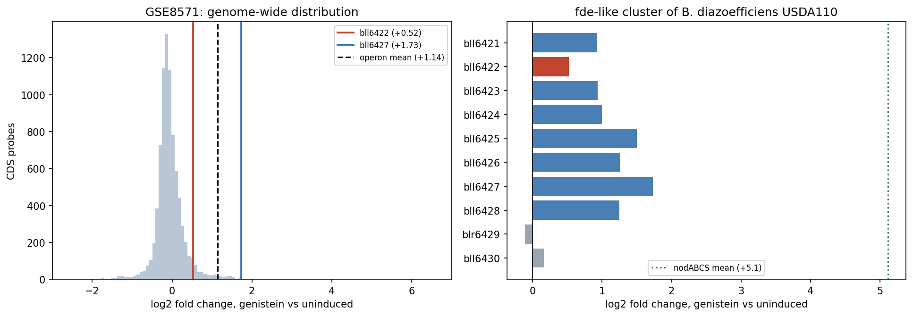
- [OpenScientist plot 10](openscientist_artifacts/provenance_plot_10.json)
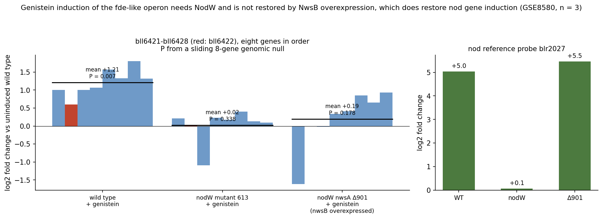
- [OpenScientist plot 11](openscientist_artifacts/provenance_plot_11.json)
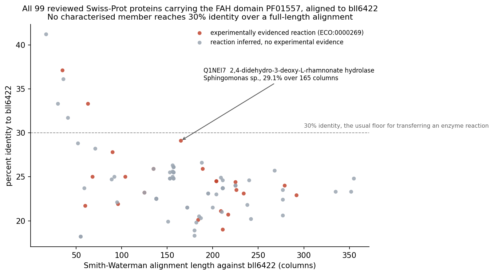
- [OpenScientist plot 12](openscientist_artifacts/provenance_plot_12.json)
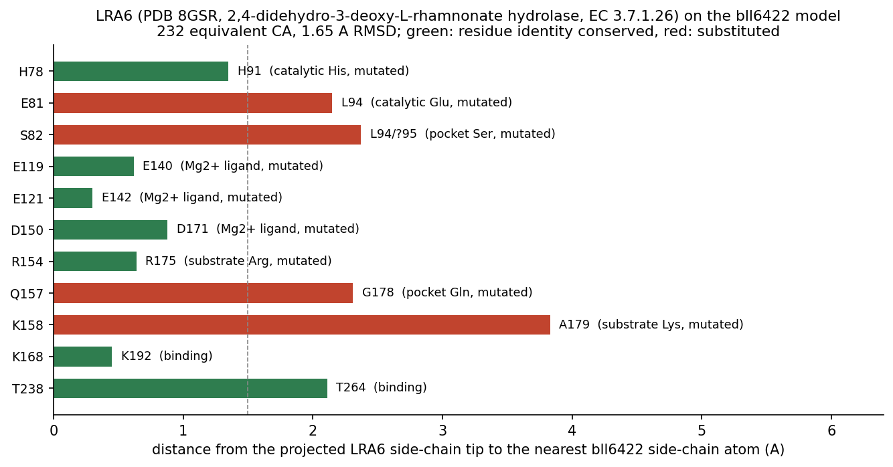
- [OpenScientist plot 13](openscientist_artifacts/provenance_plot_13.json)
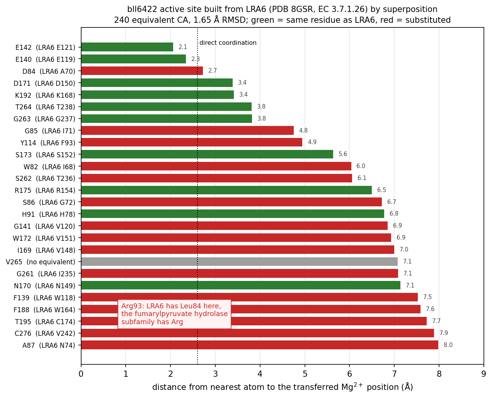
- [OpenScientist plot 14](openscientist_artifacts/provenance_plot_14.json)
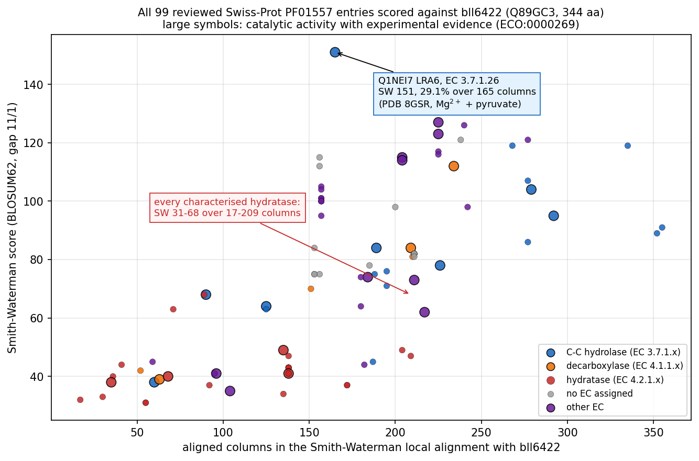
- [OpenScientist plot 2](openscientist_artifacts/provenance_plot_2.json)
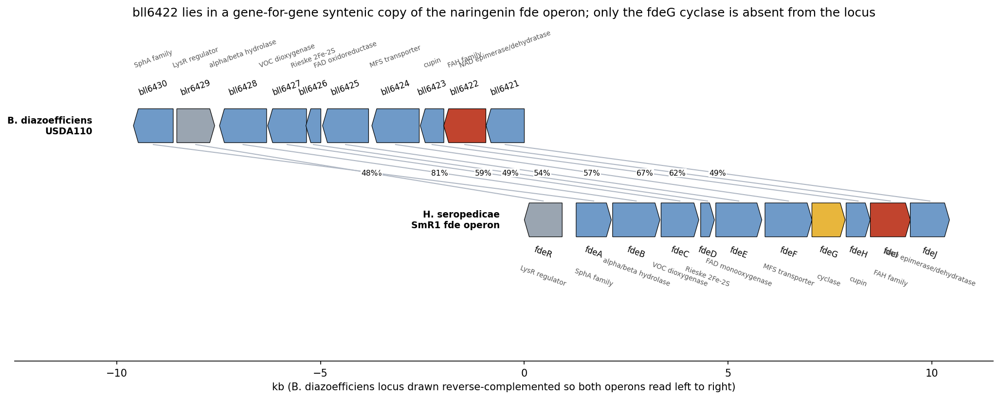
- [OpenScientist plot 3](openscientist_artifacts/provenance_plot_3.json)
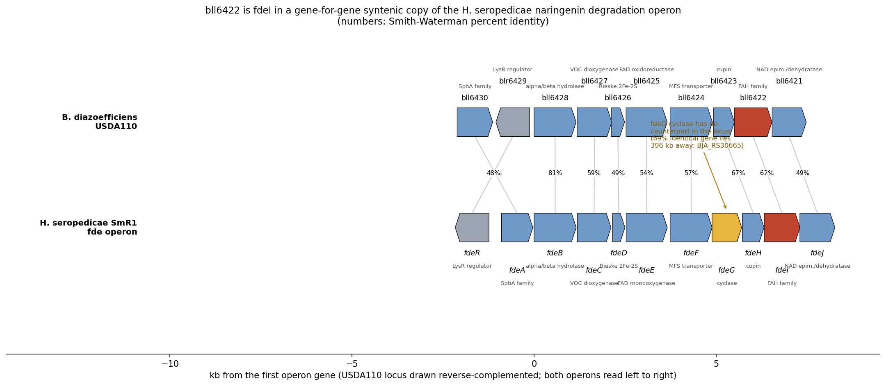
- [OpenScientist plot 4](openscientist_artifacts/provenance_plot_4.json)
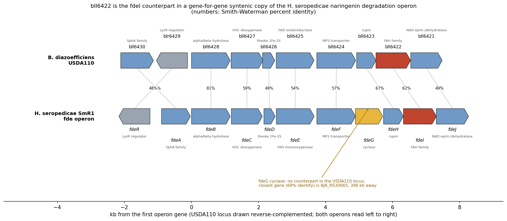
- [OpenScientist plot 5](openscientist_artifacts/provenance_plot_5.json)
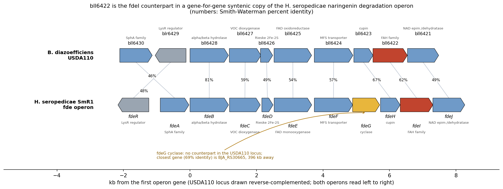
- [OpenScientist plot 6](openscientist_artifacts/provenance_plot_6.json)
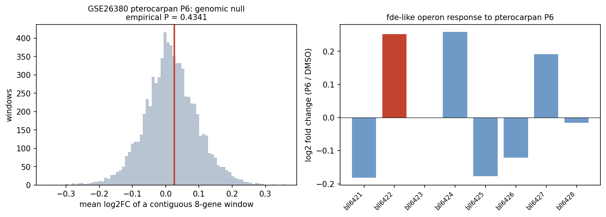
- [OpenScientist plot 7](openscientist_artifacts/provenance_plot_7.json)
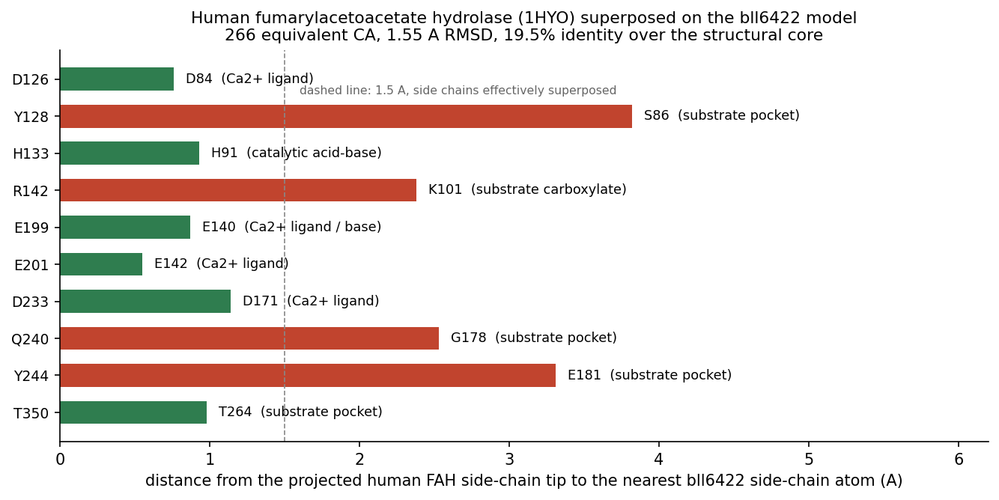
- [OpenScientist plot 8](openscientist_artifacts/provenance_plot_8.json)
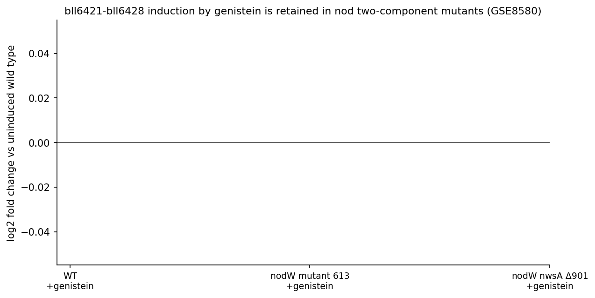
- [OpenScientist plot 9](openscientist_artifacts/provenance_plot_9.json)
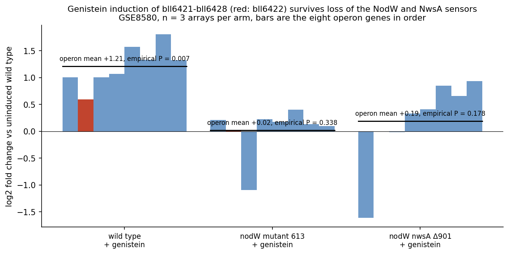
- [OpenScientist sw PF01557 vs Q89GC3](openscientist_artifacts/provenance_sw_PF01557_vs_Q89GC3.csv)
- [OpenScientist sw chunk1](openscientist_artifacts/provenance_sw_chunk1.csv)
- [OpenScientist sw chunk2](openscientist_artifacts/provenance_sw_chunk2.csv)
- [OpenScientist swissprot PF01557](openscientist_artifacts/provenance_swissprot_PF01557.tsv)
- [OpenScientist table 8GSR active site transfer](openscientist_artifacts/provenance_table_8GSR_active_site_transfer.csv)
- [OpenScientist table PF01557 branch summary](openscientist_artifacts/provenance_table_PF01557_branch_summary.csv)
- [OpenScientist table PF01557 branch summary rows](openscientist_artifacts/provenance_table_PF01557_branch_summary_rows.csv)
- [OpenScientist table bll6423 vs ring dioxygenases](openscientist_artifacts/provenance_table_bll6423_vs_ring_dioxygenases.csv)
- [OpenScientist table bll6428 vs MCP hydrolases](openscientist_artifacts/provenance_table_bll6428_vs_MCP_hydrolases.csv)
- [OpenScientist table comparison operon](openscientist_artifacts/provenance_table_comparison_operon.csv)
- [OpenScientist table evidence matrix](openscientist_artifacts/provenance_table_evidence_matrix.csv)
- [OpenScientist table go decisions](openscientist_artifacts/provenance_table_go_decisions.csv)
- [OpenScientist table operon neighbour assignments](openscientist_artifacts/provenance_table_operon_neighbour_assignments.csv)
- [OpenScientist table reviewed FAH vs bll6422](openscientist_artifacts/provenance_table_reviewed_FAH_vs_bll6422.csv)

## Reference Validation

Checked with `linkml-reference-validator` 0.3.1rc1.

| Outcome | Count |
| --- | --- |
| References checked | 15 |
| Resolved | 15 |
| Unresolved (possible confabulation) | 0 |
| Unverifiable | 0 |
| References weighed for topical relevance | 15 |
| On topic | 0 |
| Off topic | 0 |

All extracted references resolved successfully.