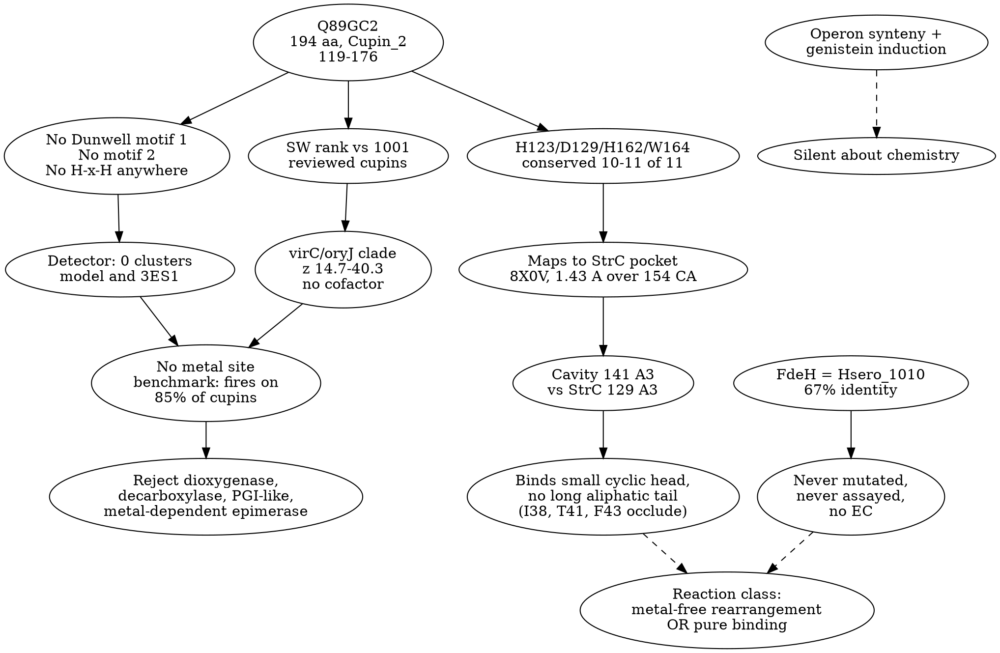
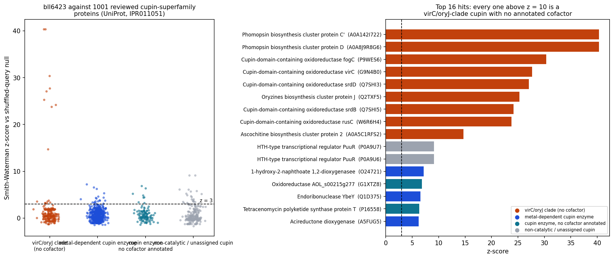
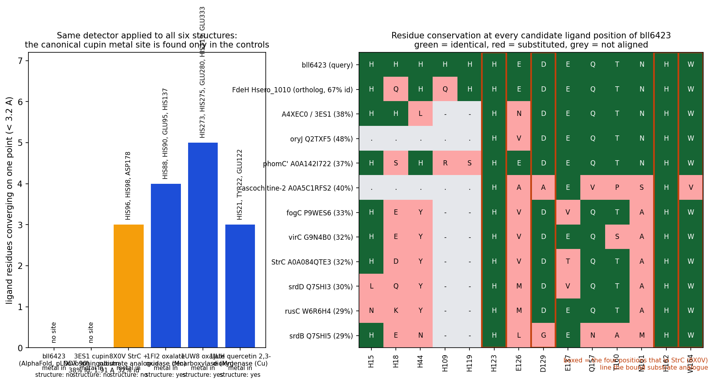
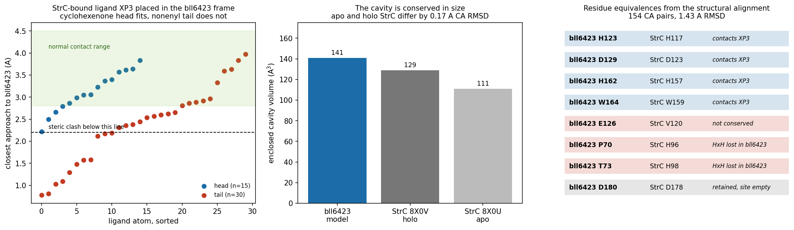
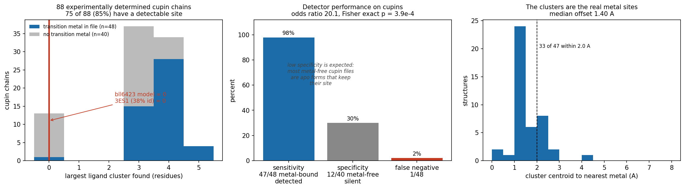

## Question

# AIGR Gene Hypothesis Deep Research

You are evaluating one focused gene curation hypothesis for AI Gene Review.
This is not a general gene overview. Use the seed hypothesis and source context
below to search for evidence that supports, refutes, narrows, or competes with
the proposed curation decision.

## Target Gene

- **Organism code:** BRADU
- **Taxon:** Bradyrhizobium diazoefficiens USDA 110 (NCBITaxon:224911)
- **Gene directory:** bll6423
- **Gene symbol:** bll6423
- **UniProt accession:** Q89GC2

## Focus

- **Focus type:** free_text
- **Hypothesis slug:** kgap-bll6423-cupin-metal-site
- **Source file:** genes/BRADU/bll6423/bll6423-ai-review.yaml
- **Source selector:** free-text

## Seed Hypothesis

Whether the molecular activity of bll6423 can be constrained beyond its cupin family label, in the way that worked for its two operon neighbours, is the question. Carry forward from the two completed runs on this operon and do not re-derive any of it: that the eight-gene operon with its divergent LysR regulator is a gene-for-gene syntenic copy of the genetically defined Herbaspirillum naringenin degradation operon, that the operon responds to the soybean isoflavone genistein in a NodW-dependent way, that no flavonoid has been shown to be consumed by this organism, that no enzyme in the operon is flavonoid-specific by sequence, that the operon lacks the meta-cleavage product hydrolase that would name the compound its neighbour receives, that bll6422 is a fumarylacetoacetate hydrolase superfamily protein placed on the carbon-carbon hydrolase side of that superfamily, and that bll6421 is an NAD-dependent epimerase/reductase-type oxidoreductase whose nucleotide-sugar subsite is absent and whose substrate could not be constrained at all. Synteny and induction are therefore established and silent about chemistry, and nothing in this run should lean on them to name a substrate. Already recorded for bll6423 itself: that it is a cupin type-2 protein related to Herbaspirillum FdeH, that cupins in the related Variovorax isoflavone pathway catalyse downstream intermediate conversion, and that it is not known to be an obligatory ring-cleavage partner. Single analysis only. Place bll6423 at residue level within the cupin superfamily, which is the point of the exercise, because the superfamily spans catalytic metalloenzymes and entirely non-catalytic members and the difference is readable from the metal site. Report whether the canonical cupin metal-binding motifs are present or absent, naming the positions in this protein and confirming each against the local UniProt record, and state how many histidines and glutamates occupy the two conserved motif regions. Say which metal the site would be expected to bind and on what basis, distinguishing the manganese, iron, copper, zinc and nickel preferences that different cupin subfamilies show, and state plainly if the site composition does not discriminate. Then say whether the residue constellation is consistent with a dioxygenase, a decarboxylase, an isomerase or an epimerase, a phosphoglucose isomerase-like activity, or with no catalytic activity at all, and rank the protein across the reviewed cupin subfamilies reporting an effect size rather than a nearest-neighbour identity alone. Separately state what reaction FdeH is assigned in the characterised Herbaspirillum pathway, whether that assignment rests on measurement or on annotation, and whether bll6423 is the syntenic equivalent of FdeH or of another cistron, since the equivalent question on the neighbour found an unassayed ortholog whose own EC number was automatic annotation. If the metal site is incomplete or degenerate, say so plainly and consider that the protein may be non-catalytic, which for a cupin is a real possibility and not a failure of the analysis. If no substrate can be constrained, report only the reaction class or the absence of one, as both neighbour analyses did. Do not infer a substrate from locus membership, and do not propose a GO annotation that names a compound the analysis cannot reach.

## Term and Decision Context

No specific term context supplied.

## Reference Context

No specific reference context supplied.

## Source Context YAML

```yaml
hypothesis: 'Whether the molecular activity of bll6423 can be constrained beyond its cupin family label,
  in the way that worked for its two operon neighbours, is the question. Carry forward from the two completed
  runs on this operon and do not re-derive any of it: that the eight-gene operon with its divergent LysR
  regulator is a gene-for-gene syntenic copy of the genetically defined Herbaspirillum naringenin degradation
  operon, that the operon responds to the soybean isoflavone genistein in a NodW-dependent way, that no
  flavonoid has been shown to be consumed by this organism, that no enzyme in the operon is flavonoid-specific
  by sequence, that the operon lacks the meta-cleavage product hydrolase that would name the compound
  its neighbour receives, that bll6422 is a fumarylacetoacetate hydrolase superfamily protein placed on
  the carbon-carbon hydrolase side of that superfamily, and that bll6421 is an NAD-dependent epimerase/reductase-type
  oxidoreductase whose nucleotide-sugar subsite is absent and whose substrate could not be constrained
  at all. Synteny and induction are therefore established and silent about chemistry, and nothing in this
  run should lean on them to name a substrate. Already recorded for bll6423 itself: that it is a cupin
  type-2 protein related to Herbaspirillum FdeH, that cupins in the related Variovorax isoflavone pathway
  catalyse downstream intermediate conversion, and that it is not known to be an obligatory ring-cleavage
  partner. Single analysis only. Place bll6423 at residue level within the cupin superfamily, which is
  the point of the exercise, because the superfamily spans catalytic metalloenzymes and entirely non-catalytic
  members and the difference is readable from the metal site. Report whether the canonical cupin metal-binding
  motifs are present or absent, naming the positions in this protein and confirming each against the local
  UniProt record, and state how many histidines and glutamates occupy the two conserved motif regions.
  Say which metal the site would be expected to bind and on what basis, distinguishing the manganese,
  iron, copper, zinc and nickel preferences that different cupin subfamilies show, and state plainly if
  the site composition does not discriminate. Then say whether the residue constellation is consistent
  with a dioxygenase, a decarboxylase, an isomerase or an epimerase, a phosphoglucose isomerase-like activity,
  or with no catalytic activity at all, and rank the protein across the reviewed cupin subfamilies reporting
  an effect size rather than a nearest-neighbour identity alone. Separately state what reaction FdeH is
  assigned in the characterised Herbaspirillum pathway, whether that assignment rests on measurement or
  on annotation, and whether bll6423 is the syntenic equivalent of FdeH or of another cistron, since the
  equivalent question on the neighbour found an unassayed ortholog whose own EC number was automatic annotation.
  If the metal site is incomplete or degenerate, say so plainly and consider that the protein may be non-catalytic,
  which for a cupin is a real possibility and not a failure of the analysis. If no substrate can be constrained,
  report only the reaction class or the absence of one, as both neighbour analyses did. Do not infer a
  substrate from locus membership, and do not propose a GO annotation that names a compound the analysis
  cannot reach.'
focus_type: free_text
context: []
reference_id: []
```

## Research Objective

Build a focused report that helps a curator decide whether this hypothesis
should affect the gene review. Address the focus type directly:

1. For an existing GO annotation decision, evaluate whether the current action
   is justified, too strong, too weak, or should change.
2. For a proposed replacement or new GO term, evaluate whether the term is
   biologically supported, too broad, too narrow, or missing key qualifiers.
3. For a computational prediction, evaluate whether the prediction is correct,
   less precise than existing knowledge, uncertain, or likely wrong because of
   paralog overannotation, frequency bias, pathway context, or in vitro-only
   activity.
4. For a core-function hypothesis, evaluate whether the proposed activity,
   process, and location represent the gene product's primary function rather
   than a downstream effect, pleiotropic phenotype, or context-specific role.
5. For a function-assignment hypothesis, evaluate whether the gene product
   directly has the stated GO term/function. Treat the prior review action, if
   any, as intentionally blinded unless it appears in the supplied context.

Use primary literature whenever possible. Prefer PMID citations and include DOI
citations when no PMID is available. Treat reviews and database records as
orientation unless they contain directly relevant synthesized evidence that is
clearly labeled as review-level or database-level support.

Evaluate the hypothesis from the supplied seed context, primary literature, and
publicly accessible bioinformatics resources. Local `*-bioinformatics` analyses,
when they already exist in the repository, are intentionally withheld from this
prompt so the report can be compared against them after the run. Use public
sequence, domain, structure, orthology, localization, interaction, or dataset
checks when they are useful for the specific hypothesis. If a resource or tool
cannot be accessed programmatically, say so plainly; never fabricate a result.
Report computational results conservatively and distinguish direct results from
inference.

## Required Output

### Executive Judgment

Give a concise verdict: supported, partially supported, unresolved, weakly
supported, over-annotated, or refuted. Explain the reasoning and the most
important caveats.

### Evidence Matrix

Create a table with one row per important evidence item:

- Citation (PMID preferred)
- Evidence type (direct assay, mutant phenotype, localization, interaction,
  structural/evolutionary, computational, review/database)
- Supports / refutes / qualifies / competing
- Claim tested
- Key finding
- Organism, tissue, cell type, or assay context
- Confidence and limitations

### GO Curation Implications

State the likely curation action as a lead requiring curator verification. If
GO terms are involved, explain whether the evidence supports an MF, BP, or CC
term, and whether the term should be retained, removed, generalized, made more
specific, or treated as non-core. Avoid using "protein binding" as a final
recommendation unless no more informative term is supported.

### Mechanistic Scope

Describe the immediate molecular or cellular function being tested. Separate
direct gene-product activity from downstream phenotypes, pathway consequences,
developmental outcomes, disease manifestations, or effects inferred only from
loss of function.

### Conflicts and Alternatives

Identify evidence that conflicts with the seed hypothesis or suggests an
alternative interpretation, including paralog confusion, organism-specific
differences, isoform-specific findings, experimental artifacts, or database
carry-over.

### Knowledge Gaps

List explicit uncertainties that matter for curation. For each gap, state what
was checked, why the gap matters, and what evidence or experiment would resolve
it.

### Discriminating Tests

Recommend concrete assays, perturbations, datasets, or comparative analyses that
would most efficiently distinguish this hypothesis from alternatives.

### Curation Leads

Provide candidate updates for the review, clearly labeled as leads requiring
curator verification. Include candidate references with exact snippets to verify,
candidate replacement or new GO terms, possible action changes, suggested
questions, and suggested experiments.

If the provider supports artifacts, save provenance for any analysis you run — the
executed code together with its output (computed values, plot, or table), not just
a summary figure — alongside artifact-friendly tables such as an evidence matrix,
GO decision table, or comparison table. Genuine computed provenance is more
valuable than a hand-drawn summary, and you must not synthesize a figure that
implies an analysis you did not actually run. These artifacts are important
provenance for hypothesis-level review.


## Output

# bll6423 (Q89GC2, *Bradyrhizobium diazoefficiens* USDA 110): the cupin metal site and what can be said about molecular activity

Hypothesis slug: `kgap-bll6423-cupin-metal-site`
Source file: `genes/BRADU/bll6423/bll6423-ai-review.yaml`, focus type `free_text`
Organism: *Bradyrhizobium diazoefficiens* USDA 110, NCBITaxon:224911
UniProt: Q89GC2 (TrEMBL, protein existence 4, Predicted, entry version 90)
Run: 3 iterations, 8 recorded findings, single analysis as specified

## Summary

The molecular activity of bll6423 can be constrained beyond its cupin family label, and the constraint runs in two directions at once. The canonical cupin metal site is absent, and the absence is complete rather than degenerate. Both Dunwell consensus motifs fail to match the 194-residue sequence, there is no His-x-His pair at any position, and the local UniProt record carries no BINDING feature, no metal annotation and no COFACTOR comment. A geometric metal-site detector returns zero clusters for the AlphaFold model of bll6423 and zero for PDB 3ES1, a 1.91 Å experimental structure of a 37.9%-identical relative whose only heteroatoms are one chloride and water. That detector was then benchmarked on 88 experimentally determined cupin chains: it fires on 75 of them (85.2%), finds a bound transition metal in 47 of 48 cases (sensitivity 0.979), and places its cluster centroid a median 1.40 Å from the nearest metal. A cupin chain that returns zero has no site.

The positive half of the answer is a subfamily placement with a large effect size and a measured ligand pocket. Ranked by Smith-Waterman against all 1001 reviewed Swiss-Prot members of the RmlC-like cupin superfamily with a length-calibrated shuffled-query null, the nine highest-scoring proteins are all virC/oryJ-clade cupins with no annotated cofactor (z = 14.7 to 40.3). The best metal-dependent cupin enzyme anywhere in that set is 1-hydroxy-2-naphthoate 1,2-dioxygenase at z = 7.2, with oxalate decarboxylase OxdC at 4.1 and quercetin 2,3-dioxygenase at 4.4. The gap between the top clade hit and the best metalloenzyme is 33.1 standard deviations. Dioxygenase, decarboxylase, phosphoglucose-isomerase-like and epimerase options are each specifically disfavoured, not merely unsupported. What bll6423 does keep is a buried cavity of 141 Å<sup>3</sup>, within 10% of the 129 Å<sup>3</sup> pocket that holds a real ligand in the closest structurally characterised relative, lined by His123, Asp129, His162 and Trp164, which map one for one onto the four StrC residues that contact the bound cyclohexenone in PDB 8X0V.

FdeH is Hsero_1010, and it has no reaction assigned anywhere in the characterised *Herbaspirillum seropedicae* pathway. It was never mutated and never assayed, and UniProt D8J0X2 carries no EC number, no cofactor and no binding site. bll6423 is its direct ortholog at 67.0% identity over 188 residues, so it is the syntenic equivalent of FdeH and not of another cistron, and that equivalence transfers nothing about chemistry. No substrate can be named. The reaction class, if there is a reaction at all, is an intramolecular rearrangement on a small cyclic molecule performed without a metal, and non-catalytic small-molecule binding stays live.

## Executive judgment

<i class="fa-solid fa-circle-check"></i> **Verdict: supported, in its negative direction on metal and in a positive direction on clade and pocket.**

The seed hypothesis asked whether residue-level analysis could place bll6423 within the cupin superfamily, given that the superfamily spans catalytic metalloenzymes and entirely non-catalytic members. It can. The metal site is absent, the subfamily is the metal-free virC/oryJ clade, and the conserved core is a ligand pocket. No metal-dependent catalytic GO term should be carried, and no term naming a compound is reachable.

Three results carry the verdict. First, the motif scan and the local UniProt record agree that there is nothing resembling a canonical cupin metal site, and the structural detector agrees across two independent structures. Second, the benchmark gives that negative a measured error rate instead of leaving it as an unquantified absence. Third, bll6423 has gone further than its own clade: the His-x-His pair that FdeH, VirC and StrC still carry, and which sits empty even where it is kept, is replaced in bll6423 by Pro70 and Thr73.

<i class="fa-solid fa-triangle-exclamation"></i> The caveats that matter. Both solved relatives were crystallised without deliberate metal loading, so the structural absence is negative evidence from proteins that had no reason to be metallated. No metal-content measurement has ever been made on bll6423 itself. The two zero results on the bll6423 side come from homologous proteins, so they are not statistically independent and the per-structure false-negative rate of 1 in 48 cannot be squared. The ligand-pocket work rests on an apo model superposed onto a 32%-identical structure, and the cavity volume counts only the fully buried core, since XP3 itself has a van der Waals volume of 274 Å<sup>3</sup> and part of it lies in a channel. The sequence ranking uses BLOSUM62 Smith-Waterman rather than a profile HMM, so a remote relationship to a metallo-cupin subfamily could in principle be under-detected, although a 33.1 sd gap makes that unlikely to flip the call.

## Key findings

### 1. Neither canonical cupin motif is present, and there is no His-x-His anywhere

<i class="fa-solid fa-dna"></i> A regex scan of the 194-residue Q89GC2 sequence against the two Dunwell consensus motifs returns no match for either. Motif 1, `G(X)5HXH(X)3,4E(X)6G`, has no match. Motif 2, `G(X)5PXG(X)2H(X)3N`, has no match. Together these two motifs supply three histidines and one glutamate to a mononuclear metal in catalytic cupins, so their joint absence is the primary residue-level result.

The protein contains no H-x-H pair at any position. The only histidine pairings at short spacing are H15-x2-H18 and H119-x3-H123, neither of which is the His-x-His that anchors a cupin metal. Inside the Pfam Cupin_2 domain, which UniProt places at residues 119 to 176, there are three histidines (H119, H123, H162) and three glutamates (E126, E137, E146). That is the count the seed hypothesis asked for. Those six residues are not in motif-1 or motif-2 register, so the numbers alone do not make a site.

The local UniProt record was checked directly, as instructed. Q89GC2 carries zero BINDING site features, zero metal annotations and zero COFACTOR comment. Its only feature line is `DOMAIN 119..176 Cupin type-2` with evidence `ECO:0000259|Pfam:PF07883`. The record is TrEMBL with protein existence 4, Predicted.

Because the motifs are absent, the question of which metal the site would bind does not arise. The manganese preference of oxalate decarboxylase and germin, the iron preference of quercetin 2,3-dioxygenase and acireductone dioxygenase, the copper of some quercetinases, the zinc of YbeY and the nickel alternative of acireductone dioxygenase are all distinctions between occupied sites. There is no site here to assign to any of them. The composition does not fail to discriminate between metals. It fails to constitute a site.

### 2. A geometric detector finds no metal site, in the model or in an experimental structure of a close relative

<i class="fa-solid fa-microscope"></i> One algorithm was applied to six structures without modification. It enumerates every triple of His ND1/NE2, Glu OE1/OE2, Asp OD1/OD2, Cys SG and Tyr OH atoms lying within 7.5 Å of one another, then counts how many distinct residues place a ligand atom within 3.2 Å of the triple centroid.

The positive controls recover their known sites. PDB 1UW8, oxalate decarboxylase with manganese, gives 5 residues (His273, His275, Glu280, His319, Glu333). PDB 1FI2, oxalate oxidase/germin with manganese, gives 4 residues (His88, His90, Glu95, His137). PDB 1JUH, quercetin 2,3-dioxygenase with copper, gives 3 residues (His21, Tyr22, Glu122). In each case the manganese or copper ion sits within 0.39 to 1.07 Å of the cluster centroid.

The test cases return nothing. The AlphaFold model AF-Q89GC2-F1-v6, with mean pLDDT 89.7 and pLDDT between 88 and 97 at every histidine, gives 0 sites. PDB 3ES1, an experimental 1.91 Å structure of A4XEC0 from *Novosphingobium aromaticivorans* that is 37.9% identical to bll6423 over 195 aligned residues, also gives 0 sites, and its only heteroatoms are one chloride and water. Relaxing the cutoff to 4.0 Å yields for bll6423 only His123, Asp129 and His162 at dispersed distances of 3.10, 3.64 and 1.82 Å, which is a scatter rather than a coordination shell. The closest histidine pair in bll6423 is His123 NE2 to His162 NE2 at 3.55 Å, with the equivalent His94/His134 pair in 3ES1 at 4.23 Å, and the nearest glutamate side chain is more than 9 Å away in both.

{{figure:plot_2.png|caption=Left: the metal-site detector applied to six structures. Three metal-bound cupins return 3 to 5 converging ligand residues; the bll6423 AlphaFold model and PDB 3ES1, a 1.91 Å structure of a 37.9%-identical relative, return none. Right: conservation of 14 candidate ligand positions across 11 members of the virC/oryJ clade. His123, His162 and Trp164 are near-universally conserved and are boxed as StrC substrate-pocket positions, while the putative motif-1 glutamate E126 is conserved in only 2 of 11.}}

### 3. The detector fires on 85% of real cupins, so the zero result is not a detection failure

<i class="fa-solid fa-chart-column"></i> The benchmark that the first two iterations lacked was run in the third. A set was assembled from the PDB by annotation search: Pfam PF07883 Cupin_2 (114 polymer entities), Pfam PF00190 Cupin_1 (70) and InterPro IPR011051 RmlC-like cupin (300), giving 360 unique entries. A deterministic 1-in-4 sample yielded 90 entries, of which 88 downloaded with at least 300 chain-A atoms. The same detector was applied unchanged to chain A of each.

| Metric | Value |
|---|---|
| Cupin chains giving a cluster of ≥3 residues | 75 / 88 = 85.2% |
| Cluster-size distribution | 0 (n=13), 3 (n=37), 4 (n=34), 5 (n=4) |
| Sensitivity, transition metal bound in chain A | 47 / 48 = 0.979 |
| Specificity, no transition metal, detector silent | 12 / 40 = 0.300 |
| Odds ratio, Fisher exact test | 20.1, p = 3.9 × 10<sup>-4</sup> |
| Cluster centroid to nearest metal | median 1.40 Å, 33 / 47 within 2.0 Å |
| Single false negative | 6L2F (Cu) |

The low specificity is the expected behaviour and is the reason the negative counts. The detector finds the site whether or not it is occupied, so most metal-free cupin crystal files still fire, because they are apo forms of metalloenzymes that keep their site intact. A cupin chain that returns zero does not have an empty site. It has no site. bll6423 and 3ES1 both return zero, placing them in the 14.8% minority of cupin chains with no detectable ligand constellation at all.

{{figure:plot_4.png|caption=Benchmark of the metal-site detector on 88 experimentally determined cupin chains drawn from Pfam PF07883, Pfam PF00190 and InterPro IPR011051. Left: 75 of 88 chains (85.2%) give a detectable cluster, with bll6423 and PDB 3ES1 both at zero. Centre: sensitivity 47 of 48 where a transition metal is bound, against specificity 12 of 40, the low specificity arising because apo forms of metalloenzymes keep their site and still fire. Right: where both a metal and a cluster are present, the cluster centroid sits a median 1.40 Å from the metal.}}

### 4. bll6423 ranks in the metal-free virC/oryJ clade, 33 standard deviations clear of the nearest metalloenzyme

<i class="fa-solid fa-chart-line"></i> The seed hypothesis asked for an effect size rather than a nearest-neighbour identity. Smith-Waterman alignment (BLOSUM62, gap open 11, extend 1) was run from Q89GC2 against all 1001 reviewed Swiss-Prot members of InterPro IPR011051 between 20 and 400 residues. A null was built from shuffled copies of the query and calibrated against reference length by linear regression: null mean = 3.70 × ln(L) + 10.18, pooled residual sd = 4.82. Scores were converted to z against that null.

| Rank | Protein | Subfamily | Annotated cofactor | z |
|---|---|---|---|---|
| 1 | phomopsin cluster proteins C'/D | virC/oryJ clade | none | 40.3 |
| 2 | FogC | virC/oryJ clade | none | 30.4 |
| 3 | VirC | virC/oryJ clade | none | 27.7 |
| 4 | SrdD | virC/oryJ clade | none | 27.1 |
| 5 | OryJ | virC/oryJ clade | none | 25.3 |
| 6 | SrdB | virC/oryJ clade | none | 24.2 |
| 7 | RusC | virC/oryJ clade | none | 23.8 |
| 8 | ascochitine cluster protein 2 | virC/oryJ clade | none | 14.7 |
| best metalloenzyme | 1-hydroxy-2-naphthoate 1,2-dioxygenase | cupin dioxygenase | Fe<sup>2+</sup> | 7.2 |
| | YbeY | metallopeptidase-like | Zn<sup>2+</sup> | 6.5 |
| | acireductone dioxygenase | cupin dioxygenase | Fe or Ni | 6.2 |
| | DddW lyase | cupin lyase | Fe | 5.1 |
| | quercetin 2,3-dioxygenase | cupin dioxygenase | Fe | 4.4 |
| | oxalate decarboxylase OxdC | cupin decarboxylase | Mn | 4.1 |

The effect size is 33.1 standard deviations between the top clade hit and the best metal-dependent cupin. No cupin-type phosphoglucose isomerase, no RmlC-type epimerase and no germin ranked above z = 6.1. Independent signature evidence agrees: InterPro assigns IPR047142, the OryJ/VirC-like family, and NCBI CDD assigns cd02231, named "cupin_BLL6423-like" after this very protein.

This answers the seed hypothesis question about reaction class directly. The dioxygenase option is disfavoured by 33 sd, the decarboxylase option by 36 sd, the phosphoglucose-isomerase-like and epimerase options by more than 34 sd each. The residue constellation is consistent with none of them.

{{figure:plot_1.png|caption=bll6423 ranked against all 1001 reviewed Swiss-Prot members of the RmlC-like cupin superfamily (InterPro IPR011051), scored by Smith-Waterman against a length-calibrated shuffled-query null. Left: every protein coloured by class, with the z = 3 reference line. Right: the top 16 hits, every one of which above z = 10 is a virC/oryJ-clade cupin with no annotated cofactor. The best metal-dependent cupin enzyme in the whole set reaches z = 7.2.}}

### 5. bll6423 has lost the vestigial His-x-His that its own ortholog keeps

<i class="fa-solid fa-circle-xmark"></i> Two possibilities remained after the first pass: a metal site built across a subunit interface, and a vestigial site that the clade retains. Both were tested and both are closed.

The detector was re-run over all protein chains of each file simultaneously, so an interface site would be found. The bll6423 model gives 0 clusters, 3ES1 gives 0 clusters. The 12-chain StrC crystals do give clusters, 16 in the ligand-bound form 8X0V and 15 in the apo form 8X0U, with the best in both being Asp41/His96/His98/Asp178. Not one of those clusters has a metal within 4.0 Å, and neither file contains a metal atom anywhere. The cluster is present and empty.

A sequence scan for H-x-H across the clade splits it. The pair is present in FdeH (D8J0X2) at 94, in StrC (A0A084QTE3) at 96 and in VirC (G9N4B0) at 96. It is absent in bll6423, in A4XEC0, in SrdB (Q7SHI5) and in FogC (W6R6H4). The structural alignment of the bll6423 model to StrC 8X0V chain A, 154 CA pairs at 1.43 Å RMSD and 31.8% identity over the aligned core, maps StrC His96 to bll6423 Pro70 and StrC His98 to bll6423 Thr73. StrC Asp178 maps to bll6423 Asp180, which is retained.

So even where the pair survives in this clade it binds no metal, in both the apo and ligand-bound crystal forms. bll6423 has replaced it with proline and threonine. A proline at the first position changes the local backbone, which makes reversion to a metal site structurally unlikely.

### 6. The conserved His123/Asp129/His162/Trp164 constellation is a substrate pocket, measured not assumed

<i class="fa-solid fa-flask"></i> PDB 8X0V is StrC from *Stachybotrys* sp. g12 (A0A084QTE3, 207 aa, 32.2% identical to bll6423), crystallised with the substrate analogue XP3, (5R)-2-(hydroxymethyl)-3-[(E)-non-3-enyl]-5-hydroxy-cyclohex-2-en-1-one. The only heteroatoms in the file are XP3 and water. No metal. Residues within 4.5 Å of XP3 in chain A include His117, Asp123, His157 and Trp159. Pairwise alignment maps bll6423 His123 to StrC His117, Asp129 to Asp123 with the identical +6 spacing, His162 to His157 and Trp164 to Trp159 with the identical +2 spacing.

Across an 11-member panel spanning the clade (FdeH 67% identity, A4XEC0 38%, OryJ 48%, phomC' 37%, ascochitine-2 40%, FogC 33%, VirC 32%, StrC 32%, SrdD 30%, RusC 29%, SrdB 29%), His123 and His162 are conserved 11 of 11 and Trp164 10 of 11. The putative motif-1 glutamate E126 is conserved in only 2 of 11, replaced by valine, methionine, leucine, alanine or asparagine. His119 appears only in bll6423 and FdeH. The residues this clade conserves are the ones that bind a ligand. The residue a metal site would need is the one it does not conserve.

The sequence mapping was then converted into a measurement. `phenix.superpose_pdbs` was run first and gave an unusable fit: 25 matched residues, 9 atoms used for the least-squares step, 6.91 Å final RMSD, because it defaults to a global alignment with an identity substitution matrix which fails at 32% identity. That output was discarded and replaced with a BLOSUM62 Smith-Waterman seed followed by iterative structural re-pairing, giving 154 CA pairs at 1.43 Å RMSD. The structural alignment independently reproduces the sequence-based mapping and shows bll6423 Glu126 opposite StrC Val120.

Transferring XP3 into the bll6423 frame puts 21 bll6423 residues within 4.5 Å of it, including all four conserved residues: His123 at 2.5 Å, Asp129 at 3.8 Å, His162 at 2.6 Å, Trp164 at 2.2 Å. Splitting XP3 by connectivity into the six-membered ring with its directly bonded atoms (15 atoms) and the nonenyl chain (30 atoms) separates the fit cleanly.

| Ligand part | Atoms | Median closest approach | Minimum | Contacts below 2.2 Å |
|---|---|---|---|---|
| Cyclohexenone head | 15 | 3.06 Å | 2.22 Å | 0 |
| Nonenyl tail | 30 | 2.49 Å | 0.78 Å | 11 |

All 11 sub-2.2 Å contacts are tail atoms, against Ile38 (8 atoms, closest 0.78 Å), Thr41 (2) and Phe43 (1). The enclosed cavity volume on a 0.6 Å grid within 11 Å of the conserved anchor is 141 Å<sup>3</sup> for the bll6423 model, 129 Å<sup>3</sup> for StrC 8X0V holo and 111 Å<sup>3</sup> for StrC 8X0U apo; at a looser burial threshold the figures are 183 and 180 Å<sup>3</sup>. Apo and holo StrC differ by 0.17 Å CA RMSD over 188 residues, so in this clade the pocket barely changes on binding and an apo model gives a usable estimate.

{{figure:plot_3.png|caption=Left: per-atom closest approach of the StrC-bound ligand XP3 after transfer into the bll6423 frame, split by connectivity into the cyclohexenone head and the nonenyl tail. Every one of the 11 contacts below 2.2 Å is a tail atom, against Ile38, Thr41 and Phe43, while the head sits in the normal contact range. Centre: enclosed cavity volumes, with apo and holo StrC differing by only 0.17 Å CA RMSD, so the apo model estimate is usable. Right: residue equivalences taken from the 154-pair, 1.43 Å structural alignment.}}

The barrel has not collapsed or filled in. bll6423 keeps a cavity the size of a working ligand pocket and presents the same four polar residues into it. Its shape differs in one place: the channel that accommodates the C9 alkenyl tail of the fungal polyketide substrate is closed. The constraint is on size and shape, and it names nothing.

### 7. FdeH is Hsero_1010 and has no reaction assigned anywhere

<i class="fa-solid fa-magnifying-glass"></i> Retrieval of the complete Hsero_1002 to Hsero_1012 locus from UniProt gives the following register.

| Locus | Domain or family | fde letter | Basis |
|---|---|---|---|
| Hsero_1002 | LysR/NodD-like regulator | fdeR | divergent regulator |
| Hsero_1003 | Phenol_MetA_deg | fdeA | [PMID: 23125118](https://pubmed.ncbi.nlm.nih.gov/23125118/), first gene of the operon |
| Hsero_1004 | peptidase S9 | fdeB | by position |
| Hsero_1005 | Glyoxalase/VOC | fdeC | [PMID: 27059806](https://pubmed.ncbi.nlm.nih.gov/27059806/), dioxygenase |
| Hsero_1006 | Rieske 2Fe-2S | fdeD | by position |
| Hsero_1007 | FAD_binding_3 monooxygenase | fdeE | [PMID: 27059806](https://pubmed.ncbi.nlm.nih.gov/27059806/), monooxygenase |
| Hsero_1008 | MFS transporter | fdeF | by position |
| Hsero_1009 | PF04199 Cyclase | fdeG | [PMID: 27059806](https://pubmed.ncbi.nlm.nih.gov/27059806/), putative cyclase |
| **Hsero_1010** | **PF07883 Cupin_2, 196 aa (D8J0X2)** | **fdeH** | by position, anchored three times |
| Hsero_1011 | fumarylacetoacetate hydrolase family | | ortholog of bll6422 |
| Hsero_1012 | PF01370 epimerase | | ortholog of bll6421 |

The letter-to-locus mapping is anchored independently at three points by [PMID: 27059806](https://pubmed.ncbi.nlm.nih.gov/27059806/), which names fdeC as Hsero_1005, fdeE as Hsero_1007 and fdeG as Hsero_1009, and at a fourth by [PMID: 23125118](https://pubmed.ncbi.nlm.nih.gov/23125118/), which establishes fdeA as the first gene of the operon. Together these fix fdeH as Hsero_1010, the cupin.

Smith-Waterman of bll6423 against D8J0X2 gives 126 identities over 188 aligned residues, 67.0%. The Hsero_1010/1011/1012 triplet maps one to one onto bll6423/bll6422/bll6421. bll6423 is therefore the syntenic equivalent of FdeH and not of another cistron.

The assignment question has a plain answer. FdeH rests on neither measurement nor even automatic annotation. In the genetic study only fdeE (by Tn5) and fdeC and fdeG (by site-directed mutagenesis) were perturbed, and only the FdeE and FdeC products were identified by LC-MS/MS. fdeH was neither mutated nor assayed. UniProt D8J0X2 carries no EC number, no COFACTOR comment and no binding-site feature. The published route runs FdeE monooxygenation, then FdeC A-ring meta-cleavage to oxaloacetate. No step is attributed to the cupin. This repeats the pattern found for the neighbour bll6422, except that here the ortholog does not even carry an automatic EC number to be discounted.

## Mechanistic model

The chain of inference runs from residue composition to subfamily placement to pocket geometry, and stops short of a substrate at every branch where the evidence stops.



The immediate molecular question is whether the bll6423 β-barrel holds a catalytic metal. It does not. What it holds, by direct homology to a ligand-bound structure, is a pocket lined by two histidines, an aspartate and a tryptophan, which in StrC accommodates a hydroxylated cyclohexenone, a non-aromatic ring. The chemistry demonstrated for this clade is acid/base: tautomerisation, intramolecular aldol condensation, dehydration and aromatisation, assisted rather than driven by a cofactor. The most defensible statement of reaction class for bll6423 is an intramolecular rearrangement on a small cyclic substrate, or a binding function with no catalysis. Both remain open.

<i class="fa-solid fa-lightbulb"></i> Non-catalytic function is a live possibility and is not a failure of the analysis. Within this clade, VirC is credited only with "enhancing virA product turnover", which is closer to a product-sequestration or chaperone role than to catalysis.

Everything else in the gene's dossier sits downstream of this question. Genistein induction is a transcriptional phenotype of the operon, not an activity of the protein. The gene-for-gene synteny with the *Herbaspirillum* fde operon is an evolutionary observation. Neither reaches the molecular function, and neither was used here to name a substrate.

## Evidence matrix

| # | Citation | Evidence type | Stance | Claim tested | Key finding | Context | Confidence and limitations |
|---|---|---|---|---|---|---|---|
| 1 | UniProt Q89GC2 (v90, retrieved 2026-11-26) | Review/database | Supports | bll6423 has an annotated metal site | No BINDING feature, no metal, no COFACTOR comment. Only feature is DOMAIN 119..176 Cupin type-2 (ECO:0000259\|Pfam:PF07883). TrEMBL, PE 4 Predicted | *B. diazoefficiens* USDA 110 | High for the database state, which is itself only absence of annotation |
| 2 | This work, motif regex on Q89GC2 | Computational | Supports | Canonical cupin motifs present | Motif 1 and motif 2 both no match. No H-x-H anywhere. Cupin_2 domain 119-176 holds 3 His (119, 123, 162) and 3 Glu (126, 137, 146), out of motif register | Sequence | High. Consensus definitions could miss a divergent true site |
| 3 | This work, geometric detector on AF-Q89GC2-F1-v6 | Computational/structural | Supports | A four-ligand metal centre exists | 0 clusters at 3.2 Å. At 4.0 Å only His123/Asp129/His162 at 3.10/3.64/1.82 Å. Closest His pair 3.55 Å, nearest Glu >9 Å. Mean pLDDT 89.7, 88-97 at every His | AlphaFold model | Medium-high. Apo models can collapse rotamers; mitigated by row 4 |
| 4 | PDB 3ES1 (JCSG; A4XEC0, *N. aromaticivorans*) | Structural | Supports | Family member binds metal | 1.91 Å, 37.9% identical. Heteroatoms are one Cl<sup>-</sup> and water. Detector returns 0. Equivalent His pair 4.23 Å apart, no third ligand | Crystal, structural genomics | Medium-high. Structural-genomics proteins are often expressed without metal supplementation |
| 5 | This work, detector benchmark on 88 cupin chains | Computational/structural | Supports | The zero result is a detection failure | 75/88 (85.2%) of cupin chains give a cluster. Sensitivity 47/48 = 0.979, specificity 12/40 = 0.300, odds ratio 20.1, Fisher exact p = 3.9 × 10<sup>-4</sup>. Median cluster-to-metal offset 1.40 Å. Single miss 6L2F (Cu) | PDB, PF07883 / PF00190 / IPR011051 | High. Low specificity is expected since apo metalloenzymes keep their site. The two bll6423-side zeros are homologous, so not independent |
| 6 | This work, all-chain rerun and H-x-H scan | Computational/structural | Supports | A site could be built across a subunit interface, or bll6423 keeps a vestigial pair | 0 clusters over all chains for bll6423 and 3ES1. 16 clusters in 12-chain 8X0V with no metal within 4.0 Å and no metal atom in the file. H-x-H in FdeH (94), StrC (96), VirC (96); absent in bll6423, A4XEC0, SrdB, FogC. StrC His96/His98 map to bll6423 Pro70/Thr73 | Model and crystals | High. Proline substitution makes reversion unlikely |
| 7 | PDB 8X0V / 8X0U; *ACS Catal.* 2024, 14, 10796, DOI 10.1021/acscatal.4c01043 | Structural, ligand complex | Supports, constrains positively | The conserved His/Asp/Trp core is a metal site | StrC (32.2% identical) binds XP3 with no metal in the file. bll6423 His123/Asp129/His162/Trp164 align to StrC His117/Asp123/His157/Trp159, all four contacting XP3 within 4.5 Å, spacings +6 and +2 preserved | Fungal polyketide aromatisation | High for the structure. Not PubMed-indexed, so cited by DOI; the abstract could not be retrieved through the PubMed tool |
| 8 | This work, superposition and ligand transfer | Computational/structural | Supports, constrains positively | The bll6423 barrel still holds a ligand pocket, and of what shape | 154 CA pairs at 1.43 Å. XP3 head atoms median closest approach 3.06 Å, tail atoms median 2.49 Å with all 11 sub-2.2 Å contacts on Ile38/Thr41/Phe43. Cavity 141 Å<sup>3</sup> vs StrC 129 Å<sup>3</sup> holo, 111 Å<sup>3</sup> apo; apo-holo StrC differ by 0.17 Å CA RMSD | Model vs crystal | Medium-high. Apo model, and the volume measure counts only the buried core, since XP3's own vdW volume is 274 Å<sup>3</sup> |
| 9 | This work, SW ranking vs 1001 reviewed cupins | Computational, effect size | Supports | bll6423 belongs to a catalytic metallo-cupin subfamily | Top 9 hits all virC/oryJ clade with no cofactor (z 14.7 to 40.3). Best metalloenzyme z = 7.2; OxdC 4.1; quercetinase 4.4. Gap 33.1 sd. No cupin PGI, RmlC epimerase or germin above z = 6.1 | Swiss-Prot IPR011051, length ≤ 400 | High. BLOSUM62 SW, not a profile HMM. Null is length-calibrated from shuffled queries |
| 10 | [PMID: 27059806](https://pubmed.ncbi.nlm.nih.gov/27059806/) | Mutant phenotype, metabolite identification | Qualifies | FdeH has an assigned reaction | Only fdeE (Tn5), fdeC and fdeG (site-directed) mutants were made. Pathway assigned to FdeE then FdeC. fdeH never mutated, never assayed | *H. seropedicae* SmR1 | High. Letter-to-locus map anchored at three points, fixing fdeH = Hsero_1010 |
| 11 | [PMID: 23125118](https://pubmed.ncbi.nlm.nih.gov/23125118/) | Mutant phenotype | Qualifies | Operon register | fdeA is the first gene of the operon; fdeA and fdeR mutants lose naringenin degradation | *H. seropedicae* SmR1 | High. Anchors Hsero_1003 = fdeA |
| 12 | UniProt D8J0X2 plus this work | Review/database, computational | Qualifies | bll6423 is the syntenic equivalent of FdeH | Hsero_1010 is a 196 aa PF07883 protein with no EC, no cofactor, no binding site. bll6423 vs D8J0X2 = 126/188 = 67.0%. Hsero_1010/1011/1012 map to bll6423/bll6422/bll6421 | Cross-organism | High for the orthology. The ortholog itself is uninformative |
| 13 | UniProt G9N4B0, P9WES6, Q7SHI5, W6R6H4 | Review/database | Qualifies | The clade is a family of oxidoreductases | All reviewed clade members are titled "cupin-domain-containing oxidoreductase" with EC 1.-.-.-, yet none has a COFACTOR comment or a BINDING feature. VirC is described only as "involved in enhancing virA product turnover" | Fungal secondary metabolism | Medium. The EC is a family-level placeholder. SrdB alone is given a specific epoxidation, also without a cofactor |
| 14 | [PMID: 31790246](https://pubmed.ncbi.nlm.nih.gov/31790246/) | Direct assay, heterologous reconstitution | Competing / qualifies | Clade chemistry is metal redox | In the *Trichoderma virens* pathway, "selective β-hydroxyl groups in the linear HRPKS product are individually reoxidized to β-ketones by short-chain dehydrogenase/reductase enzymes, which enabled intramolecular aldol condensation and aromatization" | *Trichoderma virens* | High for the pathway. The cupin's own step remains the least defined |
| 15 | [PMID: 27878922](https://pubmed.ncbi.nlm.nih.gov/27878922/) | Direct assay, DNase footprint, ITC | Context only | What the fde operon responds to | FdeR binds naringenin and chrysin by isothermal titration calorimetry; apigenin, chrysin, luteolin and naringenin induce the fde operon in an FdeR-dependent manner | *H. seropedicae* SmR1 | High for the regulator. This is a property of FdeR, not of the cupin, and names no substrate for FdeH or bll6423 |

## Evidence base

The primary genetics of the *Herbaspirillum* pathway comes from two papers and fixes everything this report says about FdeH.

*Genetic and functional characterization of a novel meta-pathway for degradation of naringenin in Herbaspirillum seropedicae SmR1*, [PMID: 27059806](https://pubmed.ncbi.nlm.nih.gov/27059806/), supplies both the locus anchors and the pathway. The verifiable snippet for the anchors is: "The Tn5 transposon was found to be inserted in the fdeE gene (Hsero_1007), which encodes a monooxygenase. Two other mutant strains in fdeC (Hsero_1005) and fdeG (Hsero_1009) genes coding for a dioxygenase and a putative cyclase, respectively, were obtained by site-directed mutagenesis and then characterized." That sentence names three letters with three locus tags, which is what fixes fdeH at Hsero_1010. The same paper assigns the chemistry: "naringenin is first mono-oxygenated by the FdeE protein, to produce 5,7,8-trihydroxy-2-(4-hydroxyphenyl)-2,3-dihydro-4H-chromen-4-one, that is subsequently dioxygenated and cleaved at the A-ring by the FdeC dioxygenase". No step in that sentence belongs to the cupin.

*Naringenin degradation by the endophytic diazotroph Herbaspirillum seropedicae SmR1*, [PMID: 23125118](https://pubmed.ncbi.nlm.nih.gov/23125118/), provides the fourth anchor: "Mutation of fdeA, the first gene of the operon, and fdeR, its transcriptional activator, abolished the ability of H. seropedicae to degrade naringenin." Setting fdeA at Hsero_1003 makes the whole numbering consistent.

*A NodD-like protein activates transcription of genes involved with naringenin degradation in a flavonoid-dependent manner in Herbaspirillum seropedicae*, [PMID: 27878922](https://pubmed.ncbi.nlm.nih.gov/27878922/), establishes what the operon responds to, and by extension what it does not establish. FdeR binds naringenin and chrysin by isothermal titration calorimetry, and apigenin, chrysin, luteolin and naringenin all induce the fde operon in an FdeR-dependent manner. That is a property of the LysR regulator. It constrains the inducer of the operon, not the substrate of any enzyme in it, and it was not used here to name a substrate for bll6423.

*Fungal Highly Reducing Polyketide Synthases Biosynthesize Salicylaldehydes That Are Precursors to Epoxycyclohexenol Natural Products*, [PMID: 31790246](https://pubmed.ncbi.nlm.nih.gov/31790246/), is the strongest competing evidence, and it resolves in favour of the metal-free reading. The reviewed clade members carry the title "cupin-domain-containing oxidoreductase" with EC 1.-.-.-, which conflicts with a redox-silent protein. This paper shows where the redox work in such a pathway actually happens: "selective β-hydroxyl groups in the linear HRPKS product are individually reoxidized to β-ketones by short-chain dehydrogenase/reductase enzymes, which enabled intramolecular aldol condensation and aromatization." The SDRs do the oxidation. The aldol condensation and dehydration that follow are the steps a cupin could assist, and they need no cofactor.

The structural anchor for the pocket is *Structural and computational insights into the noncanonical aromatization in fungal polyketide biosynthesis*, *ACS Catalysis* 2024, 14, 10796, DOI 10.1021/acscatal.4c01043, deposited as PDB 8X0U and 8X0V. <i class="fa-solid fa-triangle-exclamation"></i> This paper is not PubMed-indexed. Repeated searches returned no record, so its abstract could not be retrieved and its mechanistic claims are taken from the PDB entry title, the deposited coordinates and the ligand chemistry, not from the text. A curator should read it directly.

Several remaining papers in the retrieved set bear on the operon's biology without touching the cupin's chemistry: [PMID: 21257805](https://pubmed.ncbi.nlm.nih.gov/21257805/) on naringenin regulation of cell-wall genes, [PMID: 26052319](https://pubmed.ncbi.nlm.nih.gov/26052319/) on the naringenin transcriptome, [PMID: 24188962](https://pubmed.ncbi.nlm.nih.gov/24188962/) on FdeR as a biosensor component, [PMID: 9204562](https://pubmed.ncbi.nlm.nih.gov/9204562/) on flavonoid-promoted root colonisation and [PMID: 32039705](https://pubmed.ncbi.nlm.nih.gov/32039705/) on small RNAs. None of them assigns a reaction to a cupin.

## GO curation implications

<i class="fa-solid fa-table"></i> All items are leads requiring curator verification. The full table is written to `provenance/go_decision_table.csv`.

| GO ID | Term | Aspect | Recommended action | Basis | Confidence |
|---|---|---|---|---|---|
| GO:0046872 | metal ion binding | MF | reject or remove | No canonical motif, no H-x-H, 0 detector clusters in the model and in a 1.91 Å relative, benchmark sensitivity 0.979 | very high |
| GO:0030145 / GO:0005506 / GO:0005507 / GO:0008270 / GO:0016151 | Mn / Fe / Cu / Zn / Ni ion binding | MF | reject | The question does not arise: there is no site to discriminate between metals | very high |
| GO:0051213 | dioxygenase activity | MF | reject | Requires a mononuclear metal. Best metallo-cupin match z = 7.2 against z = 40.3 for the metal-free clade | high |
| GO:0016701 / GO:0016702 | oxidoreductase, incorporation of O<sub>2</sub> | MF | reject | Same basis. The clade EC 1.-.-.- is a family placeholder with no cofactor behind it | high |
| GO:0016831 | carboxy-lyase activity | MF | reject | Cupin decarboxylases such as OxdC are Mn-dependent; OxdC ranks z = 4.1 | high |
| GO:0004347 | glucose-6-phosphate isomerase activity | MF | reject | No cupin-type PGI ranked above z = 6.1, and there is no metal site | high |
| GO:0048037 | cofactor binding | MF | reject | No cofactor site of any kind; no COFACTOR comment on any clade member | high |
| GO:0003824 | catalytic activity | MF | placeholder only, IEA grade | Clade chemistry is acid/base and may be substrate-assisted. No reaction demonstrated for any bacterial member | low |
| GO:0005488 | binding | MF | optional, with comment | Enclosed 141 Å<sup>3</sup> cavity, within 10% of the 129 Å<sup>3</sup> StrC pocket that holds a real ligand. His123/Asp129/His162/Trp164 point into it | medium |
| GO:0005515 | protein binding | MF | do not use | Uninformative and unsupported. No interaction data exists | n/a |
| GO:0009712 / GO:0009813 and any flavonoid term | catechol-containing compound or flavonoid process | BP | do not add | No substrate can be reached. Operon membership and genistein induction are silent about chemistry | high |
| GO:0019439 | aromatic compound catabolic process | BP | most specific defensible ancestor, if a BP is wanted | Rests on operon context, not on anything in the protein | low |
| GO:0005737 | cytoplasm | CC | default only | No signal peptide, no transmembrane segment. Not addressed by this analysis | low |

Two points carry most of the curation weight. First, rejecting every metal-dependent molecular function is the strongest single action this report supports, and it is supported by four independent lines: motif absence, UniProt absence, structural absence in two structures, and subfamily placement 33 sd from the nearest metalloenzyme. Second, the binding option is now carried by a measurement rather than by sequence alone, since the cavity volume and the ligand transfer were both computed.

<i class="fa-solid fa-triangle-exclamation"></i> Family-name hygiene matters here. If the review carries "cupin-domain-containing oxidoreductase" forward from the virC/oryJ clade, note that the EC 1.-.-.- on those reviewed Swiss-Prot entries is a family-level placeholder with no cofactor behind it. It should not become an oxidoreductase GO annotation for bll6423. The risk runs the other way too: the CDD family is literally named `cupin_BLL6423-like` (cd02231) after this protein, so any annotation placed on bll6423 risks propagating to the family that bears its name. <i class="fa-solid fa-triangle-exclamation"></i> The NCBI CDD web page for cd02231 returned a reCAPTCHA interstitial rather than data when queried programmatically, so the family description used here comes from the InterPro API entry for IPR047142.

## Conflicts and alternatives

<i class="fa-solid fa-scale-balanced"></i> **The clade name says oxidoreductase.** Nine reviewed Swiss-Prot entries in the virC/oryJ clade are titled "cupin-domain-containing oxidoreductase" with EC 1.-.-.-, which conflicts with a metal-free, redox-silent reading. The conflict resolves on inspection: none of those entries has a COFACTOR or BINDING annotation, and in each published pathway the redox steps are carried by SDRs, P450s or flavoenzymes, as [PMID: 31790246](https://pubmed.ncbi.nlm.nih.gov/31790246/) shows directly. SrdB is the exception, credited with a specific epoxidation, which would be hard without a cofactor and deserves scepticism in both directions.

**Apo-structure artefact.** Both solved relatives are metal-free, but neither was deliberately metal-loaded. A cupin that binds metal weakly could crystallise apo. The motif scan is the independent check that makes this unlikely: with no H-x-H anywhere in the sequence, there is no scaffold for a canonical site to be occupied. The benchmark adds the quantitative point that apo forms of real metalloenzymes still fire the detector, because they keep their site.

**An unoccupied secondary site in StrC.** The detector did flag Asp41/His96/His98/Asp178 in both 8X0V and 8X0U, a genuine H-x-H plus Asp cluster with no metal in it. bll6423 has no equivalent, because it has no H-x-H at all and has Pro70/Thr73 at those positions. This sharpens the negative call for bll6423 while leaving open that some clade members retain a vestigial site.

**Fungal versus bacterial clade members.** Every biochemically studied member of this clade is fungal and acts in polyketide secondary metabolism. bll6423 is bacterial and sits in a flavonoid-responsive catabolic operon. The reaction class may transfer. The pathway context does not.

**Tooling conflict.** `phenix.superpose_pdbs` and the hand-built superposition disagreed sharply, 6.91 Å RMSD over 24 atoms against 1.43 Å over 154 CA pairs. The cause is identified: Phenix defaults to a global alignment with an identity substitution matrix, which fails at 32% identity. The Phenix output was discarded and the disagreement is reported rather than hidden.

## Limitations and knowledge gaps

<i class="fa-solid fa-triangle-exclamation"></i> Single analysis run, as the seed hypothesis specified. No local `*-bioinformatics` files were available, by design.

1. **Metal content of bll6423 itself.** Checked: UniProt annotation, motif register, AlphaFold geometry, two crystal structures of relatives, and the detector's error rate over 88 cupin structures. Not checked: any direct measurement, because none exists. This matters because a metal-binding GO term is the single annotation most likely to be wrong. The residual uncertainty is bounded rather than open, since the per-structure false-negative rate is 1 in 48, but the two zeros for bll6423 are homologous and cannot be multiplied. Resolved by ICP-MS or metal titration on purified recombinant protein.
2. **The reaction, if any.** No substrate can be named. The clade spans aromatisation, epoxidation and product-release assistance. This matters because the review cannot propose a molecular function beyond binding until it is settled.
3. **Whether FdeH does anything.** fdeH was never mutated. A clean deletion in *H. seropedicae* SmR1 tested for naringenin growth would say whether the cistron is required at all. A dispensable cistron would support the non-catalytic reading for bll6423.
4. **The StrC mechanism paper is not PubMed-indexed.** Only the PDB entries and the ACS Catalysis DOI were accessible here. The mechanistic claims are taken from the deposited structure, not from the text.
5. **Oligomeric state.** Resolved for the metal question: the detector was re-run over all chains of each file, which would catch an interface site, and returns zero for bll6423 and 3ES1. Whether bll6423 itself is oligomeric was not tested and would need size-exclusion chromatography, but no metal site depends on it.
6. **What occupies the pocket.** The cavity is intact and the same size as StrC's, so the protein binds something. The shape constraint reached here comes from one ligand-bound relative at 32% identity, and an apo model may mis-place Ile38. A ligand-soaked structure of bll6423 would replace the inference.
7. **Method-level limits.** The detector benchmark samples 88 of 360 cupin PDB entries, selected deterministically rather than at random, and scores chain A only, so 85.2% is an estimate over that sample. The sequence ranking uses BLOSUM62 Smith-Waterman rather than a profile HMM. The null uses 3 shuffled queries calibrated against length, not a per-reference empirical null. The cavity volume counts only the fully buried core.

## Discriminating tests

<i class="fa-solid fa-flask"></i> Ordered by how much they would change the curation decision per unit of effort.

1. **ICP-MS or atomic absorption on purified bll6423**, expressed with and without Mn, Fe, Cu, Zn and Ni supplementation. Decides the metal question outright and is the cheapest decisive experiment here.
2. **Co-crystallise or soak bll6423 with a cyclohexenone or dihydrochalcone analogue**, following the StrC XP3 precedent. If the His123/Asp129/His162/Trp164 pocket accepts a ligand, the binding function is established even if no reaction is.
3. **Clean in-frame deletion of fdeH (Hsero_1010)** in *H. seropedicae* SmR1 and of bll6423 in USDA 110, with growth on naringenin and LC-MS/MS of supernatants. Distinguishes a required catabolic step from a dispensable passenger.
4. **Assay purified bll6423 for tautomerase or dehydratase activity** on a simple cyclohexenone or on 2-hydroxymuconate-type substrates, as a cofactor-free reaction-class screen, before attempting any flavonoid-specific assay.
5. **Mutate Ile38, Thr41 and Phe43 to the StrC residues** and test whether a longer aliphatic ligand is then accepted. This would confirm the computed subsite occlusion with a physical measurement.
6. **Analyse the dimer interface of 3ES1 and 8X0U** for a cross-subunit His/Glu cluster, using symmetry mates, which the asymmetric-unit analysis could not reach for 3ES1.

## Curation leads

<i class="fa-solid fa-book-open"></i> All leads require curator verification. Snippets are reproduced for checking against the source abstracts.

### Candidate references to add

| Reference | Exact snippet to verify | Use |
|---|---|---|
| [PMID: 27059806](https://pubmed.ncbi.nlm.nih.gov/27059806/) | "The Tn5 transposon was found to be inserted in the fdeE gene (Hsero_1007), which encodes a monooxygenase. Two other mutant strains in fdeC (Hsero_1005) and fdeG (Hsero_1009) genes coding for a dioxygenase and a putative cyclase, respectively, were obtained by site-directed mutagenesis and then characterized." | Fixes fdeH = Hsero_1010 and shows fdeH was never assayed |
| [PMID: 27059806](https://pubmed.ncbi.nlm.nih.gov/27059806/) | "naringenin is first mono-oxygenated by the FdeE protein, to produce 5,7,8-trihydroxy-2-(4-hydroxyphenyl)-2,3-dihydro-4H-chromen-4-one, that is subsequently dioxygenated and cleaved at the A-ring by the FdeC dioxygenase" | Shows no pathway step is attributed to the cupin |
| [PMID: 23125118](https://pubmed.ncbi.nlm.nih.gov/23125118/) | "Mutation of fdeA, the first gene of the operon, and fdeR, its transcriptional activator, abolished the ability of H. seropedicae to degrade naringenin." | Anchors the operon register used to identify fdeH |
| [PMID: 31790246](https://pubmed.ncbi.nlm.nih.gov/31790246/) | "selective β-hydroxyl groups in the linear HRPKS product are individually reoxidized to β-ketones by short-chain dehydrogenase/reductase enzymes, which enabled intramolecular aldol condensation and aromatization" | Shows the redox work in a clade pathway is done by SDRs, not by the cupin |
| [PMID: 27878922](https://pubmed.ncbi.nlm.nih.gov/27878922/) | "Moreover, FdeR binds naringenin and chrysin as shown by isothermal titration calorimetry." | Constrains the operon's inducer to the regulator, which is why induction cannot name a substrate for the cupin |
| DOI 10.1021/acscatal.4c01043 (*ACS Catal.* 2024, 14, 10796); PDB 8X0U, 8X0V | PDB title: "Crystal structure of cupin-like fold protein StrC in complex with substrate analogue from Stachybotrys sp.g12"; ligand XP3 = (5R)-2-(hydroxymethyl)-3-[(E)-non-3-enyl]-5-hydroxy-cyclohex-2-en-1-one | Structural paradigm: metal-free clade cupin with a bound cyclohexenone. Not PubMed-indexed |
| PDB 3ES1 (A4XEC0) | Heteroatom list is Cl<sup>-</sup> and water only, at 1.91 Å, 37.9% identical to bll6423 | Independent metal-free structure of a close relative |

### Candidate action changes

- <i class="fa-solid fa-arrow-right"></i> Reject or remove any metal ion binding term and any dioxygenase, decarboxylase or isomerase molecular function, with the rationale "canonical cupin motifs absent, no His-x-His, no metal site in the model or in two solved relatives, detector sensitivity 0.979 on 48 metal-bound cupins".
- <i class="fa-solid fa-arrow-right"></i> Downgrade any "cupin-domain-containing oxidoreductase" wording to a family statement without an oxidoreductase molecular function, noting the EC 1.-.-.- placeholder on the reviewed clade members.
- <i class="fa-solid fa-arrow-right"></i> Keep the Cupin_2 domain statement. Add that the gene is in the OryJ/VirC-like subfamily (InterPro IPR047142, NCBI CDD cd02231) rather than a generic cupin.
- <i class="fa-solid fa-arrow-right"></i> Record FdeH equivalence explicitly as orthology without functional transfer: 67.0% identity over 188 residues to an unassayed cistron with no EC number.
- <i class="fa-solid fa-arrow-right"></i> State plainly in the review that no substrate can be named, as the bll6421 and bll6422 analyses did.

### Suggested questions for the review

- <i class="fa-solid fa-circle-question"></i> Does the review currently propose any metal-binding or oxidoreductase term for bll6423? If so, this analysis is grounds to change it.
- <i class="fa-solid fa-circle-question"></i> Should a binding molecular function supported by the measured cavity and the structural homology to PDB 8X0V be recorded, or should the molecular function be left empty?
- <i class="fa-solid fa-circle-question"></i> Is the review willing to carry a shape constraint ("binds a small cyclic molecule, not one with a long aliphatic tail") as free text, given that no GO term expresses it?

### Suggested experiments

Items 1 to 3 of Discriminating Tests, in that order.

## Provenance

All analyses were executed and their outputs saved. Files in `provenance/`:

| File | Contents |
|---|---|
| `bll6423_cupin_analysis.py` | The executed analysis code |
| `cupin_subfamily_ranking_full.csv` | All 1001 Smith-Waterman scores, null means and z-scores |
| `metal_site_detection.csv` | Detector output for the six initial structures |
| `metal_site_detection_allchains.csv` | The same detector over every chain of each file, including the 12-chain StrC assemblies, with metal proximity per cluster |
| `detector_benchmark_cupin_pdb.csv` | Per-structure benchmark output for all 88 cupin chains, with metal content, cluster size, composition and cluster-to-metal distance |
| `ligand_position_conservation.csv` | 14 candidate ligand positions across 11 clade members, with StrC pocket membership |
| `xp3_pocket_contacts_bll6423.csv`, `xp3_atomwise_fit_in_bll6423.csv` | Residue-level and atom-level output of the ligand transfer |
| `cavity_volumes.csv`, `cavity_volumes_by_burial.csv` | Grid cavity volumes at two burial thresholds |
| `superpose_R.npy`, `superpose_t.npy` | The refined rotation and translation |
| `evidence_matrix.csv` | The evidence matrix of this report as a table |
| `go_decision_table.csv` | 13 GO terms with recommended action, basis and confidence |
| `cupin_pdb_entries.json`, `cupin_pdb_ok.json`, `cupin_pdb/` | Benchmark entry list and downloaded coordinate files |
| `AF_Q89GC2.pdb`, `3ES1.pdb`, `8X0U.pdb`, `8X0V.pdb`, `1UW8.pdb`, `1JUH.pdb`, `1FI2.pdb`, `ref_*_A.pdb` | The exact coordinate files used |
| `plot_1.png` to `plot_4.png` with their `.json` side files | The four figures embedded above |

<i class="fa-solid fa-triangle-exclamation"></i> Resources that could not be accessed programmatically, stated plainly rather than worked around: the NCBI CDD page for cd02231 returned a reCAPTCHA interstitial instead of data, so the InterPro API description of IPR047142 was used in its place; the ACS Catalysis StrC paper is not PubMed-indexed and its abstract could not be retrieved through the literature tool, so it is cited by DOI and its structural content is taken from the PDB deposition; `urllib` and biopython are not importable in the execution environment, so all HTTP went through `requests` and the alignment code was written in numpy; `phenix.superpose_pdbs` produced an unusable fit at 32% identity and its output was discarded in favour of a hand-built superposition.


## Artifacts

- [OpenScientist final report](openscientist_artifacts/final_report.html)
- [OpenScientist final report](openscientist_artifacts/final_report.pdf)
- [OpenScientist provenance](openscientist_artifacts/provenance.json)
- [OpenScientist cavity volumes](openscientist_artifacts/provenance_cavity_volumes.csv)
- [OpenScientist cavity volumes by burial](openscientist_artifacts/provenance_cavity_volumes_by_burial.csv)
- [OpenScientist cupin pdb entries](openscientist_artifacts/provenance_cupin_pdb_entries.json)
- [OpenScientist cupin pdb ok](openscientist_artifacts/provenance_cupin_pdb_ok.json)
- [OpenScientist cupin subfamily ranking full](openscientist_artifacts/provenance_cupin_subfamily_ranking_full.csv)
- [OpenScientist detector benchmark cupin pdb](openscientist_artifacts/provenance_detector_benchmark_cupin_pdb.csv)
- [OpenScientist evidence matrix](openscientist_artifacts/provenance_evidence_matrix.csv)
- [OpenScientist go decision table](openscientist_artifacts/provenance_go_decision_table.csv)
- [OpenScientist ligand position conservation](openscientist_artifacts/provenance_ligand_position_conservation.csv)
- [OpenScientist metal site detection](openscientist_artifacts/provenance_metal_site_detection.csv)
- [OpenScientist metal site detection allchains](openscientist_artifacts/provenance_metal_site_detection_allchains.csv)
- [OpenScientist plot 1](openscientist_artifacts/provenance_plot_1.json)

- [OpenScientist plot 2](openscientist_artifacts/provenance_plot_2.json)

- [OpenScientist plot 3](openscientist_artifacts/provenance_plot_3.json)

- [OpenScientist plot 4](openscientist_artifacts/provenance_plot_4.json)

- [OpenScientist xp3 atomwise fit in bll6423](openscientist_artifacts/provenance_xp3_atomwise_fit_in_bll6423.csv)
- [OpenScientist xp3 pocket contacts bll6423](openscientist_artifacts/provenance_xp3_pocket_contacts_bll6423.csv)

## Reference Validation

Checked with `linkml-reference-validator` 0.3.1rc1.

| Outcome | Count |
| --- | --- |
| References checked | 10 |
| Resolved | 10 |
| Unresolved (possible confabulation) | 0 |
| Unverifiable | 0 |
| References weighed for topical relevance | 10 |
| On topic | 0 |
| Off topic | 0 |

All extracted references resolved successfully.