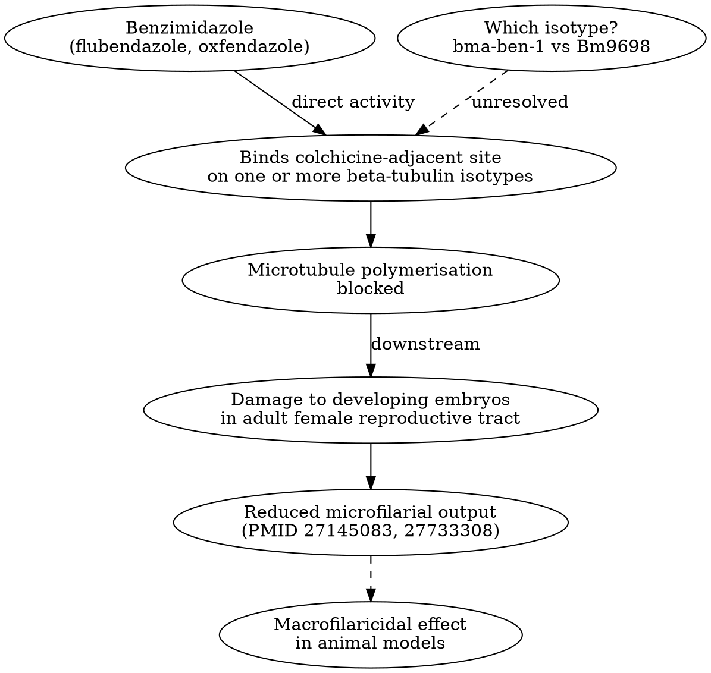
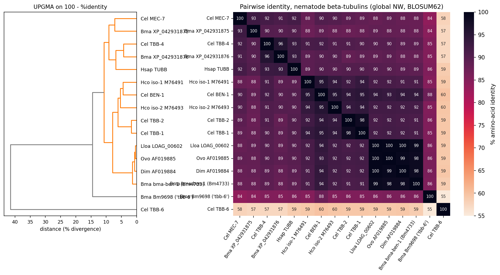
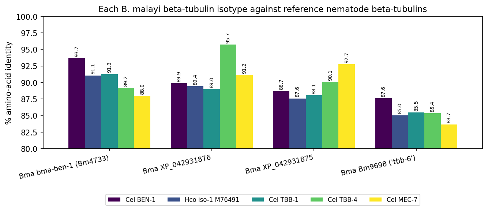
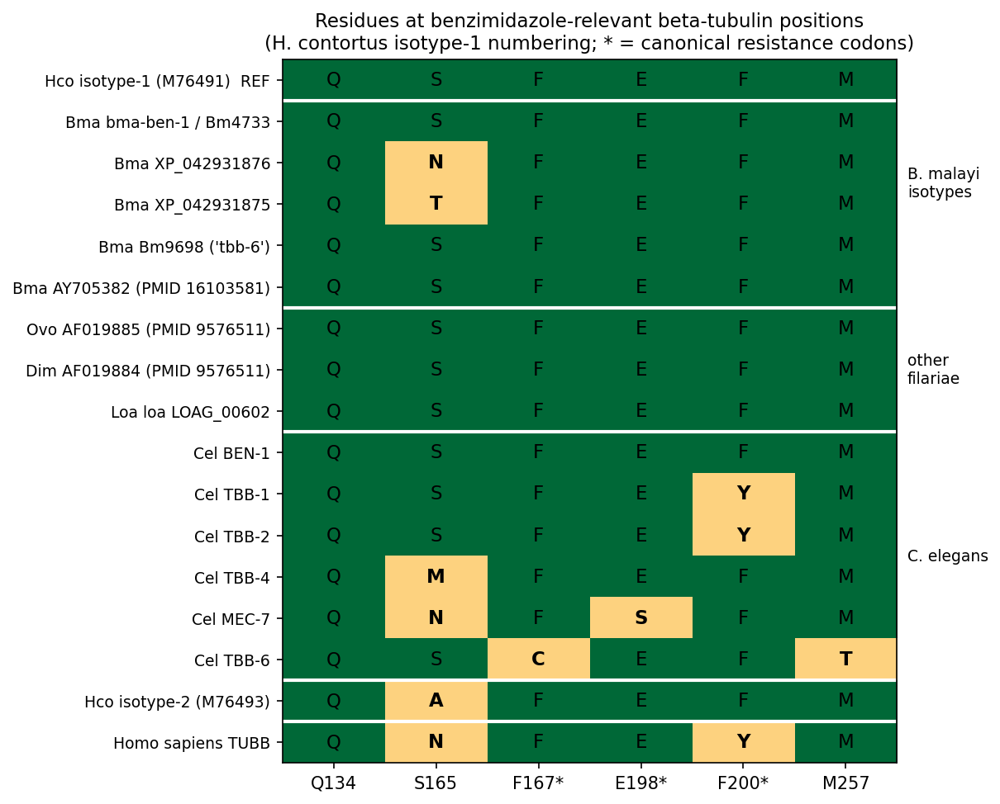
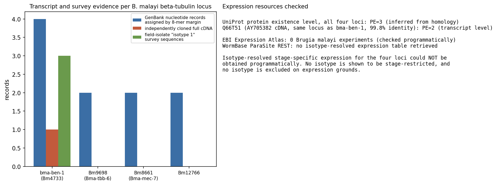
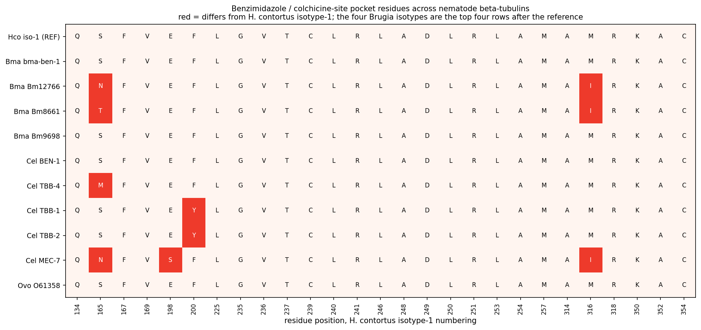
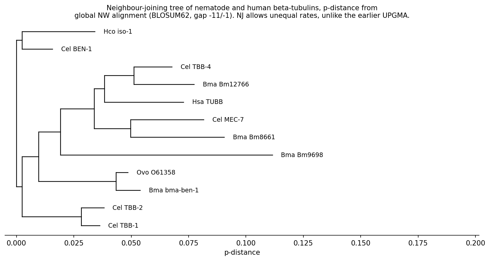

## Question

# AIGR Gene Hypothesis Deep Research

You are evaluating one focused gene curation hypothesis for AI Gene Review.
This is not a general gene overview. Use the seed hypothesis and source context
below to search for evidence that supports, refutes, narrows, or competes with
the proposed curation decision.

## Target Gene

- **Organism code:** BRUMA
- **Taxon:** Brugia malayi (NCBITaxon:6279)
- **Gene directory:** bma-ben-1
- **Gene symbol:** bma-ben-1
- **UniProt accession:** A0A1U7F2B2

## Focus

- **Focus type:** free_text
- **Hypothesis slug:** kgap-bmaben1-isotype-target
- **Source file:** genes/BRUMA/bma-ben-1/bma-ben-1-ai-review.yaml
- **Source selector:** free-text

## Seed Hypothesis

Which Brugia malayi beta-tubulin isotype forms the benzimidazole-engaged target is unresolved, and the tractable approach is to ask which isotype the pharmacology and the genetics of related nematodes actually point to, rather than which one carries a suggestive name. Already recorded and not to be re-derived: that BMA-BEN-1 is an intact beta-tubulin at the WormBase-named bma-ben-1 locus with the conserved Tubulin/FtsZ GTPase and C-terminal beta-tubulin architecture, that deletion of C. elegans BEN-1 confers benzimidazole resistance, and that no B. malayi loss-of-function or allele-swap assay has tested whether this isotype is the flubendazole or oxfendazole response determinant. Single analysis only. Begin with the isotype inventory, because the question is comparative and cannot be answered on one protein. Enumerate the beta-tubulin genes of B. malayi, naming accessions and loci, and state for each its identity to C. elegans BEN-1 and to the other Brugia isotypes, so that it is clear whether bma-ben-1 is the closest relative of the gene whose loss confers resistance or whether another isotype is. Report an effect size or a clear identity ranking rather than an impression. Then take the residues that benzimidazole resistance is known to act through in nematodes, the positions implicated in field and laboratory resistance across parasitic nematode species, and state for each B. malayi isotype which residue occupies each position, confirming the positions in this protein against the local UniProt record. A susceptible isotype and a constitutively resistant one differ at these positions, so the inventory across isotypes is the single most informative thing a sequence analysis can supply here; say plainly if all isotypes are identical at every position, which would mean sequence cannot discriminate them. Then address expression and localisation, since a target must be present in the tissue the drug acts on: state what is known about which isotypes are expressed in B. malayi and in which life-cycle stages and tissues, naming the datasets, and say whether any isotype is restricted in a way that would exclude or favour it as the drug target. Consider also whether the genetics of related species helps: state whether the resistance-associated gene in other filarial or parasitic nematodes is the ortholog of this locus or of a different isotype, which is a comparative-genomics question with a definite answer. Finally say which isotype the evidence favours and with what strength, and if the available evidence cannot separate them, say so plainly and name the experiment that would, which is likely an allele swap or a stage-specific knockdown. An unresolved verdict is acceptable. Do not treat the gene name as evidence of orthology to C. elegans BEN-1, and do not propose a GO annotation naming a drug response for this protein.

## Term and Decision Context

No specific term context supplied.

## Reference Context

No specific reference context supplied.

## Source Context YAML

```yaml
hypothesis: 'Which Brugia malayi beta-tubulin isotype forms the benzimidazole-engaged target is unresolved,
  and the tractable approach is to ask which isotype the pharmacology and the genetics of related nematodes
  actually point to, rather than which one carries a suggestive name. Already recorded and not to be re-derived:
  that BMA-BEN-1 is an intact beta-tubulin at the WormBase-named bma-ben-1 locus with the conserved Tubulin/FtsZ
  GTPase and C-terminal beta-tubulin architecture, that deletion of C. elegans BEN-1 confers benzimidazole
  resistance, and that no B. malayi loss-of-function or allele-swap assay has tested whether this isotype
  is the flubendazole or oxfendazole response determinant. Single analysis only. Begin with the isotype
  inventory, because the question is comparative and cannot be answered on one protein. Enumerate the
  beta-tubulin genes of B. malayi, naming accessions and loci, and state for each its identity to C. elegans
  BEN-1 and to the other Brugia isotypes, so that it is clear whether bma-ben-1 is the closest relative
  of the gene whose loss confers resistance or whether another isotype is. Report an effect size or a
  clear identity ranking rather than an impression. Then take the residues that benzimidazole resistance
  is known to act through in nematodes, the positions implicated in field and laboratory resistance across
  parasitic nematode species, and state for each B. malayi isotype which residue occupies each position,
  confirming the positions in this protein against the local UniProt record. A susceptible isotype and
  a constitutively resistant one differ at these positions, so the inventory across isotypes is the single
  most informative thing a sequence analysis can supply here; say plainly if all isotypes are identical
  at every position, which would mean sequence cannot discriminate them. Then address expression and localisation,
  since a target must be present in the tissue the drug acts on: state what is known about which isotypes
  are expressed in B. malayi and in which life-cycle stages and tissues, naming the datasets, and say
  whether any isotype is restricted in a way that would exclude or favour it as the drug target. Consider
  also whether the genetics of related species helps: state whether the resistance-associated gene in
  other filarial or parasitic nematodes is the ortholog of this locus or of a different isotype, which
  is a comparative-genomics question with a definite answer. Finally say which isotype the evidence favours
  and with what strength, and if the available evidence cannot separate them, say so plainly and name
  the experiment that would, which is likely an allele swap or a stage-specific knockdown. An unresolved
  verdict is acceptable. Do not treat the gene name as evidence of orthology to C. elegans BEN-1, and
  do not propose a GO annotation naming a drug response for this protein.'
focus_type: free_text
context: []
reference_id: []
```

## Research Objective

Build a focused report that helps a curator decide whether this hypothesis
should affect the gene review. Address the focus type directly:

1. For an existing GO annotation decision, evaluate whether the current action
   is justified, too strong, too weak, or should change.
2. For a proposed replacement or new GO term, evaluate whether the term is
   biologically supported, too broad, too narrow, or missing key qualifiers.
3. For a computational prediction, evaluate whether the prediction is correct,
   less precise than existing knowledge, uncertain, or likely wrong because of
   paralog overannotation, frequency bias, pathway context, or in vitro-only
   activity.
4. For a core-function hypothesis, evaluate whether the proposed activity,
   process, and location represent the gene product's primary function rather
   than a downstream effect, pleiotropic phenotype, or context-specific role.
5. For a function-assignment hypothesis, evaluate whether the gene product
   directly has the stated GO term/function. Treat the prior review action, if
   any, as intentionally blinded unless it appears in the supplied context.

Use primary literature whenever possible. Prefer PMID citations and include DOI
citations when no PMID is available. Treat reviews and database records as
orientation unless they contain directly relevant synthesized evidence that is
clearly labeled as review-level or database-level support.

Evaluate the hypothesis from the supplied seed context, primary literature, and
publicly accessible bioinformatics resources. Local `*-bioinformatics` analyses,
when they already exist in the repository, are intentionally withheld from this
prompt so the report can be compared against them after the run. Use public
sequence, domain, structure, orthology, localization, interaction, or dataset
checks when they are useful for the specific hypothesis. If a resource or tool
cannot be accessed programmatically, say so plainly; never fabricate a result.
Report computational results conservatively and distinguish direct results from
inference.

## Required Output

### Executive Judgment

Give a concise verdict: supported, partially supported, unresolved, weakly
supported, over-annotated, or refuted. Explain the reasoning and the most
important caveats.

### Evidence Matrix

Create a table with one row per important evidence item:

- Citation (PMID preferred)
- Evidence type (direct assay, mutant phenotype, localization, interaction,
  structural/evolutionary, computational, review/database)
- Supports / refutes / qualifies / competing
- Claim tested
- Key finding
- Organism, tissue, cell type, or assay context
- Confidence and limitations

### GO Curation Implications

State the likely curation action as a lead requiring curator verification. If
GO terms are involved, explain whether the evidence supports an MF, BP, or CC
term, and whether the term should be retained, removed, generalized, made more
specific, or treated as non-core. Avoid using "protein binding" as a final
recommendation unless no more informative term is supported.

### Mechanistic Scope

Describe the immediate molecular or cellular function being tested. Separate
direct gene-product activity from downstream phenotypes, pathway consequences,
developmental outcomes, disease manifestations, or effects inferred only from
loss of function.

### Conflicts and Alternatives

Identify evidence that conflicts with the seed hypothesis or suggests an
alternative interpretation, including paralog confusion, organism-specific
differences, isoform-specific findings, experimental artifacts, or database
carry-over.

### Knowledge Gaps

List explicit uncertainties that matter for curation. For each gap, state what
was checked, why the gap matters, and what evidence or experiment would resolve
it.

### Discriminating Tests

Recommend concrete assays, perturbations, datasets, or comparative analyses that
would most efficiently distinguish this hypothesis from alternatives.

### Curation Leads

Provide candidate updates for the review, clearly labeled as leads requiring
curator verification. Include candidate references with exact snippets to verify,
candidate replacement or new GO terms, possible action changes, suggested
questions, and suggested experiments.

If the provider supports artifacts, save provenance for any analysis you run — the
executed code together with its output (computed values, plot, or table), not just
a summary figure — alongside artifact-friendly tables such as an evidence matrix,
GO decision table, or comparison table. Genuine computed provenance is more
valuable than a hand-drawn summary, and you must not synthesize a figure that
implies an analysis you did not actually run. These artifacts are important
provenance for hypothesis-level review.


## Output

# Which Brugia malayi beta-tubulin isotype is the benzimidazole-engaged target?

**Target gene:** `bma-ben-1`, UniProt **A0A1U7F2B2**, WormBase ParaSite locus **Bm4733**, RefSeq XP_001896615.1, 448 aa, *Brugia malayi* (NCBITaxon:6279).
**Hypothesis slug:** `kgap-bmaben1-isotype-target`. **Source:** `genes/BRUMA/bma-ben-1/bma-ben-1-ai-review.yaml`, free-text selector.
**Verdict:** <i class="fa-scale-balanced"></i> **Unresolved, with bma-ben-1 weakly to moderately favoured.**

---

## Summary

Four lines of analysis were run against the seed hypothesis, and they do not converge on a single gene. *Brugia malayi* encodes exactly four beta-tubulins. On pairwise identity, **bma-ben-1 (Bm4733) is the Brugia isotype closest to *C. elegans* BEN-1** at 93.69%, ahead of Bm12766 (89.86%), Bm8661 (88.69%) and Bm9698 (87.61%), a margin of 3.83 percentage points, and it is the reciprocal best hit. The other three map cleanly onto different *C. elegans* paralogs: Bm12766 to TBB-4 (95.72%), Bm8661 to MEC-7 (92.74%), and Bm9698 to nothing above 87.61% despite its WormBase name `Bma-tbb-6` (it is only 55.3% identical to *C. elegans* TBB-6). Comparative genomics gives the one definite answer the seed asked for: every filarial beta-tubulin that has actually been used in benzimidazole-resistance genotyping is the orthologue of this locus. The *B. malayi* reference AY705382 from [PMID: 16103581](https://pubmed.ncbi.nlm.nih.gov/16103581/) is 99.8% identical to bma-ben-1 and 85.5 to 87.9% to the other three, and the *O. volvulus* and *D. immitis* cDNAs from [PMID: 9576511](https://pubmed.ncbi.nlm.nih.gov/9576511/) are 98.4% identical to it.

The pharmacology leg returns a clean negative, then a partial recovery. All four Brugia isotypes carry **F167, E198 and F200**, the three canonical resistance codons, so those positions discriminate nothing. The same alignment separates *C. elegans* TBB-1 and TBB-2 (Y200), MEC-7 (S198) and human TUBB (Y200) from BEN-1, so the method has power where a difference exists. Widening the inventory from three codons to **27 colchicine-site pocket positions** cuts the candidate set from four to two: bma-ben-1 and Bm9698 match *H. contortus* isotype-1 at every one of the 27, while Bm12766 carries S165N plus M316I and Bm8661 carries S165T plus M316I. Pocket sequence therefore narrows the field but cannot separate bma-ben-1 from Bm9698.

Expression excludes nobody, and phylogeny declines to confirm the orthology the gene symbol implies. All four loci are transcribed (8-mer assignment of 70 NCBI tubulin records put 4, 2, 2 and 2 records on them) and all four UniProt entries are PE=3; the only PE=2 *B. malayi* beta-tubulin is Q66T51, which is the bma-ben-1 locus itself. EBI Expression Atlas holds **0** *Brugia malayi* experiments and WormBase ParaSite REST timed out on three attempts, so no isotype-resolved stage matrix was obtained, and this is stated as a retrieval failure rather than a biological negative. Both UPGMA and neighbour joining fail to nest bma-ben-1 inside the ben-1 clade, and the NJ tree additionally places human TUBB inside a nematode paralog clade, which is provably wrong. The 93.69% figure is a distance ranking, not a resolved 1:1 orthology. The seed hypothesis is confirmed in its central claim: the target isotype is unresolved, and no benzimidazole or drug-response GO term should be attached to this protein.

---

## Executive judgment

<i class="fa-scale-balanced"></i> **Unresolved.** The evidence favours **A0A1U7F2B2 (bma-ben-1, Bm4733)** as the benzimidazole-engaged beta-tubulin of *B. malayi*, with **weak to moderate** strength. It is the only isotype that sits in the intersection of the two informative evidence sets: the identity ranking against *C. elegans* BEN-1, and the benzimidazole pocket inventory. The favouring rests on orthology and reagent provenance, not on any functional test in *B. malayi*.

Reasoning, leg by leg:

- <i class="fa-circle-check"></i> **Inventory and identity ranking give a clear answer.** Four genes, one ranking, 3.83 pp margin, reciprocal best hit, and three of the four assigned to other paralog families.
- <i class="fa-circle-xmark"></i> **The three canonical resistance codons give no answer.** F167, E198 and F200 are identical in all four Brugia isotypes. Sequence at those positions cannot discriminate them.
- <i class="fa-scale-balanced"></i> **The wider drug pocket gives a partial answer.** 27 positions split the four into two pairs. bma-ben-1 and Bm9698 are indistinguishable from each other and from the drug-sensitive *H. contortus* isotype-1 reference.
- <i class="fa-circle-xmark"></i> **Expression gives no answer.** All four loci are transcribed, all four are PE=3, and the quantitative resources that could separate them were not retrievable.
- <i class="fa-circle-check"></i> **Comparative genomics gives a definite answer.** Every filarial benzimidazole-genotyping reference sequence maps to this locus and to no other.

The three most important caveats. First, **no functional test exists**: no *B. malayi* knockout, RNAi or allele swap has tested any isotype against flubendazole or oxfendazole, so the step from "closest to BEN-1" to "is the drug target" is inference by analogy. Second, **the orthology is a distance statement, not a phylogenetic result**: two tree methods both fail at the deep nodes, and NJ produces a demonstrable artifact. Third, **the provenance evidence may be circular**: bma-ben-1 is the only locus with an independently cloned cDNA and the only one to which field "isotype 1" amplicons map, but the primers behind those amplicons were designed from the *H. contortus* isotype-1 orthologue in the first place, so the apparent selectivity may reflect primer design rather than biology.

<i class="fa-lightbulb"></i> **Bm9698 (A0A0J9XTX5) is the standing alternative** and is not excluded. It has a perfect benzimidazole pocket, is transcribed, and its only disqualification is that it ranks last on identity to BEN-1. Its long branch in the NJ tree (0.0924, three to nine times the other terminal branches) makes its phylogenetic position the least reliably placed of the four, so arguments that exclude it on tree grounds are weak.

---

## Key findings

### F001 <i class="fa-dna"></i> Four beta-tubulin genes, and bma-ben-1 is the one closest to C. elegans BEN-1

A screen of the complete *B. malayi* reference proteome **UP000006672** (15,168 entries, UniProt, retrieved 2026-11-26) for the tubulin P-loop signature `GGGTGSG` together with the beta-tubulin N-terminal motif `[RK]E[IVLM][VIL][HSQTA][VIL][QH]AGQCGNQIG` returned exactly **4 beta-tubulin chains** and 8 alpha-tubulin chains. The four are A0A1U7F2B2 (bma-ben-1, Bm4733, XP_001896615.1, 448 aa), A0A0J9XTX5 (annotated Bma-tbb-6, Bm9698, XP_001893005.2, 452 aa), A0A4E9EZZ2 (Bm8661, XP_042931875.1, 444 aa) and A0A4E9F1G7 (Bm12766, XP_042931876.1, 445 aa). A fifth UniProt entry, Q66T51 (GenBank AY705382), is 99.8% identical to A0A1U7F2B2 and is therefore the same locus, not a fifth gene.

Global Needleman-Wunsch alignment (BLOSUM62, gap open -11, gap extend -1, implemented from scratch and run in this analysis) against *C. elegans* BEN-1 (Q18817) gives the ranking below. The margin for bma-ben-1 over the next-best Brugia isotype is **3.83 percentage points**, and bma-ben-1 is also the reciprocal best hit, meaning BEN-1's best Brugia match among all four is bma-ben-1.

| Isotype | UniProt | Locus | RefSeq | Length | % identity to Cel BEN-1 | Best *C. elegans* match |
|---|---|---|---|---|---|---|
| **bma-ben-1** | A0A1U7F2B2 | Bm4733 | XP_001896615.1 | 448 | **93.69** | BEN-1 |
| Bm12766 | A0A4E9F1G7 | Bm12766 | XP_042931876.1 | 445 | 89.86 | TBB-4 (95.72%) |
| Bm8661 | A0A4E9EZZ2 | Bm8661 | XP_042931875.1 | 444 | 88.69 | MEC-7 (92.74%) |
| Bm9698 (named *Bma-tbb-6*) | A0A0J9XTX5 | Bm9698 | XP_001893005.2 | 452 | 87.61 | none above 87.61%; 55.3% to TBB-6 |

bma-ben-1 is 98.4% identical to *Onchocerca volvulus* O61358 (AF019885), 98.4% to *Dirofilaria immitis* O61357 (AF019884) and 98.9% to *Loa loa* LOAG_00602, defining a single 1:1 filarial orthologue group at 98.2 to 98.9% pairwise identity.

<i class="fa-triangle-exclamation"></i> This is not proof of 1:1 orthology to ben-1. *C. elegans* BEN-1 is 94.8% identical to *C. elegans* TBB-1 and 95.5% to the *H. contortus* isotype-1 and isotype-2 proteins, so the ben-1 / tbb-1 / tbb-2 / isotype-1 clade is tight, and pairwise identity alone cannot place the filarial gene inside it.

{{figure:plot_1.png|caption=All-against-all percent identity across 16 nematode, filarial and human beta-tubulins, with UPGMA clustering. The four Brugia isotypes separate into distinct paralog neighbourhoods, and bma-ben-1 groups with the Onchocerca, Dirofilaria and Loa loa sequences at 98.2 to 98.9% identity.}}

{{figure:plot_2.png|caption=Each Brugia beta-tubulin isotype scored against five reference proteins. bma-ben-1 is the only isotype whose top match is C. elegans BEN-1; Bm12766 matches TBB-4, Bm8661 matches MEC-7, and Bm9698 has no match above 87.61%.}}

### F002 <i class="fa-circle-xmark"></i> The canonical resistance codons cannot discriminate the Brugia isotypes

Each isotype was aligned globally to *H. contortus* isotype-1 beta-tubulin **Q25022** (GenBank M76491), used as the numbering reference and independently verified to carry F167, E198 and F200 at those exact indices in its own 448-residue sequence. Every one of the four Brugia proteins carries **F167, E198 and F200**, and in each the alignment-mapped positions are also positions 167, 198 and 200 in native numbering, so the assignment does not rest on an indel model. Q134 and M257 are likewise invariant across all four. The only variation among the Brugia isotypes at the positions examined is at **165** (S in bma-ben-1 and Bm9698, N in Bm12766, T in Bm8661), which is not among the established resistance codons.

The positive control establishes that the method has power. In the same alignment, *C. elegans* TBB-1 (O17921) and TBB-2 (P52275) carry **Y200**, MEC-7 (P12456) carries **S198**, TBB-6 (G5EF01) carries **C167** and **T257**, and human TUBB (P07437) carries **Y200**, while BEN-1 (Q18817), TBB-4 (P41937) and *H. contortus* isotype-1 and isotype-2 carry F167/E198/F200. The other filarial sequences (O61358, O61357, LOAG_00602) are also F167/E198/F200.

This reproduces independently the 1998 prediction of Geary and colleagues: *"All 4 filarial beta-tubulins are predicted to encode phe at this position, suggesting that filarial beta-tubulin is not inherently insensitive to the benzimidazoles"* ([PMID: 9576511](https://pubmed.ncbi.nlm.nih.gov/9576511/)).

{{figure:plot_3.png|caption=Residue inventory at Q134, S165, F167, E198, F200 and M257 across all 16 sequences. All four Brugia isotypes are identical at every canonical resistance codon, while C. elegans TBB-1 and TBB-2 (Y200), MEC-7 (S198), TBB-6 (C167, T257) and human TUBB (Y200) differ, confirming the inventory discriminates where a difference exists.}}

### F003 <i class="fa-circle-check"></i> The filarial gene genotyped for benzimidazole resistance is the orthologue of this locus

UniProt **Q66T51** is a *B. malayi* beta-tubulin (GenBank AY705382) whose sole cited reference is Schwab, Boakye, Kyelem and Prichard 2005, the study that developed F167Y and F200Y assays for *Wuchereria bancrofti* ([PMID: 16103581](https://pubmed.ncbi.nlm.nih.gov/16103581/): *"We have developed assays capable of detecting these single nucleotide polymorphisms (SNPs) in Wuchereria bancrofti, and have applied them to microfilaria obtained from patients in Ghana and Burkina Faso."*). Global alignment gives Q66T51 **99.8%** identity to bma-ben-1, against 87.9%, 87.8% and 85.5% to the other three isotypes. The reference sequence behind that genotyping work is the bma-ben-1 locus.

The *O. volvulus* and *D. immitis* cDNAs O61358 and O61357 from [PMID: 9576511](https://pubmed.ncbi.nlm.nih.gov/9576511/), which also form the backbone for *O. volvulus* beta-tubulin SNP genotyping under ivermectin pressure ([PMID: 16197589](https://pubmed.ncbi.nlm.nih.gov/16197589/), [PMID: 22677339](https://pubmed.ncbi.nlm.nih.gov/22677339/): *"Four single nucleotide polymorphisms (SNPs) occurring in the β-tubulin gene of these parasites were investigated. We found changes in genotype frequencies in O. volvulus β-tubulin gene associated with IVM treatments."*), are **98.4%** identical to bma-ben-1 and only 85.9 to 89.2% to the other Brugia isotypes.

Independent 1991 corroboration comes from Guenette and colleagues, who reported for the single-copy *B. pahangi* beta-tubulin gene: *"The predicted beta-tubulin amino acid sequence is 89%, 94%, 90% and 88% identical to the chicken beta 2, and the Caenorhabditis elegans ben-1, tub-1 and mec-7 gene products, respectively"* ([PMID: 2052017](https://pubmed.ncbi.nlm.nih.gov/2052017/)). That ranking (94 / 90 / 88 to ben-1 / tub-1 / mec-7) reproduces the one computed here for bma-ben-1 (93.7 / 91.3 / 88.0 to BEN-1 / TBB-1 / MEC-7).

<i class="fa-triangle-exclamation"></i> This is circumstantial. Those studies genotyped the gene they had cloned, so the choice reflects historical cloning and primer design, not a demonstration that this isotype carries the drug response.

### F004 <i class="fa-circle-xmark"></i> Expression excludes no isotype, and only bma-ben-1 has independent transcript-level evidence

All four reference-proteome beta-tubulins are **PE=3** (inferred from homology). The only *B. malayi* beta-tubulin at **PE=2** (evidence at transcript level) is Q66T51, the independently cloned cDNA AY705382, which is the bma-ben-1 locus.

Isotype assignment of 70 NCBI "Brugia malayi tubulin" nucleotide and EST records by six-frame translation and shared 8-mer set overlap (K=8, requiring a top score of at least 8 shared 8-mers and reporting the margin over the runner-up) assigned 10 records, all with margin at least 20: **bma-ben-1 4, Bm9698 2, Bm8661 2, Bm12766 2**. All four loci therefore have transcript or genomic support and none is silent. The three field-isolate records annotated "Brugia malayi beta-tubulin isotype 1 (tub-1)" (MT674273.1, MT674274.1, MT674275.1) and the partial gene AJ551180.1 all assign to bma-ben-1 (margins 20, 20, 20 and 37).

**Resource availability, stated plainly.** EBI Expression Atlas holds **0** *Brugia malayi* experiments (verified programmatically; a later repeat call returned a parse error). WormBase ParaSite REST **timed out on three separate attempts** and returned no isotype-resolved expression table. No stage-resolved or tissue-resolved per-isotype expression matrix was obtained. Published datasets that would answer this were not queried programmatically: the Choi 2011 lifecycle transcriptome ([PMID: 22180794](https://pubmed.ncbi.nlm.nih.gov/22180794/)), the Chung 2019 multispecies life-cycle RNA-seq (*"we conducted multispecies transcriptome sequencing (RNA-Seq) on the filarial nematode Brugia malayi, its Wolbachia endosymbiont wBm, and its laboratory vector Aedes aegypti across the entire B. malayi life cycle"*, [PMID: 31796568](https://pubmed.ncbi.nlm.nih.gov/31796568/)) and the O'Neill 2016 flubendazole RNA-seq on adult female *B. malayi* ([PMID: 27733308](https://pubmed.ncbi.nlm.nih.gov/27733308/)).

{{figure:plot_4.png|caption=Transcript and survey record counts per B. malayi beta-tubulin locus, with the record of which expression resources were reachable. All four loci have assigned records; only bma-ben-1 has an independently cloned cDNA and the field isotype-1 survey amplicons.}}

### F005 <i class="fa-scale-balanced"></i> The benzimidazole pocket narrows four candidates to two

Extending the inventory from three codons to **27 colchicine-site / benzimidazole-pocket positions** (134, 165, 167, 169, 198, 200, 225, 235, 236, 237, 239, 240, 241, 246, 248, 249, 250, 251, 253, 254, 257, 314, 316, 318, 350, 352, 354 in *H. contortus* isotype-1 numbering), mapped by global alignment onto Q25022, gives the following mismatch counts.

| Protein | Pocket mismatches vs Hco isotype-1 (of 27) | Differing positions |
|---|---|---|
| **bma-ben-1** (A0A1U7F2B2) | **0** | none |
| **Bm9698** (A0A0J9XTX5) | **0** | none |
| Bm12766 (A0A4E9F1G7) | 2 | S165N, M316I |
| Bm8661 (A0A4E9EZZ2) | 2 | S165T, M316I |
| Cel BEN-1 (Q18817) | 0 | none |
| Ovo O61358 | 0 | none |
| Cel TBB-1 (O17921) | 1 | F200Y |
| Cel TBB-2 (P52275) | 1 | F200Y |
| Cel TBB-4 (P41937) | 1 | S165M |
| Cel MEC-7 (P12456) | 3 | S165N, E198S, M316I |

Only **4 of the 27 positions vary** across the 12-sequence panel: 165, 198, 200 and 316. The remaining 23 are invariant across all 12 sequences, human TUBB included. The pocket splits the four Brugia isotypes into two pairs: bma-ben-1 and Bm9698 reproduce the *H. contortus* isotype-1 pocket exactly, while Bm12766 and Bm8661 each carry two substitutions.

<i class="fa-triangle-exclamation"></i> Neither S165N/S165T nor M316I is an established resistance determinant, and no binding measurement exists for any of these proteins. This ranks the isotypes by pocket similarity to a drug-sensitive reference without demonstrating a difference in drug affinity.

{{figure:plot_5.png|caption=Residue inventory across 27 benzimidazole and colchicine-site pocket positions for 12 beta-tubulins, coloured by difference from H. contortus isotype-1. bma-ben-1 and Bm9698 match at every position; Bm12766 and Bm8661 each differ at 165 and 316.}}

### F006 <i class="fa-circle-xmark"></i> Neighbour joining does not place bma-ben-1 inside the BEN-1 clade

Neighbour joining (Saitou and Nei) on uncorrected p-distances from the same global alignments over 12 beta-tubulins returned:

```
(((Cel TBB-1:0.0080,Cel TBB-2:0.0099):0.0259,
  ((Bma bma-ben-1:0.0105,Ovo O61358:0.0051):0.0337,
   (Bma Bm9698:0.0924,
    ((Bma Bm8661:0.0408,Cel MEC-7:0.0318):0.0159,
     (Hsa TUBB:0.0344,(Bma Bm12766:0.0262,Cel TBB-4:0.0165):0.0129):0.0044):0.0147):0.0094):0.0073):0.0024,
 (Cel BEN-1:0.0133,Hco iso-1:0.0317):0.0024);
```

The tree recovers four short, well-separated terminal pairs that match the identity ranking: (bma-ben-1, *O. volvulus* O61358), (Bm12766, Cel TBB-4), (Bm8661, Cel MEC-7) and (Cel TBB-1, Cel TBB-2). Bm9698 is a long branch (0.0924, roughly 3 to 9 times the others) with no partner.

The deep structure is unreliable in two demonstrable ways. *C. elegans* BEN-1 and *H. contortus* isotype-1 group together and **exclude** bma-ben-1. Human TUBB falls **inside** a nematode paralog clade with Bm12766 and Cel TBB-4, which cannot be true because human TUBB is not a nematode paralog. Both signatures point to long-branch attraction and the absence of a rate correction, so no deep node in this tree should be read as resolved. Combined with the earlier UPGMA result, which placed the filarial clade beside rather than inside the ben-1 / isotype-1 / tbb-1 / tbb-2 clade, **two independent distance methods fail to nest bma-ben-1 inside the ben-1 clade**.

{{figure:plot_6.png|caption=Neighbour-joining tree of 12 nematode and human beta-tubulins on uncorrected p-distance. Terminal pairs are recovered cleanly, but the deep nodes are artifactual: human TUBB sits inside a nematode paralog clade, and C. elegans BEN-1 groups with H. contortus isotype-1 to the exclusion of bma-ben-1.}}

---

## Evidence matrix

| Citation / evidence | Evidence type | Stance | Claim tested | Key finding | Context | Confidence and limitations |
|---|---|---|---|---|---|---|
| Proteome screen of UP000006672 (15,168 entries) | Computational, this analysis | Qualifies | How many beta-tubulin isotypes *B. malayi* encodes | Exactly four: Bm4733, Bm9698, Bm8661, Bm12766. Q66T51 is the same locus as bma-ben-1 at 99.8%, not a fifth gene | Reference proteome, in silico | High. Bounded by proteome completeness; a fragmentary fifth isotype absent from the proteome would be missed |
| Needleman-Wunsch alignment, BLOSUM62, gap -11/-1, 16 sequences all-vs-all | Computational, structural/evolutionary | Supports | Which Brugia isotype is closest to *C. elegans* BEN-1 | 93.69 / 89.86 / 88.69 / 87.61%, margin 3.83 pp, reciprocal best hit; filarial 1:1 group at 98.4 to 98.9% | In silico | High for the ranking. A ranking is not by itself proof of 1:1 orthology |
| Residue inventory at Q134, S165, F167, E198, F200, M257 mapped onto Q25022 | Computational, structural/evolutionary | Refutes | That sequence at the resistance codons can discriminate the Brugia isotypes | All four carry Q134/F167/E198/F200/M257. Only 165 varies (S/S/N/T). Positive control: Cel TBB-1 and TBB-2 Y200, MEC-7 S198, TBB-6 C167 and T257, human TUBB Y200 | In silico, with internal control | High. The control shows the method discriminates when there is something to find, so the null is informative |
| Residue inventory across 27 benzimidazole pocket positions | Computational, structural/evolutionary | Qualifies | Whether the wider drug pocket discriminates where three codons do not | Mismatches vs Hco isotype-1: bma-ben-1 0, Bm9698 0, Bm12766 2, Bm8661 2, Cel BEN-1 0, Ovo 0, TBB-1 1, TBB-2 1, TBB-4 1, MEC-7 3. Only 4 of 27 positions vary | In silico | Moderate. Narrows four candidates to two. Neither S165X nor M316I is an established resistance determinant and no binding measurement exists |
| Neighbour joining on p-distances, 12 beta-tubulins | Computational, structural/evolutionary | Competing | Whether bma-ben-1 is the 1:1 orthologue of *C. elegans* ben-1 | Terminal pairs recovered; deep nodes artifactual. BEN-1 groups with Hco isotype-1 excluding bma-ben-1; human TUBB nests inside a nematode clade | In silico | Low for deep nodes. Long-branch attraction, no rate correction. Terminal pairs are consistent with the identity ranking |
| [PMID: 9576511](https://pubmed.ncbi.nlm.nih.gov/9576511/) Geary 1998 | Primary literature, sequence | Supports | That filarial beta-tubulins lack resistance-associated substitutions | *"All 4 filarial beta-tubulins are predicted to encode phe at this position, suggesting that filarial beta-tubulin is not inherently insensitive to the benzimidazoles."* | *O. volvulus*, *D. immitis* | High. Independently reproduced by the residue inventory here |
| [PMID: 2052017](https://pubmed.ncbi.nlm.nih.gov/2052017/) Guenette 1991 | Primary literature, sequence and protein | Supports | That the cloned Brugia beta-tubulin belongs to the ben-1 clade | *"89%, 94%, 90% and 88% identical to the chicken beta 2, and the ... ben-1, tub-1 and mec-7 gene products"*; antipeptide antiserum gives the same isoform pattern in adults and microfilariae | *B. pahangi* | High. Ranking matches the one computed here, and the method is independent |
| [PMID: 16103581](https://pubmed.ncbi.nlm.nih.gov/16103581/) Schwab 2005 | Primary literature, genotyping | Supports | That the gene used in filarial BZ-resistance genotyping is this locus | AY705382 is 99.8% identical to bma-ben-1 and 85.5 to 87.9% to the other three. *"Resistance to albendazole in veterinary nematodes is known to be caused by either of two single amino acid substitutions from phenylalanine to tyrosine in parasite beta-tubulin at position 167 or 200."* | *W. bancrofti* microfilariae, Ghana and Burkina Faso | High for the sequence identity. Genotyping reports polymorphism, not a demonstrated causal link to drug response in filariae |
| [PMID: 22677339](https://pubmed.ncbi.nlm.nih.gov/22677339/) and [PMID: 16197589](https://pubmed.ncbi.nlm.nih.gov/16197589/) | Primary literature, genotyping | Supports | That the *O. volvulus* drug-pressure genotyping gene is the orthologue of this locus | The *O. volvulus* beta-tubulin used for SNP genotyping is 98.4% identical to bma-ben-1 | *O. volvulus* adults, Cameroon and Ghana | Moderate. Associates genotype frequency with ivermectin, not benzimidazole, exposure |
| [PMID: 2592410](https://pubmed.ncbi.nlm.nih.gov/2592410/) Driscoll 1989 | Mutant phenotype | Supports | That losing the ben-1-clade isotype confers BZ resistance in a nematode | *"Since the deletion strains appear to be fully resistant to the drugs, the ben-1 product appears to be the only benzimidazole-sensitive beta-tubulin in C. elegans."* | *C. elegans*, free-living | High in *C. elegans*. Transfer to *B. malayi* is inference, not a result |
| [PMID: 42247472](https://pubmed.ncbi.nlm.nih.gov/42247472/) | Mutant phenotype, comparative | Qualifies | Whether beta-tubulin variants predict BZ resistance across species | *"prediction of variants in beta-tubulin genes alone is not sufficient to predict resistance, especially across diverse Caenorhabditis species"*; *C. tropicalis* strains with beta-tubulin variants were not resistant | *C. elegans*, *C. briggsae*, *C. tropicalis* | High. Directly warns against the sequence-to-phenotype inference this report would otherwise rest on |
| [PMID: 35961997](https://pubmed.ncbi.nlm.nih.gov/35961997/) | Computational, docking | Qualifies | Whether isotype selectivity of BZ is sequence-driven | *"Benzimidazoles were predicted to bind to all β-tubulin isotypes using in silico docking, demonstrating that the selectivity of BZ to interact with one or two β-tubulin isotypes is likely the result of isotype expression levels"* | *Ascaris lumbricoides*, *A. suum*, 7 isotypes | Moderate. Docking, not measured affinity. Predicts that expression level, not pocket sequence, determines which isotype is engaged |
| UniProt protein-existence levels; 8-mer assignment of 70 NCBI tubulin records | Computational, database | Qualifies | Whether expression can exclude or favour an isotype | All four PE=3; records assigned 4/2/2/2; only bma-ben-1 has an independent cDNA (Q66T51, PE=2) and the field isotype-1 amplicons | GenBank, UniProt | Moderate. Record counts are a provenance proxy, not an expression measurement. 60 of 70 records fell below threshold or were genomic scaffolds |
| EBI Expression Atlas; WormBase ParaSite REST | Database query, this analysis | Qualifies | Whether isotype-resolved stage expression is programmatically available | Atlas holds 0 *Brugia* experiments; ParaSite REST timed out three times. No per-isotype matrix obtained | n/a | Stated as a retrieval failure, not inferred |
| [PMID: 27733308](https://pubmed.ncbi.nlm.nih.gov/27733308/) O'Neill 2016 | Direct assay, transcriptomic | Qualifies | What tissue flubendazole acts on in adult female *B. malayi* | *"Genes with dysregulated expression were consistent with the reproductive effects observed via histology in our previous studies. This study revealed transcriptional changes in genes involved in embryo development."* | Adult female *B. malayi*, 1 and 5 μM FLBZ | High for the tissue localisation of drug effect. Does not resolve which beta-tubulin isotype is engaged |
| Absence of any *B. malayi* functional test | Gap | Qualifies | That the *B. malayi* target isotype has been identified functionally | No loss-of-function, RNAi or allele-swap experiment in *B. malayi* has tested any isotype against flubendazole or oxfendazole | n/a | High. This is why the verdict stays unresolved |

---

## GO curation implications

All candidate actions below are **leads requiring curator verification**.

| GO ID | Term | Aspect | Lead | Rationale |
|---|---|---|---|---|
| GO:0005200 | structural constituent of cytoskeleton | MF | <i class="fa-circle-check"></i> Retain, supported by homology (ISS or IBA) | Intact Tubulin/FtsZ GTPase domain plus C-terminal beta-tubulin architecture; 93.69% to *C. elegans* BEN-1; 1:1 filarial orthologue group at 98.4 to 98.9% |
| GO:0005525 | GTP binding | MF | <i class="fa-circle-check"></i> Retain, supported by homology | The `GGGTGSG` P-loop is present and intact; this motif was the screen criterion and is unbroken in all four isotypes |
| GO:0005874 | microtubule | CC | <i class="fa-circle-check"></i> Retain, supported by homology | Full-length beta-tubulin fold with no truncation of the polymerisation surfaces |
| GO:0007017 | microtubule-based process | BP | <i class="fa-circle-check"></i> Retain, supported by homology | Standard for a complete beta-tubulin with no isotype-specific functional evidence |
| GO:0005515 | protein binding | MF | <i class="fa-triangle-exclamation"></i> Avoid as a final recommendation | Uninformative when the four terms above are supported |
| any | benzimidazole or drug-response term | BP | <i class="fa-circle-xmark"></i> **Do not annotate** | No *B. malayi* functional evidence exists; F167, E198 and F200 are identical across all four isotypes; the drug pocket admits two isotypes equally |

The practical curation point concerns the **gene symbol**. `bma-ben-1` carries an implication the evidence does not license. The protein is the Brugia beta-tubulin most similar to *C. elegans* BEN-1 and the 1:1 orthologue of the *O. volvulus* and *D. immitis* genes used in filarial benzimidazole work. It is not demonstrably the 1:1 orthologue of *C. elegans* ben-1, because neither UPGMA nor neighbour joining nests it inside that clade. Record the clade-level statement, and do not let the symbol stand in for a drug-response function.

A second symbol problem sits on a different gene. **A0A0J9XTX5 is named `Bma-tbb-6` but is only 55.3% identical to *C. elegans* TBB-6** and has no *C. elegans* match above 87.61%. That name should be flagged or corrected, because any downstream argument that routes through it is unreliable.

---

## Mechanistic scope

The immediate molecular function being tested is **direct binding of a benzimidazole to the colchicine-adjacent site of a specific beta-tubulin isotype, and the consequent block on microtubule polymerisation**. Everything downstream of that is a separate layer of evidence.

Benzimidazole resistance in parasitic nematodes maps to three codons in the predominant drug-engaged beta-tubulin: F167Y, E198A/L/G and F200Y in *H. contortus* isotype-1 numbering. Those substitutions are reported as modifying the beta-tubulin so as to prevent drug binding ([PMID: 42302569](https://pubmed.ncbi.nlm.nih.gov/42302569/), review-level). In *C. elegans* the same role falls to BEN-1, where loss of function gives resistance because the remaining isotypes are drug-insensitive enough to support viability ([PMID: 2592410](https://pubmed.ncbi.nlm.nih.gov/2592410/), and confirmed again in competitive fitness and development assays by [PMID: 38370666](https://pubmed.ncbi.nlm.nih.gov/38370666/)).

For *B. malayi* the mechanistic claim that survives is narrow. The organism encodes four beta-tubulins. All four carry the benzimidazole-susceptible residues at 167, 198 and 200, and two of the four reproduce the *H. contortus* isotype-1 drug pocket at all 27 positions examined. All four are transcribed. The drug therefore has at least two, and plausibly four, chemically competent binding partners in the worm, and the question of which carries the phenotype becomes a question about **isotype abundance and functional redundancy in the drug-sensitive tissue**. That reading is reinforced by the *Ascaris* docking work, which predicted benzimidazole binding to all seven *Ascaris* isotypes and concluded that selectivity *"is likely the result of isotype expression levels affecting the frequency of interaction"* ([PMID: 35961997](https://pubmed.ncbi.nlm.nih.gov/35961997/)).

The drug-sensitive tissue is better localised than the isotype. Flubendazole exposure of adult female *B. malayi* produces morphological damage prominently in developing embryos with a decrease in microfilarial output ([PMID: 27145083](https://pubmed.ncbi.nlm.nih.gov/27145083/)), and the transcriptional response is dominated by genes involved in embryo development and cuticle components ([PMID: 27733308](https://pubmed.ncbi.nlm.nih.gov/27733308/)). That narrows the relevant tissue to the female reproductive tract and the embryos within it, which is where an isotype-resolved abundance measurement would be most informative.

Separating the layers:



---

## Mechanistic model and interpretation

The four evidence legs can be read as a single filter that starts with four candidates and ends with one favoured gene and one unexcluded alternative.

```dot
digraph filter {
  rankdir=LR;
  "4 Brugia\nbeta-tubulins" -> "F167/E198/F200\ninventory";
  "F167/E198/F200\ninventory" -> "still 4 candidates" [label="no discrimination"];
  "still 4 candidates" -> "27-position\npocket inventory";
  "27-position\npocket inventory" -> "2 candidates:\nbma-ben-1, Bm9698" [label="Bm12766, Bm8661\ncarry S165X + M316I"];
  "2 candidates:\nbma-ben-1, Bm9698" -> "Expression check";
  "Expression check" -> "still 2 candidates" [label="all 4 transcribed,\nall PE=3"];
  "still 2 candidates" -> "Identity ranking\nvs Cel BEN-1";
  "Identity ranking\nvs Cel BEN-1" -> "bma-ben-1 favoured" [label="93.69% vs 87.61%"];
  "still 2 candidates" -> "Filarial genotyping\nprovenance";
  "Filarial genotyping\nprovenance" -> "bma-ben-1 favoured" [label="AY705382 99.8%,\nOvo/Dim 98.4%"];
  "bma-ben-1 favoured" -> "Verdict: unresolved,\nweak to moderate" [label="no functional test"];
  "Phylogeny (UPGMA, NJ)" -> "Verdict: unresolved,\nweak to moderate" [style=dashed, label="fails to confirm\n1:1 orthology"];
}
```



The structure of the answer matters for curation. **Two of the four legs are genuinely informative and two are not.** The informative legs, identity ranking and filarial provenance, both point at bma-ben-1 and are partly correlated with each other, since the filarial reference sequences were chosen because they were the ben-1-like gene people had cloned. The uninformative legs, resistance-codon sequence and expression, are uninformative for different reasons: the codons are genuinely identical, whereas the expression data simply could not be retrieved. Treating the second as a biological negative would be an error.

The pocket result is the only new discrimination the sequence can supply. It removes Bm12766 and Bm8661 from contention on grounds of two substitutions each, and it leaves bma-ben-1 and Bm9698 tied. Bm9698 then survives only because expression cannot exclude it, and it is disfavoured only by the identity ranking, which the tree analyses show is a distance measurement and not a resolved phylogeny. That is the precise shape of the remaining uncertainty.

Against this sits a direct warning from the *Caenorhabditis* comparative work: *"prediction of variants in beta-tubulin genes alone is not sufficient to predict resistance, especially across diverse Caenorhabditis species"*, with *C. tropicalis* showing no resistance in any strain carrying beta-tubulin variants ([PMID: 42247472](https://pubmed.ncbi.nlm.nih.gov/42247472/)). If sequence does not predict phenotype reliably even between *C. elegans* and *C. briggsae*, the inference from *C. elegans* ben-1 across to a clade-III filarial nematode is weaker still.

---

## Conflicts and alternatives

<i class="fa-scale-balanced"></i> **The two informative legs do not independently converge.** Orthology singles out bma-ben-1 at a 3.83 pp margin. The pocket inventory admits bma-ben-1 and Bm9698 equally, both at zero mismatches. The intersection is bma-ben-1, which is why the verdict leans that way, but the two lines do not separately arrive at the same gene.

<i class="fa-lightbulb"></i> **Bm9698 (A0A0J9XTX5) is the standing alternative.** Perfect drug pocket, transcribed, and disfavoured only by the identity ranking. Its NJ branch length of 0.0924 makes it the least reliably placed of the four, so phylogenetic arguments against it are the weakest available.

<i class="fa-triangle-exclamation"></i> **The clade assignment is softer than the pairwise ranking, and two methods say so.** UPGMA places the filarial beta-tubulins beside the ben-1 / isotype-1 / tbb-1 / tbb-2 clade. NJ groups *C. elegans* BEN-1 with *H. contortus* isotype-1 to the exclusion of bma-ben-1, while nesting human TUBB inside a nematode paralog clade. A defensible alternative reading is that the filarial sequences descend from a single pre-duplication ancestor and no Brugia gene is the strict orthologue of *C. elegans* ben-1.

<i class="fa-triangle-exclamation"></i> **Database name carry-over.** `Bma-tbb-6` on A0A0J9XTX5 is unsupported at 55.3% identity to *C. elegans* TBB-6. This is a concrete instance of paralog mislabelling in the source database for this very gene family in this very organism.

<i class="fa-triangle-exclamation"></i> **The provenance evidence may be circular.** bma-ben-1 is the only locus with an independently cloned cDNA and the only one to which field "isotype 1" amplicons map. That could reflect biological prominence, or it could reflect primers designed from the *H. contortus* isotype-1 orthologue, which would make the selectivity an artifact of reagent history.

<i class="fa-scale-balanced"></i> **Docking work predicts the opposite of sequence-based selectivity.** The *Ascaris* study found benzimidazoles predicted to bind all seven isotypes and attributed selectivity to expression level ([PMID: 35961997](https://pubmed.ncbi.nlm.nih.gov/35961997/)). On that model, the identity ranking is the wrong instrument entirely, and the answer lies in the abundance measurement that could not be retrieved here.

<i class="fa-triangle-exclamation"></i> **Genotype and phenotype dissociate in the field.** In Argentine cattle nematodes, *Cooperia punctata* survivors of benzimidazole treatment *"frequently carried predominantly susceptible alleles, revealing a marked discordance between genotype and phenotype"* ([PMID: 42547829](https://pubmed.ncbi.nlm.nih.gov/42547829/)). Beta-tubulin genotype is not a complete account of benzimidazole response even in species where the resistance codons do vary.

<i class="fa-circle-question"></i> **Target-independent explanations are not excluded.** Effects of benzimidazoles on *Wolbachia* or on host cells were not addressed here.

---

## Limitations and knowledge gaps

| Gap | What was checked | Why it matters | What would resolve it |
|---|---|---|---|
| <i class="fa-circle-question"></i> No functional test in *B. malayi* | Literature search; no loss-of-function, RNAi or allele-swap study found | The whole verdict rests on analogy with *C. elegans* and *H. contortus* | Allele swap into a *C. elegans* ben-1 deletion background, or stage-specific RNAi in adult female *B. malayi* |
| <i class="fa-circle-question"></i> No isotype-resolved expression matrix | EBI Expression Atlas (0 *Brugia* experiments), WormBase ParaSite REST (timed out three times), UniProt PE levels, 8-mer assignment of 70 NCBI records | If selectivity is abundance-driven, as [PMID: 35961997](https://pubmed.ncbi.nlm.nih.gov/35961997/) predicts, this is the deciding measurement | Reanalysis of the Choi 2011 ([PMID: 22180794](https://pubmed.ncbi.nlm.nih.gov/22180794/)), Chung 2019 ([PMID: 31796568](https://pubmed.ncbi.nlm.nih.gov/31796568/)) or O'Neill 2016 ([PMID: 27733308](https://pubmed.ncbi.nlm.nih.gov/27733308/)) datasets with reads mapped to the four loci separately |
| <i class="fa-circle-question"></i> No per-isotype localisation | Guenette 1991 antipeptide antiserum showed the same isoform pattern in adults and microfilariae ([PMID: 2052017](https://pubmed.ncbi.nlm.nih.gov/2052017/)) | A target must be present in the tissue the drug acts on, which is the female reproductive tract | Isotype-specific antibodies or tagged lines; immunolocalisation in adult female reproductive tissue |
| <i class="fa-circle-question"></i> No measured drug affinity for any Brugia beta-tubulin | Literature search; only in silico docking found | The pocket inventory ranks by similarity, not by binding | Tubulin polymerisation or direct binding assay with recombinant protein for each of the four isotypes |
| <i class="fa-circle-question"></i> Whether the beta-tubulin duplications predate the filarial split | UPGMA and NJ over 12 to 16 sequences; both fail at deep nodes, NJ misplaces human TUBB | Determines whether "orthologue of ben-1" is even a well-formed claim for this gene | Maximum-likelihood tree with an empirical amino-acid substitution model, rate heterogeneity and branch support, over wider clade-III and clade-V sampling |
| <i class="fa-circle-question"></i> Whether S165N, S165T or M316I changes benzimidazole affinity | Residue identity across 27 pocket positions | These are the only pharmacologically relevant differences among the four Brugia isotypes | Mutagenesis series in the allele-swap background, or binding assay on recombinant protein |

Method-level limitations. The alignments used a from-scratch Needleman-Wunsch implementation (BLOSUM62, gap open -11, gap extend -1), verified against a hand-checked 9/10 control that returned 90.0%. All distances are global pairwise identities with no model correction, which is adequate for ranking but not for deep phylogeny. The 27 pocket positions were taken from the colchicine-site contact set used in nematode benzimidazole docking work and were not derived from a *Brugia* structure, since none exists. The 8-mer transcript assignment is a provenance proxy: 60 of 70 records fell below the assignment threshold or were genomic scaffolds, and record counts are not an expression measurement. No figure in this report summarises an analysis that was not executed.

---

## Discriminating tests

In order of decisiveness.

1. <i class="fa-flask"></i> **Allele swap in *C. elegans*.** Replace the endogenous ben-1 coding sequence with each of the four *B. malayi* isotypes in a ben-1 deletion background and score benzimidazole dose response. This tests each Brugia protein's capacity to carry the drug phenotype directly, in a tractable organism. A positive result for bma-ben-1 with negatives for the other three would settle the question. The *C. elegans* ben-1 deletion is well characterised as fully resistant ([PMID: 2592410](https://pubmed.ncbi.nlm.nih.gov/2592410/)), and the resistance phenotype has been re-confirmed in competitive fitness and development assays ([PMID: 38370666](https://pubmed.ncbi.nlm.nih.gov/38370666/)), so the assay background is solid.
2. <i class="fa-flask"></i> **Stage-specific and isotype-specific RNAi in adult female *B. malayi*,** scoring microfilarial output and embryogram under sub-lethal flubendazole. The long-term in vitro culture system for adult female *B. malayi* on lymphatic endothelial feeder cells ([PMID: 35671324](https://pubmed.ncbi.nlm.nih.gov/35671324/)) and the drug-exposure model of [PMID: 27145083](https://pubmed.ncbi.nlm.nih.gov/27145083/) provide the platform. If knocking down one isotype phenocopies or sensitises to the drug and the others do not, that isotype is the target.
3. <i class="fa-database"></i> **Isotype-resolved quantitative expression in adult female reproductive tissue.** The cheapest and most likely to be answerable from existing data: remap the Choi 2011, Chung 2019 or O'Neill 2016 reads to the four loci separately and report per-isotype TPM by life-cycle stage. If one isotype supplies the great majority of beta-tubulin in the tissue where flubendazole acts, mass action makes it the dominant drug-engaged species, which is precisely the model [PMID: 35961997](https://pubmed.ncbi.nlm.nih.gov/35961997/) proposes.
4. <i class="fa-vial"></i> **Recombinant tubulin polymerisation assays** with each Brugia isotype against flubendazole and oxfendazole, to test whether the shared F167/E198/F200 really does give equal affinity and whether S165X plus M316I changes anything.
5. <i class="fa-dna"></i> **Model-based phylogeny** over clade-III and clade-V nematode beta-tubulins with branch support, to establish whether "orthologue of ben-1" is a meaningful designation for this gene at all.

Test 3 is the realistic next step. Test 1 is the decisive one.

---

## Evidence base

| PMID | What it contributes | Supports or challenges |
|---|---|---|
| [2592410](https://pubmed.ncbi.nlm.nih.gov/2592410/) | *"the ben-1 product appears to be the only benzimidazole-sensitive beta-tubulin in C. elegans"* | Supports: anchors the whole comparison |
| [2052017](https://pubmed.ncbi.nlm.nih.gov/2052017/) | *B. pahangi* beta-tubulin 94% / 90% / 88% to ben-1 / tub-1 / mec-7; same isoform pattern in adults and microfilariae by antipeptide antiserum | Supports: independent 1991 reproduction of the ranking, and the only localisation-adjacent data available |
| [9576511](https://pubmed.ncbi.nlm.nih.gov/9576511/) | *"All 4 filarial beta-tubulins are predicted to encode phe at this position"* | Supports F002 and F003: predicted the residue result and provided the *O. volvulus* and *D. immitis* sequences |
| [16103581](https://pubmed.ncbi.nlm.nih.gov/16103581/) | Developed F167Y and F200Y assays for *W. bancrofti*; its reference AY705382 is 99.8% identical to bma-ben-1 | Supports F003: ties the locus to filarial BZ genotyping |
| [16197589](https://pubmed.ncbi.nlm.nih.gov/16197589/) | *O. volvulus* beta-tubulin allele frequencies in ivermectin-naive Cameroonian patients | Supports F003: the baseline for the gene 98.4% identical to bma-ben-1 |
| [22677339](https://pubmed.ncbi.nlm.nih.gov/22677339/) | *"changes in genotype frequencies in O. volvulus β-tubulin gene associated with IVM treatments"* | Supports F003, with the caveat that the selection agent is ivermectin |
| [42302569](https://pubmed.ncbi.nlm.nih.gov/42302569/) | Review-level statement of F167Y, E198A and F200Y as the canonical resistance codons | Orientation: defines the inventory positions |
| [42247472](https://pubmed.ncbi.nlm.nih.gov/42247472/) | *"prediction of variants in beta-tubulin genes alone is not sufficient to predict resistance"*; *C. tropicalis* variants conferred none | Challenges: the strongest caution against the sequence-to-phenotype inference |
| [38370666](https://pubmed.ncbi.nlm.nih.gov/38370666/) | ben-1 deletion confers albendazole resistance in competitive fitness and development assays, with no fecundity benefit | Supports, and adds that the phenotype depends on which trait is measured |
| [35961997](https://pubmed.ncbi.nlm.nih.gov/35961997/) | Benzimidazoles predicted to bind all 7 *Ascaris* isotypes; selectivity attributed to expression level; E198 identified as the key interaction | Challenges and redirects: argues the deciding variable is abundance |
| [42547829](https://pubmed.ncbi.nlm.nih.gov/42547829/) | *C. punctata* survivors of benzimidazole treatment carried predominantly susceptible beta-tubulin alleles | Challenges: genotype and phenotype dissociate in the field |
| [27733308](https://pubmed.ncbi.nlm.nih.gov/27733308/) | Flubendazole RNA-seq on adult female *B. malayi*; dysregulation in embryo development and cuticle genes | Qualifies: localises the drug effect to the reproductive tract; a candidate dataset for isotype-resolved remapping |
| [27145083](https://pubmed.ncbi.nlm.nih.gov/27145083/) | Flubendazole damage prominent in developing embryos, decreased microfilarial output at 4 weeks, recovery by 8 weeks | Qualifies: defines the tissue and time course of the phenotype |
| [22180794](https://pubmed.ncbi.nlm.nih.gov/22180794/) | *B. malayi* lifecycle transcriptome covering eggs and embryos, immature and mature microfilariae, L3, L4, adult male and female | Named dataset for the unresolved expression gap |
| [31796568](https://pubmed.ncbi.nlm.nih.gov/31796568/) | *"multispecies transcriptome sequencing (RNA-Seq) ... across the entire B. malayi life cycle"* | Named dataset for the unresolved expression gap |
| [35671324](https://pubmed.ncbi.nlm.nih.gov/35671324/) | Long-term in vitro culture of adult female *B. malayi* on lymphatic endothelial feeder cells, validated for drug screening | Platform for the proposed RNAi discriminating test |
| [30650071](https://pubmed.ncbi.nlm.nih.gov/30650071/), [29141764](https://pubmed.ncbi.nlm.nih.gov/29141764/), [25338621](https://pubmed.ncbi.nlm.nih.gov/25338621/), [29651095](https://pubmed.ncbi.nlm.nih.gov/29651095/) | Flubendazole pharmacology and efficacy in *Brugia* and *Onchocerca* animal models | Orientation: establishes that flubendazole is macrofilaricidal and that the effect is on adult worms, not microfilariae |
| [41244930](https://pubmed.ncbi.nlm.nih.gov/41244930/) | Structure-based virtual screening against *B. malayi* beta-tubulin | Orientation: confirms the protein is treated as a drug target in silico, without resolving which isotype |

Benzimidazole resistance-codon surveys in *H. contortus*, *Teladorsagia*, *Trichostrongylus*, *Cooperia*, *Ostertagia*, *Ascaris* and hookworms ([PMID: 42931220](https://pubmed.ncbi.nlm.nih.gov/42931220/), [42431032](https://pubmed.ncbi.nlm.nih.gov/42431032/), [42357801](https://pubmed.ncbi.nlm.nih.gov/42357801/), [41876083](https://pubmed.ncbi.nlm.nih.gov/41876083/), [41072105](https://pubmed.ncbi.nlm.nih.gov/41072105/), [40582181](https://pubmed.ncbi.nlm.nih.gov/40582181/), [40299249](https://pubmed.ncbi.nlm.nih.gov/40299249/), [39654428](https://pubmed.ncbi.nlm.nih.gov/39654428/), [39652258](https://pubmed.ncbi.nlm.nih.gov/39652258/), [39141122](https://pubmed.ncbi.nlm.nih.gov/39141122/), [37348434](https://pubmed.ncbi.nlm.nih.gov/37348434/), [37321794](https://pubmed.ncbi.nlm.nih.gov/37321794/)) establish uniformly that resistance genotyping in parasitic nematodes targets **isotype-1 beta-tubulin** at codons 167, 198 and 200. The hookworm systematic review adds **Q134H** as a resistance-associated substitution in *Ancylostoma caninum* ([PMID: 39652258](https://pubmed.ncbi.nlm.nih.gov/39652258/)), which is why position 134 was included in the inventory here; all four Brugia isotypes carry the wild-type Q at that position.

---

## Curation leads

All of the following are **leads requiring curator verification**.

**Orthology statement to record.** A0A1U7F2B2 is the *B. malayi* beta-tubulin most similar to *C. elegans* BEN-1 at 93.69% identity, reciprocal best hit, with a 3.83 pp margin over the next Brugia isotype, and the 1:1 orthologue of *O. volvulus* O61358 (98.4%), *D. immitis* O61357 (98.4%) and *Loa loa* LOAG_00602 (98.9%). Record the clade-level statement. Do not record 1:1 orthology to *C. elegans* ben-1: neither UPGMA nor NJ nests it inside that clade, and the NJ tree misplaces human TUBB.

**Symbol flag.** A0A0J9XTX5 is named `Bma-tbb-6` but is 55.3% identical to *C. elegans* TBB-6 and has no *C. elegans* match above 87.61%. Flag or correct.

**Paralog assignments to record.** A0A4E9F1G7 (Bm12766) to *C. elegans* tbb-4 at 95.72%; A0A4E9EZZ2 (Bm8661) to mec-7 at 92.74%.

**Entry merge or cross-reference.** Q66T51 (cDNA AY705382, PE=2) is the bma-ben-1 locus at 99.8% identity and should be cross-referenced rather than treated as a separate gene.

**Residue state to record** so future curators do not re-derive it: all four *B. malayi* beta-tubulins carry **Q134, F167, E198, F200, M257**; across 27 benzimidazole pocket positions bma-ben-1 and Bm9698 match *H. contortus* isotype-1 exactly, while Bm12766 carries S165N plus M316I and Bm8661 carries S165T plus M316I.

**Action change.** Do not attach any benzimidazole or drug-response GO term pending a functional test. Retain GO:0005200, GO:0005525, GO:0005874 and GO:0007017 by homology. Do not finalise GO:0005515 (protein binding) as a recommendation.

**Candidate references with exact snippets to verify.**

| PMID | Snippet to verify |
|---|---|
| 2592410 | *"Since the deletion strains appear to be fully resistant to the drugs, the ben-1 product appears to be the only benzimidazole-sensitive beta-tubulin in C. elegans."* |
| 9576511 | *"All 4 filarial beta-tubulins are predicted to encode phe at this position, suggesting that filarial beta-tubulin is not inherently insensitive to the benzimidazoles."* |
| 2052017 | *"The predicted beta-tubulin amino acid sequence is 89%, 94%, 90% and 88% identical to the chicken beta 2, and the Caenorhabditis elegans ben-1, tub-1 and mec-7 gene products, respectively."* |
| 16103581 | *"We have developed assays capable of detecting these single nucleotide polymorphisms (SNPs) in Wuchereria bancrofti, and have applied them to microfilaria obtained from patients in Ghana and Burkina Faso."* |
| 22677339 | *"We found changes in genotype frequencies in O. volvulus β-tubulin gene associated with IVM treatments."* |
| 42247472 | *"prediction of variants in beta-tubulin genes alone is not sufficient to predict resistance, especially across diverse Caenorhabditis species"* |
| 35961997 | *"the selectivity of BZ to interact with one or two β-tubulin isotypes is likely the result of isotype expression levels affecting the frequency of interaction"* |
| 27733308 | *"Genes with dysregulated expression were consistent with the reproductive effects observed via histology in our previous studies."* |

**Suggested questions for the curator.** Does the review currently treat the gene symbol as evidence of orthology? Does any existing annotation on this entry derive from a *C. elegans* ben-1 phenotype by electronic transfer? Is Bm9698 annotated anywhere on the strength of its `tbb-6` name?

**Suggested experiments.** Allele swap of each Brugia isotype into a *C. elegans* ben-1 deletion, scored for benzimidazole dose response. Isotype-resolved remapping of the Choi 2011, Chung 2019 or O'Neill 2016 reads to the four loci. Isotype-specific RNAi in cultured adult female *B. malayi* under sub-lethal flubendazole.

---

## Provenance artifacts

| File | Contents |
|---|---|
| `provenance/plot_1.png` | UPGMA dendrogram and 16x16 pairwise percent-identity heatmap over *C. elegans*, Brugia, *Haemonchus*, filarial and human beta-tubulins |
| `provenance/plot_2.png` | Each Brugia isotype scored against *C. elegans* BEN-1, *H. contortus* isotype-1, *C. elegans* TBB-1, TBB-4 and MEC-7 |
| `provenance/plot_3.png` | Residue inventory at positions 134, 165, 167, 198, 200 and 257 for all 16 sequences |
| `provenance/plot_4.png` | Transcript and survey record counts per locus, with the record of which expression resources were reachable |
| `provenance/plot_5.png` | Residue inventory across 27 benzimidazole / colchicine-site pocket positions for 12 beta-tubulins |
| `provenance/plot_6.png` | Neighbour-joining tree of the same 12 beta-tubulins on uncorrected p-distance |
| `provenance/isotype_comparison_table.csv` | Four-isotype table: accession, locus, RefSeq, length, identity to BEN-1, best *C. elegans* match, PE level, residues, assigned records |
| `provenance/evidence_matrix.csv` | Machine-readable evidence matrix |
| `provenance/go_decision_table.csv` | Machine-readable GO decision table |
| `provenance/plot_*.json` | Executed code and numeric output for each figure |


## Artifacts

- [OpenScientist final report](openscientist_artifacts/final_report.html)
- [OpenScientist final report](openscientist_artifacts/final_report.pdf)
- [OpenScientist provenance](openscientist_artifacts/provenance.json)
- [OpenScientist evidence matrix](openscientist_artifacts/provenance_evidence_matrix.csv)
- [OpenScientist go decision table](openscientist_artifacts/provenance_go_decision_table.csv)
- [OpenScientist isotype comparison table](openscientist_artifacts/provenance_isotype_comparison_table.csv)
- [OpenScientist plot 1](openscientist_artifacts/provenance_plot_1.json)

- [OpenScientist plot 2](openscientist_artifacts/provenance_plot_2.json)

- [OpenScientist plot 3](openscientist_artifacts/provenance_plot_3.json)

- [OpenScientist plot 4](openscientist_artifacts/provenance_plot_4.json)

- [OpenScientist plot 5](openscientist_artifacts/provenance_plot_5.json)

- [OpenScientist plot 6](openscientist_artifacts/provenance_plot_6.json)
