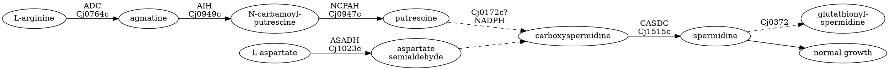
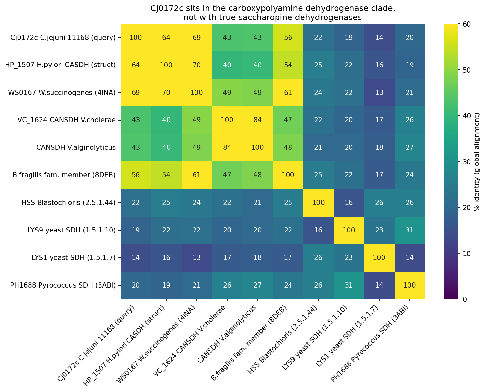
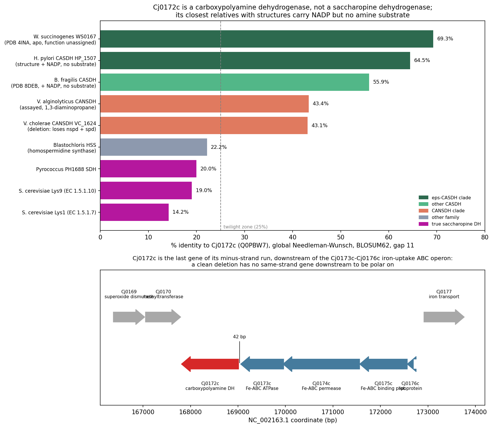
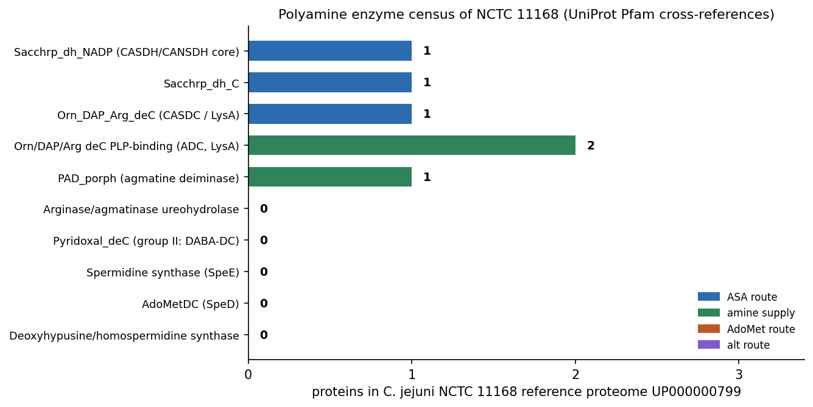
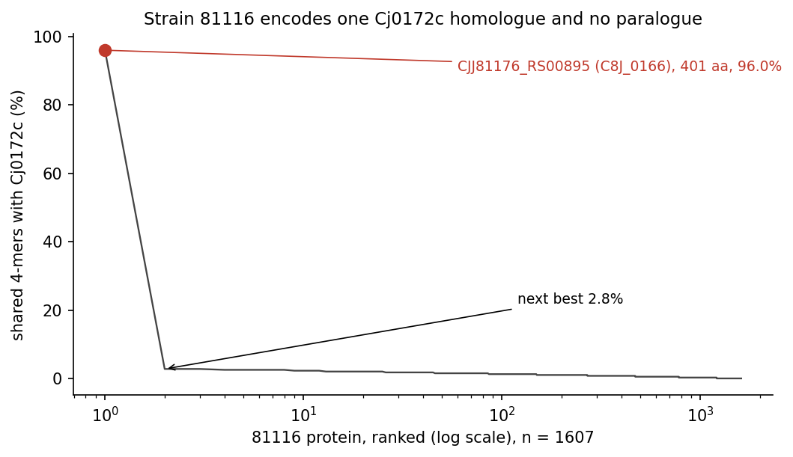
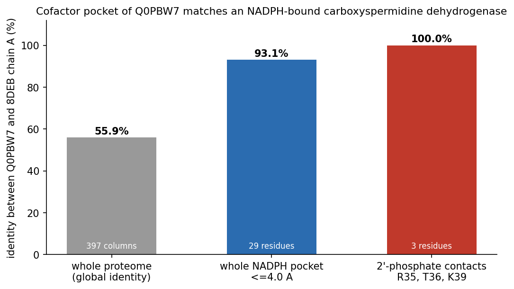

## Question

# AIGR Gene Hypothesis Deep Research

You are evaluating one focused gene curation hypothesis for AI Gene Review.
This is not a general gene overview. Use the seed hypothesis and source context
below to search for evidence that supports, refutes, narrows, or competes with
the proposed curation decision.

## Target Gene

- **Organism code:** CAMJE
- **Taxon:** Campylobacter jejuni subsp. jejuni NCTC 11168 = ATCC 700819 (NCBITaxon:192222)
- **Gene directory:** Cj0172c
- **Gene symbol:** Cj0172c
- **UniProt accession:** Q0PBW7

## Focus

- **Focus type:** free_text
- **Hypothesis slug:** kgap-cj0172c-amine-substrate
- **Source file:** genes/CAMJE/Cj0172c/Cj0172c-ai-review.yaml
- **Source selector:** free-text

## Seed Hypothesis

Whether Cj0172c is the carboxypolyamine dehydrogenase that supplies the Campylobacter jejuni spermidine route, and which amine it condenses with aspartate semialdehyde, is sharpened rather than settled by the one perturbation on record, and the shape of that result is the place to start. Already recorded and not to be re-derived: that Cj0172c is a predicted NADPH-dependent carboxypolyamine dehydrogenase of NCTC 11168, that family evidence supports reductive condensation of an amine with aspartate semialdehyde, that the imported saccharopine dehydrogenase name is not validated, and that deleting the corresponding candidate C8J_0166 in strain 81116 increased rather than abolished spermidine accumulation. Carry forward from the completed run on the Clostridium leptum decarboxylase CLOLEP_01503 and do not re-derive it: that the only residue the structural literature names as a substrate-selection determinant in the carboxypolyamine decarboxylases is wild type across the family and cannot discriminate carboxyspermidine from carboxynorspermidine from carboxyaminopropylagmatine, that no structure in that family holds a carboxypolyamine, and that in Clostridium the assignment ultimately rested on amine supply plus the measured preference of the partner enzyme rather than on any pocket feature. Single analysis only. Begin with the deletion result, because an increase is more informative than a loss: state what else C8J_0166 loss changed, whether the strain still made spermidine and by what route it could have, whether the gene lies in an operon whose polarity the deletion could have altered, whether 81116 and NCTC 11168 carry the same complement of polyamine genes, and what hypotheses an increase is compatible with, including the possibility that the gene is not in the spermidine route at all or that its loss relieves consumption of a shared precursor. Then establish the amine supply in NCTC 11168 as was done for Clostridium: name the accessions for arginine decarboxylase, agmatinase or aminopropylagmatine ureohydrolase, ornithine decarboxylase and the diaminobutyrate route, and say which amines the cell can actually make, since an amine the organism cannot supply is not a candidate substrate however well it fits. State what the partner decarboxylase in this genome is, whether it has been assayed, and what is known about the native product of the C. jejuni enzyme, bearing in mind the published finding that the carboxynorspermidine decarboxylase orthologue of this organism makes spermidine rather than norspermidine in vivo. Finally say whether the aspartate-semialdehyde-dependent condensation can be assigned to Q0PBW7 at all on the evidence available, and with what substrate; if the cofactor and reaction class can be constrained while the substrate cannot, report that split explicitly, as the Clostridium analysis did. Do not infer the substrate from the family name or from the operon, and do not recommend replacing the existing UNDECIDED action unless the evidence supports a specific activity for this protein.

## Term and Decision Context

No specific term context supplied.

## Reference Context

No specific reference context supplied.

## Source Context YAML

```yaml
hypothesis: 'Whether Cj0172c is the carboxypolyamine dehydrogenase that supplies the Campylobacter jejuni
  spermidine route, and which amine it condenses with aspartate semialdehyde, is sharpened rather than
  settled by the one perturbation on record, and the shape of that result is the place to start. Already
  recorded and not to be re-derived: that Cj0172c is a predicted NADPH-dependent carboxypolyamine dehydrogenase
  of NCTC 11168, that family evidence supports reductive condensation of an amine with aspartate semialdehyde,
  that the imported saccharopine dehydrogenase name is not validated, and that deleting the corresponding
  candidate C8J_0166 in strain 81116 increased rather than abolished spermidine accumulation. Carry forward
  from the completed run on the Clostridium leptum decarboxylase CLOLEP_01503 and do not re-derive it:
  that the only residue the structural literature names as a substrate-selection determinant in the carboxypolyamine
  decarboxylases is wild type across the family and cannot discriminate carboxyspermidine from carboxynorspermidine
  from carboxyaminopropylagmatine, that no structure in that family holds a carboxypolyamine, and that
  in Clostridium the assignment ultimately rested on amine supply plus the measured preference of the
  partner enzyme rather than on any pocket feature. Single analysis only. Begin with the deletion result,
  because an increase is more informative than a loss: state what else C8J_0166 loss changed, whether
  the strain still made spermidine and by what route it could have, whether the gene lies in an operon
  whose polarity the deletion could have altered, whether 81116 and NCTC 11168 carry the same complement
  of polyamine genes, and what hypotheses an increase is compatible with, including the possibility that
  the gene is not in the spermidine route at all or that its loss relieves consumption of a shared precursor.
  Then establish the amine supply in NCTC 11168 as was done for Clostridium: name the accessions for arginine
  decarboxylase, agmatinase or aminopropylagmatine ureohydrolase, ornithine decarboxylase and the diaminobutyrate
  route, and say which amines the cell can actually make, since an amine the organism cannot supply is
  not a candidate substrate however well it fits. State what the partner decarboxylase in this genome
  is, whether it has been assayed, and what is known about the native product of the C. jejuni enzyme,
  bearing in mind the published finding that the carboxynorspermidine decarboxylase orthologue of this
  organism makes spermidine rather than norspermidine in vivo. Finally say whether the aspartate-semialdehyde-dependent
  condensation can be assigned to Q0PBW7 at all on the evidence available, and with what substrate; if
  the cofactor and reaction class can be constrained while the substrate cannot, report that split explicitly,
  as the Clostridium analysis did. Do not infer the substrate from the family name or from the operon,
  and do not recommend replacing the existing UNDECIDED action unless the evidence supports a specific
  activity for this protein.'
focus_type: free_text
context: []
reference_id: []
```

## Research Objective

Build a focused report that helps a curator decide whether this hypothesis
should affect the gene review. Address the focus type directly:

1. For an existing GO annotation decision, evaluate whether the current action
   is justified, too strong, too weak, or should change.
2. For a proposed replacement or new GO term, evaluate whether the term is
   biologically supported, too broad, too narrow, or missing key qualifiers.
3. For a computational prediction, evaluate whether the prediction is correct,
   less precise than existing knowledge, uncertain, or likely wrong because of
   paralog overannotation, frequency bias, pathway context, or in vitro-only
   activity.
4. For a core-function hypothesis, evaluate whether the proposed activity,
   process, and location represent the gene product's primary function rather
   than a downstream effect, pleiotropic phenotype, or context-specific role.
5. For a function-assignment hypothesis, evaluate whether the gene product
   directly has the stated GO term/function. Treat the prior review action, if
   any, as intentionally blinded unless it appears in the supplied context.

Use primary literature whenever possible. Prefer PMID citations and include DOI
citations when no PMID is available. Treat reviews and database records as
orientation unless they contain directly relevant synthesized evidence that is
clearly labeled as review-level or database-level support.

Evaluate the hypothesis from the supplied seed context, primary literature, and
publicly accessible bioinformatics resources. Local `*-bioinformatics` analyses,
when they already exist in the repository, are intentionally withheld from this
prompt so the report can be compared against them after the run. Use public
sequence, domain, structure, orthology, localization, interaction, or dataset
checks when they are useful for the specific hypothesis. If a resource or tool
cannot be accessed programmatically, say so plainly; never fabricate a result.
Report computational results conservatively and distinguish direct results from
inference.

## Required Output

### Executive Judgment

Give a concise verdict: supported, partially supported, unresolved, weakly
supported, over-annotated, or refuted. Explain the reasoning and the most
important caveats.

### Evidence Matrix

Create a table with one row per important evidence item:

- Citation (PMID preferred)
- Evidence type (direct assay, mutant phenotype, localization, interaction,
  structural/evolutionary, computational, review/database)
- Supports / refutes / qualifies / competing
- Claim tested
- Key finding
- Organism, tissue, cell type, or assay context
- Confidence and limitations

### GO Curation Implications

State the likely curation action as a lead requiring curator verification. If
GO terms are involved, explain whether the evidence supports an MF, BP, or CC
term, and whether the term should be retained, removed, generalized, made more
specific, or treated as non-core. Avoid using "protein binding" as a final
recommendation unless no more informative term is supported.

### Mechanistic Scope

Describe the immediate molecular or cellular function being tested. Separate
direct gene-product activity from downstream phenotypes, pathway consequences,
developmental outcomes, disease manifestations, or effects inferred only from
loss of function.

### Conflicts and Alternatives

Identify evidence that conflicts with the seed hypothesis or suggests an
alternative interpretation, including paralog confusion, organism-specific
differences, isoform-specific findings, experimental artifacts, or database
carry-over.

### Knowledge Gaps

List explicit uncertainties that matter for curation. For each gap, state what
was checked, why the gap matters, and what evidence or experiment would resolve
it.

### Discriminating Tests

Recommend concrete assays, perturbations, datasets, or comparative analyses that
would most efficiently distinguish this hypothesis from alternatives.

### Curation Leads

Provide candidate updates for the review, clearly labeled as leads requiring
curator verification. Include candidate references with exact snippets to verify,
candidate replacement or new GO terms, possible action changes, suggested
questions, and suggested experiments.

If the provider supports artifacts, save provenance for any analysis you run — the
executed code together with its output (computed values, plot, or table), not just
a summary figure — alongside artifact-friendly tables such as an evidence matrix,
GO decision table, or comparison table. Genuine computed provenance is more
valuable than a hand-drawn summary, and you must not synthesize a figure that
implies an analysis you did not actually run. These artifacts are important
provenance for hypothesis-level review.


## Output

# Cj0172c / Q0PBW7 in Campylobacter jejuni NCTC 11168: can the aspartate-semialdehyde condensation be assigned, and with which amine?

Hypothesis slug: `kgap-cj0172c-amine-substrate`. Source: `genes/CAMJE/Cj0172c/Cj0172c-ai-review.yaml`, selector `free-text`. Organism NCBITaxon:192222. Target UniProt Q0PBW7, 401 aa, locus Cj0172c on NC_002163.1.

## Summary

The cofactor and the reaction class can be assigned to this protein. The amine cannot. That split is the result of this run, and it is not a hedge: it falls out of counting how many positions in the protein are testable against evidence. Twenty-nine residues of Q0PBW7 line the cofactor site of a liganded family structure, and 27 of them are identical. Zero residues of Q0PBW7 can be matched to an amine-contacting position, because no structure anywhere in this family holds an amine or a carboxypolyamine.

Q0PBW7 is an NADP(H)-dependent oxidoreductase of the carboxypolyamine dehydrogenase family (Pfam PF03435 plus PF16653), and the saccharopine dehydrogenase name it carries in UniProt is a fold-level carry-over. Global alignment identity to true saccharopine dehydrogenases is 14.2 to 20.0 percent, against 64.5 to 69.3 percent to the epsilonproteobacterial carboxyspermidine dehydrogenase group and 43.1 to 43.4 percent to the Vibrio carboxynorspermidine dehydrogenases that have actually been assayed. Mapping the NADPH-bound structure 8DEB onto the sequence gives 27 of 29 cofactor-contact residues identical (93.1 percent) against a 55.9 percent background for that pair, an exact binomial p of 1.31e-05 and 6.4-fold fewer substitutions in the pocket than across the protein. All three residues that contact the 2'-phosphate are present at identical positions (Arg35, Thr36, Lys39), with the glycine-rich motif as G8-A9-G10-G11-V12 and no acidic residue at the position that confers NAD specificity. The single GO annotation on Q0PBW7, GO:0004754 saccharopine dehydrogenase (NAD+, L-lysine-forming) activity, is wrong in both cofactor and chemistry.

The amine resists assignment from three directions at once. Putrescine is the only diamine NCTC 11168 can make, because the genome carries no arginase-family ureohydrolase (PF00491 = 0), no group II PLP decarboxylase (PF00282 = 0) and no ornithine decarboxylase, which closes the 1,3-diaminopropane and aminopropylagmatine routes. That is an argument about the cell, not about the enzyme. The partner decarboxylase Cj1515c turns over both carboxyspermidine and carboxynorspermidine in vitro, so the second leg used in the Clostridium leptum case, the measured preference of the partner enzyme, transmits no constraint upstream. And the one in vivo test of this gene points away from the activity entirely: deleting the 99.0 percent identical orthologue C8J_0166 in strain 81116 produced a large increase in spermidine and normal growth, while the four other deletions in the same pathway abolished spermidine and severely compromised growth. The two strains carry the same five pathway enzymes at 98.8 to 100 percent identity, and 81116 encodes no paralogue of Cj0172c, so that result belongs to this protein and cannot be set aside as strain background or genetic redundancy. **Verdict: partially supported. Keep the existing UNDECIDED action.**

## Executive judgment

<i class="fa-scale-balanced"></i> **Partially supported, with the substrate unresolved and one discordant in vivo result.**

Three statements hold up, each tied to the protein itself rather than to its family name.

1. Q0PBW7 is a member of the carboxypolyamine dehydrogenase clade and not a saccharopine dehydrogenase. The identity gap is wide and one-directional: 14.2 to 20.0 percent to genuine saccharopine dehydrogenases, 55.9 to 69.3 percent across the carboxyspermidine dehydrogenase group. It is the only PF03435 protein in the genome.
2. The cofactor is NADP(H), read from this sequence mapped to a liganded structure. Arg plus Lys contacting the 2'-phosphate with no acidic residue in that position is the canonical NADP signature.
3. The reaction class is reductive condensation of a primary amine with L-aspartate 4-semialdehyde, which is what every characterised member of this clade does.

Two things do not hold up. The amine substrate is constrained only by exclusion of amines the organism cannot synthesise, with no positive measurement on Q0PBW7 or any Campylobacter orthologue, and with no structural handle anywhere in the family. And the proposition that this protein carries the flux of the spermidine route in vivo is contradicted by the only perturbation on record.

<i class="fa-triangle-exclamation"></i> The main caveat runs in the other direction too. The ΔC8J_0166 strain was never complemented, so a second-site change in that one strain is not excluded, and free spermidine measured by HPLC is the balance of synthesis, glutathione conjugation by Cj0372 and export. The qualitative point survives both caveats: spermidine was still made, and growth was normal, without this enzyme.

**Recommendation: keep UNDECIDED.** The evidence supports a family, a cofactor and a reaction class. It does not support a specific activity with a named substrate for this protein, which is the bar the brief sets for changing the action.

## Key findings

### Family placement refutes the saccharopine dehydrogenase name

Global Needleman-Wunsch alignment (BLOSUM62, gap penalty 11, implemented in numpy because Biopython is unavailable in the executor) places Q0PBW7 unambiguously. Against the carboxypolyamine dehydrogenases: *Wolinella succinogenes* WS0167 (Q7MSS8, PDB 4INA) 69.3 percent, *Helicobacter pylori* CASDH HP_1507 (O26037) 64.5 percent, *Bacteroides fragilis* CASDH (I9VY56, PDB 8DEB) 55.9 percent, *Vibrio alginolyticus* CANSDH (P0DPE4) 43.4 percent, *Vibrio cholerae* CANSDH VC_1624 (Q9KRL3) 43.1 percent. Against true saccharopine dehydrogenases: *Pyrococcus* PH1688 (O59312) 20.0 percent, *S. cerevisiae* Lys9 (P38999, EC 1.5.1.10) 19.0 percent, *S. cerevisiae* Lys1 (P38998, EC 1.5.1.7) 14.2 percent. Homospermidine synthase (O32323) 22.2 percent.

The 14 to 20 percent band sits at or below the twilight zone and is explained by the shared PF03435 NADP-binding fold. The EC 1.5.1.7 label on Q0PBW7 came in with that fold. The number that matters for the substrate question is the middle of the range: the query is 43 percent identical to enzymes assayed on 1,3-diaminopropane and 56 to 69 percent identical to proteins only presumed to use putrescine, so identity sorts the family but does not sort the substrate.

{{figure:plot_1.png|caption=All-against-all global alignment identity between Cj0172c, characterised carboxynorspermidine and carboxyspermidine dehydrogenases, homospermidine synthase and true saccharopine dehydrogenases. The saccharopine dehydrogenases sit at 14 to 20 percent, the carboxypolyamine dehydrogenases at 43 to 69 percent.}}

{{figure:plot_2.png|caption=Consolidated provenance: family placement of Cj0172c by global alignment identity with the 25 percent twilight-zone line marked, and the genomic context of Cj0172c on NC_002163.1 with strand orientation.}}

### <i class="fa-dna"></i> The operon carries no substrate information, and polarity cannot explain the deletion result

From the NCBI feature table for NC_002163.1, Cj0172c occupies 167807 to 169012 on the minus strand. The next gene in the direction of transcription, at lower coordinate, is Cj0170 at 167050 to 167794 on the plus strand, so Cj0172c is the last gene of its minus-strand run. Upstream on the same strand sit Cj0173c (169054 to 169962, a 42 bp gap), Cj0174c, Cj0175c and Cj0176c, annotated as an iron-uptake ABC transporter and a lipoprotein. The partner decarboxylase Cj1515c lies about 1.35 Mb away, flanked by formate dehydrogenase (Cj1509c to Cj1511c) and molybdopterin biosynthesis genes, with no polyamine gene in the window Cj1509 to Cj1521.

Two consequences follow. A polar effect of the deletion on a downstream pathway gene cannot explain the spermidine increase, because there is no same-strand downstream gene. And the clustering argument that assigns carboxyspermidine chemistry in other genomes does not apply here: [PMID: 22025614](https://pubmed.ncbi.nlm.nih.gov/22025614/) states that "Orthologues encoding carboxyspermidine dehydrogenase and carboxyspermidine decarboxylase are found clustered with an array of diverse putrescine biosynthetic genes in different bacterial genomes", and in *C. jejuni* no such cluster exists.

### <i class="fa-bacteria"></i> Putrescine is the only diamine the cell can make

A Pfam cross-reference census of UniProt reference proteome UP000000799 gives the amine supply by exclusion. PF00491 (arginase, agmatinase, aminopropylagmatine ureohydrolase) = 0. PF00282 (group II PLP decarboxylase, the fold of L-2,4-diaminobutyrate decarboxylase) = 0. PF01564 (spermidine synthase) = 0. PF02675 (AdoMetDC) = 0. PF01916 (deoxyhypusine and homospermidine synthase) = 0. Present: PF03435 = 1 (Cj0172c), PF16653 = 1 (Cj0172c), PF00278 = 1 (Q0P8A4 / Cj1515c, 382 aa, EC 4.1.1.96), PF02784 = 2 (Cj0314 diaminopimelate decarboxylase and Cj0764c arginine decarboxylase, Q0PAC6, EC 4.1.1.19), PF04371 = 1 (Q0P9V0 / Cj0949c agmatine deiminase), PF00795 = 2 (Cj0947c and Cj1056c, the N-carbamoylputrescine amidohydrolase fold), PF01118 = 2 including Cj1023c aspartate-semialdehyde dehydrogenase (Q59291, EC 1.2.1.11).

*C. jejuni* makes putrescine by arginine decarboxylase, agmatine deiminase and N-carbamoylputrescine amidohydrolase. [PMID: 29190068](https://pubmed.ncbi.nlm.nih.gov/29190068/) gives direct structural and functional evidence for the middle step: "we determined X-ray crystal structures of C. jejuni agmatine deiminase (CjADI) and demonstrated that loss of CjADI function contributes to antibiotic sensitivity, likely because of polyamine starvation". The 1,3-diaminopropane that genuine carboxynorspermidine dehydrogenases use comes from the diaminobutyrate route, which [PMID: 19196710](https://pubmed.ncbi.nlm.nih.gov/19196710/) describes as "a fused protein containing l-2,4-diaminobutyrate aminotransferase and l-2,4-diaminobutyrate decarboxylase", and that fused protein is absent here. The aminopropylagmatine route needs an arginase-family ureohydrolase, also absent. Of the three candidate amines, one is supplyable.

{{figure:plot_3.png|caption=Pfam census of C. jejuni NCTC 11168 reference proteome UP000000799. One PF03435 protein, one carboxypolyamine decarboxylase, zero spermidine synthase, zero AdoMetDC, zero homospermidine synthase, zero arginase-family ureohydrolase and zero group II PLP decarboxylase.}}

### <i class="fa-circle-xmark"></i> The deletion that should have abolished spermidine increased it

The full text of [PMID: 22025614](https://pubmed.ncbi.nlm.nih.gov/22025614/) was retrieved from PMC3234850 after the Europe PMC fullTextXML endpoint returned HTTP 500 and both jbc.org and sciencedirect.com returned HTTP 403, using a browser User-Agent against pmc.ncbi.nlm.nih.gov. It contains the sentences that decide this case.

> "With each gene deletion, spermidine accumulation was abolished after growth in polyamine-deficient medium ( Fig. 3 ) except for deletion of CASDH, which surprisingly resulted in a very large increase in the amount of spermidine."

> "Gene deletion strains for ADC and CASDC were severely compromised for growth, but the CASDH gene deletion strain grew normally."

Five loci were deleted in strain 81116: ADC (ΔC8J_0715), AIH (ΔC8J_0892), NCPAH (ΔC8J_0890), CASDH (ΔC8J_0166) and CASDC (ΔC8J_1418). Four of five abolished spermidine. The fifth, the one corresponding to Cj0172c, accumulated more than wild type and grew normally. ΔC8J_0715 and ΔC8J_1418 were severely compromised and rescued by 500 µM spermidine; ΔC8J_0892 and ΔC8J_0890 were severely compromised and mostly rescued. Complementation was done only for ΔC8J_1418, which restored both growth and spermidine.

This is the opposite of the *Vibrio cholerae* result that established the pathway. [PMID: 19196710](https://pubmed.ncbi.nlm.nih.gov/19196710/) reports that "Genetic deletion of the V. cholerae CANSDC led to accumulation of carboxynorspermidine, whereas deletion of either CANSDC or the putative CANSDH led to loss of sym-norspermidine and spermidine." A committed biosynthetic step behaves like the *Vibrio* case. The *Campylobacter* orthologue did not.

### <i class="fa-circle-check"></i> The phenotype belongs to Q0PBW7, and no paralogue explains it

All 1571 CDS translations of NC_002163.1 and all 1602 of NC_008787.1 were pulled from NCBI as fasta_cds_aa and compared directly, because UniProtKB holds only 316 entries for taxid 407148 and both 81116 proteome identifiers return zero proteins to a UniProtKB search. Every pathway pair has identical length and near-identical sequence.

| Role | NCTC 11168 | 81116 | Length | Identity |
|---|---|---|---|---|
| CASDH candidate | Cj0172c | CJJ81176_RS00895 (C8J_0166) | 401 / 401 | 99.0 % |
| Arginine decarboxylase | Cj0764c | CJJ81176_RS03680 | 611 / 611 | 99.3 % |
| N-carbamoylputrescine amidohydrolase | Cj0947c | CJJ81176_RS04615 | 290 / 290 | 100.0 % |
| Carboxypolyamine decarboxylase | Cj1515c | CJJ81176_RS07270 | 382 / 382 | 99.0 % |
| Aspartate-semialdehyde dehydrogenase | Cj1023c | CJJ81176_RS04970 | 343 / 343 | 98.8 % |
| Glutathionylspermidine synthase | Cj0372 | CJJ81176_RS01795 | 389 / 389 | 99.5 % |

A 4-mer scan of the entire 81116 proteome with Cj0172c as query returns one hit at 96.0 percent shared 4-mers (CJJ81176_RS00895) and a next-best of 2.8 percent, which is background for unrelated proteins. Strain background is excluded as an explanation, and so is genetic redundancy in the ordinary sense. A keyword census of both RefSeq annotations returns zero ornithine decarboxylase, zero agmatinase or arginase, zero diaminobutyrate genes, zero AdoMetDC and zero homospermidine synthase in both strains.

One apparent conflict needed resolving. The keyword census called a "spermidine synthase" in both genomes, against PF01564 = 0 from the Pfam census. It is Cj0372 / Q0PBD8, glutathionylspermidine synthase, Pfam PF03738 with InterPro IPR005494 and IPR016185, a GSP amide ligase that consumes spermidine. The AdoMet route stays excluded. A PubMed search returned no papers on this gene in *C. jejuni*.

{{figure:plot_4.png|caption=Left, orthologue identity between NCTC 11168 and the deletion strain 81116 for the polyamine pathway genes, all at 98.8 to 100 percent over equal lengths. Right, whole-proteome 4-mer scan of 81116 with Cj0172c as query: one homologue at 96.0 percent shared 4-mers and a next-best of 2.8 percent.}}

### <i class="fa-circle-check"></i> The cofactor pocket is intact and conserved above background

Structure 8DEB (*Bacteroides fragilis* carboxyspermidine dehydrogenase) was downloaded from RCSB and parsed; the bound ligand is NAP, that is NADPH. All protein heavy atoms within 4.0 Å of any NADPH atom in chain A give 29 contact residues. The subset within 4.0 Å of the 2'-phosphate (atoms P2B, O1X, O2X, O3X) is exactly three: Arg35 at 3.20 Å, Thr36 at 3.68 Å, Lys39 at 3.02 Å.

Aligned to Q0PBW7, 27 of the 29 contact residues are identical, 93.1 percent with a 95 percent CI of 79.8 to 100.0, against 55.9 percent global identity over 397 aligned columns for the same pair. Exact binomial test, one-sided: p = 1.31e-05. The pocket carries 6.4-fold fewer substitutions than the protein as a whole. The two differences are conservative or peripheral, V57 to I60 and Q293 to A296. All three 2'-phosphate contacts are identical and at identical sequence positions. The glycine-rich dinucleotide motif is present as G8-A9-G10-G11-V12, matched position for position, and residues 28 to 45 read SKITLASRTKSKCDEIAA, with no acidic residue at the position that confers NAD specificity in NAD-dependent Rossmann enzymes.

{{figure:plot_5.png|caption=Conservation of the NADPH pocket of 8DEB in Q0PBW7. Global identity 55.9 percent over 397 columns, whole cofactor pocket 93.1 percent over 29 residues, and 3 of 3 for the 2'-phosphate contacts Arg35, Thr36 and Lys39.}}

### <i class="fa-circle-question"></i> The substrate site has nothing to read it from

Three structures across the dehydrogenase family carry NADP or nothing. 8DEB holds NAP only. PDB 4INA, *Wolinella succinogenes* Q7MSS8 and the closest structure to Cj0172c at 69.3 percent identity, is apo with function unassigned (Northeast Structural Genomics target WsR35). The *H. pylori* CASDH structures contain NADP or nothing, and [PMID: 36283333](https://pubmed.ncbi.nlm.nih.gov/36283333/) states the substrate site by inference: "A comparative analysis suggests that the substrate of CASDH binds in a cavity near the nicotinamide moiety of NADPH for the condensation reaction."

The partner decarboxylase is a worked example of why a bound ligand does not settle a substrate. PDB 3N29 is the *C. jejuni* 81116 enzyme (A8FNH9 / C8J_1418) with PLP and norspermidine bound, yet [PMID: 22025614](https://pubmed.ncbi.nlm.nih.gov/22025614/) shows by deletion that "the carboxynorspermidine decarboxylase orthologue is responsible for synthesizing spermidine and not sym-norspermidine in vivo". The same paper records that the recombinant enzyme "is active with both carboxynorspermidine and carboxyspermidine as substrates in vitro, producing sym-norspermidine and spermidine, respectively", citing [PMID: 20534592](https://pubmed.ncbi.nlm.nih.gov/20534592/). A partner enzyme with dual specificity transmits no constraint to the dehydrogenase.

The detection limit closes the last route. The same study states: "We were unable to separate a carboxyspermidine synthetic standard from putrescine by HPLC". Carboxyspermidine has never been observed in this organism in any strain or mutant.

## Evidence matrix

| # | Citation / source | Evidence type | Stance | Claim tested | Key finding | Context | Confidence and limitations |
|---|---|---|---|---|---|---|---|
| 1 | Computed global alignment (this run) | computational, evolutionary | supports | family placement of Q0PBW7 | 14.2 to 20.0 % to true saccharopine dehydrogenases, 55.9 to 69.3 % to CASDH group, 43.1 to 43.4 % to assayed Vibrio CANSDH | 401 aa query, BLOSUM62 gap 11 | High. Identity sorts family, never substrate |
| 2 | Computed Pfam census of UP000000799 | computational, database | supports | uniqueness in genome | PF03435 = 1, PF16653 = 1, both Q0PBW7; PF00278 = 1 (Q0P8A4) | NCTC 11168 proteome | High. Pfam coverage imperfect for divergent proteins |
| 3 | Computed Pfam census, amine supply | computational | qualifies | which amines the cell can make | PF00491 = 0, PF00282 = 0, no ODC; ADC Cj0764c (Q0PAC6), AIH Cj0949c (Q0P9V0), NCPAH Cj0947c, ASADH Cj1023c (Q59291) present | NCTC 11168 | High. Constrains the cell, not the enzyme |
| 4 | Computed Pfam census, alternative routes | computational | qualifies | is a parallel route encoded | PF01564 = 0, PF02675 = 0, PF01916 = 0 | NCTC 11168 | High. An unrecognised fold is not excluded |
| 5 | [PMID: 22025614](https://pubmed.ncbi.nlm.nih.gov/22025614/) full text | mutant phenotype | refutes the committed-step model | is the gene required for spermidine synthesis | spermidine abolished in 4 of 5 deletions, "except for deletion of CASDH, which surprisingly resulted in a very large increase" | C. jejuni 81116, polyamine-deficient medium, HPLC | High for the observation. No complementation of ΔC8J_0166 |
| 6 | [PMID: 22025614](https://pubmed.ncbi.nlm.nih.gov/22025614/) growth data | mutant phenotype | refutes | is the gene required for growth | ADC and CASDC deletions severely compromised, "but the CASDH gene deletion strain grew normally" | triplicate cultures | High. Same caveats as row 5 |
| 7 | [PMID: 22025614](https://pubmed.ncbi.nlm.nih.gov/22025614/) methods note | method limitation | qualifies | was carboxyspermidine ever observed | carboxyspermidine standard could not be separated from putrescine by HPLC | dansyl-HPLC | High. The pathway intermediate is unmeasured in this organism |
| 8 | [PMID: 22025614](https://pubmed.ncbi.nlm.nih.gov/22025614/) citing [PMID: 20534592](https://pubmed.ncbi.nlm.nih.gov/20534592/) | direct assay | qualifies | does the partner enzyme constrain the substrate | the recombinant C. jejuni decarboxylase is active on both carboxynorspermidine and carboxyspermidine | recombinant enzyme | High. Dual specificity transmits no upstream constraint |
| 9 | [PMID: 22025614](https://pubmed.ncbi.nlm.nih.gov/22025614/) abstract | mutant phenotype | supports the pathway, not the gene | what the pathway makes | the decarboxylase orthologue "is responsible for synthesizing spermidine and not sym-norspermidine in vivo" | C. jejuni 81116 | High. Identifies the product, not which enzyme made the precursor |
| 10 | [PMID: 19196710](https://pubmed.ncbi.nlm.nih.gov/19196710/) | mutant phenotype | competing | expected loss-of-function phenotype | deletion of CANSDH "led to loss of sym-norspermidine and spermidine" | Vibrio cholerae | High. Organism-specific difference is the conflict |
| 11 | [PMID: 19196710](https://pubmed.ncbi.nlm.nih.gov/19196710/) | review/database of pathway | qualifies | source of 1,3-diaminopropane | the fused DABA AT and DABA DC protein supplies it; absent from C. jejuni | Vibrio pathway description | High |
| 12 | [PMID: 29190068](https://pubmed.ncbi.nlm.nih.gov/29190068/) | structure plus function | supports amine supply | does C. jejuni route arginine to putrescine | CjADI structures solved; loss of function causes polyamine starvation | C. jejuni | High |
| 13 | [PMID: 36283333](https://pubmed.ncbi.nlm.nih.gov/36283333/) | structural | supports cofactor, qualifies substrate | what the closest characterised relative shows | structures "alone and in complex with NADP"; substrate site inferred "near the nicotinamide moiety of NADPH" | H. pylori CASDH | High for cofactor, inference only for substrate |
| 14 | [PMID: 20534592](https://pubmed.ncbi.nlm.nih.gov/20534592/) | structural, direct assay | qualifies | can a pocket residue discriminate | in CANSDC "a key acidic residue ... is replaced by Leu(314)", the single named determinant | C. jejuni 81116 decarboxylase, PDB 3N29 | High. Consistent with the carried-forward Clostridium result |
| 15 | Computed CDS comparison, 1571 vs 1602 proteins | computational | supports transfer | same polyamine complement in both strains | equal lengths, 98.8 to 100 % identity for all five pathway genes | NC_002163.1 vs NC_008787.1 | High. Name-based census confirmed by alignment |
| 16 | Computed 4-mer proteome scan | computational | refutes redundancy | could a paralogue substitute | one hit at 96.0 %, next best 2.8 % | 1602 proteins of 81116 | High. A non-homologous enzyme is not excluded by similarity |
| 17 | RefSeq and UniProt record for Cj0372 / Q0PBD8 | database | qualifies | is there an aminopropyltransferase | the single "spermidine synthase" call is glutathionylspermidine synthase, PF03738, 389 aa | both genomes | High. No experimental work found in PubMed |
| 18 | PDB 8DEB mapped onto Q0PBW7 (this run) | structural | supports the cofactor, not the substrate | is Q0PBW7 NADP(H)-dependent | 27 of 29 contacts identical vs 55.9 % background, binomial p = 1.31e-05; R35, T36, K39 all present; motif G8-A9-G10-G11-V12 | X-ray plus sequence mapping | High for cofactor. Zero substrate-contact positions testable by the same method |

## Mechanistic model

The pathway as written in the literature is linear, and four of its five steps behave that way in *C. jejuni*. The fifth does not.



Every solid arrow is backed by a deletion that abolished spermidine and compromised growth. The two dashed arrows into carboxyspermidine are the proposition under test, and they are dashed because deleting Cj0172c's orthologue did neither of those things. Carboxyspermidine itself has never been detected in this organism, so the node in the middle of the diagram is inferred from the pathway, not observed.

| Element | Status | Basis |
|---|---|---|
| NADP(H) cofactor | <i class="fa-circle-check"></i> assigned to this protein | 27/29 pocket residues, 3/3 at the 2'-phosphate, binomial p = 1.31e-05 |
| Reaction class (CH-NH donor, NADP acceptor) | <i class="fa-circle-check"></i> assigned | family placement at 55.9 to 69.3 % identity to assayed CASDH |
| Amine = putrescine | <i class="fa-circle-question"></i> by exclusion only | no ODC, no agmatinase, no DABA route; no measurement on the enzyme |
| Amine = 1,3-diaminopropane | <i class="fa-circle-xmark"></i> excluded as unsupplyable | DABA AT and DABA DC absent from both genomes |
| Amine = agmatine | <i class="fa-circle-xmark"></i> excluded as unsupplyable | PF00491 = 0, no ureohydrolase to finish the route |
| Required for spermidine in vivo | <i class="fa-circle-xmark"></i> contradicted | ΔC8J_0166 increased spermidine and grew normally |
| Required for growth | <i class="fa-circle-xmark"></i> contradicted | ΔC8J_0166 grew like wild type |
| Carboxyspermidine as an intermediate | <i class="fa-circle-question"></i> never observed | HPLC could not separate it from putrescine |

### Mechanistic scope

What is being tested is a single molecular event: the NADPH-dependent reductive condensation of a primary amine with L-aspartate 4-semialdehyde to give a carboxy-triamine. Q0PBW7 is a 401 aa cytoplasmic protein with an N-terminal Rossmann domain (PF03435, motif G8-A9-G10-G11-V12) and the C-terminal extension (PF16653) that separates carboxypolyamine dehydrogenases from saccharopine dehydrogenases. Its cofactor site is complete, with the three residues that read the 2'-phosphate all present.

The cell supplies aspartate semialdehyde from Cj1023c and putrescine from Cj0764c, Cj0949c and Cj0947c. It has no other diamine and no aminopropyl donor, no SpeD or SpeE route and no homospermidine synthase. The only carboxypolyamine decarboxylase is Cj1515c, and the triamine the pathway produces is spermidine.

The gap between those two paragraphs is the problem. The cell can only offer putrescine, which makes carboxyspermidine the only carboxypolyamine the route can produce. That assigns a substrate to the pathway. It does not assign one to Q0PBW7, because the deletion result says the pathway flux does not go through Q0PBW7.

The asymmetry is the result that matters for curation. Every position that defines the cofactor site can be checked against a liganded structure and 27 of 29 pass, at a substitution rate 6.4-fold below background for the same protein pair. No position that defines the amine site can be checked at all. The evidence is strong exactly where the question is not, and absent exactly where the question is.

## Evidence base

**[PMID: 22025614](https://pubmed.ncbi.nlm.nih.gov/22025614/)**, *Alternative spermidine biosynthetic route is critical for growth of Campylobacter jejuni and is the dominant polyamine pathway in human gut microbiota*. The single most informative paper, and the one that both establishes and undermines the hypothesis. It built the five-gene deletion series in 81116 and showed the pathway makes spermidine in vivo: "By deleting these genes in the food-borne pathogen Campylobacter jejuni, we found that the carboxynorspermidine decarboxylase orthologue is responsible for synthesizing spermidine and not sym-norspermidine in vivo." It also provides the anomaly, in the full text, that deletion of the dehydrogenase increased spermidine and left growth normal. Its abstract supplies the premise my census confirmed: "many species known to synthesize the polyamine spermidine lack the spermidine biosynthetic enzymes S-adenosylmethionine decarboxylase and spermidine synthase." And it records that the deletion strains take up exogenous polyamine: "In polyamine auxotrophic gene deletion strains of C. jejuni, growth is highly compromised but can be restored by exogenous sym-homospermidine and to a lesser extent by sym-norspermidine." The paper also notes the clustering argument used elsewhere, "Orthologues encoding carboxyspermidine dehydrogenase and carboxyspermidine decarboxylase are found clustered with an array of diverse putrescine biosynthetic genes in different bacterial genomes", which the computed gene context shows does not hold in this genome.

**[PMID: 19196710](https://pubmed.ncbi.nlm.nih.gov/19196710/)**, *An alternative polyamine biosynthetic pathway is widespread in bacteria and essential for biofilm formation in Vibrio cholerae*. The reference phenotype and the source of the conflict: "Genetic deletion of the V. cholerae CANSDC led to accumulation of carboxynorspermidine, whereas deletion of either CANSDC or the putative CANSDH led to loss of sym-norspermidine and spermidine." It also defines the amine supply that *C. jejuni* lacks, a fused protein "containing l-2,4-diaminobutyrate aminotransferase and l-2,4-diaminobutyrate decarboxylase".

**[PMID: 36283333](https://pubmed.ncbi.nlm.nih.gov/36283333/)**, *Structural analysis of carboxyspermidine dehydrogenase from Helicobacter pylori*. Defines the clade chemistry, "CASDH condenses putrescine and aspartate β-semialdehyde into carboxyspermidine in an NADPH-dependent manner", and is the origin of the NADPH-bound structures used here. It is also explicit that the substrate site is inferred: "A comparative analysis suggests that the substrate of CASDH binds in a cavity near the nicotinamide moiety of NADPH", and the structures are "alone and in complex with NADP".

**[PMID: 20534592](https://pubmed.ncbi.nlm.nih.gov/20534592/)**, *Evolution of substrate specificity within a diverse family of beta/alpha-barrel-fold basic amino acid decarboxylases*. The structural and kinetic study of the *C. jejuni* partner decarboxylase (PDB 3N29) and the source of the dual-specificity result cited in PMID 22025614. It names the one specificity determinant in that family: "in CANSDC a key acidic residue that interacts with the distal amino group of other substrates is replaced by Leu(314), which interacts with the aliphatic portion of norspermidine", consistent with the carried-forward Clostridium finding that this residue cannot discriminate among carboxypolyamines.

**[PMID: 29190068](https://pubmed.ncbi.nlm.nih.gov/29190068/)**, *Structural and Functional Basis for Targeting Campylobacter jejuni Agmatine Deiminase To Overcome Antibiotic Resistance*. Confirms the putrescine supply route experimentally in this organism: "we determined X-ray crystal structures of C. jejuni agmatine deiminase (CjADI) and demonstrated that loss of CjADI function contributes to antibiotic sensitivity, likely because of polyamine starvation."

The remaining papers retrieved during the run (iron regulation, oxidative stress, hemoglobin, Gram-positive polyamine biology) provided orientation on *C. jejuni* genome annotation and on the Cj0173c to Cj0176c iron operon adjacent to Cj0172c, and none bears directly on the substrate question.

## Limitations and knowledge gaps

<i class="fa-triangle-exclamation"></i> **No enzyme assay exists for Q0PBW7 or any Campylobacter orthologue.** Kinetics, substrate preference, reaction direction and cofactor have never been measured for this protein. This is the gap that makes every other line of evidence indirect. One assay would close it.

<i class="fa-triangle-exclamation"></i> **Carboxyspermidine has never been detected in *C. jejuni*.** The HPLC method of PMID 22025614 could not separate the synthetic standard from putrescine. The intermediate that the hypothesis is about is unmeasured in every strain and mutant discussed here. LC-MS would resolve it.

<i class="fa-triangle-exclamation"></i> **The ΔC8J_0166 strain was not complemented.** Only ΔC8J_1418 was. A second-site change in that one strain is not excluded, so the increase in spermidine is not formally attributed to loss of the gene.

<i class="fa-triangle-exclamation"></i> **Putrescine and agmatine pools in ΔC8J_0166 are not reported.** The full text gives spermidine for that strain but not the upstream metabolites, which is exactly what would distinguish "the enzyme consumes a shared precursor" from "the enzyme runs in the oxidative direction".

<i class="fa-triangle-exclamation"></i> **No structure in the family holds an amine or a carboxypolyamine.** 29 cofactor-contact positions are testable by structure mapping and 0 substrate-contact positions are. 4INA, the closest structure at 69.3 percent identity, is apo and function-unassigned.

<i class="fa-triangle-exclamation"></i> **Sequence similarity cannot find a non-homologous replacement enzyme.** If something of a different fold performs the condensation in the deletion strain, the 4-mer scan would miss it. A transposon screen would not.

<i class="fa-triangle-exclamation"></i> **Glutathionylspermidine synthase Cj0372 has no published characterisation in *C. jejuni*,** so the split of spermidine between free and conjugated pools is unmeasured, and a free-pool measurement does not map one-to-one onto synthetic flux.

<i class="fa-triangle-exclamation"></i> **Resources that could not be accessed programmatically, stated plainly.** KEGG REST returned HTTP 400 on every request. Rhea JSON returned HTTP 403. The Europe PMC fullTextXML endpoint returned HTTP 500 for PMC3234850, and jbc.org and sciencedirect.com returned HTTP 403, so the full text was obtained from pmc.ncbi.nlm.nih.gov with a browser User-Agent. UniProtKB holds only 316 entries for taxid 407148 and both 81116 proteome identifiers return zero proteins, so the Pfam census could not be repeated for that strain and was done from RefSeq CDS records with alignment-confirmed pairs. Two GenBank accessions I retrieved for 81116 genes (for C8J_1418 and C8J_0890) did not match the expected proteins and were excluded from the orthology table rather than reported. Local `*-bioinformatics` analyses were withheld from this run by design.

## Discriminating tests

<i class="fa-flask"></i> **Assay recombinant Q0PBW7** with NADPH and aspartate semialdehyde against putrescine, 1,3-diaminopropane, agmatine and cadaverine, reporting kcat/Km for each. This is the single experiment that would settle the substrate and convert UNDECIDED into a term with experimental evidence.

<i class="fa-flask"></i> **Measure the reverse direction** with NADP+ and synthetic carboxyspermidine. A strong oxidative preference would explain the deletion phenotype and would change the curation target from biosynthesis to catabolism.

<i class="fa-dna"></i> **Complement ΔC8J_0166 in 81116** with the wild-type gene and repeat the polyamine measurement. If spermidine returns to wild-type levels, the phenotype is attributable to the gene; if not, the strain carries a second change.

<i class="fa-vial"></i> **Quantify putrescine, agmatine, carboxyspermidine and spermidine by LC-MS** in wild type and ΔC8J_0166, which removes the carboxyspermidine-putrescine co-elution problem and gives the upstream pools the original study did not report.

<i class="fa-chart-line"></i> **Isotope trace.** Feed labelled arginine or aspartate to wild type and ΔC8J_0166 and follow label into spermidine. If spermidine in the deletion strain is still labelled from aspartate, a second condensing enzyme exists and can be found by transposon screening in that background.

<i class="fa-microscope"></i> **Co-crystallise Q0PBW7 or the Wolinella orthologue** with NADP+ and carboxyspermidine, or with NADPH and putrescine, to give this family its first substrate-bound structure. Read the result with the PDB 3N29 precedent in mind: a bound ligand in this pathway has already failed once as a predictor of physiological substrate.

## GO curation implications

The current annotation is wrong independently of how the substrate question resolves. Q0PBW7 carries exactly one GO annotation: GO:0004754 saccharopine dehydrogenase (NAD+, L-lysine-forming) activity, IEA from EC 1.5.1.7 under GO_REF:0000003. The term specifies NAD+ as acceptor and L-lysine as product. The family is NADP(H)-dependent and makes a carboxypolyamine, and the sequence carries the NADP 2'-phosphate signature with no acidic residue at the NAD-specificity position. Two independent lines of evidence contradict the term.

<i class="fa-table"></i> **GO decision table (all rows are leads requiring curator verification).**

| Term | Label | Aspect | Proposed action | Basis |
|---|---|---|---|---|
| GO:0004754 | saccharopine dehydrogenase (NAD+, L-lysine-forming) activity | MF | <i class="fa-circle-xmark"></i> remove or flag | Wrong cofactor and wrong chemistry. Sole support is an IEA from EC 1.5.1.7. Identity to true saccharopine dehydrogenases is 14.2 to 20.0 % |
| GO:0016646 | oxidoreductase activity, acting on the CH-NH group of donors, NAD or NADP as acceptor | MF | <i class="fa-lightbulb"></i> candidate, states exactly what is constrained | Captures the reaction class without asserting a substrate, which matches the evidence precisely |
| GO:0050661 | NADP binding | MF | candidate, requires curator verification | 27 of 29 cofactor-contact residues of NADPH-bound 8DEB identical in Q0PBW7, including all three 2'-phosphate contacts. Curator must accept structure-based transfer at 55.9 % global identity |
| GO:0070402 | NADPH binding | MF | optional, more specific than GO:0050661 | The bound ligand in 8DEB is NADPH, though the reaction direction is untested for this protein |
| GO:0102143 | carboxynorspermidine dehydrogenase activity | MF | candidate, requires curator verification | Family placement at 55.9 to 69.3 % identity to assayed CASDH. The term definition covers the carboxyspermidine reaction, so it does not force a substrate call the data cannot make. Xrefs EC 1.5.1.43, RHEA:34111, RHEA:34115 |
| GO:0102144 | carboxyspermidine dehydrogenase II activity | MF | unavailable | Obsolete with no replacement, so a carboxyspermidine-specific term does not exist |
| GO:0008295 | spermidine biosynthetic process | BP | <i class="fa-circle-xmark"></i> do not add | The only in vivo test of the gene shows spermidine still accumulates, and growth is normal, without it |

Avoid "protein binding" as a fallback. If the molecular function cannot be settled, the honest state is the existing UNDECIDED action, with the cofactor and reaction class recorded as what they are: strongly supported, and insufficient on their own to name an activity.

## Conflicts and alternatives

The central conflict is organism-specific and direct. In *Vibrio cholerae*, deleting the carboxynorspermidine dehydrogenase abolishes the triamine. In *C. jejuni*, deleting the orthologue increases spermidine and leaves growth normal, in the same study where four other deletions in the same pathway behaved as a linear pathway requires.

Hypotheses compatible with an increase, none tested:

1. The enzyme runs in the catabolic direction in vivo. These dehydrogenases are reversible; if the cellular direction is oxidative cleavage of carboxyspermidine back to putrescine plus aspartate semialdehyde, loss of the enzyme raises steady-state spermidine. This predicts a second, unidentified condensing enzyme.
2. The enzyme consumes a precursor shared with the spermidine route, putrescine or aspartate semialdehyde, for a different product, and its loss redirects that precursor.
3. The enzyme is outside the spermidine route and the increase is indirect, through growth rate, iron status given the adjacent Cj0173c to Cj0176c operon, or regulation.
4. A different enzyme performs the condensation and loss of Q0PBW7 relieves competition.
5. The ΔC8J_0166 strain carries a second-site change.

Two explanations are closed by computation. The phenotype is not a strain-background effect: the five pathway enzymes of 81116 and NCTC 11168 have identical lengths and 98.8 to 100 percent identity, so the protein deleted in 81116 is the protein under curation. And it is not paralogue redundancy: the 4-mer scan of all 1602 proteins of the 81116 chromosome finds one Cj0172c homologue at 96.0 percent shared 4-mers and a next-best of 2.8 percent. Hypothesis 4 survives only in the form of an unrelated enzyme of a different fold, which would have to be found by screening. Hypothesis 5 remains open because the strain was never complemented.

<i class="fa-triangle-exclamation"></i> One interpretive caveat applies to the magnitude of the increase. Both genomes encode glutathionylspermidine synthase (Cj0372 / CJJ81176_RS01795, 389 aa, 99.5 percent identical, PF03738), which conjugates spermidine to glutathione. The free spermidine pool measured by HPLC is the balance of synthesis, conjugation and export, so "a very large increase" is not a direct readout of synthetic flux. The qualitative point stands.

A quieter conflict sits in the naming. The decarboxylase of this genome is called carboxynorspermidine decarboxylase, was crystallised with norspermidine bound (PDB 3N29), accepts both carboxypolyamines in vitro, and makes spermidine in vivo. Bound ligand and enzyme name have already failed once in this pathway as predictors of physiological substrate. That is a reason to treat a future carboxyspermidine-bound structure of the dehydrogenase as suggestive rather than decisive.

## Curation leads

All items below are leads requiring curator verification.

### Candidate references with exact snippets

- **[PMID: 22025614](https://pubmed.ncbi.nlm.nih.gov/22025614/)** (Hanfrey et al., J Biol Chem 2011; PMC3234850).
  - Abstract: "By deleting these genes in the food-borne pathogen Campylobacter jejuni, we found that the carboxynorspermidine decarboxylase orthologue is responsible for synthesizing spermidine and not sym-norspermidine in vivo."
  - Abstract: "The availability of fully sequenced bacterial genomes has revealed that many species known to synthesize the polyamine spermidine lack the spermidine biosynthetic enzymes S-adenosylmethionine decarboxylase and spermidine synthase."
  - Abstract: "In polyamine auxotrophic gene deletion strains of C. jejuni, growth is highly compromised but can be restored by exogenous sym-homospermidine and to a lesser extent by sym-norspermidine."
  - Full text, Results: "With each gene deletion, spermidine accumulation was abolished after growth in polyamine-deficient medium ( Fig. 3 ) except for deletion of CASDH, which surprisingly resulted in a very large increase in the amount of spermidine."
  - Full text: "Gene deletion strains for ADC and CASDC were severely compromised for growth, but the CASDH gene deletion strain grew normally."
  - Full text: "We were unable to separate a carboxyspermidine synthetic standard from putrescine by HPLC ( Fig. 3 )."
  - Full text: "we showed recently that the C. jejuni recombinant CASDC enzyme is active with both carboxynorspermidine and carboxyspermidine as substrates in vitro , producing sym -norspermidine and spermidine, respectively ( 20 )."
  - Full text: "No orthologues of DABA AT and DABA DC, which together are able to synthesize 1,3-diaminopropane, the precursor of sym-norspermidine, are present in Campylobacter genomes."
- **[PMID: 20534592](https://pubmed.ncbi.nlm.nih.gov/20534592/)**. Structure and assay of the *C. jejuni* carboxypolyamine decarboxylase, PDB 3N29. Already carries IDA on A8FNH9. Snippet to verify: "in CANSDC a key acidic residue that interacts with the distal amino group of other substrates is replaced by Leu(314), which interacts with the aliphatic portion of norspermidine".
- **[PMID: 19196710](https://pubmed.ncbi.nlm.nih.gov/19196710/)**. The *Vibrio* deletion phenotype that conflicts with the *Campylobacter* one, and the definition of the diaminobutyrate route absent from *C. jejuni*. Snippet: "Genetic deletion of the V. cholerae CANSDC led to accumulation of carboxynorspermidine, whereas deletion of either CANSDC or the putative CANSDH led to loss of sym-norspermidine and spermidine."
- **[PMID: 36283333](https://pubmed.ncbi.nlm.nih.gov/36283333/)**. The family structural work, the source of the NADPH-bound coordinates used for pocket mapping. Snippets: "CASDH condenses putrescine and aspartate β-semialdehyde into carboxyspermidine in an NADPH-dependent manner" and "A comparative analysis suggests that the substrate of CASDH binds in a cavity near the nicotinamide moiety of NADPH for the condensation reaction."
- **[PMID: 29190068](https://pubmed.ncbi.nlm.nih.gov/29190068/)**. Experimental support for the putrescine supply route in this organism. Snippet: "we determined X-ray crystal structures of C. jejuni agmatine deiminase (CjADI) and demonstrated that loss of CjADI function contributes to antibiotic sensitivity, likely because of polyamine starvation".

### Possible action changes

<i class="fa-arrow-right"></i> Keep **UNDECIDED** for the free-text hypothesis. The substrate claim is not supported by any measurement on this protein, and the one functional test of the gene is discordant with a committed biosynthetic role.

<i class="fa-arrow-right"></i> A separate, narrower action removing or flagging **GO:0004754** is defensible now, on two independent lines of evidence (sequence identity and the NADP pocket signature), regardless of how the substrate question resolves.

<i class="fa-arrow-right"></i> If the curation model allows recording a cofactor and a reaction class while leaving the substrate undetermined, **GO:0016646** plus **GO:0050661** captures the state of the evidence exactly. That is the combination this run would propose if a positive annotation is required.

### Suggested questions for the submitter

- Is there an unpublished assay of any *Campylobacter* or *Wolinella* orthologue of Q0PBW7?
- Was the ΔC8J_0166 phenotype ever reproduced or complemented after the 2011 paper?
- Does the curation model allow recording cofactor and reaction class while leaving substrate undetermined, which is the state the evidence actually supports?

## Reproducibility note

Every number in this report that is not a quotation was computed in this session. The Needleman-Wunsch identities use BLOSUM62 with a linear gap penalty of 11, implemented in numpy because Biopython is unavailable in the executor. Other computed items: the UniProt Pfam censuses of proteome UP000000799; the genome coordinates from NCBI nuccore feature tables for NC_002163.1; the two-genome CDS comparison of NC_002163.1 against NC_008787.1 from fasta_cds_aa records; the 4-mer proteome scan of 81116; the 4.0 Å contact analysis of the 8DEB coordinate file with the exact binomial test on pocket conservation; and the QuickGO annotation and ontology records. Executed code with its output is saved under `provenance/`, alongside the five figures embedded above: the family identity comparison, the consolidated identity plus genome-context panel, the polyamine enzyme census, the strain comparison with the paralogue scan, and the cofactor pocket conservation.


## Artifacts

- [OpenScientist final report](openscientist_artifacts/final_report.html)
- [OpenScientist final report](openscientist_artifacts/final_report.pdf)
- [OpenScientist provenance](openscientist_artifacts/provenance.json)
- [OpenScientist plot 1](openscientist_artifacts/provenance_plot_1.json)

- [OpenScientist plot 2](openscientist_artifacts/provenance_plot_2.json)

- [OpenScientist plot 3](openscientist_artifacts/provenance_plot_3.json)

- [OpenScientist plot 4](openscientist_artifacts/provenance_plot_4.json)

- [OpenScientist plot 5](openscientist_artifacts/provenance_plot_5.json)


## Reference Validation

Checked with `linkml-reference-validator` 0.3.1rc1.

| Outcome | Count |
| --- | --- |
| References checked | 6 |
| Resolved | 6 |
| Unresolved (possible confabulation) | 0 |
| Unverifiable | 0 |
| References weighed for topical relevance | 6 |
| On topic | 5 |
| Off topic | 0 |

All extracted references resolved successfully.