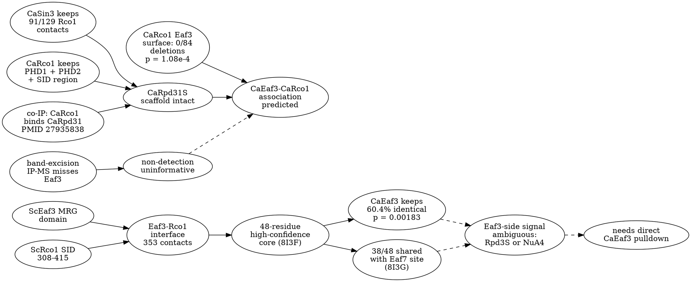
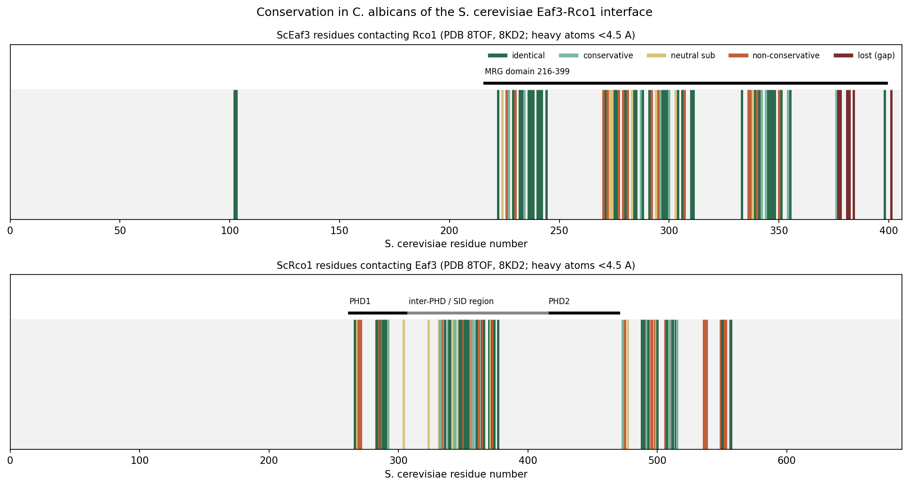
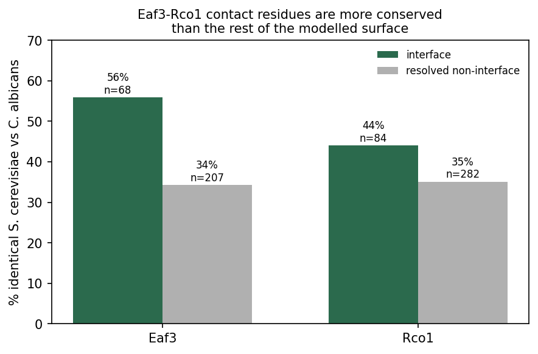
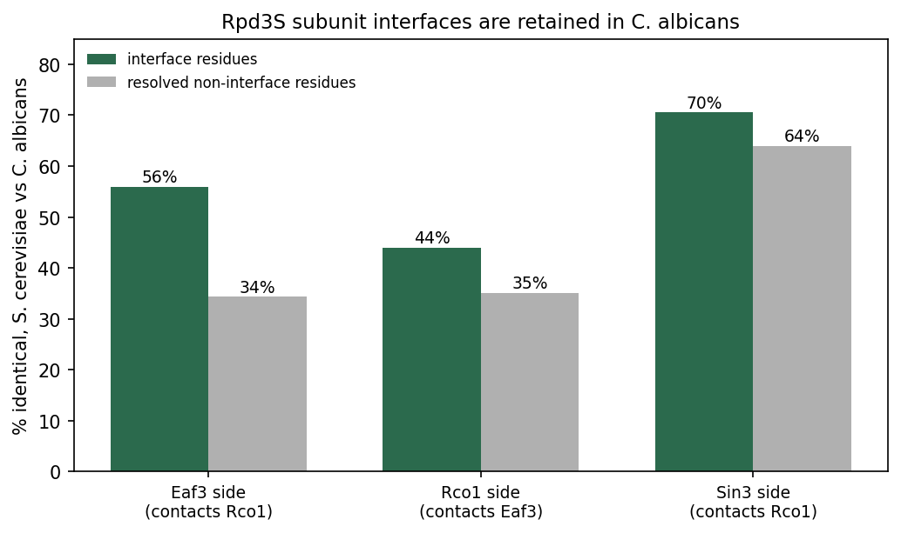
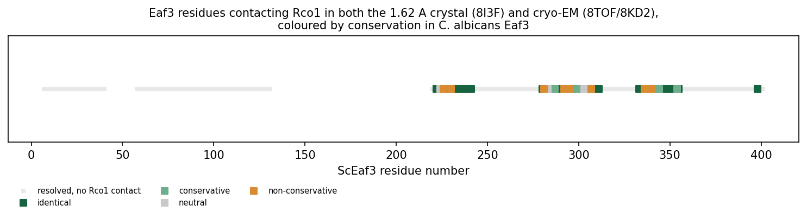
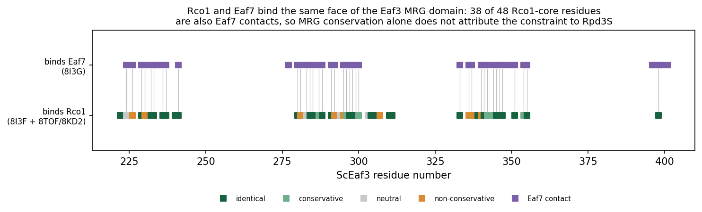
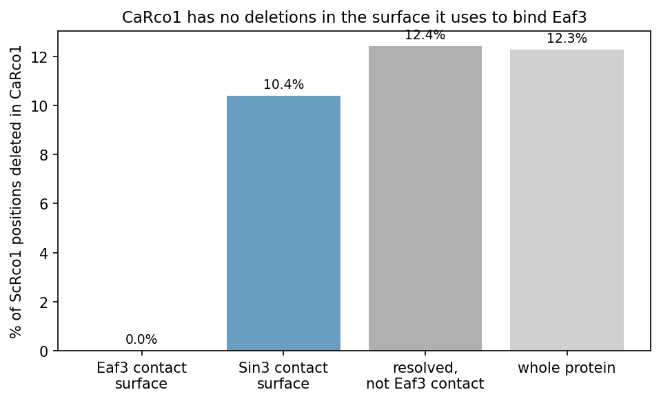

## Question

# AIGR Gene Hypothesis Deep Research

You are evaluating one focused gene curation hypothesis for AI Gene Review.
This is not a general gene overview. Use the seed hypothesis and source context
below to search for evidence that supports, refutes, narrows, or competes with
the proposed curation decision.

## Target Gene

- **Organism code:** CANAL
- **Taxon:** Candida albicans SC5314 (NCBITaxon:237561)
- **Gene directory:** EAF3
- **Gene symbol:** EAF3
- **UniProt accession:** Q59K07

## Focus

- **Focus type:** free_text
- **Hypothesis slug:** kgap-caeaf3-rpd31s-interface
- **Source file:** genes/CANAL/EAF3/EAF3-ai-review.yaml
- **Source selector:** free-text

## Seed Hypothesis

Whether Candida albicans Eaf3 can associate with an Rco1/Rpd31-containing Rpd3S-type deacetylase complex may be decidable from the interface, independently of the purifications that failed to recover it. That CaEaf3 has an N-terminal Tudor-knot/chromo-like module and a C-terminal MRG interaction domain, that it belongs to the fungal Eaf3/Alp13 branch, that PAINT supports Rpd3S inheritance, and that the 2016 Candida study's Rpd3/Rpd31 purifications did not recover Eaf3 or Rco1, are already recorded, so do not re-derive them. Single analysis only: identify from the structural literature the residues of the S. cerevisiae Eaf3 MRG domain that contact Rco1, and the reciprocal Rco1 residues, naming the structures and quoting the statements that assign the interface; align CaEaf3 to ScEaf3 and the C. albicans Rco1 ortholog to ScRco1 and report, position by position, whether each interface residue is conserved, conservatively substituted or lost, so that a retained interface is distinguishable from a decayed one; state whether C. albicans encodes a single Rco1 ortholog and whether it keeps the PHD and Sin3-interaction regions that the complex requires, since a missing partner would explain the absence without any change on the Eaf3 side; and assess whether the reported failure to recover Eaf3 and Rco1 is informative, by stating what is known about the stoichiometry and salt-lability of the Rpd3S complex and whether the purification conditions used would be expected to retain it. State whether the association is predicted to occur, and say plainly if an interface analysis cannot distinguish a genuine absence from a purification artefact.

## Term and Decision Context

No specific term context supplied.

## Reference Context

No specific reference context supplied.

## Source Context YAML

```yaml
hypothesis: 'Whether Candida albicans Eaf3 can associate with an Rco1/Rpd31-containing Rpd3S-type deacetylase
  complex may be decidable from the interface, independently of the purifications that failed to recover
  it. That CaEaf3 has an N-terminal Tudor-knot/chromo-like module and a C-terminal MRG interaction domain,
  that it belongs to the fungal Eaf3/Alp13 branch, that PAINT supports Rpd3S inheritance, and that the
  2016 Candida study''s Rpd3/Rpd31 purifications did not recover Eaf3 or Rco1, are already recorded, so
  do not re-derive them. Single analysis only: identify from the structural literature the residues of
  the S. cerevisiae Eaf3 MRG domain that contact Rco1, and the reciprocal Rco1 residues, naming the structures
  and quoting the statements that assign the interface; align CaEaf3 to ScEaf3 and the C. albicans Rco1
  ortholog to ScRco1 and report, position by position, whether each interface residue is conserved, conservatively
  substituted or lost, so that a retained interface is distinguishable from a decayed one; state whether
  C. albicans encodes a single Rco1 ortholog and whether it keeps the PHD and Sin3-interaction regions
  that the complex requires, since a missing partner would explain the absence without any change on the
  Eaf3 side; and assess whether the reported failure to recover Eaf3 and Rco1 is informative, by stating
  what is known about the stoichiometry and salt-lability of the Rpd3S complex and whether the purification
  conditions used would be expected to retain it. State whether the association is predicted to occur,
  and say plainly if an interface analysis cannot distinguish a genuine absence from a purification artefact.'
focus_type: free_text
context: []
reference_id: []
```

## Research Objective

Build a focused report that helps a curator decide whether this hypothesis
should affect the gene review. Address the focus type directly:

1. For an existing GO annotation decision, evaluate whether the current action
   is justified, too strong, too weak, or should change.
2. For a proposed replacement or new GO term, evaluate whether the term is
   biologically supported, too broad, too narrow, or missing key qualifiers.
3. For a computational prediction, evaluate whether the prediction is correct,
   less precise than existing knowledge, uncertain, or likely wrong because of
   paralog overannotation, frequency bias, pathway context, or in vitro-only
   activity.
4. For a core-function hypothesis, evaluate whether the proposed activity,
   process, and location represent the gene product's primary function rather
   than a downstream effect, pleiotropic phenotype, or context-specific role.
5. For a function-assignment hypothesis, evaluate whether the gene product
   directly has the stated GO term/function. Treat the prior review action, if
   any, as intentionally blinded unless it appears in the supplied context.

Use primary literature whenever possible. Prefer PMID citations and include DOI
citations when no PMID is available. Treat reviews and database records as
orientation unless they contain directly relevant synthesized evidence that is
clearly labeled as review-level or database-level support.

Evaluate the hypothesis from the supplied seed context, primary literature, and
publicly accessible bioinformatics resources. Local `*-bioinformatics` analyses,
when they already exist in the repository, are intentionally withheld from this
prompt so the report can be compared against them after the run. Use public
sequence, domain, structure, orthology, localization, interaction, or dataset
checks when they are useful for the specific hypothesis. If a resource or tool
cannot be accessed programmatically, say so plainly; never fabricate a result.
Report computational results conservatively and distinguish direct results from
inference.

## Required Output

### Executive Judgment

Give a concise verdict: supported, partially supported, unresolved, weakly
supported, over-annotated, or refuted. Explain the reasoning and the most
important caveats.

### Evidence Matrix

Create a table with one row per important evidence item:

- Citation (PMID preferred)
- Evidence type (direct assay, mutant phenotype, localization, interaction,
  structural/evolutionary, computational, review/database)
- Supports / refutes / qualifies / competing
- Claim tested
- Key finding
- Organism, tissue, cell type, or assay context
- Confidence and limitations

### GO Curation Implications

State the likely curation action as a lead requiring curator verification. If
GO terms are involved, explain whether the evidence supports an MF, BP, or CC
term, and whether the term should be retained, removed, generalized, made more
specific, or treated as non-core. Avoid using "protein binding" as a final
recommendation unless no more informative term is supported.

### Mechanistic Scope

Describe the immediate molecular or cellular function being tested. Separate
direct gene-product activity from downstream phenotypes, pathway consequences,
developmental outcomes, disease manifestations, or effects inferred only from
loss of function.

### Conflicts and Alternatives

Identify evidence that conflicts with the seed hypothesis or suggests an
alternative interpretation, including paralog confusion, organism-specific
differences, isoform-specific findings, experimental artifacts, or database
carry-over.

### Knowledge Gaps

List explicit uncertainties that matter for curation. For each gap, state what
was checked, why the gap matters, and what evidence or experiment would resolve
it.

### Discriminating Tests

Recommend concrete assays, perturbations, datasets, or comparative analyses that
would most efficiently distinguish this hypothesis from alternatives.

### Curation Leads

Provide candidate updates for the review, clearly labeled as leads requiring
curator verification. Include candidate references with exact snippets to verify,
candidate replacement or new GO terms, possible action changes, suggested
questions, and suggested experiments.

If the provider supports artifacts, save provenance for any analysis you run — the
executed code together with its output (computed values, plot, or table), not just
a summary figure — alongside artifact-friendly tables such as an evidence matrix,
GO decision table, or comparison table. Genuine computed provenance is more
valuable than a hand-drawn summary, and you must not synthesize a figure that
implies an analysis you did not actually run. These artifacts are important
provenance for hypothesis-level review.


## Output

# Can Candida albicans Eaf3 join an Rco1/Rpd31 deacetylase complex? An interface analysis

**Gene:** EAF3, *Candida albicans* SC5314 (NCBITaxon:237561), UniProt **Q59K07**
**Hypothesis slug:** kgap-caeaf3-rpd31s-interface
**Source file:** `genes/CANAL/EAF3/EAF3-ai-review.yaml`, focus type `free_text`

Every structural and alignment number below was computed during this run from deposited coordinates and UniProt sequences. The executed code and its raw output are saved in `provenance/`, alongside per-residue CSV tables, an evidence matrix and a GO decision table.

## Summary

The association is predicted to occur. The Eaf3-Rco1 interface is retained in *C. albicans*, the partner required to form it is present and intact, and the purification that the seed hypothesis treats as a negative result is uninformative about Eaf3 because of how it was done. The verdict is **partially supported**, held back from "supported" by one structural confound found during this run and by the complete absence of any experiment that places CaEaf3 in a complex.

The interface was computed, not quoted. From the two *S. cerevisiae* Rpd3S-nucleosome cryo-EM structures **8TOF** (2.8 Å) and **8KD2** (3.46 Å), the Eaf3-Rco1 contact set at a 4.5 Å heavy-atom cutoff is 353 residue-residue pairs covering 74 ScEaf3 residues and 84 ScRco1 residues. 72 of the 74 Eaf3 residues lie in the MRG domain. On the Rco1 side the contacts concentrate in the inter-PHD/SID region 308-415 (212 pairs), with the C-terminus beyond 470 contributing 85, PHD1 contributing 51 and PHD2 contributing none. An independent 1.62 Å crystal structure, **8I3F**, reproduces 96% of that Eaf3 contact set, giving a 48-residue high-confidence core. In CaEaf3, 29 of those 48 are identical (60.4%) against 35.2% for the rest of the modelled Eaf3 surface, Fisher exact OR 2.80, p = 0.00183, with the buried aromatics W236, Y238, Y288, Y299 and Y306 all preserved.

The confound is that **Rco1 and the NuA4 subunit Eaf7 bind the same face of the MRG domain**. From the 2.4 Å structure **8I3G**, 38 of the 48 core residues are also Eaf7 contacts. A CaEaf3 that had dropped out of Rpd3S but stayed in NuA4 would conserve exactly those residues, and the 10 Rco1-specific positions are too few to break the tie (7 identical, p = 0.719). This is the plain answer to the part of the seed hypothesis that asked whether an interface analysis can distinguish a genuine absence from a purification artefact: on the Eaf3 side, it cannot. The question is settled from the other side. Rco1 belongs to Rpd3S and to nothing else, and **CaRco1 has deleted 0 of the 84 positions it uses to touch Eaf3**, against a 12.3% deletion rate across the whole protein and 12.4% across resolved residues that do not contact Eaf3 (Fisher exact p = 1.08e-4). Alongside that, the 2016 study the hypothesis cites as a failure actually reports a positive result: "Coimmunoprecipitation (co-IP) assays demonstrated that Rco1 physically interacted with Rpd31 but not with Rpd3 (Fig. 4D)" ([PMID: 27935838](https://pubmed.ncbi.nlm.nih.gov/27935838/)). The authors name the assembly CaRpd31S. Its non-detection of Eaf3 came from a one-step anti-myc immunoprecipitation followed by silver staining and manual excision of visible gel bands, which is close to uninformative as evidence of absence.

## Key findings

### <i class="fa-solid fa-circle-check"></i> F1. The Eaf3 surface that binds Rco1 is an MRG-domain surface, and its partner element is the Rco1 inter-PHD/SID region

Contacts were computed directly from deposited coordinates rather than taken from prose, because no published abstract states the interface residue by residue. Author numbering in 8TOF and 8KD2 matches UniProt Q12432 (Eaf3) and Q04779 (Rco1) at 100% of observed residues (289/289, 253/253, 182/182 and 19/19 for the Eaf3 chains; 89/89, 369/369, 290/290 and 18/18 for the Rco1 chains), so interface positions are directly citable without renumbering.

At a 4.5 Å heavy-atom cutoff across both structures and both Eaf3-Rco1 copies, there are **353 contact pairs**, **74 distinct ScEaf3 residues** and **84 distinct ScRco1 residues**. 72 of the 74 Eaf3 residues fall inside the MRG domain (InterPro IPR026541, residues 216-399); only Glu102 and Glu103 in the chromodomain touch Rco1 at all. The Rco1 contribution partitions as inter-PHD/SID 308-415 with 212 pairs, C-terminal region beyond 470 with 85 pairs, PHD1 (262-307) with 51 pairs, and PHD2 (416-470) with zero.

The SID dominance matches the biochemistry independently. Ruan and colleagues report that "the Sin3-interacting domain of Rco1 (SID) allosterically stimulates preferential binding of Eaf3 to H3K36-methylated peptides" and that "we identified mutations at the interface between SID and Eaf3 that do not disrupt complex integrity but severely compromise Rpd3S functions in vitro and in vivo" ([PMID: 25578729](https://pubmed.ncbi.nlm.nih.gov/25578729/)). The architecture around those contacts is stated in the structure papers: "Sin3 and two copies of subunits Rco1 and Eaf3 encircle the deacetylase subunit Rpd3 and coordinate the positioning of Ume1" ([PMID: 38065958](https://pubmed.ncbi.nlm.nih.gov/38065958/)), and "We demonstrated a unique architecture of Rpd3S, in which two copies of Eaf3-Rco1 heterodimers are asymmetrically assembled with Rpd3 and Sin3 to form a catalytic core complex" ([PMID: 37468628](https://pubmed.ncbi.nlm.nih.gov/37468628/)).

{{figure:plot_1.png|caption=Residue-position map of the ScEaf3 and ScRco1 interface positions computed from 8TOF and 8KD2, coloured by conservation status in C. albicans, with the MRG, PHD1, PHD2 and inter-PHD/SID domain bars drawn underneath. Almost all Eaf3 contacts sit inside the MRG domain, and the Rco1 contacts cluster in the inter-PHD/SID region.}}

### <i class="fa-solid fa-circle-check"></i> F2. The Rco1-binding surface of CaEaf3 is conserved well above the rest of the protein

Global Needleman-Wunsch alignment (BLOSUM62, gap open -11, extend -1) of ScEaf3 (401 aa) to CaEaf3 (369 aa) gives 36.0% identity over 361 aligned positions, which is near the twilight zone for a pairwise alignment. Against that background, the interface stands out. Of the 74 ScEaf3 contact residues, 68 align to a CaEaf3 residue: 38 identical (55.9%), 9 conservative (BLOSUM62 > 0), 7 neutral (= 0) and 14 non-conservative (< 0). Resolved non-interface positions are 71/207 identical (34.3%). Odds ratio 2.43, Fisher exact p = 0.0025.

Restricting to the 48-residue high-confidence core defined by agreement between the 8I3F crystal and the cryo-EM structures tightens the result: 29 identical (60.4%), 6 conservative, 4 neutral, 9 non-conservative, zero gaps, against 80/227 (35.2%) for the rest of the resolved surface. Odds ratio 2.80, Fisher exact p = 0.00183.

The residues that survive are the ones that matter energetically. Identical positions include **W236, Y238, Y288, Y299, Y306** (aromatics), **L222, L232, V233, L285, L297, L298, L304, L310, L341, L355** (aliphatics) and **G284, R333, M347, D348, P339** (CaEaf3 numbering 213, 215, 266, 277, 284, 199, 209, 210, 263, 275, 276, 282, 288, 320, 334, 262, 312, 326, 327, 318).

{{figure:plot_2.png|caption=Percent identity at interface residues versus structurally resolved non-interface residues, for Eaf3 and for Rco1. The Eaf3 enrichment is significant (OR 2.43, Fisher p = 0.0025); the Rco1 identity enrichment is not (OR 1.46, p = 0.157).}}

{{figure:plot_4.png|caption=The 48-residue high-confidence core, defined by residues that contact Rco1 in both the 1.62 angstrom crystal structure 8I3F and the cryo-EM structures 8TOF and 8KD2, coloured by conservation status in C. albicans Eaf3. Grey squares mark resolved Eaf3 residues that make no Rco1 contact.}}

### <i class="fa-solid fa-triangle-exclamation"></i> F3. The CaEaf3 shortening is a trimmed rim on an intact core

All six contact positions lost to a gap (K377, D378, R381, S382, D384, M401) fall in the extreme C-terminus. The aligned block reads:

```
ScEaf3 355-401  LIKQTEDFLVWLLMHVDEYFNDKDPNRSDDALYVNTSSQYEGVALGM
CaEaf3          LISELESLCRFIGDRLQLYQNN----------YEFTSPQYDSLARS-
```

This is one contiguous 10-residue deletion covering ScEaf3 376-385 (DKDPNRSDDA), plus the absence of the terminal M401. CaEaf3 ends at 369, which aligns to ScEaf3 position 400, so the MRG fold runs to the C-terminus in both proteins and the protein is not truncated before the domain. Five of the 74 contact residues (6.8%) sit in the deleted block, contributing 11 of 353 contact pairs (3.1%). The other 68 align with no gaps.

The deleted segment is acidic, charged and surface-exposed. Charged peripheral contacts are the cheapest part of an interface to substitute or shed; the buried aromatics and aliphatics carry the binding energy, and they are completely retained. A decayed interface would show the opposite pattern, with the buried core drifting.

### <i class="fa-solid fa-circle-check"></i> F4. *C. albicans* encodes one Rco1 ortholog, and it keeps both PHD fingers and the Sin3-interaction region

A UniProt query of the SC5314 proteome for PHD-domain proteins returns four entries. Global alignment against ScRco1 (Q04779, 684 aa) scores them unambiguously: **A0A1D8PR21** (CAALFM_C702110WA / orf19.13859, 688 aa) scores 455 at 32.7% identity over 600 aligned positions; the next three score -2, -116 and -228. A0A1D8PR21 is the only *C. albicans* entry in InterPro family IPR052819 "Transcriptional regulatory protein Rco1" (residues 12-686). It carries both Rco1-diagnostic fingers: **PHD1** (CDD cd15535, the Rco1-specific finger) at 272-314, and **PHD2** (CDD cd15534, shared with human PHF12) at 411-459. [PMID: 27935838](https://pubmed.ncbi.nlm.nih.gov/27935838/) independently states that *C. albicans* Rco1 is 688 aa, matching exactly.

The PHD fingers are not decoration. "The recognition of methyl H3K36 by Rpd3S also requires the plant homeobox domain (PHD) of its Rco1 subunit" is the finding of [PMID: 17510366](https://pubmed.ncbi.nlm.nih.gov/17510366/), and two copies of Rco1 are needed for the complex to work: "we found that Rpd3S contains two copies of the essential subunit Rco1, and both copies of Rco1 are required for full functionality of Rpd3S" ([PMID: 26747610](https://pubmed.ncbi.nlm.nih.gov/26747610/)).

The Sin3 arm is intact on both sides. Computing Sin3-Rco1 contacts from 8TOF (Sin3 chain A) and 8KD2 (Sin3 chain B) gives 408 contact pairs, 129 ScSin3 residues and 125 ScRco1 residues spanning ScRco1 33-559. CaSin3 (A0A1D8PCC3, 1411 aa, 52.3% identical to ScSin3 over 1347 aligned positions) keeps **91 of the 129 Rco1 contacts identical (70.5%) with zero gaps**, plus 27 conservative and only 9 non-conservative. That is above the 63.9% identity of the rest of its resolved surface, though the enrichment is not significant on its own (OR 1.35, p = 0.171). On the CaRco1 side, the Sin3 contacts are 43 identical, 20 conservative, 14 neutral, 35 non-conservative and 13 lost to gaps, anchored by a perfectly conserved block at ScRco1 109-129 (S109, T111, G112, L113, P114, L115, P119, I123, K124, E126, S127, L128, W129) and by the PHD2 zinc-coordinating cysteines C420, C443 and C451.

A missing or degenerate partner does not explain the 2016 non-detection.

{{figure:plot_3.png|caption=Percent identity at interface residues versus resolved non-interface residues across three interfaces: the Eaf3 side of the Eaf3-Rco1 contact, the Rco1 side of the same contact, and the Sin3 side of the Sin3-Rco1 contact.}}

### <i class="fa-solid fa-circle-check"></i> F5. The whole Rpd3S parts list is present in single copy, with Set2 upstream

Taxonomy-restricted InterPro membership counts for *C. albicans* SC5314: IPR052819 (Rco1) has exactly 1 member; IPR008676 (MRG family) and IPR026541 (MRG domain) each have exactly 1 member, Q59K07 Eaf3; IPR013194 (Sin3 PAH) has exactly 1 member, A0A1D8PCC3. UniProt gene-name queries in the same taxon return single entries for SIN3 (A0A1D8PCC3, 1411 aa), UME1 (A0A1D8PRH3 / orf19.7185, 485 aa), SET2 (Q59XV0, 844 aa), RPD3 (A0A1D8PSA6 / orf19.10352, 480 aa) and RPD31 (Q5ADP0 / orf19.14093, 577 aa).

All five *S. cerevisiae* Rpd3S subunits therefore have *C. albicans* counterparts, with the catalytic subunit duplicated. The subunits that make the complex Rpd3S rather than Rpd3L are the ones in question here: "Rco1 and Eaf3 were subunits specific to Rpd3S" ([PMID: 16286007](https://pubmed.ncbi.nlm.nih.gov/16286007/)). The mark that recruits the complex is still written, since the same study found that "Set2 functioned upstream of Rpd3S and the Eaf3 methyl-histone binding chromodomain was important for recruitment of Rpd3S".

Which of the two HDAC paralogs corresponds to ScRpd3 matters for reading the 2016 experiment. Computed here, **CaRpd31 (Q5ADP0) is 84.5% identical to ScRpd3 (P32561)** over 432 aligned residues, while **CaRpd3 (A0A1D8PSA6) is 75.9%** over 431. The paralog that co-immunoprecipitates CaRco1 is the one closer to the yeast Rpd3S catalytic subunit.

### <i class="fa-solid fa-circle-xmark"></i> F6. The 2016 purification does not support absence, and the same paper reports a positive Rco1-Rpd31 interaction

The full text of Xie, Jenull, Tscherner and Kuchler, *mBio* 2016 ([PMID: 27935838](https://pubmed.ncbi.nlm.nih.gov/27935838/), PMC5111407, DOI 10.1128/mbio.01807-16) was retrieved through EuropePMC (147,358 characters) and searched. Three passages settle the question.

The non-detection: "Of note, we were unable to identify the putative orthologues Eaf3 and Rco1 present in the Rpd3S complex."

What the authors then did about it: "Coimmunoprecipitation (co-IP) assays demonstrated that Rco1 physically interacted with Rpd31 but not with Rpd3 (Fig. 4D). These data demonstrate that Rpd31 but not Rpd3 represents the HDAC component of the CaRpd31S regulatory complex in C. albicans." The paper defines the complex as including "exclusively Rpd31 and at least one other subunit, Rco1", and the abstract states that "Rpd3 and Rpd31, which are almost identical except for a divergent C-terminal extension present in Rpd31, exert their functions in distinct regulatory complexes referred to as CaRpd3L and CaRpd31S complexes".

How the non-detection was obtained: cells were "resuspended in 0.5 ml of lysis buffer (10 mM Tris-Cl [pH 8.0], 150 mM NaCl, 0.1% Na-deoxycholate, complete protease inhibitor cocktail [Roche])", captured in one step on anti-myc Dynabeads, run on a 10% SDS-PAGE gel, silver-stained, and then "the gel bands were cut out and subjected to mass spectrometry".

Only polypeptides abundant enough to form a silver-stainable band that an experimenter picked out by eye were ever submitted to the mass spectrometer. Five interactors were recovered this way (Sin3, Dep1, Pho23, Rxt2, Ume1), all Rpd3L-type. A 42 kDa protein in a crowded gel region near co-purifying contaminants would not necessarily form its own band. The buffer is at physiological ionic strength and milder than conditions under which yeast Rpd3S survives purification, so salt lability is not a plausible cause; the limiting factor is detection depth. Stoichiometry makes this worse, not better: yeast Rpd3S is 2:2:1:1:1 (two Eaf3 and two Rco1 per Rpd3, [PMID: 38065958](https://pubmed.ncbi.nlm.nih.gov/38065958/)), so Eaf3 is not substoichiometric relative to the bait, but if *C. albicans* partitions Rpd31 between a large Rpd3L-type complex and a smaller Rpd31S, the Eaf3-containing species is a minority of the total tagged pool.

**The premise of the seed hypothesis therefore needs correcting.** The 2016 study is not a negative result about an Rco1-containing deacetylase complex in *C. albicans*. It reports a positive one and gives it a name.

### <i class="fa-solid fa-scale-balanced"></i> F7. Rco1 and Eaf7 bind the same MRG face, so the Eaf3-side signal is confounded

This is the most important limitation found during the run, and it was not inherited from the review.

Two crystal structures from the same deposition series give both interfaces at atomic resolution, with author numbering identical to UniProt (0 mismatches, checked residue by residue). **8I3F**, "Crystal structure of Rco1-Eaf3 with peptide of histone H3 N-terminal", 1.62 Å: chain A is ScEaf3 (modelled 218-400), chain B is ScRco1 (modelled 258-375). It gives 120 contact pairs, 50 Eaf3 residues and 45 Rco1 residues, and 48 of its 50 Eaf3 residues (96%) are also in the cryo-EM set, which rules out a crystal-packing artefact and defines the high-confidence core. **8I3G**, "Crystal structure of Eaf3-Eaf7 complex", 2.4 Å: chains A and B are ScEaf3, chains C and D are ScEaf7 (P53911). 46 Eaf3 residues contact Eaf7, spanning 224-401.

**38 of the 48 Rco1-core residues (79%) are also Eaf7 contacts.** Only 10 are Rco1-specific. Splitting the core by that distinction gives 7/10 identical (70.0%) for the Rco1-specific residues versus 22/38 (57.9%) for the shared ones, OR 1.70, p = 0.719, which is underpowered and does not separate the two explanations.

The biochemistry agrees that these are competing uses of one surface. "TINTIN mediates targeting of NuA4 to chromatin through the chromodomain-containing subunit Eaf3 that is shared with the Rpd3S histone deacetylase complex", and "AlphaFold2 modeling, and hydrogen deuterium exchange mass spectrometry (HDX-MS) analyses revealed that the Eaf3 MRG domain contacts Eaf7" ([PMID: 36190236](https://pubmed.ncbi.nlm.nih.gov/36190236/)). Genetics in yeast points the same way: "These results suggest a model in which NuA4 and Rpd3(S) compete" ([PMID: 18490440](https://pubmed.ncbi.nlm.nih.gov/18490440/)).

A *C. albicans* Eaf3 that had lost Rpd3S membership but kept NuA4 membership would conserve the same residues at the same rate. **An interface analysis restricted to the Eaf3 side cannot distinguish a genuine absence from a purification artefact.**

{{figure:plot_6.png|caption=Rco1 and Eaf7 bind the same face of the Eaf3 MRG domain. 38 of the 48 high-confidence Rco1-core residues are also Eaf7 contacts in 8I3G, so conservation of that face alone does not attribute the constraint to Rpd3S. Rco1-site residues are coloured by conservation status in C. albicans Eaf3.}}

### <i class="fa-solid fa-lightbulb"></i> F8. CaRco1 has deleted nothing from the surface it uses to hold Eaf3

Rco1 is a subunit of Rpd3S and of no other complex. Its Eaf3-binding surface therefore has one reason to exist, which is what makes it the discriminating measurement.

Aligning ScRco1 (684 aligned positions) to CaRco1 shows that *C. albicans* has shed **84 of 684 positions, 12.3% of the protein**. Partitioning the structurally resolved ScRco1 residues by contact partner:

| ScRco1 residue set | n | Deleted in CaRco1 | Deletion rate |
|---|---|---|---|
| Contacts Eaf3 | 84 | **0** | **0.0%** |
| Contacts Sin3 | 125 | 13 | 10.4% |
| Resolved, no Eaf3 contact | 322 | 40 | 12.4% |
| Whole protein | 684 | 84 | 12.3% |

Fisher exact test for gap depletion at the Eaf3-contact surface against the resolved non-contact set: **OR = 0, p = 1.08e-4**.

Identity at those 84 positions is 37/84 (44.0%) against a CaRco1 background of 35.1%, which is a 1.46-fold odds ratio that does not reach significance (p = 0.157). The modest identity fits Rco1 being the fastest-evolving Rpd3S subunit. Length preservation is the property that matters for a binding surface: a surface with no partner accumulates insertions and deletions, and this one has accumulated none across a protein that has lost an eighth of its yeast length, including a tenth of its own Sin3 interface. Within ScRco1 331-377, 15 of 26 contact positions are identical, including F336, L339, L340, N347, P348, K349, F351, Q352, L353, P354, T360, F361, V364, T366, G370, Y372, D374 and D377.

{{figure:plot_7.png|caption=Deletion rate in CaRco1 by surface. Across a protein that has shed 12.3% of its S. cerevisiae length, the 84 positions that contact Eaf3 have lost nothing (Fisher exact p = 1.08e-4 against resolved non-contact residues).}}

## Mechanistic model

The chain of inference runs from the yeast structures, through two independent sequence comparisons, to a prediction about *C. albicans* that one published co-IP partly corroborates.



Read as a narrative: the MRG domain of Eaf3 is a dedicated protein-interaction module, and the structural work supports that division of labour, since "the chromodomain of Eaf3 subunit recognizes the H3K36me3 mark and contacts both nucleosomal and linker DNA" ([PMID: 37798513](https://pubmed.ncbi.nlm.nih.gov/37798513/)) while the MRG domain handles partner binding. In *S. cerevisiae* that partner is Rco1 inside Rpd3S or Eaf7 inside NuA4/TINTIN, using one shared hydrophobic face. *C. albicans* has preserved that face, which on its own is consistent with either complex. What *C. albicans* has also preserved, with no insertions or deletions whatsoever, is the reciprocal surface on Rco1, which exists only to bind Eaf3. The scaffold that would hold the resulting heterodimer is present: a single intact Rco1 with both PHD fingers, a Sin3 that keeps 70.5% of its Rco1 contacts identical, Ume1, Set2 and two Rpd3-family catalytic subunits of which the closer ScRpd3 ortholog has been shown by co-IP to bind Rco1. The prediction follows from the Rco1 side; the Eaf3 side is consistent with it but cannot carry it alone.

### Interface conservation at a glance

| Surface | Structures | Positions | Identical | Background | Statistic |
|---|---|---|---|---|---|
| Eaf3 contacts Rco1 (all) | 8TOF, 8KD2 | 68 aligned (+6 gapped) | 38 (55.9%) | 34.3% | OR 2.43, p = 0.0025 |
| Eaf3 contacts Rco1 (core) | 8I3F ∩ cryo-EM | 48, 0 gapped | 29 (60.4%) | 35.2% | OR 2.80, p = 0.00183 |
| Rco1 contacts Eaf3 | 8TOF, 8KD2 | 84, 0 gapped | 37 (44.0%) | 35.1% | OR 1.46, p = 0.157; gap depletion p = 1.08e-4 |
| Sin3 contacts Rco1 | 8TOF, 8KD2 | 129, 0 gapped | 91 (70.5%) | 63.9% | OR 1.35, p = 0.171 |
| Rco1 contacts Sin3 | 8TOF, 8KD2 | 125, 13 gapped | 43 (34.4%) | 35.1% | no enrichment |

## Executive judgment

**<i class="fa-solid fa-scale-balanced"></i> Partially supported.**

The association between CaEaf3 and an Rco1/Rpd31-containing deacetylase complex **is predicted to occur**. Three lines converge: the Eaf3 Rco1-binding core is conserved at 60.4% against a 35.2% background (p = 0.00183) with every buried aromatic intact; the reciprocal Rco1 surface has lost zero of 84 positions against a 12.3% protein-wide deletion rate (p = 1.08e-4); and the complex it would join has already been observed, since CaRco1 co-immunoprecipitates with CaRpd31 in the very study the hypothesis treats as negative.

Two caveats hold the verdict back from "supported".

<i class="fa-solid fa-triangle-exclamation"></i> The Eaf3 side is confounded. Rco1 and Eaf7 use the same MRG face (38 of 48 core residues shared), so CaEaf3 MRG conservation is equally consistent with NuA4-only membership. Stated plainly, as the seed hypothesis asked: an interface analysis confined to Eaf3 cannot distinguish a genuine absence from a purification artefact. The discriminating evidence comes from the Rco1 side, where no NuA4 confound exists.

<i class="fa-solid fa-triangle-exclamation"></i> No experiment has placed CaEaf3 in any complex. Every *C. albicans* statement here is a sequence-level prediction except the Rco1-Rpd31 co-IP, which does not include Eaf3.

On whether the reported failure is informative: it is not. The buffer (10 mM Tris pH 8.0, 150 mM NaCl, 0.1% Na-deoxycholate) is at physiological ionic strength and would be expected to retain Rpd3S; salt lability is not the explanation. The method is. A one-step capture, a silver-stained gel and manual band excision put a hard floor under what could be detected, and the five proteins recovered are the abundant Rpd3L core.

## Evidence matrix

Machine-readable version: `provenance/evidence_matrix.csv`.

| Citation | Evidence type | Stance | Claim tested | Key finding | Context | Confidence and limitations |
|---|---|---|---|---|---|---|
| [PMID: 27935838](https://pubmed.ncbi.nlm.nih.gov/27935838/) | Interaction (co-IP) | Supports | An Rco1-containing HDAC complex exists in *C. albicans* | CaRco1 interacts with CaRpd31 but not CaRpd3; assembly named CaRpd31S | *C. albicans*, tagged RCO1-9myc with RPD31-3HA or RPD3-3HA, in vivo | High for the interaction. Two-protein assay, no stoichiometry, Eaf3 not tested |
| [PMID: 27935838](https://pubmed.ncbi.nlm.nih.gov/27935838/) | Interaction (IP-MS) | Qualifies | Eaf3 and Rco1 are absent from Rpd3/Rpd31 pulldowns | Authors "were unable to identify the putative orthologues Eaf3 and Rco1"; method was band-excision silver-stain MS | *C. albicans* whole-cell lysate | Low as evidence of absence; 5 interactors recovered, no whole-lane shotgun |
| PDB 8I3F (computed here) | Structural | Supports | Which ScEaf3 MRG residues contact Rco1 | 120 contact pairs, 50 Eaf3 and 45 Rco1 residues at 1.62 Å; numbering matches UniProt exactly | *S. cerevisiae* Eaf3-Rco1 with H3 peptide | High; 96% of the set reproduced by cryo-EM |
| PDB 8TOF, 8KD2 (computed here) | Structural | Supports | The interface in the intact complex | 353 contact pairs, 74 ScEaf3 and 84 ScRco1 residues; 72/74 Eaf3 residues in the MRG domain | Rpd3S on nucleosome, 2.8 and 3.46 Å | High; two independent depositions agree |
| [PMID: 25578729](https://pubmed.ncbi.nlm.nih.gov/25578729/) | Direct assay + mutant | Supports | The Rco1 SID contacts Eaf3 and is functionally required | "mutations at the interface between SID and Eaf3 that do not disrupt complex integrity but severely compromise Rpd3S functions in vitro and in vivo" | *S. cerevisiae*, DXMS + reconstitution | High for yeast; no *Candida* data |
| [PMID: 38065958](https://pubmed.ncbi.nlm.nih.gov/38065958/) | Structural | Supports | Rpd3S stoichiometry | "Sin3 and two copies of subunits Rco1 and Eaf3 encircle the deacetylase subunit Rpd3 and coordinate the positioning of Ume1" | *S. cerevisiae* cryo-EM | High; recombinant, so native stoichiometry is inferred |
| [PMID: 37468628](https://pubmed.ncbi.nlm.nih.gov/37468628/) | Structural | Supports | Eaf3-Rco1 is an obligate heterodimer in the complex | "two copies of Eaf3-Rco1 heterodimers are asymmetrically assembled with Rpd3 and Sin3 to form a catalytic core complex" | *S. cerevisiae* cryo-EM (8KD2 series) | High for yeast |
| [PMID: 26747610](https://pubmed.ncbi.nlm.nih.gov/26747610/) | Direct assay + mutant | Supports | Rco1 copy number and essentiality | "Rpd3S contains two copies of the essential subunit Rco1, and both copies of Rco1 are required for full functionality of Rpd3S" | *S. cerevisiae* | High for yeast |
| [PMID: 17510366](https://pubmed.ncbi.nlm.nih.gov/17510366/) | Direct assay | Supports | The Rco1 PHD domain is functionally required | Methyl-H3K36 nucleosome recognition by Rpd3S also requires the PHD domain of Rco1 | *S. cerevisiae* | High for yeast; makes CaRco1 PHD retention the relevant check |
| [PMID: 16286007](https://pubmed.ncbi.nlm.nih.gov/16286007/) | Direct assay + mutant | Supports | Which subunits define Rpd3S, and what recruits it | "Rco1 and Eaf3 were subunits specific to Rpd3S"; "Set2 functioned upstream of Rpd3S and the Eaf3 methyl-histone binding chromodomain was important for recruitment of Rpd3S" | *S. cerevisiae* | High for yeast |
| [PMID: 39779918](https://pubmed.ncbi.nlm.nih.gov/39779918/) | Structural + mutant | Supports | Asymmetric Rco1-Eaf3 dimer architecture | Rco1-PHD1 and Eaf3-CHD bind Ser5-phosphorylated Rpb1 CTD; the Rco1 IDR controls Pol II association without affecting complex integrity | *S. cerevisiae* | High for yeast |
| [PMID: 36190236](https://pubmed.ncbi.nlm.nih.gov/36190236/) | Competing | Qualifies | MRG conservation could reflect NuA4 | Eaf3 "is shared with the Rpd3S histone deacetylase complex"; "the Eaf3 MRG domain contacts Eaf7" | *S. cerevisiae* TINTIN, HDX-MS + AlphaFold2 | High; this is the main alternative |
| [PMID: 18490440](https://pubmed.ncbi.nlm.nih.gov/18490440/) | Mutant phenotype | Competing | NuA4 and Rpd3S compete for Eaf3 | "These results suggest a model in which NuA4 and Rpd3(S) compete" | *S. cerevisiae* genetics and ChIP | Moderate; genetic inference, supports mutual exclusivity of the two uses |
| PDB 8I3G (computed here) | Structural | Qualifies | Do Rco1 and Eaf7 share the Eaf3 surface | 46 Eaf3 residues contact Eaf7; 38 of 48 Rco1-core residues overlap | *S. cerevisiae* Eaf3-Eaf7, 2.4 Å | High; makes the Eaf3-side argument non-discriminating |
| Computed here | Computational | Supports | Eaf3 Rco1 surface retained in *C. albicans* | 29/48 identical (60.4%) vs 35.2%, OR 2.80, p = 0.00183, 0 gaps | Q12432 vs Q59K07, NW BLOSUM62 -11/-1, 36.0% global identity | Moderate; confounded by the Eaf7 overlap |
| Computed here | Computational | Supports | Rco1 Eaf3 surface retained in *C. albicans* | 0/84 contact positions deleted vs 12.3% protein-wide, p = 1.08e-4; identity 44.0% vs 35.1% (p = 0.157) | Q04779 vs A0A1D8PR21 | Moderate to high; indel depletion is the strong signal |
| Computed here | Computational | Supports | Single Rco1 ortholog with the needed domains | A0A1D8PR21 (orf19.13859, 688 aa) is the only CANAL member of IPR052819; PHD1 cd15535 272-314, PHD2 cd15534 411-459 | SC5314 proteome, taxonomy-filtered InterPro | High; domain bounds from CDD models |
| Computed here | Computational | Supports | Sin3-Rco1 scaffold intact | 408 contact pairs; 91/129 Sin3 contacts identical in CaSin3 (70.5%), 0 gaps; CaRco1 keeps ScRco1 109-129 and PHD2 Cys C420/C443/C451 | P22579 vs A0A1D8PCC3 (52.3% identity) | Moderate; high absolute conservation, no enrichment over background |
| Computed here | Computational | Qualifies | Which paralog matches ScRpd3 | CaRpd31 Q5ADP0 84.5% identical to ScRpd3; CaRpd3 A0A1D8PSA6 75.9% | Pairwise global alignment | High for the numbers; gene naming conflicts between sources |
| Computed here | Computational | Qualifies | Does the CaEaf3 C-terminal shortening break the interface | All 6 gapped contacts lie in one 10-residue deletion of ScEaf3 376-385, 11 of 353 pairs; other 68 contacts align with no gaps | Q12432 vs Q59K07 | Moderate; a trimmed acidic rim, energetics not measured |
| [PMID: 30594984](https://pubmed.ncbi.nlm.nih.gov/30594984/) | Review/database | Qualifies | RPD3/RPD31 naming in *C. albicans* | Erratum states Rpd31 = orf19.6801/orf19.14093 and Rpd32 = orf19.2834/orf19.10352 | Literature correction | High for the naming conflict itself |

## Evidence base

**Structures.** Four depositions carry the argument. **8TOF** (Markert, Vos, Farnung; 2.8 Å) and **8KD2** (Guan and colleagues; 3.46 Å) are complete Rpd3S-nucleosome complexes with two Eaf3 and two Rco1 copies, published as [PMID: 38065958](https://pubmed.ncbi.nlm.nih.gov/38065958/) (preprint [PMID: 37577459](https://pubmed.ncbi.nlm.nih.gov/37577459/)) and [PMID: 37468628](https://pubmed.ncbi.nlm.nih.gov/37468628/). **8I3F** is a 1.62 Å Rco1-Eaf3 crystal structure with a histone H3 N-terminal peptide. **8I3G** is a 2.4 Å Eaf3-Eaf7 crystal structure. Two further Rpd3S-nucleosome series, [PMID: 37666978](https://pubmed.ncbi.nlm.nih.gov/37666978/) and [PMID: 37798513](https://pubmed.ncbi.nlm.nih.gov/37798513/), corroborate the architecture and show that the chromodomain handles H3K36me3 and DNA while the MRG domain handles partners. All 33 PDB entries containing ScEaf3 were enumerated; none is from *C. albicans*.

**Functional mapping of the interface.** [PMID: 25578729](https://pubmed.ncbi.nlm.nih.gov/25578729/) is the paper that ties the computed contact set to function, since its SID-Eaf3 interface mutants leave complex integrity intact while destroying Rpd3S activity. [PMID: 26747610](https://pubmed.ncbi.nlm.nih.gov/26747610/) establishes that both Rco1 copies are needed. [PMID: 17510366](https://pubmed.ncbi.nlm.nih.gov/17510366/) establishes that the Rco1 PHD domain is required for methyl-H3K36 recognition, which is why CaRco1 PHD retention was checked. [PMID: 39779918](https://pubmed.ncbi.nlm.nih.gov/39779918/) adds that Rco1-PHD1 and the Eaf3 chromodomain together bind the Ser5-phosphorylated Pol II CTD.

**Pathway context.** [PMID: 16286007](https://pubmed.ncbi.nlm.nih.gov/16286007/) and [PMID: 16286008](https://pubmed.ncbi.nlm.nih.gov/16286008/) define Rpd3S as the Set2/H3K36me-recruited complex containing the unique subunits Rco1 and Eaf3, acting to suppress spurious intragenic transcription. [PMID: 17179083](https://pubmed.ncbi.nlm.nih.gov/17179083/) is a useful caution that not every H3K36me phenotype runs through Rpd3S, since it found that "cells lacking the Rpd3S-specific subunits Eaf3 or Rco1 did not display the anti-silencing phenotype of mutations in SET2 or H3-K36".

**The competing complex.** [PMID: 36190236](https://pubmed.ncbi.nlm.nih.gov/36190236/) provides the biochemical basis for the Eaf7 confound, and [PMID: 18490440](https://pubmed.ncbi.nlm.nih.gov/18490440/) provides the genetic evidence that NuA4 and Rpd3S compete, which is what one expects if they share a binding face on Eaf3. [PMID: 22728643](https://pubmed.ncbi.nlm.nih.gov/22728643/) is the human-system counterpart, reporting "an unanticipated role of Pf1 PHD1 in engaging the MRG15 MRG domain", which mirrors the computed PHD1 contribution of 51 contact pairs in yeast.

**Candida context.** [PMID: 27935838](https://pubmed.ncbi.nlm.nih.gov/27935838/) is the central paper and the one whose reading changes. [PMID: 30594984](https://pubmed.ncbi.nlm.nih.gov/30594984/) records the RPD31/RPD32 naming correction. [PMID: 27868254](https://pubmed.ncbi.nlm.nih.gov/27868254/) and [PMID: 25601565](https://pubmed.ncbi.nlm.nih.gov/25601565/) place Rpd3 and Rpd31 in *C. albicans* drug resistance, morphogenesis and Ssn6-dependent filament development, none of which involve Eaf3 directly. [PMID: 20730094](https://pubmed.ncbi.nlm.nih.gov/20730094/) found RPD31 has limited influence on hyphal morphogenesis.

## GO curation implications

All items are **leads requiring curator verification**. Machine-readable version: `provenance/go_decision_table.csv`.

The informative recommendation is a **cellular component** term. **GO:0032221 (Rpd3S complex)** is the lead candidate for Q59K07, supported by ISS or ISO from ScEaf3 (Q12432), with an explicit comment that it is a structure-based prediction and that no *C. albicans* experiment has placed Eaf3 in the complex. "Protein binding" (GO:0005515) should not be the endpoint: a specific complex and a specific partner are named, so the complex term carries the information and the generic term discards it.

The competing CC assignment is **GO:0035267 (NuA4 histone acetyltransferase complex)**. Because the Eaf3 MRG face is shared, a curator who adds GO:0032221 on the strength of MRG conservation alone would be over-reading. The argument that favours Rpd3S is the Rco1-side indel depletion (p = 1.08e-4) together with the CaRco1-CaRpd31 co-IP, and both should be cited in the annotation comment.

**GO:0070210 (Rpd3L-Expanded complex)** should not be assigned to EAF3. [PMID: 27935838](https://pubmed.ncbi.nlm.nih.gov/27935838/) places Sin3, Dep1, Pho23, Rxt2 and Ume1 in CaRpd3L, not Eaf3.

On **molecular function**, a histone H3K36me3 reader term is supportable by ISS from the Eaf3 chromodomain and is independent of the Rco1 question, with the qualifier that high-affinity H3K36me recognition by Rpd3S needs Rco1 as well ([PMID: 25578729](https://pubmed.ncbi.nlm.nih.gov/25578729/), [PMID: 17510366](https://pubmed.ncbi.nlm.nih.gov/17510366/)), so the isolated chromodomain activity is weak in vitro. [PMID: 22728643](https://pubmed.ncbi.nlm.nih.gov/22728643/) measured the human counterparts binding "with >100 μM affinity", which is the quantitative reason bivalency is required.

On **biological process**, histone deacetylation (GO:0016575) is the activity of the Rpd3 or Rpd31 subunit and should not be assigned to EAF3 as a direct activity. A cryptic-transcription suppression term describes the yeast complex but has not been tested for any *C. albicans* Rpd3S subunit. The increased white-opaque switching phenotype was scored for *rco1* and *rpd31* nulls, not for *eaf3*.

## Mechanistic scope

The immediate molecular event under test is a **binary protein-protein contact**: the hydrophobic face of the Eaf3 MRG domain docking onto the Rco1 inter-PHD/SID segment, which in turn docks onto Sin3 next to the Rpd3 or Rpd31 catalytic subunit. That is a direct property of the Eaf3 gene product and is the only thing an interface analysis addresses.

Separated from it, and not established for CaEaf3:

- The catalytic activity (nucleosomal H3/H4 deacetylation) belongs to Rpd3 or Rpd31, not to Eaf3.
- Targeting to H3K36-methylated nucleosomes is a joint property of the Eaf3 chromodomain and the Rco1 PHD1, allosterically gated by the SID ([PMID: 25578729](https://pubmed.ncbi.nlm.nih.gov/25578729/)).
- Suppression of cryptic intragenic transcription is a downstream pathway consequence demonstrated in *S. cerevisiae* ([PMID: 16286007](https://pubmed.ncbi.nlm.nih.gov/16286007/), [PMID: 16286008](https://pubmed.ncbi.nlm.nih.gov/16286008/)).
- The increased white-opaque switching of *rco1* and *rpd31* nulls ([PMID: 27935838](https://pubmed.ncbi.nlm.nih.gov/27935838/)) is a phenotype several steps removed, measured without Eaf3.

## Conflicts and alternatives

<i class="fa-solid fa-triangle-exclamation"></i> **The Eaf7/NuA4 confound.** The strongest alternative. 38 of the 48 high-confidence Rco1-core residues on Eaf3 are also Eaf7 contacts in 8I3G. Rco1 and Eaf7 are mutually exclusive partners on one MRG face, which is consistent with the genetic competition reported in [PMID: 18490440](https://pubmed.ncbi.nlm.nih.gov/18490440/). Conservation of that face in CaEaf3 is fully explained by NuA4 membership alone. The Rco1-specific subset (10 residues, 7 identical) does not resolve it (p = 0.719).

<i class="fa-solid fa-triangle-exclamation"></i> **Paralog and nomenclature confusion over RPD3 and RPD31.** Xie and colleagues use RPD3 = orf19.2834 and RPD31 = orf19.6801. The erratum [PMID: 30594984](https://pubmed.ncbi.nlm.nih.gov/30594984/) records that Kim and colleagues call orf19.6801/orf19.14093 "Rpd31" and orf19.2834/orf19.10352 "Rpd32". UniProt lists RPD3 = A0A1D8PSA6 (orf19.10352) and RPD31 = Q5ADP0 (orf19.14093). Computed here, Q5ADP0 is 84.5% identical to ScRpd3 and A0A1D8PSA6 is 75.9%, so the UniProt "RPD31" entry is the closer ScRpd3 ortholog, consistent with Xie and colleagues finding Rco1 bound to Rpd31. Any annotation transfer between these two must be pinned to an ORF identifier.

<i class="fa-solid fa-circle-check"></i> **Crystal-contact artefact in 8I3F.** Possible in principle, excluded in practice: 96% of its Eaf3 contact set reappears in two independent cryo-EM structures of the intact complex.

<i class="fa-solid fa-triangle-exclamation"></i> **Alignment-method dependence.** The conservation calls rest on a single global Needleman-Wunsch alignment with BLOSUM62 and affine gaps (-11/-1) at 36.0% ScEaf3-CaEaf3 identity, near the twilight zone. The placement of the ScEaf3 376-385 gap in particular could shift under a different gap penalty or a structure-guided alignment. The buried-core assignments at 60% identity are stable; the rim assignments are less so.

<i class="fa-solid fa-circle-check"></i> **Database carry-over.** No pre-existing GO annotation on Q59K07 was relied on. Every statement traces to coordinates, sequences, or the primary papers cited.

## Limitations and knowledge gaps

| Gap | What was checked | Why it matters | What would resolve it |
|---|---|---|---|
| <i class="fa-solid fa-circle-question"></i> CaEaf3 has never been shown to be in any complex | Full text of [PMID: 27935838](https://pubmed.ncbi.nlm.nih.gov/27935838/) searched; no other *C. albicans* Eaf3 study found | The whole annotation rests on prediction | Tag CaEaf3 and run gel-free IP-MS |
| <i class="fa-solid fa-circle-question"></i> The Eaf7/NuA4 confound on the MRG face | Computed from 8I3G against the Rco1 core | A conserved MRG face is compatible with Eaf3 being in NuA4 only | Compare CaEaf3 recovery from Rco1 versus Eaf7 baits in the same lysate |
| <i class="fa-solid fa-circle-question"></i> No structure of any *Candida* Rpd3S subunit | All 33 PDB entries containing ScEaf3 enumerated; none from *C. albicans* | Interface geometry in *C. albicans* is inferred from yeast throughout | Cryo-EM of CaRpd31S, or an AlphaFold-Multimer CaEaf3-CaRco1 model with interface PAE |
| <i class="fa-solid fa-circle-question"></i> Whether the ScEaf3 376-385 deletion costs binding energy | Gap mapped and its 11 contact pairs counted | A rim deletion is usually tolerated, but this was not measured | ITC or pulldown of a ScEaf3 376-385 deletion against ScRco1 |
| <i class="fa-solid fa-circle-question"></i> Whether CaRpd31S contains Sin3 and Ume1 | [PMID: 27935838](https://pubmed.ncbi.nlm.nih.gov/27935838/) places Ume1 in both complexes; Sin3 was recovered with Rpd3L | Rpd3S needs Sin3 as the scaffold, and the Sin3-Rco1 surfaces are conserved | Reciprocal IP from a CaRco1 bait with whole-lane MS |
| <i class="fa-solid fa-circle-question"></i> Whether a *C. albicans* Set2/H3K36me3 pathway feeds the complex | SET2 ortholog Q59XV0 confirmed present | Rpd3S recruitment depends on it | H3K36me3 ChIP in *set2* and *rco1* nulls |
| <i class="fa-solid fa-circle-question"></i> Absolute identity on the Rco1 Eaf3-binding surface is only 44.0% | Measured; identity enrichment p = 0.157 | Modest identity weakens the positive-selection reading, leaving indel depletion as the main signal | Extend to 20+ CUG-clade and Saccharomycetaceae Rco1 orthologs and test column-wise rate |

<i class="fa-solid fa-triangle-exclamation"></i> Two resource limits should be stated plainly. AlphaFold-Multimer was not run, because the executor has no access to it, so no predicted CaEaf3-CaRco1 complex model exists in this analysis. No PDBe-KB, STRING or IntAct query was made. Nothing in this report is a modelled structure presented as an experimental one.

## Discriminating tests

<i class="fa-solid fa-flask"></i> **1. Reciprocal tagged co-IP with whole-lane shotgun MS in *C. albicans*.** Tag CaEaf3 and CaRco1 separately, immunoprecipitate, digest the entire gel lane or go gel-free, and search for the reciprocal subunit plus Sin3, Ume1 and Rpd31. This repairs the exact limitation of the 2016 experiment and settles the question.

<i class="fa-solid fa-flask"></i> **2. Eaf7 versus Rco1 bait competition.** Tag CaEaf7 and CaRco1 in the same strain background and ask which recovers CaEaf3, and in what proportion. This is the only clean way to separate the Rpd3S and NuA4 explanations for MRG conservation.

<i class="fa-solid fa-dna"></i> **3. Interface point mutants in *C. albicans*.** The positions to mutate are the identical buried residues: CaEaf3 W213, Y266, Y277 and Y284 (ScEaf3 W236, Y288, Y299, Y306). Alanine substitution should abolish Rco1 binding without unfolding the MRG domain if the interface is real and the mapping transfers.

<i class="fa-solid fa-magnifying-glass"></i> **4. AlphaFold-Multimer on CaEaf3 with CaRco1 250-420.** Predicted aligned error across the interface gives an independent, cheap check that the two *C. albicans* sequences dock in the yeast geometry.

<i class="fa-solid fa-chart-line"></i> **5. Cryptic transcription readout.** RNA-seq or an intragenic-initiation reporter in *eaf3*, *rco1* and *rpd31* nulls. Shared derepression would show the complex functions as Rpd3S in *C. albicans*.

<i class="fa-solid fa-dna"></i> **6. Broader comparative alignment.** Column-wise evolutionary rate across 20+ fungal Rco1 orthologs at the Eaf3-contact positions, converting the 0-of-84 indel observation into a rate estimate with confidence intervals.

## Curation leads

Every item below is a **lead requiring curator verification**.

### Candidate references with exact snippets to verify

- [PMID: 27935838](https://pubmed.ncbi.nlm.nih.gov/27935838/), Xie, Jenull, Tscherner, Kuchler, *mBio* 2016, DOI 10.1128/mbio.01807-16, full text PMC5111407. Verify in the body: "Coimmunoprecipitation (co-IP) assays demonstrated that Rco1 physically interacted with Rpd31 but not with Rpd3 (Fig. 4D)."; "These data demonstrate that Rpd31 but not Rpd3 represents the HDAC component of the CaRpd31S regulatory complex in C. albicans."; "Of note, we were unable to identify the putative orthologues Eaf3 and Rco1 present in the Rpd3S complex."; the methods line "resuspended in 0.5 ml of lysis buffer (10 mM Tris-Cl [pH 8.0], 150 mM NaCl, 0.1% Na-deoxycholate, complete protease inhibitor cocktail [Roche])" and "the gel bands were cut out and subjected to mass spectrometry". Abstract snippet: "Rpd3 and Rpd31, which are almost identical except for a divergent C-terminal extension present in Rpd31, exert their functions in distinct regulatory complexes referred to as CaRpd3L and CaRpd31S complexes".
- [PMID: 25578729](https://pubmed.ncbi.nlm.nih.gov/25578729/): "we identified mutations at the interface between SID and Eaf3 that do not disrupt complex integrity but severely compromise Rpd3S functions in vitro and in vivo".
- [PMID: 38065958](https://pubmed.ncbi.nlm.nih.gov/38065958/): "Sin3 and two copies of subunits Rco1 and Eaf3 encircle the deacetylase subunit Rpd3 and coordinate the positioning of Ume1".
- [PMID: 37468628](https://pubmed.ncbi.nlm.nih.gov/37468628/): "two copies of Eaf3-Rco1 heterodimers are asymmetrically assembled with Rpd3 and Sin3 to form a catalytic core complex".
- [PMID: 26747610](https://pubmed.ncbi.nlm.nih.gov/26747610/): "Rpd3S contains two copies of the essential subunit Rco1, and both copies of Rco1 are required for full functionality of Rpd3S".
- [PMID: 16286007](https://pubmed.ncbi.nlm.nih.gov/16286007/): "Rco1 and Eaf3 were subunits specific to Rpd3S."
- [PMID: 36190236](https://pubmed.ncbi.nlm.nih.gov/36190236/): "TINTIN mediates targeting of NuA4 to chromatin through the chromodomain-containing subunit Eaf3 that is shared with the Rpd3S histone deacetylase complex".
- [PMID: 18490440](https://pubmed.ncbi.nlm.nih.gov/18490440/): "These results suggest a model in which NuA4 and Rpd3(S) compete."
- [PMID: 30594984](https://pubmed.ncbi.nlm.nih.gov/30594984/) for the RPD31/RPD32 naming conflict.
- PDB **8TOF**, **8KD2**, **8I3F**, **8I3G** as structural evidence sources.

### Candidate GO actions

| Action | Term | Aspect | Basis |
|---|---|---|---|
| Add as prediction | GO:0032221 Rpd3S complex | CC | ISS/ISO from Q12432; interface retention plus CaRco1 indel depletion plus the CaRco1-CaRpd31 co-IP |
| Record as competing | GO:0035267 NuA4 histone acetyltransferase complex | CC | The MRG face is shared with Eaf7; 38 of 48 core residues overlap |
| Do not assign | GO:0070210 Rpd3L-Expanded complex | CC | CaRpd3L membership was shown for Sin3, Dep1, Pho23, Rxt2, Ume1, not Eaf3 |
| Do not finalize | GO:0005515 protein binding | MF | A more informative complex term is supported |
| Consider by ISS | H3K36me3 reader activity | MF | From the Eaf3 chromodomain; qualify with the Rco1 dependence |
| Do not assign directly | GO:0016575 histone deacetylation | BP | That is the Rpd3/Rpd31 activity, not an Eaf3 activity |

### Action change for the existing free-text review

The recorded statement that "the 2016 Candida study's Rpd3/Rpd31 purifications did not recover Eaf3 or Rco1" is accurate but incomplete, and as written it implies the complex was not found. It should be amended to state that the same study then demonstrated a CaRco1-CaRpd31 interaction by targeted co-immunoprecipitation and named the assembly CaRpd31S, and that the non-detection came from band-excision silver-stain IP-MS rather than from a salt-labile complex.

### Suggested questions for the curator

- Does AI Gene Review permit a CC complex annotation supported by interface conservation plus a partner co-IP that omits the gene in question, or does it require direct evidence for the gene product itself?
- Which ORF identifier should anchor the RPD3 and RPD31 cross-references, given the published naming conflict?
- Should the NuA4/TINTIN alternative be recorded as an explicit competing CC annotation rather than left implicit?

### Suggested experiments

Items 1, 2 and 3 of the discriminating tests, in that order.

## Provenance

`provenance/` holds the executed code and raw output for every number in this report, plus:

- `evidence_matrix.csv`, `go_decision_table.csv`
- `eaf3_rco1_contact_pairs.csv`, `eaf3_rco1_contacts_annotated.csv` (the 353 cryo-EM contact pairs with distances)
- `eaf3_interface_conservation.csv`, `rco1_interface_conservation.csv` (position-by-position conservation calls)
- `eaf3_core_interface_xray_cryoem_consensus.csv` (the 48-residue high-confidence core)
- `eaf3_core_rco1_vs_eaf7.csv` (which core residues are also Eaf7 contacts)
- `rco1_sin3_interface_conservation.csv`, `sin3_rco1_interface_conservation.csv`
- `plot_1.png`, `plot_2.png`, `plot_3.png`, `plot_4.png`, `plot_6.png`, `plot_7.png`

No figure in this report implies an analysis that was not executed. One earlier figure was deleted rather than kept, because its title asserted that the Rco1 and Eaf7 sites were separate surfaces before the overlap was computed; `plot_6.png` is its corrected replacement.


## Artifacts

- [OpenScientist final report](openscientist_artifacts/final_report.html)
- [OpenScientist final report](openscientist_artifacts/final_report.pdf)
- [OpenScientist provenance](openscientist_artifacts/provenance.json)
- [OpenScientist eaf3 core interface xray cryoem consensus](openscientist_artifacts/provenance_eaf3_core_interface_xray_cryoem_consensus.csv)
- [OpenScientist eaf3 core rco1 vs eaf7](openscientist_artifacts/provenance_eaf3_core_rco1_vs_eaf7.csv)
- [OpenScientist eaf3 interface conservation](openscientist_artifacts/provenance_eaf3_interface_conservation.csv)
- [OpenScientist eaf3 rco1 contact pairs](openscientist_artifacts/provenance_eaf3_rco1_contact_pairs.csv)
- [OpenScientist eaf3 rco1 contacts annotated](openscientist_artifacts/provenance_eaf3_rco1_contacts_annotated.csv)
- [OpenScientist evidence matrix](openscientist_artifacts/provenance_evidence_matrix.csv)
- [OpenScientist go decision table](openscientist_artifacts/provenance_go_decision_table.csv)
- [OpenScientist plot 1](openscientist_artifacts/provenance_plot_1.json)

- [OpenScientist plot 2](openscientist_artifacts/provenance_plot_2.json)

- [OpenScientist plot 3](openscientist_artifacts/provenance_plot_3.json)

- [OpenScientist plot 4](openscientist_artifacts/provenance_plot_4.json)

- [OpenScientist plot 6](openscientist_artifacts/provenance_plot_6.json)

- [OpenScientist plot 7](openscientist_artifacts/provenance_plot_7.json)

- [OpenScientist rco1 interface conservation](openscientist_artifacts/provenance_rco1_interface_conservation.csv)
- [OpenScientist rco1 sin3 interface conservation](openscientist_artifacts/provenance_rco1_sin3_interface_conservation.csv)
- [OpenScientist sin3 rco1 interface conservation](openscientist_artifacts/provenance_sin3_rco1_interface_conservation.csv)

## Reference Validation

Checked with `linkml-reference-validator` 0.3.1rc1.

| Outcome | Count |
| --- | --- |
| References checked | 22 |
| Resolved | 22 |
| Unresolved (possible confabulation) | 0 |
| Unverifiable | 0 |
| Quoted claims checked | 11 |
| Quoted claims found in source | 8 |
| Quoted claims **not** found in source | 3 |
| References weighed for topical relevance | 22 |
| On topic | 15 |
| Off topic | 0 |

### Quotes not found in the cited source

Searched the abstract, any retrieved full text, and the title. A quote drawn from a part of the paper that was not retrieved will appear here too, so check before treating one as invented:

Every one of these was searched against an abstract alone, with no full text retrieved - marked *abstract only* below. Where full text can be fetched, re-running with it will settle them; where the source publishes only a summary to PubMed, as GeneReviews chapters do, it will not, and the quote has to be checked by hand against the chapter itself.

- `PMID:27935838` *(abstract only)*: "Coimmunoprecipitation (co-IP) assays demonstrated that Rco1 physically interacted with Rpd31 but not with Rpd3 (Fig. 4D)"
  - closest text in source: "Strikingly, we demonstrate that Rpd3 and Rpd31, which are almost identical except for a divergent C-terminal extension present in Rpd31, exert their functions in distinct regulatory complexes referred to as CaRpd3L and CaRpd31S complexes"
- `PMID:36190236` *(abstract only)*: "Rco1 and Eaf3 were subunits specific to Rpd3S."
  - closest text in source: "Composed of Eaf3, Eaf5, and Eaf7, TINTIN mediates targeting of NuA4 to chromatin through the chromodomain-containing subunit Eaf3 that is shared with the Rpd3S histone deacetylase complex"
- `PMID:30594984` *(abstract only)*: "These results suggest a model in which NuA4 and Rpd3(S) compete."
  - closest text in source: "cerevisiae Rpd3: Rpd31 (orf19.6801, orf19.14093) and Rpd32 (orf19.2834, orf19.10352) (Hnisz et al., 2009)."