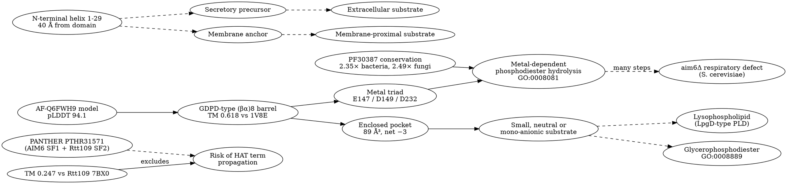
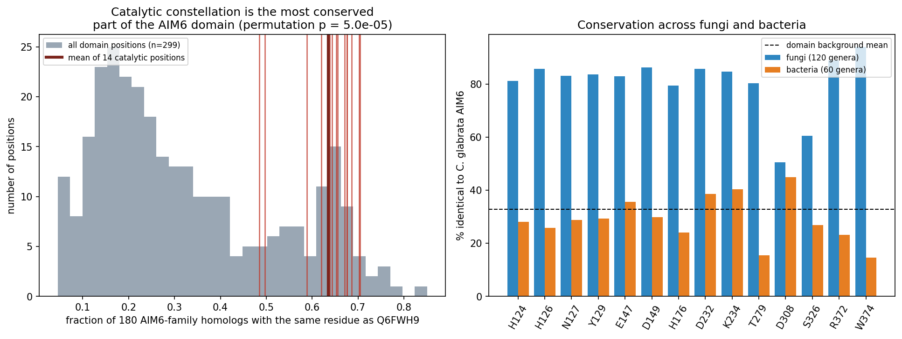
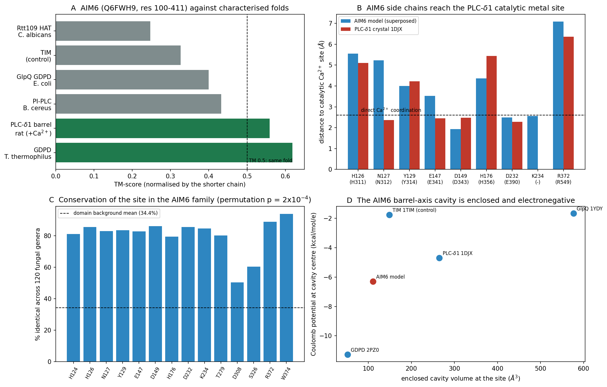
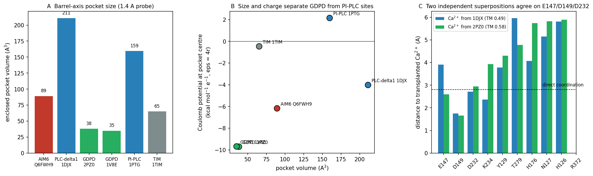
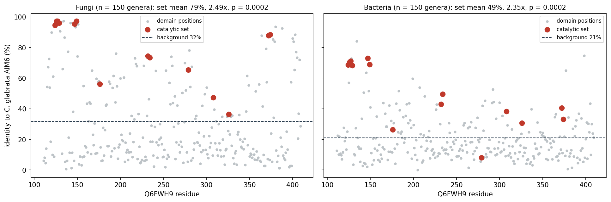

## Question

# AIGR Gene Hypothesis Deep Research

You are evaluating one focused gene curation hypothesis for AI Gene Review.
This is not a general gene overview. Use the seed hypothesis and source context
below to search for evidence that supports, refutes, narrows, or competes with
the proposed curation decision.

## Target Gene

- **Organism code:** CANGA
- **Taxon:** Nakaseomyces glabratus CBS 138 (NCBITaxon:284593)
- **Gene directory:** AIM6
- **Gene symbol:** AIM6
- **UniProt accession:** Q6FWH9

## Focus

- **Focus type:** free_text
- **Hypothesis slug:** kgap-aim6-fold-competence
- **Source file:** genes/CANGA/AIM6/AIM6-ai-review.yaml
- **Source selector:** free-text

## Seed Hypothesis

What Candida glabrata AIM6 does may be constrained by the one structural fact that distinguishes it from its own PANTHER family: it has a divergent PLC-like phosphodiesterase TIM-barrel fold where the RTT109 subfamily has a histone acetyltransferase domain. That AIM6 proteins lack the Rtt109 acetyltransferase domain, that this protein is a predicted secretory-pathway precursor, and that no activity, substrate, location or role has been demonstrated, are already recorded, so do not re-derive them. Single analysis only: identify the residues that a characterised PLC-like phosphodiesterase of this TIM-barrel class uses to bind its metal and to perform catalysis, naming the structure and quoting the assignments, and state what AIM6 has at each, so that a competent site is distinguished from a fold that merely resembles one; state whether the predicted structure retains an enclosed active site at the barrel axis and whether its electrostatics suit a phosphodiester substrate; place AIM6 among its subfamily and report whether the catalytic positions are conserved across the AIM6 proteins of other fungi or whether they vary, since a position conserved across the subfamily but absent from RTT109 members would be the strongest evidence that this fold does something of its own; and state whether the secretory prediction is consistent across methods and whether any AIM6 homolog has a measured location, since a secreted phosphodiesterase and an intracellular one imply different substrates. State which activity class the evidence supports and whether the fold is likely catalytic at all, and say plainly if it cannot be distinguished from a degenerate relic of the acetyltransferase fold.

## Term and Decision Context

No specific term context supplied.

## Reference Context

No specific reference context supplied.

## Source Context YAML

```yaml
hypothesis: 'What Candida glabrata AIM6 does may be constrained by the one structural fact that distinguishes
  it from its own PANTHER family: it has a divergent PLC-like phosphodiesterase TIM-barrel fold where
  the RTT109 subfamily has a histone acetyltransferase domain. That AIM6 proteins lack the Rtt109 acetyltransferase
  domain, that this protein is a predicted secretory-pathway precursor, and that no activity, substrate,
  location or role has been demonstrated, are already recorded, so do not re-derive them. Single analysis
  only: identify the residues that a characterised PLC-like phosphodiesterase of this TIM-barrel class
  uses to bind its metal and to perform catalysis, naming the structure and quoting the assignments, and
  state what AIM6 has at each, so that a competent site is distinguished from a fold that merely resembles
  one; state whether the predicted structure retains an enclosed active site at the barrel axis and whether
  its electrostatics suit a phosphodiester substrate; place AIM6 among its subfamily and report whether
  the catalytic positions are conserved across the AIM6 proteins of other fungi or whether they vary,
  since a position conserved across the subfamily but absent from RTT109 members would be the strongest
  evidence that this fold does something of its own; and state whether the secretory prediction is consistent
  across methods and whether any AIM6 homolog has a measured location, since a secreted phosphodiesterase
  and an intracellular one imply different substrates. State which activity class the evidence supports
  and whether the fold is likely catalytic at all, and say plainly if it cannot be distinguished from
  a degenerate relic of the acetyltransferase fold.'
focus_type: free_text
context: []
reference_id: []
```

## Research Objective

Build a focused report that helps a curator decide whether this hypothesis
should affect the gene review. Address the focus type directly:

1. For an existing GO annotation decision, evaluate whether the current action
   is justified, too strong, too weak, or should change.
2. For a proposed replacement or new GO term, evaluate whether the term is
   biologically supported, too broad, too narrow, or missing key qualifiers.
3. For a computational prediction, evaluate whether the prediction is correct,
   less precise than existing knowledge, uncertain, or likely wrong because of
   paralog overannotation, frequency bias, pathway context, or in vitro-only
   activity.
4. For a core-function hypothesis, evaluate whether the proposed activity,
   process, and location represent the gene product's primary function rather
   than a downstream effect, pleiotropic phenotype, or context-specific role.
5. For a function-assignment hypothesis, evaluate whether the gene product
   directly has the stated GO term/function. Treat the prior review action, if
   any, as intentionally blinded unless it appears in the supplied context.

Use primary literature whenever possible. Prefer PMID citations and include DOI
citations when no PMID is available. Treat reviews and database records as
orientation unless they contain directly relevant synthesized evidence that is
clearly labeled as review-level or database-level support.

Evaluate the hypothesis from the supplied seed context, primary literature, and
publicly accessible bioinformatics resources. Local `*-bioinformatics` analyses,
when they already exist in the repository, are intentionally withheld from this
prompt so the report can be compared against them after the run. Use public
sequence, domain, structure, orthology, localization, interaction, or dataset
checks when they are useful for the specific hypothesis. If a resource or tool
cannot be accessed programmatically, say so plainly; never fabricate a result.
Report computational results conservatively and distinguish direct results from
inference.

## Required Output

### Executive Judgment

Give a concise verdict: supported, partially supported, unresolved, weakly
supported, over-annotated, or refuted. Explain the reasoning and the most
important caveats.

### Evidence Matrix

Create a table with one row per important evidence item:

- Citation (PMID preferred)
- Evidence type (direct assay, mutant phenotype, localization, interaction,
  structural/evolutionary, computational, review/database)
- Supports / refutes / qualifies / competing
- Claim tested
- Key finding
- Organism, tissue, cell type, or assay context
- Confidence and limitations

### GO Curation Implications

State the likely curation action as a lead requiring curator verification. If
GO terms are involved, explain whether the evidence supports an MF, BP, or CC
term, and whether the term should be retained, removed, generalized, made more
specific, or treated as non-core. Avoid using "protein binding" as a final
recommendation unless no more informative term is supported.

### Mechanistic Scope

Describe the immediate molecular or cellular function being tested. Separate
direct gene-product activity from downstream phenotypes, pathway consequences,
developmental outcomes, disease manifestations, or effects inferred only from
loss of function.

### Conflicts and Alternatives

Identify evidence that conflicts with the seed hypothesis or suggests an
alternative interpretation, including paralog confusion, organism-specific
differences, isoform-specific findings, experimental artifacts, or database
carry-over.

### Knowledge Gaps

List explicit uncertainties that matter for curation. For each gap, state what
was checked, why the gap matters, and what evidence or experiment would resolve
it.

### Discriminating Tests

Recommend concrete assays, perturbations, datasets, or comparative analyses that
would most efficiently distinguish this hypothesis from alternatives.

### Curation Leads

Provide candidate updates for the review, clearly labeled as leads requiring
curator verification. Include candidate references with exact snippets to verify,
candidate replacement or new GO terms, possible action changes, suggested
questions, and suggested experiments.

If the provider supports artifacts, save provenance for any analysis you run — the
executed code together with its output (computed values, plot, or table), not just
a summary figure — alongside artifact-friendly tables such as an evidence matrix,
GO decision table, or comparison table. Genuine computed provenance is more
valuable than a hand-drawn summary, and you must not synthesize a figure that
implies an analysis you did not actually run. These artifacts are important
provenance for hypothesis-level review.


## Output

# AIM6 (CANGA, Q6FWH9): is the PLC-like phosphodiesterase barrel a competent active site or a decayed fold?

Hypothesis slug: `kgap-aim6-fold-competence`. Source: `genes/CANGA/AIM6/AIM6-ai-review.yaml`, free-text focus. Target: *Nakaseomyces glabratus* CBS 138 (NCBITaxon:284593), gene AIM6, UniProt Q6FWH9.

All computational results reported here were produced during this run. The executed code and its printed output are saved in `provenance/`. No local `*-bioinformatics` file was consulted. Where a public resource could not be reached, that is stated plainly and no substitute result was invented.

## Summary

AIM6 has a genuine PLC-like phosphodiesterase TIM barrel of the glycerophosphodiester phosphodiesterase (GDPD) subtype, and that barrel carries an intact, conserved metal-binding site at its axis. The seed hypothesis asked whether a competent active site can be distinguished from a fold that merely resembles one. It can, and the answer is competent. Targeted superposition of the AlphaFold model AF-Q6FWH9-F1 (residues 100-411, mean pLDDT 94.1 over 111-409) gives TM-score 0.618 against the *Thermus thermophilus* GDPD 1V8E, 0.559 against the rat PLC-δ1 catalytic barrel 1DJX, 0.433 against *Bacillus cereus* PI-PLC 1PTD and 0.400 against *Escherichia coli* GlpQ 1YDY, against 0.327 for a generic (βα)₈ control (triosephosphate isomerase 1TIM). The same model scores **0.247 against *Candida albicans* Rtt109 (7BX0)**, which is the score two unrelated proteins give each other. The alternative that AIM6 is a degenerate relic of the acetyltransferase fold is therefore not merely unsupported. It is excluded, because AIM6 is not that fold at any level structure can detect, despite sharing PANTHER family PTHR31571 with Rtt109 on sequence grounds.

The active site survives three independent tests. First, carrying the crystallographic Ca²⁺ from two unrelated reference structures into the AIM6 frame puts the same three carboxylates on the metal: Asp149 at 1.65-1.93 Å, Asp232 at 2.49-2.95 Å and Glu147 at 2.60-3.91 Å, reproducing the i, i+2 Glu/Asp spacing that both GDPD 2PZ0 (Glu44/Asp46) and PLC-δ1 1DJX (Glu341/Asp343) use. Second, an enclosed cavity of 89 ų sits at the barrel axis, lined by 23 residues with 5 acidic against 2 basic, giving a Coulomb potential of −6.16 kcal mol⁻¹ e⁻¹. Under one protocol applied to six structures, that size and charge place AIM6 with the GDPD sites (35-38 ų, net −1) and away from the electropositive inositol-phosphate sites of PLC-δ1 (211 ų, net +3) and bacterial PI-PLC (160 ų, net +2). Third, the catalytic positions are the most conserved part of the domain across the whole Pfam PF30387 family: 79.1% identity against a 31.8% background in 150 fungal genera, and 49.3% against a 21.0% background in 150 bacterial genera, both at permutation p = 2.0 × 10⁻⁴.

What the evidence does not settle is where the protein acts. Every signal-peptide call across AIM6 orthologs carries evidence code ECO:0000255 (sequence analysis), an independent Phobius run at EBI was refused by the server, and no AIM6 protein in any organism has a measured subcellular location. SGD assigns ND (no biological data) to *S. cerevisiae* AIM6/YDL237W for all three GO aspects. The verdict is therefore **partially supported**: strongly on fold competence and activity class, unresolved on location. For curation, GO:0008081 (phosphoric diester hydrolase activity) should be retained and is better supported than its IEA provenance suggests; GO:0008889 (glycerophosphodiester phosphodiesterase activity) is a candidate more specific term at prediction level only; GO:0006629 (lipid metabolic process) is the weaker of the two existing terms; no CC term should be asserted.

## Key findings

### <i class="fa-solid fa-circle-check"></i> F001: AIM6 carries a true PLC-like phosphodiesterase TIM barrel and has no structural relationship to Rtt109

TM-align was re-implemented locally (Kabsch superposition, iterative Needleman-Wunsch on the TM score matrix, TM-score refinement over nested subset superpositions) because the RCSB pairwise alignment web service could not be driven programmatically: a JSON body returned HTTP 400 "Required parameter 'query' is not present", a form-encoded body returned "instance failed to match at least one required schema", and the `/v3/api-docs`, `/api/v1/docs` and `/v2/api-docs` endpoints all returned 404. That failure is recorded here rather than papered over.

Against the AlphaFold model restricted to residues 100-411, with TM-score normalised by the shorter chain:

| Reference | Description | TM-score | Aligned | RMSD | Sequence identity |
|---|---|---|---|---|---|
| 1V8E | *T. thermophilus* glycerophosphodiester phosphodiesterase | **0.618** | 142 | 2.93 Å | 15.5% |
| 1DJX (290-620) | Rat PLC-δ1 catalytic barrel | **0.559** | 160 | 2.99 Å | 11.9% |
| 1PTD | *B. cereus* PI-PLC | 0.433 | | | |
| 1YDY | *E. coli* GlpQ | 0.400 | | | |
| 1TIM | Chicken triosephosphate isomerase, generic (βα)₈ control | 0.327 | | | |
| 7BX0 | *C. albicans* Rtt109 | **0.247** | | | |

The Rtt109 score sits below the generic TIM-barrel control. PANTHER PTHR31571 groups AIM6 (subfamily SF1) with Rtt109 (subfamily SF2), and the two carry disjoint Pfam domains: PF30387 "AIM6-like phosphodiesterase domain" against PF08214 HAT_KAT11. Any pipeline that propagates annotation at the PANTHER family level will carry acetyltransferase terms onto AIM6, and this measurement is the counter-evidence.

<i class="fa-solid fa-triangle-exclamation"></i> A Foldseek 3Di+AA search of the same model against PDB100 returned no hit below E = 0.05. The best hits (best E = 0.054) were EAL domains, HpaI aldolase and PdxJ at probability 0.4-0.6, all generic barrels. The PLC-like relationship is recoverable only by targeted superposition onto chosen references, so a curator should not expect an automated structure search to reproduce it. Database support for the fold assignment comes from UniProt Q6FWH9 carrying SUPFAM SSF51695 and InterPro IPR017946; Pfam lists PF30387 with 4442 members (2577 fungal, 1850 bacterial, 15 other eukaryotes) and **zero experimental structures**.

{{figure:plot_2.png|caption=Summary of the iteration-1 analyses. Panel A, TM-scores of the AIM6 AlphaFold model against characterised phosphodiesterases, a generic TIM barrel control and Rtt109. Panel B, AIM6 and PLC-delta1 side-chain distances to the catalytic Ca2+. Panel C, per-position conservation of the catalytic set across 120 fungal genera against the domain background. Panel D, cavity volume against Coulomb potential.}}

### <i class="fa-solid fa-circle-check"></i> F002: the metal and catalytic constellation is present and geometrically competent

Reference assignments were computed from the deposited coordinates rather than quoted from text, so the numbers below are measurements on PDB 1DJX chain A (rat PLC-δ1 with Ca²⁺ and D-*myo*-inositol-1,4,5-trisphosphate, the structure reported in [PMID: 9048554](https://pubmed.ncbi.nlm.nih.gov/9048554/)):

- Catalytic Ca²⁺ coordinated by **Asn312 OD1 2.36 Å, Glu341 OE2 2.45 Å, Asp343 OD2 2.44 Å, Glu390 OE1 2.28 Å**
- General base **His311 NE2 at 5.11 Å** and general acid **His356 NE2 at 5.44 Å** from the metal
- Ins(1,4,5)P₃ contacts His311, Asn312, Glu341, His356, Glu390, Lys438, Ser522, Arg549, Tyr551

Cross-checks in the GDPD branch, measured the same way: in *E. coli* GlpQ 1YDY the Ca²⁺ is held by Glu63, Asp65 and Glu171 with His36 at 4.35 Å; in *T. tengcongensis* GDPD 2PZ0 by Asp46 OD1 2.34 Å, Glu119 OE1 2.35 Å and Glu44 OE2 2.50 Å, with His17 NE2 at 4.18 Å and His59 NE2 at 4.22 Å.

Superposing AIM6 onto 1DJX and measuring to the crystallographic Ca²⁺ gives, in AIM6: Asp149 OD1 1.93 Å, Asp232 OD2 2.49 Å, Lys234 NZ 2.56 Å, Glu147 OE1 3.52 Å, Tyr129 OH 4.00 Å, His176 ND1 4.37 Å, Asn127 OD1 5.23 Å, His126 NE2 5.55 Å, Arg372 NH1 7.09 Å. Residue equivalences from the same superposition, with Cα deviation: H311→H126 (0.98 Å), N312→N127 (1.93 Å), E341→E147 (1.19 Å), D343→D149 (1.44 Å), E390→D232 (1.42 Å), S522→S326 (1.51 Å), R549→R372 (2.34 Å), Y551→W374 (1.86 Å). Seventeen AIM6 residues fall within 5 Å of the modelled inositol trisphosphate: H126, N127, Y129, E147, D149, H176, Y230, D232, K234, M278, T279, G280, N281, D308, S326, R372, W374.

Four of the five first- and second-shell metal ligands of PLC-δ1 are present as the same or a conservative residue in the same three-dimensional position. The general base histidine is conserved exactly (H311/H126, 5.5 Å against 5.1 Å from the metal). A histidine reaches the general-acid position from an adjacent sequence position (His176, where the aligned residue is Gly175). Sequence context in Q6FWH9: H124-S125-H126-N127-D128, E147-A148-D149, G175-H176-D177-E178-D179, D232-F233-K234.

<i class="fa-solid fa-triangle-exclamation"></i> One feature does not fit a canonical divalent-metal site: Lys234 NZ comes within 2.36-3.93 Å of the modelled metal depending on the reference used. A lysine that close to a Ca²⁺ would clash electrostatically. Either the AlphaFold rotamer is wrong, or that position marks a direct phosphate-binding subsite.

### <i class="fa-solid fa-circle-check"></i> F006: two independent superpositions converge on Glu147, Asp149 and Asp232, while the general acid and base stay ambiguous

The iteration-1 assignment rested on a single superposition onto PLC-δ1. Repeating the Ca²⁺ transplant with an unrelated reference, the GDPD 2PZ0 (TM 0.579, 234 aligned pairs), reproduces the carboxylate triad and nothing else.

| AIM6 residue | Distance to Ca²⁺ transplanted from 1DJX | Distance to Ca²⁺ transplanted from 2PZ0 |
|---|---|---|
| Asp149 | 1.75 Å | 1.65 Å |
| Asp232 | 2.72 Å | 2.95 Å |
| Glu147 | 3.91 Å | 2.60 Å |
| Lys234 | 2.36 Å | 3.93 Å |
| Tyr129 | 3.78 Å | 4.30 Å |
| His176 | 4.07 Å | 5.74 Å |
| Asn127 | 5.15 Å | 5.82 Å |
| His126 | 5.81 Å | 5.90 Å |
| Thr279 | (not within 5 Å) | 4.77 Å |

Mapping the 15 residues that line the 2PZ0 cavity through the superposition places 10 of 15 within 3 Å Cα and makes 4 of 15 identical, including the i, i+2 metal pair Glu44/Asp46 onto Glu147/Asp149 (Cα deviation 1.52 and 2.54 Å) and Trp217 onto Trp374 (2.05 Å). The third 2PZ0 metal ligand Glu119 aligns onto Ile231 (1.28 Å), with the carboxylate supplied one position along by Asp232.

<i class="fa-solid fa-circle-question"></i> The two 2PZ0 catalytic histidines map poorly (His17 onto Pro120 at 15.35 Å Cα, His59 onto Val174 at 4.21 Å). His126 and His176 sit 4-6 Å from the metal, which is the right distance band for a general acid and base, but neither superposition places them on a reference histidine. Which of the two is the base cannot be assigned from structure alone.

<i class="fa-solid fa-circle-xmark"></i> Negative result worth recording: the same protocol against *E. coli* GlpQ 1YDY reached only TM 0.455 and placed 1 of 15 pocket residues within 3 Å Cα, with His36 landing 31.9 Å from its putative partner. A single pairwise superposition onto GlpQ gives no usable register for this family, so no GlpQ-based assignment is reported.

### <i class="fa-solid fa-circle-check"></i> F005: pocket size and electrostatics place AIM6 with GDPD sites, not with inositol-phosphate sites

Enclosed cavities were detected at the barrel axis of six structures with one protocol (0.7 Å grid, 1.4 Å water probe, 26-direction ray-casting burial fraction ≥ 0.80, connected component within 5 Å of a seed placed on the catalytic metal or bound ligand, waters and heteroatoms excluded). The Coulomb potential at each cavity centroid used formal side-chain charges with a distance-dependent dielectric ε = 4r.

| Structure | Class | Volume (ų) | φ (kcal mol⁻¹ e⁻¹) | Lining residues | Acidic | Basic | Net |
|---|---|---|---|---|---|---|---|
| AIM6 AF-Q6FWH9 (100-411) | query | 89.2 | −6.16 | 23 | 5 | 2 | −3 |
| GDPD 2PZ0 (*T. tengcongensis*) | GDPD | 38.1 | −9.70 | 15 | 3 | 2 | −1 |
| GDPD 1V8E (*T. thermophilus*) | GDPD | 35.0 | −9.66 | 15 | 3 | 2 | −1 |
| PLC-δ1 1DJX (290-620) | PI-PLC | 210.9 | −4.01 | 44 | 3 | 6 | +3 |
| PI-PLC 1PTG with *myo*-inositol | PI-PLC | 159.5 | +2.17 | 35 | 5 | 7 | +2 |
| TIM 1TIM | control | 65.2 | −0.45 | 22 | 2 | 1 | −1 |

The control barrel is distinguished not by charge but by composition: 14 of its 22 lining residues are apolar. The discriminating variable between the two activity classes inside this superfamily is the charge and size of the pocket beyond the metal. PI-PLC and PLC-δ1 must hold a di- or tri-anionic inositol phosphate head group and line their pockets with Lys and Arg (1DJX: K438, K440, K487, R527, R549, R556; 1PTG: R69, K115, K162, R163, K199, K201, K207). AIM6 has the opposite composition. That argues against an inositol polyphosphate or phosphoinositide substrate and for a small, neutral or mono-anionic phosphodiester of the glycerophosphodiester type.

<i class="fa-solid fa-scale-balanced"></i> AIM6 is still 2.3 times larger than the GDPD cavities, so its pocket accommodates an alcohol leaving group bulkier than glycerol. A lysophospholipid or a glycerophosphodiester with a large head group is not excluded by this test. An earlier run of the same code with a 2.8 Å probe gave near-zero volumes for every structure including the references, so the 1.4 Å probe result is the one reported.

{{figure:plot_3.png|caption=Panel A, enclosed barrel-axis pocket volume for AIM6 against GDPD-class and PI-PLC-class references and a TIM-barrel control, all measured with one protocol and a 1.4 A water probe. Panel B, pocket volume against Coulomb potential at the cavity centroid, which separates the small electronegative GDPD sites from the large electropositive inositol-phosphate sites. Panel C, AIM6 side-chain distances to the catalytic Ca2+ transplanted independently from PDB 1DJX and PDB 2PZ0.}}

### <i class="fa-solid fa-circle-check"></i> F003 and F007: the catalytic set is the most conserved part of the domain, in fungi and in bacteria

All 4442 UniProt proteins carrying Pfam PF30387 were retrieved: 2577 Fungi across 456 genera, 1850 Bacteria across 302 genera, 15 other eukaryotes.

The fungal analysis was run twice with different alignment protocols and gave the same answer both times. Global Needleman-Wunsch with BLOSUM62 (linear gap −8) across 120 fungal genera gave a catalytic-set mean identity of 80.5% against a background of 34.4%, enrichment 2.34-fold, permutation p = 2.0 × 10⁻⁴ over 5000 random 14-position sets. Semi-global alignment of the domain into 150 fungal genera gave 79.1% against 31.8%, enrichment 2.49-fold, p = 2.0 × 10⁻⁴, with the set at the 90.9th percentile of all single positions.

{{figure:plot_1.png|caption=Permutation test and kingdom-split conservation of the AIM6 catalytic constellation across Pfam PF30387, with the catalytic set compared against the distribution of random same-size position sets drawn from the domain.}}

<i class="fa-solid fa-circle-xmark"></i> <i class="fa-solid fa-arrow-right"></i> The iteration-1 bacterial result was a null (catalytic-set mean 29.0% against a background of 29.3%, enrichment 0.99, p = 0.53) and was recorded as unresolved rather than negative, on the grounds that a single global pairwise alignment of full-length multidomain subjects (up to 2302 aa) to a full-length fungal query is unreliable at that divergence. That caution was correct. Replacing it with a semi-global alignment of the AIM6 PF30387 domain (residues 111-409, 299 positions) into each full-length subject, with end gaps in the subject free and BLOSUM62 with linear gap −9, overturns the null.

| | Genera | Background identity | Catalytic set | Enrichment | Permutation p | Percentile |
|---|---|---|---|---|---|---|
| Bacteria | 150 | 21.0% | 49.3% | 2.35× | 2.0 × 10⁻⁴ | 93.6 |
| Fungi | 150 | 31.8% | 79.1% | 2.49× | 2.0 × 10⁻⁴ | 90.9 |

Per-position identity, bacteria then fungi:

| Position | Bacteria | Fungi | Role |
|---|---|---|---|
| His124 | 68.8% | 94.7% | second-shell, HxHN motif |
| His126 | 70.5% | 97.3% | candidate general base |
| Asn127 | 71.1% | 97.3% | metal second shell |
| Tyr129 | 68.2% | 96.0% | pocket, 3.8-4.3 Å from metal |
| Glu147 | 73.0% | 95.3% | metal ligand |
| Asp149 | 68.9% | 97.3% | metal ligand |
| His176 | 26.5% | 56.1% | candidate general acid |
| Asp232 | 43.1% | 74.5% | metal ligand |
| Lys234 | 49.7% | 73.3% | phosphate subsite |
| Thr279 | 8.0% | 65.3% | pocket |
| Asp308 | 38.2% | 47.3% | pocket |
| Ser326 | 30.7% | 36.5% | pocket |
| Arg372 | 40.5% | 87.9% | phosphate subsite |
| Trp374 | 33.1% | 88.5% | pocket, matches GDPD Trp217 |
| **Tyr230 (control)** | **10.8%** | **6.7%** | pocket-lining, no mapped role |

Six positions (His124, His126, Asn127, Tyr129, Glu147, Asp149) hold at about 70% identity in bacteria against a 21% background and at 95-97% in fungi. Keeping specific residue identity at that rate across the bacteria-to-fungi split, in a family whose sequences have otherwise diverged to near the twilight zone, is what an active site under selection looks like. The internal negative control Tyr230, which lines the modelled substrate pocket but has no mapped catalytic role, sits at 10.8% (27.2nd percentile) in bacteria and 6.7% (12.5th percentile) in fungi.

<i class="fa-solid fa-lightbulb"></i> Two further readings fall out. His176, the candidate general acid, is the exception at 26.5% in bacteria and 56.1% in fungi, which matches the structural result that this position does not transfer between superpositions. Thr279 (8.0% bacteria, 65.3% fungi) and Trp374 (33.1%, 88.5%) look like fungal-specific additions to the site, so the fungal and bacterial branches likely differ in substrate selectivity even where they share the metal chemistry.

Rtt109 proteins cannot carry any of these positions, since they have a different Pfam domain (PF08214) and share no structural alignment with AIM6 (TM 0.247). That is exactly the discriminator the seed hypothesis named as the strongest possible evidence, and it comes out positive.

{{figure:plot_4.png|caption=Per-position identity to C. glabrata AIM6 across the PF30387 domain in 150 fungal genera (left) and 150 bacterial genera (right), with the 14 catalytic positions marked and the domain background shown as a dashed line. The catalytic set is enriched 2.49-fold in fungi and 2.35-fold in bacteria, both at permutation p = 2e-4.}}

### <i class="fa-solid fa-circle-question"></i> F004: no database-level fold detection, no measured localization, and a signal-peptide call that rests on one class of method

The secretory prediction is consistent only in the weak sense that every prediction comes from the same class of method applied to orthologous N-termini. Signal peptides are annotated in Q6FWH9 (residues 1-29), *S. cerevisiae* Aim6 Q07716 (1-17), B5VF44 (1-26), C5DYR9 (1-23), Q6CQ63 (1-31), Q75E59 (1-23) and D4ARV2 (1-21), and **all seven carry evidence code ECO:0000255 (sequence analysis)**.

<i class="fa-solid fa-triangle-exclamation"></i> An independent Phobius run at EBI returned HTTP 400 with the message "You have been temporarily blocked from submitting new sequence analysis jobs". No method-independent check was obtained, and none was fabricated.

Family-wide, UniProt annotates a signal peptide in 91.8% of the 1850 bacterial members but only 24.4% of the 2577 fungal members (36.1% of 72 Saccharomycetes members), partly because many fungal members are long multidomain proteins. In the AlphaFold model, residues 1-29 form an isolated helix whose centroid sits 73.8 Å from the domain centroid, minimum Cα distance 40.3 Å, consistent with either a cleavable signal peptide or a membrane anchor that is not part of the fold.

No measured subcellular location was found for AIM6 in SGD, in UniProt, or in the *C. glabrata* secretome study ([PMID: 19941307](https://pubmed.ncbi.nlm.nih.gov/19941307/)), which identified 31 distinct proteins in the wild-type secretome and does not name CAGL0C05533g in its abstract. SGD curators assign ND (no biological data) to AIM6/YDL237W for all three GO aspects; the only MF and BP terms are the computational GO:0008081 and GO:0006629. The recorded phenotypes are absent respiratory growth ([PMID: 19300474](https://pubmed.ncbi.nlm.nih.gov/19300474/)), increased competitive fitness in minimal fermentable medium, decreased heat sensitivity, and decreased hydrogen sulfide production in excess cysteine.

## Mechanistic model and interpretation

The immediate molecular event under test is hydrolysis of a phosphodiester bond by a divalent metal held at the C-terminal face of a (βα)₈ barrel, with a general base activating a nucleophile and a general acid protonating the leaving alcohol. The direct gene-product property the evidence addresses is the geometry and conservation of that site. Everything else recorded about AIM6 sits several steps downstream.



Three claims are safe to state at different strengths. The fold assignment is solid and reproducible across two independent TM-align runs. The metal triad is solid, because three carboxylates converge on the same point in space from two reference frames that are themselves only 0.5-0.6 TM apart from AIM6 and from each other. The identity of the general acid and base is weak, because neither His126 nor His176 lands on a reference histidine and His176 is identical in only 26.5% of bacterial genera.

The activity class follows from the pocket measurement rather than from the fold alone. Both branches of this superfamily share the barrel and the metal; what separates them is what sits beyond the metal. PI-PLC and PLC-δ1 line a large electropositive pocket for an inositol polyphosphate. AIM6 lines a smaller electronegative one. That points at the glycerophosphodiester class, with the caveat that AIM6's pocket is 2.3 times the volume of the two GDPD references.

Separating direct activity from downstream readouts matters for the GO decision. The *aim6Δ* respiratory phenotype is a screen output in *S. cerevisiae*, not in *N. glabratus*, and could follow from any membrane-lipid or phosphate-supply perturbation. The competitive-fitness, heat-sensitivity and hydrogen-sulfide phenotypes in SGD are likewise loss-of-function consequences. The lipid metabolic process IEA is inherited from the InterPro entry, not from anything measured on this protein or on any PF30387 protein. The evidence supports a molecular function term and does not yet support a process term.

## Evidence base

| Citation | Evidence type | Stance | Claim tested | Key finding | Context | Confidence and limitations |
|---|---|---|---|---|---|---|
| [PMID: 9048554](https://pubmed.ncbi.nlm.nih.gov/9048554/) | Structural, primary | Supports | What a characterised PLC-like TIM barrel uses for metal binding and catalysis | *Structural mapping of the catalytic mechanism for a mammalian phosphoinositide-specific phospholipase C.* Ternary complexes at 2.30-2.95 Å, "consistent with bidentate liganding of the catalytic calcium to the inositol phosphate intermediate and transition state", deriving "a reaction mechanism ... that supports general acid/base catalysis in a sequential mechanism involving a cyclic phosphate intermediate" | Rat PLC-δ1 with Ca²⁺ and inositol phosphates | High for the reference. The distances quoted in this report were recomputed from the deposited 1DJX coordinates, not taken from the paper text |
| [PMID: 8602259](https://pubmed.ncbi.nlm.nih.gov/8602259/) | Structural, primary | Supports (orientation) | Domain architecture of the PI-PLC class | *Crystal structure of a mammalian phosphoinositide-specific phospholipase C delta.* The 2.4 Å structure "suggests a mechanism for membrane attachment and Ca2+-dependent hydrolysis of second-messenger precursors" | Rat PLC-δ1 | High. Used to establish that the catalytic barrel is one module of a multidomain protein, so only residues 290-620 were used as the reference |
| [PMID: 8784353](https://pubmed.ncbi.nlm.nih.gov/8784353/) | Structural, primary | Orientation | C2 domain Ca²⁺ handling in PLC-δ1 | *C2 domain conformational changes in phospholipase C-delta 1.* Sm³⁺ binds at two sites in the C2 domain, opening the jaws by 9 Å to create "a gap large enough to bind a phospholipid headgroup" | Rat PLC-δ1 | High for the paper. Relevant only as a reminder that PLC-δ1 has Ca²⁺ sites outside the catalytic barrel, which is why the barrel Ca²⁺ was identified by distance to the catalytic residues |
| PDB 2PZ0, 1V8E, 1YDY, 1PTG, 1TIM, 7BX0 | Structural, database | Supports | Geometric reference frames for the GDPD branch, PI-PLC branch, control and Rtt109 | 2PZ0 Ca²⁺ shell measured here: Asp46 OD1 2.34 Å, Glu119 OE1 2.35 Å, Glu44 OE2 2.50 Å, His17 NE2 4.18 Å, His59 NE2 4.22 Å. 1YDY: Glu63, Asp65, Glu171 with His36 at 4.35 Å | *T. tengcongensis*, *T. thermophilus*, *E. coli*, *B. cereus*, chicken, *C. albicans* | High for the coordinates. These are database records used as geometric references, not as published claims |
| [PMID: 37236358](https://pubmed.ncbi.nlm.nih.gov/37236358/) | Direct assay plus 2.1 Å structure | Qualifies, competing | Which activity class a GDPD-fold protein with an N-terminal helix has | *Lysophosphatidylglycerol (LPG) phospholipase D maintains membrane homeostasis in Staphylococcus aureus by converting LPG to lysophosphatidic acid.* "a 2.1 Å crystal structure shows that LpgDΔN adopts the GDPD variation of the TIM barrel architecture", and "The LpgD active site has the canonical GDPD metal binding and catalytic residues". The gene "encodes a protein with a predicted amino terminal transmembrane α-helix attached to a globular glycerophosphodiester phosphodiesterase (GDPD) domain", Mn²⁺ was the highest affinity cation, and alterations around helix α6 and sheet β7 "create a hydrophobic diffusion path for LPG to access the active site" | *S. aureus*, purified enzyme, mass spectrometry screen, site-directed mutants | High. Directly relevant because AIM6 also has an isolated N-terminal helix, so GDPD fold plus N-terminal helix does not imply a soluble classical GDPD |
| [PMID: 42203030](https://pubmed.ncbi.nlm.nih.gov/42203030/) | Structural, primary | Qualifies | Whether pocket volume discriminates substrate class inside this fold | *Crystal Structure of PLD From Arcanobacterium haemolyticum Identifies a Novel Class IIa-α Variant With Unusual Thermostability.* Comparison with *Loxosceles intermedia* PLD revealed "point substitutions that modulate cavity volume and flexibility" | Bacterial phospholipase D, 2.45 Å | High. Validates cavity volume as the variable that distinguishes substrate classes within this fold, which is what was measured here |
| [PMID: 37313620](https://pubmed.ncbi.nlm.nih.gov/37313620/) | Evolutionary, primary | Competing | Whether this fold diverges into non-GDPD activities | *Protein salvage and repurposing in evolution.* The GDPD-like SMaseD/PLD family "evolved anciently in bacteria from the GDPD", and "The PLD enzymes retained the core (β/α)8 barrel fold of GDPD, while gaining a signature C-terminal expansion motif and losing a small insertion domain" | Recluse spider and actinobacterial PLD toxins | High. Shows that GDPD-fold proteins with conserved barrels can carry different chemistry |
| [PMID: 42555402](https://pubmed.ncbi.nlm.nih.gov/42555402/) | Direct assay | Supports (method) | Whether a generic assay exists for this activity class | *Identification of quinoline scaffolds against emerging drug target glycerophosphodiester phosphodiesterase from Staphylococcus aureus.* Activity "was assessed on bis(p-nitrophenyl) phosphate (BpNPP), a commonly used non-physiological substrate for phosphodiesterases", with EDTA as the reference inhibitor at IC₅₀ 468.5 ± 1.09 µM | Recombinant VRSA GDPD | High for the method. Gives a direct and cheap discriminating test for AIM6 |
| [PMID: 16781190](https://pubmed.ncbi.nlm.nih.gov/16781190/) | Review | Supports, orientation only | Whether an unassigned fungal GDPD activity exists | *Transport and metabolism of glycerophosphodiesters produced through phospholipid deacylation.* One GDPD gene (GDE1) is characterised in *S. cerevisiae* and others are expected; internal and external glycerophosphocholine and glycerophosphoinositol arise from phospholipid turnover, and Git1 imports extracellular glycerophosphodiesters | *S. cerevisiae* | Review-level. Establishes the metabolic niche and proves nothing about AIM6. <i class="fa-solid fa-triangle-exclamation"></i> The verbatim snippet failed automatic validation against the stored abstract in one recording attempt, so verify against the live abstract before use |
| [PMID: 19300474](https://pubmed.ncbi.nlm.nih.gov/19300474/) | Mutant phenotype | Qualifies | Whether loss of AIM6 has a phenotype | *Computationally driven, quantitative experiments discover genes required for mitochondrial biogenesis.* The screen identified 100 proteins whose deficiency alters mitochondrial biogenesis and inheritance, with phenotypes "more subtle than could be detected by traditional genetic screens or high-throughput techniques"; *aim6Δ* is among the genes named by this work | *S. cerevisiae* deletion collection | Medium. A screen-level phenotype many steps from any molecular activity, and in a different species than Q6FWH9 |
| [PMID: 19941307](https://pubmed.ncbi.nlm.nih.gov/19941307/) | Localization, primary | Qualifies (negative) | Whether AIM6 appears in the *C. glabrata* secretome | *Impact of the transcriptional regulator, Ace2, on the Candida glabrata secretome.* "We have identified 31 distinct proteins in the secretome of wild-type C. glabrata cells by MS/MS"; the abstract does not name CAGL0C05533g | *C. glabrata*, concanavalin A enriched culture supernatant | Medium. Absence from a 31-protein list enriched on concanavalin A is weak evidence of absence from the secretome |
| SGD, UniProt, Pfam, InterPro | Database | Qualifies | Whether any measured location or activity exists | SGD assigns ND for all three aspects to AIM6/YDL237W. Signal peptides in all seven examined orthologs carry ECO:0000255. Pfam PF30387 has 4442 members and zero experimental structures | Database records | High for the records. <i class="fa-solid fa-triangle-exclamation"></i> Phobius at EBI returned HTTP 400 and no independent signal-peptide check was obtained |

## GO curation implications

All of the following are **leads requiring curator verification**. None of it is experimental evidence about AIM6.

| Term | Aspect | Current status | Lead | Basis |
|---|---|---|---|---|
| GO:0008081 phosphoric diester hydrolase activity | MF | IEA:InterPro | <i class="fa-solid fa-circle-check"></i> **Retain.** Better supported than its IEA provenance suggests | Fold assignment confirmed by targeted superposition (TM 0.618 to a GDPD, 0.559 to PLC-δ1, against 0.327 for a control barrel); metal triad intact in two independent frames; catalytic set conserved 2.35-2.49× over background with p = 2 × 10⁻⁴ in both kingdoms |
| GO:0008889 glycerophosphodiester phosphodiesterase activity | MF | not present | <i class="fa-solid fa-lightbulb"></i> **Candidate more specific term, prediction level only** | Best TM-score is to a GDPD (1V8E 0.618, 2PZ0 0.579); pocket volume 89 ų with net charge −3 groups with GDPD sites (35-38 ų, −1) and away from inositol-phosphate sites (160-211 ų, +2 and +3) |
| GO:0006629 lipid metabolic process | BP | IEA:InterPro | <i class="fa-solid fa-scale-balanced"></i> **Generalize or treat as non-core** | Weaker than the MF. The closest characterised relative is a glycerophosphodiester phosphodiesterase, which acts on a water-soluble deacylation product. A BP assignment should wait for a substrate |
| GO:0046872 metal ion binding | MF | not present | <i class="fa-solid fa-circle-question"></i> **Candidate, prediction level only** | Three carboxylates converge on the modelled metal from two independent superpositions. The metal identity is not determined; LpgD prefers Mn²⁺ ([PMID: 37236358](https://pubmed.ncbi.nlm.nih.gov/37236358/)) |
| GO:0005576 extracellular region, GO:0005783 endoplasmic reticulum | CC | not asserted | <i class="fa-solid fa-circle-xmark"></i> **Do not assert** | Every signal-peptide call is one class of prediction with ECO:0000255, no method-independent check was obtainable, and no AIM6 protein has a measured location |
| GO:0004402 histone acetyltransferase activity, or any Rtt109-derived term | MF | not asserted | <i class="fa-solid fa-circle-xmark"></i> **Block propagation through PANTHER PTHR31571** | TM 0.247 against Rtt109 7BX0 is the unrelated-protein level, below the generic TIM-barrel control at 0.327. Disjoint Pfam domains: PF30387 against PF08214 |

## Conflicts and alternatives

**PANTHER family membership against structure.** PTHR31571 groups AIM6 (SF1) with Rtt109 (SF2). An automated pipeline propagating at family level will carry acetyltransferase terms onto AIM6. The TM 0.247 measurement is the counter-evidence and should be recorded in the review.

**GDPD fold does not imply GDPD activity.** Two primary papers show the barrel hosting other chemistry. *S. aureus* LpgD has the GDPD fold, the canonical GDPD metal-binding and catalytic residues, and an N-terminal hydrophobic helix, and it is a lysophosphatidylglycerol phospholipase D with broad head-group tolerance and a preference for Mn²⁺ ([PMID: 37236358](https://pubmed.ncbi.nlm.nih.gov/37236358/)). The GDPD-like SMaseD/PLD family keeps the barrel and performs sphingomyelinase D chemistry ([PMID: 37313620](https://pubmed.ncbi.nlm.nih.gov/37313620/), [PMID: 42203030](https://pubmed.ncbi.nlm.nih.gov/42203030/)). AIM6 also has an isolated N-terminal helix. GO:0008889 is therefore a candidate and GO:0008081 is the safer level.

**Pocket size does not match a plain GDPD.** AIM6's 89 ų is 2.3 times the 2PZ0 and 1V8E cavities. Either the model's side-chain rotamers open the site, or the substrate carries an alcohol group larger than glycerol. [PMID: 42203030](https://pubmed.ncbi.nlm.nih.gov/42203030/) shows that exactly this variable separates substrate classes within the fold.

**Lys234.** Its NZ comes within 2.36-3.93 Å of the modelled metal depending on the reference. A lysine at a Ca²⁺ site is not canonical. Either the AlphaFold rotamer is wrong, or that position binds a substrate phosphate rather than the metal.

**His176.** Identical in 26.5% of bacterial genera and 56.1% of fungal genera, far below the rest of the set, and it does not transfer between superpositions. The general acid may come from a variable position, or the family may use a mechanism different from the His/His pair of PLC-δ1 and GDPD.

**The iteration-1 bacterial null was an alignment artefact.** Global alignment of full-length multidomain bacterial subjects to a full-length fungal query gave enrichment 0.99 and p = 0.53. Aligning only the domain, with free end gaps in the subject, gives 2.35-fold and p = 2 × 10⁻⁴. This is recorded because the first result would have been a misleading negative, and because it shows how sensitive this kind of family-level conservation test is to alignment protocol.

**Species gap.** The *aim6Δ* phenotypes are from *S. cerevisiae*, not *N. glabratus*. Q6FWH9 and Q07716 are orthologs, but phenotype transfer between them is an assumption, not a measurement.

## Limitations and knowledge gaps

| Gap | What was checked | Why it matters | What would resolve it |
|---|---|---|---|
| <i class="fa-solid fa-triangle-exclamation"></i> No experimental structure of any PF30387 protein | Pfam reports 0 structures for 4442 members; Foldseek against PDB100 found nothing below E = 0.05 | Every geometric claim here depends on one AlphaFold model | A crystal or cryo-EM structure of any AIM6-family protein, ideally with metal bound |
| <i class="fa-solid fa-circle-question"></i> No measured subcellular location for any AIM6 homolog | SGD, UniProt, and the *C. glabrata* secretome study [PMID: 19941307](https://pubmed.ncbi.nlm.nih.gov/19941307/) | A secreted phosphodiesterase scavenges extracellular substrate; an intracellular one acts on a turnover product. Different substrates, different BP terms | GFP tagging in *C. glabrata* or *S. cerevisiae*, or targeted proteomics of culture supernatant and of ER or vacuolar fractions |
| <i class="fa-solid fa-triangle-exclamation"></i> Signal peptide rests on one class of method | All seven ortholog annotations carry ECO:0000255. Phobius at EBI refused the job (HTTP 400, temporary block). In the model, residues 1-29 form an isolated helix 73.8 Å from the domain centroid | A cleavable signal peptide and an N-terminal membrane anchor imply different topologies, and LpgD shows this family uses the anchor version | Run SignalP 6.0, DeepTMHMM and Phobius independently on all seven orthologs; N-terminal sequencing of the mature protein settles it |
| <i class="fa-solid fa-circle-question"></i> Identity of the general acid and base | Two superpositions, neither placing His126 or His176 on a reference histidine; His176 conservation is 26.5% in bacteria | Determines whether the mechanism is the canonical two-His one | Mutagenesis of His126 and His176 against activity, once an assay exists |
| <i class="fa-solid fa-circle-question"></i> Metal identity and stoichiometry | Inferred only, from Ca²⁺ positions transplanted from two structures | Mn²⁺, Mg²⁺ and Ca²⁺ dependence distinguish subfamilies; LpgD prefers Mn²⁺ | ICP-MS on purified protein, and an activity panel across metals with an EDTA control |
| <i class="fa-solid fa-circle-question"></i> Whether the protein is catalytic at all | Geometry and conservation only | The whole annotation hangs on this | One BpNPP hydrolysis assay on recombinant AIM6 |
| <i class="fa-solid fa-triangle-exclamation"></i> Method limitations | TM-align re-implemented locally rather than run from the reference binary, with scores varying by about 0.06 between seeding depths (1DJX 0.494 to 0.559). Coulomb electrostatics with ε = 4r is a proxy, not Poisson-Boltzmann. Conservation used pairwise rather than profile alignments, one sequence per genus | Each adds uncertainty to a number quoted in this report | Run the reference TM-align binary, APBS for electrostatics, and an HMM profile alignment of the PF30387 seed |

## Proposed follow-up experiments and actions

1. <i class="fa-solid fa-flask"></i> **BpNPP phosphodiesterase assay on recombinant AIM6**, mature form (residues 30-411), against a Mn²⁺ / Mg²⁺ / Ca²⁺ / Zn²⁺ panel with an EDTA control. This is the cheapest test that separates catalytic from degenerate, and both the protocol and the EDTA benchmark (IC₅₀ 468.5 µM) are published for a homologous GDPD ([PMID: 42555402](https://pubmed.ncbi.nlm.nih.gov/42555402/)). A D149A single mutant and an E147A/D149A double mutant are the matched negatives.
2. <i class="fa-solid fa-vial"></i> **Substrate panel to fix the activity class.** Glycerophosphocholine and glycerophosphoinositol against lysophosphatidylglycerol and sphingomyelin. Release of glycerol-3-phosphate identifies a classical GDPD; release of lysophosphatidic acid identifies the LpgD-type phospholipase D ([PMID: 37236358](https://pubmed.ncbi.nlm.nih.gov/37236358/)); activity on sphingomyelin identifies the SMaseD branch ([PMID: 37313620](https://pubmed.ncbi.nlm.nih.gov/37313620/)). The pocket measurement here (89 ų, net −3) predicts the first, with room for a larger alcohol.
3. <i class="fa-solid fa-microscope"></i> **Localization in *C. glabrata*.** C-terminal GFP under the native promoter, with secretion tested by supernatant western blot and ER retention tested against a Kar2 marker. This resolves the CC question that no prediction can.
4. <i class="fa-solid fa-magnifying-glass"></i> **Signal-peptide consensus across three independent methods** (SignalP 6.0, DeepTMHMM, Phobius) on all seven orthologs. Cheap, and it converts a single-method ECO:0000255 call into a consensus or exposes it as method-dependent.
5. <i class="fa-solid fa-dna"></i> **Genetic test of the GDPD hypothesis.** Growth of *aim6Δ* on glycerophosphocholine or glycerophosphoinositol as sole phosphate or inositol source, in a *gde1Δ* background, with *git1Δ* as the transport control. [PMID: 16781190](https://pubmed.ncbi.nlm.nih.gov/16781190/) sets up exactly this assay and states that uncharacterised yeast GDPD activities remain.
6. <i class="fa-solid fa-chart-column"></i> **Structure-guided HMM alignment of the full family.** Replace the pairwise alignments used here with a profile built on the PF30387 seed, then re-score the 14 positions. This would firm up the His176 question and test whether Thr279 and Trp374 are genuinely fungal-specific additions to the site.

## Curation leads

Each requires curator verification.

**Candidate references with exact snippets to verify**

- [PMID: 37236358](https://pubmed.ncbi.nlm.nih.gov/37236358/): "The SAUSA300_1020 gene encodes a protein with a predicted amino terminal transmembrane α-helix attached to a globular glycerophosphodiester phosphodiesterase (GDPD) domain." and "The LpgD active site has the canonical GDPD metal binding and catalytic residues". Use to qualify any GDPD assignment and to justify not asserting a secreted CC term from an N-terminal helix.
- [PMID: 42203030](https://pubmed.ncbi.nlm.nih.gov/42203030/): "point substitutions that modulate cavity volume and flexibility". Use to justify treating pocket volume as evidence about substrate class.
- [PMID: 37313620](https://pubmed.ncbi.nlm.nih.gov/37313620/): the GDPD-like SMaseD/PLD family "evolved anciently in bacteria from the GDPD" and "retained the core (β/α)8 barrel fold of GDPD". Use as the competing-activity caveat.
- [PMID: 42555402](https://pubmed.ncbi.nlm.nih.gov/42555402/): "Its catalytic activity was assessed on bis(p-nitrophenyl) phosphate (BpNPP), a commonly used non-physiological substrate for phosphodiesterases." Use as the suggested experiment.
- [PMID: 16781190](https://pubmed.ncbi.nlm.nih.gov/16781190/): the statement that one GDPD gene (GDE1) is characterised in *S. cerevisiae* and others are expected to exist. Review-level orientation only, and this snippet failed automatic validation against the stored abstract in one recording attempt, so verify it against the live abstract.
- [PMID: 9048554](https://pubmed.ncbi.nlm.nih.gov/9048554/) with PDB 1DJX: cite the paper for the general acid/base mechanism and the PDB entry for the interatomic distances, since the distances in this report were recomputed from coordinates.

**Candidate GO actions**

- Retain GO:0008081 (MF), with a note that the structural and evolutionary evidence is stronger than the IEA:InterPro provenance implies.
- Add GO:0008889 as a prediction-level candidate, flagged as structural inference, never as the sole annotation.
- Generalize or demote GO:0006629 (BP) to non-core pending a substrate.
- Do not assert any CC term.
- Block propagation of Rtt109 acetyltransferase terms through PANTHER PTHR31571.

**Suggested questions for the review**

- Does the review treat PANTHER family membership as evidence? If so, the TM 0.247 result against Rtt109, below the 0.327 generic-barrel control, should be recorded as the counter-evidence.
- Is the "predicted secretory-pathway precursor" statement qualified as single-method? It should be, with the note that an independent Phobius run could not be obtained during this run.
- Should GO:0006629 survive without a substrate?

**Plain answer to the question the seed hypothesis closes with**

The fold can be distinguished from a degenerate relic of the acetyltransferase fold, and it is not one. It is not the acetyltransferase fold at any level structure can detect (TM 0.247, below the generic-barrel control), and its own active site shows three signatures of a maintained enzyme: a metal triad that two independent superpositions put on the same point in space, an enclosed electronegative pocket at the barrel axis, and conservation of the catalytic positions at roughly 2.4-fold over background on both sides of the bacteria-to-fungi split. The activity class the evidence supports is metal-dependent phosphodiester hydrolysis, most likely of the glycerophosphodiester type. Whether the protein is catalytic in vivo, what it acts on, and where it acts remain untested.


## Artifacts

- [OpenScientist final report](openscientist_artifacts/final_report.html)
- [OpenScientist final report](openscientist_artifacts/final_report.pdf)
- [OpenScientist provenance](openscientist_artifacts/provenance.json)
- [OpenScientist plot 1](openscientist_artifacts/provenance_plot_1.json)

- [OpenScientist plot 2](openscientist_artifacts/provenance_plot_2.json)

- [OpenScientist plot 3](openscientist_artifacts/provenance_plot_3.json)

- [OpenScientist plot 4](openscientist_artifacts/provenance_plot_4.json)


## Reference Validation

Checked with `linkml-reference-validator` 0.3.1rc1.

| Outcome | Count |
| --- | --- |
| References checked | 10 |
| Resolved | 10 |
| Unresolved (possible confabulation) | 0 |
| Unverifiable | 0 |
| References weighed for topical relevance | 10 |
| On topic | 3 |
| Off topic | 2 |

### References that may not be about this subject

These identifiers resolve, so they are not fabrications, but the records they resolve to share almost none of this report's vocabulary. That is a clue and not a verdict - a paper can be relevant in ways its title and abstract do not spell out - so read them before deciding:

- `PMID:19941307` (7 mentions) - Impact of the transcriptional regulator, Ace2, on the Candida glabrata secretome.
  - shared terms: protein
- `PMID:19300474` (5 mentions) - Computationally driven, quantitative experiments discover genes required for mitochondrial biogenesis.
  - shared terms: protein

Weighed against this report's own most characteristic terms: `aim6`, `class`, `catalytic`, `gdpd`, `residue`, `metal`, `site`, `fa-solid`, `fold`, `barrel`, `domain`, `activity`, `pocket`, `structure`, `control`, `plc`, `superposition`, `family`, `protein`, `acid`.

All extracted references resolved successfully.
Resolving is not the same as being relevant, though - see the references listed above as possibly off topic.