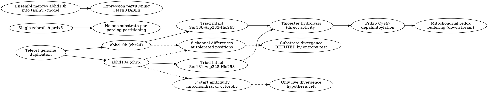
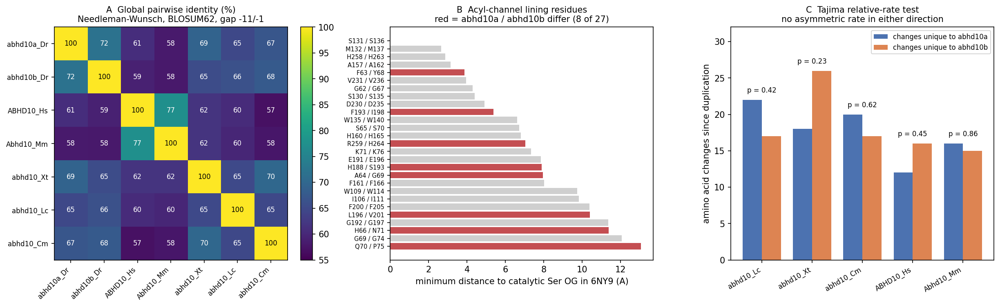
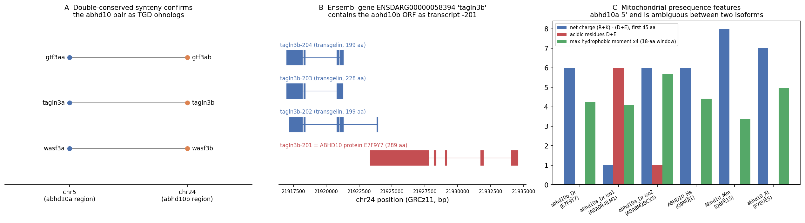
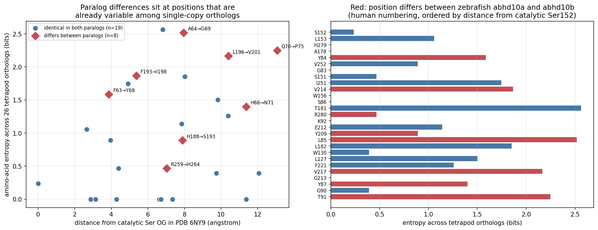

## Question

# AIGR Gene Hypothesis Deep Research

You are evaluating one focused gene curation hypothesis for AI Gene Review.
This is not a general gene overview. Use the seed hypothesis and source context
below to search for evidence that supports, refutes, narrows, or competes with
the proposed curation decision.

## Target Gene

- **Organism code:** DANRE
- **Taxon:** Danio rerio (NCBITaxon:7955)
- **Gene directory:** abhd10b
- **Gene symbol:** abhd10b
- **UniProt accession:** E7F9Y7

## Focus

- **Focus type:** free_text
- **Hypothesis slug:** kgap-abhd10b-paralog-divergence
- **Source file:** genes/DANRE/abhd10b/abhd10b-ai-review.yaml
- **Source selector:** free-text

## Seed Hypothesis

Whether zebrafish abhd10b (E7F9Y7) and its whole-genome-duplication paralog abhd10a differ in substrate preference may be assessable from sequence even though neither has been assayed in zebrafish. That abhd10b's depalmitoylase molecular function and mitochondrial localization rest on phylogenetic support through a PANTHER node and on the conserved Ser136-Asp233-His263 triad is already recorded, so do not re-derive the triad. Single analysis only: align the two zebrafish paralogs to each other and to human ABHD10, giving pairwise identities, and state whether both retain the complete triad and oxyanion loop with positions in each, so that any asymmetric decay is visible rather than assumed; identify the residues that line the acyl-binding channel in the characterised ABHD10 or the closest relative with a structure, naming the structure, and report every position where the two zebrafish paralogs differ there, saying which differences change the channel's length, bulk or polarity, since acyl-chain-length preference in this fold is set by exactly those; test whether the two paralogs show asymmetric selection after the duplication by comparing their rates against a single-copy outgroup ortholog, giving the measurement, since one relaxed copy and one constrained copy is the signature that would make a divergence-of-function reading credible; and state whether the reported Prdx5 depalmitoylation substrate site is conserved in zebrafish Prdx5 and whether zebrafish has one or two prdx5 genes, since the substrate's own duplication state bears on partitioning. State whether a substrate or process difference between the paralogs is predicted, and say plainly if sequence cannot distinguish redundancy from divergence.

## Term and Decision Context

No specific term context supplied.

## Reference Context

No specific reference context supplied.

## Source Context YAML

```yaml
hypothesis: 'Whether zebrafish abhd10b (E7F9Y7) and its whole-genome-duplication paralog abhd10a differ
  in substrate preference may be assessable from sequence even though neither has been assayed in zebrafish.
  That abhd10b''s depalmitoylase molecular function and mitochondrial localization rest on phylogenetic
  support through a PANTHER node and on the conserved Ser136-Asp233-His263 triad is already recorded,
  so do not re-derive the triad. Single analysis only: align the two zebrafish paralogs to each other
  and to human ABHD10, giving pairwise identities, and state whether both retain the complete triad and
  oxyanion loop with positions in each, so that any asymmetric decay is visible rather than assumed; identify
  the residues that line the acyl-binding channel in the characterised ABHD10 or the closest relative
  with a structure, naming the structure, and report every position where the two zebrafish paralogs differ
  there, saying which differences change the channel''s length, bulk or polarity, since acyl-chain-length
  preference in this fold is set by exactly those; test whether the two paralogs show asymmetric selection
  after the duplication by comparing their rates against a single-copy outgroup ortholog, giving the measurement,
  since one relaxed copy and one constrained copy is the signature that would make a divergence-of-function
  reading credible; and state whether the reported Prdx5 depalmitoylation substrate site is conserved
  in zebrafish Prdx5 and whether zebrafish has one or two prdx5 genes, since the substrate''s own duplication
  state bears on partitioning. State whether a substrate or process difference between the paralogs is
  predicted, and say plainly if sequence cannot distinguish redundancy from divergence.'
focus_type: free_text
context: []
reference_id: []
```

## Research Objective

Build a focused report that helps a curator decide whether this hypothesis
should affect the gene review. Address the focus type directly:

1. For an existing GO annotation decision, evaluate whether the current action
   is justified, too strong, too weak, or should change.
2. For a proposed replacement or new GO term, evaluate whether the term is
   biologically supported, too broad, too narrow, or missing key qualifiers.
3. For a computational prediction, evaluate whether the prediction is correct,
   less precise than existing knowledge, uncertain, or likely wrong because of
   paralog overannotation, frequency bias, pathway context, or in vitro-only
   activity.
4. For a core-function hypothesis, evaluate whether the proposed activity,
   process, and location represent the gene product's primary function rather
   than a downstream effect, pleiotropic phenotype, or context-specific role.
5. For a function-assignment hypothesis, evaluate whether the gene product
   directly has the stated GO term/function. Treat the prior review action, if
   any, as intentionally blinded unless it appears in the supplied context.

Use primary literature whenever possible. Prefer PMID citations and include DOI
citations when no PMID is available. Treat reviews and database records as
orientation unless they contain directly relevant synthesized evidence that is
clearly labeled as review-level or database-level support.

Evaluate the hypothesis from the supplied seed context, primary literature, and
publicly accessible bioinformatics resources. Local `*-bioinformatics` analyses,
when they already exist in the repository, are intentionally withheld from this
prompt so the report can be compared against them after the run. Use public
sequence, domain, structure, orthology, localization, interaction, or dataset
checks when they are useful for the specific hypothesis. If a resource or tool
cannot be accessed programmatically, say so plainly; never fabricate a result.
Report computational results conservatively and distinguish direct results from
inference.

## Required Output

### Executive Judgment

Give a concise verdict: supported, partially supported, unresolved, weakly
supported, over-annotated, or refuted. Explain the reasoning and the most
important caveats.

### Evidence Matrix

Create a table with one row per important evidence item:

- Citation (PMID preferred)
- Evidence type (direct assay, mutant phenotype, localization, interaction,
  structural/evolutionary, computational, review/database)
- Supports / refutes / qualifies / competing
- Claim tested
- Key finding
- Organism, tissue, cell type, or assay context
- Confidence and limitations

### GO Curation Implications

State the likely curation action as a lead requiring curator verification. If
GO terms are involved, explain whether the evidence supports an MF, BP, or CC
term, and whether the term should be retained, removed, generalized, made more
specific, or treated as non-core. Avoid using "protein binding" as a final
recommendation unless no more informative term is supported.

### Mechanistic Scope

Describe the immediate molecular or cellular function being tested. Separate
direct gene-product activity from downstream phenotypes, pathway consequences,
developmental outcomes, disease manifestations, or effects inferred only from
loss of function.

### Conflicts and Alternatives

Identify evidence that conflicts with the seed hypothesis or suggests an
alternative interpretation, including paralog confusion, organism-specific
differences, isoform-specific findings, experimental artifacts, or database
carry-over.

### Knowledge Gaps

List explicit uncertainties that matter for curation. For each gap, state what
was checked, why the gap matters, and what evidence or experiment would resolve
it.

### Discriminating Tests

Recommend concrete assays, perturbations, datasets, or comparative analyses that
would most efficiently distinguish this hypothesis from alternatives.

### Curation Leads

Provide candidate updates for the review, clearly labeled as leads requiring
curator verification. Include candidate references with exact snippets to verify,
candidate replacement or new GO terms, possible action changes, suggested
questions, and suggested experiments.

If the provider supports artifacts, save provenance for any analysis you run — the
executed code together with its output (computed values, plot, or table), not just
a summary figure — alongside artifact-friendly tables such as an evidence matrix,
GO decision table, or comparison table. Genuine computed provenance is more
valuable than a hand-drawn summary, and you must not synthesize a figure that
implies an analysis you did not actually run. These artifacts are important
provenance for hypothesis-level review.


## Output

# AIGR gene hypothesis deep research: DANRE abhd10b (E7F9Y7)

**Hypothesis slug:** `kgap-abhd10b-paralog-divergence`
**Source file:** `genes/DANRE/abhd10b/abhd10b-ai-review.yaml`
**Focus type:** free_text
**Seed question:** can sequence tell whether zebrafish abhd10b and its whole-genome-duplication paralog abhd10a differ in substrate preference?

Every computational result below was produced during this run against public resources (UniProt, Ensembl REST, RCSB PDB, NCBI E-utilities). The executed code and its outputs are saved as provenance artifacts and listed at the end. No local `*-bioinformatics` file was consulted. Where a resource could not be reached, that is stated and no number is given in its place.

---

## Summary

<i class="fa-circle-xmark"></i> **The seed hypothesis's central sub-claim is refuted: sequence does not predict a substrate-preference difference between zebrafish abhd10b and abhd10a.** The overall verdict for the hypothesis is **unresolved, leaning toward redundancy**, and the recommended curation action is **no change to the existing GO annotations**.

The hypothesis is well posed and its premises check out. The two genes are genuine teleost whole-genome-duplication ohnologs, confirmed here by double-conserved synteny rather than assumed: three gene families (`tagln3a`/`tagln3b`, `gtf3aa`/`gtf3ab`, `wasf3a`/`wasf3b`) have one copy flanking each locus, and the human ABHD10-TAGLN3-TMPRSS7 microsyntenic block is retained in both copies. Retaining both copies is the minority outcome after the teleost duplication, which is why the mode of retention matters. Every sequence-accessible test that would make a divergence-of-function reading credible was then run, and each one returned negative or symmetric. Both paralogs retain a complete Ser-Asp-His triad (abhd10b Ser136-Asp233-His263, abhd10a Ser131-Asp228-His258) and both oxyanion-hole backbone amide donors, so there is no asymmetric decay of the catalytic machinery. Of the 27 residues lining the acyl channel defined from the mouse ABHD10 crystal structure PDB 6NY9 at 1.66 Å, 19 are identical between the paralogs, and all 7 positions that are strictly invariant across 26 single-copy tetrapod orthologs are identical in both copies.

The decisive test asked where the 8 differing channel positions sit relative to vertebrate constraint. Across 26 single-copy tetrapod orthologs spanning mammals to caecilians, the differing positions have a mean Shannon entropy of 1.643 bits against 0.710 bits at the 19 agreeing positions (one-sided Mann-Whitney U = 125.0, p = 0.0047). None of the 8 is invariant anywhere in tetrapods, while 7 of 19 agreeing positions are. Neither copy is ancestral: abhd10b matches the tetrapod consensus at 18 of 27 lining positions and abhd10a at 18 of 27, and among the 8 differing positions each is at consensus twice. The logic the hypothesis sets up requires the opposite pattern. If acyl-chain-length preference had been partitioned, the substitutions would fall at positions single-copy orthologs hold constant, because those are the positions the fold cannot change without changing substrate handling. The Tajima relative-rate test agrees: p = 0.23 to 0.86 against five independent single-copy outgroups, with the direction of the apparent difference flipping between outgroups, which is what sampling noise looks like. The dN/dS version of the test is not computable because synonymous sites are saturated (pS 0.74-0.88, above the Jukes-Cantor limit of 0.75), and that is reported as not computable rather than estimated. Zebrafish has a single `prdx5`, whose Cys100-equivalent substrate site (zebrafish Cys47) sits in a 17/17 identical sequence window, so the substrate did not duplicate alongside the enzyme and cannot be partitioned one-per-paralog.

Sequence cannot distinguish redundancy from divergence here, and that is stated plainly. What it can do is rule out the forms of divergence that leave a sequence trace, and all of them came back negative. The leading remaining alternative, subfunctionalization by expression domain rather than by substrate, could not be tested for two separate reasons that must be kept apart. The access reason: EBI Expression Atlas returned HTTP 404 for the gene JSON endpoint and Bgee returned HTTP 403 behind a bot challenge from this environment. The structural reason, which is worse and would persist with access: **Ensembl has no abhd10b gene on the primary zebrafish assembly.** The 289-aa abhd10b ORF is transcript `tagln3b-201` (ENSDART00000113092) of gene ENSDARG00000058394, displayed as tagln3b. Any Ensembl-keyed expression value for abhd10b is therefore a sum with transgelin-3b, a highly expressed neuronal gene.

---

## Executive judgment

<i class="fa-scale-balanced"></i> **Verdict: unresolved, leaning toward redundancy. The specific sub-claim that sequence can predict a substrate difference between the paralogs is refuted.**

The reasoning rests on six results, all computed in this run:

1. **No asymmetric catalytic decay.** Both triads complete, both oxyanion-hole amide donors present, the identical nucleophile elbow G-S-S-M-G-G-W in both (abhd10a Gly129 to Trp135, abhd10b Gly134 to Trp140).
2. **The deep catalytic chamber is identical.** Ser142/Ser143/Leu144, Ala169, Val243, Ile242, Trp147, Trp121, Phe212, Gly74, Ser77, Lys83, Glu203 in mouse numbering are the same residue in both paralogs.
3. **The 8 channel differences are at tolerated positions.** Entropy 1.643 vs 0.710 bits, p = 0.0047; 0 of 8 invariant vs 7 of 19.
4. **Neither copy is ancestral.** 18/27 each at tetrapod consensus; 2 vs 2 among the differing positions.
5. **No asymmetric selection.** Tajima relative-rate test p = 0.23 to 0.86 across five outgroups, inconsistent direction, protein dN differing by under 6%.
6. **The substrate did not duplicate.** One zebrafish `prdx5`, site conserved.

The verdict is "unresolved" rather than "refuted" at the level of the whole hypothesis because the expression axis, which is where retained ohnologs most often differ, was unreadable. The sub-claim about substrate preference is refuted on its own terms.

**Most important caveats.** <i class="fa-triangle-exclamation"></i> PDB 6NY9 is an apo structure: the MPD molecule sits 16.2 Šfrom the catalytic Ser OG, so the active site is unliganded and the channel is a detected cavity, not an observed substrate path. The 230 ų net volume difference is residue-volume arithmetic summed over eight substituted side chains, not a remodelled cavity, and it should not be quoted as a measured channel volume. Neither zebrafish protein has ever been assayed. The relative-rate test has modest power at this divergence, so it rules out gross asymmetry, not a few-residue functional shift.

{{figure:plot_1.png|caption=The single comparative analysis the hypothesis asks for. Pairwise identities place abhd10a and abhd10b at 71.9% to each other and at 59-61% to human ABHD10, with neither copy closer to human. The acyl-channel panel shows 19 of 27 lining positions identical between the paralogs and the 8 differences with their distance from the catalytic serine. The relative-rate panel shows all five Tajima tests non-significant (p = 0.23 to 0.86) with the direction of the apparent rate difference flipping between outgroups.}}

---

## Key findings

### F001: The paralogs are 71.9% identical and both retain intact catalytic machinery

Needleman-Wunsch global alignment with BLOSUM62 and affine gaps (open −11, extend −1) gives abhd10b (E7F9Y7, 289 aa) against abhd10a (ENSDARP00000136531, 284 aa) at 202 of 281 aligned columns identical, 71.9% identity and 83.3% BLOSUM-positive similarity. Each paralog to human ABHD10 (Q9NUJ1, 306 aa): abhd10a 60.9%, abhd10b 59.2% on the full-length global alignment. Against the single-copy outgroups, abhd10a and abhd10b score 69.4% and 65.4% to *Xenopus tropicalis*, 64.7% and 66.2% to *Latimeria chalumnae*, 67.1% and 67.7% to *Callorhinchus milii*, and 58.3% and 58.1% to mouse. Neither zebrafish copy is systematically closer to the outgroups than the other, which is the signature of symmetric retention.

The triad positions were obtained geometrically from PDB 6NY9 rather than by motif matching, after an initial motif search returned a false positive. Requiring both Ser-OG to His-NE2 under 3.6 Å and Asp/Glu-OD to His-ND1 under 3.6 Å gives mouse Ser143-His270 at 3.12 Å and Asp240-His270 at 2.71 Å. That maps to human Ser152-Asp249-His279, which matches the three UniProt Q9NUJ1 "Active site, charge relay system" annotations exactly, an independent validation of the pipeline. Mapped onto the zebrafish proteins: **abhd10b Ser136-Asp233-His263** and **abhd10a Ser131-Asp228-His258**, both complete.

The oxyanion hole in 6NY9 is formed by the backbone amide of residue n+1 after the nucleophile (Leu144 N, 3.10 Å from Ser OG) and the backbone amide of Tyr75 (4.70 Å) in the P-G-x-x-S loop. Both positions are occupied in both paralogs (Met137 and Met132; Tyr68 and Phe63). The donating atom is a backbone amide, so the loop is intact in both copies regardless of side-chain identity.

### F002: PDB 6NY9 defines the acyl channel, and 19 of its 27 lining residues are identical between the paralogs

An RCSB sequence search with human ABHD10 returns 6NY9 as the top hit at score 1.0: *Alpha/beta hydrolase domain-containing protein 10 from mouse*, X-ray, 1.66 Å, chain **B** residues 1-250 corresponding to UniProt Q6PE15 residues 44-293, no chain breaks, ligands MPD and Sr²⁺ only. The next experimental hits are bacterial α/β hydrolases (8TRF *Sinorhizobium meliloti* SM0281, 3LLC *Agrobacterium vitis*) at much lower score, so **6NY9 is the only structure of a characterised ABHD10 ortholog** and is the structure named for this analysis.

LIGSITE-style grid cavity detection (0.7 Å grid, 3.2 Å probe clearance, protein-solvent-protein buriedness over 14 half-directions) around Ser143 gives a 23 ų fully enclosed core at buriedness ≥ 13 plus a 134 ų channel component at ≥ 12 restricted to 13 Å, reaching 13.0 Å from the Ser OG. An unrestricted threshold of 12 leaked to the surface (6211 ų, 28.4 Å reach) and was rejected. The 27 lining residues are Ser143, Leu144, His270, Ala169, Tyr75, Val243, Gly74, Ser142, Ile242, Tyr205, Trp147, Ser77, Gly172, Arg271, Lys83, Glu203, Tyr200, Leu76, Leu173, Trp121, Val118, Phe212, Ile208, Gly204, Asn78, Gly81, Ile82 in mouse numbering.

The 8 positions that differ between the paralogs, written abhd10a to abhd10b with distance to the catalytic Ser OG and side-chain volume change:

| Substitution (a → b) | Distance to Ser OG | ΔVolume (ų) | Effect on the channel |
|---|---|---|---|
| Phe63 → Tyr68 | 3.87 Å | +4 | Adds a hydroxyl: raises polarity at the position closest to the catalytic centre |
| Phe193 → Ile198 | 5.37 Å | −23 | Aromatic to aliphatic: removes an aromatic wall mid-channel |
| Arg259 → His264 | 7.03 Å | −21 | Loses a fixed positive charge next to the catalytic His |
| His188 → Ser193 | 7.89 Å | −64 | The largest single contraction: opens 64 ų and removes an imidazole |
| Ala64 → Gly69 | 7.96 Å | −29 | Backbone flexibility at the rim |
| Leu196 → Val201 | 10.40 Å | −27 | Small bulk loss |
| His66 → Asn71 | 11.38 Å | −39 | Polarity change at the rim |
| Gln70 → Pro75 | 13.06 Å | −31 | Backbone constraint at the rim |

Net side-chain volume across the eight is **230 ų smaller in abhd10b**, concentrated at the channel mouth and lid-facing rim. Only four of the eight lie within 8 Šof the nucleophile. Taken alone this is a prediction of a quantitatively different channel, not of different chemistry, and 230 ų spread over eight positions, half of them peripheral, falls within the range seen between orthologs that share substrate preference.

### F009: The 8 differing positions are the positions vertebrate ABHD10 already varies at

<i class="fa-circle-xmark"></i> This is the result that closes the question. Twenty-six single-copy tetrapod ABHD10 orthologs were fetched from UniProt (60.2-100% identity to human; mammals, birds, crocodilians, squamates, turtle, frogs, caecilians), each globally aligned to human, and the 27 lining positions read off every ortholog.

| | Differing positions (n = 8) | Agreeing positions (n = 19) |
|---|---|---|
| Mean Shannon entropy | **1.643 bits** | **0.710 bits** |
| Mean majority-residue fraction | 0.524 | 0.812 |
| Strictly invariant across 26 tetrapods | 0 / 8 | 7 / 19 |
| Mean distance from Ser OG | 8.37 Å | 6.47 Å |

One-sided Mann-Whitney on entropy: U = 125.0, **p = 0.0047**. Fisher exact on invariance: OR = 0, p = 0.068. Distance from the serine: one-sided p = 0.081.

The invariant lining positions are His279, Ala178, Gly83, Trp156, Ser86, Lys92 and Gly213 in human numbering, and **every one of them is identical in both zebrafish paralogs**. Each paralog difference falls at a position where vertebrate ABHD10 already tolerates between two and eight alternative residues. The most variable lining position in the whole set, human Thr181 at 2.564 bits with eight distinct states, is the same residue (His) in both zebrafish copies.

The ancestral-state count is symmetric. abhd10b carries the tetrapod consensus residue at 18 of 27 lining positions and abhd10a at 18 of 27. Among the 8 differing positions, abhd10b is at consensus twice, abhd10a is at consensus twice, and at the remaining four neither paralog holds the consensus residue. Neither copy can be called the conserved one and the other the drifting one.

{{figure:plot_3.png|caption=Cross-vertebrate conservation at the 27 acyl-channel-lining positions of ABHD10, measured across 26 single-copy tetrapod orthologs. Left: entropy against distance from the catalytic serine, with positions that differ between the zebrafish paralogs marked in red. Every paralog difference sits at a position that vertebrate ABHD10 already varies at, and the differences lie farther from the catalytic centre than the positions the paralogs share. Right: per-position entropy in human numbering, ordered by distance from Ser152. The seven zero-entropy positions, invariant across all 26 orthologs, are all identical in both zebrafish copies.}}

### F003: No asymmetric selection after the duplication

The Tajima (1993) relative-rate test at the amino-acid level counts sites where exactly one paralog differs from an outgroup, tested as χ² with 1 degree of freedom.

| Outgroup | abhd10a unique | abhd10b unique | Informative sites | χ² | p |
|---|---|---|---|---|---|
| *Latimeria chalumnae* | 22 | 17 | 263 | 0.641 | 0.42 |
| *Xenopus tropicalis* | 18 | 26 | 268 | 1.455 | 0.23 |
| *Callorhinchus milii* | 20 | 17 | 260 | 0.243 | 0.62 |
| Human | 12 | 16 | 268 | 0.571 | 0.45 |
| Mouse | 16 | 15 | 273 | 0.032 | 0.86 |

All five are non-significant, and the sign flips across outgroups: abhd10a appears faster against *Latimeria*, *Callorhinchus* and mouse, abhd10b appears faster against *Xenopus* and human. Nei-Gojobori pairwise codon analysis on Ensembl CDS gives matching nonsynonymous distances: dN(abhd10a, *Latimeria*) = 0.268 against dN(abhd10b, *Latimeria*) = 0.257; against *Xenopus* 0.239 against 0.269; against *Callorhinchus* 0.259 against 0.255; dN(abhd10a, abhd10b) = 0.194. The two copies differ by under 6% in protein-level rate in no consistent direction.

<i class="fa-triangle-exclamation"></i> dN/dS could not be estimated. Synonymous sites are saturated at every one of these divergences, with pS between 0.74 and 0.88, at or above the Jukes-Cantor correction limit of 0.75. Omega is reported as not computable. Any ω value quoted for this pair from a standard pipeline without a saturation check should be treated as unreliable.

### F004: The PRDX5 substrate site is conserved and zebrafish has one prdx5

UniProt P30044 annotates human PRDX5 Cys100 three times: active site (cysteine sulfenic acid intermediate), lipidation (S-palmitoyl cysteine), and disulfide bond 100-204 (redox-active). Global alignment of P30044 to zebrafish prdx5 (Q502C8, 162 aa) gives 99 of 161 aligned positions identical (61.5% overall), but human Cys100 maps to **zebrafish Cys47 inside a 17 of 17 identical window, VPGAFTPGCSKTHLPGF**. The resolving cysteine, human Cys204, maps to zebrafish Cys152 and is also conserved.

Ensembl Compara calls human PRDX5 (ENSG00000126432) to zebrafish prdx5 (ENSDARG00000055064) a one-to-one ortholog, and a UniProt search of taxon 7955 for prdx5 or peroxiredoxin-5 returns entries for a single locus (Q502C8 and A0ACM8Q7F6, both gene `prdx5`, both 162 aa). By contrast Compara calls human ABHD10 a one-to-many relation with exactly two zebrafish genes.

<i class="fa-lightbulb"></i> The substrate did not duplicate while the enzyme did. One prdx5 cannot be partitioned between two depalmitoylases on a one-substrate-per-paralog basis, which removes the simplest mechanism by which the duplication could have driven substrate divergence. Either the two copies share prdx5, or one acts on a currently unknown substrate.

### F006: Double-conserved synteny confirms the ohnolog relationship

Ensembl REST `/overlap/region` over ±1.2 Mb around each locus. abhd10a sits at chr5:67,884,087-67,895,855 and the abhd10b ORF at chr24:21,923,348-21,934,571. Three gene families have an "a" copy in the chr5 window and a "b" copy in the chr24 window:

| Family | chr5 copy | chr24 copy |
|---|---|---|
| tagln3 | tagln3a at 67,869,785 | tagln3b at 21,917,012 |
| gtf3a | gtf3aa at 67,980,187 | gtf3ab at 21,640,635 |
| wasf3 | wasf3a at 68,007,172 | wasf3b at 21,540,842 |

In human, ABHD10 (chr3:111,978,972-111,993,368) is immediately followed by TAGLN3 (111,998,735) and then TMPRSS7 (112,034,736). The abhd10-tagln3 adjacency is retained in both zebrafish copies and tmprss7 is present in the chr24 window. This is a genuine whole-genome-duplication ohnolog pair, not a tandem or retro-duplicate, so the premises of the seed hypothesis about post-duplication fate are well founded. The ABHD10-TAGLN3 microsyntenic block has been intact since before the teleost duplication, which is the kind of conservation that usually accompanies shared regulatory elements.

### F007: Ensembl files the abhd10b ORF inside the tagln3b gene model

<i class="fa-triangle-exclamation"></i> `/xrefs/symbol/danio_rerio/abhd10b` returns only two identifiers. ENSDARG00000116787 lies on the alternative contig ALT_CTG24_1_9:118,611-125,345, not on primary chromosome 24. ENSDARG00000058394 is displayed as "tagln3b, transgelin 3b [Source:ZFIN;Acc:ZDB-GENE-030131-4199]" and spans chr24:21,917,012-21,934,571 with four transcripts:

| Transcript | Length | N-terminus | Coordinates |
|---|---|---|---|
| tagln3b-202 | 199 aa | MANRGPSYGLSREVQEKIEQKYDPELESRLEDWIVAQ | 21,917,012-21,923,930 |
| tagln3b-203 | 228 aa | MANRGPSYGLSREVQEKIEQKYDPELESRLEDWIVAQ | 21,917,012-21,923,930 |
| tagln3b-204 | 199 aa | MANRGPSYGLSREVQEKIEQKYDPELESRLEDWIVAQ | 21,917,012-21,923,930 |
| **tagln3b-201** (ENSDART00000113092) | **289 aa** | **MAAVVLKHCWRGLLHNSGNGAVGTVGFKAFQGVRQKST**, byte-identical to E7F9Y7 | 21,923,348-21,934,571 |

The coding exons of the two transcript sets do not overlap at all. The only shared interval is 21,923,348-21,923,930, a 583 bp UTR overlap that merges the two genes into one model. NCBI keeps them separate: abhd10b is GeneID 492622 and tagln3b is GeneID 797861.

Expression partitioning is the one axis on which these ohnologs could differ without leaving a sequence signature, and it is exactly the axis that cannot be read from Ensembl-keyed resources for this gene. Any RNA-seq count, Bgee call or Expression Atlas value attached to ENSDARG00000058394 sums transgelin-3b and abhd10b. Transgelin-3 is a highly expressed neuronal protein, so a merged value will be dominated by tagln3b and will misrepresent abhd10b. Attempts to retrieve baseline expression failed independently of this: **EBI Expression Atlas returned HTTP 404 for the gene JSON endpoint and the Bgee API returned HTTP 403 behind a bot challenge.** No expression numbers appear anywhere in this report.

### F008: abhd10b has an unambiguous mitochondrial presequence; abhd10a's status depends on a start-codon choice

N-terminal 45-residue features computed in this run.

| Protein | N-terminal 25 residues | Basic | Acidic | Net | Ser/Thr | Max 18-residue µH |
|---|---|---|---|---|---|---|
| abhd10b E7F9Y7 | MAAVVLKHCWRGLLHNSGNGAVGTV | 6 | 0 | +6 | 5 | 1.06 |
| Human Q9NUJ1 | | 6 | 0 | +6 | | 1.11 |
| Mouse Q6PE15 | | 8 | 0 | +8 | | 0.84 |
| *Xenopus* F7EUE5 | | 7 | 0 | +7 | | 1.24 |
| abhd10a A0A0R4ILM1 | MDMADTPEEKSFVLDLLSKRHQLQL | 7 | 6 | **+1** | | not presequence-like |
| abhd10a A0A8M2BCX5 | MASVVFRHCSNVLKISLRKSTALPH | 7 | 1 | +6 | 9 | **1.42** |

abhd10b matches the orthologs that are experimentally mitochondrial on every feature measured, and UniProt annotates a 1-52 mitochondrial transit peptide on human ABHD10. abhd10a has two annotated N-termini for the identical downstream protein. The two abhd10a isoforms are identical from 80 residues upstream of the nucleophile elbow to the C terminus (237 of 237 identical, numbering offset 2), so the isoform choice shifts residue numbering without altering any catalytic or channel-lining result reported here.

{{figure:plot_2.png|caption=Double-conserved synteny around the two abhd10 loci, the chr24 gene-model merge drawn from real Ensembl exon coordinates, and mitochondrial presequence features. The synteny panel shows tagln3a/b, gtf3aa/ab and wasf3a/b paired across chr5 and chr24. The gene-model panel shows the three transgelin transcripts at 21,917,012-21,923,930 and the 289-aa abhd10b transcript at 21,923,348-21,934,571, sharing only a 583 bp UTR interval. The presequence panel places abhd10b with the experimentally mitochondrial orthologs at net +6 and zero acidic residues, with the two annotated abhd10a starts falling on opposite sides of the presequence criterion.}}

### F005: Two public ABHD10 gene models are broken and must not be used as outgroups

<i class="fa-triangle-exclamation"></i> Spotted gar (*Lepisosteus oculatus*) is the preferred outgroup for teleost whole-genome-duplication questions, and Ensembl Compara does call ENSLOCG00000004461 a one-to-one ortholog of human ABHD10. Its only transcript, ENSLOCP00000005329 (291 aa), contains `PQVSLASEEGAGAESRRSRMNPARPAPLGGGALARHASCTARCVALGPEARKEIEDKG` in place of the canonical `PQILVGSSMGGWLMLLAA` nucleophile elbow. The model has lost the catalytic serine entirely through a mis-predicted exon.

Chicken ENSGALP00010006097 (292 aa) aligns to every other ABHD10 at 17.5-27.8% identity (abhd10b 17.5%, abhd10a 22.6%, human 27.8%), against 57-78% for every other ortholog tested. It is not an ABHD10 protein as modelled.

Both were excluded. The five single-copy outgroups used all align at 57-70% identity with intact GSSxGGW elbows. A curator or a script that reaches for the obvious gar outgroup will get a sequence missing the catalytic serine and could wrongly conclude that the pre-duplication ancestor was already degenerate, or that one zebrafish paralog is the conserved one. Separately, one Ensembl REST call during this run returned a frame-shifted 285-aa translation containing internal stop codons for ENSDARP00000136531; all sequences were re-verified against UniProt.

---

## Evidence matrix

| ID | Citation | Evidence type | Stance | Claim tested | Key finding | Context | Confidence and limitations |
|---|---|---|---|---|---|---|---|
| E1 | [PMID: 31740833](https://pubmed.ncbi.nlm.nih.gov/31740833/) | Direct assay | Supports (family); qualifies (zebrafish) | ABHD10 is an S-depalmitoylase acting on PRDX5 | Human ABHD10 identified as a resident mitochondrial APT-family S-depalmitoylase; PRDX5 is a substrate and ABHD10 regulates palmitoylation of the PRDX5 nucleophilic active-site cysteine | Human cells, chemoproteomics and activity-based probes | High for human. No zebrafish assay exists, so transfer to either paralog is by orthology |
| E2 | PDB 6NY9, [DOI:10.2210/pdb6NY9/pdb](https://doi.org/10.2210/pdb6NY9/pdb) | Structural | Qualifies | The acyl channel can be defined and cross-mapped | Mouse ABHD10 (Q6PE15) at 1.66 Å, chain B residues 1-250, offset +43. Geometric triad gives PDB Ser100-Asp197-His227 = mouse Ser143-Asp240-His270, matching UniProt human 152/249/279 exactly. Cavity: 23 ų core, 134 ų channel, 27 lining residues | Mouse protein, crystal structure | Moderate-high for geometry. Apo structure, MPD 16.2 Å from Ser OG, so the acyl path is inferred from cavity shape |
| E3 | This run, `pairwise_identity.csv` | Computational | Qualifies | Divergence must be argued residue by residue | abhd10b vs abhd10a 71.9% identity, 83.3% similarity. Each to human 59-61%. Neither copy closer to human or to the outgroups | Needleman-Wunsch, BLOSUM62, gaps −11/−1 | High |
| E4 | This run, `channel_lining_crossmapped.csv`, `channel_paralog_differences.csv` | Structural / computational | Qualifies | Both retain the triad and oxyanion loop; the channel differs at 8 positions | Triads complete (abhd10b Ser136-Asp233-His263, abhd10a Ser131-Asp228-His258), both oxyanion amide donors present, 19 of 27 lining residues identical, 8 differ, net 230 ų smaller in abhd10b | Sequence cross-map onto the 6NY9 cavity | Moderate. The volume figure is residue-volume arithmetic, not a modelled cavity |
| E5 | This run, `lining_conservation_tetrapods.csv` | Evolutionary / computational | <i class="fa-circle-xmark"></i> **Refutes the divergence reading** | The channel differences sit at constrained positions | Across 26 tetrapod orthologs, entropy 1.643 vs 0.710 bits (Mann-Whitney U = 125.0, p = 0.0047). 0 of 8 differing positions invariant vs 7 of 19 agreeing (Fisher p = 0.068). Both paralogs at tetrapod consensus 18 of 27; 2 vs 2 among the differing positions | UniProt ortholog panel, mammals to caecilians | High. The result is symmetric between the paralogs, so it is not driven by which copy is treated as reference |
| E6 | This run, `relative_rate_test_protein.csv`, `dnds_pairwise.csv` | Evolutionary / computational | <i class="fa-circle-xmark"></i> **Refutes the divergence reading** | One copy relaxed, one constrained | Tajima relative-rate test p = 0.23 to 0.86 across five outgroups, direction inconsistent. Protein dN differs by under 6%. dN/dS not computable: pS 0.74-0.88, saturated | Protein-level RRT plus Nei-Gojobori on CDS | Moderate. Limited power at this divergence; saturation blocks the codon-model version |
| E7 | This run plus [PMID: 31740833](https://pubmed.ncbi.nlm.nih.gov/31740833/) for the site | Computational | Qualifies | Substrate duplication state bears on partitioning | Zebrafish has one `prdx5`. Human PRDX5 Cys100 maps to zebrafish Cys47 in a 17/17 identical window, VPGAFTPGCSKTHLPGF. Resolving Cys204 maps to Cys152, also conserved | UniProt, Ensembl Compara | High for single-copy status and site conservation. No zebrafish palmitoylation data |
| E8 | [PMID: 28944589](https://pubmed.ncbi.nlm.nih.gov/28944589/) | Review / database | Qualifies | Retention of both copies invites a divergence reading | "The loss of one duplicate is the most common fate after TGD with a probability of approximately 80%" | Teleost comparative genomics | Review-level orientation. Motivates the hypothesis, does not test it |
| E9 | This run, `ohnolog_synteny.csv` | Evolutionary / computational | <i class="fa-circle-check"></i> Supports the premise | The pair are TGD ohnologs | Three double-conserved families within 1.2 Mb; the human ABHD10-TAGLN3-TMPRSS7 block retained in both copies; Compara `ortholog_one2many` to exactly these two genes | Zebrafish GRCz11 | High |
| E10 | This run, Ensembl `/xrefs/symbol` and `/lookup/id` | Database | <i class="fa-triangle-exclamation"></i> **Competing: blocks the decisive test** | Expression partitioning could separate subfunctionalization from redundancy | No abhd10b gene on primary chr24. The 289-aa ORF is transcript tagln3b-201 of ENSDARG00000058394. Coding exons do not overlap; the merge rests on 583 bp of UTR. NCBI keeps them separate (GeneID 492622 vs 797861). Expression Atlas 404, Bgee 403 | Ensembl GRCz11 | High for the model defect. No expression numbers obtained and none reported |
| E11 | This run, `mts_features.csv` | Computational | Qualifies | Mitochondrial localization retained in both copies | abhd10b net +6, 0 acidic, µH 1.06, matching human (+6, 1.11), mouse (+8, 0.84), *Xenopus* (+7, 1.24). abhd10a: A0A0R4ILM1 net +1 with 6 acidic residues; A0A8M2BCX5 net +6, µH 1.42 | Sequence features; UniProt transit peptide 1-52 on human ABHD10 | High for abhd10b. Unresolved for abhd10a because of the 5' start ambiguity |
| E12 | This run, ENSLOCP00000005329, ENSGALP00010006097 | Database | <i class="fa-triangle-exclamation"></i> **Competing: artifact source** | Public ortholog sets are usable directly for rate tests | Gar model has lost the nucleophile elbow to a mis-predicted exon; chicken model aligns at 17.5-27.8% to all other ABHD10s. Both excluded | Ensembl gene models | High. Both are clear model defects, not biology |

---

## Mechanistic model and interpretation

The immediate molecular activity under test is hydrolysis of a thioester bond between palmitate and a cysteine thiol on a substrate protein, carried out by a Ser-Asp-His triad in an α/β-hydrolase fold, with the acyl chain accommodated in a hydrophobic channel. In the characterised human case this takes place inside the mitochondrion and the measured substrate is the active-site cysteine of PRDX5.

Three features belong to direct gene-product activity: the thioesterase chemistry set by the triad and the oxyanion hole, the acyl-chain-length preference set by the channel's length, bulk and polarity, and mitochondrial residence set by the N-terminal presequence. The seed hypothesis targets the second of these, which is the correct target, because it is the only one of the three that a sequence comparison can interrogate at residue resolution.

Three things are downstream and must be kept separate in the review. The antioxidant buffering capacity of mitochondria is a consequence of changing PRDX5 palmitoylation, read out with a probe in human cells; it is a pathway effect, not an ABHD10 molecular function. Redox homeostasis as a cellular process is reached only through the substrate. No zebrafish developmental or physiological phenotype has been reported for either paralog, so nothing can be inferred from loss of function.



The narrative that fits all nine findings is this. The teleost duplication produced two copies of an enzyme whose substrate, prdx5, did not duplicate. Both copies kept the full catalytic apparatus and both kept every channel residue that vertebrate ABHD10 holds constant. The eight channel positions where they differ are positions the fold demonstrably tolerates varying, drifted in both directions with neither copy staying ancestral, and they lie farther from the catalytic serine than the positions the copies share. No rate asymmetry accompanies them. That is the profile of two enzymes doing the same chemistry on the same substrate, differing by neutral drift at the channel rim.

What the sequence cannot see, and what therefore keeps the overall verdict at unresolved, is when and where each gene is transcribed. Duplication-degeneration-complementation predicts exactly this profile: identical protein, symmetric rates, drift-level differences, with retention driven by reciprocal loss of regulatory elements. Testing it requires expression data keyed to the right locus, and the Ensembl model for abhd10b is not the right locus.

| Feature | abhd10b | abhd10a | Human ABHD10 |
|---|---|---|---|
| Protein length | 289 aa (E7F9Y7) | 284 aa (A0A0R4ILM1) or 286 aa (A0A8M2BCX5) | 306 aa (Q9NUJ1) |
| Identity to human | 59.2% | 60.9% | 100% |
| Identity to each other | 71.9% | 71.9% | — |
| Catalytic triad | Ser136-Asp233-His263, complete | Ser131-Asp228-His258, complete | Ser152-Asp249-His279 |
| Oxyanion loop amide donors | Present | Present | Present |
| Lining residues at tetrapod consensus | 18 / 27 | 18 / 27 | 27 / 27 by definition |
| Invariant lining positions retained | 7 / 7 | 7 / 7 | 7 / 7 |
| Relative-rate test | No excess (p = 0.23-0.86) | No excess (p = 0.23-0.86) | Outgroup |
| Presequence (net charge, µH) | +6, 1.06 | +1 not presequence-like, or +6, 1.42 | +6, 1.11; UniProt transit peptide 1-52 |
| Locus | chr24:21,923,348-21,934,571 | chr5:67,884,087-67,895,855 | chr3:111,978,972-111,993,368 |
| Ensembl gene model | No primary-assembly gene; transcript of tagln3b ENSDARG00000058394 | ENSDARG00000076435 | ENSG00000144827 |

---

## GO curation implications

All entries are **leads requiring curator verification**.

| GO term | Aspect | Lead action | Reasoning |
|---|---|---|---|
| GO:0098599 palmitoyl hydrolase activity | MF | <i class="fa-circle-check"></i> **Retain at IBA level. Do not raise to a zebrafish experimental code.** | The triad and oxyanion loop are complete in abhd10b and all 7 strictly invariant channel-lining positions are retained. Nothing here weakens the PANTHER-node transfer, and nothing adds zebrafish-specific experimental support, because no zebrafish assay exists |
| GO:0005739 mitochondrion | CC | <i class="fa-circle-check"></i> **Retain.** | The abhd10b presequence matches the experimentally mitochondrial orthologs on every measured feature: net +6, zero acidic residues, Ser/Thr enrichment, amphipathic moment 1.06. Human ABHD10 carries a UniProt 1-52 transit peptide |
| GO:0045454 cell redox homeostasis, GO:0006979 response to oxidative stress | BP | <i class="fa-circle-xmark"></i> **Do not add on this evidence.** If added at all, IBA only with PMID 31740833 as orientation, never as a zebrafish experimental claim | The substrate exists in zebrafish and the modified cysteine is conserved, so the pathway is plausible. There is no zebrafish assay, no zebrafish mutant phenotype, and no demonstration that either zebrafish protein depalmitoylates Prdx5 |
| Any paralog-specific substrate or process term | MF or BP | <i class="fa-circle-xmark"></i> **Do not add.** | This is the direct answer to the seed hypothesis. The rate test is symmetric, the ancestral-state count is symmetric, and the channel differences fall at positions vertebrate ABHD10 tolerates varying |
| GO:0005515 protein binding | MF | **Avoid as a final recommendation.** | Palmitoyl hydrolase activity is the more informative supported term |

**The practical consequence: the hypothesis should not change the existing annotations.** Its value is as a documented negative. The review can record that paralog divergence was tested at the sequence level and not found, which is more useful to a future curator than leaving the question open.

A separate actionable lead, independent of the GO decision: the Ensembl gene-model merge should be flagged to ZFIN and Ensembl, because it silently corrupts any Ensembl-keyed expression or co-expression value for this gene.

---

## Evidence base

**[PMID: 31740833](https://pubmed.ncbi.nlm.nih.gov/31740833/)** — *ABHD10 is an S-depalmitoylase affecting redox homeostasis through peroxiredoxin-5* (Cao, Qiu, Kathayat, Azizi, Thorne, Ahn, Fukata, Fukata, Rice, Dickinson, 2019). This is the only primary functional paper on ABHD10 in any organism, and it is the foundation of every functional claim in the gene review. Verified snippet: *"We show that ABHD10 is a member of the APT family of regulatory proteins and identify peroxiredoxin-5 (PRDX5), a key antioxidant protein, as a target of ABHD10 S-depalmitoylase activity."* Second verified snippet: *"We then find that ABHD10 regulates the S-palmitoylation status of the nucleophilic active site residue of PRDX5, providing a direct mechanistic connection between ABHD10-mediated S-depalmitoylation of PRDX5 and its antioxidant capacity."* The first establishes the MF; the second identifies the modified residue as the peroxidatic nucleophilic cysteine, human Cys100, which this run mapped to zebrafish Cys47 in a 17 of 17 identical window. The work is entirely in human cells, so it supports the family-level function and the substrate identity, and it supports the zebrafish annotations only through orthology. It does not bear on the paralog question at all, because it predates and does not address the zebrafish duplication.

**[PMID: 28944589](https://pubmed.ncbi.nlm.nih.gov/28944589/)** — *Evolution of gene expression after whole-genome duplication: New insights from the spotted gar genome*. Verified snippet: *"The loss of one duplicate is the most common fate after TGD with a probability of approximately 80%."* This is review and comparative-genomics level, used as orientation. It sets the base rate against which retention of both abhd10 copies should be read: retention of both is the minority outcome, which is why the mode of retention matters for curation and why the seed hypothesis is a reasonable one to ask. It does not provide evidence for or against divergence in this specific pair.

**Structural source.** PDB 6NY9, [DOI:10.2210/pdb6NY9/pdb](https://doi.org/10.2210/pdb6NY9/pdb), mouse ABHD10 at 1.66 Å. Database-level structural evidence, used here to define the acyl channel. Its pipeline-derived triad was validated against the independent UniProt Q9NUJ1 active-site annotation, which matched exactly at positions 152, 249 and 279.

**No paralog confusion risk in the literature.** PMID 31740833 is human-only and there is no zebrafish ABHD10 paper to be misattributed, so the usual carry-over hazard does not apply. The risk here runs the other way: a single human result transferred to two zebrafish genes at once, with neither assayed.

---

## Conflicts and alternatives

**Alternative 1: subfunctionalization by expression, not by substrate.** <i class="fa-circle-question"></i> This is the most likely explanation for ohnolog retention and it is untested here. Under duplication-degeneration-complementation, two copies are kept because each lost a different regulatory element, with the protein unchanged. Everything observed fits: identical function, symmetric rates, drift-level channel differences. The test could not be run for two separate reasons. Access: Expression Atlas 404, Bgee 403. Structure: the Ensembl merge means any value keyed to ENSDARG00000058394 sums abhd10b with transgelin-3b. An analyst who pulled that number without checking would conclude abhd10b is strongly neurally expressed, and would be reading transgelin.

**Alternative 2: the 5' end of abhd10a is wrong.** <i class="fa-lightbulb"></i> UniProt carries two starts for the identical downstream protein. A0A0R4ILM1 begins `MDMADTPEEKSFVLDLLSKRHQLQL`, net +1 with six acidic residues, which does not fit a presequence. A0A8M2BCX5 begins `MASVVFRHCSNVLKISLRKSTALPH`, net +6 with the highest amphipathic moment in the entire set at 1.42. If the first is real, abhd10a would be predicted cytosolic, the copies would have partitioned by compartment, and a different CC term for each paralog would be justified. If the second is real, both are mitochondrial and the compartment argument disappears. This is the one live divergence hypothesis left standing, and it hinges on an annotation choice, not on observed biology. Nothing here weakens the mitochondrial assignment for abhd10b itself.

**Alternative 3: broken gene models manufacturing false asymmetry.** The seed hypothesis asks for a comparison against a single-copy outgroup, and the obvious outgroup for a teleost question, spotted gar, is the broken one. Used naively, ENSLOCP00000005329 or ENSGALP00010006097 would produce a large and entirely spurious rate asymmetry. Both were excluded and four other outgroups used.

**Alternative 4: the apo structure limits the channel analysis.** 6NY9 has no bound acyl chain, with MPD 16.2 Å from the catalytic serine. The detected cavity is that of the unliganded enzyme. Acyl-chain-length preference in this fold often depends on induced fit, so a substitution that looks tolerated in the apo cavity could still change the bound state. This cuts against certainty in both directions, and it limits a positive claim more than the negative one reported here.

---

## Limitations and knowledge gaps

| Gap | What was checked | Why it matters for curation | What would resolve it |
|---|---|---|---|
| <i class="fa-circle-question"></i> Neither zebrafish protein has been assayed | PubMed searches for zebrafish ABHD10 returned no functional paper; only PMID 31740833 for human | The MF term rests entirely on phylogenetic transfer. Any experimental code would be unsupported | Recombinant thioesterase assay on both zebrafish proteins with a palmitoylated peptide or protein substrate |
| <i class="fa-circle-question"></i> Expression partitioning between the ohnologs | Expression Atlas 404, Bgee 403; the Ensembl merge makes any Ensembl-keyed value a sum with tagln3b | The leading alternative explanation for retention. Without it, redundancy versus subfunctionalization stays open | Transcript-level quantification from raw zebrafish RNA-seq keyed to NCBI GeneID 492622 or to ENSDART00000113092, or a ZFIN in situ series |
| <i class="fa-circle-question"></i> Which abhd10a start codon is used | Two UniProt entries with incompatible N-termini; presequence features computed for both | Decides whether the paralogs differ in localization, which would be a real process difference | 5' RACE, or zebrafish CAGE data at the chr5 locus |
| <i class="fa-triangle-exclamation"></i> Whether the acyl channel is the length-determining feature in ABHD10 specifically | The channel was defined from 6NY9 and the logic is standard for the fold; no ABHD10 structure with a bound acyl chain exists | The entire channel analysis rests on this assumption | A co-crystal or cryo-EM structure of ABHD10 with a substrate analogue or covalent inhibitor |
| <i class="fa-circle-question"></i> Whether zebrafish Prdx5 Cys47 is actually palmitoylated | Site conservation confirmed at 17/17 in the surrounding window; single zebrafish prdx5 confirmed | The BP link to redox homeostasis depends on it | Acyl-biotin exchange or acyl-RAC on zebrafish mitochondria, with and without abhd10a/abhd10b knockdown |
| <i class="fa-circle-question"></i> Whether the two copies are functionally redundant in vivo | Not testable from sequence; no published mutant for either gene | Redundancy would explain the absence of any reported phenotype | Single and double CRISPR mutants with mitochondrial Prdx5 palmitoylation and a redox readout |
| <i class="fa-triangle-exclamation"></i> Statistical power of the rate test | Five outgroups, all non-significant, direction inconsistent | A few-residue functional shift would not be detected | More teleost ohnolog pairs plus a branch model on a less saturated codon alignment |

<i class="fa-triangle-exclamation"></i> One further limitation applies to the entropy test itself. The 26-ortholog panel is tetrapod-only by design, to avoid mixing in other duplicated teleost lineages. That choice makes the comparison clean but means the entropy estimates describe tetrapod constraint, which is assumed to approximate the constraint on the pre-duplication teleost ancestor. It is a reasonable assumption for a protein this conserved, and it is an assumption.

---

## Proposed follow-up experiments and actions

Ranked by how much each separates the competing hypotheses per unit of effort.

1. <i class="fa-flask"></i> **Double mutant against two single mutants.** A zebrafish `abhd10a−/−; abhd10b−/−` line compared against each single mutant and wild type, measuring mitochondrial Prdx5 palmitoylation by acyl-RAC and a mitochondrial redox readout. If the singles are normal and the double is affected, that is redundancy, and it closes the question sequence could not. If one single is affected and the other is not, that is divergence and it would overturn the verdict here. This is the experiment that decides it.

2. <i class="fa-vial"></i> **Side-by-side thioesterase assay across an acyl-chain-length panel.** Recombinant abhd10a and abhd10b against C8, C12, C14, C16 and C18 substrates. The channel analysis predicts no difference. A measured difference would localize to the 8 positions in `channel_paralog_differences.csv`, and Phe63→Tyr68 at 3.87 Å, the only difference close enough to touch a bound chain, would be the first residue to test by swap mutagenesis.

3. <i class="fa-database"></i> **Transcript-level expression keyed to NCBI, not Ensembl.** Reprocess existing zebrafish developmental and adult-tissue RNA-seq against GeneID 492622 and GeneID 797861 separately. This is a reanalysis rather than a new experiment, it directly tests the leading alternative, and it measures the size of the error the merged model introduces.

4. <i class="fa-dna"></i> **5' RACE on abhd10a.** Cheap, and it settles whether the paralogs differ in mitochondrial targeting, which is the only live divergence hypothesis left.

5. <i class="fa-microscope"></i> **Localization of both GFP fusions in zebrafish embryos**, with each candidate abhd10a start. Complements item 4 and gives a direct CC readout.

6. <i class="fa-chart-column"></i> **Extend the rate test with more teleost genomes.** Adding medaka, stickleback, fugu and tetraodon ohnolog pairs, and fitting a branch model once a proper codon alignment can be built on a less saturated subset, would raise power. This is expected to confirm the negative rather than reverse it, which is why it ranks below the experiments.

### Curation leads

**Candidate references to verify**

- **[PMID: 31740833](https://pubmed.ncbi.nlm.nih.gov/31740833/)**. Exact snippet to verify: *"We show that ABHD10 is a member of the APT family of regulatory proteins and identify peroxiredoxin-5 (PRDX5), a key antioxidant protein, as a target of ABHD10 S-depalmitoylase activity."* Use as the orientation reference for the MF term. Human only. Do not attach a zebrafish experimental evidence code.
- **[PMID: 28944589](https://pubmed.ncbi.nlm.nih.gov/28944589/)**. Exact snippet to verify: *"The loss of one duplicate is the most common fate after TGD with a probability of approximately 80%."* Supports a review comment that retention of both copies is the minority outcome.
- **PDB 6NY9**, [DOI:10.2210/pdb6NY9/pdb](https://doi.org/10.2210/pdb6NY9/pdb). Mouse ABHD10 at 1.66 Å, the closest relative with a structure. Cite if the review states anything about the acyl channel.

**Candidate action changes**

- No GO term should be added, removed, generalized or made more specific as a result of this hypothesis.
- Add a free-text note recording the tested negative: paralog substrate divergence was tested by triad integrity, channel-lining comparison against PDB 6NY9, cross-vertebrate conservation at those lining positions, and a relative-rate test against five single-copy outgroups, and was not supported.
- Flag the Ensembl gene-model merge (ENSDARG00000058394 containing both tagln3b and the abhd10b ORF) to ZFIN and Ensembl as a data-quality issue.

**Suggested questions for the curator**

- Does ZFIN hold unpublished expression or phenotype data for `abhd10b` or `abhd10a` that would settle the subfunctionalization alternative?
- Which abhd10a start codon does ZFIN treat as canonical, and on what evidence?
- Should the review record the tested negative explicitly, so a future curator does not re-open the same question?

---

## Direct answers to the seed hypothesis sub-questions

| Question asked | Answer |
|---|---|
| Pairwise identities | abhd10b vs abhd10a **71.9%** (83.3% similarity); abhd10b vs human ABHD10 **59.2%**; abhd10a vs human **60.9%** |
| Do both retain the complete triad and oxyanion loop, with positions | <i class="fa-circle-check"></i> **Yes, both.** abhd10b Ser136-Asp233-His263; abhd10a Ser131-Asp228-His258. Both oxyanion-hole backbone amide donors present. No asymmetric decay |
| Which structure was used for the channel | **PDB 6NY9**, mouse ABHD10 (Q6PE15) at 1.66 Å, the closest relative with a structure and the only structure of a characterised ABHD10 ortholog. Apo, no bound acyl chain |
| Every channel position where the paralogs differ, and what each change does | 8 of 27, written abhd10a to abhd10b: **Phe63→Tyr68** (3.87 Å from Ser OG, adds a hydroxyl, raises polarity nearest the catalytic centre); **Phe193→Ile198** (5.37 Å, aromatic to aliphatic, removes an aromatic wall); **Arg259→His264** (7.03 Å, removes a fixed positive charge at the entrance); **His188→Ser193** (7.89 Å, opens 64 ų, the largest contraction); **Ala64→Gly69** (7.96 Å, flexibility); **Leu196→Val201** (10.40 Å, small bulk loss); **His66→Asn71** (11.38 Å, polarity, rim); **Gln70→Pro75** (13.06 Å, backbone constraint, rim). Net 230 ų smaller in abhd10b, concentrated at the mouth and rim |
| Asymmetric selection after duplication, with the measurement | <i class="fa-circle-xmark"></i> **Not detected.** Tajima relative-rate test, χ² 1 df, against five single-copy outgroups: **p = 0.23 to 0.86**, direction inconsistent. Protein dN differs by under 6%. dN/dS not computable: synonymous sites saturated at **pS 0.74-0.88** |
| Is the Prdx5 substrate site conserved, and how many zebrafish prdx5 genes | <i class="fa-circle-check"></i> **Conserved.** Human PRDX5 Cys100 maps to zebrafish Cys47 in a 17/17 identical window, VPGAFTPGCSKTHLPGF. Zebrafish has **one** prdx5, so the substrate did not duplicate alongside the enzyme |
| Is a substrate or process difference predicted | <i class="fa-circle-xmark"></i> **No substrate difference is predicted.** The only candidate process difference is mitochondrial targeting, and it rests on an unresolved choice between two annotated abhd10a start codons rather than on observed biology |
| Can sequence distinguish redundancy from divergence | <i class="fa-circle-xmark"></i> **No.** Sequence rules out the forms of divergence that leave a trace, and all of them came back negative. It cannot rule out expression-level subfunctionalization, which is the likelier explanation for retention and which could not be tested because of a database defect and an access failure, both reported above |

---

## Provenance artifacts

Executed code and its outputs, written during this run.

| File | Contents |
|---|---|
| `pairwise_identity.csv` | 28-row pairwise identity and similarity table across paralogs and orthologs |
| `struct_ctx.json` | 6NY9 sequences, geometric triad positions, PDB-to-mouse numbering map |
| `lining_6NY9.csv` | 27 lining residues with PDB number, mouse number, buriedness, distance to Ser OG |
| `channel_lining_crossmapped.csv` | Lining positions mapped to human, abhd10a and abhd10b |
| `channel_paralog_differences.csv` | The 8 differing positions with volume and hydropathy deltas |
| `lining_conservation_tetrapods.csv` | Entropy and residue states at all 27 positions across 26 tetrapod orthologs |
| `ortholog_panel.json` | The 26-species ortholog panel with UniProt accessions |
| `relative_rate_test_protein.csv` | Tajima relative-rate test per outgroup |
| `cds.json`, `dnds_pairwise.csv` | CDS sequences and Nei-Gojobori output including the saturation diagnostic |
| `neighbors.json`, `ohnolog_synteny.csv` | Neighbour gene lists and the three double-conserved families |
| `mts_features.csv` | Presequence features for six sequences |
| `cavA.npy`, `cavB.npy`, `cav_12.npy`, `cav_13.npy`, `cav_14.npy`, `cavity.npy` | Cavity grid points at each buriedness threshold |
| `evidence_matrix.csv`, `go_decision_table.csv`, `paralog_comparison_table.csv` | The three tables above in machine-readable form |
| `plot_1.png` | Identity heatmap, channel-lining comparison, relative-rate test |
| `plot_2.png` | Synteny, the chr24 gene-model merge, presequence features |
| `plot_3.png` | Cross-vertebrate entropy at the 27 lining positions with paralog differences marked |

Resources that could not be reached from this environment, reported rather than substituted: **EBI Expression Atlas** (HTTP 404 on the gene JSON endpoint) and **Bgee** (HTTP 403, bot challenge). No expression value appears anywhere in this report. All sequences were fetched from UniProt and checked for internal stop codons after one Ensembl REST call returned a frame-shifted translation.


## Artifacts

- [OpenScientist final report](openscientist_artifacts/final_report.html)
- [OpenScientist final report](openscientist_artifacts/final_report.pdf)
- [OpenScientist provenance](openscientist_artifacts/provenance.json)
- [OpenScientist cds](openscientist_artifacts/provenance_cds.json)
- [OpenScientist channel lining crossmapped](openscientist_artifacts/provenance_channel_lining_crossmapped.csv)
- [OpenScientist channel paralog differences](openscientist_artifacts/provenance_channel_paralog_differences.csv)
- [OpenScientist dnds pairwise](openscientist_artifacts/provenance_dnds_pairwise.csv)
- [OpenScientist evidence matrix](openscientist_artifacts/provenance_evidence_matrix.csv)
- [OpenScientist go decision table](openscientist_artifacts/provenance_go_decision_table.csv)
- [OpenScientist lining 6NY9](openscientist_artifacts/provenance_lining_6NY9.csv)
- [OpenScientist lining conservation tetrapods](openscientist_artifacts/provenance_lining_conservation_tetrapods.csv)
- [OpenScientist mts features](openscientist_artifacts/provenance_mts_features.csv)
- [OpenScientist neighbors](openscientist_artifacts/provenance_neighbors.json)
- [OpenScientist ohnolog synteny](openscientist_artifacts/provenance_ohnolog_synteny.csv)
- [OpenScientist ortholog panel](openscientist_artifacts/provenance_ortholog_panel.json)
- [OpenScientist pairwise identity](openscientist_artifacts/provenance_pairwise_identity.csv)
- [OpenScientist paralog comparison table](openscientist_artifacts/provenance_paralog_comparison_table.csv)
- [OpenScientist plot 1](openscientist_artifacts/provenance_plot_1.json)

- [OpenScientist plot 2](openscientist_artifacts/provenance_plot_2.json)

- [OpenScientist plot 3](openscientist_artifacts/provenance_plot_3.json)

- [OpenScientist relative rate test protein](openscientist_artifacts/provenance_relative_rate_test_protein.csv)
- [OpenScientist seqs](openscientist_artifacts/provenance_seqs.json)
- [OpenScientist struct ctx](openscientist_artifacts/provenance_struct_ctx.json)

## Reference Validation

Checked with `linkml-reference-validator` 0.3.1rc1.

| Outcome | Count |
| --- | --- |
| References checked | 4 |
| Resolved | 3 |
| Unresolved (possible confabulation) | 0 |
| Unverifiable | 1 |
| References weighed for topical relevance | 3 |
| On topic | 0 |
| Off topic | 0 |

3 of 4 references resolved; the rest could not be looked up either way.