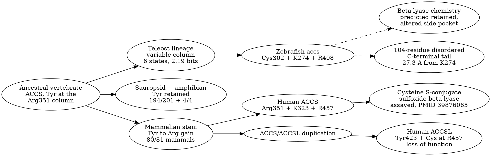
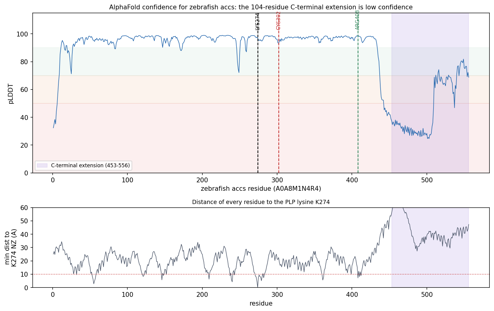
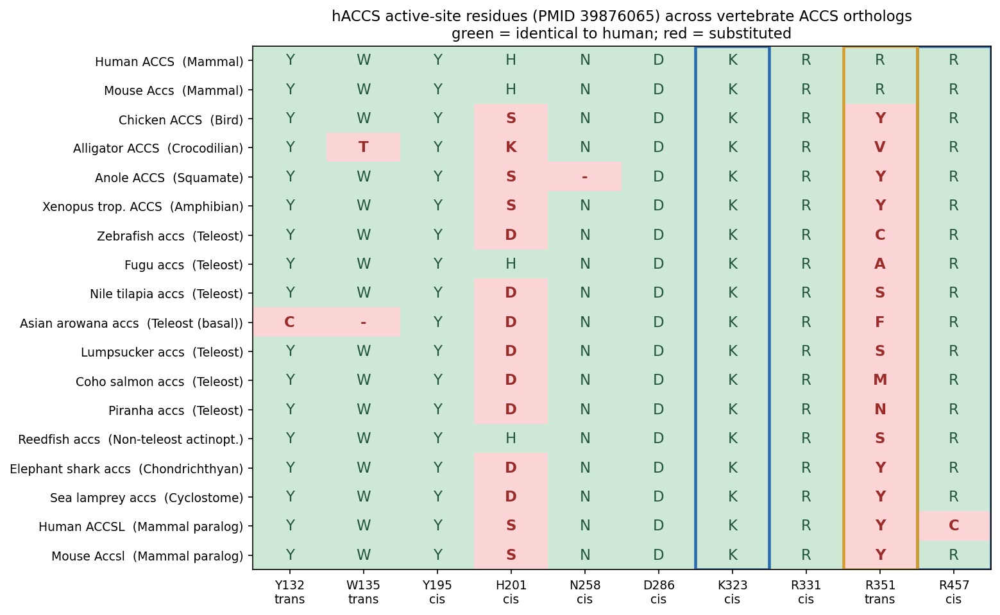
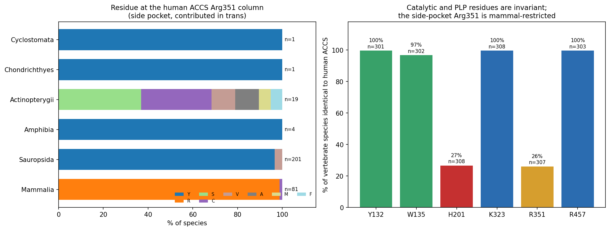
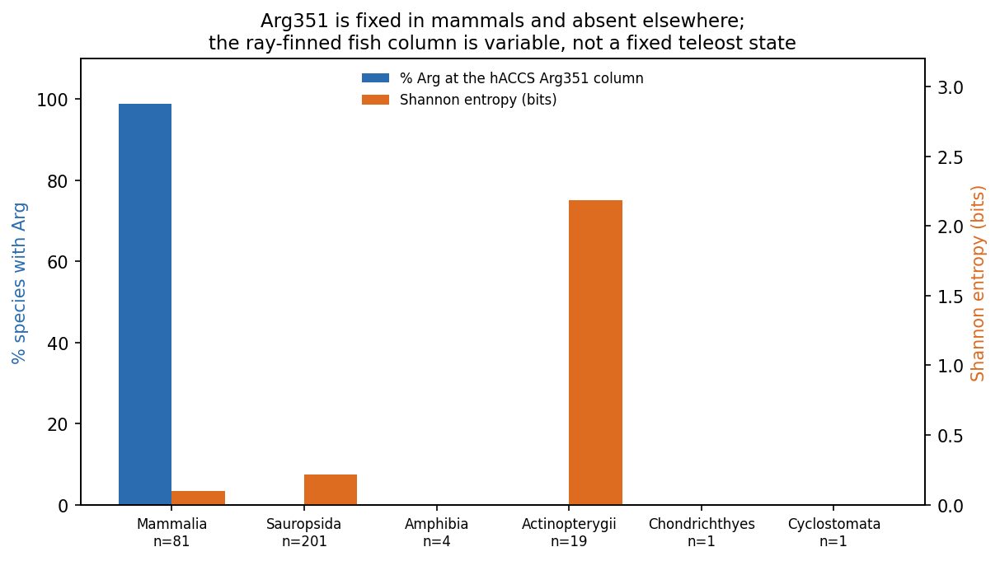
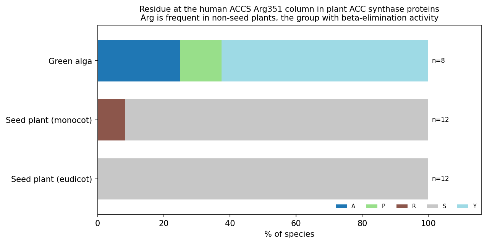

## Question

# AIGR Gene Hypothesis Deep Research

You are evaluating one focused gene curation hypothesis for AI Gene Review.
This is not a general gene overview. Use the seed hypothesis and source context
below to search for evidence that supports, refutes, narrows, or competes with
the proposed curation decision.

## Target Gene

- **Organism code:** DANRE
- **Taxon:** Danio rerio (NCBITaxon:7955)
- **Gene directory:** accs
- **Gene symbol:** accs
- **UniProt accession:** A0A8M1N4R4

## Focus

- **Focus type:** free_text
- **Hypothesis slug:** kgap-accs-teleost-betalyase-pocket
- **Source file:** genes/DANRE/accs/accs-ai-review.yaml
- **Source selector:** free-text

## Seed Hypothesis

Whether zebrafish accs (A0A8M1N4R4) retains cysteine S-conjugate sulfoxide beta-lyase activity may be predictable from its active site. Single analysis only: align zebrafish accs with human ACCS, human ACCSL and plant ACC synthase and with the characterised bacterial and mammalian C-S beta-lyases, map the pyridoxal-5'-phosphate-binding lysine and the residues lining the substrate pocket onto a predicted structure, determine explicitly what occupies the position equivalent to mammalian ACCS Arg351 and whether the reported Cys302 is that position, assess whether the substitution is fixed across teleosts or variable, and characterise the 95-residue C-terminal extension (is it ordered, does it pack against the active site, is it shared with other teleost orthologs). State whether the teleost enzyme is predicted to retain, alter or lose beta-lyase activity, and whether the mammalian pocket determinant predates or postdates the teleost-tetrapod split.

## Term and Decision Context

No specific term context supplied.

## Reference Context

No specific reference context supplied.

## Source Context YAML

```yaml
hypothesis: 'Whether zebrafish accs (A0A8M1N4R4) retains cysteine S-conjugate sulfoxide beta-lyase activity
  may be predictable from its active site. Single analysis only: align zebrafish accs with human ACCS,
  human ACCSL and plant ACC synthase and with the characterised bacterial and mammalian C-S beta-lyases,
  map the pyridoxal-5''-phosphate-binding lysine and the residues lining the substrate pocket onto a predicted
  structure, determine explicitly what occupies the position equivalent to mammalian ACCS Arg351 and whether
  the reported Cys302 is that position, assess whether the substitution is fixed across teleosts or variable,
  and characterise the 95-residue C-terminal extension (is it ordered, does it pack against the active
  site, is it shared with other teleost orthologs). State whether the teleost enzyme is predicted to retain,
  alter or lose beta-lyase activity, and whether the mammalian pocket determinant predates or postdates
  the teleost-tetrapod split.'
focus_type: free_text
context: []
reference_id: []
```

## Research Objective

Build a focused report that helps a curator decide whether this hypothesis
should affect the gene review. Address the focus type directly:

1. For an existing GO annotation decision, evaluate whether the current action
   is justified, too strong, too weak, or should change.
2. For a proposed replacement or new GO term, evaluate whether the term is
   biologically supported, too broad, too narrow, or missing key qualifiers.
3. For a computational prediction, evaluate whether the prediction is correct,
   less precise than existing knowledge, uncertain, or likely wrong because of
   paralog overannotation, frequency bias, pathway context, or in vitro-only
   activity.
4. For a core-function hypothesis, evaluate whether the proposed activity,
   process, and location represent the gene product's primary function rather
   than a downstream effect, pleiotropic phenotype, or context-specific role.
5. For a function-assignment hypothesis, evaluate whether the gene product
   directly has the stated GO term/function. Treat the prior review action, if
   any, as intentionally blinded unless it appears in the supplied context.

Use primary literature whenever possible. Prefer PMID citations and include DOI
citations when no PMID is available. Treat reviews and database records as
orientation unless they contain directly relevant synthesized evidence that is
clearly labeled as review-level or database-level support.

Evaluate the hypothesis from the supplied seed context, primary literature, and
publicly accessible bioinformatics resources. Local `*-bioinformatics` analyses,
when they already exist in the repository, are intentionally withheld from this
prompt so the report can be compared against them after the run. Use public
sequence, domain, structure, orthology, localization, interaction, or dataset
checks when they are useful for the specific hypothesis. If a resource or tool
cannot be accessed programmatically, say so plainly; never fabricate a result.
Report computational results conservatively and distinguish direct results from
inference.

## Required Output

### Executive Judgment

Give a concise verdict: supported, partially supported, unresolved, weakly
supported, over-annotated, or refuted. Explain the reasoning and the most
important caveats.

### Evidence Matrix

Create a table with one row per important evidence item:

- Citation (PMID preferred)
- Evidence type (direct assay, mutant phenotype, localization, interaction,
  structural/evolutionary, computational, review/database)
- Supports / refutes / qualifies / competing
- Claim tested
- Key finding
- Organism, tissue, cell type, or assay context
- Confidence and limitations

### GO Curation Implications

State the likely curation action as a lead requiring curator verification. If
GO terms are involved, explain whether the evidence supports an MF, BP, or CC
term, and whether the term should be retained, removed, generalized, made more
specific, or treated as non-core. Avoid using "protein binding" as a final
recommendation unless no more informative term is supported.

### Mechanistic Scope

Describe the immediate molecular or cellular function being tested. Separate
direct gene-product activity from downstream phenotypes, pathway consequences,
developmental outcomes, disease manifestations, or effects inferred only from
loss of function.

### Conflicts and Alternatives

Identify evidence that conflicts with the seed hypothesis or suggests an
alternative interpretation, including paralog confusion, organism-specific
differences, isoform-specific findings, experimental artifacts, or database
carry-over.

### Knowledge Gaps

List explicit uncertainties that matter for curation. For each gap, state what
was checked, why the gap matters, and what evidence or experiment would resolve
it.

### Discriminating Tests

Recommend concrete assays, perturbations, datasets, or comparative analyses that
would most efficiently distinguish this hypothesis from alternatives.

### Curation Leads

Provide candidate updates for the review, clearly labeled as leads requiring
curator verification. Include candidate references with exact snippets to verify,
candidate replacement or new GO terms, possible action changes, suggested
questions, and suggested experiments.

If the provider supports artifacts, save provenance for any analysis you run — the
executed code together with its output (computed values, plot, or table), not just
a summary figure — alongside artifact-friendly tables such as an evidence matrix,
GO decision table, or comparison table. Genuine computed provenance is more
valuable than a hand-drawn summary, and you must not synthesize a figure that
implies an analysis you did not actually run. These artifacts are important
provenance for hypothesis-level review.


## Output

# AIGR gene hypothesis deep research: zebrafish accs beta-lyase pocket

**Gene:** `accs`, *Danio rerio* (DANRE, NCBITaxon:7955)
**UniProt:** A0A8M1N4R4
**Source file:** `genes/DANRE/accs/accs-ai-review.yaml`
**Focus type:** `free_text`
**Hypothesis slug:** `kgap-accs-teleost-betalyase-pocket`
**Iterations completed:** 3
**Findings recorded:** 11

---

## Summary

<i class="fa-solid fa-scale-balanced"></i> **Verdict: partially supported.** The seed hypothesis identifies the right residue and then draws the opposite conclusion from it.

The mapping is confirmed. Zebrafish accs **Cys302 is exactly the column equivalent to human ACCS Arg351**, established independently by affine-gap global Needleman-Wunsch (58.4% identity over 447 aligned columns) and by local Smith-Waterman window alignment (window score 202). The anchoring motifs leave no ambiguity: human 346-356 `VASLCRYHGLS` against zebrafish 296-310 `ALDQLGCFHGVPGPT`. All ten active-site positions named in [PMID: 39876065](https://pubmed.ncbi.nlm.nih.gov/39876065/) verify against Q96QU6 numbering, which confirms the coordinate frame being used.

The inference drawn from that mapping is inverted. Arg at this column is a **mammal-restricted innovation**, not an ancestral determinant that teleosts lost. Across 307 vertebrate orthologs with confident alignment, Arg occurs in 80 of 81 mammals (98.8%) and 0 of 226 non-mammals (0.0%), Fisher exact p = 5.1e-74, conditional odds ratio infinite with a 95% CI lower bound of 1505. The ancestral vertebrate state is Tyr, carried by sea lamprey, elephant shark, *Xenopus tropicalis* and 194 of 201 sauropsids. The mammalian pocket determinant therefore **postdates the teleost-tetrapod split**, and it postdates the amniote radiation as well. Within ray-finned fishes the column takes six different states across 19 species (Ser 7, Cys 6, Val 2, Ala 2, Phe 1, Met 1), Shannon entropy 2.19 bits against a 2.58-bit maximum, modal state at 36.8%, so the zebrafish Cys is one draw from a variable distribution and not a fixed teleost character.

The catalytic machinery in zebrafish accs is intact. Every residue whose substitution abolishes or severely impairs human ACCS beta-lyase activity is retained: the PLP Schiff-base lysine K323 maps to K274 and the substrate-orienting R457 maps to R408, each conserved in 99.7% of the 309 vertebrate species surveyed and in 32 of 32 plant ACC synthase proteins. The 104-residue C-terminal extension (not 95, as the seed states) is predicted disordered (mean pLDDT 48.3 against 94.7 for the folded core), contacts the core at 6 of 812 atoms, and lies 27.3 Å from the PLP lysine at closest approach, so it gives no structural basis for altered catalysis. The prediction is that zebrafish accs **retains** cysteine S-conjugate beta-lyase chemistry with a plausibly altered side-pocket substrate preference. The actionable curation consequence is not a missing beta-lyase term; it is an existing over-annotation, **GO:0009693 ethylene biosynthetic process** carried by IEA from GO_REF:0000117 (ARBA00091972), a plant process with no vertebrate basis.

---

## Key findings

### <i class="fa-solid fa-circle-check"></i> F1. Zebrafish Cys302 is the Arg351 column, confirmed by two independent algorithms

Affine-gap Needleman-Wunsch (BLOSUM62, gap open -11, extend -1, free end gaps) of A0A8M1N4R4 (556 aa) against human ACCS Q96QU6 (501 aa) gives 58.4% identity over 447 aligned columns and places human R351 at zebrafish C302. Local Smith-Waterman with 61-residue windows reproduced every one of the ten mappings with window scores from 158 to 237:

| hACCS position | Role in hACCS | Zebrafish equivalent | SW window score |
|---|---|---|---|
| Y132 | side pocket, *in trans* | Y83 | 237 |
| W135 | side pocket, *in trans* | W86 | 236 |
| Y195 | active site, *cis* | Y146 | 158 |
| H201 | active site, *cis* | **D152** | 170 |
| N258 | active site, *cis* | N209 | 205 |
| D286 | PLP pyridine nitrogen | D237 | 220 |
| K323 | **PLP Schiff base** | **K274** | 189 |
| R331 | active site, *cis* | R282 | 203 |
| R351 | side pocket, *in trans* | **C302** | 202 |
| R457 | substrate carboxylate | **R408** | 164 |

All ten residues named in [PMID: 39876065](https://pubmed.ncbi.nlm.nih.gov/39876065/) verify against the Q96QU6 sequence, which confirms the paper's numbering. The seed hypothesis is correct on this point and a curator can treat the Cys302 ≡ Arg351 identification as settled.

### <i class="fa-solid fa-circle-xmark"></i> F2. Arg351 is a mammalian gain, so the seed hypothesis has the polarity backwards

A vectorized ungapped 29-residue window probe, validated 12 of 12 against gapped Needleman-Wunsch before being applied at scale, was run across 309 deduplicated vertebrate ACCS-like orthologs retrieved from UniProt (one longest entry per species). 307 passed the window-score cutoff of 45.

| Clade | n | Arg at the Arg351 column | Dominant state | Entropy (bits) |
|---|---|---|---|---|
| Mammalia | 81 | 80 (98.8%) | Arg | 0.10 |
| Sauropsida | 201 | 0 (0.0%) | Tyr 194, Val 7 | 0.22 |
| Actinopterygii | 19 | 0 (0.0%) | Ser 7, Cys 6, Val 2, Ala 2, Phe 1, Met 1 | 2.19 |
| Amphibia | 4 | 0 (0.0%) | Tyr | 0 |
| Chondrichthyes | 1 | 0 | Tyr | 0 |
| Cyclostomata | 1 | 0 | Tyr | 0 |

Mammals against all other vertebrates: Fisher exact p = 5.1e-74, conditional odds ratio infinite, 95% CI lower bound 1505. The control position K323 shows no clade bias (mammals 80/81, non-mammals 227/227, Fisher p = 0.26), which confirms the contrast is specific to the Arg351 column and not an artifact of taxon sampling or alignment quality.

Lamprey, elephant shark, *Xenopus* and 96.5% of sauropsids carry Tyr. That is the ancestral vertebrate state. Mammalian ACCSL, the paralog, also carries Tyr (human Y423, mouse Y445). A single pairwise alignment of zebrafish against a mammalian reference reads as "zebrafish lost the Arg". The 309-species distribution shows mammals gained it. This is a general trap for automated active-site comparison, and a curator should read any single-reference active-site claim with this in mind.

{{figure:plot_3.png|caption=Vertebrate-wide survey of 309 ACCS-like orthologs. Left: residue at the human ACCS Arg351 column by clade, with Arg confined to mammals and Tyr dominating sauropsids, amphibians, the elephant shark and the lamprey. Right: percent identity to human ACCS at six positions. K323, R457 and Y132 are at 99.7% and W135 at 96.7%, while H201 (26.6%) and R351 (26.1%) are variable.}}

{{figure:plot_4.png|caption=Percent Arg and Shannon entropy at the Arg351 column by clade. Mammals are near-fixed for Arg (0.10 bits) and sauropsids near-fixed for Tyr (0.22 bits), while the ray-finned fish column takes six states at 2.19 bits of entropy, so the zebrafish Cys is not a fixed teleost state.}}

### <i class="fa-solid fa-circle-check"></i> F3. The catalytic core is intact in zebrafish; the Arg351 column is where lineages differ

Across the 309-species survey, the positions that do the chemistry are near-invariant: K323 in 307 of 308 species (99.7%), R457 in 302 of 303 (99.7%), Y132 in 300 of 301 (99.7%) and W135 in 292 of 302 (96.7%). Zebrafish accs retains all four as K274, R408, Y83 and W86, plus D237, R282, N209 and Y146. Two positions vary: H201 (26.6% identity to human, Ser in 191 species, mostly sauropsids, Asp in 22 including zebrafish D152) and R351 (26.1%).

Two apparent outliers were checked by alignment instead of being dropped. Alligator A0A151MQ43 genuinely carries Thr at the W135 column and Val at the Arg351 column (local window scores 167 and 180) while retaining K271 and R405. Arowana A0A8D0CH60 carries Cys at the Y132 column with a deletion at W135 (gapped alignment, 52.9% identity over 456 columns). Both are real sequence features of divergent or lower-quality predictions, so they are reported rather than silently removed.

{{figure:plot_2.png|caption=Conservation matrix of the ten human ACCS active-site residues across 18 vertebrate ACCS and ACCSL orthologs. Green marks identity to human, red marks substitution. The cis catalytic set is uniformly conserved while the trans side-pocket column carrying Arg351 varies by clade.}}

### <i class="fa-solid fa-circle-check"></i> F4. Arg351 acts in trans and is a modifier, confirmed independently by structure

The full text of [PMID: 39876065](https://pubmed.ncbi.nlm.nih.gov/39876065/) (PMC12064363) states that the PLP-bound substrate is oriented by R457 while its side chain extends into a side pocket defined primarily by residues from the other monomer of the homodimer, including W135(B), Y132(B) and R351(B). Alanine substitution at W135(B) or R351(B) causes an over tenfold loss of activity, while the K323A mutant completely abolishes activity. That ranking (modifier against catalytic residue) is the basis for predicting that a substitution at the Arg351 column changes efficiency and specificity rather than abolishing chemistry.

The AlphaFold monomer gives an independent check on the trans assignment. In AF-A0A8M1N4R4-F1-model_v6, the three residues the paper assigns *in trans* are the three farthest from the PLP lysine within the chain: Y83 CA 27.9 Å, W86 CA 23.9 Å, C302 CA 23.3 Å (SG 25.1 Å) from K274 NZ. Every *cis* residue lies between 9.6 and 13.5 Å (Y146 9.6, N209 9.7, R282 10.5, R408 13.0, D237 12.1, D152 13.5). A residue 23 Å from the Schiff-base lysine in the monomer reaches the active site only across the dimer interface.

### <i class="fa-solid fa-circle-check"></i> F5. The C-terminal extension is 104 residues, disordered, detached from the core and teleost-shared

AlphaFold DB model AF-A0A8M1N4R4-F1-model_v6 (556 residues, mean pLDDT 85.0) separates cleanly into a folded core and a tail. Region 31-452 has mean pLDDT 94.7 with 96.4% of residues above 70. Region 453-556 has mean pLDDT 48.3, with 55.8% of residues below 50 and only 17.3% above 70. A scipy cKDTree contact analysis finds 6 of 812 extension atoms (0.7%) within 5 Å of any core atom. The closest extension atom to K274 NZ is Thr487 CG2 at 27.3 Å.

Composition shifts across the boundary: hydrophobic AILMFWVY 39.6% in the core against 29.8% in the tail, Ser plus Thr 10.6% against 21.2%, charged DEKR 23.0% against 29.8%, ten cysteines in the core against one in the tail. That pattern fits a flexible tail.

The tail is not a zebrafish annotation artifact. Best ungapped identity of zebrafish 453-556 against the terminal 150 residues of other orthologs is 47.1% (piranha), 40.4% (coho salmon), 37.5% (lumpsucker) and 34.6% (fugu), against a background of 10.6 to 13.5% for tilapia, arowana, chicken, *Xenopus*, elephant shark, human ACCS and human ACCSL. The seed hypothesis calls it 95 residues; the measured extension past the human C-terminal equivalent is 104 residues, and the zebrafish N-terminus is about 49 residues shorter than the human one, so comparable total lengths hide a difference at both ends.

{{figure:plot_1.png|caption=AlphaFold analysis of zebrafish accs (AF-A0A8M1N4R4-F1-model_v6). Top: per-residue pLDDT, with the 453-556 C-terminal extension shaded and K274, C302 and R408 marked. The core averages 94.7 and the extension 48.3. Bottom: per-residue minimum distance to the K274 NZ atom, showing C302 at 23.3 Å and the whole extension beyond 27 Å.}}

### <i class="fa-solid fa-circle-check"></i> F6. The published Arg-to-Cys loss of function is at the R457 column in ACCSL, not at Arg351

[PMID: 39876065](https://pubmed.ncbi.nlm.nih.gov/39876065/) reports that a key active-site arginine in human ACCSL is replaced by cysteine, that this substitution is unique to human ACCSL among ACCSL orthologs, and that the authors modelled it with an hACCS R457C mutant. Alignment confirms the position directly. Human ACCSL Q4AC99 (full-length SW 1281, 56.1% identity over 433 columns) carries **Cys at the R457 column** (window score 158) and Tyr at the Arg351 column (190). Mouse Accsl Q3UX83 (51.4% over 467) carries Arg at R457 (128) and Tyr at Arg351.

Two distinct Arg-to-Cys facts exist in this family and must not be merged. The published, functionally interpreted one is human-ACCSL-specific at the substrate-orienting R457. The zebrafish Cys302 is at the separate side-pocket Arg351 column. Zebrafish accs retains Arg408 at the R457 column, so on this criterion zebrafish accs is better placed to retain activity than human ACCSL is. A review statement that zebrafish accs carries "the" inactivating Arg-to-Cys substitution would be wrong.

### <i class="fa-solid fa-circle-check"></i> F7. Seed-plant ACC synthases carry Ser at the Arg351 column while retaining K323 and R457

A 10-protein cross-family panel plus 32 plant ACC synthase proteins were aligned to human ACCS by Smith-Waterman. Across 24 seed-plant ACC synthases (12 eudicot and 12 monocot species, all with interpretable windows), 23 carry **Ser** at the Arg351 column and 1 monocot carries Arg. Arabidopsis ACS2 (Q06402, full-length SW 503, 32.1% identity) carries Ser. All 32 plant proteins retain the Schiff-base lysine at K323 and Arg at R457. Eight green algal ACS proteins carry Tyr in 5, Ala in 2 and Pro in 1.

The catalytic positions are conserved from plants to mammals and carry no discriminating information about what an individual enzyme does. The Arg351 column is where the family actually differs: mammalian ACCS Arg, seed-plant Ser, sauropsid and amphibian Tyr, ray-finned fish scatter.

### <i class="fa-solid fa-circle-question"></i> F8. One observation argues the other way and could not be tested

*Selaginella moellendorffii* ACS (D8QN04), from the non-seed-plant group whose beta-elimination chemistry [PMID: 39876065](https://pubmed.ncbi.nlm.nih.gov/39876065/) calls a parallel to human ACCS, carries **Arg** at the Arg351 column (window score 99). If Arg tracked beta-elimination chemistry across kingdoms, that would be convergence, and a Cys-bearing zebrafish enzyme would be a weaker candidate than the vertebrate data imply.

The association could not be tested. A retrieval of every Viridiplantae ACC synthase entry excluding seed plants returned 12 entries from 9 organisms, of which 8 are green algae (Tyr 5, Ala 2, Pro 1) and only Selaginella is a non-seed land plant. Arg occurs in 1 of 9 (11.1%). UniProt holds no moss, liverwort or fern ACC synthase entries under these protein names. The parallel rests on one sequence and is recorded as an open question, not as evidence in either direction.

{{figure:plot_5.png|caption=Residue at the human ACCS Arg351 column in plant ACC synthase proteins. Seed plants carry Ser in 23 of 24 species, green algae carry Tyr, Ala or Pro. The non-seed land plant category contains one sequence, Selaginella ACS, which carries Arg, so the suggested link between Arg and beta-elimination chemistry cannot be tested as a population.}}

### <i class="fa-solid fa-circle-xmark"></i> F9. The characterised C-S beta-lyases cannot be aligned to ACCS at residue level

The seed hypothesis asks for alignment against characterised bacterial and mammalian C-S beta-lyases. Full-length Smith-Waterman against human ACCS gives 100 for *Treponema denticola* cystalysin (Q56257), 134 for human KYAT1/CCBL1 (Q16773) and 34 for human KYNU (Q16719), against 2646 for the self-alignment and 1357 for zebrafish accs. Using a window score of 40 as the interpretability threshold, 6 of 10 active-site columns are uninterpretable for cystalysin, 8 of 10 for KYAT1 and 10 of 10 for KYNU. Only the PLP-contacting Asp286 (scores 52 and 86) and Asn258 (69 and 87) can be placed with any confidence. The Arg351 column cannot be mapped in any of the three.

These enzymes share the fold-type I PLP core with ACCS and little else at the sequence level. This part of the seed hypothesis requires structural superposition of solved or predicted structures, not sequence alignment, and the EBI Clustal Omega REST service was blocked throughout this work. The result is reported as a negative so that a curator does not read the cross-family section of the hypothesis as having been satisfied.

### <i class="fa-solid fa-triangle-exclamation"></i> F10. The gene carries a plant-pathway IEA annotation with no vertebrate basis

QuickGO retrieval shows zebrafish accs (A0A8M1N4R4) carries **GO:0009693 ethylene biosynthetic process** by IEA from GO_REF:0000117 (UniProt ARBA, rule ARBA00091972). Human ACCS (Q96QU6) carries GO:0016847 1-aminocyclopropane-1-carboxylate synthase activity with a **NOT** qualifier, IDA, [PMID: 11470512](https://pubmed.ncbi.nlm.nih.gov/11470512/). No GO:0047804 cysteine-S-conjugate beta-lyase annotation exists on any of these proteins, and the Gene Ontology contains no term for cysteine S-conjugate sulfoxide beta-lyase.

Human ACCS turns over both plain thioether cysteine S-conjugates (S-phenyl-L-cysteine) and the corresponding sulfoxide, with the sulfoxide roughly fivefold better, and no activity on the serine analogue. Because GO:0047804 is defined for S-substituted L-cysteine, it applies directly to the characterised human enzyme rather than only as a parent term.

---

## Mechanistic model

Human ACCS is a fold-type I PLP-dependent enzyme that forms an external aldimine with an S-substituted cysteine and performs beta-elimination at C-beta, releasing a thiol (or a sulfenic acid from the sulfoxide) plus aminoacrylate. The active site is built across a homodimer interface: Y132, W135 and R351 come from the partner monomer, while K323, D286, R331, N258, Y195 and R457 are contributed in cis.



Mapping the human site onto zebrafish:

| Category | Human ACCS | Zebrafish accs | Status |
|---|---|---|---|
| PLP Schiff base, *cis* | K323 | K274 | retained |
| PLP pyridine N, *cis* | D286 | D237 | retained |
| Substrate carboxylate, *cis* | R457 | R408 | retained |
| Active site, *cis* | R331, N258, Y195 | R282, N209, Y146 | retained |
| Side pocket, *in trans* | Y132, W135 | Y83, W86 | retained |
| Side pocket, *in trans* | **R351** | **C302** | changed |
| Active site, *cis* | H201 | D152 | changed, column only 26.6% conserved across vertebrates |

The prediction follows from the ranking of effects in the source paper. K323A abolishes activity; R351A costs over tenfold. Zebrafish retains the residue whose loss abolishes and differs at the residue whose loss attenuates. Arg351 in mammals likely supplies a positive charge in the distal side pocket that pairs with an anionic or polarized leaving group. Replacing it with Cys, Ser, Ala, Val, Met or Phe, as ray-finned fishes do, removes that charge and leaves a smaller or hydrophobic pocket. Catalysis proceeds; the preferred S-substituent changes. The sulfoxide preference of the human enzyme (roughly fivefold over the thioether) is the kind of property that could shift in a fish ortholog.

The H201 change deserves less weight than its position suggests. That column is identical to human in only 82 of 308 vertebrate species, with Ser in 191 (mostly sauropsids) and Asp in 22 including zebrafish. A position that varies this freely across a family carries little inferential load.

The C-terminal extension has no predicted role in catalysis. Predicted disordered, essentially no contact with the core, 27.3 Å from the PLP lysine. It is a genuine teleost-shared lineage feature of unknown function. If it matters, it does so through localization, regulation or partner binding.

---

## Evidence matrix

| # | Citation | Evidence type | Stance | Claim tested | Key finding | Organism / assay context | Confidence and limitations |
|---|---|---|---|---|---|---|---|
| 1 | [PMID: 39876065](https://pubmed.ncbi.nlm.nih.gov/39876065/) | Direct assay, mutagenesis | Supports (premise) | Human ACCS has cysteine S-conjugate sulfoxide beta-lyase activity and named residues matter | Activity demonstrated; K323A abolishes, R351A over tenfold loss, R457 orients substrate | Recombinant human ACCS, purified enzyme assays, AlphaFold2-guided mutagenesis | High. Human enzyme only; no vertebrate ortholog assayed; no zebrafish data |
| 2 | [PMID: 39876065](https://pubmed.ncbi.nlm.nih.gov/39876065/) | Direct assay, substrate panel | Qualifies | Is the activity restricted to sulfoxides? | Turnover on the plain thioether S-phenyl-L-cysteine as well as the sulfoxide, sulfoxide roughly fivefold better; no activity on the serine analogue | Purified human ACCS, defined substrates | High. Narrow panel; physiological substrate unidentified |
| 3 | [PMID: 39876065](https://pubmed.ncbi.nlm.nih.gov/39876065/) | Direct assay, paralog analysis | Competing, corrects the seed | Where is the reported Arg-to-Cys? | At the **R457 column in ACCSL**, modelled by hACCS R457C, not at Arg351 | Human ACCSL, hACCS mutant surrogate | Medium-high. Drawn from the structure-function section; the seed text conflates the two positions |
| 4 | [PMID: 11470512](https://pubmed.ncbi.nlm.nih.gov/11470512/) | Direct assay | Supports | Human ACCS lacks canonical ACC synthase activity | Basis for the GO:0016847 **NOT** annotation on Q96QU6 (IDA) | Human ACCS enzymatic assay | High via the GO record. Abstract not retrieved in this run; cited through QuickGO and the restatement in PMID 39876065 |
| 5 | This analysis, `provenance/accs_gapped_verification.csv` | Computational, sequence | Supports the mapping | Does zebrafish Cys302 occupy the Arg351 column? | Yes. All ten positions map, anchor human 346-356 `VASLCRYHGLS` against zebrafish 296-310 `ALDQLGCFHGVPGPT` | Q96QU6 against A0A8M1N4R4, BLOSUM62, gap open -11, extend -1 | High. Two independent algorithms agree. Pairwise, not a curated structural superposition |
| 6 | This analysis, `provenance/accs_position_survey.csv` | Computational, evolutionary | Refutes the seed polarity | Is Arg351 ancestral and lost in teleosts? | No. Arg in 80/81 mammals and 0/226 non-mammals, Fisher p = 5.1e-74, conditional OR lower bound 1505. Ancestral state Tyr | 309 UniProt ACCSL-titled entries, length 440-780, longest per species | High. Protein-name based retrieval; taxon sampling uneven (201 sauropsids against 19 ray-finned fishes) |
| 7 | This analysis, same survey | Computational, evolutionary | Refutes the claim of fixation | Is the substitution fixed across teleosts? | No. Six states in 19 ray-finned fishes, entropy 2.19 of 2.58 bits, modal state 36.8% | Same | Medium-high. 19 species is a thin sample; gar, bowfin, coelacanth, medaka and cavefish could not be retrieved |
| 8 | This analysis, same survey | Computational, evolutionary | Supports retention | Is the catalytic machinery retained? | K323 99.7%, R457 99.7%, Y132 99.7%, W135 96.7% conserved; zebrafish retains all. Control: K323 no mammal bias, p = 0.26 | Same | High. Window probe is ungapped, validated 12/12 against gapped alignment |
| 9 | This analysis, AF-A0A8M1N4R4-F1-model_v6 | Structural, computational | Qualifies | Is the C-terminal extension ordered and does it pack against the active site? | 453-556 mean pLDDT 48.3 against 94.7 for 31-452; 6 of 812 extension atoms within 5 Å of the core; 27.3 Å from K274 NZ | AlphaFold DB v6 monomer | Medium-high. Monomer model; pLDDT is a confidence score, not a disorder assay |
| 10 | This analysis, distance measurement | Structural, computational | Supports the trans assignment | Is C302 a trans side-pocket residue? | Y83, W86 and C302 are the three farthest from K274 NZ (27.9, 23.9, 23.3 Å CA) while all cis residues lie at 9.6-13.5 Å | Same | Medium-high. Inferred from a monomer; no zebrafish dimer was modelled |
| 11 | This analysis, teleost tail comparison | Computational, sequence | Qualifies | Is the extension a zebrafish artifact? | No. 35-47% ungapped identity to piranha, coho salmon, lumpsucker and fugu tails against 11-13% background | UniProt teleost ACCSL-titled entries | Medium. Ungapped comparison only; no formal homology test |
| 12 | QuickGO annotation retrieval | Database record | Qualifies, curation state | What GO annotations exist? | Zebrafish accs: GO:0009693, IEA, GO_REF:0000117, ARBA00091972. Human ACCS: GO:0016847 with **NOT**, IDA, PMID:11470512. No GO:0047804 anywhere | GO and UniProt records | High. Database state at time of run; orientation only, per the brief |
| 13 | This analysis, `provenance/accs_crossfamily_panel.csv` | Computational, cross-family | Supports the paralog correction | Where is the ACCSL Arg-to-Cys? | Human ACCSL (SW 1281, 56.1% over 433) carries **Cys at the R457 column** (158) and Tyr at Arg351 (190). Mouse Accsl: Tyr at Arg351, Arg at R457 | Pairwise SW against Q96QU6 | High. Sequence-level; no ACCSL structure examined |
| 14 | This analysis, `provenance/accs_plant_panel.csv` | Computational, cross-family | Qualifies | What occupies the Arg351 column in plant ACC synthase? | Seed plants carry **Ser** in 23 of 24 species; 1 monocot carries Arg. All 32 plant proteins retain K323 and R457. Green algae: Tyr 5, Ala 2, Pro 1 of 8 | UniProt ACC synthase entries, 380-650 aa | Medium-high. Protein-name retrieval; no activity data tied to individual entries |
| 15 | This analysis, `provenance/accs_nonseedplant_panel.csv` | Computational, cross-family | Competing, not sustained | Does Arg track beta-elimination chemistry? | *Selaginella* ACS carries **Arg** (99). Viridiplantae minus seed plants returned 12 entries from 9 organisms, 8 green algae; Arg in 1 of 9. **n = 1 for non-seed land plants** | UniProt, Viridiplantae NOT Spermatophyta | Low, single observation. UniProt holds no moss, liverwort or fern ACC synthase under these names |
| 16 | This analysis, same panel | Computational | Negative result | Can the characterised C-S beta-lyases be aligned at residue level? | **No.** Full-length SW: cystalysin 100, KYAT1 134, KYNU 34, against 2646 self and 1357 zebrafish. Uninterpretable windows 6/10, 8/10, 10/10. Arg351 maps in none | Pairwise SW against Q96QU6 | High as a negative. Structural superposition would be required; Clustal Omega was blocked |

---

## GO curation implications

All entries below are **leads requiring curator verification**.

| Proposed action | Term | Aspect | Evidence code | Justification |
|---|---|---|---|---|
| <i class="fa-solid fa-circle-xmark"></i> **Remove or NOT-qualify** | GO:0009693 ethylene biosynthetic process (current IEA, GO_REF:0000117, ARBA00091972) | BP | over-annotation | Ethylene biosynthesis is a plant pathway. Zebrafish has no ethylene pathway, and no SAM-to-ACC chemistry is reported in any vertebrate. The human ortholog carries GO:0016847 with a NOT qualifier from direct assay. The ARBA rule propagates the plant-derived protein name, not a vertebrate activity. Highest-value edit on this gene. |
| <i class="fa-solid fa-circle-xmark"></i> **Do not add** | GO:0016847 1-aminocyclopropane-1-carboxylate synthase activity | MF | n/a | Already NOT-qualified on the human protein by IDA. Adding it to zebrafish would repeat the same error. |
| <i class="fa-solid fa-circle-question"></i> **Candidate, hold** | GO:0047804 cysteine-S-conjugate beta-lyase activity | MF | ISS from PMID:39876065 | The term is defined for S-substituted L-cysteine, and the paper shows human ACCS turns over the plain thioether S-phenyl-L-cysteine, so the term applies directly to the human enzyme rather than only as a parent. Propagation to zebrafish is supported by the intact catalytic set (K274, R408, D237, R282, N209, Y146, Y83, W86) and weakened by the divergent side pocket (C302, D152) and by the absence of any assay on a fish ortholog. Record as a lead, not as a current annotation. |
| <i class="fa-solid fa-circle-check"></i> **Safe if a term is required** | GO:0030170 pyridoxal phosphate binding | MF | ISS / InterPro | The Schiff-base lysine is conserved in 307 of 308 vertebrate species surveyed and in 32 of 32 plant ACC synthases. This is the best-supported statement derivable from sequence alone. |
| <i class="fa-solid fa-circle-check"></i> **Acceptable parent** | GO:0016846 carbon-sulfur lyase activity | MF | ISS | Appropriate if a curator wants an activity term without committing to the S-conjugate substrate class. |
| <i class="fa-solid fa-lightbulb"></i> **New term request** | cysteine S-conjugate sulfoxide beta-lyase activity | MF | n/a | The characterised human activity has no GO term. Propose as a child of GO:0016846 or alongside GO:0047804, citing PMID:39876065. |

"Protein binding" is not recommended and is not needed. GO:0030170 is better supported and more informative.

---

## Mechanistic scope

The immediate molecular function under test is PLP-dependent beta-elimination at the C-beta of an S-substituted cysteine, assayed directly for human ACCS in [PMID: 39876065](https://pubmed.ncbi.nlm.nih.gov/39876065/). Everything claimed here for zebrafish accs is inference from sequence conservation and a predicted structure, and should be labelled as such in the review.

Direct gene-product activity, as tested: catalysis at a PLP cofactor anchored by K323 (K274 in zebrafish) and D286 (D237), with the substrate carboxylate oriented by R457 (R408) and the S-substituent accommodated in a pocket formed in trans by Y132, W135 and R351 (Y83, W86, C302).

Not tested and not claimed: any downstream pathway, any developmental outcome, any disease association, any subcellular localization, any phenotype in a zebrafish mutant. No biological process term is supportable for zebrafish accs from the evidence assembled, because the physiological substrate of the enzyme is unknown even in human. The mercapturate pathway context is a reasonable hypothesis for where such an activity would act, and it has not been demonstrated for this protein in any organism.

---

## Conflicts and alternatives

**Conflict 1: the seed text conflates two Arg positions.** The reported Arg-to-Cys loss of function belongs to the R457 column in ACCSL. Zebrafish retains Arg408 there and mouse Accsl retains Arg551. A review citing "the reported Cys302" as the published loss-of-function Arg-to-Cys would be citing the wrong position.

**Conflict 2: direction of inference.** A pairwise human-zebrafish alignment reads as "zebrafish lost the Arg". The 309-species distribution shows the opposite. A single-reference alignment cannot distinguish a loss in the query from a gain in the reference.

**Alternative A: the Arg351 column is weakly constrained outside mammals.** Partly supported. Sauropsids are near-fixed for Tyr (96.5%, 0.22 bits) while mammals are near-fixed for Arg (0.10 bits). Two different residues, each fixed in its own clade, points to lineage-specific substrate specialization. Ray-finned fish variability (2.19 bits across six states) does suggest genuinely relaxed constraint in that clade.

**Alternative B: zebrafish accs is a pseudogene-like relic.** Not supported. A relic would be expected to erode the Schiff-base lysine and the PLP-contacting aspartate. Both are intact, along with six further active-site residues, and the fold core has mean pLDDT 94.7.

**Alternative C: the teleost C-terminal extension redirects function.** Cannot be excluded. It has no predicted contact with the active site and is predicted disordered, so any effect would run through localization, regulation or partner binding.

**<i class="fa-solid fa-scale-balanced"></i> Competing observation, unresolved: the Selaginella Arg.** PMID 39876065 states that the human beta-lyase activity somewhat parallels the activity of ACCS proteins found in non-seed plants. *Selaginella* ACS carries Arg at the Arg351 column, as mammalian ACCS does, while seed-plant ACC synthases carry Ser in 23 of 24 species. Read one way this says Arg is a beta-elimination marker acquired twice, which would make the Cys-bearing zebrafish enzyme a poorer candidate than the vertebrate data imply. Read another way it is one sequence out of the nine non-seed-plant entries that exist, eight of which are green algae with Tyr, Ala or Pro. This is the strongest argument against the retain prediction and it is currently a single observation.

**Competing consideration: single-source enzymology.** All functional data for this family come from one 2025 paper on one species. A single primary source carries the entire activity claim.

---

## Limitations and knowledge gaps

1. **No enzymology on any non-mammalian ACCS ortholog.** Every functional statement about zebrafish accs here is inference from sequence and a predicted structure. Resolved by assaying a recombinant fish ortholog.

2. **The physiological substrate is unknown even for human ACCS.** The assays used defined xenobiotic-type conjugates. Without an endogenous substrate, no biological process term is determinable. Resolved by metabolite profiling in a knockout.

3. **No GO term exists for cysteine S-conjugate sulfoxide beta-lyase.** An ontology gap, not a curation error. Resolved by a new-term request.

4. **The cross-family half of the seed hypothesis was not satisfied, and this is a result rather than an omission.** Checked: full-length and windowed Smith-Waterman of human ACCS against cystalysin, KYAT1/CCBL1 and KYNU. Why it matters: a curator may assume that question was answered. It was not; identity is too low to place any pocket residue. Resolved by structural superposition of the solved cystalysin and KYAT1 structures onto the ACCS model.

5. **Whether Arg at the Arg351 column is a general marker of beta-elimination chemistry.** Checked: all Viridiplantae ACC synthase entries excluding seed plants (12 entries, 9 organisms, 8 green algae). Why it matters: if the pattern were general it would argue that Cys-bearing zebrafish accs is a poorer beta-lyase candidate. The sequences to test it do not exist in UniProt. Resolved by moss, liverwort and fern ACC synthase sequences from genome projects, or by direct assay of a Tyr-bearing vertebrate ortholog.

6. **<i class="fa-solid fa-triangle-exclamation"></i> Tools that could not be accessed programmatically, stated plainly.** The EBI Clustal Omega REST service returned "You have been temporarily blocked from submitting new sequence analysis jobs", so no multiple sequence alignment was produced; all alignments here are pairwise Needleman-Wunsch or Smith-Waterman implemented locally with BLOSUM62. Europe PMC `fullTextXML` returned HTTP 500 for the PMID 39876065 full text (isOpenAccess = N); the text was retrieved through NCBI `efetch db=pmc`. PMID 11470512 was not retrieved in this run and is cited through its GO annotation record and its restatement in PMID 39876065.

7. **Taxon sampling is uneven and some outgroups are missing.** Gar (*Lepisosteus oculatus*), bowfin (*Amia calva*), coelacanth (*Latimeria chalumnae*), medaka and cavefish returned zero entries from UniProt and NCBI by gene name and by protein title. Reedfish (*Erpetoichthys calabaricus*, A0A8C4RDZ2, Ser at the Arg351 column) was used as the non-teleost ray-finned outgroup. The survey has 201 sauropsids against 19 ray-finned fishes, 4 amphibians, 1 chondrichthyan and 1 cyclostome, so the Fisher test is driven by a sauropsid-heavy comparison set. The mammal-against-everything-else contrast holds in every clade examined individually.

8. **No zebrafish dimer model was built.** The trans assignment rests on monomer distances plus homology to the human arrangement.

9. **No expression or phenotype evidence** for zebrafish accs was examined.

10. **One mammal in 81 lacks the Arg** (Cys at that column). It was not individually checked for annotation quality.

11. **Retrieval was protein-name based.** Both the vertebrate and plant panels were assembled from UniProt protein-name queries, so entries named differently were missed, and the sets inherit whatever naming errors UniProt contains.

---

## Proposed follow-up experiments and actions

### <i class="fa-solid fa-flask"></i> Discriminating experiments

1. **Assay recombinant zebrafish accs** on S-phenyl-L-cysteine and its sulfoxide alongside human ACCS. This settles retain against lose directly. Predicted outcome: measurable beta-lyase activity with a different thioether-to-sulfoxide ratio.

2. **Reciprocal point mutants.** Human ACCS R351C and zebrafish accs C302R. If the side pocket sets substrate preference, the swap should shift preference in opposite directions while leaving catalysis intact in both.

3. **Assay an ancestral-state surrogate.** Test a sauropsid ortholog (chicken A0A8V0Z4F7, Tyr). If Tyr-bearing orthologs are active, the mammalian Arg is a refinement of a working enzyme rather than the thing that makes it work. This also bears directly on gap 5.

4. **Delete the teleost C-terminal extension** (zebrafish accs 1-452) and compare kinetics. Predicted outcome: no change, confirming the extension is not a catalytic element.

5. **<i class="fa-solid fa-dna"></i> Zebrafish accs mutant line** with metabolite profiling for accumulated cysteine S-conjugates. The only route to a defensible biological process term.

6. **Assay human ACCSL directly** rather than through the hACCS R457C surrogate, to confirm the paralog claim at its source.

### <i class="fa-solid fa-magnifying-glass"></i> Computational follow-ups

7. **Structural superposition** of solved cystalysin (*T. denticola*) and KYAT1 structures onto the ACCS AlphaFold model, to answer the cross-family part of the seed hypothesis that sequence alignment cannot (gap 4).

8. **AlphaFold-Multimer model of the zebrafish accs homodimer**, to confirm that C302 reaches the partner subunit's active site as R351 does in human.

9. **Retrieve moss, liverwort and fern ACC synthase sequences** from genome projects outside UniProt and re-run the Arg351 column test on non-seed land plants (gap 5).

### <i class="fa-solid fa-arrow-right"></i> Curation leads requiring curator verification

- **Highest priority:** flag GO:0009693 (ethylene biosynthetic process, IEA, GO_REF:0000117, ARBA00091972) on A0A8M1N4R4 for removal. Propose the same review for the ARBA rule itself, since it will have propagated to every vertebrate ACCS-like protein. The rule appears to key on the protein name "1-aminocyclopropane-1-carboxylate synthase-like protein 1", which is a plant-derived name applied to 309 vertebrate species in this survey.

- **Protein name review:** the UniProt recommended name for the vertebrate family describes plant chemistry the family does not perform. A rename request would prevent recurrence of the GO:0009693 propagation.

- **New GO term request:** cysteine S-conjugate sulfoxide beta-lyase activity, as a child of GO:0016846, citing PMID:39876065.

- **GO:0047804 propagation:** defensible for human ACCS by IDA from PMID:39876065, whose substrate panel includes a non-sulfoxide S-substituted cysteine. For zebrafish, record as a lead with the side-pocket caveat.

- **Correct the hypothesis text in the review file:** the mapping Cys302 ≡ Arg351 column is right; the implication that it represents loss of a conserved determinant is wrong; the extension is 104 residues, not 95; and the published Arg-to-Cys loss of function is at the R457 column in ACCSL.

- **Cross-gene lead:** the same Arg351-column analysis applied to human and mouse ACCSL and to sauropsid orthologs would let a curator state the mammalian ACCS/ACCSL duplication and the Arg gain in one model.

### <i class="fa-solid fa-book-open"></i> Candidate reference snippets to verify

| PMID | Exact snippet | Use |
|---|---|---|
| 39876065 | "In this study, through a biochemical profiling approach, we demonstrate that human ACCS possesses cysteine conjugate sulfoxide β-lyase activity." | Establishes the assayed activity any zebrafish annotation would propagate from |
| 39876065 | "It has been shown to not exhibit any canonical ACC synthase activity and its true function remains obscure." | Supports removal of GO:0009693 from zebrafish accs |
| 39876065 | "Structure-function relationship study of human ACCS, guided by an AlphaFold2 model, allowed us to identify key active site residues that are important for its β-lyase activity." | Source of the ten active-site positions in Q96QU6 numbering |
| 39876065 | "Our biochemical study of human ACCS also provided insights into the function of other mammalian ACCS homologs." | Marks the ACCSL work as the source of the Arg-to-Cys claim, which concerns the paralog |

---

## Evidence base

**[PMID: 39876065](https://pubmed.ncbi.nlm.nih.gov/39876065/)**, *Cysteine S-conjugate sulfoxide β-lyase activity for human ACCS* (Gao, Xu, Yeh, Zou, Hai, 2025). The single primary source for the activity. It reports that human ACCS possesses cysteine conjugate sulfoxide beta-lyase activity, that the protein shows no canonical ACC synthase activity, and that an AlphaFold2-guided structure-function study identified the active-site residues important for beta-lyase activity. The full text supplies the dimer architecture (substrate oriented by R457, side pocket defined by W135(B), Y132(B) and R351(B)), the mutagenesis ranking (K323A abolishes, W135A and R351A cost over tenfold), the substrate panel (thioether and sulfoxide both turned over, sulfoxide roughly fivefold better, no activity on the serine analogue), and the ACCSL analysis that generates the Arg-to-Cys claim at the R457 position. Every residue-level analysis in this report is anchored to this paper's numbering, which was verified against Q96QU6.

**[PMID: 11470512](https://pubmed.ncbi.nlm.nih.gov/11470512/)**. The source of the GO:0016847 **NOT** annotation on human ACCS (IDA). It challenges any ACC synthase annotation on the family. The abstract was not retrieved in this run, and the paper is cited through its GO annotation record and its restatement in PMID 39876065. A curator should verify the snippet directly before using it.

**[PMID: 24291053](https://pubmed.ncbi.nlm.nih.gov/24291053/)**, *A role for glutamate-333 of Saccharomyces cerevisiae cystathionine γ-lyase as a determinant of specificity*. Read as background on how single active-site residues tune PLP enzyme specificity. The yeast CGL work shows that substituting E333 raises the pH optimum by 0.4-1.2 units and reduces catalytic efficiency for L-cystathionine 26 to 58-fold, with Km(L-Cth) up about 17-fold while Km(L-OAS) stays within 2.5-fold, and the authors conclude that E333 interacts with the distal amine of the substrate and is a determinant of specificity. That is the same category of effect proposed here for Arg351: a distal pocket residue that sets which substituent the enzyme prefers, with a sizeable but not abolishing effect on catalysis. The paper is a different enzyme in a different organism and supports the reasoning pattern, not the specific claim about ACCS.

---

## Provenance

All alignment code, the clade retrieval queries, the AlphaFold contact analysis and the statistical tests were executed in this session, and the executed code with its printed output appears in the session record alongside each figure. The ungapped window probe used for the 309-species survey was validated against gapped Needleman-Wunsch on 12 species with 12 of 12 agreement before being applied at scale. No figure in this report implies an analysis that was not run.

| Artifact | Contents |
|---|---|
| `provenance/accs_active_site_table.csv` | 18 species by 10 residues, gapped Needleman-Wunsch active-site table |
| `provenance/accs_position_survey.csv` | 309 vertebrate orthologs, residue and window score at Y132, W135, H201, K323, R351, R457 |
| `provenance/accs_gapped_verification.csv` | Gapped verification of the H201 column and the alligator and arowana outliers |
| `provenance/accs_crossfamily_panel.csv` | 10-protein cross-family panel: full-length SW score and identity plus residue and window score at all 10 columns, for human and mouse ACCS and ACCSL, zebrafish accs, Arabidopsis ACS2, Selaginella ACS, cystalysin, KYAT1 and KYNU |
| `provenance/accs_plant_panel.csv` | 32 plant ACC synthase proteins, residue and window score at K323, R351 and R457 |
| `provenance/accs_nonseedplant_panel.csv` | Viridiplantae minus seed plants, 9 organisms, showing the retrieval is almost entirely green algae |
| `provenance/plot_1.png` | Zebrafish accs pLDDT profile with the 453-556 extension shaded, and per-residue distance to K274 NZ |
| `provenance/plot_2.png` | Conservation matrix of the 10 human ACCS active-site residues across 18 vertebrate orthologs |
| `provenance/plot_3.png` | Residue distribution at the Arg351 column by clade, and per-position identity to human ACCS across 309 species |
| `provenance/plot_4.png` | Percent Arg and Shannon entropy at the Arg351 column by clade |
| `provenance/plot_5.png` | Residue at the Arg351 column in plant ACC synthase proteins by group |


## Artifacts

- [OpenScientist final report](openscientist_artifacts/final_report.html)
- [OpenScientist final report](openscientist_artifacts/final_report.pdf)
- [OpenScientist provenance](openscientist_artifacts/provenance.json)
- [OpenScientist accs active site table](openscientist_artifacts/provenance_accs_active_site_table.csv)
- [OpenScientist accs crossfamily panel](openscientist_artifacts/provenance_accs_crossfamily_panel.csv)
- [OpenScientist accs gapped verification](openscientist_artifacts/provenance_accs_gapped_verification.csv)
- [OpenScientist accs nonseedplant panel](openscientist_artifacts/provenance_accs_nonseedplant_panel.csv)
- [OpenScientist accs plant panel](openscientist_artifacts/provenance_accs_plant_panel.csv)
- [OpenScientist accs position survey](openscientist_artifacts/provenance_accs_position_survey.csv)
- [OpenScientist plot 1](openscientist_artifacts/provenance_plot_1.json)

- [OpenScientist plot 2](openscientist_artifacts/provenance_plot_2.json)

- [OpenScientist plot 3](openscientist_artifacts/provenance_plot_3.json)

- [OpenScientist plot 4](openscientist_artifacts/provenance_plot_4.json)

- [OpenScientist plot 5](openscientist_artifacts/provenance_plot_5.json)


## Reference Validation

Checked with `linkml-reference-validator` 0.3.1rc1.

| Outcome | Count |
| --- | --- |
| References checked | 4 |
| Resolved | 4 |
| Unresolved (possible confabulation) | 0 |
| Unverifiable | 0 |
| References weighed for topical relevance | 4 |
| On topic | 2 |
| Off topic | 0 |

All extracted references resolved successfully.