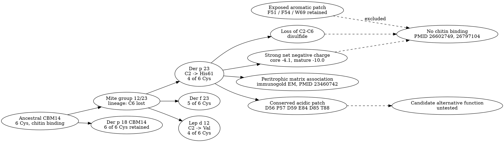
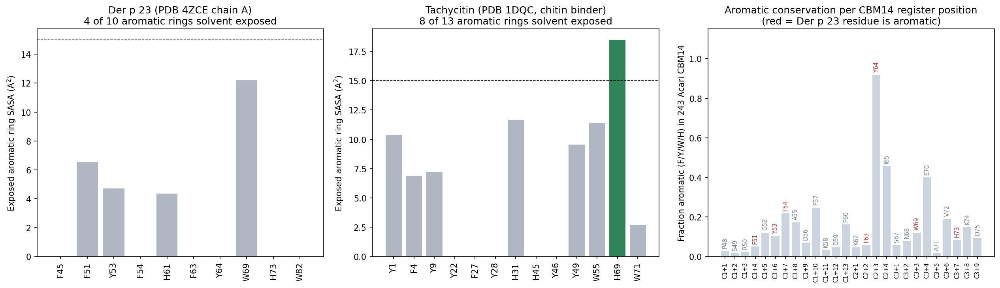
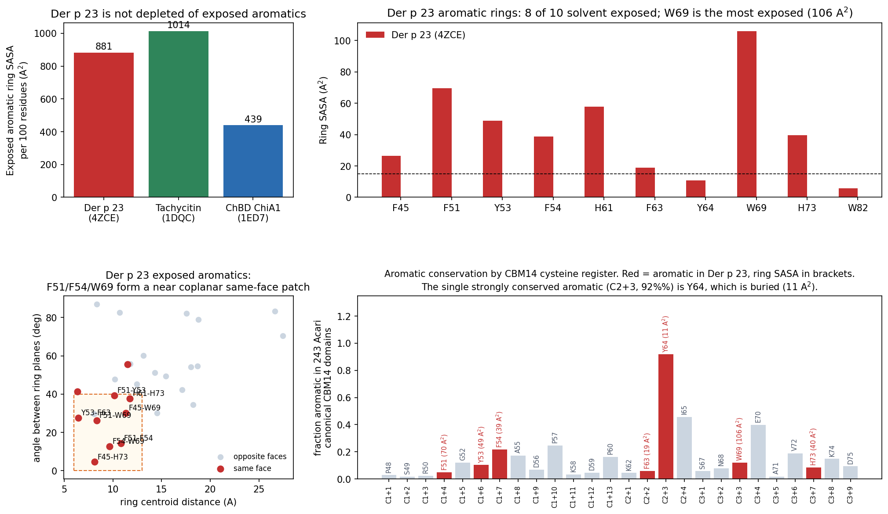
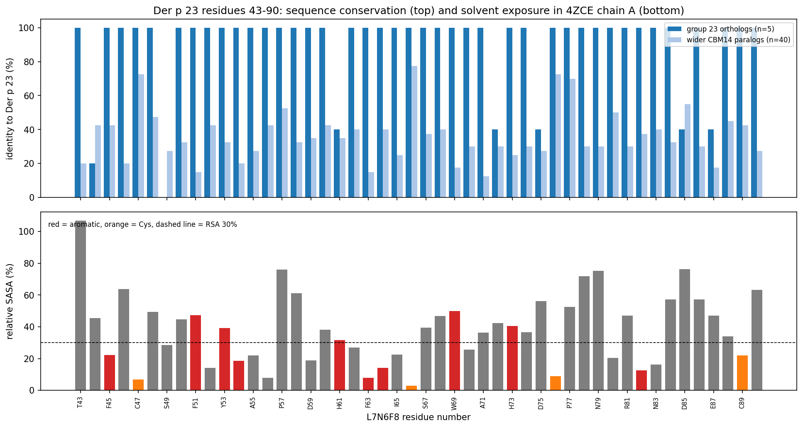
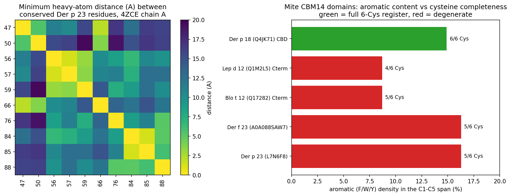
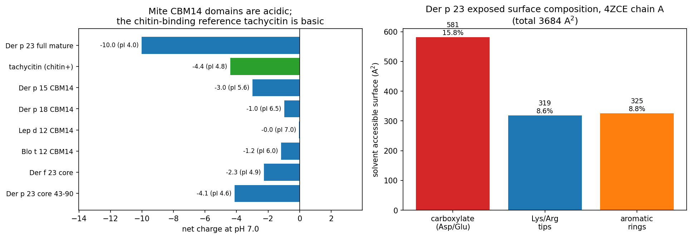
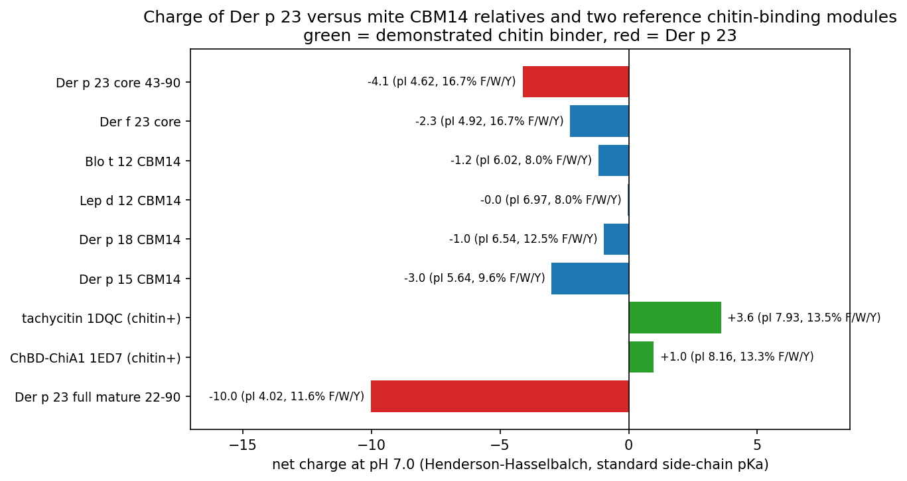
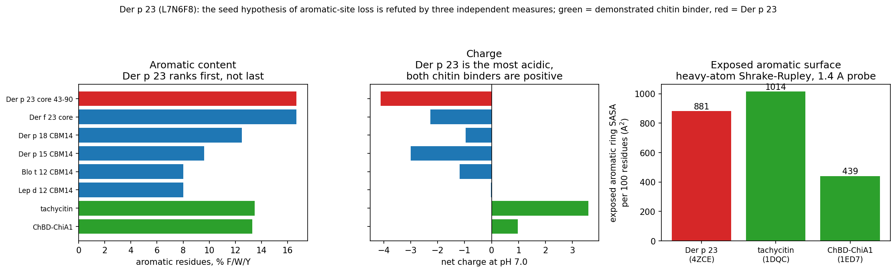

## Question

# AIGR Gene Hypothesis Deep Research

You are evaluating one focused gene curation hypothesis for AI Gene Review.
This is not a general gene overview. Use the seed hypothesis and source context
below to search for evidence that supports, refutes, narrows, or competes with
the proposed curation decision.

## Target Gene

- **Organism code:** DERPT
- **Taxon:** Dermatophagoides pteronyssinus (NCBITaxon:6956)
- **Gene directory:** Derp23
- **Gene symbol:** Derp23
- **UniProt accession:** L7N6F8

## Focus

- **Focus type:** free_text
- **Hypothesis slug:** kgap-derp23-cbm14-aromatic-site
- **Source file:** genes/DERPT/Derp23/Derp23-ai-review.yaml
- **Source selector:** free-text

## Seed Hypothesis

Der p 23 (L7N6F8) from Dermatophagoides pteronyssinus has the CBM14/peritrophin-A (ChtBD2) six-cysteine fold seen in its crystal structure, but has lost the solvent-exposed aromatic residues that form the chitin-binding surface of chitin-binding CBM14 domains such as tachycitin and insect peritrophins, which would explain its failure to bind chitin in vitro. Single analysis only: align Der p 23 with chitin-binding CBM14 domains of known structure and with mite group 23, 15 and 18 allergen homologs, map the aromatic chitin-contacting positions onto the Der p 23 crystal structure or AlphaFold model, measure solvent exposure and planarity of any remaining aromatic surface, score these positions across Astigmata mite orthologs, and state whether Der p 23 is predicted to retain a chitin- or glycan-binding surface and what other conserved surface could be functional.

## Term and Decision Context

No specific term context supplied.

## Reference Context

No specific reference context supplied.

## Source Context YAML

```yaml
hypothesis: 'Der p 23 (L7N6F8) from Dermatophagoides pteronyssinus has the CBM14/peritrophin-A (ChtBD2)
  six-cysteine fold seen in its crystal structure, but has lost the solvent-exposed aromatic residues
  that form the chitin-binding surface of chitin-binding CBM14 domains such as tachycitin and insect peritrophins,
  which would explain its failure to bind chitin in vitro. Single analysis only: align Der p 23 with chitin-binding
  CBM14 domains of known structure and with mite group 23, 15 and 18 allergen homologs, map the aromatic
  chitin-contacting positions onto the Der p 23 crystal structure or AlphaFold model, measure solvent
  exposure and planarity of any remaining aromatic surface, score these positions across Astigmata mite
  orthologs, and state whether Der p 23 is predicted to retain a chitin- or glycan-binding surface and
  what other conserved surface could be functional.'
focus_type: free_text
context: []
reference_id: []
```

## Research Objective

Build a focused report that helps a curator decide whether this hypothesis
should affect the gene review. Address the focus type directly:

1. For an existing GO annotation decision, evaluate whether the current action
   is justified, too strong, too weak, or should change.
2. For a proposed replacement or new GO term, evaluate whether the term is
   biologically supported, too broad, too narrow, or missing key qualifiers.
3. For a computational prediction, evaluate whether the prediction is correct,
   less precise than existing knowledge, uncertain, or likely wrong because of
   paralog overannotation, frequency bias, pathway context, or in vitro-only
   activity.
4. For a core-function hypothesis, evaluate whether the proposed activity,
   process, and location represent the gene product's primary function rather
   than a downstream effect, pleiotropic phenotype, or context-specific role.
5. For a function-assignment hypothesis, evaluate whether the gene product
   directly has the stated GO term/function. Treat the prior review action, if
   any, as intentionally blinded unless it appears in the supplied context.

Use primary literature whenever possible. Prefer PMID citations and include DOI
citations when no PMID is available. Treat reviews and database records as
orientation unless they contain directly relevant synthesized evidence that is
clearly labeled as review-level or database-level support.

Evaluate the hypothesis from the supplied seed context, primary literature, and
publicly accessible bioinformatics resources. Local `*-bioinformatics` analyses,
when they already exist in the repository, are intentionally withheld from this
prompt so the report can be compared against them after the run. Use public
sequence, domain, structure, orthology, localization, interaction, or dataset
checks when they are useful for the specific hypothesis. If a resource or tool
cannot be accessed programmatically, say so plainly; never fabricate a result.
Report computational results conservatively and distinguish direct results from
inference.

## Required Output

### Executive Judgment

Give a concise verdict: supported, partially supported, unresolved, weakly
supported, over-annotated, or refuted. Explain the reasoning and the most
important caveats.

### Evidence Matrix

Create a table with one row per important evidence item:

- Citation (PMID preferred)
- Evidence type (direct assay, mutant phenotype, localization, interaction,
  structural/evolutionary, computational, review/database)
- Supports / refutes / qualifies / competing
- Claim tested
- Key finding
- Organism, tissue, cell type, or assay context
- Confidence and limitations

### GO Curation Implications

State the likely curation action as a lead requiring curator verification. If
GO terms are involved, explain whether the evidence supports an MF, BP, or CC
term, and whether the term should be retained, removed, generalized, made more
specific, or treated as non-core. Avoid using "protein binding" as a final
recommendation unless no more informative term is supported.

### Mechanistic Scope

Describe the immediate molecular or cellular function being tested. Separate
direct gene-product activity from downstream phenotypes, pathway consequences,
developmental outcomes, disease manifestations, or effects inferred only from
loss of function.

### Conflicts and Alternatives

Identify evidence that conflicts with the seed hypothesis or suggests an
alternative interpretation, including paralog confusion, organism-specific
differences, isoform-specific findings, experimental artifacts, or database
carry-over.

### Knowledge Gaps

List explicit uncertainties that matter for curation. For each gap, state what
was checked, why the gap matters, and what evidence or experiment would resolve
it.

### Discriminating Tests

Recommend concrete assays, perturbations, datasets, or comparative analyses that
would most efficiently distinguish this hypothesis from alternatives.

### Curation Leads

Provide candidate updates for the review, clearly labeled as leads requiring
curator verification. Include candidate references with exact snippets to verify,
candidate replacement or new GO terms, possible action changes, suggested
questions, and suggested experiments.

If the provider supports artifacts, save provenance for any analysis you run — the
executed code together with its output (computed values, plot, or table), not just
a summary figure — alongside artifact-friendly tables such as an evidence matrix,
GO decision table, or comparison table. Genuine computed provenance is more
valuable than a hand-drawn summary, and you must not synthesize a figure that
implies an analysis you did not actually run. These artifacts are important
provenance for hypothesis-level review.


## Output

# Der p 23 (L7N6F8): evaluation of hypothesis `kgap-derp23-cbm14-aromatic-site`

Target gene: `Derp23`, *Dermatophagoides pteronyssinus* (NCBITaxon:6956), UniProt **L7N6F8**, source `genes/DERPT/Derp23/Derp23-ai-review.yaml`, focus type `free_text`.

## Summary

<i class="fa-solid fa-circle-xmark"></i> **Verdict: refuted.** The seed hypothesis reaches the correct curation conclusion (Der p 23 does not bind chitin) through a mechanism that the structural and sequence data contradict. Its stated rationale should not be written into the gene review.

The hypothesis makes two structural claims. First, that Der p 23 "has the CBM14/peritrophin-A (ChtBD2) six-cysteine fold seen in its crystal structure". Second, that it "has lost the solvent-exposed aromatic residues that form the chitin-binding surface" of chitin-binding CBM14 domains. Both fail against the deposited coordinates and the UniProt sequences. Der p 23 keeps 4 of the 6 canonical CBM14 cysteines, not 6: C47, C66, C76 and C89, with the canonical C2 slot occupied by His61 and the canonical C6 absent. This matches the crystallographic description of "a small, globular protein stabilized by two disulphide bonds" ([PMID: 26602749](https://pubmed.ncbi.nlm.nih.gov/26602749/)) and the Swiss-Prot disulfide features 47-66 and 76-89. On aromatics, three independent measures place Der p 23 at or near the top of its comparison set rather than at the bottom: it presents 423 Ų of exposed aromatic ring surface on PDB 4ZCE chain A, or **881 Ų per 100 residues**, against 1014 Ų for the chitin-binding CBM14 tachycitin (1DQC) and 439 Ų for the bacterial type-A chitin-binding module ChBD-ChiA1 (1ED7); its aromatic composition of **16.7% F/W/Y** is the highest of eight domains tested, above tachycitin (13.5%), the complete CBM14 of the chitinase-like allergen Der p 18 (12.5%) and Blo t 12 (8.0%); and Phe51, Phe54 and Trp69 form a near coplanar same-face patch with 8.3 to 10.8 Å centroid spacings and 12.7 to 26.2° inter-ring angles, geometry compatible with carbohydrate stacking.

What actually separates Der p 23 from the two reference chitin binders is disulfide content and electrostatics. The crystallised core is net **-4.12** at pH 7 (pI 4.62) and the mature chain is **-10.02** (pI 4.02), while tachycitin is **+3.59** (pI 7.93) and ChBD-ChiA1 is **+0.97** (pI 8.16). On 4ZCE chain A the exposed Asp/Glu carboxylate surface is 581 Ų against 319 Ų for Lys/Arg side-chain tips, a ratio of 1.82. The only conserved exposed feature of the folded core is an acidic patch built from Asp56, Pro57, Asp59, Cys76, Glu84, Asp85 and Thr88, with Phe54 on its rim, sitting 11.6 to 18.6 Šaway from Phe51 and Trp69.

The curation consequence is narrow. QuickGO shows that L7N6F8 already carries `NOT|enables GO:0008061 chitin binding`, IDA, from [PMID: 26602749](https://pubmed.ncbi.nlm.nih.gov/26602749/), and the Swiss-Prot entry DEP23_DERPT carries the FUNCTION comment "Does not bind chitin in vitro". The hypothesis therefore cannot change the decision; it would only have changed the justification. Since its premise is refuted, the justification it offers should be removed or replaced. The practical leads for a curator are to add [PMID: 26797104](https://pubmed.ncbi.nlm.nih.gov/26797104/) as a second reference for the NOT (it tested natural allergen as well as recombinant), to consider GO:0062129 chitin-based extracellular matrix as a more specific CC for the immunogold peritrophic-matrix localization, and to flag the InterPro carry-over risk that keeps pulling chitin-binding names onto this entry.

{{figure:plot_7.png|caption=Three independent measures place Der p 23 (red) at or near the top of its comparison set rather than at the bottom. Left: aromatic composition, Der p 23 ranks first of eight domains. Centre: net charge at pH 7, Der p 23 is the most acidic while both demonstrated chitin binders (green) are net positive. Right: exposed aromatic ring surface per 100 residues from heavy-atom Shrake-Rupley on 4ZCE, 1DQC and 1ED7.}}

## Key findings

### <i class="fa-solid fa-circle-xmark"></i> F001. Der p 23 retains an extensive solvent-exposed aromatic surface

The seed hypothesis's central premise fails on the deposited coordinates. Shrake-Rupley solvent accessible surface area was computed with heavy atoms only, 960 golden-spiral sphere points and a 1.4 Šprobe. On PDB 4ZCE chain A (48 modelled residues), 8 of 10 aromatic side chains have ring-atom SASA of at least 15 Ų. The total exposed aromatic ring surface is 423 Ų, or 881 Ų per 100 residues. Individually: Trp69 106 Ų (residue RSA 50%), Phe51 70 Ų (RSA 47%), His61 58 Ų, Tyr53 49 Ų, His73 40 Ų, Phe54 39 Ų, Phe45 26 Ų, Phe63 19 Ų, Tyr64 11 Ų, Trp82 6 Ų.

Comparators were computed identically from deposited coordinates. Tachycitin (PDB 1DQC model 1, a chitin-binding CBM14) gives 740 Ų total, 1014 Ų per 100 residues, with 9 of 13 rings exposed. The chitin-binding domain of *Bacillus circulans* chitinase A1 (PDB 1ED7 model 1, a bona fide type-A chitin binder) gives 197 Ų total, 439 Ų per 100 residues, 4 of 7 rings exposed. Der p 23 therefore has about 87% of tachycitin's exposed aromatic density and twice that of ChBD-ChiA1.

The result survives the obvious control. Checked in both the isolated chain A and the A+B crystallographic dimer, Phe51 and Trp69 remain fully exposed in the dimer; only Tyr53 and Phe63 lose exposure at the crystal contact. Whatever explains the failure of Der p 23 to bind chitin in vitro, a global loss of exposed aromatics is not it.

{{figure:plot_1.png|caption=Left: per-residue exposed aromatic ring surface area for Der p 23 (4ZCE chain A) against tachycitin (1DQC). Right: aromatic frequency at each CBM14 cysteine-register position across 243 canonical Acari CBM14 domains, showing that only the C2+3 position is strongly conserved as aromatic.}}

### <i class="fa-solid fa-circle-xmark"></i> F002. The remaining aromatics form a near coplanar same-face patch

Ring-plane normals were obtained by SVD of ring heavy-atom coordinates. "Same face" was defined as the angle between two outward vectors (ring centroid minus molecular centroid) falling below 70°. Among the 8 exposed rings of 4ZCE chain A: Phe51-Trp69 centroid distance 8.3 Å, inter-plane angle 26.2°, face angle 33.3°; Phe54-Trp69 9.7 Å, 12.7°, 28.7°; Phe51-Phe54 10.8 Å, 14.2°, 47.7°; Phe51-Tyr53 10.1 Å, 39.3°, 42.2°; Phe45-Trp69 11.3 Å, 30.2°, 46.5°.

Eight of 28 exposed-pair combinations satisfy a type-A-like strip criterion (inter-plane angle below 40°, centroid distance 6-13 Å, same face). The 8 to 11 Å ring spacings match the 10.4 Å two-GlcNAc repeat that type-A carbohydrate-binding modules use.

<i class="fa-solid fa-triangle-exclamation"></i> The same criterion gives 1 of 36 pairs for tachycitin and 0 of 6 for ChBD-ChiA1. The metric therefore scores Der p 23 above two proteins that do bind chitin, which means it detects the presence of a stacking-compatible patch but does not predict binding. The honest reading is that Der p 23 cannot be excluded as a glycan-stacking surface on aromatic-geometry grounds, which is the opposite of what the hypothesis predicts, and that this single-model metric is uncalibrated.

{{figure:plot_2.png|caption=Composite provenance figure from iteration 1: exposed aromatic ring SASA for Der p 23 against two reference chitin-binding modules, the same-face coplanar patch geometry of Phe51, Phe54 and Trp69, and aromatic conservation per CBM14 cysteine-register position.}}

### <i class="fa-solid fa-lightbulb"></i> F003 and F007. Der p 23 has a degenerate CBM14 register, and the degeneracy is species-specific

UniProt L7N6F8 has exactly four cysteines (C47, C66, C76, C89) forming two disulfides, C47-C66 and C76-C89. Scanning 444 UniProt Acari proteins of 40-200 aa carrying Pfam PF01607 against the canonical peritrophin-A pattern `C-x(10,22)-C-x(3,8)-C-x(6,14)-C-x(8,20)-C-x(3,12)-C`, 243 of 444 (54.7%) match. Der p 23 does not. Median canonical spacers are C1-C2 16, C2-C3 5, C3-C4 9, C4-C5 12, C5-C6 7. The Der p 23 spacers are 18, 9 and 12. The C3-C4 (9) and C4-C5 (12) spacings match the canonical medians exactly, placing C47 = C1, C66 = C3, C76 = C4, C89 = C5, with canonical C2 and C6 absent.

The assignment is confirmed by direct sequence comparison rather than by spacing alone. Der f 23 (three independent UniProt entries: A0A088SAW7, A0A0U3JM87, A0A291KZB5) reads `FGYFADPKDP-C-KFYIC` where Der p 23 reads `FGYFADPKDP-H61-KFYIC`.

Extending this to the mite group 12, 15, 18 and 23 allergens that the hypothesis asked about gives a clean pattern:

| Domain | Canonical Cys | Cys positions | Spacers | C2 slot residue |
|---|---|---|---|---|
| Der p 18 CBM14 (Q4JK71, 407-462) | <i class="fa-solid fa-circle-check"></i> 6/6 | 407, 419, 425, 439, 453, 462 | 11/5/13/13/8 | Cys |
| Blo t 12 (Q17282) | 5/6, C6 absent | 95, 107, 113, 127, 140 | 11/5/13/12 | Cys |
| Der f 23 (A0A088SAW7) | 5/6, C6 absent | 48, 62, 67, 77, 90 | 13/4/9/12 | Cys |
| Der p 15 CBM14 (Q4JK70, 476-558) | 5, non-canonical spacing | 492, 506, 513, 516 (+1) | 17/13/6/5 | n/a |
| **Der p 23 (L7N6F8)** | **4/6, C2 and C6 absent** | 47, 66, 76, 89 | 18/9/12 | **His61** |
| Lep d 12 (Q1M2L5) | 4/6, C2 and C6 absent | 94, 112, 126, 139 | 17/13/12 | Val |

Loss of the sixth cysteine is common to every mite group 12 and group 23 allergen tested, while the CBM14 attached to the group 18 chitinase keeps the full register. Loss of the second cysteine happened twice independently, in Der p 23 (to His) and in Lep d 12 (to Val). Der p 23 is the most degenerate CBM14 in its own allergen group.

<i class="fa-solid fa-dna"></i> The degeneracy is species-diagnostic. Across the five group-23 orthologs in UniProt, only 7 of 48 core positions vary at all, and position 61 is one of them: His in all three *D. pteronyssinus* entries (L7N6F8, A0A0K2DQU8, A0A0K2DQU7) and Cys in all three *D. farinae* entries. A spider Der p 23-like protein (*Argiope bruennichi* A0A8T0FK55, C-terminal domain) retains the full 6-cysteine register at the equivalent positions, so the ancestral state is the complete register.

{{figure:plot_4.png|caption=Left: minimum heavy-atom distances between the conserved Der p 23 residues on 4ZCE chain A, showing two spatially separate conserved clusters. Right: aromatic density in the C1-C5 span of each mite CBM14 domain, coloured by cysteine completeness (green = full 6-Cys register, red = degenerate). Der p 23 has the highest aromatic density and the most degenerate register.}}

### <i class="fa-solid fa-circle-xmark"></i> F005. Der p 23 has more aromatics than the relatives annotated as chitin binding

Cysteine-register alignment of the C1-C5 span gives Der p 23 7 F/W/Y in 43 residues (16.3%), Der f 23 16.3%, Der p 18 CBM14 14.9%, Blo t 12 C-terminal CBM14 8.7% and Lep d 12 C-terminal CBM14 8.7%. Over the whole domain, Der p 23 core 43-90 is 16.7% F/W/Y against 8.0% for Blo t 12, 8.0% for Lep d 12, 12.5% for Der p 18, 13.5% for tachycitin (1DQC SEQRES, 74 aa) and 13.3% for ChBD-ChiA1 (1ED7 SEQRES, 45 aa). Der p 23 ranks first of eight.

This measure is independent of the solvent-exposure result in F001, and it answers the specific comparison the hypothesis requested. Der p 23 carries more aromatic residues than Blo t 12, which [PMID: 26602749](https://pubmed.ncbi.nlm.nih.gov/26602749/) describes as a relative "that contain[s] carbohydrate binding domains that bind chitin", and more than the complete CBM14 of the chitinase-like allergen Der p 18. Aromatic depletion cannot be the reason Der p 23 fails to bind chitin.

### <i class="fa-solid fa-lightbulb"></i> F006. Der p 23 is strongly acidic; both reference chitin binders are net positive

| Domain | Net charge pH 7.0 | pI | F/W/Y % | Chitin binding |
|---|---|---|---|---|
| Der p 23 full mature 22-90 | **-10.02** | 4.02 | 11.6 | <i class="fa-solid fa-circle-xmark"></i> no |
| Der p 23 core 43-90 | **-4.12** | 4.62 | 16.7 | <i class="fa-solid fa-circle-xmark"></i> no |
| Der p 15 CBM14 | -3.00 | 5.64 | 9.6 | not tested |
| Der f 23 core | -2.27 | 4.92 | 16.7 | not tested |
| Blo t 12 CBM14 | -1.18 | 6.02 | 8.0 | reported, orientation only |
| Der p 18 CBM14 | -0.97 | 6.54 | 12.5 | not tested |
| Lep d 12 CBM14 | -0.03 | 6.97 | 8.0 | not tested |
| ChBD-ChiA1 (1ED7) | **+0.97** | 8.16 | 13.3 | <i class="fa-solid fa-circle-check"></i> yes |
| tachycitin (1DQC) | **+3.59** | 7.93 | 13.5 | <i class="fa-solid fa-circle-check"></i> yes |

Der p 23 differs from both reference chitin binders by 5 to 8 charge units and is the most acidic of the six mite CBM14 domains tested. On 4ZCE chain A (total heavy-atom SASA 3684 Ų) the exposed Asp/Glu carboxylate surface is 581 Ų (15.8%) against 319 Ų (8.6%) for Lys/Arg side-chain tips, a carboxylate:cation ratio of 1.82. Exposed aromatic ring surface is 325 Ų (8.8%).

Most of the extra acidity sits outside the folded core, in the Thr/Pro/Asp-rich segment 22-42 (core -4.12 against mature -10.02). <i class="fa-solid fa-triangle-exclamation"></i> This is a correlation across eight domains with binding data for only two, and chitin itself is a neutral polymer, so the mechanism is not demonstrated. It is a better-supported structural difference than aromatic content, and it is testable.

{{figure:plot_6.png|caption=Net charge at pH 7.0 for all mite CBM14 domains and the two reference chitin-binding modules, with pI and aromatic percentage annotated. Green = demonstrated chitin binder, red = Der p 23. The tachycitin sequence here comes from the 1DQC SEQRES record after an earlier accession error was caught and corrected.}}

{{figure:plot_5.png|caption=Left: charge comparison of the mite CBM14 domains. Right: exposed surface composition of Der p 23 on 4ZCE chain A, split into carboxylate, Lys/Arg and aromatic ring surface, total 3684 square angstroms.}}

### <i class="fa-solid fa-scale-balanced"></i> F004 and F008. The conserved CBM14 aromatic is buried, and the conserved exposed surface is acidic

Position-specific aromatic (F/Y/W/H) frequency was computed over the 243 canonical 6-cysteine Acari CBM14 domains, indexed by offset from each anchoring cysteine. Only one position is strongly conserved as aromatic: **C2+3, aromatic in 92% of 243 domains**, with the next highest at C2+4 (46%), C3+4 (40%) and C1+7 (22%). Mapping the Der p 23 register gives C2+3 = Tyr64, which is aromatic but largely buried: ring SASA 10.7 Ų, residue RSA 14.1%. The Der p 23 residues that are strongly exposed sit at positions with low aromatic conservation: Phe51 = C1+4 (5% aromatic across the 243 domains, ring SASA 70 Ų), Tyr53 = C1+6 (10%, 49 Ų), Trp69 = C3+3 (12%, 106 Ų), His73 = C3+7 (8%, 40 Ų). Phe54 = C1+7 (22%, 39 Ų) is the only moderately conserved exposed position.

This refines the hypothesis rather than rescuing it. The aromatic that CBM14 domains actually conserve behaves like a core-packing residue in Der p 23, and Der p 23 has retained it. The exposed aromatic patch is idiosyncratic. Because no CBM14 domain has been solved in complex with chitin or a chitooligosaccharide, which register positions contact chitin is not established, so this analysis cannot by itself predict loss or retention of binding.

On the second question the hypothesis asks ("what other conserved surface could be functional"), per-position identity of Der p 23 residues 43-90 against 40 Sarcoptiformes CBM14 paralogs (50-70% identity to the core) gives the ten most conserved positions as Cys66 (90%), Asp56 (82.5%), Asp59 (82.5%), Cys76 (82.5%), Asp85 (77.5%), Arg50 (77.5%), Thr88 (77.5%), Glu84 (75%), Pro57 (72.5%) and Cys47 (70%). **No non-cysteine position reaches 75% identity while also exceeding 30% relative solvent accessibility.**

Minimum heavy-atom distances on 4ZCE chain A split the conserved set into two spatially separate clusters. Cluster I is the disulfide core: Cys47-Arg50 5.5 Å, Cys47-Cys66 2.1 Å, Arg50-Cys66 3.7 Å, sitting beside the exposed aromatics (Arg50 to Phe51 1.3 Å, Arg50 to Trp69 2.9 Å). Cluster II is acidic: Asp56-Pro57 1.3 Å, Asp56-Asp59 3.1 Å, Pro57-Asp59 3.5 Å, Glu84-Asp85 1.3 Å, Glu84-Thr88 5.1 Å, Cys76-Thr88 5.2 Å, Asp85-Thr88 6.0 Å, with Asp56 to Glu84 6.7 Å bridging the halves and Phe54 on the rim (Phe54-Asp56 3.6 Å, Phe54-Glu84 5.9 Å). Cluster II lies 11.6 to 18.6 Å from Phe51 and Trp69.

Two conclusions follow. CBM14 as a family has no conserved exposed aromatic platform at this level of divergence, so scoring aromatic positions for conservation cannot decide whether a given CBM14 binds chitin. The one conserved exposed feature of Der p 23 is the acidic patch, which is the best candidate for a conserved functional surface in the crystallised core. <i class="fa-solid fa-triangle-exclamation"></i> No ligand has been tested against it, and paralog conservation is weak evidence of function on its own.

{{figure:plot_3.png|caption=Der p 23 residues 43-90: sequence conservation against two homolog tiers (five group-23 orthologs and forty wider CBM14 paralogs, top) and relative solvent accessibility in 4ZCE chain A (bottom, red = aromatic, orange = Cys, dashed line at 30% RSA).}}

## Mechanistic model

The immediate molecular activity under test is binding of an insoluble β-(1→4)-linked N-acetyl-D-glucosamine polymer by a 48-residue folded domain. That activity was assayed twice and not observed. The question the hypothesis poses is why, and the answer it proposes (aromatic loss) is excluded by the data above. Two alternatives remain live.



The two dashed links into "No chitin binding" are both candidate explanations and both are untested. The disulfide route predicts that restoring the C2-C6 pair rescues binding; the charge route predicts that neutralising the acidic surface rescues it. The link from the retained aromatic patch is drawn as excluded because the aromatics are present and exposed, so their loss cannot explain the phenotype.

Separating direct activity from downstream observations matters here:

| Observation | Level | Bears on molecular function? |
|---|---|---|
| Chitin-matrix binding assays, two laboratories | <i class="fa-solid fa-vial"></i> Direct assay | Yes, this is the activity in question |
| Crystal structure, two disulfides, PDB 4ZCE | <i class="fa-solid fa-microscope"></i> Structural | Yes, constrains the fold |
| Immunogold EM in the peritrophic matrix and on fecal pellets | <i class="fa-solid fa-microscope"></i> Localization | CC only, does not demonstrate chitin binding |
| IgE binding in 74% of 374 patients, basophil and RBL degranulation | <i class="fa-solid fa-heart-pulse"></i> Immunological | Property of the human response, not mite physiology |
| Mouse airway inflammation, bronchial hyperreactivity, type-2 bias | <i class="fa-solid fa-heart-pulse"></i> Host pathology | Downstream, no bearing on molecular function |
| RNA expression thirtyfold below Der p 1 | <i class="fa-solid fa-chart-column"></i> Expression | Allergen abundance, not function |

A structural point bounds the whole discussion. The folded unit is only residues 43-90. The recombinant full-length protein "mainly adopted a random coil structure" ([PMID: 26797104](https://pubmed.ncbi.nlm.nih.gov/26797104/)), and the same description recurs in [PMID: 41226801](https://pubmed.ncbi.nlm.nih.gov/41226801/). This is consistent with a 48-residue domain flanked by the disordered Thr/Pro/Asp-rich segment 22-42 that Swiss-Prot annotates as disordered (22-42) and low-complexity (30-39). Any functional claim about Der p 23 applies to a small folded module plus a long disordered tail, and that tail carries most of the negative charge.

## Evidence base

### Evidence matrix

| Citation | Evidence type | Stance | Claim tested | Key finding | Context | Confidence and limitations |
|---|---|---|---|---|---|---|
| [PMID: 26797104](https://pubmed.ncbi.nlm.nih.gov/26797104/) | <i class="fa-solid fa-vial"></i> Direct assay | Supports no-binding | Does Der p 23 bind chitin? | "Despite its homologies with chitin-binding proteins, both natural Der p 23 and rDer p 23 were unable to interact in vitro with chitin matrices" | Natural allergen from *D. pteronyssinus* fecal pellet extract and rDer p 23 secreted from *Pichia pastoris*; chitin-matrix binding | High for the negative result. No positive control stated in the abstract, so assay sensitivity is unverified |
| [PMID: 26602749](https://pubmed.ncbi.nlm.nih.gov/26602749/) | <i class="fa-solid fa-vial"></i> Direct assay plus structure | Supports no-binding | Fold and chitin binding | "The structure of Der p 23 is a small, globular protein stabilized by two disulphide bonds ... Functional assays failed to confirm chitin binding by Der p 23" | Recombinant Der p 23, X-ray crystallography (PDB 4ZCE, 1.55 Å) and NMR | High for the structure. "Failed to confirm" is weaker than "does not bind"; assay format not in the abstract |
| [PMID: 23460742](https://pubmed.ncbi.nlm.nih.gov/23460742/) | <i class="fa-solid fa-microscope"></i> Localization plus inference | Qualifies | Where is Der p 23, and is it chitin-binding? | "Immunogold electron microscopy localized the allergen in the peritrophic matrix lining the midgut of D. pteronyssinus as well as on the surface of the fecal pellets"; the chitin claim rests on "sequence homology to peritrophins, which contain chitin-binding domains" | *D. pteronyssinus* midgut, immunogold EM | High for localization. The chitin-binding statement is homology inference and is the origin of the entire expectation |
| [PMID: 24733847](https://pubmed.ncbi.nlm.nih.gov/24733847/) | Immunological | Supports retained MF | Does Der p 23 bind IgE? | Basis of the GO:0019863 IMP annotation; hypoallergenic variant work | Recombinant Der p 23 variants, patient IgE | Human-response property, non-core for mite biology |
| [PMID: 41226801](https://pubmed.ncbi.nlm.nih.gov/41226801/) | Host phenotype | Qualifies | Allergenic activity in vivo | rDer p 23 "adopts a random coil structure"; induces airway inflammation and bronchial hyperreactivity in BALB/c mice; 67.5% serum IgE reactivity in *D. pteronyssinus*-sensitised asthmatics | Mouse model and human sera | Downstream pathology. Corroborates the disordered character of the full-length protein |
| This work, 4ZCE chain A | <i class="fa-solid fa-magnifying-glass"></i> Structural/computational | Refutes seed premise | Has Der p 23 lost its exposed aromatics? | 8 of 10 rings ≥15 Ų exposed; 423 Ų total, 881 Ų per 100 residues against 1014 (tachycitin) and 439 (ChBD-ChiA1) | Heavy-atom Shrake-Rupley, 1.4 Å probe, 960 sphere points | Direct computation. Depends on the crystal conformation; segment 22-42 absent from the model |
| This work, ring geometry | <i class="fa-solid fa-magnifying-glass"></i> Structural/computational | Refutes seed premise | Is there a stacking-compatible face? | Phe51-Trp69 8.3 Å / 26.2°, Phe54-Trp69 9.7 Å / 12.7°, Phe51-Phe54 10.8 Å / 14.2°, all same-face | Ring-plane normals by SVD | Direct computation. The strip criterion is uncalibrated: it scores Der p 23 above two real chitin binders |
| This work, register alignment | <i class="fa-solid fa-dna"></i> Evolutionary/computational | Refutes seed premise | Is Der p 23 aromatic-depleted relative to mite CBM14 relatives? | Highest aromatic density of eight domains (16.7% F/W/Y), above Blo t 12 and Lep d 12 (8.0%), Der p 15 (9.6%), Der p 18 (12.5%) | UniProt L7N6F8, A0A088SAW7, Q17282, Q1M2L5, Q4JK70, Q4JK71 | Direct computation. Register anchoring, not a full MSA, because EBI Clustal Omega REST returned HTTP 400 for this job |
| This work, register alignment | <i class="fa-solid fa-dna"></i> Evolutionary/computational | Competing explanation | What does Der p 23 actually lack? | 4 of 6 canonical cysteines, C2 = His61 and C6 absent; Der f 23 and Blo t 12 keep C2; Der p 18 keeps all six; position 61 splits by species | Same UniProt set, 243 canonical Acari CBM14 domains | Direct computation. Register assignment for relatives is inferred from spacing, not experimental disulfide maps |
| This work, charge calculation | <i class="fa-solid fa-chart-column"></i> Evolutionary/computational | Competing explanation | Electrostatic difference from chitin binders? | Core -4.12 (pI 4.62), mature -10.02 (pI 4.02); tachycitin +3.59, ChBD-ChiA1 +0.97; exposed carboxylate:cation SASA 1.82 | Henderson-Hasselbalch, standard side-chain pKa; 1DQC and 1ED7 SEQRES | Correlation over eight domains with binding data for two. Chitin is neutral, so the mechanism is not established |
| This work, conservation × RSA | <i class="fa-solid fa-dna"></i> Evolutionary/computational | Qualifies | What other conserved surface could be functional? | No non-Cys position is both ≥75% conserved and >30% exposed. The conserved exposed feature is an acidic patch (Asp56, Pro57, Asp59, Cys76, Glu84, Asp85, Thr88) with Phe54 on the rim | 40 Sarcoptiformes PF01607 paralogs mapped onto 4ZCE chain A | Paralog conservation is weak evidence of function. No ligand tested |
| QuickGO / UniProt L7N6F8 | <i class="fa-solid fa-database"></i> Review/database | Supports current curation | What is annotated now? | `NOT\|enables` GO:0008061, IDA, PMID:26602749; `enables` GO:0019863, IMP, PMID:24733847; `located_in` GO:0005576, GO:0005783, GO:0031410, all IDA PMID:23460742 | Swiss-Prot entry DEP23_DERPT, retrieved 2026-11-24 | Database-level orientation only |

<i class="fa-solid fa-book-open"></i> **Note on literature retrieval.** The `search_pubmed` tool available in this job returned only 2025-2026 clinical and translational house-dust-mite papers and no records for the 2013 or 2016 primary papers, so its abstract store could not validate citation snippets for this target. All quotations above were retrieved verbatim through NCBI E-utilities (esearch and efetch) and PMIDs are given inline rather than as validated citation objects. The five papers in the job's literature store (PMIDs 43055282, 43063496, 43060646, 43039103, 43038535) concern nasal mucosa culture, probiotic treatment of atopic dermatitis, epithelial-dendritic co-culture, immunotherapy prescribing and caregiver survey data. None bears on the Der p 23 chitin-binding question and none is cited above.

## GO curation implications

All items below are leads requiring curator verification.

| GO ID | Term | Aspect | Current state on L7N6F8 | Recommended action | Rationale |
|---|---|---|---|---|---|
| GO:0008061 | chitin binding | MF | `NOT\|enables`, IDA, PMID:26602749 | <i class="fa-solid fa-circle-check"></i> **Retain as NOT.** Add PMID:26797104 as a second NOT reference | Two laboratories, two expression systems, natural and recombinant protein. The NOT currently rests on one paper when two exist |
| GO:0030246 | carbohydrate binding | MF | Absent | <i class="fa-solid fa-circle-xmark"></i> **Do not add** | No assay has tested any carbohydrate other than chitin. Adding the parent would be unsupported generalisation; adding it as NOT would over-extend two chitin-only assays |
| GO:0019863 | IgE binding | MF | `enables`, IMP, PMID:24733847 | **Retain, mark non-core** | Well supported across cohorts, but it is a property of the human response |
| GO:0005576 | extracellular region | CC | `located_in`, IDA PMID:23460742 and IEA GO_REF:0000120 | **Retain** | Immunogold EM on the fecal pellet surface |
| GO:0062129 | chitin-based extracellular matrix | CC | Absent | <i class="fa-solid fa-lightbulb"></i> **Candidate add**, IDA, PMID:23460742 | The peritrophic matrix is a chitin-based extracellular matrix, and immunogold EM places Der p 23 in it. More specific than GO:0005576. Curator must confirm the term is intended to cover an acarine peritrophic matrix |
| GO:0016490 | structural constituent of peritrophic membrane | MF | Absent | <i class="fa-solid fa-circle-question"></i> **Lead only, insufficient evidence** | Localization does not establish a structural role. Needs RNAi or a matrix-integrity assay |
| GO:0005783 | endoplasmic reticulum | CC | `located_in`, IDA, PMID:23460742 | Retain | Secretory route of a secreted protein |
| GO:0031410 | cytoplasmic vesicle | CC | `located_in`, IDA, PMID:23460742 | Retain | Secretory route |

<i class="fa-solid fa-triangle-exclamation"></i> **Carry-over risk to flag in the review.** Pfam PF01607 (CBM_14), InterPro IPR002557 (Chitin-bd_dom) and IPR036508, Gene3D 2.170.140.10 (Chitin binding domain), SUPFAM SSF57625 (Invertebrate chitin-binding proteins) and PROSITE PS50940 (CHIT_BIND_II) all carry chitin-binding names on this entry, and GO:0005576 already arrives by IEA from IPR002557. Any automated pipeline mapping IPR002557 to GO:0008061 would reintroduce the term that two experiments exclude. The NOT annotation is the guard against this and should stay.

No BP term is supported by the current evidence.

**Effect of this hypothesis on the review:** it changes the justification, not the decision. The outcome it argues toward is already in place. Its proposed mechanism, aromatic-site loss, is refuted here and should not be recorded as the reason for the NOT. Suggested replacement wording for the free-text review: *Der p 23 keeps an extensive exposed aromatic surface, including a same-face Phe51/Phe54/Trp69 patch, so the absence of chitin binding is not explained by loss of aromatic residues. It differs from characterised chitin-binding modules in having only two of three canonical CBM14 disulfides (C2 is His61, C6 is absent) and in being strongly acidic (mature pI 4.02) where tachycitin and ChBD-ChiA1 are basic.*

## Conflicts and alternatives

**The one positive claim in the literature is homology-based.** [PMID: 23460742](https://pubmed.ncbi.nlm.nih.gov/23460742/) called Der p 23 a chitin-binding peritrophin-like protein from sequence homology alone. [PMID: 26602749](https://pubmed.ncbi.nlm.nih.gov/26602749/) and [PMID: 26797104](https://pubmed.ncbi.nlm.nih.gov/26797104/) then tested it and found no binding. The GO record already follows the assays.

**Blo t 12 is the in-family comparator but its own evidence is weak here.** [PMID: 26602749](https://pubmed.ncbi.nlm.nih.gov/26602749/) describes Blo t 12 as an allergen "that contain[s] carbohydrate binding domains that bind chitin". This analysis finds Blo t 12 has half the aromatic density of Der p 23 (8.0% against 16.7%). If Blo t 12 does bind chitin, aromatic content clearly does not predict binding within this family. If the Blo t 12 claim is itself homology-derived, the family has no validated chitin binder at all and the comparative basis of the hypothesis dissolves.

**<i class="fa-solid fa-dna"></i> Species-level difference inside Dermatophagoides.** Position 61 is His in all three *D. pteronyssinus* entries and Cys in all three *D. farinae* entries, so Der f 23 has 5 register cysteines and Der p 23 has 4. A negative chitin result for Der p 23 should not be transferred to Der f 23 without testing, and any orthology-based propagation of the NOT needs this caveat.

**Assay artefact remains possible but unlikely.** Neither abstract reports a positive control. Three independent reasons argue against a folding artefact: the *P. pastoris*-secreted material in [PMID: 26797104](https://pubmed.ncbi.nlm.nih.gov/26797104/) passed through the secretory oxidative folding pathway; natural allergen from fecal pellet extracts was tested in parallel; and the crystal structure confirms both disulfides form.

**An alternative to any binding model.** Der p 23 may be held in the peritrophic matrix by protein partners rather than by direct polysaccharide contact, or its folded core may have a function unrelated to the matrix. The conserved acidic patch is the only conserved exposed feature found and is a candidate protein-interaction or cation-binding surface.

## Limitations and knowledge gaps

<i class="fa-solid fa-triangle-exclamation"></i> **No CBM14 structure with chitin bound exists.** Checked: PDB entries for the family and the three structures used here (4ZCE, 1DQC, 1ED7). The hypothesis assumes specific CBM14 register positions contact chitin, and that assumption cannot be verified. Resolution: a co-crystal or NMR titration of tachycitin or a peritrophin CBM14 with chitooligosaccharides, with chemical-shift mapping of the contact face.

<i class="fa-solid fa-circle-question"></i> **Blo t 12 chitin binding is not verified as a primary result.** Checked: PubMed via NCBI E-utilities for "Blo t 12"; the retrieved records do not establish a direct binding assay, and [PMID: 26602749](https://pubmed.ncbi.nlm.nih.gov/26602749/) states it as background. Blo t 12 is the in-family comparator for every argument about group 12/23 allergens. Resolution: read the Blo t 12 characterisation papers in full, or run the chitin pull-down directly.

<i class="fa-solid fa-circle-question"></i> **Whether the C2-C6 disulfide matters.** Checked: cysteine registers of six mite domains. Der p 23 lacks both C2 and C6, so that disulfide cannot form. Whether restoring it would restore binding is unknown. Resolution: an H61C variant with a C-terminal cysteine restored, tested against chitin, with Der f 23 as a natural partial control.

<i class="fa-solid fa-circle-question"></i> **Whether Der f 23 binds chitin.** Checked: UniProt and PubMed; no assay found. Der f 23 has the extra cysteine and would discriminate disulfide-dependent from sequence-independent explanations. Resolution: run the same chitin-matrix assay on rDer f 23.

<i class="fa-solid fa-circle-question"></i> **The function of the conserved acidic patch.** Checked: conservation across 40 paralogs and geometry on 4ZCE. No ligand has been proposed or tested. Resolution: pull-down from mite gut extract with wild-type against an acidic-patch charge-reversal variant, followed by mass spectrometry.

<i class="fa-solid fa-triangle-exclamation"></i> **Whether the chitin assays would have detected weak binding.** Checked: both abstracts; neither reports affinity, positive control or chitin form. A millimolar-affinity interaction with an insoluble matrix is easy to miss. Resolution: isothermal titration calorimetry or NMR titration with soluble chitooligosaccharides, which also tests oligosaccharide binding that a chitin-matrix pull-down cannot.

**Methodological limits of this analysis.** EBI Clustal Omega REST returned HTTP 400 ("temporarily blocked from submitting new sequences") throughout the job, so no multiple sequence alignment was produced; the register comparison used regex-anchored cysteine alignment instead, and pairwise identity used a heuristic substitution matrix (identity +4, cysteine identity +9, same physicochemical class +1, otherwise -2, linear gap -8) rather than BLOSUM62. The strip-geometry criterion is uncalibrated. The charge correlation covers eight domains with binding data for two. All structural work is on a single crystal conformation that omits residues 22-42.

**Errors caught and corrected during the run**, recorded here rather than hidden. A first SASA pass retained the deposited hydrogens in 4ZCE and assigned them the 1.8 Šfallback radius, which under-reported the Phe51 ring SASA as 6.5 Ų instead of 38 Ų and would have produced a false confirmation of the seed hypothesis; all reported values come from the corrected heavy-atom calculation. UniProt P82107 was used as "tachycitin" in one charge calculation, but P82107 is bdellastasin from *Hirudo medicinalis*; the tachycitin sequence was re-taken from the 1DQC SEQRES record and all charge values recomputed. PDB 4ZCE residue 43 is Thr, a cloning scar (SEQRES begins SER-PHE-THR-LYS), while UniProt position 43 is Asp; modelled residues 44-90 match L7N6F8 exactly.

## Discriminating tests and proposed follow-up

Ordered by how much each separates the alternatives per unit of effort.

1. <i class="fa-solid fa-flask"></i> **NMR titration of rDer p 23 with (GlcNAc)₂₋₆.** Separates "binds no carbohydrate" from "binds soluble oligosaccharide too weakly for a matrix pull-down", and maps the contact face if any. Directly tests whether GO:0030246 should ever be considered. The 48-residue core is well suited to HSQC.
2. <i class="fa-solid fa-vial"></i> **Chitin-matrix assay on rDer f 23 run alongside rDer p 23.** One extra cysteine, otherwise 85% identical. If Der f 23 binds and Der p 23 does not, the C2 position is causal and the NOT must stay species-specific. If neither binds, the group-23 fold has lost the activity and the NOT can be propagated with more confidence.
3. <i class="fa-solid fa-flask"></i> **Der p 23 H61C plus C6 restoration variant against wild type.** Tests the disulfide explanation directly. This is the experiment the aromatic hypothesis would never have suggested.
4. <i class="fa-solid fa-flask"></i> **Charge-reversal variants of the acidic patch (D56K/D59K and E84K/D85K) assayed against chitin and against mite gut extract.** Tests both the electrostatic explanation for non-binding and the conserved-patch function in one construct series.
5. <i class="fa-solid fa-book-open"></i> **Verify the Blo t 12 chitin-binding claim.** Cheapest high-value item. If it is homology-derived, the framing in [PMID: 26602749](https://pubmed.ncbi.nlm.nih.gov/26602749/) and in several reviews needs correcting.
6. <i class="fa-solid fa-microscope"></i> **Co-crystal or NMR of any CBM14 with chitooligosaccharide.** Highest effort, largest payoff: it would establish the CBM14 contact register and turn "the aromatic chitin-contacting positions" from an assumption into a defined set.

## Curation leads

All items below require curator verification.

### Candidate references and exact snippets to verify

- [PMID: 26797104](https://pubmed.ncbi.nlm.nih.gov/26797104/): "Despite its homologies with chitin-binding proteins, both natural Der p 23 and rDer p 23 were unable to interact in vitro with chitin matrices." Use as a second reference for `NOT` GO:0008061. Verify the assay format and whether a positive control appears in the full text.
- [PMID: 26602749](https://pubmed.ncbi.nlm.nih.gov/26602749/): "The structure of Der p 23 is a small, globular protein stabilized by two disulphide bonds, which is structurally related to allergens such as Blo t 12 that contain carbohydrate binding domains that bind chitin. Functional assays failed to confirm chitin binding by Der p 23." Already the NOT reference. Verify in the full text whether "failed to confirm" reflects a clean negative or an inconclusive assay, since the two support different annotation strengths.
- [PMID: 23460742](https://pubmed.ncbi.nlm.nih.gov/23460742/): "Immunogold electron microscopy localized the allergen in the peritrophic matrix lining the midgut of D. pteronyssinus as well as on the surface of the fecal pellets." Use for the candidate GO:0062129 addition.
- [PMID: 23460742](https://pubmed.ncbi.nlm.nih.gov/23460742/): "A cDNA coding for a new major allergen was isolated, which showed sequence homology to peritrophins, which contain chitin-binding domains." Flag in the review as the origin of the chitin-binding expectation and as homology inference, not evidence.

### Candidate GO term changes

- Retain `NOT|enables` GO:0008061, IDA, and add PMID:26797104 alongside PMID:26602749.
- Candidate add: `located_in` GO:0062129 chitin-based extracellular matrix, IDA, PMID:23460742, as a more specific CC than GO:0005576.
- Do not add GO:0030246 carbohydrate binding in either polarity.
- Mark GO:0019863 IgE binding as non-core with respect to mite gene function.
- GO:0016490 structural constituent of peritrophic membrane: record as a hypothesis, not an annotation.

### Action changes to the free-text review

- Replace the aromatic-loss rationale with the wording given in the GO curation implications section.
- Add the InterPro carry-over warning: IPR002557, PF01607, SSF57625, PS50940 and Gene3D 2.170.140.10 all carry chitin-binding names on this entry, and GO:0005576 already arrives by IEA from IPR002557.
- Add the species caveat: the NOT should not be propagated to Der f 23 by orthology, because position 61 is Cys in *D. farinae* and His in *D. pteronyssinus*.

### Suggested questions for the curator

- <i class="fa-solid fa-circle-question"></i> Does the full text of PMID 26602749 describe a chitin pull-down with a positive control, or only an inconclusive attempt? This determines whether `NOT|enables` is the right qualifier strength.
- <i class="fa-solid fa-circle-question"></i> Is GO:0062129 intended to cover an acarine peritrophic matrix, or is it restricted to insect cuticle and peritrophic membrane?
- <i class="fa-solid fa-circle-question"></i> Is there a primary assay anywhere establishing that Blo t 12 binds chitin?

## Methods and provenance

All computation ran in this job's executor. Executed code and its output are in the iteration transcript; derived tables and figures are under `provenance/`.

- **Structures:** PDB 4ZCE (Der p 23, X-ray 1.55 Å, chains A and B = residues 43-90), 1DQC (tachycitin, NMR), 1ED7 (ChBD-ChiA1). Downloaded from RCSB at run time. AlphaFold DB model AF-L7N6F8-F1-model_v6.pdb was retrieved as a cross-check (v4 returns 404, v6 returns 200).
- **Solvent accessibility:** Shrake-Rupley with 960 golden-spiral sphere points and a 1.4 Å probe, heavy atoms only. Relative solvent accessibility uses the Tien et al. theoretical maxima.
- **Ring geometry:** ring-plane normals by SVD of ring heavy-atom coordinates; same-face test by outward vectors from the molecular centroid.
- **Sequences:** UniProt REST, query `(xref:pfam-PF01607) AND (taxonomy_id:83137) AND (length:[40 TO 200])` for the Sarcoptiformes set, `(taxonomy_id:6933)` for the 444 Acari domains, plus named accessions. Tachycitin and ChBD-ChiA1 sequences come from the 1DQC and 1ED7 SEQRES records.
- **Register mapping:** regex `C(.{10,22})C(.{3,8})C(.{6,14})C(.{8,20})C(.{3,12})C`.
- **Charge:** Henderson-Hasselbalch over standard side-chain pKa values with termini included; pI by bisection.
- **Database state:** UniProt REST JSON for L7N6F8 and the QuickGO annotation and ontology services, retrieved 2026-11-24.
- **Literature:** NCBI E-utilities esearch and efetch.

Artifact tables: `provenance/table_evidence_matrix.csv`, `provenance/table_cbm14_comparison.csv`, `provenance/table_go_decisions.csv`, `provenance/table_quickgo_L7N6F8.csv`. Figures `provenance/plot_1.png` through `plot_7.png` were produced by the executed code blocks and contain only computed values. No figure in this report implies an analysis that was not run.


## Artifacts

- [OpenScientist final report](openscientist_artifacts/final_report.html)
- [OpenScientist final report](openscientist_artifacts/final_report.pdf)
- [OpenScientist provenance](openscientist_artifacts/provenance.json)
- [OpenScientist plot 1](openscientist_artifacts/provenance_plot_1.json)

- [OpenScientist plot 2](openscientist_artifacts/provenance_plot_2.json)

- [OpenScientist plot 3](openscientist_artifacts/provenance_plot_3.json)

- [OpenScientist plot 4](openscientist_artifacts/provenance_plot_4.json)

- [OpenScientist plot 5](openscientist_artifacts/provenance_plot_5.json)

- [OpenScientist plot 6](openscientist_artifacts/provenance_plot_6.json)

- [OpenScientist plot 7](openscientist_artifacts/provenance_plot_7.json)

- [OpenScientist table cbm14 comparison](openscientist_artifacts/provenance_provenance_table_cbm14_comparison.csv)
- [OpenScientist table evidence matrix](openscientist_artifacts/provenance_provenance_table_evidence_matrix.csv)
- [OpenScientist table go decisions](openscientist_artifacts/provenance_provenance_table_go_decisions.csv)
- [OpenScientist table quickgo L7N6F8](openscientist_artifacts/provenance_provenance_table_quickgo_L7N6F8.csv)

## Reference Validation

Checked with `linkml-reference-validator` 0.3.1rc1.

| Outcome | Count |
| --- | --- |
| References checked | 5 |
| Resolved | 5 |
| Unresolved (possible confabulation) | 0 |
| Unverifiable | 0 |
| Quoted claims checked | 2 |
| Quoted claims found in source | 2 |
| Quoted claims **not** found in source | 0 |
| References weighed for topical relevance | 5 |
| On topic | 1 |
| Off topic | 0 |

All extracted references resolved successfully.