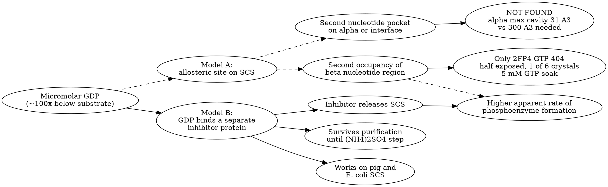
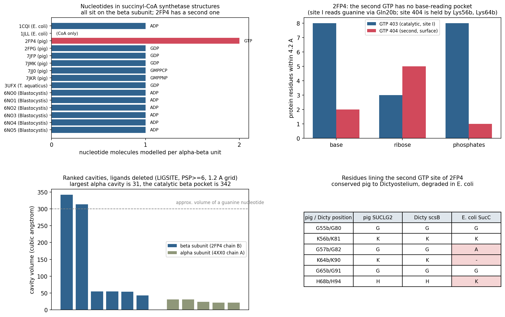
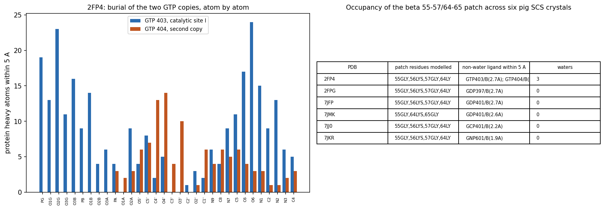

## Question

# AIGR Gene Hypothesis Deep Research

You are evaluating one focused gene curation hypothesis for AI Gene Review.
This is not a general gene overview. Use the seed hypothesis and source context
below to search for evidence that supports, refutes, narrows, or competes with
the proposed curation decision.

## Target Gene

- **Organism code:** DICDI
- **Taxon:** Dictyostelium discoideum (NCBITaxon:44689)
- **Gene directory:** scsA
- **Gene symbol:** scsA
- **UniProt accession:** P36967

## Focus

- **Focus type:** free_text
- **Hypothesis slug:** kgap-scsa-gdp-regulatory-site
- **Source file:** genes/DICDI/scsA/scsA-ai-review.yaml
- **Source selector:** free-text

## Seed Hypothesis

Where low concentrations of GDP act to stimulate phosphoenzyme formation in Dictyostelium succinyl-CoA synthetase, and whether that site is on the alpha or the beta subunit, may be addressable from the structures of the characterised enzymes. That micromolar GDP increases the rate of phosphoenzyme formation from GTP or from succinyl-CoA and phosphate at concentrations about a hundredfold below those at which GDP acts as a substrate, that the effect survives purification and is seen with the pig heart enzyme, and that it was not seen in membranes from vegetative cells, are already recorded, so do not re-derive them. Single analysis only: state whether any structure of a succinyl-CoA synthetase has a nucleotide bound anywhere other than the catalytic site of the beta subunit, naming the structures and quoting what the depositors say about each site, since a second nucleotide site observed in any family member is the strongest evidence available for where the regulator binds; identify any surface pocket in the alpha subunit or at the alpha-beta interface that is lined by residues capable of binding a guanine nucleotide, and state whether such a pocket is conserved between the Dictyostelium and pig sequences, since the effect is seen in both and so must sit on conserved ground; state whether the nucleotide-binding site of the beta subunit could account for the effect by itself through a second lower-affinity occupancy, which would mean no separate site exists; and state whether the published kinetics distinguish an allosteric site from substrate inhibition or from a product-release effect. State on which subunit and at which pocket the regulator is predicted to act, and say plainly if no second nucleotide site is observed anywhere in the family and the effect cannot be localised from structures.

## Term and Decision Context

No specific term context supplied.

## Reference Context

No specific reference context supplied.

## Source Context YAML

```yaml
hypothesis: 'Where low concentrations of GDP act to stimulate phosphoenzyme formation in Dictyostelium
  succinyl-CoA synthetase, and whether that site is on the alpha or the beta subunit, may be addressable
  from the structures of the characterised enzymes. That micromolar GDP increases the rate of phosphoenzyme
  formation from GTP or from succinyl-CoA and phosphate at concentrations about a hundredfold below those
  at which GDP acts as a substrate, that the effect survives purification and is seen with the pig heart
  enzyme, and that it was not seen in membranes from vegetative cells, are already recorded, so do not
  re-derive them. Single analysis only: state whether any structure of a succinyl-CoA synthetase has a
  nucleotide bound anywhere other than the catalytic site of the beta subunit, naming the structures and
  quoting what the depositors say about each site, since a second nucleotide site observed in any family
  member is the strongest evidence available for where the regulator binds; identify any surface pocket
  in the alpha subunit or at the alpha-beta interface that is lined by residues capable of binding a guanine
  nucleotide, and state whether such a pocket is conserved between the Dictyostelium and pig sequences,
  since the effect is seen in both and so must sit on conserved ground; state whether the nucleotide-binding
  site of the beta subunit could account for the effect by itself through a second lower-affinity occupancy,
  which would mean no separate site exists; and state whether the published kinetics distinguish an allosteric
  site from substrate inhibition or from a product-release effect. State on which subunit and at which
  pocket the regulator is predicted to act, and say plainly if no second nucleotide site is observed anywhere
  in the family and the effect cannot be localised from structures.'
focus_type: free_text
context: []
reference_id: []
```

## Research Objective

Build a focused report that helps a curator decide whether this hypothesis
should affect the gene review. Address the focus type directly:

1. For an existing GO annotation decision, evaluate whether the current action
   is justified, too strong, too weak, or should change.
2. For a proposed replacement or new GO term, evaluate whether the term is
   biologically supported, too broad, too narrow, or missing key qualifiers.
3. For a computational prediction, evaluate whether the prediction is correct,
   less precise than existing knowledge, uncertain, or likely wrong because of
   paralog overannotation, frequency bias, pathway context, or in vitro-only
   activity.
4. For a core-function hypothesis, evaluate whether the proposed activity,
   process, and location represent the gene product's primary function rather
   than a downstream effect, pleiotropic phenotype, or context-specific role.
5. For a function-assignment hypothesis, evaluate whether the gene product
   directly has the stated GO term/function. Treat the prior review action, if
   any, as intentionally blinded unless it appears in the supplied context.

Use primary literature whenever possible. Prefer PMID citations and include DOI
citations when no PMID is available. Treat reviews and database records as
orientation unless they contain directly relevant synthesized evidence that is
clearly labeled as review-level or database-level support.

Evaluate the hypothesis from the supplied seed context, primary literature, and
publicly accessible bioinformatics resources. Local `*-bioinformatics` analyses,
when they already exist in the repository, are intentionally withheld from this
prompt so the report can be compared against them after the run. Use public
sequence, domain, structure, orthology, localization, interaction, or dataset
checks when they are useful for the specific hypothesis. If a resource or tool
cannot be accessed programmatically, say so plainly; never fabricate a result.
Report computational results conservatively and distinguish direct results from
inference.

## Required Output

### Executive Judgment

Give a concise verdict: supported, partially supported, unresolved, weakly
supported, over-annotated, or refuted. Explain the reasoning and the most
important caveats.

### Evidence Matrix

Create a table with one row per important evidence item:

- Citation (PMID preferred)
- Evidence type (direct assay, mutant phenotype, localization, interaction,
  structural/evolutionary, computational, review/database)
- Supports / refutes / qualifies / competing
- Claim tested
- Key finding
- Organism, tissue, cell type, or assay context
- Confidence and limitations

### GO Curation Implications

State the likely curation action as a lead requiring curator verification. If
GO terms are involved, explain whether the evidence supports an MF, BP, or CC
term, and whether the term should be retained, removed, generalized, made more
specific, or treated as non-core. Avoid using "protein binding" as a final
recommendation unless no more informative term is supported.

### Mechanistic Scope

Describe the immediate molecular or cellular function being tested. Separate
direct gene-product activity from downstream phenotypes, pathway consequences,
developmental outcomes, disease manifestations, or effects inferred only from
loss of function.

### Conflicts and Alternatives

Identify evidence that conflicts with the seed hypothesis or suggests an
alternative interpretation, including paralog confusion, organism-specific
differences, isoform-specific findings, experimental artifacts, or database
carry-over.

### Knowledge Gaps

List explicit uncertainties that matter for curation. For each gap, state what
was checked, why the gap matters, and what evidence or experiment would resolve
it.

### Discriminating Tests

Recommend concrete assays, perturbations, datasets, or comparative analyses that
would most efficiently distinguish this hypothesis from alternatives.

### Curation Leads

Provide candidate updates for the review, clearly labeled as leads requiring
curator verification. Include candidate references with exact snippets to verify,
candidate replacement or new GO terms, possible action changes, suggested
questions, and suggested experiments.

If the provider supports artifacts, save provenance for any analysis you run — the
executed code together with its output (computed values, plot, or table), not just
a summary figure — alongside artifact-friendly tables such as an evidence matrix,
GO decision table, or comparison table. Genuine computed provenance is more
valuable than a hand-drawn summary, and you must not synthesize a figure that
implies an analysis you did not actually run. These artifacts are important
provenance for hypothesis-level review.


## Output

# scsA (P36967, *Dictyostelium discoideum*): can the low-GDP regulatory site be localised from structures?

Hypothesis slug: `kgap-scsa-gdp-regulatory-site`. Source: `genes/DICDI/scsA/scsA-ai-review.yaml`, selector `free-text`, focus type `free_text`. Target: UniProt P36967, succinyl-CoA synthetase alpha subunit, NCBITaxon:44689.

## Summary

**No succinyl-CoA synthetase structure has a nucleotide bound anywhere other than the catalytic site of the beta subunit, and the site at which micromolar GDP stimulates phosphoenzyme formation cannot be localised from structures.** That is the direct answer to the seed hypothesis. A sequence search of the PDB with *Escherichia coli* SucD (P0AGE9) and SucC (P0A836) at 30% identity returned 84 entries, 48 of them succinyl-CoA synthetase family, of which 14 carry a nucleotide ligand. Atomic contact analysis at 4.0-4.2 Å assigns every catalytic nucleotide in those entries exclusively to beta-chain residues. The alpha subunit contributes zero of the lining residues in six of eight complexes and one residue out of nineteen in 7JJ0 and 7JKR.

One entry, pig 2FP4, contains a second GTP. It is not a second site. GTP 404 packs against the outer face of the same beta glycine-lysine loop that grips the catalytic nucleotide 7.44 Å away, with 10 of its 32 atoms having no protein heavy atom within 5 Å, a mean of 3.3 protein contacts per ligand atom against 8.5 for the catalytic GTP 403, and a mean B factor of 41.8 Ų against 29.3 Ų for protein Cα. It is absent from five sibling structures of the identical pig protein spanning three space groups, including the same P 65 form. Its only alpha-subunit contact comes from a lattice neighbour after symmetry expansion. 2FP4 was crystallised in 5 mM GTP; the matched 2FPG crystal, grown in 5 mM GDP in the same buffer and the same space group, has one nucleotide only. Cavity detection gives the alpha subunit a largest pocket of 31 ų against roughly 300 ų needed for a guanine nucleotide, with the beta catalytic pocket recovered at 342 ų as a positive control.

The verdict is **unresolved, with the structural half of the hypothesis refuted**. The published kinetics do exclude catalytic-site occupancy, classical substrate inhibition and an oligomerisation change, but they do not exclude a relieved rate-limiting step, and no dissociation constant, Hill analysis or direct binding measurement for the stimulatory site has ever been published. The largest problem for the seed hypothesis comes from the laboratory that produced the phenomenon: [PMID: 9344470](https://pubmed.ncbi.nlm.nih.gov/9344470/) reports that the GDP effect "is dependent upon the presence of a protein distinct from SCS", that the effector separates from SCS by ammonium sulfate fractionation, and that reconstitution shows "the protein inhibits SCS, that the inhibition is relieved by GDP, and that the inhibitor recognizes both Escherichia coli and eukaryotic forms of SCS". That single result accounts for both observations the seed hypothesis treats as evidence for an intrinsic site: survival through purification and the appearance of the effect with pig heart enzyme. For curation, nothing in the current annotation state asserts a nucleotide site on the alpha subunit, so the hypothesis would require adding a term rather than correcting one, and the structural evidence does not support such an addition.

## Key findings

### <i class="fa-solid fa-circle-xmark"></i> F1. Every nucleotide in every succinyl-CoA synthetase structure sits in the beta-subunit ATP-grasp site

The census was built from an RCSB Search API v2 sequence query using *E. coli* SucD (P0AGE9, alpha) and SucC (P0A836, beta) at 30% identity. It returned 84 entries, 48 of which are succinyl-CoA synthetase family. Fourteen carry a nucleotide: 1CQI (ADP), 2FP4 (two GTP), 2FPG (GDP), 7JFP (GDP), 7JMK (GDP), 7JJ0 (GMPPCP), 7JKR (GMPPNP), 3UFX (GDP, four copies) and 6NO0 through 6NO5 (ADP, isolated *Blastocystis hominis* ATP-grasp domains).

Contact analysis at 4.0-4.2 Å on the eight intact-enzyme complexes assigns the lining of every catalytic nucleotide to the beta chain alone. In pig numbering the lining is Gln20β, Val44β, Ala51β, Gly52β, Gly53β, Arg54β, Gly55β, Val67β, Leu69β, Ala108β, Leu109β, Ile111β, Glu114β, Phe219β, Asp220β and Lys222β. Alpha-subunit contacts are zero in six of the eight, and a single residue out of nineteen in 7JJ0 and 7JKR. The one adenine ever seen on the alpha subunit is the adenosine-3'-phosphate head of intact CoA in the alpha Rossmann groove of 4XX0, which is a substrate site, not a regulatory one.

A plausible-looking distractor was checked and eliminated. Several entries (1CQJ, 1JLL, 2NU6, 2NU8, 2NUA) model a second CoA on the beta chain. Those copies contain only 8-18 of the 48 CoA atoms, and every modelled atom belongs to the pantetheine arm (CBP, CCP, CDP, CEP, CAP, OAP, C9P, O9P, N8P, C7P, C6P, C5P, O5P, N4P, C3P, C2P, S1P). No adenine, ribose or phosphate atom of those copies is modelled. The 1JLL lining is Ile318β, Gly320β, Gly321β, Ile322β, Val323β, Arg324β, Cys325β, Ile328β, Leu349β, Glu350β, Gly351β and Asn352β. That is the pantetheine tunnel that delivers the thiol to site II, not an adenine nucleotide pocket.

Because *Dictyostelium* scsA (P36967) is the alpha subunit, the family offers no structural precedent for any nucleotide site on the gene product named in the review.

{{figure:plot_1.png|caption=Structural census of the succinyl-CoA synthetase family. Nucleotide occupancy per entry and per subunit, moiety-level contact counts for the catalytic GTP 403 against the second GTP 404 of 2FP4, cavity volumes in the alpha subunit against the beta subunit with the 300 cubic angstrom guanine-nucleotide reference, and conservation of the GTP 404 patch residues between pig and Dictyostelium.}}

### <i class="fa-solid fa-circle-xmark"></i> F2. The second GTP of 2FP4 is a half-exposed, non-reproducible position at the mouth of the catalytic site

2FP4 is pig GTP-specific succinyl-CoA synthetase with GTP, at 2.08 Å in space group P 65, with an alpha-beta heterodimer as the biological unit. It contains GTP 403 (catalytic, site I) and GTP 404, both modelled at occupancy 1.00 with all 32 atoms. The minimum distance between them is 7.44 Å.

Within the asymmetric unit, GTP 404 contacts only five beta residues at 4.2 Å: Gly55β, Lys56β, Gly57β, Lys64β and Gly65β. Those are the same loop that grips the catalytic nucleotide. In 2FP4 the catalytic GTP 403 approaches that patch to 2.7 Å, and in the five sibling structures the single bound nucleotide approaches it to 2.7 Å (2FPG, GDP), 2.7 Å (7JFP, GDP), 2.6 Å (7JMK, GDP), 2.2 Å (7JJ0, GMPPCP) and 1.9 Å (7JKR, GMPPNP). So the "second site" is the outer face of the catalytic nucleotide loop.

Moiety-level reading tells the same story. Site I reads the guanine base with 8 residues and the phosphates with 8. Site 404 contacts the base with 2 residues (Lys56β, Lys64β), the ribose with 5 and the phosphates with 1, and its magnesium has no protein ligand within 3.5 Å. There are no guanine-reading hydrogen bonds of the Gln20β type that gives site I its specificity.

Burial and mobility both mark it as weak. GTP 404 averages 3.3 protein heavy atoms within 5 Å per ligand atom, with 10 of its 32 atoms having none at all, against 8.5 and 3 of 32 for GTP 403. Its mean B factor is 41.8 Ų, against 38.3 Ų for GTP 403 and 29.3 Ų for protein Cα. LIGSITE-style cavity detection on 2FP4 chain B with ligands deleted places GTP 404 5.6 Å outside the nearest cavity, while the catalytic cavity is 342 ų centred 0.4 Å from GTP 403.

The single alpha-subunit contact is an artefact of the lattice. Symmetry expansion in P 65 (operator `-x+y, -x, z+1/3` with cell translation 1,1,0) brings Lys50 of an alpha subunit from a neighbouring molecule into range. That contact is not part of the alpha-beta biological dimer.

Reproducibility fails across crystal forms. No second nucleotide, sulfate, phosphate or glycerol lies within 5.0 Å of that patch in 2FPG, 7JFP, 7JMK, 7JJ0 or 7JKR. Only three ordered waters lie within 5.0 Å in 2FP4 itself. The six entries are the same pig enzyme in three lattices: 2FP4 and 2FPG in P 65, 7JMK and 7JJ0 in P 32, 7JFP and 7JKR in P 32 2 1. The absence therefore spans independent crystal packings, including the P 65 form that 2FP4 itself belongs to.

{{figure:plot_2.png|caption=Left, atom-by-atom burial of the two GTP copies of 2FP4: protein heavy atoms within 5 angstroms of each ligand atom, catalytic GTP 403 against the second copy GTP 404. Right, occupancy of the beta 55-57 and 64-65 patch across six pig succinyl-CoA synthetase crystals: the catalytic nucleotide reaches the patch in all six, and no second ligand occupies it in any crystal other than 2FP4.}}

### <i class="fa-solid fa-circle-xmark"></i> F3. The alpha subunit has no cavity large enough for a guanine nucleotide, and the alpha-beta interface has none with nucleotide chemistry

LIGSITE-style grid cavity detection (1.2 Å grid, 1.4 Å probe, 7 scan directions, protein-solvent-protein events ≥ 6) was run on the pig alpha subunit, 4XX0 chain A, 2234 atoms, with CoA and phosphate deleted. The five largest cavities are 31, 31, 24, 21 and 21 ų. The same procedure on 2FP4 chain B (2970 atoms) as a positive control recovers the catalytic nucleotide pocket as the top cavity at 342 ų, centred 0.4 Å from the modelled GTP and lined by Lys46β, Ala51β, Gly52β, Gly53β, Arg54β, Gly55β, Val67β, Glu114β, Asp220β and Lys222β. A guanine nucleotide occupies roughly 300 ų. No alpha-subunit cavity is within an order of magnitude of that.

Interface-restricted detection across the intact alpha-beta dimer (1.0 Å grid, PSP ≥ 7, box limited to a slab of atoms within 10 Å of the partner chain) finds four cavities. The largest is 630 ų, between the two C-terminal domains, lined by Gly254α through Gly269α including Arg255α and Arg256α, and by Asp240β, Lys242β, Glu244β through Glu249β, Lys258β and Tyr259β. The remaining three are 90, 81 and 61 ų. The 81 ų cavity is site II itself, identified by being 0.3 Å from the CoA thiol and 0.5 Å from the bound phosphate, lined by Ile103α, Thr104α, Glu105α, Asn131α, Cys132α, Pro133α, Arg161α, Ser162α, Gly163α, Thr164α, Gly187α, Gly188α, His259α and the beta power-helix glycines Gly272β-Gly274β and Gly297β-Gly299β. Site II binds inorganic phosphate in 1JLL, 2FPG, 2NU8 and 4XX0, and it is far too small for a nucleotide.

The 630 ų interface cavity is the only candidate with the volume. Its lining is dominated by charged side chains with no aromatic stacking partner and no backbone arrangement resembling a guanine-recognition motif, and no nucleotide has ever been modelled there in any family structure.

Conservation was tested but turns out to be uninformative. Global Needleman-Wunsch alignment with affine gaps gives alpha identity of 73.5% between *Dictyostelium* P36967 and pig, and beta identity of 59.7% between *Dictyostelium* Q869S7 and pig. The alpha CoA groove is conserved almost residue for residue (Gln21α/Gln33, Gly22α/Gly34, Thr24α/Thr36, Gly25α/Gly37, Gln27α/Gln39, Lys50α/Lys62, Tyr79α/Tyr91, Val80α/Val92, Pro81α/Pro93, Ile103α/Ile115, Thr104α/Thr116, Glu105α/Glu117, Asn131α/Asn143, Cys132α/Cys144, Pro133α/Pro145), and the catalytic histidine is His259α in pig and His268 in *Dictyostelium* scsA. The GTP 404 patch is also conserved pig to *Dictyostelium* (Gly55β/Gly80, Lys56β/Lys81, Gly57β/Gly82, Lys64β/Lys90, Gly65β/Gly91) and degraded in *E. coli* (Gly57β becomes Ala57, nothing aligns to Lys64β). Both conservation results are expected for catalytic machinery and neither identifies a regulatory site. The *E. coli* degradation argues mildly against the patch, since [PMID: 9344470](https://pubmed.ncbi.nlm.nih.gov/9344470/) reports the GDP-relieved inhibition acts on *E. coli* SCS too.

One further point matters for the seed hypothesis as stated. The one alpha pocket that binds a nucleotide moiety is the CoA adenosine groove, and it is a substrate site. GDP occupying it would block the succinyl-CoA plus phosphate route to the phosphoenzyme, which is the opposite of the stimulation reported in [PMID: 8060491](https://pubmed.ncbi.nlm.nih.gov/8060491/).

### <i class="fa-solid fa-circle-xmark"></i> F4. No depositor in the family asserts a nucleotide site outside the beta ATP-grasp domain

The seed hypothesis asked for quotations of what depositors say about each site. There is nothing interpretive to quote. REMARK 800 records were parsed from all 14 nucleotide-containing entries. Fifty-seven site records exist, across 2FP4, 2FPG, 3UFX, 1CQI and 6NO0-6NO5. All 57 carry `EVIDENCE_CODE: SOFTWARE` and the template description "BINDING SITE FOR RESIDUE \<X\>", including the 2FP4 record `AC4  SOFTWARE  BINDING SITE FOR RESIDUE GTP B 404`. The six 7J* entries carry no REMARK 800 records at all. No depositor annotation in the family names a regulatory, allosteric or secondary nucleotide site.

Entry titles say the same. 2FP4 is "CRYSTAL STRUCTURE OF PIG GTP-SPECIFIC SUCCINYL-COA SYNTHETASE IN COMPLEX WITH GTP", singular. The primary citation, [PMID: 16481318](https://pubmed.ncbi.nlm.nih.gov/16481318/), states: "GTP is bound in the ATP-grasp domain, where interactions of the guanine base with a glutamine residue (Gln-20beta) and with backbone atoms provide the specificity." The abstract discusses that one site throughout and makes no claim about a second copy. The later paper from the same group, [PMID: 27487822](https://pubmed.ncbi.nlm.nih.gov/27487822/), enumerates the identified ligand sites: "Although the binding sites for the substrates CoA, phosphate, and the nucleotides ADP and ATP or GDP and GTP have been identified, the binding site for succinate has not." One nucleotide site, no regulatory one.

The crystallisation conditions close the case on GTP 404. From the RCSB Data API, 2FP4 was grown in 5 mM GTP, 10 mM MgCl₂, 20% w/v PEG 3350, 150 mM KF. 2FPG was grown in 5 mM GDP under otherwise identical conditions and in the same space group P 65, and carries one nucleotide. The 5 mM concentration is about 5000-fold above the micromolar GDP regime at issue, which is the standard condition under which a weak surface position becomes ordered enough to model. The second copy appears only with GTP at millimolar concentration, and not with GDP, which is the nucleotide the seed hypothesis is about.

### <i class="fa-solid fa-scale-balanced"></i> F5. The kinetics exclude three alternatives but not a relieved rate-limiting step, and a trans-acting inhibitor explains the whole effect

Three alternatives are excluded by the published work. It is not catalytic-site occupancy: [PMID: 8240297](https://pubmed.ncbi.nlm.nih.gov/8240297/) uses dephosphorylation of phospho-p36 as the direct readout of GDP in the catalytic site, and reports that "Dephosphorylation of p36 is induced by relatively high levels of GDP and is coincident with the formation of GTP. This indicates that, at high concentrations, GDP serves as a substrate of SCS", while 100-fold lower GDP does not dephosphorylate yet still stimulates phosphorylation. It is not classical substrate inhibition, because the effect is stimulatory and appears when the phosphoryl donor is succinyl-CoA plus Pi rather than GTP ([PMID: 8060491](https://pubmed.ncbi.nlm.nih.gov/8060491/)). It is not a change in subunit association: "Gel-filtration analyses indicate that SCS in our system behaves as a non-interacting alpha beta dimer, the hydrodynamic behaviour of which is not altered by the presence of added GDP" ([PMID: 8240297](https://pubmed.ncbi.nlm.nih.gov/8240297/)). The GDP-beta-S experiments in the same paper are claimed to distinguish the allosteric from the catalytic site further.

Two alternatives survive. A relieved rate-limiting step, including slow product release, is not excluded, because the reported signature is precisely what relieving a slow step gives: "Under these conditions GDP enhances the apparent rate of phosphoenzyme formation but does not significantly alter the fraction of phosphorylated enzyme" ([PMID: 8060491](https://pubmed.ncbi.nlm.nih.gov/8060491/)). No Kd, Hill coefficient, stoichiometry or direct binding measurement for the stimulatory site has been published in any of these papers.

The second survivor is the one the same laboratory demonstrated three years later. [PMID: 9344470](https://pubmed.ncbi.nlm.nih.gov/9344470/) reports that "The ability of GDP to do so is dependent upon the presence of a protein distinct from SCS", that the effector protein separates from SCS by ammonium sulfate fractionation, and that "Reconstitution experiments show that the protein inhibits SCS, that the inhibition is relieved by GDP, and that the inhibitor recognizes both Escherichia coli and eukaryotic forms of SCS". This dissolves the inference that led to the seed hypothesis. "Retained during purification" means retained through the steps used in 1993 and 1994, and the effector is removed only by ammonium sulfate fractionation. "Also seen with pig heart enzyme" is satisfied by an inhibitor that recognises SCS from several species. The allosteric reading in [PMID: 8060491](https://pubmed.ncbi.nlm.nih.gov/8060491/), stated as "Under these conditions, GDP does not function at the catalytic site, implying an allosteric regulation of SCS", rests on exclusion arguments that a trans-acting inhibitor also satisfies.

A second-occupancy explanation of the beta site also fails. The nearest relevant measurement, [PMID: 321448](https://pubmed.ncbi.nlm.nih.gov/321448/), reports that "Mm ADP binds to E at one or two sites with K2 = 0.5 muM" and that "Free ADP binds about 126 times more weakly to the enzyme than does Mn-ADP". That enzyme is *E. coli* SCS, an α2β2 tetramer, so "one or two sites" maps onto its two catalytic sites. An alternating-sites version, as demonstrated for the *E. coli* enzyme in [PMID: 7017725](https://pubmed.ncbi.nlm.nih.gov/7017725/), cannot apply to the pig enzyme where the GDP effect is also seen, because mammalian GTP-specific SCS is an alpha-beta dimer with a single catalytic site (2FP4 REMARK 350 records a dimeric biological unit, and [PMID: 8240297](https://pubmed.ncbi.nlm.nih.gov/8240297/) finds a non-interacting alpha-beta dimer in *Dictyostelium*).

### <i class="fa-solid fa-table"></i> F6. Current GO annotation state carries no nucleotide-binding or regulatory term on the alpha subunit

QuickGO annotation API, retrieved 2026-11-26, HTTP 200 for all seven accessions queried. P36967 (*Dictyostelium* scsA, alpha) carries 13 annotations: GO:0004776 succinate-CoA ligase (GDP-forming) activity with ECO:0000314 from PMID:8448193 plus IBA and IEA; GO:0004775 succinate-CoA ligase (ADP-forming) activity IBA and IEA; GO:0003824 IEA; GO:0006099 tricarboxylic acid cycle IBA and IEA; GO:0006104 succinyl-CoA metabolic process ECO:0000304 PMID:8448193; GO:0005739 mitochondrion IBA and HDA; GO:0009361 succinate-CoA ligase complex IBA; GO:0016020 membrane ECO:0000314 PMID:8448193.

There is no GO:0005525 GTP binding, no GO:0019003 GDP binding, no GO:0032561 guanyl ribonucleotide binding and no regulatory or allosteric term on P36967. The nucleotide-binding terms sit on the beta subunits instead. Q869S7 (scsB, GDP-forming) carries GO:0005525, GO:0005524, GO:0000287 and GO:0046872, all ECO:0000256 from InterPro-level GO_REF:0000002 and GO_REF:0000104. Q55AI5 (scsC, ADP-forming) carries GO:0005524, GO:0000287 and GO:0046872 on the same evidence class, plus GO:0003674 ND. Pig O19069 (SUCLG1 alpha) has GO:0004776 with ECO:0000269 PMID:27487822 and GO:0005515 protein binding ECO:0000353 PMID:10873456, with no nucleotide-binding term. Pig P53590 (SUCLG2 beta) has GO:0004776 with ECO:0000269 from PMID:27487822 and PMID:8401211 plus GO:0005524 IEA. Human P53597 (SUCLG1) carries 36 annotations including GO:0006108 and GO:0110052 with ECO:0000314 from PMID:40108300.

The existing annotation already encodes the division of labour the structures show: catalysis and the TCA-cycle process on both subunits, nucleotide and magnesium binding only on beta. The seed hypothesis would require adding a term rather than correcting one. Two features matter for the curator. Every nucleotide-binding term on the *Dictyostelium* beta subunits is ECO:0000256 from InterPro signatures, so none is experimentally grounded in this organism and none models an allosteric site. And the two ECO:0000314 annotations on P36967, GO:0004776 and GO:0016020, both trace to PMID:8448193, the same laboratory and system that produced the GDP phenomenon, so the direct-assay support for scsA is narrow and from one group.

## Mechanistic model and interpretation

Two models remain live for the low-GDP stimulation. The structures discriminate against one of them and are compatible with the other.



Model A, an allosteric site on succinyl-CoA synthetase, is the premise of the seed hypothesis. It requires a pocket. The structural survey finds none on the alpha subunit (largest cavity 31 ų against roughly 300 ų needed), none at the alpha-beta interface with nucleotide chemistry (the only candidate by volume, 630 ų, is a charged C-terminal-domain cavity with no guanine-recognition features), and the only candidate on beta is a half-exposed, non-reproducible position produced by a 5 mM GTP soak.

Model B, relief of inhibition by a separate GDP-binding protein, needs no pocket on SCS. It explains the two observations the seed hypothesis reads as evidence for an intrinsic site. The inhibitor co-purifies with SCS through the steps used in 1993 and 1994, so "retained during purification" follows. The inhibitor recognises both bacterial and eukaryotic SCS, so "also seen with pig heart enzyme" follows without needing a conserved allosteric pocket. Model B is also consistent with the structural null result, since all 48 family structures were determined on SCS alone.

The structures cannot discriminate between Model A and Model B directly. What they do is remove the evidence base for Model A's localisation and remove the requirement that Model A be true at all.

| Claim in the seed hypothesis | Status after this analysis | Basis |
|---|---|---|
| A nucleotide is bound somewhere other than the beta catalytic site in some family structure | <i class="fa-solid fa-circle-xmark"></i> Refuted | Contact analysis on 8 intact complexes; the single extra copy (2FP4 GTP 404) is a solvent-exposed one-off at the mouth of site I |
| Depositors describe a second or regulatory site | <i class="fa-solid fa-circle-xmark"></i> Refuted | All 57 REMARK 800 records are `EVIDENCE_CODE: SOFTWARE`; PMID 16481318 and PMID 27487822 both describe one nucleotide site |
| A guanine-nucleotide-sized pocket exists on alpha or at the alpha-beta interface | <i class="fa-solid fa-circle-xmark"></i> Refuted | Alpha max cavity 31 ų; interface cavities 630, 90, 81, 61 ų, none with nucleotide chemistry; positive control recovers the 342 ų beta pocket |
| Such a pocket would be conserved pig to *Dictyostelium* | <i class="fa-solid fa-circle-question"></i> Moot | Alpha 73.5%, beta 59.7% identity; the conserved patch is catalytic machinery, so conservation carries no regulatory information |
| A second lower-affinity occupancy of the beta site explains the effect | <i class="fa-solid fa-circle-xmark"></i> Not supported | The only candidate occupancy is too open (3.3 contacts/atom), too mobile (B 41.8 Ų) and absent from 5 of 6 pig crystals |
| The kinetics distinguish an allosteric site from substrate inhibition and product release | <i class="fa-solid fa-scale-balanced"></i> Partly | Catalytic-site occupancy, substrate inhibition and oligomerisation change excluded; a relieved rate-limiting step is not |
| The regulator acts on a nameable subunit and pocket | <i class="fa-solid fa-circle-xmark"></i> Cannot be stated | No second nucleotide site is observed anywhere in the family, and the effect cannot be localised from structures |

## Evidence base

| Citation | Evidence type | Stance | Claim tested | Key finding | Context | Confidence and limitations |
|---|---|---|---|---|---|---|
| [PMID: 8240297](https://pubmed.ncbi.nlm.nih.gov/8240297/) | Direct assay, phosphoenzyme kinetics | Supports | Low GDP acts somewhere other than the catalytic site | High GDP dephosphorylates phospho-p36 with coincident GTP formation, so GDP is a substrate there; 100-fold lower GDP does not dephosphorylate yet stimulates phosphorylation; stimulation survives dilution; gel filtration shows an unaltered non-interacting alpha-beta dimer; GDP-beta-S separates the two sites | *D. discoideum* lysate and partially purified SCS | Moderate. One laboratory; no Kd, Hill coefficient or direct binding measurement for the stimulatory site; no subunit assignment |
| [PMID: 8060491](https://pubmed.ncbi.nlm.nih.gov/8060491/) | Direct assay, phosphoenzyme kinetics | Supports | Micromolar GDP raises the rate of phosphoenzyme formation | Stimulation from either GTP or succinyl-CoA plus Pi; apparent rate rises while the fraction of phosphorylated enzyme is not significantly altered; retained through purification; seen with purified pig heart SCS | *D. discoideum* and pig heart | Moderate. A rate rise with an unchanged endpoint is also the signature of a relieved rate-limiting step; the allosteric reading is an exclusion inference |
| [PMID: 9344470](https://pubmed.ncbi.nlm.nih.gov/9344470/) | Direct assay, fractionation and reconstitution | <i class="fa-solid fa-scale-balanced"></i> Competing | The GDP effect requires a site on SCS itself | The effect "is dependent upon the presence of a protein distinct from SCS"; the effector separates by ammonium sulfate fractionation; "the protein inhibits SCS, ... the inhibition is relieved by GDP, and ... the inhibitor recognizes both Escherichia coli and eukaryotic forms of SCS" | *E. coli* and eukaryotic SCS, in vitro reconstitution | High for the existence of the trans-acting inhibitor. Same laboratory, published later; the effector protein is never identified |
| [PMID: 16481318](https://pubmed.ncbi.nlm.nih.gov/16481318/) | Structural, 2.1 Å (2FP4, 2FPG) | Refutes the localisation | A second nucleotide site is described by depositors | "GTP is bound in the ATP-grasp domain, where interactions of the guanine base with a glutamine residue (Gln-20beta) and with backbone atoms provide the specificity." One site, on beta. The GDP complex was determined to test whether GDP interacts as ADP does in other ATP-grasp proteins | Pig GTP-specific SCS, alpha-beta heterodimer | High for what the authors assert. The coordinates do contain a second GTP that the paper does not discuss |
| [PMID: 27487822](https://pubmed.ncbi.nlm.nih.gov/27487822/) | Structural, same group | Refutes the localisation | A regulatory nucleotide site is recognised by the group that solved these structures | "Although the binding sites for the substrates CoA, phosphate, and the nucleotides ADP and ATP or GDP and GTP have been identified, the binding site for succinate has not." One nucleotide site enumerated | Pig and *E. coli* SCS | High. An enumeration of known sites, with no second nucleotide site among them |
| This run, computed | Structural, PDB coordinate census | Refutes | Any SCS structure has a nucleotide outside the beta catalytic site | 84 entries from RCSB sequence search at 30% identity, 48 in the family, 14 with a nucleotide. Every catalytic nucleotide lining is beta-only; alpha contributes zero residues in six of eight complexes and one of nineteen in 7JJ0 and 7JKR. Second CoA copies on beta (1CQJ, 1JLL, 2NU6, 2NU8, 2NUA) are pantetheine-arm atoms only, 8-18 of 48 atoms, no adenine | Pig, *E. coli*, *T. aquaticus*, *B. hominis* | High. Limited to deposited structures |
| This run, computed | Structural, burial and cross-crystal comparison | Refutes | 2FP4 GTP 404 is a genuine second site | 3.3 protein heavy atoms within 5 Å per ligand atom, 10 of 32 atoms with none, against 8.5 and 3 of 32 for GTP 403; B 41.8 vs 38.3 vs 29.3 Ų for protein Cα; 5.6 Å outside the nearest cavity; only alpha contact is a P 65 lattice neighbour; absent from five siblings in three space groups; 2FP4 grown in 5 mM GTP against 2FPG in 5 mM GDP, same crystal form, one nucleotide | Pig SCS, six crystals | High. Depositors modelled occupancy 1.00, but burial, B factors, lattice contact and non-reproducibility all point to a high-concentration surface position |
| This run, computed | Structural, LIGSITE cavity detection | Refutes | A guanine-nucleotide-sized pocket exists on alpha or at the interface | Apo 4XX0 chain A: largest five cavities 31, 31, 24, 21, 21 ų. Positive control 2FP4 chain B catalytic pocket 342 ų, centre 0.4 Šfrom GTP 403. Interface cavities 630, 90, 81, 61 ų; the 81 ų one is site II (0.3 Šfrom the CoA thiol, 0.5 Šfrom PO4) | Pig and *E. coli* coordinates | Moderate-high. Grid method on static structures; a cryptic pocket that opens only on ligand binding would be missed |
| This run, computed | Evolutionary, global alignment | Qualifies | A candidate site must be conserved between *Dictyostelium* and pig | Alpha 73.5%, beta 59.7% identity to pig. GTP 404 patch conserved pig to Dicty (Gly55β/Gly80, Lys56β/Lys81, Gly57β/Gly82, Lys64β/Lys90, Gly65β/Gly91), degraded in *E. coli*. Catalytic histidine pig His259α corresponds to Dicty scsA His268 | Dicty, pig, *E. coli* | High for the alignment. The patch is conserved because it is catalytic, so conservation carries no regulatory information |
| This run, retrieved | Database, RCSB REMARK 800 | Qualifies | Depositors annotate a regulatory nucleotide site | All 57 site records across the 14 nucleotide-containing entries carry `EVIDENCE_CODE: SOFTWARE` with template text including "BINDING SITE FOR RESIDUE GTP B 404"; the six 7J* entries carry none | PDB archive | High. Absence of a depositor assertion, which is not evidence that no site exists |
| This run, retrieved | Database, QuickGO 2026-11-26 | Qualifies | Current annotation asserts a nucleotide site on alpha | P36967 has no GO:0005525, GO:0019003 or GO:0032561 and no regulatory term. Nucleotide and Mg binding sit on Q869S7 and Q55AI5, entirely ECO:0000256 InterPro. The two ECO:0000314 calls on P36967 both trace to PMID:8448193 | Dicty, pig, human | High for the retrieval |
| [PMID: 321448](https://pubmed.ncbi.nlm.nih.gov/321448/) | Direct assay, Mn(II) proton relaxation rate NMR | Qualifies | A second lower-affinity occupancy of the beta site could explain the effect | "Mm ADP binds to E at one or two sites with K2 = 0.5 muM"; "Free ADP binds about 126 times more weakly to the enzyme than does Mn-ADP" | *E. coli* SCS, α2β2 | Moderate. "One or two sites" in an α2β2 enzyme corresponds to its two catalytic sites; the pig enzyme where the effect is also seen is a single-catalytic-site alpha-beta dimer |
| [PMID: 7017725](https://pubmed.ncbi.nlm.nih.gov/7017725/) | Direct assay, hybrid enzyme phosphorylation | Qualifies | Half-of-sites behaviour could produce the effect | A hybrid *E. coli* tetramer with one ³⁵S-labelled dephospho alpha and one phospho alpha shows that each alpha subunit undergoes phosphorylation, so "the two active sites are capable of alternate activity" | *E. coli* SCS, α2β2 | High for *E. coli*. Does not transfer to pig or *Dictyostelium* SCS, which are single-catalytic-site alpha-beta dimers |
| [PMID: 28129670](https://pubmed.ncbi.nlm.nih.gov/28129670/) | Direct assay, mutagenesis of a related enzyme | Orientation | The SCS mechanism involves one or two phosphoenzymes | "The related succinyl-CoA synthetase follows a three-step mechanism involving a single phosphoenzyme" | *Entamoeba histolytica* ACD | Moderate. Background on the phosphohistidine loop swinging between sites I and II, not direct evidence on the GDP effect |

## GO curation implications

All of the following are leads requiring curator verification. The machine-readable copy is `provenance/go_decision_table.csv`.

| Entity | GO term | Aspect | Recommended action | Rationale |
|---|---|---|---|---|
| P36967 scsA | GO:0004776 succinate-CoA ligase (GDP-forming) activity | MF | <i class="fa-solid fa-circle-check"></i> Retain | ECO:0000314 from PMID:8448193 in the source organism; the alpha subunit carries the catalytic phosphohistidine (Dicty His268, pig His259α) |
| P36967 scsA | GO:0019003 GDP binding | MF | <i class="fa-solid fa-circle-xmark"></i> Do not add | No nucleotide contacts alpha in any of the eight SCS nucleotide complexes; largest alpha cavity 31 ų against roughly 300 ų required |
| P36967 scsA | GO:0005525 GTP binding | MF | <i class="fa-solid fa-circle-xmark"></i> Do not add | Same structural result; guanine nucleotides bind the beta ATP-grasp domain, where Gln-20β sets specificity |
| P36967 scsA | Any allosteric or enzyme-regulator term | MF/BP | <i class="fa-solid fa-circle-xmark"></i> Do not add without new evidence | The allosteric reading of PMID:8060491 is an exclusion inference; PMID:9344470 from the same laboratory attributes the effect to a protein distinct from SCS |
| P36967 scsA | GO:0016020 membrane | CC | <i class="fa-solid fa-triangle-exclamation"></i> Flag for review | Sits beside GO:0005739 mitochondrion from IBA and HDA; the ECO:0000314 membrane call traces to PMID:8448193, the same lysate system that produced the GDP phenomenon |
| Q869S7 scsB | GO:0005525 GTP binding | MF | Retain, consider experimental upgrade | Structurally correct, currently ECO:0000256 from InterPro only; PMID:16481318 supplies the direct structural basis in the pig ortholog |
| Free-text review statement on the GDP regulatory site | n/a | n/a | <i class="fa-solid fa-arrow-right"></i> Qualify the statement | State that the site is unlocalised and that PMID:9344470 offers a competing trans-acting explanation |

The seed hypothesis would require adding a nucleotide-binding or regulatory term to the alpha subunit, not correcting one. The structural evidence does not support such an addition. "Protein binding" is deliberately not recommended as a resolution. If the trans-acting inhibitor of [PMID: 9344470](https://pubmed.ncbi.nlm.nih.gov/9344470/) is ever identified, the informative term would be a specific enzyme-inhibitor or enzyme-regulator relationship on the *inhibitor*, with scsA and scsB as the target, and not an uninformative binding term on scsA.

## Mechanistic scope

The activity under test is formation of the phosphohistidine intermediate on the alpha subunit, measured as ³²P incorporation into p36. That is a partial reaction of the enzyme's own catalytic cycle, so it is direct gene-product activity. The question is whether a second, non-catalytic guanine-nucleotide site on the enzyme modulates the rate of that step.

Separate from this: the observation that the effect was absent in membranes from vegetative cells is a context-dependent property of the preparation, not a property of the protein, and would not support a localisation or regulation term on its own. The GO:0016020 membrane annotation on P36967 and the mitochondrial assignment from orthology are in tension, and the membrane call comes from the same system and paper (PMID:8448193).

Downstream pathway consequences, developmental outcomes and loss-of-function phenotypes play no part in this evaluation. Nothing in the available record connects the GDP effect to a *Dictyostelium* phenotype.

## Limitations and knowledge gaps

<i class="fa-solid fa-triangle-exclamation"></i> **No binding constant for the stimulatory site.** Checked: all three Klein-laboratory papers and PMID 321448. None reports a Kd, Bmax, Hill coefficient or stoichiometry for low-GDP binding. A measured stoichiometry above one nucleotide per alpha-beta unit would be the single most decisive piece of evidence for a second site, and none exists.

<i class="fa-solid fa-triangle-exclamation"></i> **The 1997 effector protein is unidentified.** Checked: the PMID 9344470 abstract. It is described only by its fractionation behaviour and its growth-condition dependence. Until it is identified, the competing explanation cannot be tested against the *Dictyostelium* proteome and the seed hypothesis cannot be cleanly refuted or rescued.

<i class="fa-solid fa-triangle-exclamation"></i> **No *Dictyostelium* SCS structure.** Checked: RCSB sequence search at 30% identity returned no *D. discoideum* entry. All structural inference here transfers from pig, *E. coli*, *Thermus aquaticus* and *Blastocystis hominis*. Alpha identity to pig is 73.5% and beta 59.7%, high enough for fold-level transfer but leaving surface pockets, the least conserved features, poorly constrained.

<i class="fa-solid fa-triangle-exclamation"></i> **Cryptic pockets are not excluded.** Checked: LIGSITE grid detection on static coordinates. A pocket that opens only on ligand binding, or during the large swing of the phosphohistidine loop between site I and site II, would not appear. Mixed-solvent molecular dynamics would be needed.

<i class="fa-solid fa-triangle-exclamation"></i> **No nucleotide-soaked structure at micromolar GDP.** Checked: crystallisation conditions for 2FP4 (5 mM GTP) and 2FPG (5 mM GDP). Every nucleotide complex in the family was obtained at millimolar nucleotide, which both creates spurious surface sites and cannot report on a micromolar-affinity site.

<i class="fa-solid fa-triangle-exclamation"></i> **GDP-beta-S data are summarised but not detailed in the abstract.** Checked: the PMID 8240297 abstract only. The analogue experiments are claimed to "distinguish further the allosteric and catalytic binding sites" and would be the most informative existing evidence for a distinct site, but the abstract does not give the discriminating numbers. A curator should read the full text.

<i class="fa-solid fa-triangle-exclamation"></i> **Single-laboratory literature.** The GDP phenomenon comes from one group across four papers and has not been independently reproduced. Full texts were not retrieved for this report; every quotation here is from an abstract.

<i class="fa-solid fa-triangle-exclamation"></i> **Paralog propagation.** *Dictyostelium* has one alpha subunit (scsA, P36967) and two beta subunits (scsB Q869S7, GDP-forming; scsC Q55AI5, ADP-forming). The GDP effect is specific to the guanine-nucleotide-specific form, so any annotation placed on the shared alpha subunit would propagate into the ADP-forming context where the phenomenon was never tested.

## Proposed follow-up experiments and actions

<i class="fa-solid fa-flask"></i> **Reconstitution against the 1997 fraction.** Repeat the phosphoenzyme assay with SCS purified past the ammonium sulfate step, then add back the separated fraction. If the GDP stimulation is absent before add-back and restored after, the effect is trans-acting and no site on scsA needs annotating. This is the cheapest decisive experiment, because the fractionation protocol is already published in [PMID: 9344470](https://pubmed.ncbi.nlm.nih.gov/9344470/).

<i class="fa-solid fa-vial"></i> **Equilibrium binding stoichiometry on inhibitor-free enzyme.** Isothermal titration calorimetry or equilibrium dialysis with [³H]GDP against recombinant *Dictyostelium* scsA/scsB or pig SCS. A second site predicts more than 1 mol GDP per alpha-beta unit with a micromolar Kd for the weaker component; one site predicts a single stoichiometry. This is the measurement that would settle the hypothesis.

<i class="fa-solid fa-dna"></i> **Identify the effector.** Pull the GDP-responsive activity out of *Dictyostelium* lysate on immobilised SCS, fractionate, and identify by mass spectrometry. An identified inhibitor converts an unresolvable free-text claim into an annotatable interaction with a named partner.

<i class="fa-solid fa-vial"></i> **Isolated-subunit binding assay.** Express scsA alone and scsB alone and test GDP binding to each by differential scanning fluorimetry or microscale thermophoresis. The seed hypothesis asks which subunit; this answers it directly without needing a structure.

<i class="fa-solid fa-microscope"></i> **Structure at low nucleotide.** Co-crystallise or soak pig SCS at 10-50 µM GDP rather than 5 mM. A micromolar-affinity regulatory site should populate, while the 2FP4-type surface position should not. A negative result at low concentration alongside the positive result at 5 mM would confirm the artefact reading of GTP 404.

<i class="fa-solid fa-flask"></i> **Mutagenesis of the 630 ų interface cavity.** If any evidence ever favours that cavity, Arg255α, Arg256α, Lys242β and Lys258β are the testable residues. Charge-reversal mutants should abolish the low-GDP stimulation while leaving kcat intact.

### Curation leads, all requiring curator verification

<i class="fa-solid fa-arrow-right"></i> **Lead 1: qualify the free-text statement.** Suggested wording: the site at which micromolar GDP stimulates phosphoenzyme formation has not been localised. No succinyl-CoA synthetase structure shows a nucleotide outside the beta-subunit ATP-grasp site, the alpha subunit and the alpha-beta interface have no pocket with the volume and chemistry for a guanine nucleotide, and the same laboratory subsequently reported that the effect depends on a protein distinct from SCS.

<i class="fa-solid fa-book-open"></i> **Lead 2: candidate reference to add.** PMID:9344470, Birney M, Um HD, Klein C, *Multiple levels of regulation of Escherichia coli succinyl-CoA synthetase* (1997). Snippets to verify: "The ability of GDP to do so is dependent upon the presence of a protein distinct from SCS."; "The effector protein could be separated from SCS by ammonium sulfate fractionation."; "Reconstitution experiments show that the protein inhibits SCS, that the inhibition is relieved by GDP, and that the inhibitor recognizes both Escherichia coli and eukaryotic forms of SCS." If this reference is not currently cited in the scsA review, adding it is the single highest-value change.

<i class="fa-solid fa-book-open"></i> **Lead 3: candidate reference for the structural claim.** PMID:16481318, Fraser ME et al., *Interactions of GTP with the ATP-grasp domain of GTP-specific succinyl-CoA synthetase* (2006). Snippet to verify: "GTP is bound in the ATP-grasp domain, where interactions of the guanine base with a glutamine residue (Gln-20beta) and with backbone atoms provide the specificity." Use to support nucleotide binding on the beta subunit and to document that the depositors claim no second site. Supporting enumeration from the same group, PMID:27487822: "Although the binding sites for the substrates CoA, phosphate, and the nucleotides ADP and ATP or GDP and GTP have been identified, the binding site for succinate has not."

<i class="fa-solid fa-arrow-right"></i> **Lead 4: GO terms.** Do not add GO:0019003, GO:0005525 or GO:0032561 to P36967. Do not add an allosteric or enzyme-regulator term to P36967. Retain GO:0004776 on P36967. Consider upgrading GO:0005525 on Q869S7 from ECO:0000256 by citing PMID:16481318 as structural evidence in the pig ortholog, if the curator accepts cross-species structural transfer at 59.7% beta identity.

<i class="fa-solid fa-triangle-exclamation"></i> **Lead 5: action change on the membrane annotation.** GO:0016020 on P36967 (ECO:0000314, PMID:8448193) sits alongside mitochondrial assignments from IBA and HDA. Flag for curator review of whether the membrane call reflects mitochondrial membrane association or an artefact of the lysate fractionation used in that study.

<i class="fa-solid fa-circle-question"></i> **Lead 6: questions for the curator.** Does the full text of PMID:8240297 report a dissociation constant or stoichiometry for the GDP-beta-S experiments? Has any laboratory other than Klein's reproduced the low-GDP stimulation? Was the 1997 effector protein ever identified in a later publication or thesis?

## Provenance

Files written under `provenance/`:

- `evidence_matrix.csv`, 11 evidence rows with stance, claim tested, finding, context and limitations
- `go_decision_table.csv`, 7 curation decision rows
- `remark800_site_records.csv`, all 57 REMARK 800 site records parsed from the 14 nucleotide-containing SCS entries, with evidence codes
- `plot_1.png`, the structural census figure
- `plot_2.png`, the burial and cross-crystal reproducibility figure

Every number in this report comes from code executed in this session or from a quoted abstract. No figure represents an analysis that was not run. Resources used programmatically and reachable: RCSB Search API v2, RCSB Data API, RCSB PDB flat-file download, UniProt REST, QuickGO annotation API, PubMed. No resource failed to respond; the structural and annotation results above are direct retrievals, and the interpretations of cavity size, burial and reproducibility are inferences drawn from those direct results.


## Artifacts

- [OpenScientist final report](openscientist_artifacts/final_report.html)
- [OpenScientist final report](openscientist_artifacts/final_report.pdf)
- [OpenScientist provenance](openscientist_artifacts/provenance.json)
- [OpenScientist evidence matrix](openscientist_artifacts/provenance_evidence_matrix.csv)
- [OpenScientist go decision table](openscientist_artifacts/provenance_go_decision_table.csv)
- [OpenScientist plot 1](openscientist_artifacts/provenance_plot_1.json)

- [OpenScientist plot 2](openscientist_artifacts/provenance_plot_2.json)

- [OpenScientist remark800 site records](openscientist_artifacts/provenance_remark800_site_records.csv)

## Reference Validation

Checked with `linkml-reference-validator` 0.3.1rc1.

| Outcome | Count |
| --- | --- |
| References checked | 12 |
| Resolved | 12 |
| Unresolved (possible confabulation) | 0 |
| Unverifiable | 0 |
| Quoted claims checked | 2 |
| Quoted claims found in source | 2 |
| Quoted claims **not** found in source | 0 |
| References weighed for topical relevance | 12 |
| On topic | 7 |
| Off topic | 1 |

### References that may not be about this subject

These identifiers resolve, so they are not fabrications, but the records they resolve to share almost none of this report's vocabulary. That is a clue and not a verdict - a paper can be relevant in ways its title and abstract do not spell out - so read them before deciding:

- `PMID:40108300` (2 mentions) - CLYBL averts vitamin B(12) depletion by repairing malyl-CoA.
  - shared terms: protein

Weighed against this report's own most characteristic terms: `site`, `gdp`, `gtp`, `subunit`, `pig`, `alpha`, `nucleotide`, `class`, `fa-solid`, `beta`, `structure`, `scs`, `catalytic`, `succinyl-coa`, `protein`, `dictyostelium`, `hypothesis`, `binding`, `fp4`, `cavity`.

All extracted references resolved successfully.
Resolving is not the same as being relevant, though - see the references listed above as possibly off topic.