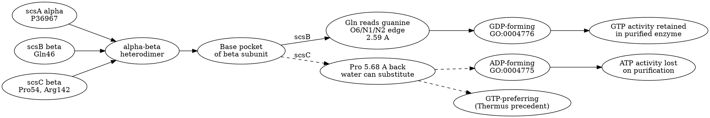
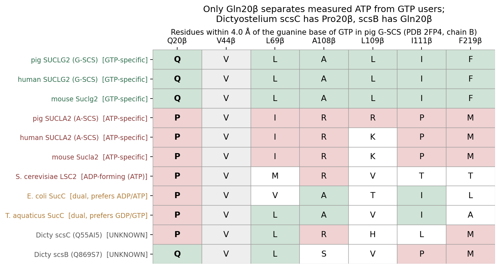
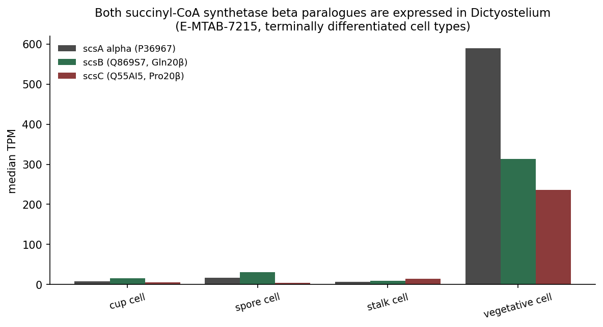
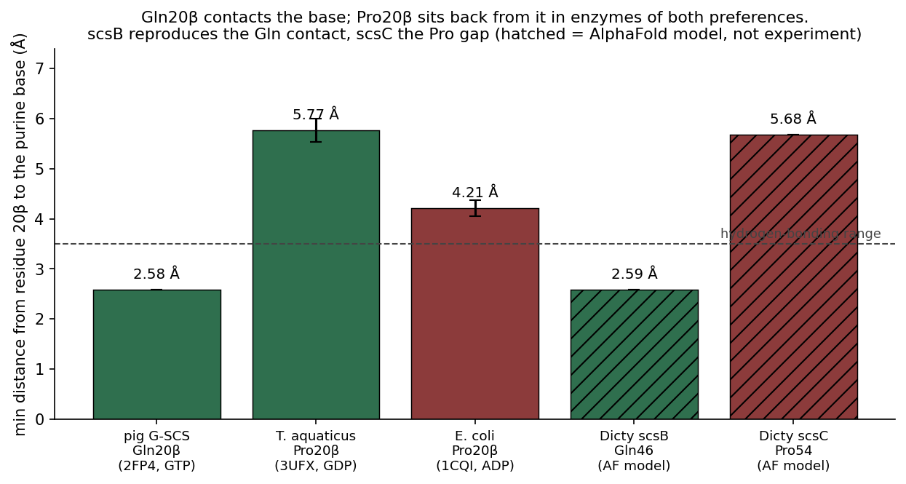

## Question

# AIGR Gene Hypothesis Deep Research

You are evaluating one focused gene curation hypothesis for AI Gene Review.
This is not a general gene overview. Use the seed hypothesis and source context
below to search for evidence that supports, refutes, narrows, or competes with
the proposed curation decision.

## Target Gene

- **Organism code:** DICDI
- **Taxon:** Dictyostelium discoideum (NCBITaxon:44689)
- **Gene directory:** scsC
- **Gene symbol:** scsC
- **UniProt accession:** Q55AI5

## Focus

- **Focus type:** free_text
- **Hypothesis slug:** kgap-scsc-nucleotide-specificity
- **Source file:** genes/DICDI/scsC/scsC-ai-review.yaml
- **Source selector:** free-text

## Seed Hypothesis

Whether Dictyostelium scsC (Q55AI5) confers ATP or GTP specificity on the succinyl-CoA synthetase it forms may be predictable from the known specificity determinants. That scsC descends from the lineage of the ATP-specific subunits of animals and fungi, outside the node where ADP use was lost, that it has Pro at position 20 of the mature subunit, and that the enzyme purified from growing cells uses GTP, is already recorded, so do not re-derive the phylogeny. Single analysis only: identify from the primary structural literature the residues that distinguish the ATP-specific from the GTP-specific beta subunits in the characterised enzymes, naming the structures and quoting the statements that assign specificity to those positions; state what scsC and the second beta subunit scsB have at each of those positions, and whether either matches the ATP-specific or the GTP-specific pattern; state explicitly whether the Pro at mature position 20 is one of the established determinants or merely a lineage marker, since the gap treats it as informative; and assess whether a mixed outcome, one ATP-specific and one GTP-specific beta subunit in the same mitochondrion, is consistent with the purified enzyme using GTP. State what specificity each subunit is predicted to confer, and say plainly if the determinants are not established well enough to predict specificity from sequence.

## Term and Decision Context

No specific term context supplied.

## Reference Context

No specific reference context supplied.

## Source Context YAML

```yaml
hypothesis: 'Whether Dictyostelium scsC (Q55AI5) confers ATP or GTP specificity on the succinyl-CoA synthetase
  it forms may be predictable from the known specificity determinants. That scsC descends from the lineage
  of the ATP-specific subunits of animals and fungi, outside the node where ADP use was lost, that it
  has Pro at position 20 of the mature subunit, and that the enzyme purified from growing cells uses GTP,
  is already recorded, so do not re-derive the phylogeny. Single analysis only: identify from the primary
  structural literature the residues that distinguish the ATP-specific from the GTP-specific beta subunits
  in the characterised enzymes, naming the structures and quoting the statements that assign specificity
  to those positions; state what scsC and the second beta subunit scsB have at each of those positions,
  and whether either matches the ATP-specific or the GTP-specific pattern; state explicitly whether the
  Pro at mature position 20 is one of the established determinants or merely a lineage marker, since the
  gap treats it as informative; and assess whether a mixed outcome, one ATP-specific and one GTP-specific
  beta subunit in the same mitochondrion, is consistent with the purified enzyme using GTP. State what
  specificity each subunit is predicted to confer, and say plainly if the determinants are not established
  well enough to predict specificity from sequence.'
focus_type: free_text
context: []
reference_id: []
```

## Research Objective

Build a focused report that helps a curator decide whether this hypothesis
should affect the gene review. Address the focus type directly:

1. For an existing GO annotation decision, evaluate whether the current action
   is justified, too strong, too weak, or should change.
2. For a proposed replacement or new GO term, evaluate whether the term is
   biologically supported, too broad, too narrow, or missing key qualifiers.
3. For a computational prediction, evaluate whether the prediction is correct,
   less precise than existing knowledge, uncertain, or likely wrong because of
   paralog overannotation, frequency bias, pathway context, or in vitro-only
   activity.
4. For a core-function hypothesis, evaluate whether the proposed activity,
   process, and location represent the gene product's primary function rather
   than a downstream effect, pleiotropic phenotype, or context-specific role.
5. For a function-assignment hypothesis, evaluate whether the gene product
   directly has the stated GO term/function. Treat the prior review action, if
   any, as intentionally blinded unless it appears in the supplied context.

Use primary literature whenever possible. Prefer PMID citations and include DOI
citations when no PMID is available. Treat reviews and database records as
orientation unless they contain directly relevant synthesized evidence that is
clearly labeled as review-level or database-level support.

Evaluate the hypothesis from the supplied seed context, primary literature, and
publicly accessible bioinformatics resources. Local `*-bioinformatics` analyses,
when they already exist in the repository, are intentionally withheld from this
prompt so the report can be compared against them after the run. Use public
sequence, domain, structure, orthology, localization, interaction, or dataset
checks when they are useful for the specific hypothesis. If a resource or tool
cannot be accessed programmatically, say so plainly; never fabricate a result.
Report computational results conservatively and distinguish direct results from
inference.

## Required Output

### Executive Judgment

Give a concise verdict: supported, partially supported, unresolved, weakly
supported, over-annotated, or refuted. Explain the reasoning and the most
important caveats.

### Evidence Matrix

Create a table with one row per important evidence item:

- Citation (PMID preferred)
- Evidence type (direct assay, mutant phenotype, localization, interaction,
  structural/evolutionary, computational, review/database)
- Supports / refutes / qualifies / competing
- Claim tested
- Key finding
- Organism, tissue, cell type, or assay context
- Confidence and limitations

### GO Curation Implications

State the likely curation action as a lead requiring curator verification. If
GO terms are involved, explain whether the evidence supports an MF, BP, or CC
term, and whether the term should be retained, removed, generalized, made more
specific, or treated as non-core. Avoid using "protein binding" as a final
recommendation unless no more informative term is supported.

### Mechanistic Scope

Describe the immediate molecular or cellular function being tested. Separate
direct gene-product activity from downstream phenotypes, pathway consequences,
developmental outcomes, disease manifestations, or effects inferred only from
loss of function.

### Conflicts and Alternatives

Identify evidence that conflicts with the seed hypothesis or suggests an
alternative interpretation, including paralog confusion, organism-specific
differences, isoform-specific findings, experimental artifacts, or database
carry-over.

### Knowledge Gaps

List explicit uncertainties that matter for curation. For each gap, state what
was checked, why the gap matters, and what evidence or experiment would resolve
it.

### Discriminating Tests

Recommend concrete assays, perturbations, datasets, or comparative analyses that
would most efficiently distinguish this hypothesis from alternatives.

### Curation Leads

Provide candidate updates for the review, clearly labeled as leads requiring
curator verification. Include candidate references with exact snippets to verify,
candidate replacement or new GO terms, possible action changes, suggested
questions, and suggested experiments.

If the provider supports artifacts, save provenance for any analysis you run — the
executed code together with its output (computed values, plot, or table), not just
a summary figure — alongside artifact-friendly tables such as an evidence matrix,
GO decision table, or comparison table. Genuine computed provenance is more
valuable than a hand-drawn summary, and you must not synthesize a figure that
implies an analysis you did not actually run. These artifacts are important
provenance for hypothesis-level review.


## Output

# scsC (Q55AI5) nucleotide specificity: can it be predicted from the established determinants?

**Gene:** *scsC* / DDB_G0271842 / Q55AI5, *Dictyostelium discoideum* (NCBITaxon:44689)
**Paralogue examined alongside:** *scsB* / DDB_G0274449 / Q869S7
**Shared alpha subunit:** *scsA* / p36 / P36967
**Hypothesis slug:** `kgap-scsc-nucleotide-specificity` · **Focus type:** free text · **Source:** `genes/DICDI/scsC/scsC-ai-review.yaml`

## Summary

The primary structural literature assigns nucleotide specificity in succinyl-CoA synthetase to exactly one residue, **Gln20β**. Fraser et al. ([PMID: 16481318](https://pubmed.ncbi.nlm.nih.gov/16481318/)), working on the pig GTP-specific enzyme crystallised with GTP and magnesium (PDB 2FP4, 2.1 Å), state that "GTP is bound in the ATP-grasp domain, where interactions of the guanine base with a glutamine residue (Gln-20beta) and with backbone atoms provide the specificity." Recomputing contacts from the deposited coordinates confirms Gln20β is the only side chain in the base pocket able to hydrogen bond the guanine O6/N1/N2 edge (2.58 Å). The six other residues within 4.0 Å of the base (Val44β, Leu69β, Ala108β, Leu109β, Ile111β, Phe219β) make hydrophobic packing contacts. Arg54β, the other named residue in that paper, is assigned to the gamma-phosphate, not to base discrimination.

Reading both Dictyostelium beta subunits at those seven positions gives a split answer. **scsB (Q869S7) has the guanine-reading glutamine** (Gln46 in full-length numbering), and an AlphaFold model superposed on the GTP complex places its side chain 2.59 Å from the guanine edge, against 2.58 Å for pig Gln20β. **scsC (Q55AI5) has proline** (Pro54), which sits 5.68 Å back from the base, matching the geometry of the *Thermus aquaticus* Pro20β. scsC also carries Arg142 and Met253 where mammalian ATP-specific subunits differ from the GTP-specific ones. So scsB is predicted GTP-specific with moderate confidence, resting on the one residue with a mechanistic assignment, and scsC is predicted to use ATP with low-to-moderate confidence, resting on the absence of that residue plus co-varying substitutions that cannot be separated from lineage signal.

**The Pro at mature position 20 is a lineage marker and a permissive state, not an established determinant.** The gap treats it as informative in the direction of ATP specificity, and that inference fails on the structural evidence. Joyce et al. ([PMID: 22751660](https://pubmed.ncbi.nlm.nih.gov/22751660/)) characterised *T. aquaticus* SCS, which carries Pro20β and *prefers* GDP/GTP: "A water molecule and Pro20β in T. aquaticus take the place of Gln20β in pig GTP-specific SCS, interacting well with the guanine base and other residues of the nucleotide-binding site. This leads to the preference for GDP/GTP, but does not hinder the binding of ADP/ATP." *E. coli* SucC has the same proline and prefers ADP/ATP. Two Pro20β enzymes, opposite preferences. Pro20β marks the absence of the guanine-reading amide, which is not the same as the presence of an adenine-reading mechanism. Scoring nine beta subunits at the seven candidate positions, six of seven sites separate the strictly specific enzymes, but **none of the seven also places the two enzymes with measured preference on the side they prefer**. The determinants are not established well enough to predict specificity from sequence with confidence. A mixed outcome, one ATP-type and one GTP-type beta subunit in one mitochondrion, is fully consistent with the purified enzyme using GTP.

## Executive judgment

<i class="fa-scale-balanced"></i> **Verdict: partially supported.**

The seed hypothesis has two halves and they do not fare equally.

**Supported.** scsB is predicted GTP-specific on the strength of Gln46, the one position with a direct structural assignment to guanine recognition, verified in three dimensions by superposition. The mixed-outcome scenario is internally consistent and matches the mammalian arrangement, where SUCLG1 alpha pairs with either SUCLA2 (ATP-specific) or SUCLG2 (GTP-specific).

**Weakly supported.** scsC as the ATP-specific subunit. The inference rests on the *absence* of Gln20β plus two second-shell substitutions (Arg142 and Met253) whose discriminating power comes from a single characterised clade.

**The gap's stated reasoning is wrong and should be corrected.** The Pro at mature position 20 is cited as informative. It is not a determinant. The structure that describes Pro20β with a bound nucleotide describes it in a GTP-preferring enzyme.

**Most important caveats.**

<i class="fa-triangle-exclamation"></i> No crystal or cryo-EM structure of any ATP-specific succinyl-CoA synthetase with a bound adenine nucleotide exists. The RCSB entries mapping to human SUCLA2 are 6G4Q (2.59 Å, apo SUCLG1-SUCLA2) and 9SWJ (3.7 Å cryo-EM, CoA only). None map to pig SUCLA2. The "ATP-specific pattern" has therefore never been observed reading an adenine; it is defined by difference from the GTP-specific enzymes.

<i class="fa-triangle-exclamation"></i> Lineage and residue pattern are not independent lines of evidence. Both reduce to similarity against the same small set of mammalian A-SCS sequences.

<i class="fa-triangle-exclamation"></i> The numbering in the seed is alignment-derived. Placing scsC Pro54 at mature position 20 implies a cleaved presequence of 34 residues. UniProt Q55AI5 predicts a 17-residue transit peptide (HAMAP MF_03220, ECO:0000255), and Q869S7 has no transit peptide annotated at all. The *structural* equivalence is unambiguous regardless of the numbering.

**Predicted specificity.** scsB: GTP-specific, moderate confidence. scsC: ATP-using and probably ADP-forming, low-to-moderate confidence. Neither should be stated as fact in the review without an experimental qualifier.

## Key findings

### <i class="fa-circle-check"></i> F1. Gln20β is the only residue the primary literature assigns to nucleotide specificity

Fraser et al. ([PMID: 16481318](https://pubmed.ncbi.nlm.nih.gov/16481318/)) determined structures of pig GTP-specific succinyl-CoA synthetase with GTP and with GDP bound in the ATP-grasp domain of the beta subunit (PDB 2FP4, 2FPI, 2FPP, 2FPG; the GTP-Mg complex at 2.08 Å). Their assignment is explicit: specificity comes from "interactions of the guanine base with a glutamine residue (Gln-20beta) and with backbone atoms." The same paper separates the role of the other named side chain: "The gamma-phosphate interacts with the side chain of an arginine residue (Arg-54beta) and with backbone amide nitrogen atoms, leading to tight interactions between the gamma-phosphate and the protein." Arg54β binds phosphate, not the base, so it is not a discrimination determinant.

Recomputing residue-to-base distances directly from the deposited 2FP4 coordinates (chain B, GTP 403; base atoms N1, C2, N2, N3, C4, C5, C6, O6, N7, C8, N9) returns seven residues within 4.0 Å:

| Residue | Minimum distance to guanine base | Chemistry |
|---|---|---|
| **Gln20β** | **2.58 Å** | amide side chain, hydrogen bonds the O6/N1/N2 edge |
| Leu109β | 2.72 Å | hydrophobic packing |
| Ala108β | 3.28 Å | hydrophobic packing |
| Val44β | 3.49 Å | hydrophobic packing |
| Leu69β | 3.58 Å | hydrophobic packing |
| Phe219β | 3.69 Å | aromatic stacking |
| Ile111β | 3.72 Å | hydrophobic packing |

Contacts to the whole GTP additionally include the P-loop Gly52β-Gly53β-Arg54β-Gly55β, Val67β, Glu114β, Asp220β and Lys222β. Gln20β is the only one of the seven base-contacting residues whose side chain can read the hydrogen-bonding pattern that distinguishes guanine from adenine. The rest define a pocket shape.

The asymmetry of the evidence matters for curation. The determinant is assigned from the GTP-bound side only. Searching RCSB for structures mapped to human SUCLA2 (Q9P2R7) returns 6G4Q, an apo SUCLG1-SUCLA2 heterodimer at 2.59 Å, and 9SWJ, a 3.7 Å cryo-EM structure with CoA only. No structure maps to pig SUCLA2 (O97580). The only nucleotide-bound structure from an ADP/ATP-preferring enzyme is *E. coli* 1CQI (3.3 Å, ADP-Mg), and that enzyme is dual-specificity.

### <i class="fa-circle-xmark"></i> F2. Pro20β is permissive, not an ATP-specificity determinant

This is the finding that directly answers the question the seed asks to be stated explicitly.

Joyce et al. ([PMID: 22751660](https://pubmed.ncbi.nlm.nih.gov/22751660/)) characterised *T. aquaticus* SCS biochemically and structurally. Their activity assays show that "the enzyme uses either ADP/ATP or GDP/GTP, but prefers GDP/GTP. This contrasts with Escherichia coli SCS, which uses GDP/GTP but prefers ADP/ATP." Their structure explains how: "A water molecule and Pro20β in T. aquaticus take the place of Gln20β in pig GTP-specific SCS, interacting well with the guanine base and other residues of the nucleotide-binding site. This leads to the preference for GDP/GTP, but does not hinder the binding of ADP/ATP."

Recomputing from the deposited coordinates of PDB 3UFX (GDP-Mn, four copies in the asymmetric unit, chains B/E/G/I) gives Pro20β minimum distances to the guanine base of 6.15, 5.56, 5.77 and 5.59 Å, with no direct contact, and ordered water molecules hydrogen bonding the base at 2.63/2.74, 2.93/3.18/2.63, 2.61/2.31 and 2.45/3.01 Å. The direct guanine contacts in 3UFX are Val43β, Ala93β, Val94β and Ile96β, equivalent to pig Val44β, Ala108β, Leu109β and Ile111β. The pocket is intact; the glutamine is replaced by a water.

For the opposite preference, recomputation of PDB 1CQI (*E. coli* SCS with ADP-Mg, two copies, [PMID: 9917402](https://pubmed.ncbi.nlm.nih.gov/9917402/)) shows the adenine contacted by Val44β, Lys46β, Glu99β, Ala100β, Ala101β, Thr102β, Ile104β and Leu212β, with Pro20β not within 4.0 Å (4.22 ± 0.15 Å across the two copies).

{{figure:plot_3.png|caption=Distance from residue 20β to the bound purine base. Pig GTP-specific SCS (2FP4) places Gln20β 2.58 Å from the guanine. The two experimentally characterised Pro20β enzymes sit well back from the base (T. aquaticus 3UFX, 5.56-6.15 Å across four copies, with waters substituting; E. coli 1CQI, no contact within 4.0 Å) and they have opposite nucleotide preferences. The two Dictyostelium values come from AlphaFold models superposed on 2FP4 and are marked to distinguish them from the experimental measurements.}}

Residue 20β is Pro in every measured ADP/ATP user examined (pig and human SUCLA2, mouse Sucla2, *S. cerevisiae* Lsc2, *E. coli* SucC) and also in the GTP-preferring *T. aquaticus* enzyme. It is Gln in every strictly GTP-specific one (pig, human, mouse SUCLG2). The residue is informative in one direction only: Gln20β predicts guanine recognition, Pro20β predicts the loss of that particular contact and nothing more.

### <i class="fa-table"></i> F3. scsC carries Pro20β with A-SCS-like second-shell residues; scsB carries Gln20β

Each full-length UniProt sequence was aligned to the observed pig G-SCS beta chain of PDB 2FP4 (residues 1-393, mature numbering) by Needleman-Wunsch with BLOSUM62, gap open -11, gap extend -1, then read out at the seven base-contacting positions. Sequence identity to 2FP4 chain B: pig SUCLG2 99.8%, human SUCLG2 96.4%, scsB 59.5%, pig SUCLA2 54.7%, scsC 54.5%, human SUCLA2 53.9%, *E. coli* 44.0%, *T. aquaticus* 41.7%.

| Subunit | Measured nucleotide use | 20β | 44β | 69β | 108β | 109β | 111β | 219β |
|---|---|---|---|---|---|---|---|---|
| pig SUCLG2 (P53590) | GTP-specific | **Q** | V | L | A | L | I | F |
| human SUCLG2 (Q96I99) | GTP-specific | **Q** | V | L | A | L | I | F |
| mouse Suclg2 (Q9Z2I8) | GTP-specific (orthology) | **Q** | V | L | A | L | I | F |
| pig SUCLA2 (O97580) | ATP-specific | **P** | V | I | R | R | P | M |
| human SUCLA2 (Q9P2R7) | ATP-specific | **P** | V | I | R | K | P | M |
| mouse Sucla2 (Q9Z2I9) | ATP-specific (orthology) | **P** | V | I | R | K | P | M |
| *S. cerevisiae* Lsc2 (P53312) | ADP-forming | **P** | V | M | R | V | T | T |
| *E. coli* SucC (P0A836) | dual, prefers ADP/ATP | **P** | V | V | A | T | I | L |
| *T. aquaticus* SucC | dual, **prefers GDP/GTP** | **P** | V | L | A | V | I | A |
| **Dicty scsC (Q55AI5)** | **unknown** | **P**54 | V78 | L103 | **R**142 | H143 | L145 | **M**253 |
| **Dicty scsB (Q869S7)** | **unknown** | **Q**46 | V69 | L95 | S134 | V135 | **P**137 | **M**245 |

{{figure:plot_1.png|caption=Guanine-contacting residues across succinyl-CoA synthetase beta subunits with known nucleotide use, with the two Dictyostelium paralogues at the foot. The GTP-specific animal subunits share Gln at position 20β. Every ATP or ADP user has Pro there, as does the GTP-preferring Thermus aquaticus enzyme. scsB matches the GTP-specific state at 20β, scsC does not.}}

scsC matches the mammalian A-SCS state at three of seven positions: 20β (Pro), 108β (Arg) and 219β (Met). It matches the GTP-specific state at 44β and 69β, and neither at 109β (His) or 111β (Leu). scsB matches the GTP-specific state at 20β, 44β and 69β, and the A-SCS state at 111β (Pro) and 219β (Met), with Ser134 at 108β matching neither.

### <i class="fa-microscope"></i> F4. Superposition places scsB Gln46 on the guanine-reading position in three dimensions

AlphaFold DB models AF-Q55AI5-F1 v6 (global pLDDT 89.5) and AF-Q869S7-F1 v6 (global pLDDT 90.9) were retrieved through the prediction API and superposed onto chain B of 2FP4 by Kabsch fit on alignment-paired CA atoms, with six rounds of 90th-percentile outlier trimming. scsB: 370/392 pairs, core CA RMSD 0.98 Å. scsC: 353/393 pairs, core CA RMSD 1.30 Å. Local pLDDT at every mapped residue is 91.8 to 97.2 in both models.

| Pig site | Pig measured (2FP4) | scsB model | pLDDT | scsC model | pLDDT |
|---|---|---|---|---|---|
| Gln20β | 2.58 Å | **Gln46 2.59 Å** | 95.0 | **Pro54 5.68 Å** | 95.0 |
| Val44β | 3.49 Å | Val69 4.03 Å | 96.8 | Val78 3.96 Å | 97.2 |
| Leu69β | 3.58 Å | Leu95 4.86 Å | 96.7 | Leu103 4.35 Å | 95.7 |
| Ala108β | 3.28 Å | Ser134 3.93 Å | 93.9 | **Arg142 3.82 Å** | 94.1 |
| Leu109β | 2.72 Å | Val135 2.76 Å | 91.8 | His143 3.32 Å | 93.4 |
| Ile111β | 3.72 Å | Pro137 3.50 Å | 92.4 | Leu145 4.70 Å | 93.5 |
| Phe219β | 3.69 Å | Met245 2.78 Å | 93.8 | Met253 2.81 Å | 94.8 |

The scsB Gln46 side chain sits 2.59 Å from the polar guanine edge atoms O6/N1/N2/N7, within hydrogen-bonding range and within 0.01 Å of the pig measurement. The scsC Pro54 sits 5.68 Å back, in the same position as the water-substituted *T. aquaticus* Pro20β (5.56-6.15 Å).

One substitution in scsC deserves attention. Arg142, equivalent to pig Ala108β, projects to 3.82 Å from the base. Arginine at 108β is present in pig, human and mouse A-SCS, in yeast Lsc2 and in scsC, and absent from every GTP-specific or dual-specificity enzyme examined. It is the only candidate that could make the scsC prediction mechanistic. No primary paper assigns specificity to it.

### <i class="fa-circle-check"></i> F5. A mixed outcome is consistent with the GTP-utilising purified enzyme

The arrangement the seed proposes for Dictyostelium, a single alpha subunit partnering two beta subunits of different specificity, is the arrangement established in mammals. The Dictyostelium biochemistry matches a two-beta system. In crude preparations the alpha subunit p36 is phosphorylated by both nucleotides, and the ATP activity is the one lost on purification ([PMID: 8448193](https://pubmed.ncbi.nlm.nih.gov/8448193/)): "In crude sample preparations, p36 could be phosphorylated by both ATP or GTP and in either case, its phosphorylation was stimulated by low concentrations of GDP. Partially purified p36 retained its ability to be phosphorylated with GTP while exhibiting little or no phosphorylation with ATP." An independent study of aggregation-stage mitochondrial fractions reports the same dual donor use ([PMID: 8384004](https://pubmed.ncbi.nlm.nih.gov/8384004/)): "p38 can be phosphorylated in vitro using either ATP or GTP as phosphoryl donors."

The recorded purified-enzyme evidence ([PMID: 7771809](https://pubmed.ncbi.nlm.nih.gov/7771809/)) is a statement about a preparation: "We have previously shown that the enzyme purified from growing D. discoideum is a GTP-utilizing enzyme." It constrains which holoenzyme survives purification from growing cells, not which beta subunits the genome encodes. Both loci exist as separate genes, Q55AI5/DDB_G0271842 and Q869S7/DDB_G0274449.

### <i class="fa-chart-column"></i> F6. Both beta paralogues are abundant in growing cells, so expression does not explain the GTP-only result

EBI Expression Atlas baseline experiment E-MTAB-7215 (RNA-seq, 13,731 genes, four cell types, 3 replicates per group) gives median TPM in vegetative (growing) cells of 590 for scsA, 313 for scsB and 236 for scsC. All three rank in the top 4% of expressed genes (percentile ranks 98.2, 97.1, 96.1), and the scsB/scsC ratio is 1.33. The alpha subunit TPM (590) is close to the sum of the two betas (549). The ratio shifts through development: 7.75 in spore cells, 2.67 in cup cells, 0.64 in stalk cells.

{{figure:plot_2.png|caption=Expression of the three Dictyostelium succinyl-CoA synthetase subunit genes across four differentiated cell types (EBI Expression Atlas E-MTAB-7215, median TPM). Both beta paralogues are abundant in vegetative cells at close to 1:1, and the alpha subunit level approximates their sum. The paralogues diverge during development, with scsB higher in spore cells and scsC relatively higher in stalk cells.}}

Growth-stage silencing of the ATP-type subunit does not explain the GTP-utilising purified enzyme. The remaining explanations are selective loss of the second holoenzyme during purification, which is exactly the behaviour reported in [PMID: 8448193](https://pubmed.ncbi.nlm.nih.gov/8448193/), or scsC not being ATP-specific. The developmental divergence of the two paralogues indicates the duplication is functionally maintained rather than a redundant copy. mRNA abundance is not protein abundance, and this is a single dataset. dictyExpress could not be reached (DNS resolution failure for dictyexpress.research.bcm.edu) and dictyBase serves a JavaScript application rather than a queryable REST endpoint, so no second expression dataset was obtained.

### <i class="fa-circle-xmark"></i> F7. No candidate position separates the beta subunits once measured preference is scored

Scoring the seven guanine-contacting positions against the nine beta subunits with measured or orthology-assigned nucleotide use gives a specific negative result. Six of seven sites (20β, 69β, 108β, 109β, 111β, 219β) separate the strictly GTP-specific set from the strictly ATP/ADP-using set. **None of the seven also places the two dual-specificity enzymes on the side of their measured preference.** At 20β the GTP-specific set is {Q} and the ATP/ADP set is {P}, yet *T. aquaticus*, which prefers GDP/GTP, has P. At 108β the sets are {A} and {R}, yet both dual enzymes have A regardless of their preference.

Counting independent evolutionary origins in the evidence set: the strictly GTP-specific enzymes come from one origin (animal G-SCS, three near-identical sequences) and the ATP/ADP users from two (animal A-SCS and fungal single-copy Lsc2). The apparent discriminating power of the residue set comes almost entirely from one contrast, three near-identical animal G-SCS sequences against three near-identical animal A-SCS sequences.

Applying the per-site rule to Dictyostelium gives mixed scores for both subunits. scsC scores ATP-side at 20β, 108β and 219β, GTP-specific at 44β and 69β, and neither at 109β and 111β. scsB scores GTP-specific at 20β, 44β and 69β, ATP-side at 109β, 111β and 219β, and neither at 108β.

This is the direct answer to the last clause of the seed. **The determinants are not established well enough to predict nucleotide specificity from sequence with confidence.** Only Gln20β carries a mechanistic assignment from a structure, and it predicts in one direction.

### <i class="fa-scale-balanced"></i> F8. The A-beta/G-beta duplication is placed in animals, so applying those labels to Dictyostelium is an extrapolation

Johnson et al. ([PMID: 9765291](https://pubmed.ncbi.nlm.nih.gov/9765291/)) determined the mature pigeon ATP-specific and GTP-specific beta subunit sequences and completed the mouse, human and pig counterparts. They report that "the sequences of the mature ATP- and GTP-specific beta-subunits (A-beta and G-beta, respectively) in pigeon are 54% identical" and conclude that "alignment with two sequences of the beta-subunit in Caenorhabditis elegans suggests that the A-beta and G-beta genes arose by duplication early in the evolution of multicellular eucaryotes."

*Dictyostelium discoideum* is an amoebozoan outside that clade, and *S. cerevisiae* carries a single beta subunit (Lsc2) rather than an A/G pair. The 54% figure for the pigeon A-beta/G-beta pair is the same range as scsC (54.5%) and pig SUCLA2 (54.7%) against the pig G-SCS structure, so percent identity alone does not place the Dictyostelium paralogues in either family. The seed instructs that the phylogeny should not be re-derived, so this was not tested here. The point for curation is that lineage membership and residue pattern are not independent evidence, because both trace back to similarity with the same mammalian A-SCS sequences.

### <i class="fa-database"></i> F9. The existing GO annotations already encode the mixed outcome, and all of them are IBA or IEA

QuickGO retrieval for the three subunits:

| Entry | Term | Evidence | With / from |
|---|---|---|---|
| scsC Q55AI5 | GO:0004775 succinate-CoA ligase (ADP-forming) activity | IBA GO_REF:0000033; IEA GO_REF:0000120 | PTN000212531, P0A836, P53593, Q84LB6, Q9P2R7; EC 6.2.1.5 |
| scsC Q55AI5 | GO:0005524 ATP binding | IEA | InterPro |
| scsC Q55AI5 | GO:0005739 mitochondrion | ISS GO_REF:0000024, IBA, IEA | Q9P2R7 (human SUCLA2) |
| scsC Q55AI5 | GO:0042709 succinate-CoA ligase complex | IBA | |
| scsC Q55AI5 | GO:0006099, GO:0006104 | IBA, IEA | |
| scsC Q55AI5 | GO:0003674 molecular_function, ND | ND GO_REF:0000015 | dictyBase |
| scsB Q869S7 | GO:0004776 succinate-CoA ligase (GDP-forming) activity | IBA; IEA | P53590, Q96I99; EC 6.2.1.4 |
| scsB Q869S7 | GO:0004775, **NOT\|enables** | IBA | |
| scsB Q869S7 | GO:0005524 ATP binding; GO:0005525 GTP binding | IEA; IEA | IPR011761 / IPR013815 |
| scsB Q869S7 | GO:0005739 mitochondrion | ISS | Q9Z2I8 (mouse Suclg2) |
| scsA P36967 | GO:0004776; GO:0016020 | **IDA** PMID 8448193; IDA PMID 8448193 | |

No experimental evidence code supports any nucleotide-specificity term on either beta subunit. The single Dictyostelium IDA sits on the shared alpha subunit, which cannot discriminate between the two beta-containing holoenzymes. The database already states the mixed outcome the seed proposes, and the computational evidence gathered here is consistent with it, so this is not a case where the annotation needs reversing. The problem is calibration, and the GO:0005524 ATP binding call on scsB conflicts with the GDP-forming assignment made on the same entry.

## Evidence matrix

| Citation | Evidence type | Stance | Claim tested | Key finding | Context | Confidence and limitations |
|---|---|---|---|---|---|---|
| [PMID: 16481318](https://pubmed.ncbi.nlm.nih.gov/16481318/) | Structural, X-ray (2FP4, 2FPI, 2FPP, 2FPG) | Qualifies | Which residues assign nucleotide specificity | Gln-20β plus backbone atoms provide guanine specificity; Arg-54β binds the gamma-phosphate | Pig GTP-specific SCS, 2.1 Å, GTP and GDP complexes | High. Exactly one determinant, assigned from the GTP-bound side only |
| [PMID: 22751660](https://pubmed.ncbi.nlm.nih.gov/22751660/) | Direct assay plus structural (3UFX) | **Refutes** Pro20β as an ATP marker | Pro at β20 indicates ATP specificity | A Pro20β enzyme prefers GDP/GTP; a water substitutes for the Gln amide; the enzyme uses both nucleotides | *T. aquaticus* recombinant enzyme, activity assays plus GDP-Mn structure | High. Directly breaks the Pro20β to ATP inference |
| [PMID: 9917402](https://pubmed.ncbi.nlm.nih.gov/9917402/), PDB 1CQI | Structural, X-ray, ADP-Mg | Qualifies | How an ADP/ATP-preferring SCS reads the adenine | Computed here: adenine contacted by Val44, Lys46, Glu99, Ala100, Ala101, Thr102, Ile104, Leu212; Pro20β makes no 4.0 Å contact (4.22 ± 0.15 Å) | *E. coli* SCS, dual specificity, prefers ADP/ATP | Moderate. 3.3 Å ADP complex; the enzyme is not strictly ATP-specific |
| [PMID: 9765291](https://pubmed.ncbi.nlm.nih.gov/9765291/) | Structural/evolutionary, sequence | Competing | scsC descends from the ATP-specific lineage | A-β/G-β duplication placed early in multicellular eukaryotes; pigeon A-β and G-β are 54% identical, the same range as scsC against pig G-SCS (54.5%) | Pigeon, mouse, human, pig, *C. elegans* | Moderate. The family labels may not extend to an amoebozoan duplication |
| [PMID: 7771809](https://pubmed.ncbi.nlm.nih.gov/7771809/) | Direct assay, prior work cited | Qualifies | The Dictyostelium enzyme uses GTP | "the enzyme purified from growing D. discoideum is a GTP-utilizing enzyme" | *D. discoideum* growing cells, purified enzyme | High for that preparation, silent on which beta subunit was in it |
| [PMID: 8448193](https://pubmed.ncbi.nlm.nih.gov/8448193/) | Direct assay | Supports mixed outcome | Dictyostelium SCS uses only GTP | Crude extracts phosphorylate p36 with ATP or GTP; partial purification keeps GTP and loses ATP | *D. discoideum* crude preparations and partially purified p36 | Moderate. Phosphoenzyme assay, not steady-state kinetics |
| [PMID: 8384004](https://pubmed.ncbi.nlm.nih.gov/8384004/) | Direct assay | Supports mixed outcome | Only GTP supports phosphoenzyme formation | p38 in crude mitochondrial fractions is phosphorylated by either ATP or GTP | *D. discoideum* aggregation-stage mitochondria | Moderate. Crude fraction, phosphorylation only |
| This work: AF-Q869S7-F1 v6 on 2FP4 | Computational, superposition | Supports scsB = GTP | scsB carries the guanine-reading Gln in the pocket | 370/392 CA pairs, 0.98 Å core RMSD; Gln46 side chain 2.59 Å from the guanine O6/N1/N2/N7 edge against 2.58 Å for pig Gln20β; local pLDDT 95.0 | AlphaFold model superposed on the GTP complex | Moderate-high as a prediction. Model, no nucleotide docked |
| This work: AF-Q55AI5-F1 v6 on 2FP4 | Computational, superposition | Weakly supports scsC = ATP | scsC lacks the guanine-reading group | 353/393 CA pairs, 1.30 Å core RMSD; Pro54 5.68 Å from the guanine, matching *T. aquaticus* Pro20β (5.77 ± 0.23 Å); Arg142 (pig Ala108β) 3.82 Å from the base | AlphaFold model superposed on the GTP complex | Low-moderate. The same geometry occurs in an enzyme that prefers GTP |
| This work: 9 beta subunits × 7 sites | Computational, comparative | Qualifies | Specificity is predictable from the determinant residues | 6/7 sites separate the strictly specific enzymes; 0/7 separate once the dual enzymes are scored by measured preference. One independent origin of measured GTP specificity, two of ATP/ADP use | Pig, human and mouse SUCLG2 and SUCLA2, yeast Lsc2, *E. coli*, *T. aquaticus* | High as a statement of limits |
| E-MTAB-7215, EBI Expression Atlas | Computational, transcriptome | Qualifies | Only one beta subunit is present in growing cells | Vegetative median TPM: scsA 590, scsB 313, scsC 236, all top 4% expressed; scsB/scsC = 1.33 | *D. discoideum*, 4 cell types, 3 replicates | Moderate. mRNA not protein, single dataset |
| QuickGO (GO_Central, UniProt, InterPro, dictyBase) | Review/database | Qualifies | Current annotation state | scsC: GO:0004775 IBA + IEA, stale GO:0003674 ND. scsB: GO:0004776 IBA + IEA, NOT\|enables GO:0004775 IBA, both GO:0005524 and GO:0005525 IEA. The only Dictyostelium IDA (GO:0004776, PMID 8448193) sits on the alpha subunit | Database records | High as a record. No experimental code supports specificity on either beta subunit |

## Mechanistic model

The activity under test is the immediate molecular function of a single subunit. The beta subunit supplies the ATP-grasp nucleotide site that binds the NDP/NTP and is phosphorylated in the second half-reaction. The catalytic histidine then shuttles the phosphoryl group roughly 29 Å between the two active sites ([PMID: 33645539](https://pubmed.ncbi.nlm.nih.gov/33645539/)). Nucleotide specificity is a property of the base pocket in that site.



The dashed arrows mark the uncertain links. scsB's path to a GDP-forming assignment runs through a residue with a direct structural assignment and a verified 3D position. scsC's path forks, because the Pro20β state is compatible with both outcomes in the characterised enzymes.

The biochemical observations fit the model without strain. Both beta transcripts are abundant in growing cells at a 1.33:1 ratio, so both holoenzymes should be present. Crude extracts phosphorylate the alpha subunit with either ATP or GTP ([PMID: 8448193](https://pubmed.ncbi.nlm.nih.gov/8448193/), [PMID: 8384004](https://pubmed.ncbi.nlm.nih.gov/8384004/)). Partial purification removes the ATP-dependent activity and retains the GTP-dependent one, which is what a labile or lower-abundance second holoenzyme would produce. The purified GTP-utilising enzyme ([PMID: 7771809](https://pubmed.ncbi.nlm.nih.gov/7771809/)) is then a property of the surviving species.

Separate from that, and not evidence for it: the developmental regulation of SCS transcripts and enzyme activity ([PMID: 7771809](https://pubmed.ncbi.nlm.nih.gov/7771809/)), the GDP-stimulated allosteric behaviour of the phosphoenzyme ([PMID: 8240297](https://pubmed.ncbi.nlm.nih.gov/8240297/), [PMID: 8060491](https://pubmed.ncbi.nlm.nih.gov/8060491/)), the chemoattractant-induced change in alpha-subunit phosphorylation ([PMID: 8384004](https://pubmed.ncbi.nlm.nih.gov/8384004/)), and the interaction of mammalian SCS-betaA with ALAS-E ([PMID: 10727444](https://pubmed.ncbi.nlm.nih.gov/10727444/)). None of these bear on which nucleotide scsC uses.

## GO curation implications

All items below are leads requiring curator verification.

| Gene | Term | Current evidence | Lead |
|---|---|---|---|
| scsC Q55AI5 | GO:0004775 succinate-CoA ligase (ADP-forming) activity, MF | IBA GO_REF:0000033 + IEA GO_REF:0000120 (EC 6.2.1.5) | **Retain as the best available assignment with lowered stated confidence.** Do not justify it with Pro20β. If the review wants a specificity-neutral core MF, GO:0004774 succinate-CoA ligase activity is the defensible parent |
| scsC Q55AI5 | GO:0003674 molecular_function, ND (dictyBase) | ND GO_REF:0000015 | **Remove.** A root ND annotation coexisting with populated IBA and IEA terms is stale |
| scsC Q55AI5 | GO:0005524 ATP binding, MF | IEA | Retain. Consistent with the ADP-forming assignment and the ATP-grasp fold |
| scsC Q55AI5 | GO:0005739 mitochondrion, CC | ISS with Q9P2R7, IBA, IEA | Retain. Supported independently by mitochondrial localisation of the Dictyostelium alpha subunit ([PMID: 8384004](https://pubmed.ncbi.nlm.nih.gov/8384004/)) |
| scsC Q55AI5 | GO:0042709 succinate-CoA ligase complex, CC | IBA | Retain as core. The subunit functions only within the heterodimer |
| scsB Q869S7 | GO:0004776 succinate-CoA ligase (GDP-forming) activity, MF | IBA + IEA | **Retain and strengthen.** Gln46 is the one residue with a structural assignment to guanine recognition and it superposes within 0.01 Å of pig Gln20β |
| scsB Q869S7 | GO:0004775, NOT\|enables, MF | NOT\|enables IBA | **Flag.** The NOT rests on phylogenetic inference alone. Bacterial enzymes with the same pocket chemistry use both nucleotides, so exclusivity is not established for a non-animal organism |
| scsB Q869S7 | GO:0005524 ATP binding, MF | IEA, IPR011761 / IPR013815 | **Flag as conflicting** with GO:0004776 on the same entry. Generic ATP-grasp signature. GO:0005525 GTP binding, already present, is the informative term |
| scsA P36967 | GO:0004776, IDA, PMID 8448193 | IDA | Retain, with a note in the scsC review that this IDA sits on the shared alpha subunit and cannot assign specificity to either beta subunit |

The useful curation change is not to reverse the annotations but to record that neither beta subunit's specificity has experimental support in this organism, and to drop Pro20β as the stated justification.

## Conflicts and alternatives

**The gap's own reasoning conflicts with the structural literature.** Pro20β is treated as informative, but the paper that describes Pro20β with a bound nucleotide describes it in a GTP-preferring enzyme ([PMID: 22751660](https://pubmed.ncbi.nlm.nih.gov/22751660/)). The conclusion about scsC can survive, the premise cannot.

**Lineage and residue pattern are not independent.** [PMID: 9765291](https://pubmed.ncbi.nlm.nih.gov/9765291/) places the A-β/G-β duplication within multicellular eukaryotes, and the Dictyostelium duplication may be a separate event. Citing both lines overstates the support.

**Differential expression does not rescue the purified-enzyme result.** Both beta transcripts are abundant in vegetative cells at a 1.33:1 ratio, so the GTP-utilising enzyme from growing cells is not explained by scsC being switched off. The remaining explanations are selective loss of the scsC holoenzyme during purification, exactly the behaviour reported in [PMID: 8448193](https://pubmed.ncbi.nlm.nih.gov/8448193/), or scsC not being ATP-specific.

**"Specific" may be the wrong frame outside animals.** Both characterised bacterial enzymes use both nucleotides and differ only in preference. A dual-specificity Dictyostelium enzyme with a preference would satisfy every observation reported so far, and would make both the GO:0004775 on scsC and the NOT GO:0004775 on scsB partly wrong.

**Database carry-over.** The scsC mitochondrion annotation is ISS against human SUCLA2 and the scsB one is ISS against mouse Suclg2, so the A/G assignment is encoded in the CC evidence as well as the MF evidence. These are not independent.

**Alpha-subunit evidence cannot be transferred.** The Pseudomonas work ([PMID: 8016083](https://pubmed.ncbi.nlm.nih.gov/8016083/)) reports that the 33 kDa alpha subunit "appears to undergo autophosphorylation in the presence of either ATP or GTP, although the presence of small amounts of Ndk activity may influence the level of such phosphorylation." Contaminating nucleoside-diphosphate kinase is a known confounder for phosphoenzyme assays, which bears on how much weight the Dictyostelium dual-donor observations can carry.

## Limitations and knowledge gaps

<i class="fa-triangle-exclamation"></i> **No ATP-bound structure of an ATP-specific SCS.** Checked: RCSB UniProt-mapped searches for Q9P2R7 and O97580. 6G4Q is apo and 9SWJ has only CoA. This matters because the ATP-specific pattern is defined entirely by difference and has never been observed reading an adenine. Resolved by a SUCLG1-SUCLA2 structure with ADP or ATP bound.

<i class="fa-triangle-exclamation"></i> **No kinetics for either Dictyostelium beta subunit.** Checked: PubMed for Dictyostelium SCS returns only phosphoenzyme assays on the alpha subunit. Every annotation on both beta subunits is IBA or IEA. Resolved by recombinant co-expression and kcat/Km measurement.

<i class="fa-triangle-exclamation"></i> **The mature N-terminus of scsC is not experimentally mapped.** UniProt predicts a 17-residue transit peptide for Q55AI5 (HAMAP MF_03220, ECO:0000255) and none for Q869S7, but placing Pro54 at mature position 20 requires a 34-residue presequence. This matters because the gap quotes a mature-numbering position. The structural equivalence is unambiguous regardless. Resolved by N-terminal sequencing or mitochondrial N-terminome data.

<i class="fa-circle-question"></i> **Whether Arg108β is a real second determinant.** Checked: present in pig, human and mouse A-SCS, in yeast Lsc2 and in scsC; absent from every GTP-specific or dual enzyme. Not assigned by any primary paper. It is the only candidate that could make the scsC prediction mechanistic rather than correlative. Resolved by an A108R mutation in the pig GTP-specific enzyme.

<i class="fa-circle-question"></i> **Whether the Dictyostelium paralogues descend from the animal duplication.** Not tested here, because the seed forbids re-deriving the phylogeny. It matters because the lineage claim is used as independent support. Resolved by a beta-subunit tree with broad amoebozoan and opisthokont sampling, with branch support values.

<i class="fa-triangle-exclamation"></i> **Protein-level abundance in growing cells is unknown.** Only mRNA was obtained (E-MTAB-7215). dictyExpress was unreachable (DNS resolution failure) and dictyBase serves no queryable REST endpoint. Resolved by quantitative proteomics of vegetative-cell mitochondria.

<i class="fa-triangle-exclamation"></i> **The two Dictyostelium structural predictions rest on AlphaFold models, not experimental structures, and no nucleotide was docked.** The superposition measures where a residue sits, not whether it binds. The comparative analysis covers nine beta subunits, of which five have directly measured nucleotide use, spanning three independent evolutionary origins.

## Proposed follow-up experiments and actions

<i class="fa-flask"></i> **Co-express scsA with scsB and with scsC separately in *E. coli* and measure ADP and GDP kinetics.** This single experiment settles the hypothesis and converts every IBA on both beta subunits into an IDA. It also tests whether either enzyme is strictly specific or merely preferential, which is the outcome the current GO terms cannot express.

<i class="fa-flask"></i> **Swap residue 20β in both directions.** scsB Q46P and scsC P54Q in the recombinant holoenzymes. If Gln20β is the determinant in this organism, the swap should move the preference. This is the only test that makes the sequence-based prediction falsifiable.

<i class="fa-flask"></i> **Mutate Ala108β to Arg in pig GTP-specific SCS** and measure the change in GDP/ADP preference. This would promote or eliminate Arg108β as a second determinant and decide how much weight scsC's Arg142 can carry.

<i class="fa-dna"></i> **Knock out scsB and scsC separately** and assay nucleotide-dependent phosphoenzyme formation in mitochondrial fractions. The prediction is that the scsB knockout loses GTP-dependent and retains ATP-dependent phosphorylation. Dictyostelium gene disruption is routine, and this uses the existing assay from [PMID: 8448193](https://pubmed.ncbi.nlm.nih.gov/8448193/) unchanged.

<i class="fa-vial"></i> **Quantitative proteomics of vegetative-cell mitochondria** to test whether scsC protein is present at the level its mRNA implies, which would locate the purification artefact.

<i class="fa-microscope"></i> **Crystallise or cryo-image human SUCLG1-SUCLA2 with ADP or ATP bound.** This is the missing reciprocal structure, and it would turn the ATP-specific pattern from a sequence difference into a recognition mechanism.

## Curation leads

All items require curator verification.

**Candidate references with exact snippets to verify:**

- [PMID: 16481318](https://pubmed.ncbi.nlm.nih.gov/16481318/): "GTP is bound in the ATP-grasp domain, where interactions of the guanine base with a glutamine residue (Gln-20beta) and with backbone atoms provide the specificity." Use as the authority for what a determinant is, and for scsB's Gln46.
- [PMID: 16481318](https://pubmed.ncbi.nlm.nih.gov/16481318/): "The gamma-phosphate interacts with the side chain of an arginine residue (Arg-54beta) and with backbone amide nitrogen atoms, leading to tight interactions between the gamma-phosphate and the protein." Use to show Arg54β is a phosphate contact, not a specificity determinant.
- [PMID: 22751660](https://pubmed.ncbi.nlm.nih.gov/22751660/): "A water molecule and Pro20β in T. aquaticus take the place of Gln20β in pig GTP-specific SCS, interacting well with the guanine base and other residues of the nucleotide-binding site. This leads to the preference for GDP/GTP, but does not hinder the binding of ADP/ATP." Use to retire Pro20β as evidence for ATP specificity.
- [PMID: 22751660](https://pubmed.ncbi.nlm.nih.gov/22751660/): "The activity assays showed that the enzyme uses either ADP/ATP or GDP/GTP, but prefers GDP/GTP. This contrasts with Escherichia coli SCS, which uses GDP/GTP but prefers ADP/ATP." Use to question whether strict specificity is the right frame outside animals.
- [PMID: 8448193](https://pubmed.ncbi.nlm.nih.gov/8448193/): "In crude sample preparations, p36 could be phosphorylated by both ATP or GTP and in either case, its phosphorylation was stimulated by low concentrations of GDP. Partially purified p36 retained its ability to be phosphorylated with GTP while exhibiting little or no phosphorylation with ATP." Use to show the mixed outcome is consistent with the purified enzyme using GTP.
- [PMID: 8384004](https://pubmed.ncbi.nlm.nih.gov/8384004/): "p38 can be phosphorylated in vitro using either ATP or GTP as phosphoryl donors." A second, independent observation of ATP-dependent phosphorylation in Dictyostelium.
- [PMID: 7771809](https://pubmed.ncbi.nlm.nih.gov/7771809/): "We have previously shown that the enzyme purified from growing D. discoideum is a GTP-utilizing enzyme." The recorded purified-enzyme evidence. Note it is a property of that preparation.
- [PMID: 9765291](https://pubmed.ncbi.nlm.nih.gov/9765291/): "Alignment with two sequences of the beta-subunit in Caenorhabditis elegans suggests that the A-beta and G-beta genes arose by duplication early in the evolution of multicellular eucaryotes." Use to qualify the lineage claim.
- [PMID: 9765291](https://pubmed.ncbi.nlm.nih.gov/9765291/): "The sequences of the mature ATP- and GTP-specific beta-subunits (A-beta and G-beta, respectively) in pigeon are 54% identical." Use to show percent identity alone does not place the Dictyostelium paralogues in either family.

**Candidate term changes:** remove GO:0003674 ND on scsC; flag GO:0005524 on scsB as conflicting with GO:0004776 and prefer GO:0005525; consider GO:0004774 as a specificity-neutral fallback for scsC if the curator judges GO:0004775 unsupportable; flag the NOT|enables GO:0004775 on scsB as resting on IBA alone.

**Suggested text change in the review:** replace any statement that scsC's Pro at mature position 20 indicates ATP specificity with this: scsC lacks the Gln20β that confers guanine specificity in the characterised GTP-specific enzymes, which is consistent with but does not establish ATP use, since *T. aquaticus* SCS has Pro at that position and prefers GTP.

**Suggested questions for the curator:** Is GO:0004775 on scsC meant as a prediction or an assertion? Should GO terms that presuppose strict specificity be used at all for an organism where neither subunit has been assayed? Is the NOT|enables qualifier on scsB defensible from IBA alone?

## Provenance

- `provenance/determinant_readout.md`: contact computation on 2FP4, 3UFX and 1CQI; the alignment readout across all eleven subunits; the PDB structure availability check; the numbering caveat.
- `provenance/structural_and_expression_checks.md`: AlphaFold superposition protocol and per-residue distances; the E-MTAB-7215 expression table; the list of resources that could not be accessed.
- Tables: `scs_beta_specificity_sites.csv`, `determinant_diagnosticity.csv`, `dicty_scs_expression_EMTAB7215.csv`, `evidence_matrix.csv`, `go_decision_table.csv`.
- Figures: `plot_1.png` (determinant readout grid), `plot_2.png` (expression of the three subunit genes), `plot_3.png` (residue 20β distance to the purine base across structures and models).

**Resources that could not be accessed:** dictyexpress.research.bcm.edu (DNS resolution failure from the execution environment); dictybase.org REST paths (they return a JavaScript single-page application, not queryable data); no PDB entry of an ATP-specific succinyl-CoA synthetase with a bound adenine nucleotide exists, so that comparison could not be made.


## Artifacts

- [OpenScientist final report](openscientist_artifacts/final_report.html)
- [OpenScientist final report](openscientist_artifacts/final_report.pdf)
- [OpenScientist provenance](openscientist_artifacts/provenance.json)
- [OpenScientist determinant diagnosticity](openscientist_artifacts/provenance_determinant_diagnosticity.csv)
- [OpenScientist determinant readout](openscientist_artifacts/provenance_determinant_readout.md)
- [OpenScientist dicty scs expression EMTAB7215](openscientist_artifacts/provenance_dicty_scs_expression_EMTAB7215.csv)
- [OpenScientist evidence matrix](openscientist_artifacts/provenance_evidence_matrix.csv)
- [OpenScientist go decision table](openscientist_artifacts/provenance_go_decision_table.csv)
- [OpenScientist plot 1](openscientist_artifacts/provenance_plot_1.json)

- [OpenScientist plot 2](openscientist_artifacts/provenance_plot_2.json)

- [OpenScientist plot 3](openscientist_artifacts/provenance_plot_3.json)

- [OpenScientist scs beta specificity sites](openscientist_artifacts/provenance_scs_beta_specificity_sites.csv)
- [OpenScientist structural and expression checks](openscientist_artifacts/provenance_structural_and_expression_checks.md)

## Reference Validation

Checked with `linkml-reference-validator` 0.3.1rc1.

| Outcome | Count |
| --- | --- |
| References checked | 12 |
| Resolved | 10 |
| Unresolved (possible confabulation) | 2 |
| Unverifiable | 0 |
| References weighed for topical relevance | 10 |
| On topic | 4 |
| Off topic | 0 |

### Unresolved references

These identifiers did not resolve to a record and may be fabricated. A lookup that failed for transport reasons is indistinguishable from one that failed because the record does not exist, so spot-check before acting on them:

- `PMID:16481318` (11 mentions) - Identifier did not resolve to a record
- `PMID:10727444` (3 mentions) - Identifier did not resolve to a record