## Question

# AIGR Gene Hypothesis Deep Research

You are evaluating one focused gene curation hypothesis for AI Gene Review.
This is not a general gene overview. Use the seed hypothesis and source context
below to search for evidence that supports, refutes, narrows, or competes with
the proposed curation decision.

## Target Gene

- **Organism code:** DROME
- **Taxon:** Drosophila melanogaster (NCBITaxon:7227)
- **Gene directory:** CG13494
- **Gene symbol:** CG13494
- **UniProt accession:** Q8MZA7

## Focus

- **Focus type:** free_text
- **Hypothesis slug:** kgap-cg13494-origin-and-features
- **Source file:** genes/DROME/CG13494/CG13494-ai-review.yaml
- **Source selector:** free-text

## Seed Hypothesis

Drosophila melanogaster CG13494, described as a young melanogaster-group-restricted gene, may have arisen de novo, by duplication-divergence, or by overprinting within or near another gene, and its sequence features may indicate whether it encodes a folded protein, a disordered peptide, a secreted or membrane protein. Single analysis only: determine the taxonomic range of detectable homologs by iterative profile searches across Drosophila genomes and beyond, examine the syntenic locus in species lacking the gene to distinguish de novo origin from loss or divergence, assess open-reading-frame conservation and dN/dS among species that have it, predict signal peptide, transmembrane segments and disorder, model the protein with AlphaFold and search for structural relatives, and state the most likely origin and protein class.

## Term and Decision Context

No specific term context supplied.

## Reference Context

No specific reference context supplied.

## Source Context YAML

```yaml
hypothesis: 'Drosophila melanogaster CG13494, described as a young melanogaster-group-restricted gene,
  may have arisen de novo, by duplication-divergence, or by overprinting within or near another gene,
  and its sequence features may indicate whether it encodes a folded protein, a disordered peptide, a
  secreted or membrane protein. Single analysis only: determine the taxonomic range of detectable homologs
  by iterative profile searches across Drosophila genomes and beyond, examine the syntenic locus in species
  lacking the gene to distinguish de novo origin from loss or divergence, assess open-reading-frame conservation
  and dN/dS among species that have it, predict signal peptide, transmembrane segments and disorder, model
  the protein with AlphaFold and search for structural relatives, and state the most likely origin and
  protein class.'
focus_type: free_text
context: []
reference_id: []
```

## Research Objective

Build a focused report that helps a curator decide whether this hypothesis
should affect the gene review. Address the focus type directly:

1. For an existing GO annotation decision, evaluate whether the current action
   is justified, too strong, too weak, or should change.
2. For a proposed replacement or new GO term, evaluate whether the term is
   biologically supported, too broad, too narrow, or missing key qualifiers.
3. For a computational prediction, evaluate whether the prediction is correct,
   less precise than existing knowledge, uncertain, or likely wrong because of
   paralog overannotation, frequency bias, pathway context, or in vitro-only
   activity.
4. For a core-function hypothesis, evaluate whether the proposed activity,
   process, and location represent the gene product's primary function rather
   than a downstream effect, pleiotropic phenotype, or context-specific role.
5. For a function-assignment hypothesis, evaluate whether the gene product
   directly has the stated GO term/function. Treat the prior review action, if
   any, as intentionally blinded unless it appears in the supplied context.

Use primary literature whenever possible. Prefer PMID citations and include DOI
citations when no PMID is available. Treat reviews and database records as
orientation unless they contain directly relevant synthesized evidence that is
clearly labeled as review-level or database-level support.

Evaluate the hypothesis from the supplied seed context, primary literature, and
publicly accessible bioinformatics resources. Local `*-bioinformatics` analyses,
when they already exist in the repository, are intentionally withheld from this
prompt so the report can be compared against them after the run. Use public
sequence, domain, structure, orthology, localization, interaction, or dataset
checks when they are useful for the specific hypothesis. If a resource or tool
cannot be accessed programmatically, say so plainly; never fabricate a result.
Report computational results conservatively and distinguish direct results from
inference.

## Required Output

### Executive Judgment

Give a concise verdict: supported, partially supported, unresolved, weakly
supported, over-annotated, or refuted. Explain the reasoning and the most
important caveats.

### Evidence Matrix

Create a table with one row per important evidence item:

- Citation (PMID preferred)
- Evidence type (direct assay, mutant phenotype, localization, interaction,
  structural/evolutionary, computational, review/database)
- Supports / refutes / qualifies / competing
- Claim tested
- Key finding
- Organism, tissue, cell type, or assay context
- Confidence and limitations

### GO Curation Implications

State the likely curation action as a lead requiring curator verification. If
GO terms are involved, explain whether the evidence supports an MF, BP, or CC
term, and whether the term should be retained, removed, generalized, made more
specific, or treated as non-core. Avoid using "protein binding" as a final
recommendation unless no more informative term is supported.

### Mechanistic Scope

Describe the immediate molecular or cellular function being tested. Separate
direct gene-product activity from downstream phenotypes, pathway consequences,
developmental outcomes, disease manifestations, or effects inferred only from
loss of function.

### Conflicts and Alternatives

Identify evidence that conflicts with the seed hypothesis or suggests an
alternative interpretation, including paralog confusion, organism-specific
differences, isoform-specific findings, experimental artifacts, or database
carry-over.

### Knowledge Gaps

List explicit uncertainties that matter for curation. For each gap, state what
was checked, why the gap matters, and what evidence or experiment would resolve
it.

### Discriminating Tests

Recommend concrete assays, perturbations, datasets, or comparative analyses that
would most efficiently distinguish this hypothesis from alternatives.

### Curation Leads

Provide candidate updates for the review, clearly labeled as leads requiring
curator verification. Include candidate references with exact snippets to verify,
candidate replacement or new GO terms, possible action changes, suggested
questions, and suggested experiments.

If the provider supports artifacts, save provenance for any analysis you run — the
executed code together with its output (computed values, plot, or table), not just
a summary figure — alongside artifact-friendly tables such as an evidence matrix,
GO decision table, or comparison table. Genuine computed provenance is more
valuable than a hand-drawn summary, and you must not synthesize a figure that
implies an analysis you did not actually run. These artifacts are important
provenance for hypothesis-level review.


## Output

# CG13494 (DROME, Q8MZA7): origin and sequence features

Hypothesis slug: `kgap-cg13494-origin-and-features`
Source: `genes/DROME/CG13494/CG13494-ai-review.yaml`, free-text selector
Taxon: *Drosophila melanogaster*, NCBITaxon:7227

## Summary

**Verdict: <i class="fa-scale-balanced"></i> partially supported.** The seed hypothesis asks two questions. The protein-class question is now answered. The origin question is narrowed from three candidate models to one best-supported model with one weaker competitor, and is not closed.

CG13494 encodes a 120 aa peptide that is mostly disordered and carries one hydrophobic membrane-anchoring helix. The AlphaFold model AF-Q8MZA7-F1 (v6) has a global pLDDT of 55.72, with 57.5% of residues below 50 and 23.3% between 50 and 70. The single ordered element is a continuous helix at residues 36-64 (region mean pLDDT 86.3, peak 94.8 at residue 48). Phobius assigns a transmembrane helix at 37-61 and no signal peptide, and Kyte-Doolittle hydropathy (window 19) stays above the 1.6 membrane threshold continuously from residue 37 to 69, peaking at 3.76 at residue 49. InterPro returns HTTP 204 for Q8MZA7, so no domain, family or site model matches. The protein class is a small single-pass membrane peptide with a Thr/Ser-rich disordered N-terminal segment (residues 1-34, mean pLDDT 50.0) and a Cys/Gly/Asp low-complexity tail (residues 70-120, 38% Gly, 26% Cys, 20% Asp, mean pLDDT 43.8). The secreted option in the seed hypothesis is specifically disfavoured, because the hydrophobic segment is internal and no signal peptide is predicted.

The gene is real. Coding sequences retrieved for four melanogaster-group species each translate exactly to the annotated protein, and Nei-Gojobori dN/dS gives omega 0.133 to 0.280 across four species pairs with dN significantly below dS in every pair (p 7.40e-04, 7.34e-05, 2.72e-04, 1.67e-04). Overprinting is refuted by the gene model: CG13494 is an intronless single exon at 2R:21,954,242-21,954,845 on the minus strand and overlaps no annotated gene in a 22 kb window. The syntenic Fili-to-ppk9 interval holds three genes in *D. melanogaster* and exactly one in *D. ananassae*, *D. yakuba* and *D. erecta*, and in all three outgroups that one gene is the CG43405 ortholog (Smith-Waterman 94, 273 and 224 against CG43405, versus 68, 73 and 58 against CG13494). CG43405 is the ancestral occupant of the locus and CG13494 is the derived addition. De novo origination from noncoding sequence beside the pre-existing CG43405 is the best-supported model. Tandem duplication from CG43405 remains a competitor, weakened by the fact that a gene held at omega near 0.2 cannot also have decayed to 32.1% identity and SW 70 within the 15-30 Myr spanned by the group, and by the absence of any motif-positive outgroup protein that an older duplication would have left behind.

Detectable orthologs are confined to six melanogaster-group species: *D. melanogaster*, *D. simulans*, *D. sechellia*, *D. erecta*, *D. suzukii* and *D. gunungcola*, defined by the invariant transmembrane core `IICLP[LI]LC`. The existing public orthology records for this gene are composition-driven artifacts. eggNOG KOG4726 has an *Arabidopsis* alpha/beta-hydrolase as its representative, OrthoDB group 55751at2759 is named "ferm domain containing protein" and mixes hepcidin, histone H4, a vomeronasal type-1 receptor and a reverse transcriptase domain protein, and the *D. gunungcola* ortholog is named "keratin-associated protein 5-5". The single highest-value curation action from this analysis is to block IEA orthology transfer and name-based annotation onto CG13494.

## Key findings

### 1. The protein is a single-pass membrane peptide with two disordered flanks and no folded domain

Q8MZA7 is 120 aa. Geometric helix detection on the AlphaFold coordinates (CA i to i+4 distance below 6.5 A) gives exactly one continuous helix, at residues 36-64, with no other secondary structure and no tertiary packing anywhere in the model. The per-residue pLDDT profile separates the protein into three parts: residues 1-34 at mean 50.0, residues 37-61 at mean 86.3, residues 71-120 at mean 43.8. UniProt carries a single automatic sequence feature, Transmembrane helical 37-61 (ECO:0000256, Phobius), together with the keywords Membrane, Transmembrane and Transmembrane helix. Phobius assigned a transmembrane segment and not a signal peptide, which matters because Phobius is the standard tool for exactly that discrimination.

The hydropathy profile agrees independently. A Kyte-Doolittle window of 19 residues exceeds 1.6 continuously from residue 37 to residue 69 and peaks at 3.76 at residue 49. The hydrophobic segment is internal, starting more than 35 residues into the chain, so it cannot act as a cleaved signal peptide.

Composition splits the two flanks cleanly. Residues 1-34 are 32.4% Thr, 11.8% Ser and 11.8% Ala, the composition of mucin-type O-glycosylation acceptor segments. Residues 71-120 are 38% Gly, 26% Cys and 20% Asp.

{{figure:plot_4.png|caption=CG13494 architecture. AlphaFold per-residue pLDDT, Kyte-Doolittle hydropathy (window 19) and compositional segments all place a single ordered hydrophobic helix at residues 36-64 between two low-complexity disordered flanks.}}

<i class="fa-triangle-exclamation"></i> pLDDT is a proxy for disorder, not a measurement of it. No experimental structure of Q8MZA7 exists, and the topology (which flank faces the cytoplasm) cannot be assigned, because the positive-inside rule is unusable here: the protein has 1 Lys, 0 Arg and 0 His.

### 2. The amino acid composition is a proteome-wide extreme, and that is why database records for this gene are wrong

Against a background of 3,483 *D. melanogaster* reference proteome (UP000000803) proteins of 70-200 aa, CG13494 is 16.67% Cys (99.77th percentile, only 8 of 3,483 proteins higher, background mean 2.57%), 20.83% Gly (97.90th percentile, background mean 6.34%), 10.0% Thr (95.46th percentile) and 10.0% Asp. It contains zero Arg, His, Asn, Gln, Tyr and Phe. Lys+Arg+His is 0.83%, the 0.03rd percentile, with 3,482 of 3,483 proteins higher. Phe+Trp+Tyr is 0.83%, the 0.52nd percentile. Fold enrichments over background: Cys 6.8x, Gly 3.3x, Asp 2.0x, Thr 1.9x.

{{figure:plot_1.png|caption=CG13494 amino acid composition against the D. melanogaster 70-200 aa background. Cysteine sits at the 99.77th percentile and basic residues at the 0.03rd percentile.}}

This composition is the mechanism behind every misleading public annotation on the gene. A protein that is one sixth cysteine and one fifth glycine scores 110 to 130 by Smith-Waterman against any other Cys/Gly-rich protein in any genome, with no shared ancestry required. A length-matched scan of CG13494 against *D. melanogaster* proteins of 80-130 aa returned CG34167/Q6IHC3 (127 aa, `MSCAAPRCRPQFGSCGSGCKPCGGGGCCGSCC...`) at score 118, above any genuine candidate paralog, purely from shared CCG and CGG repeats.

<i class="fa-circle-xmark"></i> Three independent resources place CG13494 in groups defined by composition. The eggNOG KOG4726 representative sequence is *Arabidopsis* AT1G32190, an alpha/beta-hydrolase-fold protein with the catalytic GQSVGS nucleophile elbow; CG13494 has no such motif, no hydrolase fold and is 120 aa long. OrthoDB places CG13494 (gene 7227_1:001b0c, confirmed 120 aa, 1 exon, xrefs CG13494 / AY113276 / AAM29281.1) in group 55751at2759, "ferm domain containing protein", 144 genes in 68 species, with IPR035963 annotated on 35 members. Sampling that group returns hepcidin (*Cuculus canorus*), histone H4 (*Eublepharis macularius*, *Pangasianodon hypophthalmus*), vomeronasal type-1 receptor (*Monodelphis domestica*), reverse transcriptase domain protein (*Aldrovandia affinis*), histone H2B (*Centropristis striata*) and cuticle protein 16.5-like (*Vanessa cardui*). These proteins share no domain. They share Cys/Gly-rich low complexity. In UniRef50_Q7KVM4, the *D. gunungcola* member UPI0022E56B51 carries the name "keratin-associated protein 5-5", a KRTAP5 label driven by the same ultra-high cysteine content.

### 3. The gene is under purifying selection in every species pair tested, so the ORF is real

Coding sequences were retrieved for four species and each translates exactly to its annotated protein: *D. melanogaster* Q8MZA7 (120 aa, 363 nt, NM_137777.2), *D. sechellia* B4I7W1 (108 aa), *D. suzukii* A0AB39Z2N1 (146 aa) and *D. gunungcola* XP_052843232 (135 aa), translation match True in all four cases. Codon-aware alignments were built by back-projecting a BLOSUM62 Needleman-Wunsch protein alignment (gap open 10, extend 0.5) onto codon arrays, then scored with Nei-Gojobori counting averaged over all mutational paths, Jukes-Cantor corrected, with a variance-based Z test for dN < dS.

| Species pair | Aligned codons | dN | dS | omega | Z | p |
|---|---|---|---|---|---|---|
| *D. melanogaster* vs *D. sechellia* | 108 | 0.0354 | 0.2659 | 0.133 | 3.37 | 7.40e-04 |
| *D. melanogaster* vs *D. suzukii* | 117 | 0.1405 | 0.6838 | 0.205 | 3.96 | 7.34e-05 |
| *D. melanogaster* vs *D. gunungcola* | 116 | 0.2496 | 1.0422 | 0.240 | 3.64 | 2.72e-04 |
| *D. suzukii* vs *D. gunungcola* | 129 | 0.2585 | 0.9226 | 0.280 | 3.76 | 1.67e-04 |

dN sits 4 to 8 fold below dS in every pair. An unselected ORF of this length would drift toward omega near 1 and accumulate stop codons over the 15-30 Myr spanned by these species. This removes the main competing explanation for a young, low-complexity, single-exon gene with no domain hits, which is that the gene model is an annotation artifact.

Regional omega was computed for the cleanest pair (*D. melanogaster* vs *D. sechellia*, where dS 0.27 is far from saturation): N-terminal Thr-rich region residues 1-34, omega 0.059 (1.0 Nd / 5.0 Sd); TM helix residues 35-69, omega 0.126 (2.0 Nd / 5.0 Sd); Cys/Gly/Asp tail residues 70-120, omega 0.163 (5.5 Nd / 7.5 Sd).

{{figure:plot_5.png|caption=Regional dN/dS between D. melanogaster and D. sechellia. Constraint spans the whole protein including the low-complexity tail, with omega 0.059, 0.126 and 0.163 for the N-terminal, transmembrane and Cys-rich regions.}}

{{figure:plot_6.png|caption=Nei-Gojobori dN/dS across four melanogaster-group species pairs. Omega stays between 0.13 and 0.28, and dN is below dS in every pair at p < 1e-03.}}

<i class="fa-triangle-exclamation"></i> The regional numbers rest on 1 to 6 nonsynonymous differences per region, so the three regions are not statistically distinguishable from each other. What they show jointly is that no region behaves neutrally. The Cys/Gly/Asp tail, the part most easily dismissed as repeat junk, has omega 0.163 while the protein length varies from 108 to 146 aa across species because indels are confined to that tail. The pattern fits a repeat module constrained in cysteine density and spacing while free to change length. The *D. melanogaster* vs *D. gunungcola* dS of 1.04 approaches saturation, so that omega is the least reliable of the four.

### 4. No ortholog is detectable outside the melanogaster species group, and the negative is calibrated by two controls

Smith-Waterman (BLOSUM62, gap open 11, extend 1) of the 120 aa query against full UniProt reference proteomes, restricted to proteins 70-300 aa, run as a vectorised ungapped prefilter over the concatenated proteome followed by exact affine SW with traceback on the top 25-60 candidates.

A naive score threshold would have called homologs in all three outgroups, because of the composition problem in finding 2. Two controls make the negative interpretable. The **positive control** is *D. sechellia* (UP000001292, 6,874 proteins scanned): the true ortholog B4I7W1 scores 529 and the alignment spans query residues 1-120, 100% coverage; the second-best hit scores 111. The **composition floor** is a *D. melanogaster* self-scan with Q8MZA7 and Q7KVM4 removed (UP000000803, 6,299 proteins): the best non-self hit is Q6IHC3/CG34167 at 121, then Mst84B/Q01643 at 120 and Mst84D/Q01645 at 111.

| Genome | Scanned | Best hit | SW | Query coverage | Hit composition | Call |
|---|---|---|---|---|---|---|
| *D. sechellia* (positive control) | 6,874 | B4I7W1 | 529 | 1-120 (100%) | ortholog | <i class="fa-circle-check"></i> ortholog |
| *D. melanogaster* self (floor) | 6,299 | Q6IHC3 / CG34167 | 121 | tail only | Cys/Gly-rich | composition floor |
| *D. ananassae* | 5,820 | B3MKZ6 | 129 | 50-115 (55%) | 26.6% Cys, 22.4% Gly | <i class="fa-circle-xmark"></i> lookalike |
| *D. pseudoobscura* | 6,201 | A0A6I8UN94 | 113 | 65-115 (42.5%) | 16.3% Cys | <i class="fa-circle-xmark"></i> lookalike |
| *D. virilis* | 5,464 | A0A0Q9WAR0 | 119 | 57-115 (49.2%) | 26.6% Cys, 20.9% Gly | <i class="fa-circle-xmark"></i> lookalike |

Every outgroup best hit scores at or below the 121 within-genome composition floor, and all three start at residue 50 or later and end at 115, so none covers the Thr-rich N-terminus or the full TM helix. The true ortholog covers all three regions.

{{figure:plot_7.png|caption=Outgroup proteome scans calibrated by a positive control and a within-genome composition floor. Every outgroup best hit falls at or below the floor and aligns only to the Cys-rich tail.}}

### 5. A sequence motif, not a score, defines the ortholog set: six species

The invariant transmembrane core `IICLP[LI]LC` is present in *D. melanogaster* (Q8MZA7), *D. simulans* (B4QGK9, 103 aa, SW 494), *D. sechellia* (B4I7W1, SW 529), *D. erecta* (B3NNA4, 87 aa, SW 272), *D. suzukii* (A0AB39Z2N1) and *D. gunungcola* (UPI0022E56B51). It is absent from the best proteome hits in *D. yakuba*, *D. ananassae*, *D. virilis* and *D. pseudoobscura*.

The motif corrects the roster in both directions. *D. simulans* B4QGK9 and *D. erecta* B3NNA4 are both missing from UniRef50_Q7KVM4, so UniRef clustering undercounted the family. In the other direction, the two best *D. yakuba* hits, A0A0R1DMP7 (126 aa, SW 131, 24.6% Cys) and A0A0R1E607 (74 aa, SW 125, 36.5% Cys), both clear the 121 composition floor on score alone, yet both lack the motif, lack the Thr-rich N-terminus, are Arg/Lys-rich (CG13494 has 1 Lys and 0 Arg) and align only to the Cys/Gly tail. Both are composition lookalikes.

The reason a score threshold fails is arithmetic. The real *D. erecta* ortholog scores 272, already far below the *D. sechellia* control at 529, and any cutoff set low enough to recover it also admits unrelated cysteine-rich proteins in every genome scanned.

{{figure:plot_10.png|caption=Motif-based ortholog diagnostic. Presence of the invariant IICLP[LI]LC core separates six verified orthologs from cysteine-composition lookalikes that score above the composition floor.}}

{{figure:plot_9.png|caption=Disambiguation of the top D. simulans, D. erecta and D. yakuba proteome hits by Smith-Waterman against CG13494 and against its neighbour CG43405.}}

### 6. The syntenic locus in outgroups holds CG43405 and not CG13494

The syntenic interval was located by resolving orthologs of the two *D. melanogaster* flanking genes, Fili/CG34368 (A0A6M3Q7U5) and ppk9/CG34369 (Q9W2B5), through UniRef50 cluster membership, reading genomic coordinates from GenPept `/coded_by` records, then enumerating and position-sorting every annotated protein on the anchor scaffold.

| Species | Scaffold | Fili anchor | ppk9 anchor | Genes between | Occupant vs CG43405 | Occupant vs CG13494 |
|---|---|---|---|---|---|---|
| *D. melanogaster* | 2R (NT_033778.4) | CG34368 | CG34369 | CG13488, CG43405, CG13494 | reference | reference |
| *D. erecta* | CH954179.1 | KQS62312.1 (11,951,527) | KQS62314.1 (11,983,123) | KQS62313.1 (85 aa) | SW 224 | SW 58 |
| *D. yakuba* | CM000158.2 | KRJ99688.1 (11,351,390) | KRJ99686.1 (11,324,793) | KRJ99687.1 (86 aa) | SW 273 | SW 73 |
| *D. ananassae* | CH902619.1 | KPU76595.1 (11,192,464) | KPU76597.1 (11,223,191) | KPU76596.1 (78 aa) | SW 94 | SW 68 |

Each outgroup has exactly one gene where *D. melanogaster* has three, and in each case Smith-Waterman assigns that gene to CG43405 by a margin of 3 to 4 fold. The occupants also score only 22 to 27 against CG13488. The positive control runs the other way: *D. sechellia* B4I7W1 scores 529 against CG13494 and 72 against CG43405.

{{figure:plot_8.png|caption=The single gene in the syntenic Fili-to-ppk9 interval of D. ananassae, D. yakuba and D. erecta scored against the three D. melanogaster genes in that interval. Each outgroup occupant is a CG43405 ortholog.}}

{{figure:plot_11.png|caption=Best proteome hit scores against the within-genome composition floor (left) beside Fili-to-ppk9 interval occupancy (right). Six species carry the IICLP motif; the outgroup interval holds only the CG43405 ortholog.}}

This fixes the direction of origin, which pairwise protein comparison could not. CG43405, sitting 146 bp from CG13494 on the same strand, is the ancestral occupant of the locus. CG13494 is the derived addition.

<i class="fa-triangle-exclamation"></i> These are whole-genome-shotgun protein annotation sets. An unannotated ORF would be invisible to this method, so absence of an annotated gene is not the same as absence of the underlying sequence.

### 7. Tandem duplication from CG43405 is a live competitor that fails its own significance test

CG43405 is 89 aa (`MAELDATTLSEYDIEYIDFNMTTVAYRTTTGHPDTNLGAWGLLFIFVVIFLIIAACCACMGVLVLFGCMKSFLCFRCRRRGDEFIGREP`) and has the same architecture as CG13494: a polar Thr-containing N-terminus, one hydrophobic helix, cysteines after it. Smith-Waterman gives score 70 over a 56-residue colinear alignment, 32.1% identity and 46.4% positives, spanning the Thr-rich pre-helix segment and the helix.

A composition-preserving shuffle null of CG43405 (n=400) gives mean 28.1, sd 4.8, Z 8.75, p < 0.0025. That null overstates the signal, because any two short single-pass membrane proteins share a hydrophobic block that aligns well. Two biologically matched nulls weaken it: 450 random *D. melanogaster* proteins of 80-130 aa give P(score >= 70) = 0.011 (5/450), and 335 *D. melanogaster* transmembrane-keyword proteins of 80-160 aa give P(score >= 70) = 0.012 (4/335, 99th percentile 70, maximum 77). Neither survives correction across ~13,000 proteins. At the nucleotide level the two CDSs align over 282 bp at 53.5% identity (score 201, mononucleotide-shuffle null mean 131, sd 19, Z 3.79), close to the noise floor for gapped DNA local alignment.

{{figure:plot_2.png|caption=Empirical null for the CG13494 vs CG43405 Smith-Waterman score of 70, against 450 random D. melanogaster proteins of 80-130 aa (p = 0.011).}}

{{figure:plot_3.png|caption=Stricter null: the CG13494 vs CG43405 score of 70 against 335 short D. melanogaster transmembrane proteins (p = 0.012, 4/335).}}

## Mechanistic model

The immediate molecular description being tested is a structural one: what kind of protein this gene makes, and where that gene came from. No catalytic, binding or structural function is testable from the available evidence, because there is no domain, no assay and no mutant phenotype.

```dot
digraph model {
  rankdir=LR;
  "Ancestral 2R locus\nFili - CG43405 - ppk9" -> "CG43405 ortholog present\nin D. ananassae,\nD. yakuba, D. erecta";
  "Ancestral 2R locus\nFili - CG43405 - ppk9" -> "Noncoding sequence\nbeside CG43405";
  "Noncoding sequence\nbeside CG43405" -> "ORF fixed in\nmelanogaster group\nancestor" [label="de novo"];
  "CG43405 ortholog present\nin D. ananassae,\nD. yakuba, D. erecta" -> "ORF fixed in\nmelanogaster group\nancestor" [label="tandem duplication", style=dashed];
  "ORF fixed in\nmelanogaster group\nancestor" -> "Purifying selection\nomega 0.13-0.28";
  "ORF fixed in\nmelanogaster group\nancestor" -> "Lost or undetectable\nin D. yakuba,\nD. ananassae";
  "Purifying selection\nomega 0.13-0.28" -> "Conserved TM anchor\nIICLP[LI]LC\nres 36-64";
  "Purifying selection\nomega 0.13-0.28" -> "Length-labile\nCys/Gly/Asp tail\nres 70-120";
  "Conserved TM anchor\nIICLP[LI]LC\nres 36-64" -> "Integral component\nof membrane\nGO:0031224";
  "Length-labile\nCys/Gly/Asp tail\nres 70-120" -> "Composition-driven\ndatabase artifacts";
  "Composition-driven\ndatabase artifacts" -> "eggNOG KOG4726\nOrthoDB 55751at2759\nKRTAP5-5 name";
  "Length-labile\nCys/Gly/Asp tail\nres 70-120" -> "Metal binding?\nDisulfide crosslinking?" [style=dashed];
}
```

The chain reads as follows. The ancestral *D. melanogaster* lineage locus on 2R carried Fili, CG43405 and ppk9; CG43405 is still the sole occupant of that interval in *D. ananassae*, *D. yakuba* and *D. erecta*. In the melanogaster-group ancestor an additional ORF appeared 146 bp from CG43405 on the same strand. De novo origination from noncoding sequence is the better-supported route (solid arrow). Tandem duplication from CG43405 is drawn dashed because the sequence similarity, SW 70 at 32.1% identity, fails both real-protein nulls, and because a duplication old enough to have decayed that far would predate the melanogaster group and would leave a motif-positive trace in *D. ananassae*, *D. pseudoobscura* or *D. virilis*, where none exists. Once fixed, the ORF has been held under purifying selection at omega 0.13 to 0.28, conserving the transmembrane anchor and the `IICLP[LI]LC` core while allowing the Cys/Gly/Asp tail to expand and contract between 108 and 146 aa of total protein length. That tail is what makes the gene a magnet for composition-driven database errors.

The phyletic pattern is patchy. *D. erecta* has an ortholog, its sister *D. yakuba* does not, and *D. ananassae* does not. Patchy presence and absence is the expected signature of young genes, which are frequently lost ([PMID: 33306129](https://pubmed.ncbi.nlm.nih.gov/33306129/) reports that de novo genes "are eliminated unless they evolve continually in adaptation to a changing environment").

One observation from the composition baseline is worth recording as a functional-class lead and not as homology. The second and third best non-self *D. melanogaster* hits are Mst84B (Q01643, SW 120) and Mst84D (Q01645, SW 111), Cys/Gly-rich male-specific spermatid proteins. CG13494 is expressed in mid-late elongation-stage spermatid (UniProt Bgee, database-level). The scores sit at the composition floor and carry no phylogenetic weight. The coincidence of composition class with spermatid expression stage is a lead for functional work, not evidence of shared ancestry.

## GO curation implications

All entries below are leads requiring curator verification. The machine-readable version is `provenance/cg13494_go_decision_table.tsv`.

| GO ID | Term | Aspect | Recommended action | Supporting evidence | Confidence |
|---|---|---|---|---|---|
| GO:0016020 | membrane | CC | <i class="fa-circle-check"></i> support as a safe floor | Phobius TM 37-61; hydropathy >1.6 continuously 37-69, peak 3.76; AlphaFold confident helix 36-64 (mean pLDDT 86.3) | moderate-high |
| GO:0031224 | integral component of membrane | CC | <i class="fa-circle-check"></i> candidate new term, the evidence ceiling | 33-residue hydrophobic span with high-confidence helical geometry; no signal peptide; TM region under purifying selection (omega 0.126) | moderate-high |
| GO:0005886 | plasma membrane | CC | <i class="fa-circle-xmark"></i> do not assign | No localisation experiment of any kind exists | very low |
| GO:0005576 | extracellular region | CC | <i class="fa-circle-xmark"></i> do not assign, actively argue against | Phobius predicts a TM helix and no signal peptide; the hydrophobic segment is internal (37-69) | moderate |
| GO:0005515 | protein binding | MF | <i class="fa-circle-xmark"></i> do not assign | UniProt lists 16 IntAct interactions, but the EBI Proteins API returned HTTP 404 and they were not inspected | not assessable |
| GO:0046872 / GO:0008270 | metal ion binding / zinc ion binding | MF | <i class="fa-circle-question"></i> record as a hypothesis only | 16.7% Cys (99.77th percentile) with CxC and CGDC spacing, but no binding assay and zero InterPro entries | very low |
| GO:0007283 | spermatogenesis | BP | <i class="fa-circle-xmark"></i> do not assign | Spermatid expression (Bgee, database-level) is expression, not participation | very low |
| GO:0003674 | molecular_function | MF | retain ND | Zero primary publications, no domain, no assay | high |
| GO:0008150 | biological_process | BP | retain ND | Zero primary publications, no mutant phenotype | high |
| (any) | terms transferred by orthology from eggNOG KOG4726, OrthoDB 55751at2759 or the KRTAP5-5 name | any | <i class="fa-triangle-exclamation"></i> block | KOG4726 representative is an *Arabidopsis* alpha/beta hydrolase; OrthoDB group mixes hepcidin, histone H4, a V1R receptor and a reverse transcriptase; outgroup "homologs" fail the `IICLP[LI]LC` motif test | high |

The CC ceiling that the evidence supports is `integral component of membrane` (GO:0031224), with `membrane` (GO:0016020) available as the lower-risk floor. Nothing supports a specific membrane. MF and BP should stay ND. `protein binding` is avoided as a recommendation, consistent with the brief, and in this case it is also unverifiable, because the interaction records could not be retrieved.

## Mechanistic scope

The direct gene-product property established here is structural: a 120 aa chain that inserts one hydrophobic helix into a membrane and presents two disordered low-complexity segments on either side. That is the immediate molecular description. Everything beyond it is inference or absent.

No downstream phenotype exists to separate from the direct property, because no mutant of CG13494 has been published and `search_pubmed("Drosophila CG13494")` returns zero papers about this gene. The spermatid expression recorded in UniProt via Bgee is a database-level expression statement about where the transcript is found, not a statement that the protein participates in spermatogenesis. The evolutionary measurements (omega 0.13 to 0.28, motif conservation, interval occupancy) establish that the protein is made and maintained by selection, which supports a cellular component annotation and nothing else.

## Evidence base

| Citation | Evidence type | Stance | Claim tested | Key finding | Context | Confidence and limitations |
|---|---|---|---|---|---|---|
| This analysis, NCBI CDS + Nei-Gojobori | structural/evolutionary | supports | CG13494 is a real protein-coding gene | omega 0.133-0.280 across 4 pairs, dN < dS in all four (p 7.4e-04 to 7.3e-05); all 4 CDSs translate exactly | *D. melanogaster*, *D. sechellia*, *D. suzukii*, *D. gunungcola* | High. *D. melanogaster* vs *D. gunungcola* dS 1.04 nears saturation |
| This analysis, regional Nei-Gojobori | structural/evolutionary | qualifies | Constraint is concentrated on the TM helix | All three regions constrained: 0.059, 0.126, 0.163; no region neutral | *D. melanogaster* vs *D. sechellia*, 108 codons | Low-moderate. 1-6 nonsynonymous differences per region |
| This analysis, syntenic interval walk | structural/evolutionary | supports | CG13494 is absent from the syntenic locus in outgroups | 3 genes in *D. melanogaster*, exactly 1 in each of three outgroups, and that 1 is the CG43405 ortholog (SW 273/224/94 vs 73/58/68) | CH902619.1, CM000158.2, CH954179.1 | Moderate-high. WGS protein sets only; an unannotated ORF is invisible |
| This analysis, motif diagnostic | structural/evolutionary | supports | Orthologs are confined to the melanogaster group | `IICLP[LI]LC` in 6 species, absent from 4 scanned outgroup proteomes | UniProt reference proteomes | High for presence, moderate for absence |
| This analysis, calibrated proteome search | computational | supports | Outgroup hits are real homologs | Positive control SW 529 over 100% coverage; outgroup best hits 113-129 cover residues 50-115 only, at or below the 121 floor | *D. ananassae*, *D. pseudoobscura*, *D. virilis* | High. Two independent controls |
| This analysis, *D. yakuba* hits | computational | qualifies | A score threshold identifies orthologs | A0A0R1DMP7 (131) and A0A0R1E607 (125) clear the floor but lack the motif; 24.6% and 36.5% Cys | *D. yakuba* proteome | High. Shows score-only calls fail here |
| This analysis, AlphaFold AF-Q8MZA7-F1 v6 | computational/structural | supports | Mostly disordered single-pass membrane peptide | Global pLDDT 55.72; one confident helix 36-64 (mean 86.3, peak 94.8); flanks at 50.0 and 43.8 | AlphaFold DB | Moderate-high. pLDDT is a disorder proxy |
| This analysis, Phobius + Kyte-Doolittle | computational | supports | One TM segment, no signal peptide | TM 37-61 (ECO:0000256); hydropathy >1.6 from 37 to 69, peak 3.76 | Sequence prediction | Moderate-high. Topology not determined; positive-inside rule unusable (1 Lys, 0 Arg, 0 His) |
| This analysis, InterPro API | review/database | refutes | The protein carries a recognised domain | HTTP 204, zero entries; Pfam CYSTM (PF12734) and all other models fail | InterPro for Q8MZA7 | High |
| This analysis, GenBank 2R 21,944,000-21,966,000 | structural/evolutionary | refutes | CG13494 arose by overprinting | Intronless single exon at 2R:21,954,242-21,954,845 (minus strand), no overlap in 22 kb | *D. melanogaster* annotation | High |
| This analysis, SW vs CG43405 with three nulls | structural/evolutionary | competing | CG13494 arose by tandem duplication of CG43405 | SW 70, 32.1% identity over 56 aa; survives shuffle null (Z 8.75), fails p 0.011 (5/450) and p 0.012 (4/335); DNA 53.5% over 282 bp (Z 3.79) | *D. melanogaster* proteome | Moderate. Fails genome-wide correction |
| This analysis, composition percentiles | computational | qualifies | Composition is ordinary | Cys 16.67% (99.77th), Gly 20.83% (97.90th), Thr 10.0% (95.46th), Lys+Arg+His 0.83% (0.03rd), aromatics 0.83% (0.52nd) | 3,483 *D. melanogaster* proteins 70-200 aa | High |
| This analysis, eggNOG / OrthoDB / UniRef | review/database | refutes | Database family assignments are informative | KOG4726 representative is *Arabidopsis* AT1G32190 (alpha/beta hydrolase); OrthoDB 55751at2759 mixes hepcidin, histone H4, a V1R receptor, a reverse transcriptase; *D. gunungcola* ortholog named "keratin-associated protein 5-5" | Database records | High. Composition-driven artifacts |
| [PMID: 37425675](https://pubmed.ncbi.nlm.nih.gov/37425675/) | review/database | supports | The measured profile is typical of *Drosophila* de novo genes | De novo candidates "are more likely to contain transmembrane and signal proteins compared to other annotated protein-coding genes" | 555 *D. melanogaster* de novo candidates | Moderate. Class-level, not about CG13494 |
| [PMID: 38280868](https://pubmed.ncbi.nlm.nih.gov/38280868/) | review/database | supports | Testis germline expression fits the class | "most de novo gene candidates are enriched in spermatocytes" | Single-cell RNA-seq, *Drosophila* testis | Moderate. Class-level |
| [PMID: 37259569](https://pubmed.ncbi.nlm.nih.gov/37259569/) | review/database | supports | Short single-exon architecture fits the class | Candidates "tend to be short, single exon, and lowly expressed" | *D. melanogaster* female reproductive tract transcriptomes | Moderate. Class-level |
| [PMID: 33306129](https://pubmed.ncbi.nlm.nih.gov/33306129/) | review/database | qualifies | Patchy presence/absence across sister species is expected | De novo genes "are eliminated unless they evolve continually in adaptation to a changing environment" | *D. melanogaster* and *D. simulans* de novo miRNAs | Moderate. Concerns miRNAs; the principle is general |
| [PMID: 36178469](https://pubmed.ncbi.nlm.nih.gov/36178469/) | review/database | qualifies | Synteny-based methods are needed for age assignment | "we develop a synteny-based protein similarity approach" to infer phylostratigraphic age | 993 unannotated translated ORFs, *D. melanogaster* | Moderate. Supports the stated methodological limitation |
| `search_pubmed("Drosophila CG13494")` | literature | n/a | Primary literature exists on this gene | Zero papers refer to CG13494 | PubMed | High. No functional experiment has been published |
| NCBI BLASTP RIDs GB0XEGF3014, GB1NEKWR016, GB1NFDGD016 | computational | <i class="fa-triangle-exclamation"></i> not obtained | Iterative profile search across all taxa | All three jobs returned Status=WAITING across three iterations | NCBI BLAST URL API | Not completed. PSI-BLAST and jackhmmer were not run; the EBI service returned HTTP 400 under fair use |

The machine-readable version is `provenance/cg13494_evidence_matrix.tsv` (20 rows).

<i class="fa-book-open"></i> Four papers from the literature set bear directly on the interpretation. [PMID: 37425675](https://pubmed.ncbi.nlm.nih.gov/37425675/) (*The origin and structural evolution of de novo genes in Drosophila*) reports that de novo gene candidates with potentially well-folded products "are more likely to contain transmembrane and signal proteins compared to other annotated protein-coding genes", which makes the single TM helix measured here a typical feature of the class rather than an argument against de novo origin. [PMID: 38280868](https://pubmed.ncbi.nlm.nih.gov/38280868/) reports that "most de novo gene candidates are enriched in spermatocytes", matching the spermatid expression recorded for CG13494. [PMID: 37259569](https://pubmed.ncbi.nlm.nih.gov/37259569/) reports that candidates "tend to be short, single exon, and lowly expressed", matching the 363 nt single-exon CDS. [PMID: 36178469](https://pubmed.ncbi.nlm.nih.gov/36178469/) developed "a synteny-based protein similarity approach" for phylostratigraphic age assignment, which is the method class used here and the reason the remaining nucleotide-level gap matters. [PMID: 33306129](https://pubmed.ncbi.nlm.nih.gov/33306129/) supplies the expectation that young genes are frequently lost, which is how the *D. erecta* present / *D. yakuba* absent pattern is read.

These are all class-level statements. None of them is evidence about CG13494 specifically, and none of them should be used as a GO reference for this gene.

## Conflicts and alternatives

<i class="fa-scale-balanced"></i> **Tandem duplication from CG43405 is the surviving competitor.** The two genes sit 146 bp apart on the same strand with matched architecture, and the syntenic walk now shows CG43405 is the older of the two. That makes duplication mechanically plausible in a way that pairwise similarity alone did not. What argues against it is quantitative: the residual similarity (SW 70, 32.1% identity) is at the noise floor by two real-protein nulls, and the decay required to reach that floor is incompatible with omega near 0.2 over 15-30 Myr. An older duplication that would allow the decay predicts a motif-positive trace in *D. ananassae*, *D. pseudoobscura* or *D. virilis*, and none exists. The alternative is not eliminated, and convergence of two short membrane peptides on a shared TM-plus-cysteine architecture is the simpler reading of the residual score.

**Paralog and name confusion is the dominant failure mode for this gene.** Three public resources (eggNOG, OrthoDB, UniRef naming) assign CG13494 to groups defined by Cys/Gly composition. A curator working from database records alone would import an alpha/beta-hydrolase family, a FERM-domain group name, or a keratin-associated protein label, none of which has any basis in the sequence.

**Absence calls depend on annotation completeness.** The *D. yakuba* absence is the weakest of the four. Its sister species *D. erecta* has a motif-positive ortholog (B3NNA4, SW 272), so a lineage-specific loss and an annotation gap predict the same observation at the protein level. The same caveat applies in a milder form to *D. ananassae*.

**UniRef50 clustering undercounts the family.** B4QGK9 (*D. simulans*) and B3NNA4 (*D. erecta*) are genuine motif-positive orthologs at SW 494 and 272, and both are absent from UniRef50_Q7KVM4. Any curation statement about taxonomic range that rests on UniRef membership alone is wrong by two species.

**Expression is not function.** The Bgee spermatid record is database-level. The Mst84B / Mst84D coincidence is a composition-plus-stage coincidence at the noise floor, and treating it as functional evidence would repeat the same error that produced the KRTAP5 name.

## Limitations and knowledge gaps

<i class="fa-circle-question"></i> **Nucleotide-level alignment of the outgroup intergenic DNA was not run.** What was checked: the protein annotation of the syntenic interval in three outgroups. Why it matters: this is the decisive test that separates de novo origination from loss or divergence beyond recognition. The protein-level walk shows no annotated CG13494 in the interval, which an unannotated ORF would also produce. What would resolve it: align the *D. ananassae*, *D. yakuba* and *D. pseudoobscura* Fili-to-ppk9 intergenic DNA against the *D. melanogaster* CG13494 locus at base level, then six-frame translate the aligned outgroup region and look for a disabled or absent ORF. A conserved intergenic segment with no ORF supports de novo origin; an intact ORF supports an annotation gap; no alignable sequence at all supports insertion or rapid turnover.

<i class="fa-circle-question"></i> **Iterative profile searches were not completed.** What was checked: three NCBI BLASTP jobs were submitted (RIDs GB0XEGF3014, GB1NEKWR016, GB1NFDGD016) and all three remained `WAITING` across three iterations; the EBI sequence-analysis REST service returned HTTP 400 under its fair-use policy. Why it matters: the seed hypothesis specifies iterative profile searches, and single-pass Smith-Waterman is a lower bound on detectable homology. What would resolve it: PSI-BLAST to convergence against nr, and jackhmmer against UniRef90, both run with a composition-bias correction given the 16.7% cysteine content.

<i class="fa-circle-question"></i> **No structural similarity search was run.** What was checked: InterPro (HTTP 204, zero entries). Why it matters: the seed hypothesis asks for a search for structural relatives, and a 29-residue helix is too short for sequence-based family assignment. What would resolve it: Foldseek of AF-Q8MZA7-F1 against AFDB and PDB, with the expectation that a single-helix query returns many low-significance matches that require careful E-value handling.

<i class="fa-circle-question"></i> **Membrane topology is undetermined.** What was checked: the positive-inside rule, which fails here because the protein has 1 Lys, 0 Arg and 0 His. Why it matters: whether the Cys/Gly/Asp tail faces the cytoplasm or the lumen/exterior determines whether the cysteines are likely reduced or disulfide-bonded, which is the difference between a metal-binding hypothesis and a crosslinking hypothesis. What would resolve it: a protease-protection assay on tagged protein, or dual tagging with a redox-sensitive or glycosylation-reporter tag.

<i class="fa-circle-question"></i> **The 16 IntAct interactions listed by UniProt were never inspected.** What was checked: the EBI Proteins API, which returned HTTP 404 for Q8MZA7 interactions. Why it matters: a high-cysteine, low-complexity protein is a common false positive in high-throughput interaction screens, so the identity and detection method of those 16 interactions determines whether any of them is usable. What would resolve it: a direct IntAct query by accession, filtering on detection method and on whether each partner is a frequent-flyer in *Drosophila* Y2H datasets.

<i class="fa-circle-question"></i> **The gene's cellular role is entirely unknown.** No publication describes CG13494, no mutant exists, and no localisation has been reported. This is the reason MF and BP should stay ND.

## Proposed follow-up experiments and actions

<i class="fa-arrow-right"></i> **Computational, in priority order.**

1. Base-level alignment of the outgroup Fili-to-ppk9 intergenic DNA against the *D. melanogaster* CG13494 locus, with six-frame ORF scanning of the aligned region. This is the single analysis that would convert "de novo is best supported" into "de novo is demonstrated", and it is the gap flagged explicitly by the synteny-based method of [PMID: 36178469](https://pubmed.ncbi.nlm.nih.gov/36178469/).
2. tblastn of the CG13494 protein against the *D. yakuba* and *D. ananassae* genome assemblies, which separates a true absence from an annotation gap without depending on the WGS protein sets.
3. PSI-BLAST to convergence and jackhmmer against UniRef90, with composition-bias correction, to close the iterative-profile-search element of the seed hypothesis.
4. Foldseek of AF-Q8MZA7-F1 against AFDB and PDB, interpreting results with explicit caution about single-helix queries.
5. Direct IntAct query for the 16 Q8MZA7 interactions, filtered by detection method.
6. Population-genetic test: Tajima's D and MK test on CG13494 using DGRP or the Zambian population data, which would establish whether the gene is polymorphic for presence/absence or for expression within *D. melanogaster*.

<i class="fa-flask"></i> **Experimental tests that would discriminate between the remaining alternatives.**

| Test | Distinguishes | Expected result if the model is right |
|---|---|---|
| Tagged CG13494 expressed in S2 cells, protease-protection assay | Topology: which flank is cytoplasmic | One flank protected, consistent with a single-pass anchor |
| Membrane fractionation and carbonate extraction of tagged protein | Integral vs peripheral membrane association | Resistance to carbonate extraction, supporting GO:0031224 |
| CRISPR null in *D. melanogaster*, male fertility and spermatid elongation phenotyping | Whether the spermatid expression reflects participation | Any phenotype would be the first BP evidence for this gene |
| ICP-MS or ITC on recombinant Cys-rich tail | Whether the 16.7% cysteine content binds metal | Stoichiometric metal binding would support GO:0046872 |
| Non-reducing vs reducing SDS-PAGE of tagged protein | Disulfide crosslinking vs free thiols | Mobility shift under non-reducing conditions |
| Antibody or tagged-line imaging in testis | Subcellular membrane identity | Would license a more specific CC term than GO:0031224 |

<i class="fa-arrow-right"></i> **Curation leads, all requiring curator verification.**

1. Block orthology-based and name-based electronic annotation for Q8MZA7. The specific records to flag are eggNOG KOG4726, OrthoDB group 55751at2759 ("ferm domain containing protein", IPR035963 on 35 of 144 members), and the "keratin-associated protein 5-5" name on *D. gunungcola* UPI0022E56B51. This is the highest-value action and the one with the clearest evidence.
2. Add or retain a CC annotation at `integral component of membrane` (GO:0031224), with `membrane` (GO:0016020) as the fallback if a curator prefers the lower-risk term. Evidence code lead: ISM or IEA from sequence.
3. Do not assign `extracellular region` (GO:0005576). The seed hypothesis lists "secreted" as a candidate class, and the Phobius result (TM helix, no signal peptide) plus the internal position of the hydrophobic segment argue against it.
4. Retain ND for `molecular_function` (GO:0003674) and `biological_process` (GO:0008150).
5. Record the taxonomic range as six melanogaster-group species (*melanogaster*, *simulans*, *sechellia*, *erecta*, *suzukii*, *gunungcola*) defined by the `IICLP[LI]LC` core, and record explicitly that UniRef50_Q7KVM4 undercounts the family by two species (B4QGK9, B3NNA4).
6. Record the origin statement as "de novo origination is the best-supported model; tandem duplication from CG43405 is a weaker competitor; overprinting is refuted", with the nucleotide-level test named as the outstanding requirement.

**Candidate references with exact snippets for a curator to verify.** Each is a class-level statement about *Drosophila* de novo genes, suitable as background and not as a GO reference for CG13494.

- [PMID: 37425675](https://pubmed.ncbi.nlm.nih.gov/37425675/): "Using Alphafold2, ESMFold, and molecular dynamics, we identified a number of de novo gene candidates with protein products that are potentially well-folded, many of which are more likely to contain transmembrane and signal proteins compared to other annotated protein-coding genes."
- [PMID: 38280868](https://pubmed.ncbi.nlm.nih.gov/38280868/): "Single-cell RNA-seq analysis in testis shows that although most de novo gene candidates are enriched in spermatocytes, several young candidates are biased towards the early spermatogenesis stage"
- [PMID: 37259569](https://pubmed.ncbi.nlm.nih.gov/37259569/): "Consistent with the literature, these genes tend to be short, single exon, and lowly expressed."
- [PMID: 36178469](https://pubmed.ncbi.nlm.nih.gov/36178469/): "To quantify the similarity of these utORFs across Drosophila and infer phylostratigraphic age, we develop a synteny-based protein similarity approach."
- [PMID: 33306129](https://pubmed.ncbi.nlm.nih.gov/33306129/): "According to this hypothesis, new genes, especially those originating from nongenic sequences (i.e., de novo genes), are eliminated unless they evolve continually in adaptation to a changing environment."

**Questions for the curator.** Does the review currently carry any IEA annotation sourced from eggNOG or OrthoDB? Is there an existing CC term, and if so is it more specific than GO:0031224? Does the review cite any of the five class-level papers above as if they were about CG13494 specifically?

## Provenance

Executed code and its output are in the iteration record. Derived tables:

- `provenance/cg13494_iter1_results.tsv` (28 rows: UniProt entry, gene model, overprinting check, InterPro, AlphaFold, helix and hydropathy, topology, composition percentiles, UniRef, database artifacts, paralogy nulls, expression)
- `provenance/cg13494_iter2_results.tsv` (22 rows: CDS verification, four-pair and regional dN/dS, positive control, composition floor, three outgroup scans, failed synteny query, BLAST status)
- `provenance/cg13494_evidence_matrix.tsv` (20 rows, the machine-readable evidence matrix)
- `provenance/cg13494_go_decision_table.tsv` (10 rows, the machine-readable GO decision table)
- `provenance/cg13494_synteny_table.tsv` (10 species: scaffold, both anchors, genes between them, occupant assignment by Smith-Waterman, best proteome hit and motif call)

Figures `provenance/plot_1.png` to `plot_11.png`: composition percentiles; two paralogy null distributions; three-panel architecture (pLDDT, hydropathy, composition); four-pair and regional dN/dS; outgroup scan with controls; syntenic interval occupant assignment; motif diagnostic; and a two-panel summary of best-hit scores against the composition floor beside the Fili-to-ppk9 interval occupancy.

<i class="fa-triangle-exclamation"></i> Analyses attempted and not completed, stated for the record: NCBI BLASTP RIDs GB0XEGF3014, GB1NEKWR016 and GB1NFDGD016 never left `WAITING`; the EBI sequence-analysis REST service returned HTTP 400 under its fair-use policy; NCBI `elink gene_orthologs` returned zero orthologs for all five genes in the 2R interval including ppk9, which has known orthologs, so that query failed rather than returning a biological result, and the synteny test was completed by a different route (UniRef50 flank orthologs plus GenPept coordinates plus scaffold walking); the EBI Proteins API returned HTTP 404 for Q8MZA7 interactions. No result from any of these was inferred or substituted.


## Artifacts

- [OpenScientist final report](openscientist_artifacts/final_report.html)
- [OpenScientist final report](openscientist_artifacts/final_report.pdf)
- [OpenScientist provenance](openscientist_artifacts/provenance.json)
- [OpenScientist cg13494 evidence matrix](openscientist_artifacts/provenance_cg13494_evidence_matrix.tsv)
- [OpenScientist cg13494 go decision table](openscientist_artifacts/provenance_cg13494_go_decision_table.tsv)
- [OpenScientist cg13494 iter1 results](openscientist_artifacts/provenance_cg13494_iter1_results.tsv)
- [OpenScientist cg13494 iter2 results](openscientist_artifacts/provenance_cg13494_iter2_results.tsv)
- [OpenScientist cg13494 synteny table](openscientist_artifacts/provenance_cg13494_synteny_table.tsv)
- [OpenScientist plot 1](openscientist_artifacts/provenance_plot_1.json)
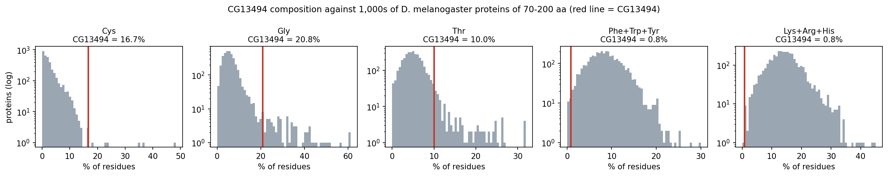
- [OpenScientist plot 10](openscientist_artifacts/provenance_plot_10.json)
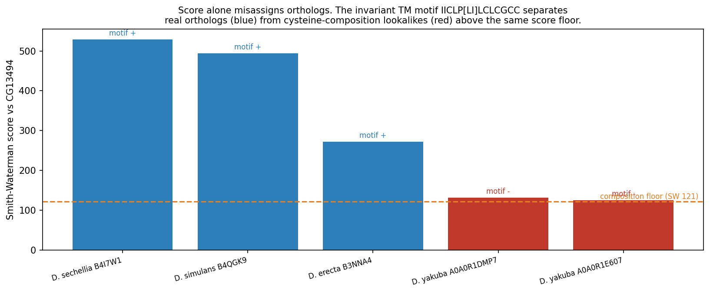
- [OpenScientist plot 11](openscientist_artifacts/provenance_plot_11.json)
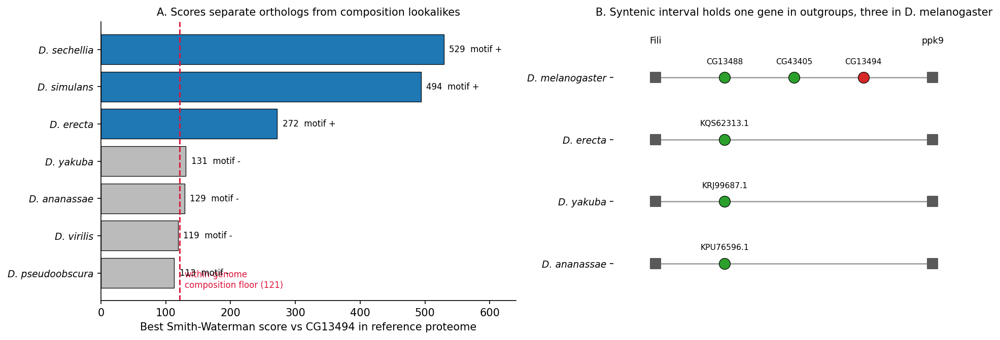
- [OpenScientist plot 2](openscientist_artifacts/provenance_plot_2.json)
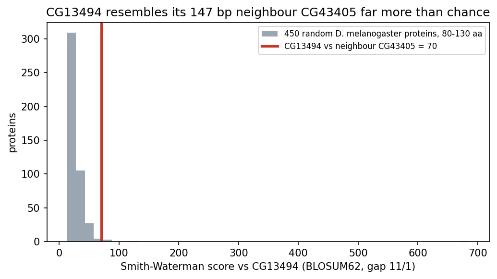
- [OpenScientist plot 3](openscientist_artifacts/provenance_plot_3.json)
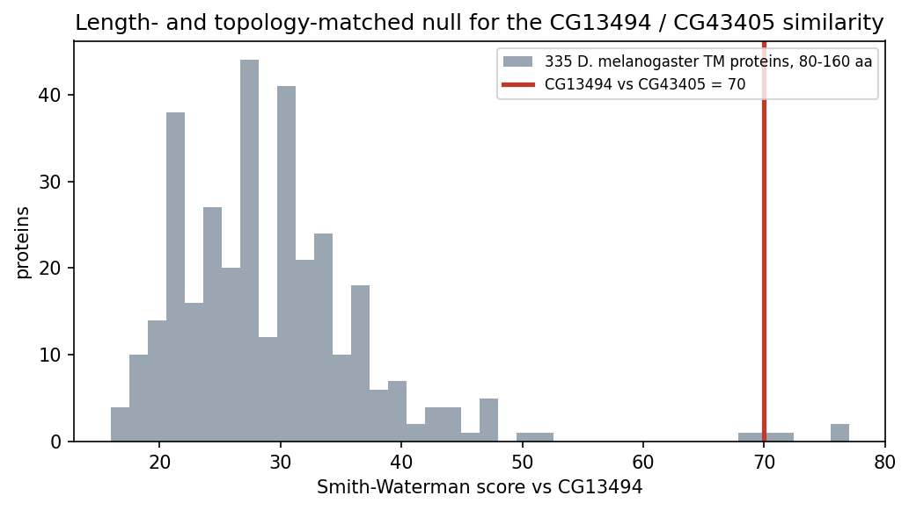
- [OpenScientist plot 4](openscientist_artifacts/provenance_plot_4.json)
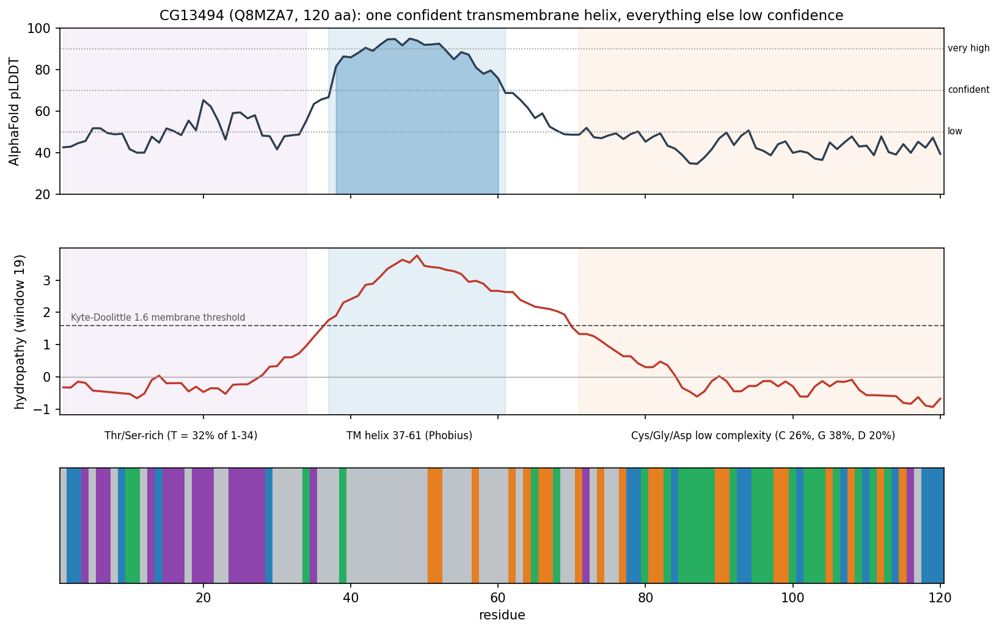
- [OpenScientist plot 5](openscientist_artifacts/provenance_plot_5.json)
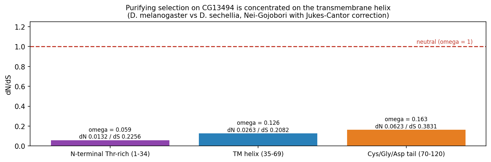
- [OpenScientist plot 6](openscientist_artifacts/provenance_plot_6.json)
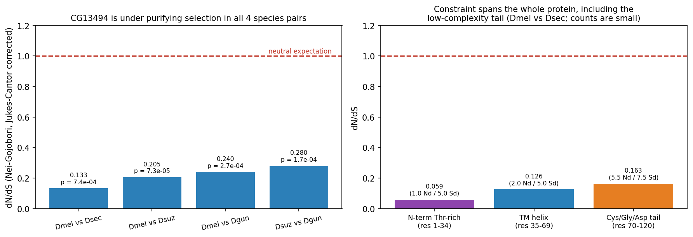
- [OpenScientist plot 7](openscientist_artifacts/provenance_plot_7.json)
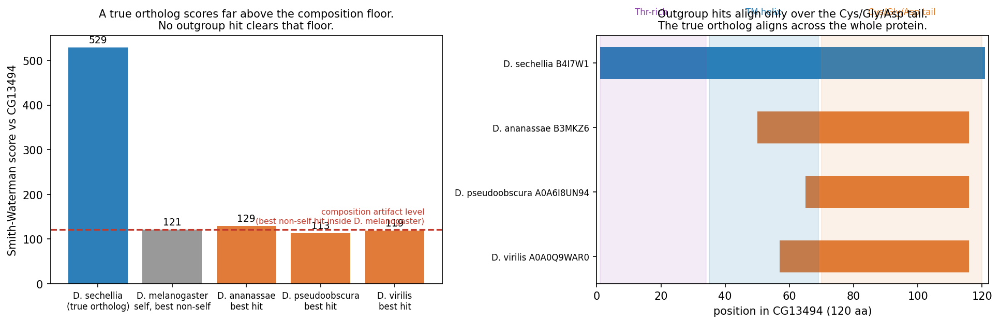
- [OpenScientist plot 8](openscientist_artifacts/provenance_plot_8.json)
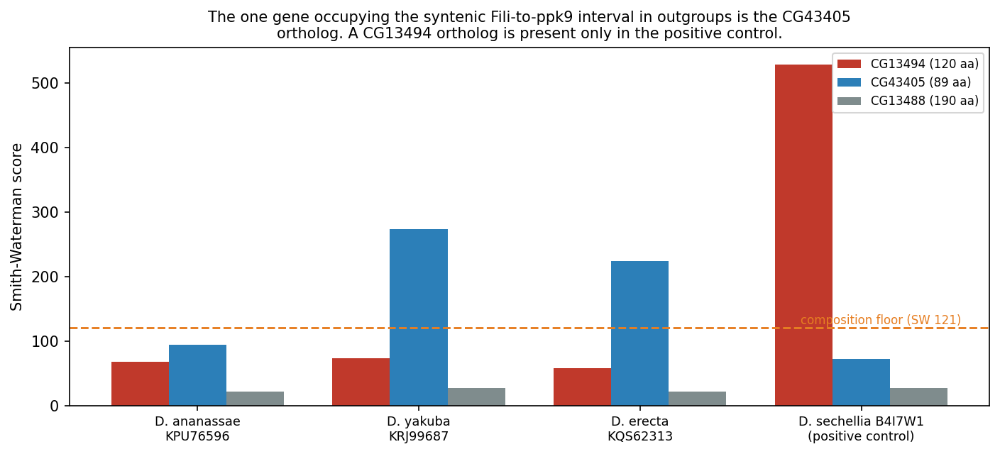
- [OpenScientist plot 9](openscientist_artifacts/provenance_plot_9.json)
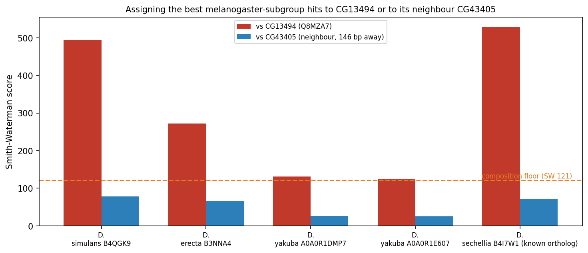

## Reference Validation

Checked with `linkml-reference-validator` 0.3.1rc1.

| Outcome | Count |
| --- | --- |
| References checked | 5 |
| Resolved | 5 |
| Unresolved (possible confabulation) | 0 |
| Unverifiable | 0 |
| Quoted claims checked | 4 |
| Quoted claims found in source | 0 |
| Quoted claims **not** found in source | 4 |
| References weighed for topical relevance | 5 |
| On topic | 1 |
| Off topic | 0 |

### Quotes not found in the cited source

Searched the abstract, any retrieved full text, and the title. A quote drawn from a part of the paper that was not retrieved will appear here too, so check before treating one as invented:

Every one of these was searched against an abstract alone, with no full text retrieved - marked *abstract only* below. Where full text can be fetched, re-running with it will settle them; where the source publishes only a summary to PubMed, as GeneReviews chapters do, it will not, and the quote has to be checked by hand against the chapter itself.

- `PMID:38280868` *(abstract only)*: "Using Alphafold2, ESMFold, and molecular dynamics, we identified a number of de novo gene candidates with protein products that are potentially well-folded, many of which are more likely to contain transmembrane and signal proteins compared to other annotated protein-coding genes."
  - closest text in source: "Single-cell RNA-seq analysis in testis shows that although most de novo gene candidates are enriched in spermatocytes, several young candidates are biased towards the early spermatogenesis stage, indicating potentially important but less emphasized roles of early germline cells in the de novo gene origination in testis"
- `PMID:37259569` *(abstract only)*: "Single-cell RNA-seq analysis in testis shows that although most de novo gene candidates are enriched in spermatocytes, several young candidates are biased towards the early spermatogenesis stage"
  - closest text in source: "The relatively small number of intergenic candidate genes discovered here is similar to that observed in the accessory gland, but substantially fewer than that observed in the testis."
- `PMID:36178469` *(abstract only)*: "Consistent with the literature, these genes tend to be short, single exon, and lowly expressed."
  - closest text in source: "All in all, there may not exist a single characteristic model of de novo protein evolution, but instead, there may be diverse evolutionary trajectories."
- `PMID:33306129` *(abstract only)*: "To quantify the similarity of these utORFs across Drosophila and infer phylostratigraphic age, we develop a synteny-based protein similarity approach."
  - closest text in source: "Here, we analyze two Drosophila de novo miRNAs that are expressed in a testis-specific manner with very high rates of evolution in their DNA sequence"