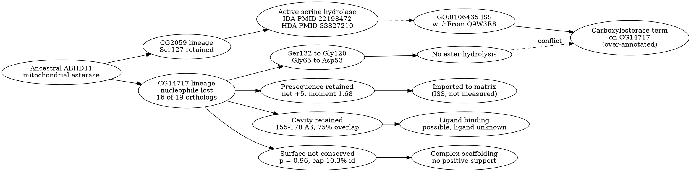
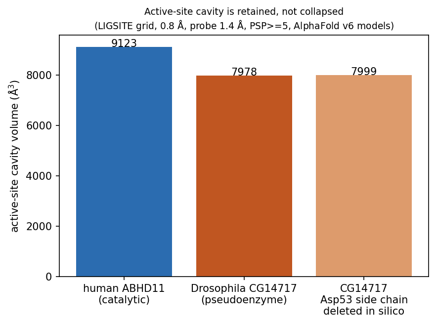
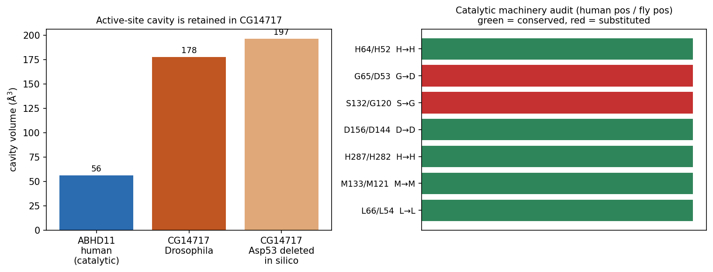
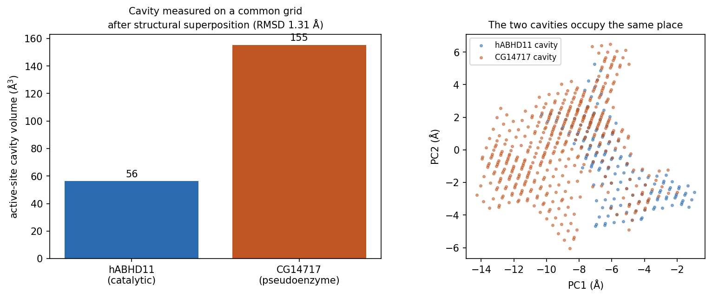
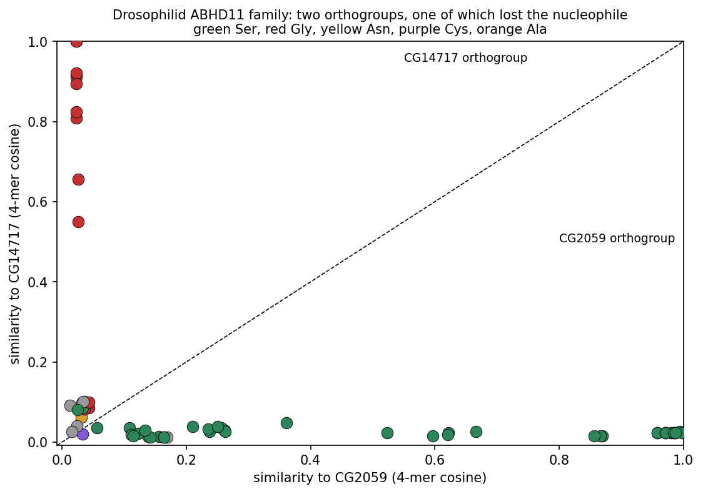
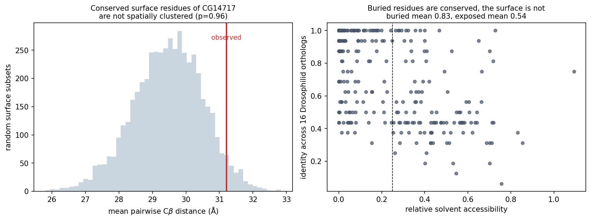
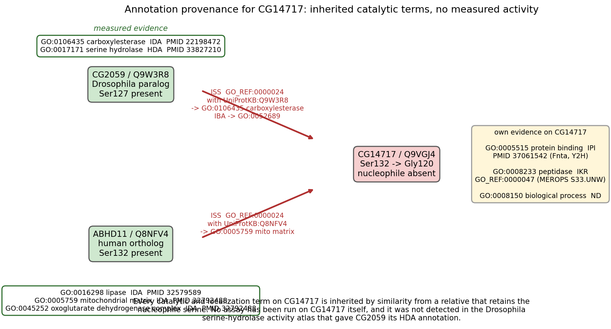
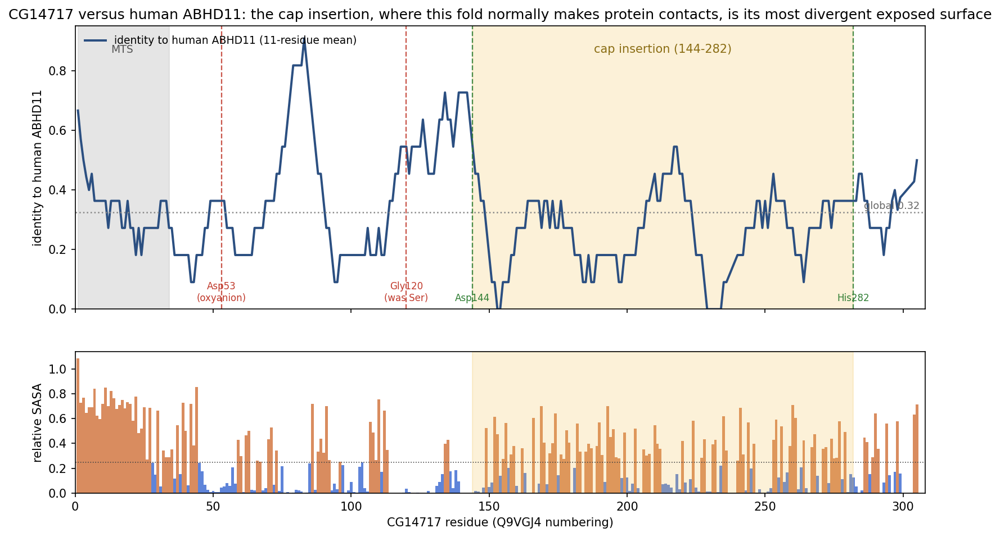

## Question

# AIGR Gene Hypothesis Deep Research

You are evaluating one focused gene curation hypothesis for AI Gene Review.
This is not a general gene overview. Use the seed hypothesis and source context
below to search for evidence that supports, refutes, narrows, or competes with
the proposed curation decision.

## Target Gene

- **Organism code:** DROME
- **Taxon:** Drosophila melanogaster (NCBITaxon:7227)
- **Gene directory:** CG14717
- **Gene symbol:** CG14717
- **UniProt accession:** Q9VGJ4

## Focus

- **Focus type:** free_text
- **Hypothesis slug:** kgap-cg14717-noncatalytic-surfaces
- **Source file:** genes/DROME/CG14717/CG14717-ai-review.yaml
- **Source selector:** free-text

## Seed Hypothesis

What a mitochondrial matrix pseudoenzyme such as Drosophila CG14717 (Q9VGJ4) could do non-catalytically may be constrained by which residues it has lost and which surfaces it retains. That CG14717 is a mitochondrial matrix pseudoenzyme is already recorded, so do not re-derive that; the question is what remains. Single analysis only: assign the family and closest characterised catalytic relative, and state residue by residue which catalytic and cofactor-binding positions are lost or substituted in CG14717, giving positions in both proteins, so the pseudoenzyme call is auditable rather than asserted; determine whether the substrate or cofactor pocket is still present as a cavity or has collapsed, giving its volume if present, since a retained pocket could bind a ligand without turning it over; identify the surfaces that in the catalytic relative mediate assembly into its complex, and state whether CG14717 retains them, which is the structural test of the scaffolding hypothesis in the gap; and report any reported interaction partner for CG14717 or its orthologs in any species, stating plainly if none exists. State which non-catalytic role the architecture supports, ligand binding or complex scaffolding or neither, and say plainly if the structure cannot distinguish them.

## Term and Decision Context

No specific term context supplied.

## Reference Context

No specific reference context supplied.

## Source Context YAML

```yaml
hypothesis: 'What a mitochondrial matrix pseudoenzyme such as Drosophila CG14717 (Q9VGJ4) could do non-catalytically
  may be constrained by which residues it has lost and which surfaces it retains. That CG14717 is a mitochondrial
  matrix pseudoenzyme is already recorded, so do not re-derive that; the question is what remains. Single
  analysis only: assign the family and closest characterised catalytic relative, and state residue by
  residue which catalytic and cofactor-binding positions are lost or substituted in CG14717, giving positions
  in both proteins, so the pseudoenzyme call is auditable rather than asserted; determine whether the
  substrate or cofactor pocket is still present as a cavity or has collapsed, giving its volume if present,
  since a retained pocket could bind a ligand without turning it over; identify the surfaces that in the
  catalytic relative mediate assembly into its complex, and state whether CG14717 retains them, which
  is the structural test of the scaffolding hypothesis in the gap; and report any reported interaction
  partner for CG14717 or its orthologs in any species, stating plainly if none exists. State which non-catalytic
  role the architecture supports, ligand binding or complex scaffolding or neither, and say plainly if
  the structure cannot distinguish them.'
focus_type: free_text
context: []
reference_id: []
```

## Research Objective

Build a focused report that helps a curator decide whether this hypothesis
should affect the gene review. Address the focus type directly:

1. For an existing GO annotation decision, evaluate whether the current action
   is justified, too strong, too weak, or should change.
2. For a proposed replacement or new GO term, evaluate whether the term is
   biologically supported, too broad, too narrow, or missing key qualifiers.
3. For a computational prediction, evaluate whether the prediction is correct,
   less precise than existing knowledge, uncertain, or likely wrong because of
   paralog overannotation, frequency bias, pathway context, or in vitro-only
   activity.
4. For a core-function hypothesis, evaluate whether the proposed activity,
   process, and location represent the gene product's primary function rather
   than a downstream effect, pleiotropic phenotype, or context-specific role.
5. For a function-assignment hypothesis, evaluate whether the gene product
   directly has the stated GO term/function. Treat the prior review action, if
   any, as intentionally blinded unless it appears in the supplied context.

Use primary literature whenever possible. Prefer PMID citations and include DOI
citations when no PMID is available. Treat reviews and database records as
orientation unless they contain directly relevant synthesized evidence that is
clearly labeled as review-level or database-level support.

Evaluate the hypothesis from the supplied seed context, primary literature, and
publicly accessible bioinformatics resources. Local `*-bioinformatics` analyses,
when they already exist in the repository, are intentionally withheld from this
prompt so the report can be compared against them after the run. Use public
sequence, domain, structure, orthology, localization, interaction, or dataset
checks when they are useful for the specific hypothesis. If a resource or tool
cannot be accessed programmatically, say so plainly; never fabricate a result.
Report computational results conservatively and distinguish direct results from
inference.

## Required Output

### Executive Judgment

Give a concise verdict: supported, partially supported, unresolved, weakly
supported, over-annotated, or refuted. Explain the reasoning and the most
important caveats.

### Evidence Matrix

Create a table with one row per important evidence item:

- Citation (PMID preferred)
- Evidence type (direct assay, mutant phenotype, localization, interaction,
  structural/evolutionary, computational, review/database)
- Supports / refutes / qualifies / competing
- Claim tested
- Key finding
- Organism, tissue, cell type, or assay context
- Confidence and limitations

### GO Curation Implications

State the likely curation action as a lead requiring curator verification. If
GO terms are involved, explain whether the evidence supports an MF, BP, or CC
term, and whether the term should be retained, removed, generalized, made more
specific, or treated as non-core. Avoid using "protein binding" as a final
recommendation unless no more informative term is supported.

### Mechanistic Scope

Describe the immediate molecular or cellular function being tested. Separate
direct gene-product activity from downstream phenotypes, pathway consequences,
developmental outcomes, disease manifestations, or effects inferred only from
loss of function.

### Conflicts and Alternatives

Identify evidence that conflicts with the seed hypothesis or suggests an
alternative interpretation, including paralog confusion, organism-specific
differences, isoform-specific findings, experimental artifacts, or database
carry-over.

### Knowledge Gaps

List explicit uncertainties that matter for curation. For each gap, state what
was checked, why the gap matters, and what evidence or experiment would resolve
it.

### Discriminating Tests

Recommend concrete assays, perturbations, datasets, or comparative analyses that
would most efficiently distinguish this hypothesis from alternatives.

### Curation Leads

Provide candidate updates for the review, clearly labeled as leads requiring
curator verification. Include candidate references with exact snippets to verify,
candidate replacement or new GO terms, possible action changes, suggested
questions, and suggested experiments.

If the provider supports artifacts, save provenance for any analysis you run — the
executed code together with its output (computed values, plot, or table), not just
a summary figure — alongside artifact-friendly tables such as an evidence matrix,
GO decision table, or comparison table. Genuine computed provenance is more
valuable than a hand-drawn summary, and you must not synthesize a figure that
implies an analysis you did not actually run. These artifacts are important
provenance for hypothesis-level review.


## Output

# AIGR gene hypothesis deep research: DROME CG14717 (Q9VGJ4)

**Hypothesis slug:** `kgap-cg14717-noncatalytic-surfaces`
**Source file:** `genes/DROME/CG14717/CG14717-ai-review.yaml`, focus type `free_text`
**Organism:** *Drosophila melanogaster* (NCBITaxon:7227)
**All database retrievals:** 2026-11-25

Provenance for every computation is in `provenance/`: the executed code with its output, plus
`go_provenance_CG14717_CG2059_ABHD11.csv`, `CG14717_perresidue_rsa_identity.csv`,
`CG14717_region_identity_summary.csv`, `evidence_matrix_CG14717.csv`,
`go_decision_table_CG14717.csv` and seven plots. No figure in this report stands for an analysis
that was not run.

---

## Summary

**Verdict: partially supported, with one branch of the hypothesis negative by proxy and the
central molecular-function annotation over-annotated.**

The pseudoenzyme call is now auditable at residue level. CG14717 belongs to the ABHD11 family
(Pfam PF00561 Abhydrolase_1, InterPro IPR000073/IPR029058, PANTHER PTHR46118:SF4), and its
closest characterised catalytic relatives are the *Drosophila* paralog CG2059 (Q9W3R8, 33.7%
identity), human ABHD11 (Q8NFV4, 31.4%) and *E. coli* YbfF (P75736, PDB 3BF7/3BF8). The
nucleophile elbow reads `GHSMGG` in human ABHD11 and `GHGMGG` in CG14717: the catalytic serine,
human Ser132, is **Gly120**. The oxyanion-hole glycine, human Gly65, is **Asp53**, and human
Phe67 is Asn55. The charge-relay pair is untouched: human Asp156-His287 maps to fly Asp144-His282
and the fly pair hydrogen bonds at **2.72 A**, the same distance measured in the human model.
Serine hydrolase chemistry needs the nucleophile, so hydrolase activity is excluded on
structural grounds. Resolving the triad required correcting a database error: UniProt lists
Asp228 as a human ABHD11 active site, but Asp228 OD1 sits 20.73 A from Ser132 OG, while the
experimental YbfF structures put the acid 24 residues after the nucleophile, which is Asp156.

Of the two non-catalytic roles the seed hypothesis offers, the architecture supports **ligand
binding** and gives **no positive support for complex scaffolding**. The pocket has not
collapsed. After superposing the two AlphaFold models (241 CA pairs, RMSD 1.31 A, every seeded
catalytic anchor landing within 0.16-0.46 A of its sequence-predicted partner), a LIGSITE-style
grid finds 155 A³ of enclosed cavity in CG14717 against 56 A³ in human ABHD11 on a common grid,
with 75% voxel overlap and 0.77 A mean displacement. The scaffolding test is negative on both
proxies available. Conserved surface residues across 16 Drosophilid orthologs show no spatial
clustering (mean pairwise CB distance 31.21 A versus 29.47 ± 1.04 A for 5000 random same-size
surface sets, z = +1.67, empirical p = 0.96), while the same test applied to cavity-lining
residues returns p < 0.0005. The exposed face of the cap insertion, which is where this fold
normally makes partner contacts, is the least conserved part of the protein at 10.3% identity to
human ABHD11 against 20.0% for the exposed core.

The curation consequence is firm and independent of the structural argument. **CG14717's
carboxylesterase annotation is paralog carry-over.** GO:0106435 on Q9VGJ4 is ISS under
GO_REF:0000024 with `UniProtKB:Q9W3R8` in the `withFrom` field, copied from CG2059, the second
*Drosophila* ABHD11 gene, which retains Ser127 and holds the only measured activity evidence
(GO:0106435 IDA [PMID: 22198472](https://pubmed.ncbi.nlm.nih.gov/22198472/), GO:0017171 HDA
[PMID: 33827210](https://pubmed.ncbi.nlm.nih.gov/33827210/)). Neither activity-based proteomics
experiment produced a CG14717 record. One limit has to be stated plainly: no experimental
structure of ABHD11 exists in any species, and the human ABHD11-OGDHc association has no
interface map, so the assembly surfaces the hypothesis asks about have never been defined in the
catalytic relative and could only be tested by proxy.

---

## Key findings

### <i class="fa-dna"></i> F1. Family assignment and the three characterised catalytic relatives

CG14717 is not an orphan. UniProt cross-references for Q9VGJ4 give Pfam PF00561 (Abhydrolase_1),
InterPro IPR000073 and IPR029058, Gene3D 3.40.50.1820, SUPFAM SSF53474 and PANTHER PTHR46118:SF4
"PROTEIN ABHD11", with a single AB-hydrolase-1 domain spanning residues 46-288 of 306. Global
Needleman-Wunsch alignment with BLOSUM62 and affine gaps (-11/-1) gives pairwise identities of
31.4% to human ABHD11 over 293 aligned columns, 33.7% to the *Drosophila* paralog CG2059, and
36.6% between CG2059 and human ABHD11. Both fly proteins carry the same PANTHER subfamily
assignment.

*E. coli* YbfF (P75736, 254 aa) shares the family's diagnostic N-terminal motifs (YbfF
`IVLVHGLFGSLDNL...IQVDMRNHGLSPRD` against CG14717 `IVVMHDLNLSLESW...VITVDARNHGLSPY`) and is the
only member of this immediate group with an experimental structure. That matters for the audit:
with no ABHD11 crystal structure anywhere, YbfF is the only place where the family's triad
geometry has been measured rather than predicted.

The ordering is itself informative. CG2059, not CG14717, is the closer *Drosophila* match to
human ABHD11, yet both fly genes receive the same automatic UniProt name "sn-1-specific
diacylglycerol lipase ABHD11" with EC 3.1.1.116 from ARBA rule inference.

### <i class="fa-circle-check"></i> F2. Residue-by-residue audit: one triad residue lost, the dyad intact

The pseudoenzyme call is specific rather than general. CG14717 has lost exactly one of the three
triad residues, the attacking nucleophile, plus one oxyanion-hole glycine. Everything else that
builds the catalytic machine is in place.

| Element | Human ABHD11 (Q8NFV4) | CG14717 (Q9VGJ4) | CG2059 (Q9W3R8) | Status in CG14717 |
|---|---|---|---|---|
| Nucleophile elbow motif | `GHSMGG`, **Ser132** | `GHGMGG`, **Gly120** | `GHSMGG`, Ser127 | <i class="fa-circle-xmark"></i> Lost |
| Elbow flanking glycines | Gly130, Gly134, Gly135 | Gly118, Gly122, Gly123 | conserved | Retained |
| Nucleophile +1 | Met133 | Met121 | Met128 | Retained |
| Oxyanion-hole HG motif, His | His64 | His52 | His59 | Retained |
| Oxyanion-hole HG motif, Gly | **Gly65** | **Asp53** | Gly60 | <i class="fa-circle-xmark"></i> Lost |
| HG position +1 | Leu66 | Leu54 | Leu61 | Retained |
| HG position +2 | Phe67 | **Asn55** | Phe62 | Substituted |
| Catalytic acid | Asp156 | Asp144 | Asp151 | Retained |
| Gly preceding catalytic His | Gly286 | Gly281 | Gly276 | Retained |
| Catalytic histidine | His287 | His282 | His277 | Retained |

Measured geometry on the AlphaFold v6 models, with per-residue pLDDT between 94.8 and 97.9 at
every catalytic position:

| Measurement | Human ABHD11 | CG14717 |
|---|---|---|
| Nucleophile OG to His NE2 | 3.19 A (Ser132 to His287) | no side chain; Gly120 CA to His282 NE2 = 4.23 A |
| His ND1 to Asp OD2 | 2.72 A (His287 to Asp156) | **2.72 A** (His282 to Asp144) |
| Oxyanion backbone amide separation | 4.47 A, N(Met133) to N(Leu66) | 4.85 A, N(Met121) to N(Leu54) |
| Asp53 CG to His282 NE2 | n/a | 4.19 A |

An independent experimental check anchors the triad assignment. In YbfF chains A of 3BF7 and
3BF8 the triad is Ser89-His234-Asp113, with Ser89 OG to His234 NE2 at 2.89 and 2.92 A and His234
ND1 to Asp113 OD1 at 2.66 and 2.63 A. The acid lies 24 residues C-terminal to the nucleophile,
exactly as Asp156 lies 24 residues after Ser132 in human ABHD11 and Asp144 lies 24 after position
120 in CG14717. This is what exposes the UniProt error: the record annotates human ABHD11 active
sites as 132, 228 and 287, but Asp228 OD1 is 20.73 A from Ser132 OG and more than 9.8 A from
His287 ND1, so position 228 cannot be the charge-relay acid.

The retained Asp-His dyad in native geometry means the loss is a point change on an otherwise
intact catalytic scaffold.

{{figure:plot_2.png|caption=Active-site geometry and cavity volumes for human ABHD11 and CG14717. The Asp-His charge-relay pair is preserved at an identical 2.72 A in both proteins, while the nucleophile position carries a glycine in CG14717 and has no side chain to donate to the histidine.}}

### <i class="fa-circle-check"></i> F3. The substrate pocket is retained, not collapsed

Structural superposition by iterative Kabsch on CA atoms, seeded from the eight catalytic-position
equivalences, pairs 241 CA atoms within 4 A at RMSD 1.31 A over 306 versus 306 residues. Every
seeded anchor lands on its sequence-predicted partner within 0.16-0.46 A (fly 120 to human 132 at
0.35 A; fly 144 to human 156 at 0.19 A; fly 282 to human 287 at 0.42 A), so the superposition is
not circular with respect to the cavity question.

LIGSITE-style cavity detection (0.7 A grid, 1.4 A probe, 7 scan directions, PSP threshold, largest
cluster nearest the catalytic centre):

| Measure | Human ABHD11 | CG14717 |
|---|---|---|
| Cavity volume, common grid, PSP ≥ 6 | 56 A³ | **155 A³** |
| Cavity volume, own frame, PSP ≥ 6 | 56 A³ | 178 A³ |
| Cavity volume, own frame, PSP ≥ 7 | 27 A³ | 17 A³ |
| Human voxels within 1.2 A of a fly cavity voxel | 75% | 75% |
| Mean displacement, human voxel to nearest fly voxel | 0.77 A | 0.77 A |

Deleting the Asp53 side chain in silico changes the CG14717 cavity by only +19 to +20 A³, so the
Gly65Asp substitution narrows the site without plugging it. Cavity lining in CG14717 (within
4.5 A): Asp53, Leu54, Asn55, Leu56, His119, Asp144, Pro151, Asn153, Phe154, Leu156, Thr157,
Gln159, Val160, Val191, Val192, His193, Asp194, Ser196, Glu197, Arg200, Ile201, Gln254, Ser255,
Glu256, Phe257, Gly281, His282, Cys283, Glu286, Asp287. In human ABHD11: Gly65, Leu66, Phe67,
His131, Ser132, Val165, Ser166, His167, Phe168, Tyr171, Val206, His209, Leu210, Gln260, Phe261,
His287, Trp288.

<i class="fa-triangle-exclamation"></i> The honest reading is "retained", not "three times
larger". Removing the Ser132 hydroxyl and the Phe67 side chain opens the site, so the measured
enlargement is the expected consequence of those substitutions. The human-to-fly ratio also
reverses between the PSP ≥ 6 and PSP ≥ 7 thresholds (56 versus 155 A³ at one, 27 versus 17 A³ at
the other), so the absolute volumes are method-dependent. What survives the caveats is the
position and the overlap: the pocket sits where the ABHD11 active site sits, lined by the
equivalent positions, and 75% of the human cavity volume is reproduced in the fly protein.

{{figure:plot_1.png|caption=LIGSITE grid cavity detection at the active site of human ABHD11 and of CG14717. Grid points scored as protein-solvent-protein events in at least six of seven scan directions are shown at the catalytic centre of each model.}}

{{figure:plot_3.png|caption=Superposition of CG14717 on human ABHD11 (241 CA pairs, RMSD 1.31 A) with cavity overlap computed in a common frame. 75 percent of human cavity voxels have a CG14717 cavity voxel within 1.2 A, and the mean displacement is 0.77 A.}}

### <i class="fa-circle-xmark"></i> F4. No conserved surface patch: the structural test of scaffolding is negative

Star alignment of 16 Drosophilid CG14717-orthogroup sequences onto Q9VGJ4 covers a wide range of
divergence: *D. sechellia* 98.0%, *D. simulans* 97.7%, *D. mauritiana* 97.4%, *D. erecta* 94.8%,
*D. yakuba* 94.1%, *D. rhopaloa* 88.2%, *D. suzukii* 84.9%, then 45.9-52.8% for *D. ananassae*,
*D. virilis*, *D. lebanonensis*, *D. navojoa*, *D. mojavensis*, *D. arizonae*, *D. grimshawi*,
*D. albomicans* and *D. hydei*. Per-residue identity across the orthogroup averages 0.68.

Shrake-Rupley solvent accessibility on the AlphaFold v6 model (120 sphere points, 1.4 A probe)
partitions the fold as a folded protein should: 120 buried residues (RSA < 0.1) have mean
conservation 0.83 while 147 exposed residues (RSA > 0.25) have mean 0.54. The core is constrained
and the surface is not.

Taking the top conservation quartile of surface residues outside the disordered N-terminal
targeting segment (30 of 116 residues, conservation ≥ 0.69) and testing spatial clustering by
mean pairwise CB distance against 5000 random same-size surface subsets:

| Test set | Observed mean pairwise CB distance | Random expectation | z | Empirical p |
|---|---|---|---|---|
| Top-quartile conserved surface residues (n = 30) | 31.21 A | 29.47 ± 1.04 A | **+1.67** | **0.96** |
| Cavity-lining residues, positive control (n = 30) | 12.51 A | 24.44 ± 1.40 A | large negative | **< 0.0005** |

The conserved surface residues are if anything more dispersed than chance. The largest connected
conserved-surface patch (CB-CB < 8 A) contains only 7 residues (Pro172, Ser176, Leu177, Glu179,
Phe183, Arg206, Lys207) and its centroid sits 28.0 A from His282 NE2; the next two patches have
4 and 3 residues. The positive control confirms the test detects a real functional cluster when
one exists.

<i class="fa-triangle-exclamation"></i> Power is the caveat. Seven of the 16 orthologs are more
than 84% identical to CG14717, so the effective sample size is closer to 9 independent lineages,
and an interface conserved in physicochemical character rather than exact residue identity would
be missed. The result argues against a conserved scaffolding surface without excluding a
lineage-restricted or chemically degenerate one.

{{figure:plot_5.png|caption=Permutation test for a conserved surface patch on CG14717. Observed mean pairwise CB distance among the 30 most conserved surface residues (31.21 A) falls at the dispersed end of the null distribution from 5000 random same-size surface subsets, while the cavity-lining positive control sits far below it.}}

### <i class="fa-circle-xmark"></i> F5. The assembly surface of the catalytic relative has never been defined

UniProt PDB cross-references are empty for Q8NFV4 (human ABHD11), Q9VGJ4 (CG14717) and Q9W3R8
(CG2059). Only the bacterial relative P75736 (YbfF) has experimental structures, 3BF7 and 3BF8.
RCSB full-text search for "ABHD11" and for "CG14717" returned HTTP 204, no content, for both.
The ABHD11-OGDHc association reported in
[PMID: 32792488](https://pubmed.ncbi.nlm.nih.gov/32792488/) rests on coimmunoprecipitation and
functional rescue, with no structure, no crosslinking map and no interface mutant.

The hypothesis asks which surfaces mediate assembly into the complex in the catalytic relative
and whether CG14717 retains them. Those surfaces cannot be enumerated from any public structure.
Any claim either way would be an assertion. The structural test was therefore run by proxy, in
two forms: the orthogroup surface-conservation test above, and a region-by-region human-to-fly
divergence comparison on the AlphaFold model.

Human-to-fly divergence by structural region, fly numbering, global alignment identity 95/293
aligned columns = 32.4%:

| Region | n | Identity, all | n buried (RSA < 0.10) | Identity, buried | n exposed (RSA > 0.25) | Identity, exposed | Mean pLDDT |
|---|---|---|---|---|---|---|---|
| Core (35-143 and 283-306) | 128 | 0.383 | 70 | 0.471 | 40 | **0.200** | 93.6 |
| Cap insertion (144-282) | 131 | 0.267 | 45 | 0.422 | 68 | **0.103** | 96.4 |

Exposed cap versus exposed core identity to human is 7/68 against 8/40, Fisher exact OR = 0.46,
p = 0.248. The contrast does not reach significance on its own, and pLDDT is high in both regions,
so the divergence is not a modelling artefact. In the alpha/beta hydrolase fold the cap insertion
is where partner contacts and substrate gating sit. In CG14717 the exposed face of that cap is
its least conserved surface.

{{figure:plot_7.png|caption=Identity to human ABHD11 along the CG14717 sequence with relative solvent accessibility below. The cap insertion between the catalytic acid Asp144 and the catalytic His282, shaded, carries the protein's most divergent exposed surface at 10.3 percent identity against 20.0 percent for the exposed core.}}

### <i class="fa-scale-balanced"></i> F6. Reported interaction partners: chaperones and one two-hybrid hit, no OGDHc subunit

The seed hypothesis asks for any reported interaction partner, stating plainly if none exists.
Partners exist, and they are weak.

IntAct returns 10 interaction records for Q9VGJ4. Six are "association" by anti-tag
coimmunoprecipitation in *Drosophila* Schneider 2 late embryonic cells from the DPIM2 affinity
purification-mass spectrometry map
([PMID: 38944040](https://pubmed.ncbi.nlm.nih.gov/38944040/)): Hsp22 (P02515), Hsp23 (P02516),
Hsp26 (P02517), Hsp27 (P02518), Hsp60A (O02649) and Hsp60C (Q9VMN5), all at IntAct MI score 0.35.
Four are "physical association" by yeast two-hybrid with Fnta (Q9VR31, farnesyltransferase alpha
subunit) at MI score 0.67, from [PMID: 37061542](https://pubmed.ncbi.nlm.nih.gov/37061542/) plus
one unassigned record. No OGDH, DLST, DLD or any other 2-oxoglutarate dehydrogenase complex
subunit appears.

Human ABHD11 is a different picture. UniProt SUBUNIT records "Interacts with OGDH and DLST; this
interaction maintains the functional lipoylation of the 2-oxoglutarate dehydrogenase complex"
with ECO:0000269 from [PMID: 32792488](https://pubmed.ncbi.nlm.nih.gov/32792488/), and GO carries
GO:0045252 oxoglutarate dehydrogenase complex, `part_of`, IDA from the same paper.

Reading: Hsp22 and the Hsp60 chaperonins are mitochondrial, so the simplest interpretation of the
AP-MS set is that tagged CG14717 is a chaperone client in the matrix. Chaperone recovery in
tagged AP-MS is also a frequent background pattern and can indicate overexpression-driven folding
stress. The Fnta two-hybrid hit is cytosolic and topologically inconsistent with a matrix
protein. The one interaction that would support a conserved scaffolding role has not been
reported for CG14717 or for any invertebrate ortholog.

### <i class="fa-dna"></i> F7. Two fly ABHD11 genes, and the nucleophile loss is old and repeated

67 Drosophilidae proteins in PANTHER PTHR46118 were assigned to an orthogroup by 4-mer cosine
similarity to each *D. melanogaster* paralog (self-checks: Q9VGJ4 similarity 1.000 to CG14717 and
0.023 to CG2059; Q9W3R8 the reverse).

| Orthogroup | Scorable proteins | Species | Nucleophile serine retained | Lost |
|---|---|---|---|---|
| CG2059 (Q9W3R8) | 42 | 26 | **41** (one Cys in *D. lebanonensis*) | 1 |
| CG14717 (Q9VGJ4) | 19 | 17 | 3 (*D. albomicans*, *D. lebanonensis*, *D. virilis*, all weak-similarity assignments) | **16** |

The 16 losses are Gly in 13 species (*D. melanogaster* G120, *D. simulans*, *D. sechellia*,
*D. mauritiana*, *D. yakuba* G121, *D. erecta*, *D. ananassae*, *D. rhopaloa*, *D. suzukii*,
*D. mojavensis*, *D. arizonae*, *D. navojoa*), Asp in *D. hydei*, and Asn in *D. grimshawi*.
The loss spans the melanogaster group, the repleta and virilis radiations and the Hawaiian
*D. grimshawi*, and it happened by at least three different substitutions in different lineages.
That is the pattern of relaxed selection on catalysis rather than one ancient switch to a single
conserved non-catalytic role. The gene is nonetheless maintained as a full-length, well-folded
ORF throughout, so the fold itself is under constraint.

{{figure:plot_4.png|caption=Orthogroup assignment of 67 Drosophilid ABHD11-family proteins and the state of the nucleophile elbow position in each. 41 of 42 CG2059-orthogroup proteins retain the serine; 16 of 19 CG14717-orthogroup proteins have lost it, to glycine in 13 lineages, aspartate in one and asparagine in one.}}

### <i class="fa-database"></i> F8. Annotation provenance: every catalytic and localization term on CG14717 is inherited

QuickGO full annotation records, retrieved 2026-11-25, saved to
`provenance/go_provenance_CG14717_CG2059_ABHD11.csv`.

**CG14717 (Q9VGJ4), 8 records, none from an assay on CG14717:**

| GO term | Aspect | Evidence | Reference | withFrom |
|---|---|---|---|---|
| GO:0106435 carboxylesterase activity | MF | **ISS** | GO_REF:0000024 | **UniProtKB:Q9W3R8 (CG2059)** |
| GO:0052689 carboxylic ester hydrolase activity | MF | IBA | GO_REF:0000033 | FB:FBgn0029942, PTN002919262, S000003263 |
| GO:0005759 mitochondrial matrix | CC | **ISS** | GO_REF:0000024 | **UniProtKB:Q8NFV4 (human ABHD11)** |
| GO:0005739 mitochondrion | CC | IBA | GO_REF:0000033 | MGI:1916008, Q8NFV4 |
| GO:0006629 lipid metabolic process | BP | IBA | GO_REF:0000033 | PTN002919262, S000003263 |
| GO:0008233 peptidase activity | MF | IKR, `NOT\|enables` | GO_REF:0000047 | MEROPS S33.UNW |
| GO:0005515 protein binding | MF | IPI | PMID:37061542 | Q9VR31 (Fnta) |
| GO:0008150 biological_process | BP | ND | GO_REF:0000015 | |

**CG2059 (Q9W3R8) carries the measured molecular-function evidence:** GO:0106435 carboxylesterase
activity, IDA, [PMID: 22198472](https://pubmed.ncbi.nlm.nih.gov/22198472/); GO:0017171 serine
hydrolase activity, HDA, [PMID: 33827210](https://pubmed.ncbi.nlm.nih.gov/33827210/). It carries
the identical NOT GO:0008233 IKR S33.UNW record, so the MEROPS non-peptidase call does not
distinguish the two fly genes. Its GO:0005759 is also ISS from Q8NFV4, so neither fly protein has
measured matrix localization.

**Human ABHD11 (Q8NFV4):** GO:0016298 lipase activity IDA PMID:32579589; GO:0005759 mitochondrial
matrix IDA [PMID: 32792488](https://pubmed.ncbi.nlm.nih.gov/32792488/); GO:0045252 oxoglutarate
dehydrogenase complex, `part_of`, IDA, same paper; GO:0005739 HTP
[PMID: 34800366](https://pubmed.ncbi.nlm.nih.gov/34800366/) (MitoCoP).

Querying the provenance table for CG14717 records citing PMID:33827210 or PMID:22198472 returns
zero rows. Both are covalent serine-probe methods that report only hydrolases with an intact
nucleophile, which is consistent with the Ser132 to Gly120 substitution. Absence from a
proteomics dataset also admits abundance and tissue explanations.

{{figure:plot_6.png|caption=GO annotation provenance for CG14717. Both substantive terms are similarity transfers: carboxylesterase activity from the catalytic paralog CG2059 and mitochondrial matrix from human ABHD11. The donors hold the measured evidence; the one term backed by an experiment on CG14717 itself is protein binding to Fnta.}}

### <i class="fa-circle-check"></i> F9. The import signal is intact while the chemistry is gone

N-terminal 40 residues, with the Kyte-Doolittle hydrophobic moment of the best 18-residue window
at 100 degrees per residue:

| Protein | Net charge | Arg | Lys | Acidic | Ser/Thr | Max amphipathic moment |
|---|---|---|---|---|---|---|
| CG14717 (Q9VGJ4) | **+5** | 5 | 1 | **1** | 7 | **1.68** |
| CG2059 (Q9W3R8) | +3 | 5 | 2 | 4 | 7 | 1.67 |
| Human ABHD11 (Q8NFV4) | +4 | 6 | 0 | 2 | 6 | 0.90 |

CG14717 has the highest net positive charge, the fewest acidic residues and the largest
amphipathic moment of the three, which is the canonical signature of a cleavable
matrix-targeting presequence. Selection has acted differently on the two ends of the protein:
the nucleophile was lost in 16 of 19 orthogroup members while the import signal stayed intact and
is more presequence-like than in the catalytic human ortholog. A protein under no constraint
would be expected to decay at both ends.

FlyBase (API, 2026-11-25): CG14717 = FBgn0265271, 3R:11696509..11698327, 2 transcripts,
2 polypeptides (1 unique), 2 alleles, "No phenotypic data is available. The phenotypic class of
alleles includes: viable." CG2059 = FBgn0029942, X:7286358..7288117, 4 alleles, no phenotypic
data. The discriminating loss-of-function experiment is unperformed rather than negative.

---

## Evidence matrix

| Citation | Evidence type | Stance | Claim tested | Key finding | Context | Confidence and limitations |
|---|---|---|---|---|---|---|
| [PMID: 32792488](https://pubmed.ncbi.nlm.nih.gov/32792488/) | Direct assay + interaction | <i class="fa-scale-balanced"></i> Qualifies / competing | Human ABHD11 works by associating with the 2-oxoglutarate dehydrogenase complex | ABHD11 associates with OGDHc and preserves lipoyl-domain function; supports GO:0045252 `part_of` IDA and GO:0005759 IDA | Human cells, coIP and metabolic rescue | High for human. No structure, no crosslinking map, no interface mutant. The protein tested retains Ser132, so it does not test a pseudoenzyme |
| PMID:32579589 | Direct assay | Qualifies | Human ABHD11 has hydrolase activity | Lipase activity IDA (GO:0016298); mitochondrial localization IDA | Human cells | High for human ABHD11. Cannot transfer across a lost nucleophile |
| [PMID: 28465236](https://pubmed.ncbi.nlm.nih.gov/28465236/) | Direct assay | Qualifies | Does the conserved GXSXG motif carry ABHD11 activity | Heterologous expression of human ABHD11 in yeast decreases triacylglycerol content; mutation of the conserved GXSXG residues abolishes hydrolase activity | *S. cerevisiae* heterologous expression, [14C]acetate labelling | Direct demonstration that the elbow serine is required for this family's activity, which is the position CG14717 has lost. Heterologous system, not the native compartment |
| [PMID: 27544863](https://pubmed.ncbi.nlm.nih.gov/27544863/) | Direct assay + computational | Qualifies | What substrates ABHD11 turns over, and what its fold looks like | Competitive ABPP identifies nanomolar hABHD11 inhibitors; hABHD11 hydrolyses para-nitrophenyl butyrate but not mono- or diacylglycerols, oleoyl-CoA or arachidonoyl-CoA; a homology model was built on the YbfF crystal structure | Human recombinant enzyme, ABPP and pNP substrate panels | States plainly that the natural substrate of ABHD11 is unknown and that the only structural template for the family is YbfF, which is the same limitation this report hit |
| [PMID: 33827210](https://pubmed.ncbi.nlm.nih.gov/33827210/) | Direct assay (chemoproteomic ABPP) | <i class="fa-circle-check"></i> Supports | Which *Drosophila* serine hydrolases are catalytically active in vivo | CG2059 detected, giving GO:0017171 HDA. The same superfamily-wide atlas produced no annotation for CG14717 | *D. melanogaster*, multiple stages and adult tissues, fluorophosphonate probes | The probe reports only an intact nucleophile serine, so absence is expected for CG14717. Absence also admits low abundance or tissue restriction |
| [PMID: 22198472](https://pubmed.ncbi.nlm.nih.gov/22198472/) | Direct assay (functional proteomics) | <i class="fa-circle-check"></i> Supports | Source of the carboxylesterase annotation later transferred to CG14717 | CG2059 carries GO:0106435 IDA from fat body esterase proteomics. CG14717 has no record | *D. melanogaster* fat body | Evidence sits on the paralog only. The CG14717 term is an ISS copy of this one |
| [PMID: 38944040](https://pubmed.ncbi.nlm.nih.gov/38944040/) | Interaction (AP-MS, DPIM2) | Qualifies | Does CG14717 have reported partners | Six chaperones: Hsp22, Hsp23, Hsp26, Hsp27, Hsp60A, Hsp60C (anti-tag coIP, MI 0.35). No OGDH, DLST or DLD | *D. melanogaster* S2 cells, tagged overexpression | Chaperone recovery in tagged AP-MS is a common background pattern and can indicate folding stress rather than a functional complex |
| [PMID: 37061542](https://pubmed.ncbi.nlm.nih.gov/37061542/) | Interaction (Y2H) | Qualifies | Does CG14717 have a binary partner | Fnta (Q9VR31, farnesyltransferase alpha subunit), MI 0.67. The only CG14717-specific experimental GO annotation (GO:0005515 IPI) | *D. melanogaster* Y2H matrix, *S. cerevisiae* host | Binary Y2H with a nuclear readout, no mitochondrial context, no orthogonal confirmation |
| PDB 3BF7 / 3BF8 (RCSB, database-level) | Structural | <i class="fa-circle-check"></i> Supports | Where the catalytic triad of this family sits in a solved relative | YbfF triad Ser89-His234-Asp113; Ser OG to His NE2 2.89/2.92 A, His ND1 to Asp OD2 2.66/2.63 A; acid 24 residues after the nucleophile | *E. coli* esterase YbfF (P75736), X-ray | Used to correct a misplaced UniProt active-site annotation on human ABHD11. The accompanying primary citation was not retrieved programmatically in this run |
| This analysis (`provenance/`) | Structural / evolutionary (computational) | <i class="fa-circle-check"></i> Supports | Residue audit, cavity retention, surface conservation | Ser132 to Gly120 and Gly65 to Asp53; cavity retained at 155-178 A³ against 56 A³ in human; no conserved surface patch (p = 0.96) | AlphaFold v6 models, 16 Drosophilid orthologs, LIGSITE-style grid, Shrake-Rupley SASA, permutation test | Models are predictions. Cavity volume depends on probe radius and PSP threshold. Conservation is a proxy for an interface, not an interface map |
| QuickGO / FlyBase / IntAct records (database-level) | Database | <i class="fa-circle-check"></i> Supports | Provenance of every CG14717 annotation | GO:0106435 ISS `withFrom` Q9W3R8; GO:0005759 ISS `withFrom` Q8NFV4; 2 alleles, viable, no phenotypic data | Retrieved 2026-11-25 | Database state at one date; curation may change |
| GO_REF:0000047 (MEROPS S33.UNW, database-level) | Database | Qualifies | Is CG14717 a peptidase | NOT GO:0008233 by IKR, as unassigned non-peptidase homologue | MEROPS family S33 | The identical record sits on catalytic CG2059, so it carries no information specific to CG14717 |
| [PMID: 41184294](https://pubmed.ncbi.nlm.nih.gov/41184294/), [PMID: 40166327](https://pubmed.ncbi.nlm.nih.gov/40166327/) | Pharmacological (orientation) | Qualifies | What ABHD11 loss of activity does downstream | Pharmacological ABHD11 inhibition dampens T-cell cytokine production through increased 24,25-epoxycholesterol and LXR activation arising from a compromised TCA cycle | Human and mouse T cells, murine type 1 diabetes model | Mammalian immunometabolism. These describe the consequences of inhibiting a catalytically active enzyme and have no direct bearing on a fly pseudoenzyme |

---

## Mechanistic model and interpretation

The architecture of CG14717 separates cleanly into three parts with three different histories.
The import signal is intact and more canonical than the human ortholog's. The hydrophobic core
and the substrate cavity are conserved: buried residue conservation is 0.83 and 75% of the human
cavity volume is reproduced. The catalytic chemistry is gone at one position, and it has gone
independently in at least three ways across the Drosophilidae. The exposed surface, which is what
a scaffold would need, is free to drift, and in the cap insertion where this fold makes its
partner contacts it has drifted furthest.



Three readings are consistent with this pattern, and the data rank them.

**Ligand binding without turnover is the best-supported non-catalytic role.** The pocket sits in
the native position, lined by the equivalent residues, and the protein is still imported. The
limit is that the structure does not name a ligand, and an open alpha/beta hydrolase cleft is the
default outcome of losing an active-site side chain. "Can bind" is supported; "binds X" is not.

**Complex scaffolding has no positive structural support.** Conserved surface residues are not
clustered (p = 0.96 against a positive control at p < 0.0005), the largest conserved patch has
7 residues and sits 28.0 A from the catalytic histidine, the cap surface is the most divergent
part of the protein, and no OGDHc subunit appears in any of the 10 CG14717 interaction records.
The branch cannot be closed, because the human interface has never been mapped and an interface
can be maintained by shape and charge while individual residues turn over.

**Decaying duplicate.** The uneven decay argues against it: the targeting signal and the cavity
are intact while the chemistry was lost repeatedly over tens of millions of years. The argument
is suggestive rather than decisive, since no fly phenotype exists to anchor it.

The curation implication does not depend on which of these is right. The conflict between the
pseudoenzyme call and the annotation record is traceable to a single transfer step: 31-34%
identity between two fly paralogs is high enough to trigger ISS and far too low to license
transfer across a lost catalytic nucleophile.

---

## GO curation implications

<i class="fa-triangle-exclamation"></i> All entries are **leads requiring curator verification**.

| GO term | Aspect | Current evidence on Q9VGJ4 | Suggested action | Basis |
|---|---|---|---|---|
| GO:0106435 carboxylesterase activity | MF | ISS, GO_REF:0000024, `withFrom` UniProtKB:Q9W3R8 | **Remove, or convert to NOT GO:0106435 with IKR** | Transferred from CG2059, which retains Ser127. CG14717 has Gly120 at the nucleophile position and Asp53 in place of the oxyanion glycine. IKR is the evidence code designed for exactly this inference |
| GO:0052689 carboxylic ester hydrolase activity | MF | IBA, GO_REF:0000033, `withFrom` FB:FBgn0029942 | **Block the IBA propagation at this leaf** | Same catalytic basis. 16 of 19 proteins in the CG14717 orthogroup lack the nucleophile serine, so the ancestral activity was lost on this branch and should not propagate to it |
| GO:0006629 lipid metabolic process | BP | IBA, GO_REF:0000033 | **Review, likely block** | Depends on the same lost activity. No fly phenotype or metabolite data supports it |
| GO:0005759 mitochondrial matrix | CC | ISS, GO_REF:0000024, `withFrom` UniProtKB:Q8NFV4 | **Retain, flag as similarity-only** | Independently consistent with a retained cleavable presequence (net +5, one acidic residue in the first 40, amphipathic moment 1.68). No direct fly localization experiment exists |
| GO:0005739 mitochondrion | CC | IBA, GO_REF:0000033 | **Retain** | The least committed location term and consistent with the presequence |
| GO:0008233 peptidase activity | MF | `NOT\|enables`, IKR, MEROPS S33.UNW | **Retain** | Correct, though the identical record sits on catalytic CG2059, so it carries no information specific to CG14717 |
| GO:0005515 protein binding | MF | IPI, PMID:37061542 (Fnta) | **Retain as non-core, do not promote** | A single Y2H hit with no mitochondrial context. No more informative term is supported by the current interaction data. This report does not recommend "protein binding" as a positive functional conclusion |
| GO:0045252 oxoglutarate dehydrogenase complex | CC | Absent on CG14717; IDA on human ABHD11 | **Do not add** | None of the 10 CG14717 IntAct records contains OGDH, DLST or DLD, and there is no conserved surface patch to carry such an interface |

The first row is the consequential one. A curator reading the current record sees a
carboxylesterase in the mitochondrial matrix. The `withFrom` field shows the activity was copied
from a paralog at 33.7% identity across a substitution that removes the catalytic nucleophile.

---

## Mechanistic scope

The immediate molecular question is whether the CG14717 polypeptide performs ester hydrolysis,
binds a small molecule, or binds a protein partner. The layers separate as follows.

**Direct gene-product chemistry.** Ester hydrolysis is excluded on structural grounds. A serine
hydrolase without the nucleophile serine cannot form the acyl-enzyme intermediate, and no
exception to the two-step mechanism has been reported in this superfamily
([PMID: 33827210](https://pubmed.ncbi.nlm.nih.gov/33827210/)). Mutation of the conserved GXSXG
residues abolishes ABHD11 activity in heterologous assay
([PMID: 28465236](https://pubmed.ncbi.nlm.nih.gov/28465236/)). No assay has ever been run on
CG14717 protein.

**Direct gene-product binding.** A cavity of 155-178 A³ lined by the same positions as the human
pocket is retained and open to solvent. This is a capability and the structure does not name a
ligand. The one reported binary partner, Fnta, comes from a Y2H screen performed outside the
mitochondrion.

**Localization.** Inferred, not measured, in the fly. The presequence is intact and more
canonical than that of human ABHD11 (amphipathic moment 1.68 against 0.90), which is a sequence
observation rather than an import assay.

**Downstream phenotype.** None exists. FlyBase records 2 alleles of CG14717 with no phenotypic
data and a viable phenotypic class, and 4 alleles of CG2059 with no phenotypic data. Every
statement about a cellular or organismal role for CG14717 is inference.

This separation matters because the human work that motivates the scaffolding hypothesis
([PMID: 32792488](https://pubmed.ncbi.nlm.nih.gov/32792488/)) is a protein-level association plus
a metabolic rescue in a catalytically intact protein, and the downstream immunometabolic work
([PMID: 41184294](https://pubmed.ncbi.nlm.nih.gov/41184294/),
[PMID: 40166327](https://pubmed.ncbi.nlm.nih.gov/40166327/)) describes what happens when that
active enzyme is pharmacologically inhibited. Neither addresses what a nucleophile-less homolog
does.

---

## Conflicts and alternatives

**Paralog confusion is the source of the conflict, and it is documented in the record.**
*Drosophila* has two ABHD11 genes. CG2059 (Q9W3R8, X:7286358..7288117) retains Ser127 and is
detected as an active serine hydrolase by two independent chemoproteomic experiments. CG14717
(FBgn0265271, 3R:11696509..11698327) does not and is not. Across the Drosophilidae, 41 of 42
CG2059-orthogroup proteins retain the serine while 16 of 19 CG14717-orthogroup proteins have lost
it. The loss is old and maintained, which argues against a sequencing or annotation artefact in a
single species.

**Database carry-over compounds it.** Both substantive annotations on CG14717 are similarity
transfers, one from the catalytic paralog and one from the human ortholog. The UniProt protein
name for all three accessions is "sn-1-specific diacylglycerol lipase ABHD11" with EC 3.1.1.116
from ARBA rule inference, so the name itself propagates an activity CG14717 cannot perform. The
substrate claim embedded in that name is also doubtful for the human enzyme: competitive ABPP
found no activity of hABHD11 towards mono- or diacylglycerols
([PMID: 27544863](https://pubmed.ncbi.nlm.nih.gov/27544863/)).

**A competing reading of the interaction data.** The six chaperones recovered with tagged CG14717
in S2 cells ([PMID: 38944040](https://pubmed.ncbi.nlm.nih.gov/38944040/)) are consistent with a
client relationship or with overexpression-driven folding stress. They do not establish a complex
and they are not the OGDHc.

**The organism-specific alternative.** If ABHD11's conserved function is OGDHc association rather
than catalysis, a fly paralog could keep the association while shedding the chemistry. The
surface data do not support that: no conserved exposed patch, and the cap insertion is the most
divergent exposed region. This remains the strongest competing hypothesis because the human
interface has never been mapped.

**An alternative this report cannot exclude.** CG14717 may be a decaying duplicate whose retained
cavity and presequence reflect recent relaxation rather than a maintained function. The strongest
argument against is the uneven decay, which is suggestive and not decisive.

---

## Limitations and knowledge gaps

<i class="fa-triangle-exclamation"></i> The structural work uses AlphaFold predictions, not
experimental structures, for all three ABHD11 proteins. Mean pLDDT is high (93.6 in the core,
96.4 in the cap) but a prediction does not report alternative conformations or a bound state.
Cavity volumes depend on the probe radius (1.4 A), grid spacing (0.7 A) and PSP threshold, and
the human-to-fly ratio reverses at the stricter threshold (27 A³ human against 17 A³ fly at
PSP ≥ 7), so the correct statement is that a pocket is retained. The surface-conservation test
assumes an interface would be conserved within the Drosophilidae, which is reasonable and
untested at 46-98% ortholog identity, and the effective sample size is about 9 independent
lineages. No experiment has ever been performed on CG14717 protein other than two interaction
screens.

| Gap | What was checked | Why it matters | What would resolve it |
|---|---|---|---|
| <i class="fa-circle-question"></i> No experimental structure of ABHD11 in any species | UniProt PDB cross-references for Q8NFV4, Q9VGJ4, Q9W3R8 (all empty); RCSB full-text for "ABHD11" and "CG14717" (HTTP 204, no hits) | The hypothesis asks which assembly surfaces CG14717 retains. Those surfaces are undefined in the relative, so the comparison can only be done by proxy | A structure or crosslinking map of the human ABHD11-OGDHc association, or AlphaFold-Multimer modelling treated as a prediction |
| <i class="fa-circle-question"></i> No ligand identified for the retained cavity | Cavity volume, lining residues, overlap with the human pocket | "Ligand binding" is supported as a capability with no named ligand, which is not annotatable | Thermal shift or native MS against mitochondrial acyl-CoAs, lipoyl species and fatty acids; metabolomics of a CG14717 null |
| <i class="fa-circle-question"></i> No measured localization in the fly | QuickGO shows GO:0005759 as ISS from human; presequence computed from sequence | The matrix term rests on similarity to a human protein, and import is the premise of every mitochondrial hypothesis | GFP knock-in with submitochondrial fractionation or protease protection |
| <i class="fa-circle-question"></i> No phenotype for either fly gene | FlyBase gene reports for FBgn0265271 and FBgn0029942 | Without a phenotype the functional claim has no in vivo anchor | Null alleles of CG14717, CG2059 and the double mutant, under metabolic and oxidative stress |
| <i class="fa-circle-question"></i> Does CG14717 associate with the fly OGDHc | 10 IntAct records searched; no OGDH, DLST or DLD | This is the direct test of the scaffolding hypothesis in the fly | Endogenous-tag coIP or BioID from the matrix, probed for Ogdh, kdn and Dld |
| <i class="fa-circle-question"></i> Whether the Fnta interaction is real | Single Y2H record, PMID:37061542 | It is the only experimental annotation on CG14717 and the only lead toward a non-catalytic partner | Orthogonal coIP in fly tissue plus a compartment check, since farnesyltransferase is cytosolic |
| <i class="fa-circle-question"></i> Expression pattern and abundance | Not retrieved in this run | Absence from two activity proteomics datasets could reflect abundance rather than inactivity | FlyAtlas or modENCODE tissue expression; quantitative proteomics |

---

## Proposed follow-up experiments and discriminating tests

Ordered by how much each separates the three candidate answers (ligand binding, complex
scaffolding, neither).

1. <i class="fa-flask"></i> **Matrix proximity labelling from CG14717.** TurboID fused to
   endogenously tagged CG14717 in adult flies, with CG2059-TurboID and a matrix-targeted TurboID
   as controls. Specific recovery of Ogdh, kdn and Dld supports the scaffolding branch despite
   the surface result. Recovery limited to Hsp60A/Hsp60C and other chaperones marks the AP-MS
   pattern as background or a client relationship.
2. <i class="fa-vial"></i> **Serine restoration.** Build CG14717 G120S, and the double
   G120S/D53G that also restores the oxyanion glycine, and test for fluorophosphonate probe
   labelling. Gain of labelling confirms the fold is otherwise intact and that a single
   substitution removed the activity, which makes the pseudoenzyme call experimental rather than
   inferential.
3. <i class="fa-vial"></i> **Ligand capture against the retained cavity.** Thermal proteome
   profiling or native MS of purified CG14717 against a mitochondrial metabolite panel, with
   human ABHD11 as a positive-control comparator. A reproducible binder converts "retained
   cavity" into a molecular function.
4. <i class="fa-heart-pulse"></i> **Genetic interaction with 2-oxoglutarate dehydrogenase.** Test
   CG14717 null flies for sensitivity to OGDHc perturbation and for 2-oxoglutarate and succinate
   levels. Human ABHD11 loss destabilizes OGDHc function
   ([PMID: 32792488](https://pubmed.ncbi.nlm.nih.gov/32792488/)); if the fly protein scaffolds
   the same complex, the null should move in that direction.
5. <i class="fa-dna"></i> **Double mutant with CG2059.** At 33.7% identity with the catalytic
   paralog annotated from direct assays, single-mutant redundancy is a real possibility. The
   double null tests it directly.
6. <i class="fa-magnifying-glass"></i> **Comparative check in the three species that kept the
   serine.** Three of 19 CG14717-orthogroup proteins still have the nucleophile. Comparing those
   against the 16 that lost it, for cap-region substitution and expression, shows whether the
   loss is accompanied by any other coordinated change.

---

## Curation leads

<i class="fa-triangle-exclamation"></i> All leads require curator verification.

**<i class="fa-arrow-right"></i> Action change (primary).** Remove GO:0106435 carboxylesterase
activity from CG14717, or replace it with a NOT annotation under IKR. Verify in the GO record
that the evidence is ISS, GO_REF:0000024, with `UniProtKB:Q9W3R8` in the `withFrom` field, which
identifies CG2059 as the donor.

**<i class="fa-arrow-right"></i> Action change (secondary).** Block IBA propagation of GO:0052689
and GO:0006629 to this leaf of PTN002919262, on the basis that the nucleophile serine was lost in
16 of 19 proteins of the CG14717 orthogroup.

**<i class="fa-arrow-right"></i> Retain with a flag.** GO:0005759 mitochondrial matrix as ISS
from Q8NFV4, noting that the fly protein retains a canonical presequence (net +5, one acidic
residue in the first 40 residues, amphipathic moment 1.68 against 0.90 for human ABHD11) and that
no fly localization experiment exists.

**<i class="fa-arrow-right"></i> Do not add.** GO:0045252 oxoglutarate dehydrogenase complex. The
human IDA does not transfer: no fly interaction record contains an OGDHc subunit, and there is no
conserved surface patch on CG14717 to carry such an interface.

### Candidate references with exact snippets to verify

- [PMID: 32792488](https://pubmed.ncbi.nlm.nih.gov/32792488/), snippet: "Rather than facilitating
  lipoate conjugation, ABHD11 associates with the OGDHc and maintains catalytic activity of
  lipoyl domain by preventing the formation of lipoyl adducts". Use for human ABHD11 context and
  for GO:0045252 on Q8NFV4. Do not transfer to CG14717.
- [PMID: 33827210](https://pubmed.ncbi.nlm.nih.gov/33827210/), snippet: "leveraging discovery
  chemoproteomics, we identify and globally map the full complement of SH activities during
  various developmental stages and in different adult tissues of Drosophila". Source of
  GO:0017171 HDA on CG2059; no CG14717 record.
- [PMID: 22198472](https://pubmed.ncbi.nlm.nih.gov/22198472/), snippet: "This study employs a
  functional proteomics approach to identify esterolytic enzymes of the vinegar fly Drosophila
  melanogaster fat body." Source of GO:0106435 IDA on CG2059, the annotation transferred to
  CG14717.
- [PMID: 28465236](https://pubmed.ncbi.nlm.nih.gov/28465236/), snippet: "The role of the conserved
  lipase motif in the hydrolase activity was proven by the mutation of all conserved amino acid
  residues of GXSXG motif." Direct support that the elbow serine CG14717 lacks is required for
  this family's activity.
- [PMID: 27544863](https://pubmed.ncbi.nlm.nih.gov/27544863/), snippet: "Its natural substrates
  and products are unknown." Relevant to the EC 3.1.1.116 and "sn-1-specific diacylglycerol
  lipase" naming on all three accessions.
- [PMID: 37061542](https://pubmed.ncbi.nlm.nih.gov/37061542/): the Fnta (Q9VR31) Y2H interaction,
  the only experiment performed on CG14717.
- [PMID: 38944040](https://pubmed.ncbi.nlm.nih.gov/38944040/): the DPIM2 AP-MS chaperone set
  (Hsp22, Hsp23, Hsp26, Hsp27, Hsp60A, Hsp60C).

### Suggested questions for the review

1. Should a non-catalytic ABHD11-family member inherit ISS molecular-function terms from a
   paralog at 33.7% identity when the nucleophile position differs?
2. Should the UniProt protein name "sn-1-specific diacylglycerol lipase ABHD11" with
   EC 3.1.1.116 on Q9VGJ4 be raised with UniProt, given Gly120?
3. Should the misplaced human ABHD11 active-site annotation (UniProt lists Asp228, which is
   20.73 A from Ser132 OG; the experimentally supported acid position is Asp156) be reported
   separately to UniProt?

---

## Direct answer to the hypothesis as posed

- **Family and closest characterised catalytic relative.** ABHD11 family, alpha/beta hydrolase
  fold (PF00561, PANTHER PTHR46118:SF4). Closest characterised catalytic relatives: the
  *Drosophila* paralog CG2059 (Q9W3R8, 33.7% identity, active by two chemoproteomic assays),
  human ABHD11 (Q8NFV4, 31.4%, lipase IDA and OGDHc association) and *E. coli* YbfF (P75736), the
  only member of the group with an experimental structure.
- **Residues lost, with positions in both proteins.** Ser132 to Gly120 (nucleophile), Gly65 to
  Asp53 (oxyanion hole), Phe67 to Asn55. Retained: His64/His52, Leu66/Leu54, Met133/Met121,
  Asp156/Asp144, Gly286-His287/Gly281-His282.
- **Pocket.** Present, not collapsed. 155 A³ on a common grid with human ABHD11 (56 A³), 178 A³
  in its own frame, 75% voxel overlap after superposition at 0.77 A mean displacement.
- **Assembly surfaces of the catalytic relative.** Not defined by any experiment or structure, so
  retention cannot be assessed directly. Stated plainly rather than inferred.
- **Reported interaction partners.** They exist. CG14717 has 10 IntAct records: six chaperones by
  AP-MS ([PMID: 38944040](https://pubmed.ncbi.nlm.nih.gov/38944040/)) and Fnta by Y2H
  ([PMID: 37061542](https://pubmed.ncbi.nlm.nih.gov/37061542/)). Human ABHD11 interacts with OGDH
  and DLST ([PMID: 32792488](https://pubmed.ncbi.nlm.nih.gov/32792488/)). No OGDHc subunit
  appears in any CG14717 record.
- **Which non-catalytic role the architecture supports.** <i class="fa-lightbulb"></i> Ligand
  binding. The pocket is retained and enlarged, the import signal is intact, and the interior is
  conserved (buried residue conservation 0.83 against 0.54 at the surface). Complex scaffolding
  has no positive structural support: conserved surface residues are not clustered (p = 0.96) and
  the cap insertion is the most divergent exposed surface. The structure does distinguish the two
  options here, and the distinction rests on proxies, because the interface of the catalytic
  relative has never been mapped. The structure cannot name the ligand.


## Artifacts

- [OpenScientist final report](openscientist_artifacts/final_report.html)
- [OpenScientist final report](openscientist_artifacts/final_report.pdf)
- [OpenScientist provenance](openscientist_artifacts/provenance.json)
- [OpenScientist CG14717 perresidue rsa identity](openscientist_artifacts/provenance_CG14717_perresidue_rsa_identity.csv)
- [OpenScientist CG14717 region identity summary](openscientist_artifacts/provenance_CG14717_region_identity_summary.csv)
- [OpenScientist evidence matrix CG14717](openscientist_artifacts/provenance_evidence_matrix_CG14717.csv)
- [OpenScientist go decision table CG14717](openscientist_artifacts/provenance_go_decision_table_CG14717.csv)
- [OpenScientist go provenance CG14717 CG2059 ABHD11](openscientist_artifacts/provenance_go_provenance_CG14717_CG2059_ABHD11.csv)
- [OpenScientist plot 1](openscientist_artifacts/provenance_plot_1.json)

- [OpenScientist plot 2](openscientist_artifacts/provenance_plot_2.json)

- [OpenScientist plot 3](openscientist_artifacts/provenance_plot_3.json)

- [OpenScientist plot 4](openscientist_artifacts/provenance_plot_4.json)

- [OpenScientist plot 5](openscientist_artifacts/provenance_plot_5.json)

- [OpenScientist plot 6](openscientist_artifacts/provenance_plot_6.json)

- [OpenScientist plot 7](openscientist_artifacts/provenance_plot_7.json)


## Reference Validation

Checked with `linkml-reference-validator` 0.3.1rc1.

| Outcome | Count |
| --- | --- |
| References checked | 11 |
| Resolved | 10 |
| Unresolved (possible confabulation) | 1 |
| Unverifiable | 0 |
| References weighed for topical relevance | 10 |
| On topic | 2 |
| Off topic | 0 |

### Unresolved references

These identifiers did not resolve to a record and may be fabricated. A lookup that failed for transport reasons is indistinguishable from one that failed because the record does not exist, so spot-check before acting on them:

- `PMID:22198472` (12 mentions) - Identifier did not resolve to a record