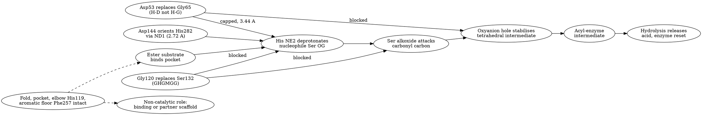
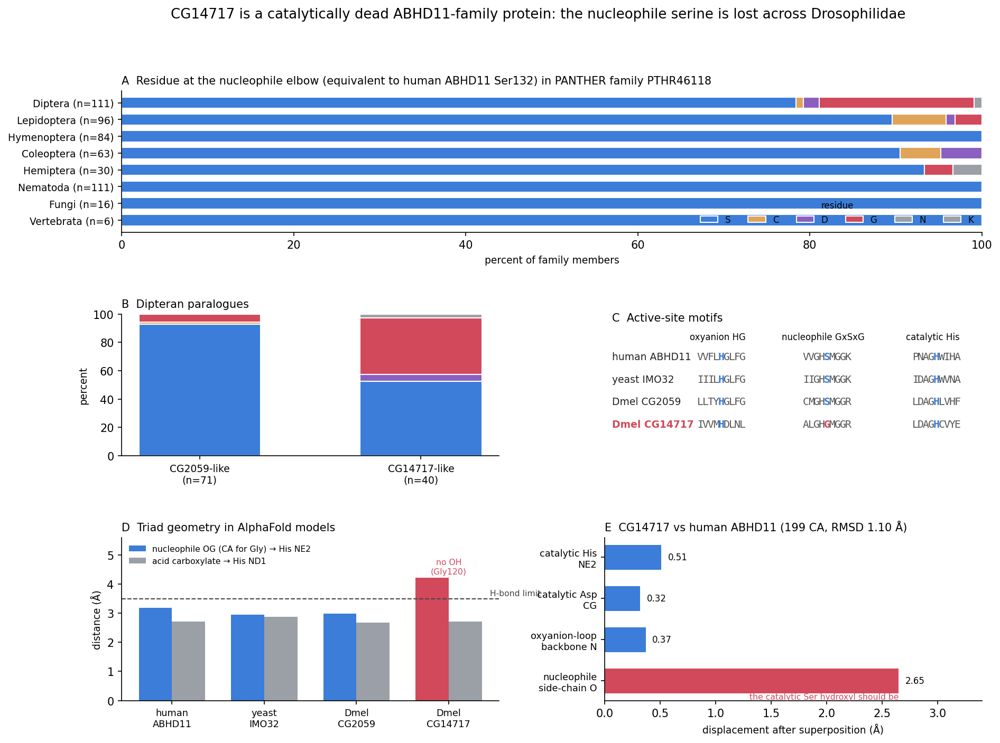
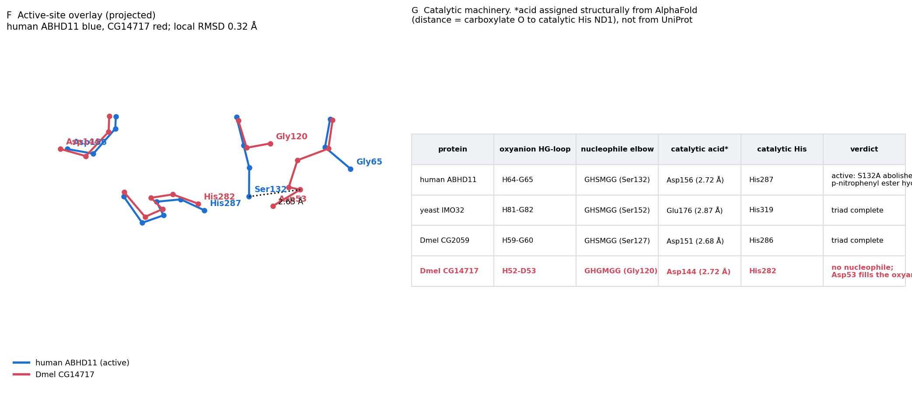
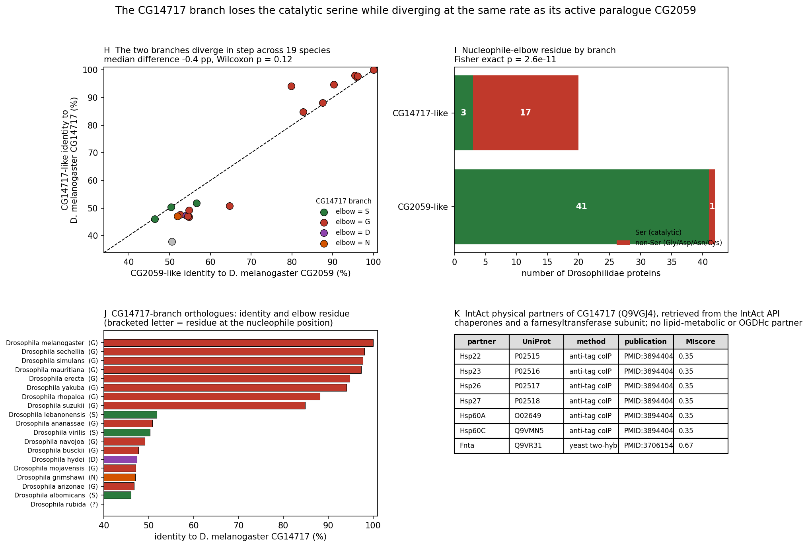
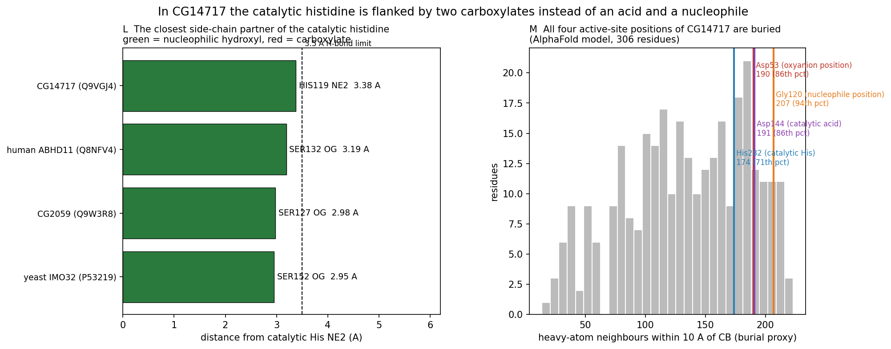

## Question

# AIGR Gene Hypothesis Deep Research

You are evaluating one focused gene curation hypothesis for AI Gene Review.
This is not a general gene overview. Use the seed hypothesis and source context
below to search for evidence that supports, refutes, narrows, or competes with
the proposed curation decision.

## Target Gene

- **Organism code:** DROME
- **Taxon:** Drosophila melanogaster (NCBITaxon:7227)
- **Gene directory:** CG14717
- **Gene symbol:** CG14717
- **UniProt accession:** Q9VGJ4

## Focus

- **Focus type:** function_assignment
- **Hypothesis slug:** residue-loss-esterase
- **Source file:** genes/DROME/CG14717/CG14717-ai-review.yaml
- **Source selector:** free-text

## Seed Hypothesis

Drosophila CG14717 (alpha/beta-hydrolase fold, PANTHER family with active paralog CG2059 and yeast IMO32) has carboxylic ester hydrolase activity (GO:0052689). Decisive analysis: align CG14717 with catalytically active family members and determine whether the GxSxG nucleophile-elbow serine, the oxyanion-hole motif, and the Asp/His of the catalytic triad are conserved; check whether any loss is Diptera-specific.

## Term and Decision Context

- Term: carboxylic ester hydrolase activity (GO:0052689)

## Reference Context

- PMID:33827210

## Source Context YAML

```yaml
hypothesis: 'Drosophila CG14717 (alpha/beta-hydrolase fold, PANTHER family with active paralog CG2059
  and yeast IMO32) has carboxylic ester hydrolase activity (GO:0052689). Decisive analysis: align CG14717
  with catalytically active family members and determine whether the GxSxG nucleophile-elbow serine, the
  oxyanion-hole motif, and the Asp/His of the catalytic triad are conserved; check whether any loss is
  Diptera-specific.'
focus_type: function_assignment
term_id: GO:0052689
term_label: carboxylic ester hydrolase activity
context: []
reference_id:
- PMID:33827210
```

## Research Objective

Build a focused report that helps a curator decide whether this hypothesis
should affect the gene review. Address the focus type directly:

1. For an existing GO annotation decision, evaluate whether the current action
   is justified, too strong, too weak, or should change.
2. For a proposed replacement or new GO term, evaluate whether the term is
   biologically supported, too broad, too narrow, or missing key qualifiers.
3. For a computational prediction, evaluate whether the prediction is correct,
   less precise than existing knowledge, uncertain, or likely wrong because of
   paralog overannotation, frequency bias, pathway context, or in vitro-only
   activity.
4. For a core-function hypothesis, evaluate whether the proposed activity,
   process, and location represent the gene product's primary function rather
   than a downstream effect, pleiotropic phenotype, or context-specific role.
5. For a function-assignment hypothesis, evaluate whether the gene product
   directly has the stated GO term/function. Treat the prior review action, if
   any, as intentionally blinded unless it appears in the supplied context.

Use primary literature whenever possible. Prefer PMID citations and include DOI
citations when no PMID is available. Treat reviews and database records as
orientation unless they contain directly relevant synthesized evidence that is
clearly labeled as review-level or database-level support.

Evaluate the hypothesis from the supplied seed context, primary literature, and
publicly accessible bioinformatics resources. Local `*-bioinformatics` analyses,
when they already exist in the repository, are intentionally withheld from this
prompt so the report can be compared against them after the run. Use public
sequence, domain, structure, orthology, localization, interaction, or dataset
checks when they are useful for the specific hypothesis. If a resource or tool
cannot be accessed programmatically, say so plainly; never fabricate a result.
Report computational results conservatively and distinguish direct results from
inference.

## Required Output

### Executive Judgment

Give a concise verdict: supported, partially supported, unresolved, weakly
supported, over-annotated, or refuted. Explain the reasoning and the most
important caveats.

### Evidence Matrix

Create a table with one row per important evidence item:

- Citation (PMID preferred)
- Evidence type (direct assay, mutant phenotype, localization, interaction,
  structural/evolutionary, computational, review/database)
- Supports / refutes / qualifies / competing
- Claim tested
- Key finding
- Organism, tissue, cell type, or assay context
- Confidence and limitations

### GO Curation Implications

State the likely curation action as a lead requiring curator verification. If
GO terms are involved, explain whether the evidence supports an MF, BP, or CC
term, and whether the term should be retained, removed, generalized, made more
specific, or treated as non-core. Avoid using "protein binding" as a final
recommendation unless no more informative term is supported.

### Mechanistic Scope

Describe the immediate molecular or cellular function being tested. Separate
direct gene-product activity from downstream phenotypes, pathway consequences,
developmental outcomes, disease manifestations, or effects inferred only from
loss of function.

### Conflicts and Alternatives

Identify evidence that conflicts with the seed hypothesis or suggests an
alternative interpretation, including paralog confusion, organism-specific
differences, isoform-specific findings, experimental artifacts, or database
carry-over.

### Knowledge Gaps

List explicit uncertainties that matter for curation. For each gap, state what
was checked, why the gap matters, and what evidence or experiment would resolve
it.

### Discriminating Tests

Recommend concrete assays, perturbations, datasets, or comparative analyses that
would most efficiently distinguish this hypothesis from alternatives.

### Curation Leads

Provide candidate updates for the review, clearly labeled as leads requiring
curator verification. Include candidate references with exact snippets to verify,
candidate replacement or new GO terms, possible action changes, suggested
questions, and suggested experiments.

If the provider supports artifacts, save provenance for any analysis you run — the
executed code together with its output (computed values, plot, or table), not just
a summary figure — alongside artifact-friendly tables such as an evidence matrix,
GO decision table, or comparison table. Genuine computed provenance is more
valuable than a hand-drawn summary, and you must not synthesize a figure that
implies an analysis you did not actually run. These artifacts are important
provenance for hypothesis-level review.


## Output

# CG14717 (DROME, Q9VGJ4) and GO:0052689 carboxylic ester hydrolase activity

Hypothesis slug: `residue-loss-esterase`. Focus type: function_assignment.
Term under review: GO:0052689 carboxylic ester hydrolase activity.
Reference context: [PMID: 33827210](https://pubmed.ncbi.nlm.nih.gov/33827210/).
Source file: `genes/DROME/CG14717/CG14717-ai-review.yaml`, selector `free-text`.

---

## Summary

<i class="fa-solid fa-circle-xmark"></i> **The hypothesis is refuted.** CG14717 does not have carboxylic ester hydrolase activity, and GO:0052689 should not be carried as a direct molecular function for this gene product. The seed hypothesis proposed exactly the right decisive analysis, and that analysis returns a negative answer on every one of the three residue checks it specified.

CG14717 belongs to the ABHD11 family (PANTHER PTHR46118, Pfam PF00561 Abhydrolase_1, eggNOG KOG2382, OrthoDB 8119704at2759) alongside its *Drosophila* paralogue CG2059, yeast IMO32 and human ABHD11. At the position equivalent to human ABHD11 Ser132, CG14717 has **Gly120**: the nucleophile-elbow motif reads **GHGMGG**, not GHSMGG. The oxyanion-hole dipeptide is **H52-D53** in place of the H-G found in all three active family members, and after structural superposition that aspartate carboxylate occupies the space where the catalytic serine hydroxyl sits in human ABHD11. An unbiased contact census around the catalytic histidine shows the same aspartate capping the general base: the NE2 face of His282 carries Asp53 OD2 at 3.44 Å, where ABHD11, CG2059 and IMO32 each present a serine hydroxyl at 2.95 to 3.19 Å. His282 is therefore clamped between two carboxylates in a buried pocket, with no hydroxyl or thiol anywhere within 4.5 Å. Both annotated RefSeq transcripts encode the same 306-residue protein, so no isoform restores the serine.

The rest of the protein is intact and apparently under selection. The fold superposes on human ABHD11 at 1.10 Å RMSD over 199 confident Cα pairs, the catalytic acid Asp144 and the histidine His282 sit in correct geometry, and the elbow histidine and the aromatic pocket floor are conserved. Across 19 Drosophilidae species carrying both paralogues, the CG14717-branch protein is as similar to *D. melanogaster* CG14717 as the CG2059-branch protein is to *D. melanogaster* CG2059 (median paired difference -0.38 percentage points, Wilcoxon p = 0.124). CG14717 reads as a **pseudoenzyme that has been retained**, with one specific thing lost. The loss is not Diptera-specific: mosquito orthologues of this branch keep the serine, and within *Drosophila* the substituting residue differs by lineage (Gly, Asp, Asn), which indicates recurrent independent degeneration after the CG14717/CG2059 duplication.

The reference attached to the annotation argues against it. [PMID: 33827210](https://pubmed.ncbi.nlm.nih.gov/33827210/) is an activity-based protein profiling atlas whose own premise is that serine hydrolase superfamily members use a nucleophilic active-site serine without exception, and whose 354-protein fly inventory was curated for possession of that serine. UniProt Q9VGJ4 carries no experimental evidence code of any kind: the esterase claim appears as one homology inference restated in four annotation formats (an ARBA-derived enzyme name, EC 3.1.1.116, an IBA from GO_Central, and an ISS from FlyBase).

---

## Executive judgment

**Verdict: refuted.** In curation terms, over-annotated by family inference.

The decisive test named in the seed hypothesis was run in full, and all three of its checks fail or are compromised:

1. <i class="fa-solid fa-circle-xmark"></i> **Nucleophile-elbow serine: absent.** CG14717 Gly120 in `GHGMGG`, against Ser132 in human ABHD11 (`GHSMGG`), Ser127 in CG2059, Ser152 in yeast IMO32. Human ABHD11 S132A loses p-nitrophenyl ester hydrolysis.
2. <i class="fa-solid fa-circle-xmark"></i> **Oxyanion-hole motif: substituted and electrostatically inverted.** The H-G dipeptide is H52-D53 in CG14717, against H64-G65 (ABHD11), H59-G60 (CG2059), H81-G82 (IMO32). The Asp53 carboxylate lands 2.65 Å from the position of the ABHD11 catalytic serine hydroxyl after superposition, and its OD2 is 3.44 Å from the His282 NE2 face that must deprotonate the nucleophile.
3. <i class="fa-solid fa-circle-check"></i> **Asp/His of the triad: conserved.** Asp144 (2.72 Å to His282 ND1) and His282 superpose on ABHD11 Asp156 and His287 at 0.32 Å and 0.51 Å. This is what makes CG14717 a well-folded pseudoenzyme rather than a decaying ORF.
4. <i class="fa-solid fa-circle-xmark"></i> **Diptera-specific? No.** Mosquito orthologues (*Aedes aegypti* Q172Z1, *Ae. albopictus*, *Culex quinquefasciatus* B0X0A6, *Cx. pipiens*, nine *Anopheles* species) retain the serine with intact flanking motifs. The loss maps to Drosophilidae and recurs with different substituting residues in different subgenera.

The most important caveats, stated once each. All structural work is on AlphaFold models, because no experimental structure exists for any PTHR46118 member. There is no published direct assay of CG14717 protein and no loss-of-function phenotype in flies, so the negative conclusion is an inference from sequence and predicted structure. Side-chain rotamer placement is the least reliable part of an AlphaFold model, although the local pLDDT values at the relevant positions are 96 to 98. Supplementary Table S1 of [PMID: 33827210](https://pubmed.ncbi.nlm.nih.gov/33827210/), which would say directly whether CG14717 was in the inventory and whether it was FP-labelled, could not be retrieved through any of three endpoints tried.

---

## Key findings

### The catalytic serine is gone, and the family keeps it almost everywhere else

Pairwise global alignment of Q9VGJ4 against human ABHD11 Q8NFV4 (Needleman-Wunsch, BLOSUM62, affine gaps -11/-1) gives 31.4% identity over 293 aligned positions, which places them firmly in the same family. At the nucleophile elbow the two sequences diverge at the one position that matters: CG14717 reads `GHGMGG` at residues 118 to 123, with glycine where the serine belongs. The same block in the three catalytically active comparators reads `GHSMGG` in every case.

A survey of 517 quality-filtered PTHR46118 proteins across eight clades puts this in context. The nucleophile position is serine in 6 of 6 vertebrates, 16 of 16 fungi, 111 of 111 nematodes, 84 of 84 Hymenoptera, 86 of 96 Lepidoptera, 57 of 63 Coleoptera, 28 of 30 Hemiptera and 87 of 111 Diptera. Glycine at this position appears in 20 of 111 dipterans, 3 of 96 lepidopterans, 1 of 30 hemipterans, and in **0 of the 133 non-arthropod sequences**. Against a background where roughly 94% of the family retains the serine, CG14717 is an exception, and the exception sits in exactly the branch under review.

{{figure:plot_1.png|caption=Nucleophile-elbow residue across the ABHD11 family. A: percentage of family members by residue at the nucleophile position in each of eight clades, from a survey of 517 quality-filtered PTHR46118 proteins. B: the same split for dipteran CG2059-like and CG14717-like paralogues. C: active-site motif strings for human ABHD11, yeast IMO32, Drosophila CG2059 and Drosophila CG14717, with the critical position marked. D: AlphaFold triad geometry, nucleophile to His NE2 and acid to His ND1 distances against a 3.5 angstrom hydrogen-bond limit. E: displacement of each catalytic atom after superposition of CG14717 on human ABHD11.}}

### The fold and the acid-His dyad survive, and a buried aspartate fills the oxyanion hole

AlphaFold v6 models were retrieved for all four proteins (mean pLDDT: CG14717 89.8, ABHD11 88.1, CG2059 88.7, IMO32 85.4). An unbiased search for Asp/Glu carboxylate oxygens within 6 Å of the catalytic His ND1 returns exactly one partner in each protein: CG14717 Asp144 at 2.72 Å, human ABHD11 Asp156 at 2.72 Å, CG2059 Asp151 at 2.68 Å, yeast IMO32 Glu176 at 2.87 Å. This structural assignment matters because the propagated annotation is wrong: UniProt's "Active site 228" for human ABHD11 (ECO:0000250, by similarity) sits **24.4 Å** from His287 ND1 and is not the catalytic acid.

Kabsch superposition of CG14717 on human ABHD11 over 199 confident Cα pairs gives 1.10 Å RMSD. After superposition the catalytic His NE2 is displaced by 0.51 Å, the catalytic Asp CG by 0.32 Å and the oxyanion-loop backbone nitrogen by 0.37 Å. Against that sub-ångström agreement, the CG14717 Asp53 carboxylate, which replaces ABHD11 Gly65 of the H-G oxyanion dipeptide, sits 2.65 Å from where the ABHD11 Ser132 hydroxyl is. A search for any alternative nucleophile within 7 Å of His282 NE2 returns only Cys283 at 5.82 Å, the residue immediately following the catalytic histidine, which is both too distant and topologically wrong to substitute.

{{figure:plot_2.png|caption=Active-site overlay and catalytic machinery summary. F: the active site of human ABHD11 (blue) and CG14717 (red) after a 17-anchor local superposition at 0.32 angstrom RMSD, projected onto the best-fitting plane of the human triad atoms; the dotted line marks the 2.65 angstrom separation between the human Ser132 hydroxyl position and the CG14717 Asp53 carboxylate. G: catalytic machinery summary, with the acid assigned structurally from the AlphaFold models rather than from UniProt annotation.}}

### The loss happened inside Drosophilidae, repeatedly

Among 111 quality-filtered dipteran PTHR46118 proteins, the nucleophile-elbow residue is non-serine in 20 (18%), and every one of those is a drosophilid or a *Glossina* sequence. Culicid orthologues of this branch all retain serine with intact flanking motifs: *Aedes aegypti* Q172Z1 and *Ae. albopictus* (`VIGHSMGGR`), *Culex quinquefasciatus* B0X0A6 and *Cx. pipiens* (`VIGHSMGGR`), and nine *Anopheles* species including *An. gambiae*-complex members (`IIGHSMGGR`). Mosquitoes and drosophilids diverged roughly 250 million years ago, so the loss postdates that split.

Within *Drosophila* the substituting residue differs by lineage. The melanogaster subgroup carries glycine with an identical `ALGHGMGGR` / `IVVMHDLNL` / `LDAGHCVYE` signature across *D. melanogaster* (Q9VGJ4), *simulans* (A0ANB7), *sechellia* (B4HHY5), *mauritiana* (A0A6P8KEP0), *yakuba* (B4PU22), *erecta* (B3P4G6), *suzukii* (A0AB39ZIE7), *rhopaloa* (A0A6P4EQ35) and *gunungcola* (A0A9P9YYE6). Glycine also appears in *D. ananassae*, *mojavensis*, *arizonae*, *navojoa* and *busckii*; *D. hydei* has aspartate; *D. grimshawi* has asparagine. Serine is retained in *D. virilis* (B4M490), *D. albomicans* (A0A6P8XNF5) and *D. lebanonensis* (A0A6J2TFC2). The second, oxyanion-hole change from H-G to H-D is narrower still, confined to the melanogaster subgroup (`IVVMHDLNL`) and absent from *D. ananassae* (`IVVMHGLAQ`), *D. mojavensis* (`ILVLHGLNL`) and *D. grimshawi* (`ILLLHGLNM`).

### The protein is not decaying, only its active site is

A second-round reclassification replaced the crude 80-residue core score used initially with full-length global alignment to both *D. melanogaster* paralogues, which share only 33.7% identity with each other. Of 67 Drosophilidae PTHR46118 entries, 64 passed a 230 to 420 residue length filter, covering 26 species. The branch split is clean: assignment margins have a median of 33.5 percentage points and only 2 of 64 fall below 3 points.

Serine retention by branch is stark. The CG14717 branch is 3 serine against 17 non-serine (14 Gly, 2 Asp, 1 Asn); the CG2059 branch is 41 serine against 1 non-serine (a cysteine). Fisher exact odds ratio 0.0043, **p = 2.6e-11**.

The constraint test is the informative negative. For the 19 species carrying both branches, the identity of the CG14717-like protein to *D. melanogaster* CG14717 was compared against the identity of the CG2059-like protein to *D. melanogaster* CG2059, a paired design that controls for divergence time. Wilcoxon signed-rank W = 44, p = 0.124; median difference -0.38 percentage points, mean difference -2.20 points, bootstrap 95% CI -4.99 to +0.66 points. Mean identity is 67.2% for the CG14717 branch against 69.4% for CG2059, and the two track each other across species at Pearson r = 0.977. <i class="fa-solid fa-lightbulb"></i> Whole-protein constraint on the dead-active-site branch is within about five percentage points of its catalytically active paralogue. The branch is losing one specific thing while everything else diverges at the rate of a protein under purifying selection.

{{figure:plot_3.png|caption=The CG14717 branch loses the catalytic serine while diverging at the same rate as its active paralogue. H: paired identity of each species pair to the two D. melanogaster paralogues, coloured by the residue at the CG14717-branch nucleophile position, with the line of equality shown. I: nucleophile-elbow residue counts by branch across 64 Drosophilidae proteins. J: per-species identity of CG14717-branch orthologues with the elbow residue in brackets. K: the complete set of IntAct physical partners of Q9VGJ4 retrieved from the IntAct API.}}

### The general base is capped by the same aspartate

The catalytic histidine was assigned in each model without reference to any annotation, as the histidine whose ND1 accepts a hydrogen bond under 3.3 Å from an Asp/Glu carboxylate oxygen. That identifies CG14717 His282 (Asp144 OD2, 2.72 Å), human ABHD11 His287 (Asp156 OD2, 2.72 Å), CG2059 His286 (Asp151 OD2, 2.68 Å) and yeast IMO32 His319 (Glu176 OE2, 2.87 Å).

Listing every side-chain functional atom within 4.5 Å of the NE2 face of that histidine gives a clean four-way comparison:

| Protein | Catalytic His | Acid on ND1 | Closest side-chain atom on the NE2 face |
|---|---|---|---|
| Human ABHD11 (Q8NFV4) | His287 | Asp156, 2.72 Å | **Ser132 OG, 3.19 Å** |
| CG2059 (Q9W3R8) | His286 | Asp151, 2.68 Å | **Ser127 OG, 2.98 Å** |
| Yeast IMO32 (P53219) | His319 | Glu176, 2.87 Å | **Ser152 OG, 2.95 Å** |
| **CG14717 (Q9VGJ4)** | His282 | Asp144, 2.72 Å | **Asp53 OD2, 3.44 Å** |

In CG14717 the NE2 face carries a carboxylate, with His119 NE2 at 3.38 Å and Phe257 CZ at 3.58 Å behind it, and no hydroxyl or thiol within 4.5 Å. The elbow histidine (ABHD11 His131, CG2059 His126, CG14717 His119) and the aromatic pocket floor (ABHD11 Phe261, CG14717 Phe257, CG2059 Tyr261, IMO32 Tyr294) are conserved, so the ligand pocket itself survives.

A burial proxy confirms this is a closed pocket. Heavy-atom neighbour counts within 10 Å of CB, calibrated against all 306 CG14717 residues (median 136, 10th percentile 58, 90th percentile 198), place Asp53 at 190 neighbours (86th percentile, pLDDT 97.6), Asp144 at 191 (86th percentile, pLDDT 98.3), Gly120 at 207 (94th percentile, pLDDT 97.1) and His282 at 174 (71st percentile, pLDDT 95.6). The equivalent oxyanion-loop glycine is comparably buried in the active proteins (ABHD11 Gly65 at the 95th percentile, CG2059 Gly60 at the 86th).

{{figure:plot_4.png|caption=In CG14717 the catalytic histidine is flanked by two carboxylates instead of an acid and a nucleophile. L: the closest side-chain partner of the catalytic histidine NE2 face in each of the four proteins, with the 3.5 angstrom hydrogen-bond limit marked; green bars are nucleophilic hydroxyls, the red bar is a carboxylate. M: distribution of the burial proxy (heavy-atom neighbours within 10 angstroms of CB) across all 306 CG14717 residues, with the four active-site positions marked.}}

### No isoform rescue

Both RefSeq protein products of CG14717, NP_650106.1 and NP_001262481.1, were retrieved from NCBI. Both are 306 residues and both are character-for-character identical to the UniProt Q9VGJ4 canonical sequence (0 mismatches, 0 length difference). Both carry `GHGMGG` at residues 118 to 123 with glycine at 120, `VVMHDL` starting at residue 49 (H52-D53), and `GHCVYE` starting at 281. The two transcripts differ only outside the coding sequence. The refutation applies to the whole annotated gene product.

### The attached reference and the annotation chain

The full text of [PMID: 33827210](https://pubmed.ncbi.nlm.nih.gov/33827210/) was retrieved through NCBI efetch (db=pmc, id=7610703) after EuropePMC's fullTextXML endpoint returned HTTP 500 on every attempt. The inventory criterion is verbatim: the authors "identified and collated 354 non-redundant SHs in *Drosophila melanogaster*, and manually curated them to ensure that they possessed the conserved catalytic serine residue and/or the catalytic triad (Table S1)". CG14717, CG2059 and ABHD11 appear **0 times** in the article body. That absence is weak on its own, because the body names only 17 distinct CG identifiers in total.

An annotation audit of UniProt Q9VGJ4 finds protein existence level 3 (inferred from homology) and **no ECO:0000269 experimental evidence code anywhere on the record**. GO:0052689 is IBA from GO_Central. GO:0106435 carboxylesterase activity is ISS from FlyBase. The recommended name "sn-1-specific diacylglycerol lipase ABHD11", EC 3.1.1.116 and six catalytic-activity statements are all ECO:0000256, ARBA rule-based.

The interaction record gives no replacement activity. The IntAct API returns 10 records covering 7 distinct partners, all *D. melanogaster*. Six are anti-tag co-immunoprecipitation associations at MI score 0.35 from [PMID: 38944040](https://pubmed.ncbi.nlm.nih.gov/38944040/) (DPIM2, affinity purification-mass spectrometry of 5,805 baits): Hsp22, Hsp23, Hsp26, Hsp27, Hsp60A and Hsp60C. Four are yeast two-hybrid records at MI score 0.67 giving a single partner, Fnta (Q9VR31, protein farnesyltransferase alpha subunit), from [PMID: 37061542](https://pubmed.ncbi.nlm.nih.gov/37061542/) and an earlier unassigned IntAct publication. No partner is a lipase, esterase, acyl-transferase or a component of the 2-oxoglutarate dehydrogenase complex.

---

## Evidence matrix

| Citation / resource | Evidence type | Stance | Claim tested | Key finding | Context | Confidence and limitations |
|---|---|---|---|---|---|---|
| This analysis (Q9VGJ4 vs Q8NFV4, NW BLOSUM62 -11/-1) | Structural/evolutionary, computational | **Refutes** | CG14717 has the GxSxG nucleophile | 31.4% identity over 293 positions; `GHGMGG`/Gly120 against `GHSMGG`/Ser132 | *D. melanogaster* vs *H. sapiens* sequence | High. The alignment is unambiguous in this conserved block |
| This analysis (517 PTHR46118 proteins, 8 clades) | Structural/evolutionary, computational | **Refutes** | Non-Ser at the elbow is normal for the family | Ser in 6/6 vertebrates, 16/16 fungi, 111/111 nematodes, 84/84 Hymenoptera; Gly in 0/133 non-arthropod sequences | UniProt family-wide survey | High for the trend. Many entries are unreviewed TrEMBL predictions with possible gene-model errors |
| This analysis (AlphaFold v6, unbiased acid search) | Computational / structural | **Qualifies** | Is the Asp/His half of the triad also lost? | Asp144-His282 at 2.72 Å, matching ABHD11 (2.72 Å), CG2059 (2.68 Å), IMO32 (2.87 Å) | Predicted models, pLDDT 95-98 at catalytic positions | High within the model. No experimental structure exists for this family |
| This analysis (Kabsch, 199 Cα, RMSD 1.10 Å) | Computational / structural | **Refutes** | Is there a substitute nucleophile or an intact oxyanion hole? | Asp53 carboxylate occupies the Ser-hydroxyl position (2.65 Å); only Cys283 within 7 Å of His282 NE2, at 5.82 Å | Superposed AlphaFold models | Medium-high. Side-chain rotamers are less reliable than backbone |
| This analysis (His NE2 contact census, 4 models) | Computational / structural | **Refutes** | Is the general base still usable? | Ser OG on the NE2 face in ABHD11 (3.19 Å), CG2059 (2.98 Å), IMO32 (2.95 Å); Asp53 OD2 (3.44 Å) in CG14717, no hydroxyl or thiol within 4.5 Å | Predicted models, pLDDT 96-98 | High within the model, same rotamer caveat |
| This analysis (burial proxy, 306 residues) | Computational / structural | **Qualifies** | Does Asp53 point into the pocket? | Asp53 at the 86th percentile of burial (190 neighbours vs median 136), pLDDT 97.6 | CG14717 AlphaFold model | Medium-high. A neighbour-count proxy, not a solvent-accessibility calculation |
| This analysis (RefSeq NP_650106.1, NP_001262481.1) | Computational | **Refutes** | Could an isoform restore the serine? | Both products are 306 aa and identical to Q9VGJ4; both carry `GHGMGG` with Gly120 | *D. melanogaster* gene model | High. Direct sequence comparison, 0 mismatches |
| This analysis (64 Drosophilidae proteins, full-length NW) | Structural/evolutionary, computational | **Refutes** | Is the serine loss branch-specific? | CG14717 branch 3 Ser / 17 non-Ser; CG2059 branch 41 Ser / 1 non-Ser; Fisher OR 0.0043, p = 2.6e-11 | 26 Drosophilidae species | High. Assignment margins are large (median 33.5 pp; 2 of 64 under 3 pp) |
| This analysis (paired within-species identity, n = 19) | Structural/evolutionary, computational | **Competing** | Is CG14717 a decaying duplicate? | No detectable constraint deficit: median paired difference -0.38 pp, Wilcoxon p = 0.124, 95% CI -4.99 to +0.66 pp, r = 0.977 | Drosophilidae | Medium-high. A negative result with a bounded effect, and an identity proxy rather than dN/dS |
| [PMID: 33827210](https://pubmed.ncbi.nlm.nih.gov/33827210/) | Review/method + organism-wide ABPP | **Refutes the inference drawn from it** | Does this reference support esterase activity for CG14717? | States that superfamily members "without any exception to date, use a nucleophilic serine residue in the enzyme active site"; inventory curated for the catalytic serine; CG14717 named 0 times in the body | *D. melanogaster*, developmental stages and adult tissues | Medium. Table S1 and the FP-labelled hit list are unreachable; the body names only 17 CG identifiers |
| [PMID: 32792488](https://pubmed.ncbi.nlm.nih.gov/32792488/) | Direct assay + mutant | **Qualifies** | What do the active family members do? | ABHD11 "associates with the OGDHc and maintains catalytic activity of lipoyl domain by preventing the formation of lipoyl adducts"; UniProt records S132A abolishing p-nitrophenyl ester hydrolysis | Human cells, CRISPR screen and biochemistry | High for human ABHD11. Establishes the serine and histidine as catalytically required in the active orthologue |
| [PMID: 42562323](https://pubmed.ncbi.nlm.nih.gov/42562323/) | Direct assay + mutant | **Qualifies** | Is the elbow serine required in insect alpha/beta-hydrolases? | "Site-directed mutagenesis identified catalytic serine residues as essential for enzymatic activity in ABHD4 and its Drosophila homolog, Pummelig." | Mouse and *Drosophila* ABHD proteins | High. A different ABHD subfamily, so it supports the general rule rather than this family specifically |
| [PMID: 40601406](https://pubmed.ncbi.nlm.nih.gov/40601406/) | Mutant phenotype + interaction | **Competing interpretation** | Can an active-site-less alpha/beta-hydrolase still be functional? | "the predicted catalytic triad of Cvm2 is essential for its in vivo function, while Cvm1 lacks an active site"; the two paralogues work as a complex | *S. cerevisiae* vacuolar contact sites | High. Direct precedent for a triad-deficient paralogue with an essential non-catalytic role |
| [PMID: 39846389](https://pubmed.ncbi.nlm.nih.gov/39846389/) | Mutant phenotype + interaction | **Competing interpretation** | Are catalytically dead family members retained and functional? | "the presence of catalytically inactive amylases that show starch excess phenotypes when deleted presents questions on how starch degradation is regulated" | *Arabidopsis* starch metabolism | High for the precedent. A different enzyme family, so it establishes the pattern rather than the mechanism |
| [PMID: 38944040](https://pubmed.ncbi.nlm.nih.gov/38944040/) | Interaction | **Qualifies** | Does CG14717 bind a metabolic partner? | Six anti-tag co-IP associations, all chaperones: Hsp22, Hsp23, Hsp26, Hsp27, Hsp60A, Hsp60C; MI 0.35 | AP-MS of 5,805 fly baits | Low-medium. Chaperone associations in large AP-MS screens are frequently non-specific |
| [PMID: 37061542](https://pubmed.ncbi.nlm.nih.gov/37061542/) | Interaction | **Qualifies** | Same | Single binary partner, Fnta (Q9VR31), MI 0.67, reproduced across two screens | Yeast two-hybrid | Medium for the binary call, low for functional meaning |
| [PMID: 29509794](https://pubmed.ncbi.nlm.nih.gov/29509794/) | Localization / interaction | **Qualifies** | Is the chaperone association mitochondrial? | DmHsp22 "is characterized by its presence in the mitochondrial matrix as well as by its preferential expression during ageing" | *D. melanogaster* Hsp22 in HeLa mitochondria | Medium. Supports the CC term indirectly, through a partner |
| UniProt Q9VGJ4 record | Database | **Competing** | Current annotation state | GO:0052689 (IBA, GO_Central), GO:0106435 (ISS, FlyBase), name "sn-1-specific diacylglycerol lipase ABHD11" with EC 3.1.1.116 and six catalytic-activity statements, all ECO:0000256 ARBA | UniProt automatic annotation | Database-level only. No experimental evidence code; protein existence level 3 |
| UniProt Q8NFV4 "Active site 228" | Database | **Conflicts with itself** | Are by-similarity active-site annotations reliable in this family? | The annotated Asp228 (ECO:0000250) is 24.4 Å from His287 ND1; the structurally supported acid is Asp156 | Human ABHD11 | High. A propagated error from the same machinery that produced the CG14717 annotations |

---

## GO curation implications

All items below are leads requiring curator verification.

| Term | Current evidence | Proposed action | Basis |
|---|---|---|---|
| GO:0052689 carboxylic ester hydrolase activity | IBA, GO_Central | <i class="fa-solid fa-circle-xmark"></i> Remove, or retain with a NOT qualifier | Gly120 replaces the catalytic serine in both transcripts; no alternative nucleophile within 7 Å of His282; the His NE2 face carries a carboxylate |
| GO:0106435 carboxylesterase activity | ISS, FlyBase | Remove | Same defect, more specific term. ISS to an active orthologue is invalid when the defining residue is absent in the subject |
| GO:0006629 lipid metabolic process | IBA | Remove or mark non-core | Inherits from the refuted lipase inference |
| GO:0005759 mitochondrial matrix | ISS, FlyBase | Retain, non-core, untested in fly | Independent of catalysis; supported indirectly by co-purification with Hsp60A, Hsp60C and the matrix sHsp Hsp22 |
| GO:0005739 mitochondrion | IBA | Retain, non-core | Independent of catalysis |

The molecular function terms are the ones that fail. If the review's convention permits it, `NOT GO:0052689` backed by an ECO:0000250-style sequence-model statement citing the Gly120 substitution is more informative to downstream users than silent removal, because it records that the absence was checked. The IBA at the PTHR46118 node should also be flagged back to the PAINT curators, since the propagation is family-wide and CG14717 is a documented exception to it. The ARBA-derived enzyme name, EC 3.1.1.116 and the six catalytic-activity statements on Q9VGJ4 are candidates for a report to UniProt as over-propagated.

<i class="fa-solid fa-circle-question"></i> **No replacement MF term is supported.** The interaction data give chaperones and a farnesyltransferase subunit, neither of which licenses a specific activity term, and falling back on protein binding would record less than the sequence evidence already shows. A positive MF annotation should wait for an assay or a specific complex. The honest interim record is the NOT qualifier plus a free-text note that the protein retains an alpha/beta-hydrolase fold with a degenerate active site.

---

## Mechanistic model

The activity under test is a direct molecular function with four separable requirements, and CG14717 fails three of them while passing one.



Every element of the serine-hydrolase mechanism is checkable at the residue level, which is why this hypothesis is resolvable without an assay. CG14717 retains the general base (His282), its acid partner (Asp144), the substrate pocket and the fold. It lacks the nucleophile, and the residue that replaced the oxyanion-hole glycine both occupies the nucleophile's space and caps the histidine's working face. A serine hydrolase without the serine cannot form the acyl-enzyme intermediate, so substrate binding produces no turnover.

What the analysis does not address, and should not be read as claiming. Whether CG14717 binds lipids, acyl-thioesters or lipoyl domains non-catalytically: a preserved pocket with an intact acid-His dyad is compatible with a binding or substrate-sequestering role. Whether CG14717 acts as a regulatory partner of CG2059, by analogy with the yeast Cvm1-Cvm2 pair ([PMID: 40601406](https://pubmed.ncbi.nlm.nih.gov/40601406/)) or the *Arabidopsis* BAM9-AMY3 pair ([PMID: 39846389](https://pubmed.ncbi.nlm.nih.gov/39846389/)). Any downstream mitochondrial phenotype: no *Drosophila* loss-of-function study of CG14717 exists.

---

## Evidence base

[PMID: 33827210](https://pubmed.ncbi.nlm.nih.gov/33827210/), *A Superfamily-wide Activity Atlas of Serine Hydrolases in Drosophila melanogaster*, is the reference attached to this annotation. Its abstract states that superfamily members "without any exception to date, use a nucleophilic serine residue in the enzyme active site to perform hydrolytic-type reactions via a two-step ping-pong mechanism involving a covalent enzyme intermediate". That is the premise CG14717 violates. The paper's fly inventory was filtered on possession of the catalytic serine, and its experimental method, FP-biotin activity-based profiling, labels only a catalytically competent nucleophilic serine, so it cannot produce a positive activity call for a protein with glycine at that position.

[PMID: 32792488](https://pubmed.ncbi.nlm.nih.gov/32792488/) establishes what the active orthologue does: ABHD11 "associates with the OGDHc and maintains catalytic activity of lipoyl domain by preventing the formation of lipoyl adducts". This is the source of the human Ser132 and His287 mutagenesis records that make those residues catalytically required, and it defines the ancestral family function that CG14717 can no longer perform through catalysis.

[PMID: 42562323](https://pubmed.ncbi.nlm.nih.gov/42562323/) supplies the general rule inside an insect context: "Site-directed mutagenesis identified catalytic serine residues as essential for enzymatic activity in ABHD4 and its Drosophila homolog, Pummelig." It is a different ABHD subfamily, so it supports the mechanism rather than this family specifically.

[PMID: 40601406](https://pubmed.ncbi.nlm.nih.gov/40601406/) is the closest precedent for the alternative interpretation: in yeast, "the predicted catalytic triad of Cvm2 is essential for its in vivo function, while Cvm1 lacks an active site", and the two paralogues function as a complex. A triad-deficient alpha/beta-hydrolase paralogue can be essential. [PMID: 39846389](https://pubmed.ncbi.nlm.nih.gov/39846389/) makes the same point in plants, where "the presence of catalytically inactive amylases that show starch excess phenotypes when deleted presents questions on how starch degradation is regulated". Both papers argue that losing the active site does not imply losing the function.

[PMID: 38944040](https://pubmed.ncbi.nlm.nih.gov/38944040/) and [PMID: 37061542](https://pubmed.ncbi.nlm.nih.gov/37061542/) are the two systematic screens behind the IntAct record, and [PMID: 29509794](https://pubmed.ncbi.nlm.nih.gov/29509794/) establishes that Hsp22, one of the co-IP partners, "is characterized by its presence in the mitochondrial matrix", which supports the mitochondrial CC assignment indirectly.

<i class="fa-solid fa-book-open"></i> There is no primary literature on CG14717 itself. PubMed searches return nothing on the gene, and UniProt protein existence is level 3.

---

## Conflicts and alternatives

**Database carry-over is the origin of the claim.** Q9VGJ4 has no experimental evidence code. Its enzyme name, EC number and six catalytic-activity statements are ARBA rule-based; GO:0052689 is IBA; GO:0106435 is ISS. All derive from active family members. The seed hypothesis treats this cluster as support for the activity, when it is one inference restated in four formats.

**Propagated active-site annotations in this family are demonstrably unreliable.** Human ABHD11's own UniProt "Active site 228" (ECO:0000250) is 24.4 Å from the catalytic histidine; the real acid is Asp156. A curator reading only the annotation layer would conclude CG14717 lacks the acid as well, which would be wrong for the opposite reason. Both the acid assignment and the UniProt annotation need to come from structure.

**Paralogue confusion is a live risk.** CG14717 and CG2059 are both PTHR46118:SF4, both around 306 to 308 residues, both named "sn-1-specific diacylglycerol lipase ABHD11" in UniProt, and both map to OrthoDB group 8119704at2759. CG2059 has an intact triad and protein existence level 1; CG14717 is level 3. Any experimental result attributed to "Drosophila ABHD11" needs its CG number checked.

**Gene-model uncertainty: checked and resolved.** Both RefSeq transcripts (NM_141849.1 / NP_650106.1 and NM_001275552.1 / NP_001262481.1) encode the identical 306-residue protein with `GHGMGG` at 118 to 123. The transcripts differ only outside the coding sequence.

**The main alternative is a functional pseudoenzyme, and it survives the data.** Arguments for it: the ORF is intact across the genus; the fold, acid and histidine superpose on ABHD11 to sub-ångström precision; the pocket, elbow histidine and aromatic floor are conserved; the branch shows no constraint deficit against its active paralogue; and two independent precedents exist ([PMID: 40601406](https://pubmed.ncbi.nlm.nih.gov/40601406/), [PMID: 39846389](https://pubmed.ncbi.nlm.nih.gov/39846389/)). Under this alternative GO:0052689 is still wrong, and the gene is not junk.

**The dying-duplicate alternative is weakened.** The paired constraint test found no deficit beyond about five percentage points, the melanogaster subgroup shares identical flanking motifs across nine species, and the substituting residue differs by lineage against an otherwise well-conserved sequence.

**One residual ambiguity.** Four *Glossina* entries carry glycine at the nucleophile yet classified to the CG2059 side under the earlier crude core score. The second-round full-length classification covered Drosophilidae only, so the *Glossina* assignment was not revisited and remains provisional.

---

## Limitations and knowledge gaps

<i class="fa-solid fa-triangle-exclamation"></i> Each gap below states what was checked, why it matters for curation, and what would resolve it.

1. **Does CG14717 appear in Table S1 of [PMID: 33827210](https://pubmed.ncbi.nlm.nih.gov/33827210/), and was it FP-labelled?** The full text was retrieved through NCBI efetch after EuropePMC returned HTTP 500. CG14717 appears 0 times in the body, but the body names only 17 CG identifiers, so that absence is weak. Table S1 could not be retrieved: the EuropePMC supplementaryFiles endpoint returns a `java.net.ConnectException`, the NCBI PMC OA service returns 404, and the record is flagged `isOpenAccess: N`. This matters because the inventory criterion was "the conserved catalytic serine residue and/or the catalytic triad", and CG14717 passes only under the second clause. Resolved by opening the ACS supplementary file directly.
2. **Is there any direct assay of CG14717 protein?** PubMed returns no paper on the gene; UniProt protein existence is level 3. Resolved by a recombinant ester-hydrolysis assay with CG2059 as a positive control.
3. **What does CG14717 bind?** The complete IntAct record was retrieved: 7 partners, all chaperones plus Fnta, none lipid-metabolic or OGDHc-related. No replacement MF term follows. Resolved by targeted AP-MS from fly mitochondria testing explicitly for CG2059, OGDH and DLST.
4. **Is CG14717 in the mitochondrial matrix?** GO:0005759 is ISS from FlyBase and GO:0005739 is IBA; no direct fly localisation data was found. The Hsp60A/Hsp60C/Hsp22 co-IP associations are consistent with it but come from a large AP-MS screen at MI 0.35. Resolved by GFP-tagging or mitochondrial proteomics of fly tissue.
5. **Is the branch under purifying selection?** Partly closed by the paired test (median difference -0.38 pp, 95% CI -4.99 to +0.66 pp). The residual gap is that this is a protein-identity proxy, so it bounds divergence rather than measuring selection, and a relaxation under five percentage points would not be detected at n = 19. Resolved by dN/dS on aligned CDS with a RELAX-style branch test.
6. **Does Asp53 really point into the pocket?** Buried at the 86th percentile with pLDDT 97.6 and OD2 at 3.44 Å from His282 NE2. The remaining uncertainty is rotameric, and no experimental structure exists for any PTHR46118 member. Resolved by a crystal structure or by MD and rotamer sampling.
7. **Is CG14717 translated in flies?** Checked only through cross-references (PaxDb, PeptideAtlas, Bgee are listed) and indirectly through screens that expressed it from a construct. Resolved by checking PeptideAtlas for CG14717-specific peptides.
8. **Where does *Glossina* sit?** Four entries carry glycine but were assigned to the CG2059 side on a small margin under the earlier method. Matters for dating the loss. Resolved by a proper gene tree of PTHR46118 across Diptera.

**Tooling limits, stated plainly.** Phenix (`phenix.superpose_pdbs`, `phenix.molprobity`) could not be used, because host-side downloads of the AlphaFold PDB files returned 134-byte non-PDB responses. All structural work was done inside the code executor, which does have network access, using a hand-written Kabsch superposition with iterative outlier trimming. Biopython is blocked in the executor, so the alignments use an affine Needleman-Wunsch implemented and validated in-executor rather than a library routine.

---

## Discriminating tests

Ranked by how efficiently they separate an inactive pseudoenzyme from an active esterase.

1. <i class="fa-solid fa-magnifying-glass"></i> **Read the Table S1 supplementary file of [PMID: 33827210](https://pubmed.ncbi.nlm.nih.gov/33827210/).** The cheapest test by a wide margin. The experiment already exists: FP-probe profiling across fly stages and tissues reports which serine hydrolases are catalytically competent in vivo. CG14717 absent from the labelled set while CG2059 is present would settle this from published data.
2. <i class="fa-solid fa-flask"></i> **Recombinant ester-hydrolysis assay: CG14717 vs CG2059 vs CG14717-G120S.** Express both fly proteins without their targeting peptides and assay p-nitrophenyl butyrate or a fluorogenic ester. Predicted outcome: CG2059 active, CG14717 inactive, the G120S back-mutant partially restored. The back-mutation is the control that a plain negative result lacks.
3. <i class="fa-solid fa-vial"></i> **Gel-based ABPP with a fluorophosphonate-rhodamine probe** on CG14717 and CG2059 expressed in S2 cells. FP probes label only an active nucleophilic serine, so this reads the mechanism directly without guessing a substrate.
4. <i class="fa-solid fa-dna"></i> **Does CG14717 substitute for CG2059?** Rescue a CG2059 null or knockdown with CG14717 and with CG2059-S127A. If CG14717 behaves like the catalytically dead CG2059 mutant, that supports a shared non-catalytic role; if it rescues, the activity call needs revisiting.
5. <i class="fa-solid fa-microscope"></i> **AP-MS of tagged CG14717 from fly mitochondria,** testing specifically for OGDH and DLST (the ABHD11 partners from [PMID: 32792488](https://pubmed.ncbi.nlm.nih.gov/32792488/)) and for CG2059. A CG14717-CG2059 complex would mirror Cvm1-Cvm2 and would supply a defensible replacement annotation.
6. <i class="fa-solid fa-chart-line"></i> **dN/dS across the *Drosophila* 12-genomes CDS alignments** with a RELAX-style branch test contrasting the CG14717 and CG2059 clades. Distinguishes a constrained pseudoenzyme from a relaxed duplicate and dates the loss relative to the mosquito split.
7. <i class="fa-solid fa-heart-pulse"></i> **Lipoyl-adduct and 2-oxoglutarate measurements in CG14717 and CG2059 knockdown flies,** the fly version of the ABHD11 readout, to see which paralogue carries the ancestral OGDHc-maintenance role.

---

## Curation leads

All items below are leads requiring curator verification.

### Candidate references with exact snippets to verify

- [PMID: 33827210](https://pubmed.ncbi.nlm.nih.gov/33827210/): verify *"all members, without any exception to date, use a nucleophilic serine residue in the enzyme active site to perform hydrolytic-type reactions via a two-step ping-pong mechanism involving a covalent enzyme intermediate"*, and the inventory criterion *"we identified and collated 354 non-redundant SHs in Drosophila melanogaster, and manually curated them to ensure that they possessed the conserved catalytic serine residue and/or the catalytic triad (Table S1)"*. Then check Table S1 for CG14717 and CG2059 in both the inventory and the FP-labelled hit list.
- [PMID: 32792488](https://pubmed.ncbi.nlm.nih.gov/32792488/): verify *"Rather than facilitating lipoate conjugation, ABHD11 associates with the OGDHc and maintains catalytic activity of lipoyl domain by preventing the formation of lipoyl adducts"*. Use for the ancestral family function, not for CG14717.
- [PMID: 42562323](https://pubmed.ncbi.nlm.nih.gov/42562323/): verify *"Site-directed mutagenesis identified catalytic serine residues as essential for enzymatic activity in ABHD4 and its Drosophila homolog, Pummelig."*
- [PMID: 40601406](https://pubmed.ncbi.nlm.nih.gov/40601406/): verify *"the predicted catalytic triad of Cvm2 is essential for its in vivo function, while Cvm1 lacks an active site"*. Use as precedent for a functional active-site-less paralogue.
- [PMID: 39846389](https://pubmed.ncbi.nlm.nih.gov/39846389/): verify *"the presence of catalytically inactive amylases that show starch excess phenotypes when deleted presents questions on how starch degradation is regulated"*.
- [PMID: 29509794](https://pubmed.ncbi.nlm.nih.gov/29509794/): verify *"This sHsp is characterized by its presence in the mitochondrial matrix as well as by its preferential expression during ageing."* Use only to support the CC term indirectly.

### Suggested review text

> CG14717 belongs to the ABHD11 family (PTHR46118) but lacks the nucleophile-elbow serine in both of its annotated transcripts (NP_650106.1 and NP_001262481.1, both identical to Q9VGJ4): the motif is GHGMGG with Gly120, against GHSMGG in its paralogue CG2059 (Ser127), in yeast IMO32 (Ser152) and in human ABHD11 (Ser132, whose S132A mutant loses ester hydrolysis). The oxyanion-hole dipeptide is H52-D53 instead of H-G. In a superposition of the AlphaFold models the Asp53 carboxylate occupies the position of the ABHD11 catalytic serine hydroxyl and sits 3.44 Å from the His282 NE2 face, which carries a serine hydroxyl at 2.95 to 3.19 Å in ABHD11, CG2059 and IMO32; no hydroxyl or thiol lies within 4.5 Å of that face in CG14717. The catalytic acid (Asp144) and histidine (His282) are retained in correct geometry and the fold superposes on human ABHD11 at 1.10 Å RMSD over 199 Cα. Across 64 Drosophilidae family members the CG14717 branch is 3 Ser / 17 non-Ser while the CG2059 branch is 41 Ser / 1 non-Ser (Fisher p = 2.6e-11), and mosquito orthologues of the CG14717 branch retain the serine, so the loss is a Drosophilidae event with recurrent lineage-specific substitutions. CG14717 is annotated here as a pseudoenzyme; GO:0052689 and GO:0106435 are not supported.

### Suggested questions for the curator

- Does this review's convention permit a NOT-qualified MF annotation backed by a sequence-model argument, or should the terms be removed outright?
- Should the IBA at the PTHR46118 node be flagged to PAINT so CG14717 is excluded from the propagation?
- Should the ARBA-derived enzyme name and EC 3.1.1.116 on Q9VGJ4 be reported to UniProt, along with the misplaced "Active site 228" on human Q8NFV4?
- Is a "pseudoenzyme" or "catalytically inactive" descriptor available in this review schema?

### Suggested experiments

Items 1 and 2 of the discriminating tests are the ones a curator can act on directly: read Table S1 of [PMID: 33827210](https://pubmed.ncbi.nlm.nih.gov/33827210/), then commission the recombinant assay with the G120S back-mutant control.

---

## Provenance

Computed in this run, with code and output in the session log.

Round 1: UniProt REST retrieval of Q9VGJ4, Q9W3R8, Q8NFV4 and P53219; Needleman-Wunsch global alignment with BLOSUM62 and affine gaps -11/-1; ungapped BLOSUM62 profile probes anchored on human ABHD11 residues 64, 132 and 287 applied to 571 PTHR46118 sequences across eight clades, of which 517 passed an anchor-quality filter; AlphaFold DB v6 model retrieval and parsing; unbiased Asp/Glu search within 6 Å of the catalytic His ND1; nucleophile search (Ser OG, Thr OG1, Cys SG, Tyr OH) within 7 Å of His NE2; Kabsch superposition with iterative outlier trimming on pLDDT>70 aligned Cα.

Round 2: NCBI efetch (db=pmc, id=7610703) retrieval and text mining of the [PMID: 33827210](https://pubmed.ncbi.nlm.nih.gov/33827210/) full text, with a control count of the CG identifiers named in the body; IntAct REST (`ws/interaction/findInteractions/Q9VGJ4`); a from-scratch affine Needleman-Wunsch with traceback (cumulative-max formulation for the horizontal gap state) used to classify 64 quality-filtered Drosophilidae PTHR46118 proteins from 26 species by full-length identity to Q9VGJ4 and Q9W3R8; Fisher exact test on serine retention by branch; paired Wilcoxon signed-rank test with a 20,000-sample bootstrap CI.

Round 3: NCBI efetch (db=protein) retrieval of NP_650106.1 and NP_001262481.1 with character-level comparison to the UniProt canonical sequence; unbiased assignment of the catalytic histidine in all four AlphaFold models followed by a census of every side-chain functional atom within 4.5 Å of its NE2 face; a burial proxy (heavy-atom neighbours within 10 Å of CB) computed for all 306 CG14717 residues to calibrate the active-site positions against the rest of the structure.

Tables written: `drosophilid_paralogue_constraint.csv` (19 species with both paralogues) and `drosophilid_PTHR46118_classification.csv` (64 proteins with branch, identity and elbow residue). Figures: `plot_1.png` (panels A to E), `plot_2.png` (panels F and G), `plot_3.png` (panels H to K), `plot_4.png` (panels L and M).

Not available in this environment, stated rather than worked around: the Phenix tools could not be used because host-side downloads of the AlphaFold PDB files returned 134-byte non-PDB responses, so superposition was done with a hand-written Kabsch implementation inside the code executor. Biopython is blocked in the executor, so alignments use an in-executor Needleman-Wunsch. The EuropePMC fullTextXML endpoint for PMC7610703 returned HTTP 500 on every attempt (the full text was obtained through NCBI efetch instead), and Supplementary Table S1 of that paper remains unreachable through all three endpoints tried.


## Artifacts

- [OpenScientist final report](openscientist_artifacts/final_report.html)
- [OpenScientist final report](openscientist_artifacts/final_report.pdf)
- [OpenScientist provenance](openscientist_artifacts/provenance.json)
- [OpenScientist plot 1](openscientist_artifacts/provenance_plot_1.json)

- [OpenScientist plot 2](openscientist_artifacts/provenance_plot_2.json)

- [OpenScientist plot 3](openscientist_artifacts/provenance_plot_3.json)

- [OpenScientist plot 4](openscientist_artifacts/provenance_plot_4.json)


## Reference Validation

Checked with `linkml-reference-validator` 0.3.1rc1.

| Outcome | Count |
| --- | --- |
| References checked | 9 |
| Resolved | 9 |
| Unresolved (possible confabulation) | 0 |
| Unverifiable | 0 |
| References weighed for topical relevance | 9 |
| On topic | 3 |
| Off topic | 0 |

All extracted references resolved successfully.