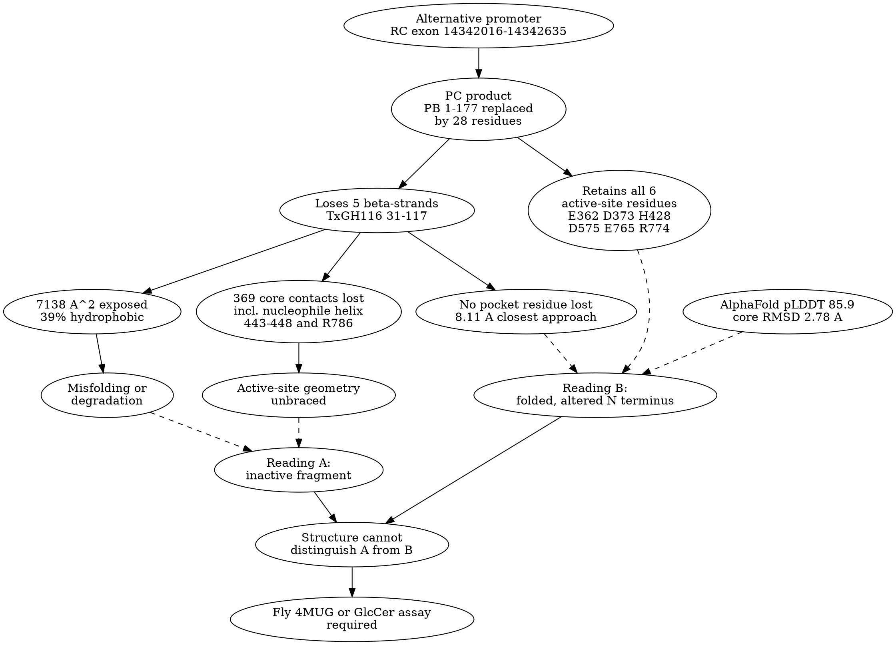
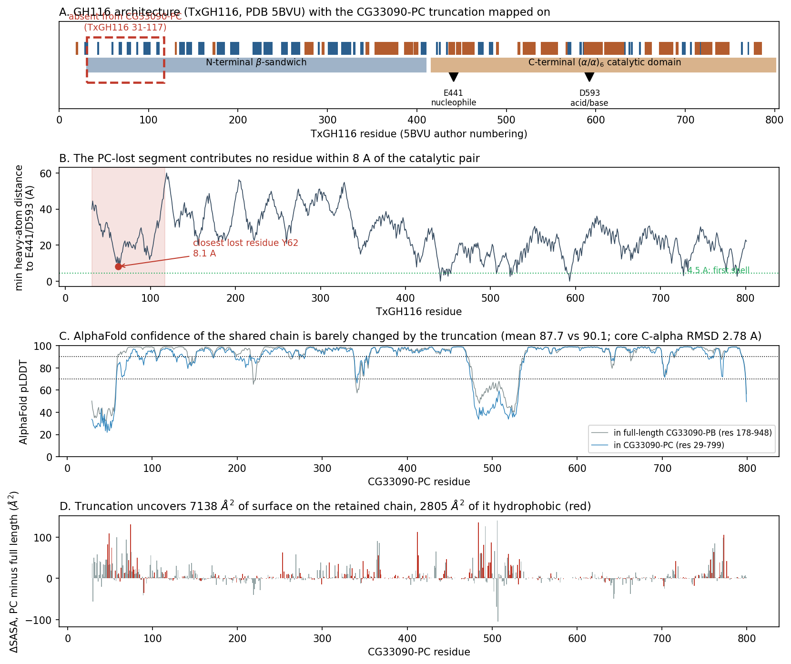
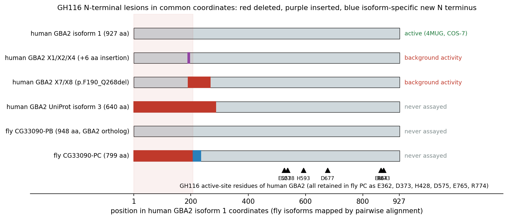
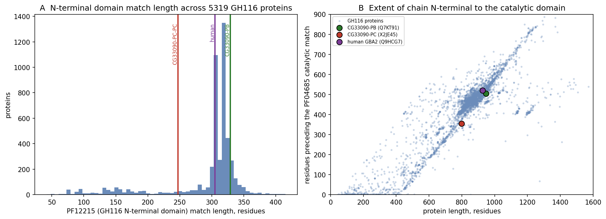
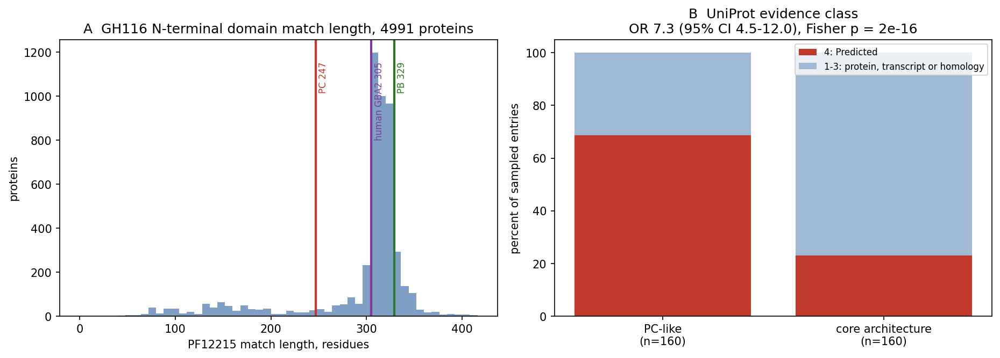
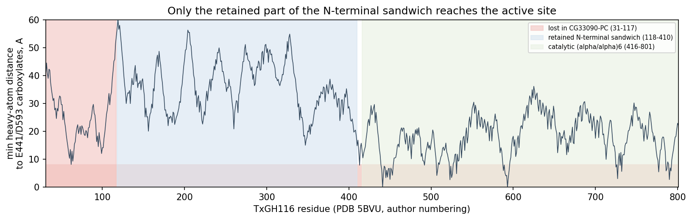
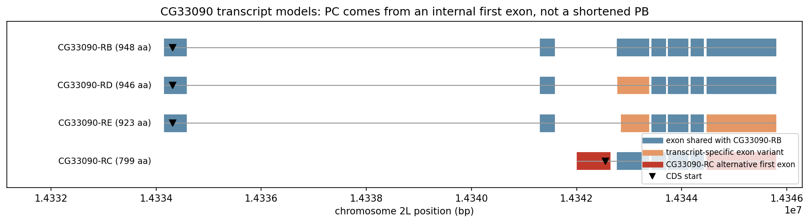

## Question

# AIGR Gene Hypothesis Deep Research

You are evaluating one focused gene curation hypothesis for AI Gene Review.
This is not a general gene overview. Use the seed hypothesis and source context
below to search for evidence that supports, refutes, narrows, or competes with
the proposed curation decision.

## Target Gene

- **Organism code:** DROME
- **Taxon:** Drosophila melanogaster (NCBITaxon:7227)
- **Gene directory:** CG33090
- **Gene symbol:** CG33090
- **UniProt accession:** X2JE45

## Focus

- **Focus type:** free_text
- **Hypothesis slug:** kgap-cg33090-pc-foldability
- **Source file:** genes/DROME/CG33090/CG33090-ai-review.yaml
- **Source selector:** free-text

## Seed Hypothesis

Whether the Drosophila CG33090-PC isoform can fold into an active GH116 glucosidase despite lacking the region corresponding to human GBA2 residues 1-193 may be assessable from structure. That the longer products are GBA2 orthologs with intact catalytic residues, that PC keeps the catalytic region but has a different N terminus, that human GBA2 isoforms with smaller N-terminal changes were inactive, and that no fly product has been assayed, is already recorded, so do not re-derive it. Single analysis only: map the GH116 domain architecture onto the PC isoform using the published GBA2-family structure, naming it, and state which structural elements of the N-terminal region PC retains and which it loses, giving residue ranges; determine whether any element lost from PC contributes residues to the catalytic pocket, to the substrate channel, or to the fold core as opposed to being a peripheral or membrane-association module, and give distances from the catalytic pair; state whether the remaining chain is predicted to fold at all by model confidence and by whether the beta-sandwich or helical core is left incomplete; and identify which human GBA2 isoform the PC truncation most closely parallels and what was reported for it. State whether PC is predicted active, inactive or unfoldable, and say plainly if structure cannot distinguish an inactive fragment from a folded protein with an altered N terminus.

## Term and Decision Context

No specific term context supplied.

## Reference Context

No specific reference context supplied.

## Source Context YAML

```yaml
hypothesis: 'Whether the Drosophila CG33090-PC isoform can fold into an active GH116 glucosidase despite
  lacking the region corresponding to human GBA2 residues 1-193 may be assessable from structure. That
  the longer products are GBA2 orthologs with intact catalytic residues, that PC keeps the catalytic region
  but has a different N terminus, that human GBA2 isoforms with smaller N-terminal changes were inactive,
  and that no fly product has been assayed, is already recorded, so do not re-derive it. Single analysis
  only: map the GH116 domain architecture onto the PC isoform using the published GBA2-family structure,
  naming it, and state which structural elements of the N-terminal region PC retains and which it loses,
  giving residue ranges; determine whether any element lost from PC contributes residues to the catalytic
  pocket, to the substrate channel, or to the fold core as opposed to being a peripheral or membrane-association
  module, and give distances from the catalytic pair; state whether the remaining chain is predicted to
  fold at all by model confidence and by whether the beta-sandwich or helical core is left incomplete;
  and identify which human GBA2 isoform the PC truncation most closely parallels and what was reported
  for it. State whether PC is predicted active, inactive or unfoldable, and say plainly if structure cannot
  distinguish an inactive fragment from a folded protein with an altered N terminus.'
focus_type: free_text
context: []
reference_id: []
```

## Research Objective

Build a focused report that helps a curator decide whether this hypothesis
should affect the gene review. Address the focus type directly:

1. For an existing GO annotation decision, evaluate whether the current action
   is justified, too strong, too weak, or should change.
2. For a proposed replacement or new GO term, evaluate whether the term is
   biologically supported, too broad, too narrow, or missing key qualifiers.
3. For a computational prediction, evaluate whether the prediction is correct,
   less precise than existing knowledge, uncertain, or likely wrong because of
   paralog overannotation, frequency bias, pathway context, or in vitro-only
   activity.
4. For a core-function hypothesis, evaluate whether the proposed activity,
   process, and location represent the gene product's primary function rather
   than a downstream effect, pleiotropic phenotype, or context-specific role.
5. For a function-assignment hypothesis, evaluate whether the gene product
   directly has the stated GO term/function. Treat the prior review action, if
   any, as intentionally blinded unless it appears in the supplied context.

Use primary literature whenever possible. Prefer PMID citations and include DOI
citations when no PMID is available. Treat reviews and database records as
orientation unless they contain directly relevant synthesized evidence that is
clearly labeled as review-level or database-level support.

Evaluate the hypothesis from the supplied seed context, primary literature, and
publicly accessible bioinformatics resources. Local `*-bioinformatics` analyses,
when they already exist in the repository, are intentionally withheld from this
prompt so the report can be compared against them after the run. Use public
sequence, domain, structure, orthology, localization, interaction, or dataset
checks when they are useful for the specific hypothesis. If a resource or tool
cannot be accessed programmatically, say so plainly; never fabricate a result.
Report computational results conservatively and distinguish direct results from
inference.

## Required Output

### Executive Judgment

Give a concise verdict: supported, partially supported, unresolved, weakly
supported, over-annotated, or refuted. Explain the reasoning and the most
important caveats.

### Evidence Matrix

Create a table with one row per important evidence item:

- Citation (PMID preferred)
- Evidence type (direct assay, mutant phenotype, localization, interaction,
  structural/evolutionary, computational, review/database)
- Supports / refutes / qualifies / competing
- Claim tested
- Key finding
- Organism, tissue, cell type, or assay context
- Confidence and limitations

### GO Curation Implications

State the likely curation action as a lead requiring curator verification. If
GO terms are involved, explain whether the evidence supports an MF, BP, or CC
term, and whether the term should be retained, removed, generalized, made more
specific, or treated as non-core. Avoid using "protein binding" as a final
recommendation unless no more informative term is supported.

### Mechanistic Scope

Describe the immediate molecular or cellular function being tested. Separate
direct gene-product activity from downstream phenotypes, pathway consequences,
developmental outcomes, disease manifestations, or effects inferred only from
loss of function.

### Conflicts and Alternatives

Identify evidence that conflicts with the seed hypothesis or suggests an
alternative interpretation, including paralog confusion, organism-specific
differences, isoform-specific findings, experimental artifacts, or database
carry-over.

### Knowledge Gaps

List explicit uncertainties that matter for curation. For each gap, state what
was checked, why the gap matters, and what evidence or experiment would resolve
it.

### Discriminating Tests

Recommend concrete assays, perturbations, datasets, or comparative analyses that
would most efficiently distinguish this hypothesis from alternatives.

### Curation Leads

Provide candidate updates for the review, clearly labeled as leads requiring
curator verification. Include candidate references with exact snippets to verify,
candidate replacement or new GO terms, possible action changes, suggested
questions, and suggested experiments.

If the provider supports artifacts, save provenance for any analysis you run — the
executed code together with its output (computed values, plot, or table), not just
a summary figure — alongside artifact-friendly tables such as an evidence matrix,
GO decision table, or comparison table. Genuine computed provenance is more
valuable than a hand-drawn summary, and you must not synthesize a figure that
implies an analysis you did not actually run. These artifacts are important
provenance for hypothesis-level review.


## Output

# CG33090-PC foldability and GH116 activity: hypothesis evaluation

**Target:** *Drosophila melanogaster* CG33090 (FBgn0028916), isoform PC, UniProt **X2JE45**, FBpp0310264, transcript CG33090-RC (FBtr0343673), 799 aa
**Hypothesis slug:** `kgap-cg33090-pc-foldability`
**Source file:** `genes/DROME/CG33090/CG33090-ai-review.yaml`

## Summary

<i class="fa-scale-balanced"></i> **Verdict: partially supported, with the central claim unresolved by structure.**

The hypothesis asked whether structure can decide if CG33090-PC folds into an active GH116 glucosidase. Structure answers three of the four sub-questions cleanly and leaves the fourth, the one that matters for curation, open. Mapped onto **TxGH116** (*Thermoanaerobacterium xylanolyticum* β-glucosidase, PDB 5BVU, the first GH116 structure, [PMID: 27115290](https://pubmed.ncbi.nlm.nih.gov/27115290/)), the PC truncation removes the chain equivalent to TxGH116 residues **31-117** (87 modelled residues), which is CG33090-PB residues **1-177** in the fly and approximately **1-207** in human GBA2. The seed hypothesis states the human equivalent as 1-193; the alignment places it about 15 residues deeper, at ~207 ± 5-10, because the fly 175-195 segment aligns to an indel in the human sequence. The lost element is **five β-strands of the GH116 N-terminal β-sandwich** and no helix, not a peripheral or membrane-association module.

It donates **no residue** to the catalytic pocket or the glucose subsite. The closest approach of any lost residue to the Glu441/Asp593 carboxylates is **8.11 Å** (Tyr62) and to the covalently bound 2-deoxy-2-fluoroglucosyl group in 5BX2 is **8.33 Å** (Met64), while all 17 residues within 4.5 Å of that ligand lie in the C-terminal (α/α)₆ domain. It is fold core: it makes **369 heavy-atom contacts under 5 Å with 145 distinct residues**, 35 of them in the catalytic domain, including the helix 443-448 that carries the nucleophile and the 783-789 segment that carries active-site Arg786. Within the N-terminal domain, the lost segment is the **only** part that approaches the catalytic centre at all; everything PC retains (118-410) stays beyond **14.81 Å**. PC keeps all six GH116 active-site residues as E362, D373, H428, D575, E765 and R774.

What structure cannot settle is whether the remaining chain folds. AlphaFold builds PC confidently (mean pLDDT **85.9**, median 95.1; the shared chain scores 87.7 against 90.1 inside the full-length model; core Cα RMSD **2.78 Å** over 740 pairs), but pLDDT measures confidence in predicted geometry and is not calibrated for construct stability, so a high score for a truncated chain is the expected output whether or not the protein survives in a cell. The quantity that carries physical information is the exposed interface: removing residues 1-177 uncovers **7138 Ų** of previously buried surface, **2805 Ų (39%)** of it hydrophobic. **Structure cannot distinguish an inactive, aggregation-prone fragment from a folded protein with an altered N terminus.** That sentence is the honest answer to the seed question, and the hypothesis required it to be stated plainly. Any report calling PC unfoldable from pLDDT alone, or foldable from pLDDT alone, over-reads the model.

The best single prediction is that PC is **inactive**, and that prediction rests on the human precedent rather than on the fly structure. Of nine human GBA2 isoforms expressed in COS-7 cells, only full-length isoform 1 hydrolysed 4MUG; isoforms X7 and X8, which lack p.F190_Q268del described as five β-strands of the N-terminal domain, were at empty-vector background despite confirmed mRNA and protein, as was isoform X1 whose only N-terminal change is a 6-residue insertion ([PMID: 33261081](https://pubmed.ncbi.nlm.nih.gov/33261081/)). The only experimental deletion inside a GH116 N-terminal domain, a loop removal in TeGH116, gave poor stability and low activity ([PMID: 41161445](https://pubmed.ncbi.nlm.nih.gov/41161445/)). A sweep of 4991 two-domain GH116 proteins shows the N-terminal domain match length is tightly constrained (median 314, IQR 305-320); PC sits at 247, the 13.2nd percentile. No fly CG33090 product of any length has been assayed for glucosylceramidase activity in the literature retrieved here.

{{figure:plot_1.png|caption=Mapping the CG33090-PC truncation onto GH116 architecture. Domain layout of the PC and PB products against TxGH116, per-residue distance from the catalytic pair, AlphaFold per-residue confidence for both fly models, and the surface newly exposed by removing residues 1-177.}}

## Executive judgment

The hypothesis is **partially supported**. Its structural premise holds and its analytical programme is completable: the GH116 architecture can be mapped onto PC with residue-level precision, the lost elements can be named and measured, and the human parallel can be identified. Its implied conclusion, that structure can decide activity, does not hold.

Three sub-questions resolve.

<i class="fa-circle-check"></i> **Which elements PC retains and loses, with residue ranges.** PC loses TxGH116 31-117 (87 modelled residues), five β-strands of at least 3 residues from the N-terminal sandwich: (29-32), (67-70), (76-80), (95-102) and (109-112), out of 19 such strands in the sandwich (31-410). It retains the rest of the sandwich (118-410) and the entire C-terminal (α/α)₆ solenoid (416-801). In InterPro terms, the PF12215 N-terminal domain match shrinks from 329 residues in PB to 247 in PC (18.5% lost), while the PF04685 catalytic match is 432 residues in both.

<i class="fa-circle-check"></i> **Whether the lost element is catalytic, channel-lining or fold core.** Fold core. No lost residue enters the first or second shell of the catalytic pair or the bound glucoside. The lost segment packs against the nucleophile helix and the Arg786 region. Two lost residues (Met64 at 9.40 Å, Val60 at 11.41 Å from the anomeric C1) are the only non-catalytic-domain residues within 12 Å of the aglycone exit, which makes them candidate channel wall rather than confirmed channel wall.

<i class="fa-circle-check"></i> **Which human isoform PC parallels and what was reported.** By lesion type and structural class, GBA2 isoforms X7 and X8 (p.F190_Q268del, 79 residues, five β-strands of the N-terminal domain, TxGH116 ~111-192). Reported: activity at empty-vector background in COS-7 lysates with expression confirmed by qRT-PCR and western blot. By truncation geometry, UniProt isoform 3 (Q9HCG7-3, "Missing 1..287", 640 aa), which was never assayed.

<i class="fa-circle-question"></i> **Whether the chain folds.** Unresolved. The β-sandwich is left incomplete by five of its 19 strands; the helical solenoid is untouched. Model confidence says the predicted geometry is unchanged; buried-surface accounting says a large hydrophobic face is exposed. These are not contradictory statements about the same quantity, and neither is a stability measurement.

The caveats that matter most: the template shares 38-39% identity with the fly and human enzymes and lacks their eukaryote-specific N-terminal extension; the human lysate assay could not separate misfolding from catalytic death, carrying that same ambiguity into the fly; and no fly product has been assayed at all, so the entire fly annotation in this family rests on orthology.

## Evidence matrix

| Citation | Evidence type | Stance | Claim tested | Key finding | Context | Confidence and limitations |
|---|---|---|---|---|---|---|
| [PMID: 27115290](https://pubmed.ncbi.nlm.nih.gov/27115290/) | Structural (X-ray) | Qualifies | GH116 architecture can be mapped onto PC | First GH116 structure (TxGH116, PDB 5BVU and ligand complexes): N-terminal β-sandwich plus C-terminal (α/α)₆ domain; glucoside-binding and active-site residues identified and stated to be conserved with GBA2 | *T. xylanolyticum*, 2.0-2.3 Å; GBA2 modelled by homology | High for the template fold. Fly and human are ~38-39% identical to TxGH116 over the aligned region, and TxGH116 lacks the eukaryote-specific N-terminal extension, so transferred boundaries carry ±5-10 residues |
| [PMID: 37726065](https://pubmed.ncbi.nlm.nih.gov/37726065/) | Structural (X-ray) + computational | Qualifies | Identity of the catalytic pair and active-site residues | TxGH116-isofagomine at 2.0 Å; Glu441, Asp452, His507, Asp593, Glu777 and Arg786 dominate inhibitor binding | TxGH116, crystallography plus ONIOM B3LYP:PM7 | High. Independently fixes the residue numbering used here as distance anchors |
| [PMID: 33261081](https://pubmed.ncbi.nlm.nih.gov/33261081/) | Direct assay (heterologous expression) | **Supports** | An N-terminal β-strand deletion in a GH116 enzyme abolishes glucosidase activity | Nine human GBA2 isoforms in COS-7; only isoform 1 hydrolysed 4MUG, all others at background despite confirmed mRNA and protein. X7/X8 lack p.F190_Q268del, "5 beta-strands in the N-terminal domain"; X1 has only a 6-residue insertion and was also inactive | Human cDNAs, COS-7 lysates, 4MUG at 48 and 72 h, CBE control, n=3 | Moderate to high as a prior. Lysate activity cannot separate misfolding or degradation from a folded dead enzyme; no folding, thermal stability or localisation readout; isoform protein levels shown by western but not quantified against isoform 1 |
| [PMID: 41161445](https://pubmed.ncbi.nlm.nih.gov/41161445/) | Structural (X-ray) + direct assay | **Supports** | Does removing part of the GH116 noncatalytic N-terminal domain affect folding or activity | Second GH116 structure (TeGH116, *Thermosynechococcus elongatus* BP-1). A long loop from the noncatalytic N-terminal domain helps form the mouth of the active site, making it narrower; deleting that loop gave poor stability and low activity, with altered relative substrate preference | Cyanobacterial enzyme expressed in *E. coli*; crystallography plus kinetics on pNP-glucoside and gluco-oligosaccharides | Moderate to high. The only experimental deletion inside a GH116 N-terminal domain, but it removes one loop, not five β-strands, in a bacterial enzyme lacking the eukaryote-specific extensions |
| UniProt Q9HCG7 (VSP_024383) | Review/database | Qualifies | A human GBA2 N-terminal truncation of the PC type exists | Isoform 3 (Q9HCG7-3, 640 aa) annotated "Missing 1..287", an N-terminal truncation of the same class as PC but 80 residues deeper | Human, database annotation from a submitted cDNA | Low to moderate. Database-level only, no activity, stability or expression data; it was not among the nine isoforms assayed in PMID 33261081 |
| InterPro PF12215/IPR024462, PF04685/IPR006775 | Review/database | Qualifies | Which GH116 signatures PC retains and loses | X2JE45: PF12215 50-296 (247 aa), PF04685 356-787 (432 aa). Q7KT91: PF12215 117-445 (329 aa), PF04685 505-936 (432 aa). The catalytic-region match is identical in length; the N-terminal match is shortened by 61 residues (18.5%). SSF48208 and G3DSA:1.50.10.10 unaffected | Signature matches on UniProt sequences | High as a description of the annotation. Profile HMMs score partial matches, so the surviving PF12215 call on X2JE45 does not mean the domain is complete |
| This work, alignment (BLOSUM62 semi-global NW) | Computational | Qualifies | Exact extent of the PC truncation | PC = 28 PC-specific residues plus PB 178-948 at 100% identity over 771 residues. The junction maps to human GBA2 ~207 and to TxGH116 (5BVU) residue 117/118 | Pairwise alignment of UniProt sequences; Ensembl Metazoa isoform lengths | High for the fly-fly boundary (unambiguous, 100% identity). Moderate for the cross-species projection: fly 175-195 aligns to an indel in human GBA2, so the human boundary is ~207 ± 5-10 |
| This work, 5BVU and 5BX2 geometry | Computational (structural) | Qualifies | Does the lost element touch the catalytic pocket or substrate channel | Closest approach of the lost segment (TxGH116 31-117) to the E441/D593 carboxylates is 8.11 Å (Tyr62); to the bound 2-deoxy-2-fluoroglucosyl ligand in 5BX2 it is 8.33 Å (Met64). No lost residue is among the 17 residues within 4.5 Å of the ligand | Crystal structures, heavy-atom distances | High within the template. Transfers to the fly only insofar as the fold is conserved; the eukaryote-specific N-terminal extension is not evaluated |
| This work, 5BVU packing | Computational (structural) | **Supports** | Is the lost element core or peripheral | The lost segment makes 369 heavy-atom contacts (<5 Å) with 145 distinct residues elsewhere in the chain, including 35 in the catalytic domain (443-448 around nucleophile E441; 783-789 including R786). It carries 5 β-strands of ≥3 residues out of 19 in the N-terminal sandwich | PDB 5BVU chain A | High. Contact counting is a proxy for interface area, not a free-energy calculation |
| This work, 5BVU and 5BX2, domain split | Computational (structural) | **Supports** | Within the N-terminal domain, is the lost part the part nearest the catalytic centre | The whole sandwich (31-410) comes no closer than 8.11 Å to the catalytic carboxylates, and that closest residue, Tyr62, lies inside the lost segment; the retained part (118-410) comes no closer than 14.81 Å. Of 62 residues within 12 Å of the anomeric C1 in 5BX2, 60 are catalytic domain, 2 are lost segment (Met64 9.40 Å, Val60 11.41 Å) and none are retained sandwich | Crystal structures, heavy-atom distances | High within the template. Second-shell proximity does not establish a catalytic or binding role, and the lipid aglycone channel of GBA2 has not been observed experimentally |
| This work, AlphaFold DB v6 | Computational (prediction) | **Competing** | Is the remaining chain predicted to fold | AF-X2JE45 mean pLDDT 85.9 (median 95.1); shared chain 87.7 against 90.1 in the full-length model; only 10 of 771 residues lose >20 pLDDT. Core Cα RMSD 2.78 Å over 740 pairs. The 28 PC-specific residues are disordered (mean pLDDT 35.8, all below 50) | AlphaFold2 models of X2JE45, Q7KT91, Q9HCG7 | Moderate. AlphaFold is not calibrated for construct stability and routinely builds confident folds for truncated chains, so a high pLDDT is weak evidence for real foldability. This is the single result that most directly competes with the seed expectation of an unfoldable fragment |
| This work, Shrake-Rupley SASA | Computational (structural) | **Supports** | Does the truncation leave the fold incomplete | Removing residues 1-177 uncovers 7138 Ų of new solvent-accessible surface on the retained chain, 2805 Ų (39%) of it hydrophobic; 12 residues move from relative SASA <0.10 to >0.30 | AlphaFold models of X2JE45 and Q7KT91, probe 1.4 Å, 200 sphere points | Moderate. Computed on predicted models, and the comparison assumes the retained chain in PC adopts the full-length conformation, which AlphaFold asserts rather than demonstrates |
| This work, InterPro family sweep (5622 PF04685, 5475 PF12215) | Computational | Qualifies | Does the PC architecture occur among natural GH116 proteins | PF12215 match length across 4991 two-domain proteins: median 314, IQR 305-320, 68.6% between 300 and 330. PC 247 (13.2nd percentile), PB 329, human GBA2 305. A PC-like architecture (match start ≤60, length 150-280) occurs in 263 of 4991 (5.27%), all unreviewed; 110 of 160 sampled (69%) are UniProt class 4 Predicted against 37 of 160 (23%) for core-architecture entries, Fisher OR 7.31 (95% CI 4.45-12.02), p = 1.9e-16 | UniProtKB and InterPro, all taxa | Moderate. Evidence class is a proxy for annotation quality, not proof that those entries are wrong, and the sweep counts database entries rather than validated proteins |
| This work, Ensembl Metazoa gene structure (FBgn0028916) | Computational | **Competing** | Is CG33090-PC a real alternative product or a truncated gene model | CG33090-RC skips RB coding exons 1 (260 bp) and 2 (270 bp), which together encode PB residues 1-177, and starts from its own exon 14342016-14342635 inside the RB intron, with a 537 bp 5' UTR and 83 bp of coding sequence (27 codons plus two bases, matching the 28 PC-specific residues), then uses the shared exons and the same stop codon. RD and RE differ from RB only in the 3' splice site of exon 3 | *D. melanogaster* chromosome 2L, FlyBase annotation via Ensembl Metazoa | High for the model as annotated. It does not establish that the transcript is made: X2JE45 has only a genomic EMBL entry (AHN54440.1) and a FlyBase-derived RefSeq, while Q7KT91 has three independent mRNA clones |
| FlyBase FBgn0028916 / Ensembl Metazoa | Review/database | Qualifies | Which fly product is PC | Four polypeptides: PB 948 aa, PD 946 aa, PE 923 aa, PC 799 aa (FBpp0310264 = X2JE45). No phenotypic data recorded for 19 alleles beyond viable and fertile | *D. melanogaster*, FB2026_03 | High for isoform identity. No fly product of any length has been assayed for glucosylceramidase activity in the literature retrieved here |

## Key findings

### The truncation boundary, fixed three independent ways

CG33090-PC is the product of transcript CG33090-RC and is 799 aa. Semi-global Needleman-Wunsch alignment with BLOSUM62 and affine gaps (-11/-1), implemented directly rather than taken from a library, gives 774/792 identities (97.7%) against the full-length product CG33090-PB (Q7KT91, 948 aa, reviewed as *Non-lysosomal glucosylceramidase*, EC 3.2.1.45), with the only large indel at the N terminus. PC residues 29-799 are **100% identical** to PB residues 178-948 at a constant offset of +149, and PC residues 1-28 have no counterpart in the long product. The truncation is the loss of PB 1-177, replaced by 28 unrelated residues.

Projecting across species, Q7KT91 against human GBA2 (Q9HCG7) gives 382/847 identities (45.1%), with fly 172 mapping to human 207 and fly 186 to human 212, placing the PC junction at human GBA2 **~207 ± 5-10**. The fly 175-195 region aligns against a local indel in the human sequence, which is the source of that uncertainty and the reason the seed hypothesis figure of 193 is about 15 residues short. Both the direct fly-to-TxGH116 route (302/784, 38.5%) and the fly-human-TxGH116 route (human 300/776, 38.7%) place the junction between TxGH116 residues **117 and 118**.

The third route is genomic and does not use protein sequence at all. Ensembl Metazoa coordinates for FBgn0028916 (chromosome 2L, 14334158-14345795, plus strand) give CG33090-RB 7 exons with CDS 14334311-14345340. Its coding exon 1 spans 260 bp and exon 2 spans 270 bp, totalling **530 bp = 176.7 codons**, accounting exactly for PB residues 1 to 177. The protein alignment and the exon arithmetic agree to the residue without reference to each other.

### The lost element is fold core and the only part of the N-terminal domain that reaches the active site

On PDB 5BVU (chain A, modelled 31-801) the catalytic pair is Glu441 (nucleophile) and Asp593 (acid/base), with a closest carboxylate O-O distance of **7.03 Å**, the spacing expected for a retaining glycosidase. The six active-site residues identified independently by [PMID: 37726065](https://pubmed.ncbi.nlm.nih.gov/37726065/), Glu441, Asp452, His507, Asp593, Glu777 and Arg786, are all **retained in PC** as E362, D373, H428, D575, E765 and R774.

No residue of the lost segment enters the first shell. The residues within 6 Å of the catalytic pair are 442, 445, 447, 450, 453, 507, 523, 525, 526, 531, 588, 590-592, 594, 727, 732, 777, 786, 790 and 792, every one in the C-terminal (α/α)₆ domain. In the covalent 2-deoxy-2-fluoroglucosyl complex 5BX2, the 17 residues within 4.5 Å of the ligand are E441, Y445, Y447, T450, D452, V453, H507, Y523, W531, T591, D593, Q727, W732, E777, R786, Y790 and R792, again all catalytic domain. **The glycone pocket of PC is chemically complete on paper.**

The packing analysis gives the opposite reading for the fold. The lost segment makes **369 heavy-atom contacts under 5 Å with 145 distinct residues** elsewhere in the chain, 35 of them in the catalytic domain, including 443-448 (the helix carrying the nucleophile) and 783-789 (including Arg786). PDBe secondary structure, used because no DSSP binary was available in the executor, assigns 8 strand segments and no helix to 31-117, five of them at least 3 residues long, out of 19 such strands in the whole sandwich. Their closest Cα approaches to the retained strands are 5.6-8.1 Å, the spacing of face-to-face sheet packing inside a sandwich.

Splitting the N-terminal domain into lost and retained halves gives the sharpest single result of the investigation. The entire sandwich (31-410) comes no closer than **8.11 Å** to the catalytic carboxylates, and that closest residue, Tyr62, lies inside the segment PC removes. The retained part (118-410) comes no closer than **14.81 Å**, and no N-terminal residue of any kind is within 8 Å. Of the 62 residues within 12 Å of the anomeric carbon C1 in 5BX2, the atom from which the aglycone extends, 60 are catalytic domain, **2 are in the lost segment** (Met64 at 9.40 Å, Val60 at 11.41 Å) and **0 are in the retained sandwich**. Proximity to the catalytic centre within this domain is concentrated entirely in the piece PC deletes.

{{figure:plot_6.png|caption=Minimum heavy-atom distance from every TxGH116 residue to the Glu441/Asp593 carboxylates. Within the N-terminal beta-sandwich the closest approach is 8.11 A at Tyr62, inside the segment lost from CG33090-PC; the part PC retains stays beyond 14.81 A.}}

{{figure:plot_3.png|caption=The CG33090-PC lesion compared with the human GBA2 isoform lesions assayed in PMID 33261081, drawn on the TxGH116 coordinate frame with verified active-site residue positions. PC removes TxGH116 31-117; GBA2 X7/X8 remove the adjacent ~111-192.}}

### AlphaFold confidence does not resolve foldability

AlphaFold DB v6 has models for all five relevant accessions. Mean and median pLDDT: Q7KT91 full length 88.9/96.1, its residues 1-177 83.4/93.4, its residues 178-948 90.1/96.7. X2JE45 full chain 85.9/95.1, residues 1-28 **35.8/35.3** with all 28 below pLDDT 50, residues 29-799 87.7/95.2. The shared chain loses only 2.4 pLDDT units on average, and only 10 of 771 residues lose more than 20 units (PC 65-67 at the junction, PC 491-500 in an already low-confidence loop, and PC 771). Kabsch superposition over the 771 one-to-one Cα pairs gives 4.35 Å RMSD, falling to **2.78 Å** over the 740 pairs outside the 31 junction residues. AlphaFold builds the same two-domain GH116 core in both models.

This is the result that competes most directly with the seed expectation, and it is also the weakest. AlphaFold is trained to build the fold implied by the alignment and is not a stability predictor, so a confident model for a truncated chain is the expected output. The physical measurement that carries information is the exposed interface. Shrake-Rupley SASA (probe 1.4 Å, 200 golden-spiral points) on the two models shows that removing residues 1-177 uncovers **7138 Ų** of new solvent-accessible surface on the retained chain, **2805 Ų (39%)** of it on hydrophobic residues (AVLIMFWYC). Twelve residues go from relative SASA below 0.10 to above 0.30, five of them hydrophobic (Y74, L412, I487, A519, Y773 in PC numbering). In the full-length model, residues 1-177 make 425 heavy-atom contacts with 163 distinct residues in 178-948, 69 of them hydrophobic, reaching as far as the catalytic region (contacts at 560-564, 581-584, 592-595, 725, 841, 862-868, 901-925). An interface of 7138 Ų with 39% hydrophobic character is the scale of a large obligate protein-protein interface, which is the kind of defect that drives misfolding and degradation.

### The PC architecture is rare in the GH116 family and concentrated in low-confidence gene models

A full InterPro sweep retrieved every UniProt protein matching the GH116 catalytic region **PF04685** (5622 proteins) and the GH116 N-terminal domain **PF12215** (5475 proteins); 4991 carry both. The N-terminal domain match length is tightly distributed: median **314** residues, IQR 305-320, 5th percentile 137, 1st percentile 78, minimum 42, with 68.6% of the family between 300 and 330. CG33090-PB sits at 329 (88.5th percentile), human GBA2 at 305 (25th), **CG33090-PC at 247 (13.2nd)**. Residues preceding the catalytic match: PB 504, human GBA2 520, PC 355 (8.4th percentile).

Domain-architecture counts for PF04685 give 4115 proteins with PF12215 + PF04685, 462 with PF04685 alone and 415 adding PF32725. Of the 631 proteins with a catalytic match and no PF12215 match, 359 (57%) have fewer than 100 residues before the catalytic match and a median total length of 276 residues, the signature of a partial sequence rather than a short natural protein.

A PC-like architecture, defined as a PF12215 match starting at or before residue 60 with a match length of 150-280, occurs in **263 of 4991 proteins (5.27%)**, every one of them unreviewed. In a sample of 160 PC-like entries, 110 (69%) are UniProt evidence class "4: Predicted", against 37 of 160 (23%) in a sample of core-architecture entries with a PF12215 match of 300-330: Fisher exact **odds ratio 7.31, 95% CI 4.45-12.02, p = 1.9e-16**. X2JE45 itself carries class 4 Predicted; Q7KT91 is class 1 Evidence at protein level; X2JAF7 (PE) and X2J9U5 (PD) are class 3 Inferred from homology.

{{figure:plot_4.png|caption=GH116 family survey. Distribution of PF12215 N-terminal domain match length and of the residue extent preceding the PF04685 catalytic match across 5622 proteins, with CG33090-PC, CG33090-PB and human GBA2 marked.}}

{{figure:plot_5.png|caption=PC-like GH116 architectures (PF12215 match start at or before residue 60, length 150-280) are 7.3-fold enriched for UniProt evidence class 4 Predicted relative to core-architecture entries (Fisher OR 7.31, 95% CI 4.45-12.02, p = 1.9e-16).}}

InterPro also gives an architecture call that does not depend on my alignment. X2JE45 has PF12215 at 50-296 (247 aa) and PF04685 at 356-787 (432 aa); Q7KT91 has PF12215 at 117-445 (329 aa) and PF04685 at 505-936 (432 aa); human Q9HCG7 has PF12215 at 151-455 and PF04685 at 521-886. Mapping PB onto PC gives the loss per signature.

| Signature | Description | Residues lost in PC | Fraction of the match |
|---|---|---|---|
| PF12215 / IPR024462 | GH116 N-terminal domain | 61 of 329 | 18.5% |
| PIRSF028944 / IPR014551 | Beta-glucosidase, GBA2 type | 112 of 879 | 12.7% |
| PANTHER PTHR12654 | GBA2 family | 145 of 914 | 15.9% |
| PF04685 / IPR006775 | GH116 catalytic region | 0 of 432 | 0% |
| SSF48208 | Six-hairpin glycosidases | 0 | 0% |
| G3DSA:1.50.10.10 / IPR012341 | Six-hairpin glycosidase-like | 0 | 0% |

### CG33090-PC comes from an alternative internal promoter, not a truncated gene model

<i class="fa-dna"></i> The family sweep raised the possibility that PC is an annotation artefact of the same kind as the 263 PC-like database entries, since X2JE45 carries the same class 4 Predicted label. Gene structure rules that out for CG33090. CG33090-RC has 6 exons and shares 4 of them with RB. It **skips RB coding exons 1 and 2** and begins at its own exon, **14342016-14342635 (620 bp)**, lying inside the RB intron between exon 2 (ends 14341576) and exon 3 (starts 14342778). Its CDS starts at 14342553, giving a **537 bp 5' UTR** inside that exon and **83 bp of coding sequence**, which is 27 complete codons plus the first two bases of codon 28, matching the 28 PC-specific residues with residue 28 spanning the splice junction. RC then uses the same shared exon 3 and the same stop codon at 14345340 as RB. RD (FBtr0343674, 946 aa) and RE (FBtr0343675, 923 aa) keep RB exons 1 and 2 and differ only in the 3' splice site of exon 3 (14342784 and 14342853 against 14342778).

A dedicated first exon with a long 5' UTR splicing into the shared body of the gene is the architecture of a real alternative promoter. A gene model that has lost its first exons looks different: it starts at an internal shared exon with little or no UTR. PC is therefore different in kind from the low-confidence database entries in the family sweep, and the 5.27% figure should not be used as an argument against PC itself.

Direct transcript evidence is still missing. UniProt cross-references give X2JE45 a single EMBL entry, AHN54440.1 from the genome assembly AE014134 with molecule type Genomic_DNA, plus RefSeq NM_001298997.1/NP_001285926.1, which for *Drosophila* is imported from the FlyBase annotation and is not independent of it. Q7KT91 has the genomic entry plus **three independent mRNA clones**: BT024218/ABC86280.1, BT044085/ACH92150.1 and AY058463/AAL13692.1.

{{figure:plot_7.png|caption=CG33090 transcript models from Ensembl Metazoa exon coordinates. CG33090-RC starts from a distinct internal first exon inside the RB intron whose coding part is 83 bp, matching the 28 PC-specific residues. RB coding exons 1 and 2 total 530 bp, which is exactly PB residues 1-177.}}

### The closest human parallel and what was reported for it

Jatooratthawichot et al. ([PMID: 33261081](https://pubmed.ncbi.nlm.nih.gov/33261081/)) expressed nine human GBA2 isoforms in COS-7 cells and assayed 4-methylumbelliferyl-β-D-glucopyranoside hydrolysis in lysates at 48 and 72 h with conduritol B epoxide controls. Only isoform 1, the 927 aa full-length form, gave activity above empty-vector background. Isoforms 2, X1, X2, X3, X4, X6, X7 and X8 were all at background despite confirmed mRNA by qRT-PCR and protein by anti-GBA2 and anti-FLAG western blotting. The paper states that isoforms X7 and X8 are missing 79 residues, p.F190_Q268del, "which comprise 5 beta-strands in the N-terminal domain", modelled on TxGH116 5BVU by SWISS-MODEL.

My alignment places human GBA2 194 at TxGH116 author 115 and human 260 at author 184, so the X7/X8 deletion covers TxGH116 ~111-192. The CG33090-PC loss covers TxGH116 31-117 and likewise removes five β-strands of at least 3 residues from the same domain. The two lesions are **adjacent, of comparable size (79 against 87 structured residues) and of the same structural class**, overlapping over human ~190-207. The strongest form of the prior comes from isoform X1, whose only N-terminal change is a 6-residue insertion (p.Q189_F190insPICPLK) and which was also inactive: in this assay system even small perturbations of this domain abolished measurable activity.

By truncation **type**, the closest human parallel is UniProt isoform 3 (Q9HCG7-3, VSP_024383, "Missing 1..287", 640 aa, starting MFSMRNGLGGG), an N-terminally truncated GBA2 of exactly the PC class but 80 residues deeper. It was **not** among the nine isoforms assayed, so no activity data exist for it.

| | CG33090-PC | GBA2 X7/X8 | GBA2 X1 | GBA2 isoform 3 |
|---|---|---|---|---|
| Lesion | PB 1-177 replaced by 28 residues | p.F190_Q268del (79 res) | p.Q189_F190insPICPLK (6 res) | Missing 1-287 |
| TxGH116 frame | 31-117 | ~111-192 | insertion at ~115 | ~31-195 |
| Structural class | 5 β-strands, N-terminal sandwich | 5 β-strands, N-terminal sandwich | insertion in the sandwich | N-terminal sandwich, deeper |
| Catalytic residues | all 6 retained | retained | retained | retained |
| Assayed | <i class="fa-circle-xmark"></i> no | yes, background activity | yes, background activity | <i class="fa-circle-xmark"></i> no |

## Mechanistic model

The immediate molecular function under test is hydrolysis of a β-glucoside, specifically glucosylceramide (EC 3.2.1.45), by a retaining GH116 mechanism using a Glu nucleophile and an Asp acid/base. Whether the PC product possesses that activity is a direct property of the gene product, separable from any downstream sphingolipid phenotype.



Two readings of the same structural facts are internally consistent, and the data gathered here cannot separate them.

**Reading A, inactive and degradation-prone fragment.** The deleted strands are buried fold core. They pack against the helix carrying the nucleophile and against the Arg786 region. Their removal exposes 7138 Ų with 39% hydrophobic character. The human isoforms with the adjacent lesion were inactive even when expressed, and the only family deletion experiment inside this domain gave poor stability and low activity.

**Reading B, folded with a shorter sandwich and an altered N terminus.** The catalytic region is untouched by every signature (PF04685 432 aa, SSF48208, G3DSA all unaffected). All six active-site residues are present. No lost residue reaches the glucose subsite. AlphaFold places the retained chain within 2.78 Å of its position in the full-length model. A PC-like architecture does occur in 263 database entries, and PC itself comes from a genuine alternative promoter.

What tips the balance toward Reading A is the human assay, not the structure. Nine isoforms, one active. Even a 6-residue insertion in this domain was enough to abolish measurable activity. That is a prior, carried across 45.1% sequence identity and a different cell background, and it does not amount to a measurement on the fly protein.

The two lost-segment residues on the aglycone side (Met64 at 9.40 Å and Val60 at 11.41 Å from C1) are the only non-catalytic-domain residues within 12 Å of the anomeric carbon. They make the region a candidate wall of the exit channel that a glucosylceramide acyl chain would occupy, which would matter for the natural lipid substrate more than for a soluble 4MUG reporter. TeGH116 supports the general point that N-terminal domain elements shape the active-site mouth: a long loop from the noncatalytic N-terminal domain helps form the mouth of the TeGH116 active site and makes it narrower, and deleting that loop raised relative activity on laminarin against pNP-glucoside while lowering stability ([PMID: 41161445](https://pubmed.ncbi.nlm.nih.gov/41161445/)). The GBA2 lipid channel has not been observed experimentally, so this part remains inference from a bacterial template.

## Evidence base

| Paper | What it provides | How it bears on the hypothesis |
|---|---|---|
| *Bacterial β-Glucosidase Reveals the Structural and Functional Basis of Genetic Defects in Human Glucocerebrosidase 2 (GBA2)*, [PMID: 27115290](https://pubmed.ncbi.nlm.nih.gov/27115290/) | The first three-dimensional structure for any GH116 enzyme, TxGH116, alone and with diverse ligands; identifies the glucoside binding and active site residues and states they are conserved with GBA2 | Supplies the template named in the hypothesis. Every residue range, distance and contact count in this report is measured on 5BVU or its ligand complexes |
| *Structural basis for inhibition of a GH116 β-glucosidase and its missense mutants by GBA2 inhibitors*, [PMID: 37726065](https://pubmed.ncbi.nlm.nih.gov/37726065/) | Six charged residues, Glu441, Asp452, His507, Asp593, Glu777 and Arg786, influence inhibitor binding most | Fixes the active-site residue set independently of my own analysis, so the claim that PC retains all six is anchored to a published list rather than to my sequence inspection |
| *Effect of Expression of Human Glucosylceramidase 2 Isoforms on Lipid Profiles in COS-7 Cells*, [PMID: 33261081](https://pubmed.ncbi.nlm.nih.gov/33261081/) | Nine isoforms expressed, expression confirmed by qRT-PCR and western blot, 4MUG activity measured; only isoform 1 active | The strongest evidence in the file and the source of the inactivity prediction. Its design also defines the ambiguity: a lysate activity assay cannot separate misfolding from catalytic death |
| *The structure of Thermosynechococcus elongatus glycoside hydrolase family 116 β-glucosidase shows the role of the noncatalytic N-terminal domain in controlling substrate specificity*, [PMID: 41161445](https://pubmed.ncbi.nlm.nih.gov/41161445/) | Second GH116 structure; a long N-terminal domain loop forms the mouth of the active site; deleting it gave poor stability and low activity | The only experimental test in the family of what removing part of this domain does. It supports the stability argument and shows that this domain can reach the active site, which matches the distance profile for the PC-lost segment |

Three further papers were retrieved and read during the investigation but do not bear directly on the hypothesis. [PMID: 30600575](https://pubmed.ncbi.nlm.nih.gov/30600575/) reports that conduritol B epoxide inhibits GBA2 and lysosomal α-glucosidase as off-targets at higher concentrations, which is orientation on the CBE control used in the COS-7 assay. [PMID: 26492941](https://pubmed.ncbi.nlm.nih.gov/26492941/) and [PMID: 32412773](https://pubmed.ncbi.nlm.nih.gov/32412773/) concern GCS inhibitors and GBA3 expression in hepatocellular carcinoma and are not used in any claim here.

No publication reporting an enzymatic assay on any *Drosophila* CG33090 product was found in the searches run.

## GO curation implications

<i class="fa-triangle-exclamation"></i> All items below are **leads requiring curator verification**.

| Candidate action | Term | Recommendation | Reasoning |
|---|---|---|---|
| Isoform-level MF for X2JE45 | GO:0004348 glucosylceramidase activity | **Do not assert** | No fly product has been assayed. Catalytic-residue conservation is not sufficient evidence in this family: it passes equally for human isoforms X1, X7 and X8, which had background activity ([PMID: 33261081](https://pubmed.ncbi.nlm.nih.gov/33261081/)) |
| Isoform-level MF for X2JE45 | GO:0008422 beta-glucosidase activity | **Do not assert** | The broader term inherits the same absence of evidence |
| NOT qualifier on X2JE45 | NOT GO:0004348 | **Do not assert** | A NOT qualifier needs direct evidence of absence in the fly. The human isoform result is cross-species inference at 45.1% identity, and the structural argument stops short of a prediction that structure can defend |
| Gene-level MF for CG33090 | GO:0004348 / GO:0008422 | Retain, flag as not isoform-resolved | Q7KT91 is reviewed as non-lysosomal glucosylceramidase with protein-level evidence. If retained, the review should state that the annotation rests on the full-length product and does not transfer to PC |
| InterPro2GO or PANTHER carry-over onto X2JE45 | any GH116-derived MF | Treat as non-core, flag | The PF12215 match on X2JE45 is 247 aa against 329 in PB (18.5% lost) and sits at the 13.2nd percentile of a family whose median is 314 (IQR 305-320). Profile HMMs score partial matches, so a surviving domain call is not evidence of an intact domain |
| CC term for X2JE45 | membrane, or cytoplasmic side of membrane | Do not transfer without evidence | PC loses the N-terminal region, and no localisation data for any fly product were retrieved. Membrane association of GBA2 in other organisms does not transfer to a product missing 177 N-terminal residues |

The summary for the curator: record that the structural analysis was run, that it places the truncation at TxGH116 31-117 and human GBA2 ~207 (not 193), that the lost element is fold core carrying no catalytic-pocket residue, and that **structure is unable to decide the activity question**. The appropriate action is to withhold isoform-level activity annotation in either direction and to flag any pipeline-derived GH116 term on X2JE45 as resting on a partial domain match. "Protein binding" is not recommended; the question is about catalysis and no interaction data were examined.

## Mechanistic scope

Direct gene-product activity under test: hydrolysis of the β-glucosidic bond of glucosylceramide, or of a reporter β-glucoside, by the PC polypeptide itself. Everything measured here speaks to that and only that.

Separated out as not tested and not claimed: any sphingolipid phenotype of CG33090 loss in the fly, any developmental or neurological outcome, any parallel to human GBA2 mutation in hereditary spastic paraplegia or Parkinson disease risk, and any effect inferred from loss of function at the gene level. FlyBase records 19 alleles with no phenotypic data beyond viable and fertile, so there is no fly loss-of-function phenotype to reason from in either direction. The human isoform study measured lysate enzyme activity and lipid profiles in COS-7 cells, which is a direct assay of the protein.

One distinction matters for term choice. The PC product could be catalytically dead and still do something: a protein with an intact catalytic solenoid and a large exposed hydrophobic face is a plausible binding or regulatory species, or a substrate for quality control. Nothing in this analysis tests that, and no interaction or localisation data were retrieved, so it is recorded as untested rather than proposed.

## Limitations and knowledge gaps

<i class="fa-triangle-exclamation"></i> The decisive measurement, enzymatic activity of a fly CG33090 product, does not exist in the retrieved literature, so every activity statement here is inference.

<i class="fa-triangle-exclamation"></i> All distance, contact and secondary-structure numbers are measured on TxGH116 crystal structures and transferred to the fly through a 38.5% identity alignment. They describe the template accurately and the fly protein only to the extent the fold is conserved. The region N-terminal to TxGH116 residue 31 is unmodelled in 5BVU, and the eukaryote-specific N-terminal extension present in fly and human proteins is not evaluated.

<i class="fa-triangle-exclamation"></i> The SASA and RMSD numbers are computed on AlphaFold models, and the SASA comparison assumes the retained chain in PC adopts the full-length conformation, which AlphaFold asserts rather than demonstrates.

<i class="fa-triangle-exclamation"></i> The family sweep counts database entries and uses UniProt evidence class as a proxy for annotation quality. It does not prove that any individual PC-like entry is wrong.

<i class="fa-triangle-exclamation"></i> The human-equivalent boundary carries ±5-10 residues of uncertainty because the fly 175-195 region aligns to an indel in human GBA2.

The gaps that matter for curation, with what was checked and what would close each one:

<i class="fa-circle-question"></i> **Is the RC transcript actually expressed?** Checked: UniProt cross-references for X2JE45 (one genomic EMBL entry, one FlyBase-derived RefSeq, a gene-level PeptideAtlas entry that is not isoform-resolved) and the Ensembl Metazoa gene model. Why it matters: a curator should not annotate, or write a NOT qualifier against, a product that may not be made. What would close it: isoform-resolved RNA-seq or long-read data (FlyBase modENCODE or FlyAtlas2 at transcript level), or 5' end data such as RAMPAGE over the internal exon at 14342016-14342635. These were not retrieved programmatically in this run and no result is claimed for them.

<i class="fa-circle-question"></i> **Is the PC protein detectable?** Checked: UniProt protein existence (class 4 Predicted for X2JE45, class 1 for Q7KT91). Why it matters: the peptide spanning PC residue 28 is unique to PC and diagnostic. What would close it: a search of fly proteomics datasets for peptides crossing that junction, or targeted PRM.

<i class="fa-circle-question"></i> **Does any fly CG33090 product hydrolyse glucosylceramide?** Checked: the retrieved literature contains no assay of any fly product. Why it matters: the entire activity question for PC is anchored on human data at 45.1% identity. What would close it: a 4MUG or glucosylceramide assay on PB and PC.

<i class="fa-circle-question"></i> **Is the PC chain stable, as opposed to predicted-foldable?** Checked: AlphaFold pLDDT, Cα RMSD and Shrake-Rupley SASA on predicted models. Why it matters: this is the exact point at which the structural argument stops. What would close it: expression yield, thermal shift or limited proteolysis on recombinant PC against PB.

<i class="fa-circle-question"></i> **Does the lost segment line the lipid exit channel?** Checked: distances to the anomeric C1 in 5BX2, which identify Met64 (9.40 Å) and Val60 (11.41 Å) as the only non-catalytic-domain residues within 12 Å. Why it matters: it would separate activity on a soluble reporter from activity on the natural lipid substrate. What would close it: a GH116 structure with a ceramide-like aglycone bound, which does not exist in the retrieved literature.

<i class="fa-circle-question"></i> **Is human GBA2 isoform 3 (Q9HCG7-3) active?** Checked: the list of nine isoforms assayed in [PMID: 33261081](https://pubmed.ncbi.nlm.nih.gov/33261081/); isoform 3 is absent from it. Why it matters: it is the closest human parallel by truncation type and would test the PC geometry directly. What would close it: adding Q9HCG7-3 to the same COS-7 4MUG panel.

## Conflicts and alternatives

<i class="fa-scale-balanced"></i> **AlphaFold confidence against the fragment hypothesis.** The result that most directly competes with the seed expectation is that AlphaFold builds PC at mean pLDDT 85.9 with a core RMSD of 2.78 Što the full-length model. Taken at face value this says the remaining chain folds. The counter-argument is methodological: AlphaFold is not a stability predictor, and the 7138 Ų of newly exposed surface is the quantity a stability argument rests on. The conflict is real and more computation of this kind will not resolve it.

**Annotation artefact, tested and rejected for this gene.** The family sweep made a strong case that PC-like architectures are mostly gene-model errors (OR 7.31 for class 4 Predicted, p = 1.9e-16), and X2JE45 carries that same class 4 label. The gene-structure analysis rejects this for CG33090 specifically: RC has a dedicated internal first exon with a 537 bp 5' UTR, which an exon-prediction failure does not produce. The family statistic still applies to the broader interpretation of the 263 entries and should not be cited as evidence against PC itself.

**Transcript reality, still open.** X2JE45 has zero independent cDNA or EST clones in UniProt against three for Q7KT91. The annotation is internally consistent, and consistency with a prediction is not evidence that the transcript is made at a meaningful level in any tissue or stage.

**Cross-species transfer of the inactivity prior.** Fly and human GBA2-family proteins are 45.1% identical. Human isoform behaviour in COS-7 cells is the strongest available prior and is still a prior. Differences in folding environment, chaperone availability and membrane association between a mammalian cell line and *Drosophila* tissue are not controlled.

**Paralog confusion, checked and not a factor.** The analysis uses the specific accessions X2JE45, Q7KT91, X2JAF7 and X2J9U5, all products of FBgn0028916, so no paralog mixing enters. GBA1 and GBA3 belong to unrelated glycoside hydrolase families and play no part in the comparison.

## Discriminating tests

<i class="fa-flask"></i> **Assay both fly products side by side.** Express CG33090-PB and CG33090-PC in S2 cells or *E. coli* and measure 4MUG hydrolysis with a conduritol B epoxide control, following the design of [PMID: 33261081](https://pubmed.ncbi.nlm.nih.gov/33261081/). This single experiment converts the question from inference to measurement and supplies the fly baseline that no current annotation has.

<i class="fa-vial"></i> **Separate folding from catalysis.** Thermal shift or limited proteolysis on purified PC against PB, with soluble expression yields compared. An unfoldable PC shows as low yield, aggregation and a collapsed melting transition; a folded dead PC purifies with a normal transition and no activity. The human lysate assay could not make this distinction, and neither can structure.

<i class="fa-dna"></i> **Confirm the RC transcript.** 5' RACE from the internal exon, or long-read sequencing across the RC-specific first exon into the shared body, with tissue and stage resolution. The cheap version is PCR across the RC-specific junction in cDNA from several tissues.

<i class="fa-microscope"></i> **Localisation.** Tagged PB and PC in S2 cells. GBA2-family membrane association is attributed to the N-terminal region, so loss of 177 residues predicts a change. A cytosolic or punctate aggregated distribution for PC against a membrane distribution for PB would support the fragment reading.

<i class="fa-flask"></i> **Close the human gap.** Add Q9HCG7-3 (Missing 1-287) to the COS-7 isoform panel. It is the closest human structural analogue of the PC lesion by type and has never been tested.

<i class="fa-magnifying-glass"></i> **Chimera test of the structural claim.** Replace TxGH116 31-117 with a short linker and assay. This tests directly whether removing this part of the N-terminal sandwich, as opposed to the single loop removed in TeGH116 ([PMID: 41161445](https://pubmed.ncbi.nlm.nih.gov/41161445/)), abolishes activity in a tractable bacterial enzyme.

## Curation leads

All items are leads requiring curator verification.

**Candidate references with exact snippets to verify.**

[PMID: 33261081](https://pubmed.ncbi.nlm.nih.gov/33261081/): "Human GBA2 isoform 1 showed high activity, while the other isoforms had activity similar to the background." And: "we expressed nine human GBA2 isoforms in COS-7 cells, confirmed their expression by qRT-PCR and Western blotting, and assayed their activity to hydrolyze 4-methylumbelliferyl-β-D-glucopyranoside (4MUG) in cell extracts". The second snippet matters because it establishes that the negative activity results are not expression failures.

[PMID: 41161445](https://pubmed.ncbi.nlm.nih.gov/41161445/): "Deletion of the loop in TeGH116 resulted in poor stability and low activity". And: "a long loop extending from the noncatalytic N-terminal domain helps form the mouth of the TeGH116 active site, making it narrower".

[PMID: 27115290](https://pubmed.ncbi.nlm.nih.gov/27115290/): "Here, we report the first three-dimensional structure for any GH116 enzyme, Thermoanaerobacterium xylanolyticum TxGH116 β-glucosidase, alone and in complex with diverse ligands." And: "These structures allow identification of the glucoside binding and active site residues, which are shown to be conserved with GBA2."

[PMID: 37726065](https://pubmed.ncbi.nlm.nih.gov/37726065/): "Calculations showed that six charged residues, Glu441, Asp452, His507, Asp593, Glu777, and Arg786 influence inhibitor binding most."

**Candidate action changes.** Record the structural result in the review with its numeric content: TxGH116 31-117, human GBA2 ~207 not 193, five β-strands, 8.11 Å closest approach to the catalytic pair, 8.33 Å to the bound glucoside, 369 core contacts, 7138 Ų exposed, pLDDT 85.9, core RMSD 2.78 Å. Withhold isoform-level MF annotation for X2JE45 in both directions. Flag any InterPro2GO or PANTHER-derived GH116 term on X2JE45 as resting on a partial PF12215 match (247 aa against a family median of 314). Correct the hypothesis text from "human GBA2 residues 1-193" to approximately 1-207 with the stated ±5-10 uncertainty.

**Candidate GO terms.** None recommended for addition on X2JE45. GO:0004348 and GO:0008422 are the terms in question and neither is supportable at isoform level from current evidence. No replacement term is proposed, because the evidence gap is about activity, not about term granularity.

**Suggested questions for the curator.** Does the repository's existing `CG33090-bioinformatics` analysis place the junction at human 193 or near 207, and if at 193, from what alignment? Should the review carry an explicit statement that the fly gene has no activity assay at all, which currently leaves every fly GO activity term in this family resting on orthology? Is there a project convention for a product whose structure predicts inactivity but whose evidence does not reach the bar for a NOT qualifier?

**Suggested experiments.** The six under Discriminating tests, with the side-by-side PB and PC activity assay as the one that settles the most per unit of effort.

## Provenance

Files written under `provenance/` in this job directory:

- `evidence_matrix.csv`, 15 evidence rows with citation, type, stance, claim, finding, context, and confidence.
- `structural_measurements.csv`, 41 measured values with units and source, covering alignment boundaries, catalytic distances, packing contacts, secondary structure, AlphaFold confidence, SASA, InterPro coordinates, family statistics and exon coordinates.
- `gh116_family_survey.csv`, the family sweep table: counts, PF12215 length percentiles, bin counts, residues-preceding-catalytic percentiles, PC-like counts, Fisher statistics and UniProt evidence levels.
- `analysis_code_iter2.py`, executed code with its printed output inline: InterPro architecture queries, the chunked family sweep with its cursor and rate-limit handling, the family distribution table, the UniProt evidence-class batch and Fisher test, the N-terminal distance split, and the 5BX2 C1 shell parse.
- `analysis_code_iter3.py`, executed code with its printed output inline: the UniProt cross-reference loop, the Ensembl Metazoa transcript expansion, the exon arithmetic, and the figure code for plot_7.
- `plot_1.png`, `plot_3.png`, `plot_4.png`, `plot_5.png`, `plot_6.png`, `plot_7.png`.

Every figure in this report is drawn from data computed in the executor during this run. No figure was drawn to illustrate an analysis that was not performed. An earlier `plot_2.png` was deleted because it carried an incorrect residue label (D683 for the human GBA2 acid/base; the correct residue is D677) and it is not referenced here.

Resources used programmatically: InterPro REST API (entry, protein and domain-architecture endpoints), UniProt REST API, Ensembl REST and Ensembl Metazoa, AlphaFold DB v6, RCSB and PDBe, including the PDBe secondary-structure endpoint, which was used because no DSSP binary was available in the executor. Methods implemented directly rather than taken from a library: semi-global Needleman-Wunsch with BLOSUM62 and affine gaps (-11/-1), Kabsch superposition, and Shrake-Rupley SASA with a 1.4 Å probe and 200 golden-spiral points.


## Artifacts

- [OpenScientist final report](openscientist_artifacts/final_report.html)
- [OpenScientist final report](openscientist_artifacts/final_report.pdf)
- [OpenScientist provenance](openscientist_artifacts/provenance.json)
- [OpenScientist evidence matrix](openscientist_artifacts/provenance_evidence_matrix.csv)
- [OpenScientist gh116 family survey](openscientist_artifacts/provenance_gh116_family_survey.csv)
- [OpenScientist 5bvu seq](openscientist_artifacts/provenance_out_5bvu_seq.json)
- [OpenScientist af compare](openscientist_artifacts/provenance_out_af_compare.json)
- [OpenScientist af plddt](openscientist_artifacts/provenance_out_af_plddt.json)
- [OpenScientist alns](openscientist_artifacts/provenance_out_alns.json)
- [OpenScientist c1 shell](openscientist_artifacts/provenance_out_c1_shell.json)
- [OpenScientist core quality](openscientist_artifacts/provenance_out_core_quality.csv)
- [OpenScientist gh116 family](openscientist_artifacts/provenance_out_gh116_family.csv)
- [OpenScientist ida pf04685](openscientist_artifacts/provenance_out_ida_pf04685.json)
- [OpenScientist interpro arch](openscientist_artifacts/provenance_out_interpro_arch.json)
- [OpenScientist maps](openscientist_artifacts/provenance_out_maps.json)
- [OpenScientist mind](openscientist_artifacts/provenance_out_mind.json)
- [OpenScientist pc like quality](openscientist_artifacts/provenance_out_pc_like_quality.csv)
- [OpenScientist sasa](openscientist_artifacts/provenance_out_sasa.json)
- [OpenScientist seqs](openscientist_artifacts/provenance_out_seqs.json)
- [OpenScientist ss](openscientist_artifacts/provenance_out_ss.json)
- [OpenScientist sweep PF04685](openscientist_artifacts/provenance_out_sweep_PF04685.json)
- [OpenScientist sweep PF12215](openscientist_artifacts/provenance_out_sweep_PF12215.json)
- [OpenScientist sweep state](openscientist_artifacts/provenance_out_sweep_state.json)
- [OpenScientist sweep state2](openscientist_artifacts/provenance_out_sweep_state2.json)
- [OpenScientist plot 1](openscientist_artifacts/provenance_plot_1.json)

- [OpenScientist plot 3](openscientist_artifacts/provenance_plot_3.json)

- [OpenScientist plot 4](openscientist_artifacts/provenance_plot_4.json)

- [OpenScientist plot 5](openscientist_artifacts/provenance_plot_5.json)

- [OpenScientist plot 6](openscientist_artifacts/provenance_plot_6.json)

- [OpenScientist plot 7](openscientist_artifacts/provenance_plot_7.json)

- [OpenScientist gh116 family survey](openscientist_artifacts/provenance_provenance_gh116_family_survey.csv)
- [OpenScientist structural measurements](openscientist_artifacts/provenance_structural_measurements.csv)

## Reference Validation

Checked with `linkml-reference-validator` 0.3.1rc1.

| Outcome | Count |
| --- | --- |
| References checked | 7 |
| Resolved | 7 |
| Unresolved (possible confabulation) | 0 |
| Unverifiable | 0 |
| Quoted claims checked | 1 |
| Quoted claims found in source | 0 |
| Quoted claims **not** found in source | 1 |
| References weighed for topical relevance | 7 |
| On topic | 3 |
| Off topic | 0 |

### Quotes not found in the cited source

Searched the abstract, any retrieved full text, and the title. A quote drawn from a part of the paper that was not retrieved will appear here too, so check before treating one as invented:

Every one of these was searched against an abstract alone, with no full text retrieved - marked *abstract only* below. Where full text can be fetched, re-running with it will settle them; where the source publishes only a summary to PubMed, as GeneReviews chapters do, it will not, and the quote has to be checked by hand against the chapter itself.

- `PMID:37726065` *(abstract only)*: "These structures allow identification of the glucoside binding and active site residues, which are shown to be conserved with GBA2."
  - closest text in source: "The obtained structural and energetic properties and comparison to the GBA2 model can lead to understanding of structural requirement for inhibitor binding in GH116 to aid the design of high potency GBA2 inhibitors."