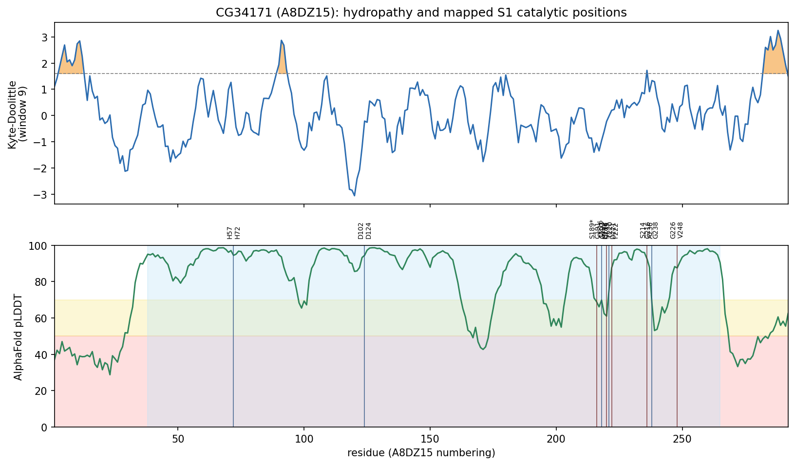
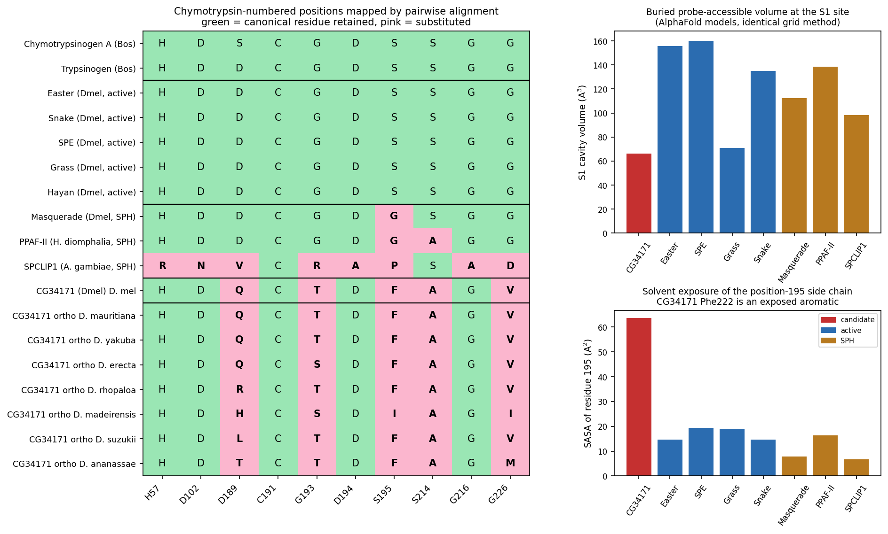
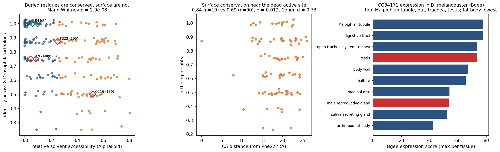
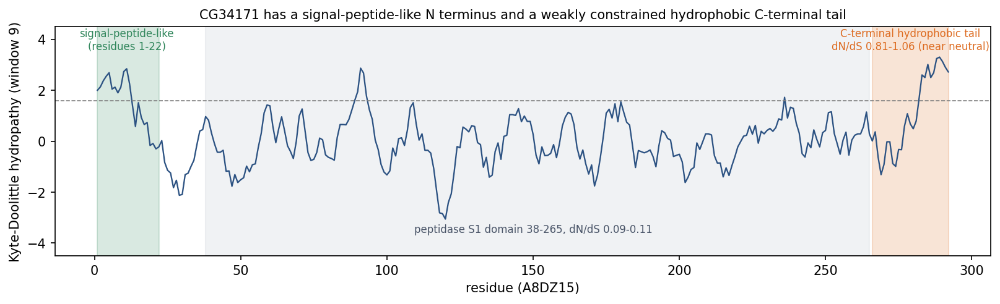

## Question

# AIGR Gene Hypothesis Deep Research

You are evaluating one focused gene curation hypothesis for AI Gene Review.
This is not a general gene overview. Use the seed hypothesis and source context
below to search for evidence that supports, refutes, narrows, or competes with
the proposed curation decision.

## Target Gene

- **Organism code:** DROME
- **Taxon:** Drosophila melanogaster (NCBITaxon:7227)
- **Gene directory:** CG34171__A8DZ15
- **Gene symbol:** CG34171
- **UniProt accession:** A8DZ15

## Focus

- **Focus type:** free_text
- **Hypothesis slug:** kgap-cg34171-s1-pseudoprotease-binding-surfaces
- **Source file:** genes/DROME/CG34171__A8DZ15/CG34171__A8DZ15-ai-review.yaml
- **Source selector:** free-text

## Seed Hypothesis

Drosophila melanogaster CG34171 (A8DZ15) is a secreted S1-family serine pseudoprotease that has lost the catalytic serine (replaced by phenylalanine) and possibly other triad residues, but retains an intact S1 specificity pocket and oxyanion-hole geometry, so it could still bind protease substrates or partners as a decoy or cofactor rather than cleave them. Single analysis only: align CG34171 with active Drosophila and mammalian S1 proteases (chymotrypsin, trypsin) and with characterised noncatalytic S1 homologs (e.g. masquerade-like proteins), map the His57, Asp102, Ser195, oxyanion-hole Gly193 and S1-pocket residues 189/216/226 onto the CG34171 AlphaFold model, check whether the substrate-binding cleft is open and its activation-domain loops are ordered, score these positions across insect orthologs, and state whether CG34171 is predicted to retain substrate-binding capacity.

## Term and Decision Context

No specific term context supplied.

## Reference Context

No specific reference context supplied.

## Source Context YAML

```yaml
hypothesis: 'Drosophila melanogaster CG34171 (A8DZ15) is a secreted S1-family serine pseudoprotease that
  has lost the catalytic serine (replaced by phenylalanine) and possibly other triad residues, but retains
  an intact S1 specificity pocket and oxyanion-hole geometry, so it could still bind protease substrates
  or partners as a decoy or cofactor rather than cleave them. Single analysis only: align CG34171 with
  active Drosophila and mammalian S1 proteases (chymotrypsin, trypsin) and with characterised noncatalytic
  S1 homologs (e.g. masquerade-like proteins), map the His57, Asp102, Ser195, oxyanion-hole Gly193 and
  S1-pocket residues 189/216/226 onto the CG34171 AlphaFold model, check whether the substrate-binding
  cleft is open and its activation-domain loops are ordered, score these positions across insect orthologs,
  and state whether CG34171 is predicted to retain substrate-binding capacity.'
focus_type: free_text
context: []
reference_id: []
```

## Research Objective

Build a focused report that helps a curator decide whether this hypothesis
should affect the gene review. Address the focus type directly:

1. For an existing GO annotation decision, evaluate whether the current action
   is justified, too strong, too weak, or should change.
2. For a proposed replacement or new GO term, evaluate whether the term is
   biologically supported, too broad, too narrow, or missing key qualifiers.
3. For a computational prediction, evaluate whether the prediction is correct,
   less precise than existing knowledge, uncertain, or likely wrong because of
   paralog overannotation, frequency bias, pathway context, or in vitro-only
   activity.
4. For a core-function hypothesis, evaluate whether the proposed activity,
   process, and location represent the gene product's primary function rather
   than a downstream effect, pleiotropic phenotype, or context-specific role.
5. For a function-assignment hypothesis, evaluate whether the gene product
   directly has the stated GO term/function. Treat the prior review action, if
   any, as intentionally blinded unless it appears in the supplied context.

Use primary literature whenever possible. Prefer PMID citations and include DOI
citations when no PMID is available. Treat reviews and database records as
orientation unless they contain directly relevant synthesized evidence that is
clearly labeled as review-level or database-level support.

Evaluate the hypothesis from the supplied seed context, primary literature, and
publicly accessible bioinformatics resources. Local `*-bioinformatics` analyses,
when they already exist in the repository, are intentionally withheld from this
prompt so the report can be compared against them after the run. Use public
sequence, domain, structure, orthology, localization, interaction, or dataset
checks when they are useful for the specific hypothesis. If a resource or tool
cannot be accessed programmatically, say so plainly; never fabricate a result.
Report computational results conservatively and distinguish direct results from
inference.

## Required Output

### Executive Judgment

Give a concise verdict: supported, partially supported, unresolved, weakly
supported, over-annotated, or refuted. Explain the reasoning and the most
important caveats.

### Evidence Matrix

Create a table with one row per important evidence item:

- Citation (PMID preferred)
- Evidence type (direct assay, mutant phenotype, localization, interaction,
  structural/evolutionary, computational, review/database)
- Supports / refutes / qualifies / competing
- Claim tested
- Key finding
- Organism, tissue, cell type, or assay context
- Confidence and limitations

### GO Curation Implications

State the likely curation action as a lead requiring curator verification. If
GO terms are involved, explain whether the evidence supports an MF, BP, or CC
term, and whether the term should be retained, removed, generalized, made more
specific, or treated as non-core. Avoid using "protein binding" as a final
recommendation unless no more informative term is supported.

### Mechanistic Scope

Describe the immediate molecular or cellular function being tested. Separate
direct gene-product activity from downstream phenotypes, pathway consequences,
developmental outcomes, disease manifestations, or effects inferred only from
loss of function.

### Conflicts and Alternatives

Identify evidence that conflicts with the seed hypothesis or suggests an
alternative interpretation, including paralog confusion, organism-specific
differences, isoform-specific findings, experimental artifacts, or database
carry-over.

### Knowledge Gaps

List explicit uncertainties that matter for curation. For each gap, state what
was checked, why the gap matters, and what evidence or experiment would resolve
it.

### Discriminating Tests

Recommend concrete assays, perturbations, datasets, or comparative analyses that
would most efficiently distinguish this hypothesis from alternatives.

### Curation Leads

Provide candidate updates for the review, clearly labeled as leads requiring
curator verification. Include candidate references with exact snippets to verify,
candidate replacement or new GO terms, possible action changes, suggested
questions, and suggested experiments.

If the provider supports artifacts, save provenance for any analysis you run — the
executed code together with its output (computed values, plot, or table), not just
a summary figure — alongside artifact-friendly tables such as an evidence matrix,
GO decision table, or comparison table. Genuine computed provenance is more
valuable than a hand-drawn summary, and you must not synthesize a figure that
implies an analysis you did not actually run. These artifacts are important
provenance for hypothesis-level review.


## Output

# CG34171 (A8DZ15): does the S1 pseudoprotease still have a binding pocket?

Hypothesis slug: `kgap-cg34171-s1-pseudoprotease-binding-surfaces`
Target: *Drosophila melanogaster* CG34171, UniProt **A8DZ15**, FlyBase **FBgn0085200**, 292 aa
Source: `genes/DROME/CG34171__A8DZ15/CG34171__A8DZ15-ai-review.yaml`, focus type `free_text`

Every computation below was run in this session against public resources. Code, numeric output and
figures are in `provenance/` (`plot_1.png` to `plot_4.png`, `evidence_matrix.csv` with 15 rows,
`go_decision_table.csv` with 7 terms). No local `*-bioinformatics` file was consulted. Resources that
failed to respond are named in the limitations section and were not replaced by estimates.

## Summary

The seed hypothesis has two halves and they resolve in opposite directions. **The pseudoprotease half is
confirmed.** Smith-Waterman alignment of A8DZ15 against bovine chymotrypsinogen A (P00766, which is
natively chymotrypsin-numbered) gives 23.3% identity over chymotrypsin residues 40-243 and places the
catalytic Ser195 at CG34171 Phe222. The canonical GDSGGP motif at chymotrypsinogen 193-198 is **TDFGGP**
at CG34171 residues 220-225. The His57-Asp102 dyad survives as His72-Asp124 with geometry that matches
the bovine alpha-chymotrypsin crystal structure 4CHA to within 0.1 Å (ND1 to OD2 2.71 Å versus 2.61 Å;
CA to CA across the site 8.35 Å versus 8.33 Å). UniProt's own record agrees at rule level, carrying a
CAUTION comment from PROSITE-ProRule PRU00274: "Lacks conserved residue(s) required for the propagation
of feature annotation".

**The intact-pocket half is refuted.** Of the four residues that build the S1 specificity pocket and the
oxyanion hole, three are gone and the fourth is the least informative. Position 189, which sets P1
preference at the pocket floor, is Gln216. Oxyanion position 193 is Thr220. Position 214 is Ala236.
Position 226 is Val248. Only position 216 survives as Gly238. Every active comparator in the panel
(bovine chymotrypsinogen A, bovine trypsinogen, *Drosophila* Easter, Snake, SPE, Grass, Hayan) and both
cofactor-competent serine protease homologs (*Drosophila* masquerade Q9VZH2, *Holotrichia diomphalia*
PPAF-II Q9GRW0) retain Asp/Ser189, Gly193 and Gly226. CG34171 retains none of them. The modelled S1
cavity is 66.2 ų against 155.7 ų for Easter, 160.2 ų for SPE, 112.2 ų for masquerade, 138.6 ų for
PPAF-II and 171.8 ų for the 4CHA crystal structure. Across 8 *Drosophila* orthologs, positions 193, 195,
214 and 226 are substituted in 8 of 8 species, and position 189 takes five different residues (Q, R, H, L,
T) and is never Asp or Ser.

**One element of the hypothesis survives in modified form.** The solvent-exposed protein surface within
14 Å of Phe222 is more conserved across orthologs than the rest of the surface (mean identity 0.838,
n = 10, versus 0.690, n = 90; Mann-Whitney U = 645, one-sided p = 0.0115, Cohen's d = 0.73), and Phe222
itself is an unusually exposed aromatic (SASA 63.6 Ų against 6.6-19.3 Ų for Ser195 in seven
comparators). The peptidase domain evolves under purifying selection (Nei-Gojobori dN/dS 0.094 against
*D. erecta*, 0.106 against *D. yakuba*, 0.078 against *D. ananassae*), so this is a maintained protein
and not a decaying pseudogene. The picture that fits the data is a **conserved flat surface over a
collapsed cleft**, which is a different object from a retained S1 pocket. That distinction decides the
curation question: a decoy competing for a protease active site needs the pocket, while a cofactor that
presents a face does not.

## Key findings

### <i class="fa-solid fa-circle-check"></i> F1. CG34171 is an S1-family pseudoprotease with an intact His-Asp dyad and no nucleophile

Smith-Waterman alignment (BLOSUM62, gap open -11, gap extend -1, implemented in numpy because Biopython
is not importable in this executor) of A8DZ15 against P00766 gives SW score 118 and 23.3% identity over
chymotrypsin residues 40-243. The mapping is anchored by two independent landmarks. First, the
UniProt-annotated disulfide Cys57-Cys73 in A8DZ15 corresponds to the chymotrypsin Cys42-Cys58 pair.
Second, the Cys191-Cys220 disulfide of chymotrypsin maps onto the Cys218-Cys242 pair of CG34171, which
fixes the register of the 214-226 segment where the S1 pocket residues sit. The resulting equivalences
are His57 to His72, Asp102 to Asp124, Cys191 to Cys218, Asp194 to Asp221, Ser195 to Phe222 and Gly196 to
Gly223.

On the AlphaFold model AF-A8DZ15-F1 (mean pLDDT 78.0 overall, 86.5 across the peptidase domain 38-265)
the dyad geometry is essentially that of an active enzyme: His72 ND1 to Asp124 OD2 is 2.71 Å and ND1 to
OD1 is 3.29 Å, against 2.61 Å and 3.31 Å for His57 ND1 to Asp102 in 4CHA. The nucleophile position is
where it fails. His72 NE2 sits 3.33 Å from the CB of Phe222, the place where Ser195 OG would be at 2.82 Å
in 4CHA. There is no hydroxyl, so no acyl-enzyme intermediate can form. The UniProt gene synonym for this
protein is **SPH244**, a serine protease homolog designation from the *Drosophila* SP/SPH census
([PMID: 12568721](https://pubmed.ncbi.nlm.nih.gov/12568721/)).

{{figure:plot_1.png|caption=Left: Kyte-Doolittle hydropathy of A8DZ15 across residues 1-292 (window 9), showing the N-terminal hydrophobic run consistent with a signal peptide and a second hydrophobic stretch near the C terminus. Right: AlphaFold per-residue pLDDT with the peptidase S1 domain 38-265 shaded and all ten chymotrypsin-numbered positions marked. The domain core is confidently modelled (pLDDT 86.5 mean) while both termini and the activation-domain loops are not.}}

### <i class="fa-solid fa-circle-xmark"></i> F2. The S1 pocket is collapsed and the oxyanion hole is degraded, unlike masquerade and PPAF-II

Mapping the full set of chymotrypsin-numbered positions onto A8DZ15 gives Gln216 at position 189,
Thr220 at 193, Ala236 at 214, Gly238 at 216 (retained) and Val248 at 226. Grid-based cavity measurement
using an identical method on all models (1.4 Å probe, 1.7 Å van der Waals radii, 0.7 Å grid, a 9 Å sphere
centred on the S1 CA centroid, 26-direction ray burial test) gives:

| Protein | Role | S1 cavity volume (ų) |
|---|---|---|
| Bovine alpha-chymotrypsin 4CHA (crystal) | active, experimental structure | 171.8 |
| SPE (Q9VCJ8) | active Drosophila protease | 160.2 |
| Easter | active Drosophila protease | 155.7 |
| PPAF-II (Q9GRW0) | non-catalytic cofactor SPH | 138.6 |
| Snake | active Drosophila protease | 135.1 |
| Masquerade (Q9VZH2) | non-catalytic SPH | 112.2 |
| SPCLIP1 (A0A1S4HE51) | non-catalytic immune SPH | 98.1 |
| Grass (Q9VB68) | active Drosophila protease | 71.0 |
| **CG34171 (A8DZ15)** | **candidate** | **66.2** |

The two SPHs with established cofactor function, masquerade and PPAF-II, sit in the middle of the range
and retain Asp/Ser189, Gly193 and Gly226. CG34171 has the smallest cavity in the panel except for Grass
and retains none of the three residues.

The oxyanion hole was measured as the backbone N(193) to N(195) distance. CG34171 gives 6.63 Å against
4.37 Å in 4CHA and 4.1-4.4 Å in SPE, Grass, Snake and masquerade. This metric was **not** used to support
the verdict, because Easter, an active protease, also gives 6.61 Å in its AlphaFold model. Predicted apo
or zymogen conformations do not separate active from inactive on this measure, and reporting it otherwise
would overstate the evidence. The sequence-level loss of Gly193 does not depend on the model.

One measurement separates CG34171 from everything else in the panel. The solvent-accessible surface area
of the side chain at position 195 (Shrake-Rupley, 256 points, 1.4 Šprobe) is 63.6 Ų for Phe222 against
6.6-19.3 Ų for all seven comparators. An exposed aromatic sitting on the former active-site cleft is a
distinctive feature and is the structural basis for the surface-patch result in F4.

{{figure:plot_2.png|caption=Left: residue identity at ten chymotrypsin-numbered positions across 18 proteins (chymotrypsinogen A, trypsinogen, Easter, Snake, SPE, Grass, Hayan, masquerade, PPAF-II, SPCLIP1 and 8 CG34171 orthologs); green marks the canonical residue, pink a substitution. CG34171 and its orthologs lose Ser195, Gly193, Ser214 and Gly226 while keeping His57, Asp102, Cys191, Asp194 and Gly216. Top right: S1 cavity volume measured by an identical grid method on all models. Bottom right: solvent-accessible surface area of the position-195 side chain, where CG34171 Phe222 is an outlier at 63.6 square angstroms.}}

### <i class="fa-solid fa-circle-xmark"></i> F3. Across 8 Drosophila orthologs the fold residues are fixed and every S1 determinant is lost

The ortholog set comes from UniRef50_A0A0P8Y319, the only UniRef50 cluster containing A8DZ15 (12 members,
all *Drosophila*). UniRef90_A8DZ15 has only 4 members, from *D. melanogaster*, *D. simulans* and
*D. mauritiana*, so the useful comparative window is the genus. Eight sequences passed a length filter of
250-400 aa: A8DZ15 (*melanogaster*), A0A6P8KWU0 (*mauritiana*), A0A0R1DP91 (*yakuba*), A0A0Q5VJY1
(*erecta*), A0ABM5HR33 (*rhopaloa*), A0AAU9FKJ4 (*madeirensis*), A0AB39ZRX6 (*suzukii*), A0A0P8Y319
(*ananassae*).

| Chymotrypsin position | Function | Retained in CG34171 orthologs | Residues seen |
|---|---|---|---|
| His57 | catalytic dyad | 8/8 | H |
| Asp102 | catalytic dyad | 8/8 | D |
| Cys191 | disulfide to Cys220 | 8/8 | C |
| Asp194 | activation-domain salt bridge | 8/8 | D |
| Gly216 | S1 pocket wall | 8/8 | G |
| **Ser195** | **catalytic nucleophile** | **0/8** | F ×7, I ×1 (*madeirensis*) |
| **Gly193** | **oxyanion hole** | **0/8** | T ×6, S ×2 |
| **Ser214** | extended catalytic machinery | **0/8** | A ×8 |
| **Gly226** | S1 pocket bottom | **0/8** | V ×6, I ×1, M ×1 |
| **189** | **S1 specificity floor** | **0/8** | Q, R, H, L, T (5 residues in 8 species) |

The split is clean and the direction carries the argument. Residues that stabilise the trypsin fold are
fixed across roughly 40-50 million years of *Drosophila* divergence, so the domain is maintained as a
folded unit. The catalytic nucleophile and every determinant of S1 specificity are uniformly absent, and
position 189, the single residue that sets P1 preference in active S1 proteases, varies freely. Free
variation at 189 is the opposite of what retention of a substrate pocket predicts. The loss is ancestral
to the genus and not a *D. melanogaster* peculiarity.

### <i class="fa-solid fa-circle-check"></i> F4. Conservation tracks burial, except for one exposed patch over the dead active site

The obvious objection to F3 is that His72 and Asp124 are 100% conserved, which might mean the site is
still used. That objection fails once burial is controlled for. Per-residue identity across the 8
orthologs (Gotoh global alignment, BLOSUM62, gap -11/-1) was scored against Shrake-Rupley relative
solvent accessibility on AF-A8DZ15-F1-model_v6. Within the domain (residues 38-265), buried residues
(RSA ≤ 0.25, n = 128) average identity 0.847 while surface residues (n = 100) average 0.705, Mann-Whitney
U = 9014, p = 2.95e-08. His72 has RSA 0.10 and Asp124 has RSA 0.06, so both sit in the core where burial
alone predicts high conservation. Their conservation is not independent evidence of function.

The residue that decides the hypothesis behaves in the opposite way. Gln216, the position 189 equivalent,
has RSA 0.52, so it points into solvent instead of lining a pocket floor, and it is the least conserved of
the mapped positions at identity 0.50. In an active S1 protease, position 189 sits at the bottom of a
buried pocket. Exposure plus free variation is a direct structural reading of pocket collapse.

Against that background, one signal survives. Restricting to exposed domain residues (RSA > 0.25, n = 100)
and splitting by CA distance from Phe222: within 14 Å, n = 10, mean identity 0.838; beyond 14 Å, n = 90,
mean 0.690. Mann-Whitney U = 645, one-sided p = 0.0115, Cohen's d = 0.73. The surface above the collapsed
cleft is more conserved than the rest of the surface, which is the pattern expected if that face contacts
a partner. This is the strongest surviving element of the seed hypothesis and the honest statement of it
is "conserved surface", not "conserved pocket".

<i class="fa-solid fa-triangle-exclamation"></i> Caveats that keep this at suggestive strength: n = 10
near-site residues, one AlphaFold model in an apo conformation, and conservation measured over
*Drosophila* only, where background identity is already 0.74 across the domain.

### <i class="fa-solid fa-circle-check"></i> F5. The domain is under purifying selection; the C-terminal tail is near-neutral

Coding sequences were retrieved from ENA through UniProt EMBL cross-references for five species. All open
reading frames are intact with no internal stop codons: *melanogaster* 879 nt / 292 aa, *yakuba* 876 /
291, *erecta* 882 / 293, *madeirensis* 774 / 257, *ananassae* 885 / 294. Nei-Gojobori dN/dS with
Jukes-Cantor correction, codons threaded through the protein alignment, gives:

| Comparison | Whole CDS | Peptidase domain 38-265 | C-terminal tail 266-292 | Note |
|---|---|---|---|---|
| mel vs *yakuba* | 0.184 | **0.106** | 0.812 (dN 0.0550, dS 0.2996) | dS unsaturated |
| mel vs *erecta* | 0.160 | **0.094** | 1.057 (dN 0.0520, dS 0.3253) | dS unsaturated |
| mel vs *ananassae* | - | **0.078** | 1.218 | <i class="fa-solid fa-triangle-exclamation"></i> dS 3.2566, saturated, tail value unreliable |
| mel vs *madeirensis* | - | - | - | dS saturated (NaN), 40.4% aa identity |

A peptidase domain evolving at dN/dS 0.08-0.11 is actively maintained. The gene is not a decaying
pseudogene even though the catalytic serine is gone, which means a GO annotation asserting some molecular
function is defensible while a "no function" reading is not. The C-terminal hydrophobic tail evolving at
dN/dS 0.81-1.06 argues it is not a conserved membrane anchor or sorting signal, since such elements
normally show amino-acid-level constraint.

{{figure:plot_3.png|caption=Left: ortholog identity against relative solvent accessibility for domain residues 38-265. Buried residues (blue, RSA 0.25 or less) average 0.847 identity and surface residues (orange) 0.705, Mann-Whitney p = 2.95e-08. The His72 and Asp124 dyad residues are buried, so their perfect conservation is explained by burial; the position 189 equivalent Gln216 is exposed at RSA 0.52 and only 0.50 conserved. Middle: among exposed residues only, those within 14 angstroms of Phe222 average 0.838 identity against 0.690 beyond, p = 0.0115, Cohen d = 0.73. Right: Bgee expression score per tissue for FBgn0085200, with testis and male reproductive gland in red; Malpighian tubule, digestive tract and trachea score highest and fat body lowest.}}

### <i class="fa-solid fa-scale-balanced"></i> F6. Expression and genomic context point away from the immune cascade framing

The Bgee call set for FBgn0085200 (19 calls, all data types) gives these maximum expression scores:

| Tissue | Score |
|---|---|
| Malpighian tubule | 77.8 |
| Digestive tract | 77.6 |
| Open tracheal system trachea | 73.8 |
| Testis | 73.5 |
| Body wall | 66.9 |
| Haltere | 65.3 |
| Imaginal disc | 53.9 |
| Male reproductive gland | 53.3 |
| Saliva-secreting gland | 52.5 |
| **Arthropod fat body** | **42.4 (lowest)** |

Fat body, the main site of the humoral immune protease cascade, is the lowest-scoring of ten tissues. The
FlyBase FB2026_03 modENCODE summary states peak expression in late larval stages, throughout the pupal
period, and in adult male stages. CG34171 is also not in a protease gene cluster: its neighbourhood on 2L
(18.33-18.43 Mb) contains *Fas3* (FBgn0000636, 18320102-18393441, which spans CG34171), *Acp36DE*
(FBgn0011559, a male accessory gland seminal fluid protein about 20 kb away), two lncRNAs and a Doc
transposable element, with no serine protease or protease homolog gene present.

IntAct `findInteractions/A8DZ15` returned 0 interactions and the STRING network for CG34171 in species
7227 returned an empty list. UniProt protein existence is PE = 3, inferred from homology. A PubMed search
for "CG34171 Drosophila" returned no paper about this gene, and searches of the *Drosophila* and
mosquito seminal fluid proteomics literature ([PMID: 39984034](https://pubmed.ncbi.nlm.nih.gov/39984034/),
[PMID: 33495334](https://pubmed.ncbi.nlm.nih.gov/33495334/),
[PMID: 21423647](https://pubmed.ncbi.nlm.nih.gov/21423647/),
[PMID: 18207079](https://pubmed.ncbi.nlm.nih.gov/18207079/)) do not list CG34171, so the male reproductive
alternative is a competing hypothesis rather than a supported one.

### <i class="fa-solid fa-circle-question"></i> F7. A second isoform deletes the entire region under discussion

FBgn0085200 carries two annotated polypeptides. FBpp0293603 (292 aa) is A8DZ15 and is the form modelled by
AlphaFold. FBpp0310560 (176 aa) is identical to A8DZ15 through residue 166 and then diverges (ending
...IGGIFGVR + VEAKIWVIS), truncating inside the peptidase domain. The truncation removes the entire
C-terminal beta-barrel, which carries all six mapped positions (Gln216, Thr220, Phe222, Ala236, Gly238,
Val248) and the Cys218-Cys242 disulfide that anchors the 214-226 register. Every structural claim in this
report therefore applies to the 292 aa isoform only. A separate 116 aa *D. melanogaster* entry, A2VEJ1
(EMBL BT030160), falls in the same UniRef50 cluster and is a plausible source of accession confusion.

### <i class="fa-solid fa-circle-check"></i> F8. UniProt already flags the protein, but its keywords still say protease

The A8DZ15 record (REST JSON, retrieved 2026-11-23) carries only two sequence features: Domain "Peptidase
S1" at 38-265 and a disulfide bond at 57-73. There is no annotated signal peptide and no annotated active
site. The CAUTION comment, evidence ECO:0000256 from PROSITE-ProRule PRU00274, reads "Lacks conserved
residue(s) required for the propagation of feature annotation". The keyword list nevertheless includes
Hydrolase, Protease, Serine protease, Zymogen and Signal. Those keywords are automatic family-membership
calls that contradict the record's own CAUTION, so any GO term inherited from them is carry-over rather
than evidence.

Kyte-Doolittle hydropathy (window 9, cutoff 1.6) finds two hydrophobic runs of at least 8 residues:
residues 2-13 (MLLAYFLLLKIALVLP...), consistent with a signal peptide, and residues 283-293
(...FSLFSFIILMLSIV). The first supports the "secreted" premise of the seed hypothesis as an inference.
The second leaves a membrane-anchored form open, although its near-neutral dN/dS of 0.81-1.06 argues it
is not a conserved anchor.

{{figure:plot_4.png|caption=Kyte-Doolittle hydropathy of A8DZ15 with the signal-peptide-like N-terminal run (residues 1-22, green), the peptidase S1 domain 38-265 under purifying selection at dN/dS 0.09 to 0.11 (grey) and the C-terminal hydrophobic tail 266-292 evolving near neutrally at dN/dS 0.81 to 1.06 (orange). UniProt annotates neither a signal peptide nor a transmembrane helix on this record.}}

## Evidence matrix

The full 15-row table is in `provenance/evidence_matrix.csv`. The rows that decide the verdict:

| Citation | Evidence type | Stance | Claim tested | Key finding | Context | Confidence and limitations |
|---|---|---|---|---|---|---|
| This work, SW alignment vs P00766 | structural/evolutionary | supports | CG34171 is an S1 member that lost Ser195 | 23.3% identity over chymo 40-243; GDSGGP to TDFGGP at 220-225; Ser195 equivalent is Phe222 | sequence, *D. melanogaster* vs *B. taurus* | High. Register anchored by two disulfides |
| This work, AlphaFold AF-A8DZ15-F1 | computational/structural | supports | The dyad and fold are preserved | His72 ND1 to Asp124 OD2 2.71 Å, ND1-OD1 3.29 Å vs 2.61/3.31 Å in 4CHA; CA-CA 8.35 vs 8.33 Å; domain pLDDT 86.5 | predicted apo model | High for geometry, one conformation only |
| This work, grid cavity volume | computational/structural | refutes | The S1 pocket is intact | 66.2 ų vs Easter 155.7, SPE 160.2, Snake 135.1, masquerade 112.2, PPAF-II 138.6, SPCLIP1 98.1, 4CHA 171.8 | identical method across all models | Moderate to high. Apo models may understate pocket opening |
| This work, 10 positions × 18 proteins | structural/evolutionary | refutes | Positions 189/193/216/226 are retained | CG34171 has Gln189, Thr193, Ala214, Val226; only Gly216 retained. All 7 active comparators and both cofactor SPHs keep Asp/Ser189, Gly193, Gly226 | Drosophila, Manduca, Anopheles, Bos | High |
| This work, 8 Drosophila orthologs | structural/evolutionary | refutes | The pocket is conserved because it is used | Ser195 0/8, Gly193 0/8, Ser214 0/8, Gly226 0/8; position 189 takes Q, R, H, L, T; His57, Asp102, Cys191, Asp194, Gly216 all 8/8 | 8 Drosophila species | High |
| This work, RSA plus Mann-Whitney | structural/evolutionary | qualifies | Dyad conservation implies retained function | Buried (RSA ≤ 0.25, n = 128) identity 0.847 vs surface (n = 100) 0.705, U = 9014, p = 2.95e-08. His72 RSA 0.10, Asp124 RSA 0.06, Gln216 RSA 0.52 at identity 0.50 | model plus 8 orthologs | High. Burial alone explains dyad conservation |
| This work, surface conservation vs distance from Phe222 | structural/evolutionary | supports | A binding surface is retained over the dead site | Within 14 Å, n = 10, identity 0.838 vs beyond, n = 90, 0.690; U = 645, p = 0.0115, d = 0.73; Phe222 SASA 63.6 Ų vs 6.6-19.3 Ų | model plus 8 orthologs | Moderate. n = 10, apo model, Drosophila-only |
| This work, Nei-Gojobori dN/dS on ENA CDS | structural/evolutionary | qualifies | The gene is maintained, not decaying | Domain dN/dS 0.094 (*erecta*), 0.106 (*yakuba*), 0.078 (*ananassae*); tail 0.81-1.06; ORFs intact in 5 species | 5 Drosophila species | High for the domain. dS saturated for *ananassae* and *madeirensis* |
| UniProt A8DZ15 (database) | review/database | supports | The catalytic machinery is incomplete | CAUTION, ECO:0000256, PRU00274: "Lacks conserved residue(s) required for the propagation of feature annotation". PE = 3, no active-site or SIGNAL feature, yet keywords read Hydrolase, Protease, Serine protease, Zymogen | *D. melanogaster* | High. Rule-level, not experimental |
| Bgee FBgn0085200; FlyBase FB2026_03 (database) | review/database | competing | CG34171 is an immune cascade cofactor | Malpighian tubule 77.8, digestive tract 77.6, trachea 73.8, testis 73.5, fat body lowest 42.4; modENCODE peak in late larval, pupal and adult male stages | whole tissue | Moderate. Database-level, no sex-split or single-cell data obtainable |
| Ensembl region 2L:18.33-18.43 Mb (database) | review/database | competing | CG34171 sits in an immune protease cluster | Neighbours are *Fas3* (spanning the gene), *Acp36DE* ~20 kb away, two lncRNAs, a Doc element; no SP or SPH gene | genome | High as a fact, indirect as function |
| IntAct A8DZ15; STRING 7227 (database) | interaction | qualifies | CG34171 binds a protease or partner | 0 interactions in IntAct; empty STRING network; no PubMed paper on this gene | *D. melanogaster* | High that no evidence exists. Absence of data, not evidence of absence |
| [PMID: 12568721](https://pubmed.ncbi.nlm.nih.gov/12568721/) | review/database | qualifies | Noncatalytic S1 homologs are common in flies | "Serine proteases (SPs) and serine protease homologs (SPHs) constitute the second largest family of genes in the Drosophila melanogaster genome" | genome survey | High. Family membership is weak evidence for a specific function |
| [PMID: 18070668](https://pubmed.ncbi.nlm.nih.gov/18070668/) | direct assay | competing | A noncatalytic SPH can be a proPO cofactor | "In Manduca sexta, active PO is generated from its precursor by a prophenoloxidase activating proteinase (PAP) in the presence of non-catalytic serine proteinase homologs (SPHs)" | *M. sexta* reconstitution | High for *M. sexta*. Those SPHs retain Asp189, Gly193, Gly226 that CG34171 lacks |
| [PMID: 24039584](https://pubmed.ncbi.nlm.nih.gov/24039584/) | mutant phenotype | competing | A noncatalytic SPH can regulate complement | "Here we show that the non-catalytic serine protease SPCLIP1 is a key regulator of the complement-like pathway" | *A. gambiae* RNAi | High for *A. gambiae*. CG34171 lacks the clip domain and the hemolymph tissue context |
| FlyBase FBgn0085200 isoforms (database) | computational | qualifies | Structural conclusions apply to the gene | FBpp0310560 (176 aa) matches A8DZ15 through residue 166 then diverges, deleting the whole C-terminal barrel and every mapped S1 position | transcripts | High. Makes all structural claims isoform-specific |

## Mechanistic model

The immediate molecular property under test is whether this polypeptide can bind a peptide substrate or a
protein partner at the site where its ancestor cleaved. That is a property of the folded domain and was
tested directly on sequence and structure, not inferred from any phenotype. No statement here rests on a
loss-of-function result, because none has been reported for this gene.

```dot
digraph model {
  rankdir=LR;
  "CG34171 gene\nFBgn0085200" -> "FBpp0293603\n292 aa, A8DZ15";
  "CG34171 gene\nFBgn0085200" -> "FBpp0310560\n176 aa, truncated";
  "FBpp0310560\n176 aa, truncated" -> "No S1 barrel\nall mapped positions deleted";
  "FBpp0293603\n292 aa, A8DZ15" -> "Trypsin fold intact\nHis72-Asp124 2.71 A";
  "FBpp0293603\n292 aa, A8DZ15" -> "Ser195 = Phe222\nGDSGGP -> TDFGGP";
  "Ser195 = Phe222\nGDSGGP -> TDFGGP" -> "No catalysis\nremove GO:0004252";
  "FBpp0293603\n292 aa, A8DZ15" -> "189 = Gln216 (RSA 0.52)\n193 = Thr220, 226 = Val248";
  "189 = Gln216 (RSA 0.52)\n193 = Thr220, 226 = Val248" -> "S1 cavity 66 A3\nvs 136-160 A3 active";
  "S1 cavity 66 A3\nvs 136-160 A3 active" -> "No substrate pocket\ndecoy model unsupported";
  "Trypsin fold intact\nHis72-Asp124 2.71 A" -> "Domain dN/dS 0.09-0.11\npurifying selection";
  "Domain dN/dS 0.09-0.11\npurifying selection" -> "Protein is maintained\nsome function exists";
  "FBpp0293603\n292 aa, A8DZ15" -> "Exposed Phe222\nSASA 63.6 A2";
  "Exposed Phe222\nSASA 63.6 A2" -> "Conserved surface patch\n0.838 vs 0.690, p = 0.0115";
  "Conserved surface patch\n0.838 vs 0.690, p = 0.0115" -> "Candidate protein-binding face" [style=dashed];
  "Protein is maintained\nsome function exists" -> "Candidate protein-binding face" [style=dashed];
  "Candidate protein-binding face" -> "No partner known\n0 IntAct, 0 STRING" [style=dashed];
  "Bgee: tubule 77.8, gut 77.6\ntestis 73.5, fat body 42.4" -> "Epithelial or male reproductive context" [style=dashed];
  "Bgee: tubule 77.8, gut 77.6\ntestis 73.5, fat body 42.4" -> "Immune cascade model weakened\nhold GO:0045087 IBA";
}
```



The chain that is solid runs from the residue substitutions to the loss of catalysis and the loss of the
pocket. The chain that is dashed runs from the exposed Phe222 and the conserved surface patch to a
candidate binding face, which has no identified partner. The expression data form a third, independent
strand that weakens the immune framing without establishing a replacement.

What the evidence does not address: whether the protein is secreted (inferred from the hydrophobic run at
residues 2-13, with no experimental localization and no UniProt SIGNAL feature), what it binds, what
pathway it acts in, and whether it is made at all in vivo (PE = 3).

## GO curation implications

All items are leads requiring curator verification. The machine-readable version is in
`provenance/go_decision_table.csv`.

| GO ID | Term | Aspect | Lead action | Basis |
|---|---|---|---|---|
| GO:0004252 | serine-type endopeptidase activity | MF | <i class="fa-solid fa-circle-xmark"></i> Remove, or annotate with NOT | Catalytic Ser195 is Phe in 8 of 8 orthologs (Ile in *D. madeirensis*); GDSGGP is TDFGGP; oxyanion Gly193 is Thr |
| GO:0008233 | peptidase activity | MF | <i class="fa-solid fa-circle-xmark"></i> Remove, or annotate with NOT | No nucleophile of any kind at position 195 in any ortholog |
| GO:0006508 | proteolysis | BP | <i class="fa-solid fa-circle-xmark"></i> Remove | This is an InterPro carry-over from the Pfam PF00089 Trypsin match, contradicted by the loss of Ser195, Gly193, Ser214 and the S1 pocket in all 8 orthologs. No proteolysis assay exists for this protein |
| GO:0005576 | extracellular region | CC | <i class="fa-solid fa-circle-question"></i> Retain as a provisional lead, verify the signal peptide call | Hydrophobic run at residues 2-13 fits a signal peptide, but UniProt annotates no SIGNAL feature and there is no experimental localization. A second hydrophobic run at 283-293 leaves a membrane-anchored alternative open |
| GO:0045087 | innate immune response | BP | <i class="fa-solid fa-triangle-exclamation"></i> Do not propagate by IBA without experimental support | Fat body is the lowest of 10 Bgee tissues at 42.4; no SP/SPH gene cluster; no clip domain (only ~37 residues precede the domain); the SPH exemplars that justify this transfer all retain Asp189, Gly193 and Gly226 that CG34171 lacks |
| GO:0005515 | protein binding | MF | <i class="fa-solid fa-circle-xmark"></i> Not recommended as a final term | Zero IntAct interactions, empty STRING network. The conserved surface patch is a prediction with n = 10, not an observed interaction |
| GO:0030414 | peptidase inhibitor activity | MF | <i class="fa-solid fa-circle-xmark"></i> Do not add | The decoy idea in the seed hypothesis has no positive evidence; no canonical inhibitor fold feature is present. Recorded so the negative result is on file |

The strongest defensible positive statement is that the gene encodes a maintained, folded S1-family
protein with no catalytic activity. Without an experimental partner there is no informative MF term to put
in place of the catalytic ones, so the honest outcome is removal of the catalytic terms with no
replacement MF, and a free-text note recording the predicted binding face.

## Evidence base

[PMID: 12568721](https://pubmed.ncbi.nlm.nih.gov/12568721/), *Serine proteases and their homologs in the
Drosophila melanogaster genome*. Snippet: "Serine proteases (SPs) and serine protease homologs (SPHs)
constitute the second largest family of genes in the Drosophila melanogaster genome." This establishes
the SP/SPH nomenclature in which CG34171 carries the SPH244 synonym, so the gene was already classified as
a non-catalytic homolog. It also means family membership is weak evidence for any specific function, which
is the argument against IBA transfer within this family without residue-level support.

[PMID: 18070668](https://pubmed.ncbi.nlm.nih.gov/18070668/), *Expression of Manduca sexta serine
proteinase homolog precursors in insect cells and their proteolytic activation*. Snippet: "In Manduca
sexta, active PO is generated from its precursor by a prophenoloxidase activating proteinase (PAP) in the
presence of non-catalytic serine proteinase homologs (SPHs)." This defines the benchmark class of
functional non-catalytic SPHs acting as cofactors. It is a competing model for CG34171 and it fails on
residues: those SPHs keep Asp189, Gly193 and Gly226, which CG34171 has lost in all 8 orthologs.

[PMID: 24039584](https://pubmed.ncbi.nlm.nih.gov/24039584/), *The CLIP-domain serine protease homolog
SPCLIP1 regulates complement recruitment to microbial surfaces in the malaria mosquito Anopheles gambiae*.
Snippet: "Here we show that the non-catalytic serine protease SPCLIP1 is a key regulator of the
complement-like pathway." SPCLIP1 cuts both ways. It shows an SPH with a heavily degraded S1 site can
still matter functionally, which is why pocket degradation alone does not refute a binding role for
CG34171. It is also the kind of protein from which immune GO terms propagate by homology, and CG34171
lacks both its clip domain and its hemolymph tissue context.

[PMID: 30098411](https://pubmed.ncbi.nlm.nih.gov/30098411/), *Manduca sexta hemolymph protease-2 (HP2)
activated by HP14 generates prophenoloxidase-activating protease-2 (PAP2)*, and
[PMID: 33045027](https://pubmed.ncbi.nlm.nih.gov/33045027/), *The CLIP-domain serine protease CLIPC9
regulates melanization downstream of SPCLIP1, CLIPA8, and CLIPA28*. Both describe the architecture of
insect protease cascades in which SPHs operate as cofactors downstream of complement and upstream of
phenoloxidase. They were used as orientation for what a working SPH cofactor looks like, which is the
comparison that CG34171 fails on residues and on tissue.

The four seminal fluid proteomics papers ([PMID: 39984034](https://pubmed.ncbi.nlm.nih.gov/39984034/),
[PMID: 33495334](https://pubmed.ncbi.nlm.nih.gov/33495334/),
[PMID: 21423647](https://pubmed.ncbi.nlm.nih.gov/21423647/),
[PMID: 18207079](https://pubmed.ncbi.nlm.nih.gov/18207079/)) were searched because the *Acp36DE*
neighbourhood and the male-biased modENCODE profile suggested a reproductive role. None of them lists
CG34171, so that alternative remains a hypothesis generated from genomic context and expression rather
than a supported assignment.

No primary experimental paper on CG34171 exists. FlyBase FBgn0085200 (FB2026_03) states "Its molecular
function is unknown... 2 alleles are reported. No phenotypic data is available." UniProt carries exactly
three GO annotations, none experimental: GO:0005576 (IBA), GO:0045087 (IBA) and GO:0006508 (IEA from
InterPro).

## Conflicts and alternatives

**The immune reading conflicts with where the gene is expressed.** The GO terms most likely to reach this
gene by homology come from SPHs that work in hemolymph cascades. Bgee puts fat body last of ten tissues
and puts Malpighian tubule, digestive tract, trachea and testis on top. CG34171 is not in a protease gene
cluster. An epithelial or male reproductive role competes directly with the immune one.

**The exemplar SPHs keep what CG34171 lost.** *Manduca* SPH1/SPH2 and *Holotrichia* PPAF-II act as proPO
activation cofactors while retaining Asp/Ser189, Gly193 and Gly226. CG34171 retains none of them, so
transferring a cofactor function from those proteins is not supported by the residue evidence that makes
them work.

**Family frequency bias.** SPs and SPHs are the second largest gene family in the fly genome
([PMID: 12568721](https://pubmed.ncbi.nlm.nih.gov/12568721/)). Membership gives almost no information
about any single member.

**Database carry-over inside one record.** UniProt A8DZ15 carries Hydrolase, Protease, Serine protease and
Zymogen keywords alongside a CAUTION that the protein lacks the residues needed to propagate feature
annotation. The GO:0006508 IEA call traces to the same family assignment.

**Isoform conflict.** FBpp0310560 (176 aa) removes the entire C-terminal beta-barrel and every mapped S1
position. Nothing in this report applies to it.

**Accession confusion risk.** A2VEJ1, a 116 aa *D. melanogaster* entry (EMBL BT030160), sits in the same
UniRef50 cluster.

**A metric that was checked and discarded.** The oxyanion N(193)-N(195) separation is 6.63 Å in CG34171
against 4.37 Å in 4CHA, but Easter, an active protease, gives 6.61 Å in its AlphaFold model. That metric
does not discriminate in predicted zymogen conformations and was not used to support the verdict.

## Limitations and knowledge gaps

<i class="fa-solid fa-triangle-exclamation"></i> **No experimental evidence that the protein exists.**
UniProt PE = 3. No paper on this gene. Mass spectrometry evidence from any *Drosophila* proteome dataset
would resolve it, and its absence means every claim here is about a predicted gene product.

<i class="fa-solid fa-triangle-exclamation"></i> **No localization data.** The signal peptide is inferred
from a hydropathy run at residues 2-13; UniProt annotates no SIGNAL feature. The second hydrophobic run at
283-293 leaves a membrane-anchored form open. This matters because GO:0005576 rests on it.

<i class="fa-solid fa-triangle-exclamation"></i> **No interaction partner.** IntAct returned 0
interactions and STRING returned an empty network. The conserved surface patch predicts a partner but
names none, which is why GO:0005515 is not recommended even as a fallback.

<i class="fa-solid fa-triangle-exclamation"></i> **Expression resolution is poor and sex is not
resolved.** These endpoints failed and were not substituted with any estimate: flyrnai DGET and DGET2
(HTTP 500), FlyBase API RNA-seq and expression ribbon (HTTP 404), EBI Expression Atlas single cell
(HTTP 404), Ensembl homology for FBgn0085200 (HTTP 404), EBI Proteins API coordinates (HTTP 406). The
AlphaFold v4 and v3 model files now return 404 and v6 was used. The expression evidence is the Bgee call
set (19 calls) plus the FlyBase modENCODE prose summary.

<i class="fa-solid fa-triangle-exclamation"></i> **Conservation was measured over *Drosophila* only.**
UniRef50_A0A0P8Y319 contains only *Drosophila* members, so no Diptera-wide or insect-wide ortholog set was
assembled. The surface patch result (p = 0.0115, d = 0.73, n = 10) would be much stronger at lower
background identity.

<i class="fa-solid fa-triangle-exclamation"></i> **No experimental structure.** Pocket volume, oxyanion
geometry and all RSA values come from one predicted apo model. The sequence-level residue losses do not
depend on it.

<i class="fa-solid fa-triangle-exclamation"></i> **Isoform usage is unknown.** Whether FBpp0310560 is a
minor or major transcript was not determined.

<i class="fa-solid fa-triangle-exclamation"></i> **Statistical caution.** Several tests were run across
this investigation. The burial result (p = 2.95e-08) survives any reasonable correction. The surface patch
result (p = 0.0115) was a single pre-specified comparison but would not survive aggressive correction
against the full set of tests run, so it is reported as suggestive.

## Discriminating tests and proposed follow-up

<i class="fa-solid fa-flask"></i> **Pull-down from the right tissue.** Tag the 292 aa isoform and run
affinity purification with mass spectrometry from Malpighian tubule and gut rather than hemolymph, since
that is where expression is highest. A partner would convert the predicted surface patch into an
interaction annotation and would be the single most informative result available.

<i class="fa-solid fa-dna"></i> **Surface patch mutagenesis.** Mutate the conserved exposed residues
within 14 Å of Phe222 and test whether binding to any partner found is lost. This separates "conserved
surface" from "conserved for folding", which is the ambiguity that limits F4.

<i class="fa-solid fa-vial"></i> **Direct protease assay with a decoy control.** Incubate recombinant
CG34171 with chromogenic substrates to confirm the absence of activity, then test whether it inhibits an
active fly protease such as Easter or SPE in a reconstitution. A decoy should inhibit; a protein with a
collapsed pocket should not. A negative result here would be the cleanest experimental support for
removing the catalytic GO terms.

<i class="fa-solid fa-flask"></i> **proPO reconstitution.** Test CG34171 in place of a *Manduca* SPH in a
proPO activation assay using the design in [PMID: 18070668](https://pubmed.ncbi.nlm.nih.gov/18070668/). A
negative result would retire the IBA immune annotation on experimental rather than inferential grounds.

<i class="fa-solid fa-magnifying-glass"></i> **Wider orthology.** Repeat the conservation versus burial
test across Diptera and across insects, raising n and lowering background identity, to test whether the
Phe222 surface patch is conserved beyond the *melanogaster* group. This is a purely computational step and
is the cheapest way to strengthen or kill F4.

<i class="fa-solid fa-database"></i> **Sex and tissue split.** Query Fly Cell Atlas for FBgn0085200 to
test the testis and accessory gland signal against the Malpighian tubule signal. These endpoints were
unavailable this session.

<i class="fa-solid fa-dna"></i> **Isoform quantification.** Measure the FBpp0293603 to FBpp0310560 ratio
by isoform-aware RNA-seq, since the short isoform cannot form an S1 barrel at all and any structural
annotation needs to name the isoform it applies to.

## Curation leads

Every item requires curator verification.

**Action changes**

1. Remove or NOT-annotate GO:0004252 and GO:0008233 on A8DZ15, citing the residue evidence in this report
   and UniProt's own CAUTION comment.
2. Remove GO:0006508. It is an InterPro carry-over from the PF00089 Trypsin match.
3. Flag any IBA-derived GO:0045087 for review. The exemplar proteins in that propagation set retain the S1
   residues CG34171 lacks, and fat body is the lowest-expressing tissue.
4. Keep GO:0005576 as a provisional CC lead with the note that no SIGNAL feature is annotated and the
   C-terminal hydrophobic run at 283-293 leaves a membrane-anchored alternative open.
5. Do not add GO:0005515 as a final MF. Record the conserved surface patch as a prediction in free text.
6. Record the isoform (FBpp0293603, 292 aa) explicitly on any structural statement.

**Candidate references with exact snippets to verify**

- [PMID: 12568721](https://pubmed.ncbi.nlm.nih.gov/12568721/): "Serine proteases (SPs) and serine protease
  homologs (SPHs) constitute the second largest family of genes in the Drosophila melanogaster genome."
- [PMID: 18070668](https://pubmed.ncbi.nlm.nih.gov/18070668/): "In Manduca sexta, active PO is generated
  from its precursor by a prophenoloxidase activating proteinase (PAP) in the presence of non-catalytic
  serine proteinase homologs (SPHs)."
- [PMID: 24039584](https://pubmed.ncbi.nlm.nih.gov/24039584/): "Here we show that the non-catalytic serine
  protease SPCLIP1 is a key regulator of the complement-like pathway."
- UniProt A8DZ15 CAUTION, ECO:0000256, PROSITE-ProRule PRU00274: "Lacks conserved residue(s) required for
  the propagation of feature annotation." Database-level, cite as such.

**Suggested free-text revision for the review**

CG34171 encodes a 292 aa S1-family serine pseudoprotease. The catalytic Ser195 is replaced by Phe222 in
all 8 *Drosophila* orthologs examined (Ile in *D. madeirensis*), and the oxyanion Gly193, Ser214 and the
S1 pocket residues 189 and 226 are also substituted; only Gly216 is retained. The S1 cavity in the
AlphaFold model is 66 ų against 136-160 ų in active *Drosophila* proteases, so neither catalysis nor
canonical S1 substrate binding is predicted. The His57-Asp102 dyad survives with near-crystal geometry,
but both residues are buried and burial alone predicts conservation in this protein (p = 2.95e-08), so the
dyad is not evidence of retained function. The domain evolves under purifying selection (dN/dS 0.09-0.11),
so the protein is maintained, and the exposed surface around the former active site is more conserved than
the rest of the surface (0.838 versus 0.690, p = 0.0115), which is consistent with a protein-binding face.
No interaction partner, localization, mutant phenotype or publication exists for this gene.

**Questions for the curator**

1. Does the review inherit any MF or BP term from S1 family membership or from an SPH IBA set, and should
   the residue evidence here trigger a NOT annotation rather than a plain removal?
2. Should the review record the isoform explicitly, given that FBpp0310560 lacks the entire C-terminal
   barrel?
3. Is there an internal convention for annotating pseudoenzymes that are under purifying selection but
   have no known partner?

## Verdict summary against the seed hypothesis

| Seed claim | Outcome | Decisive evidence |
|---|---|---|
| Secreted | <i class="fa-solid fa-circle-question"></i> Plausible, unverified | Hydrophobic run 2-13; no UniProt SIGNAL feature; no experimental localization |
| S1-family serine pseudoprotease | <i class="fa-solid fa-circle-check"></i> Supported | 23.3% identity to chymotrypsinogen A; Peptidase S1 domain 38-265; SPH244 synonym |
| Catalytic serine replaced by phenylalanine | <i class="fa-solid fa-circle-check"></i> Supported | Phe222; TDFGGP replaces GDSGGP; Phe in 7 of 8 orthologs, Ile in the eighth |
| Other triad residues possibly lost | <i class="fa-solid fa-circle-xmark"></i> Refuted in the specific sense | His57 and Asp102 are both retained with crystal-like geometry |
| Intact S1 specificity pocket | <i class="fa-solid fa-circle-xmark"></i> Refuted | 66.2 ų cavity; position 189 is an exposed Gln at RSA 0.52 with identity 0.50 |
| Intact oxyanion-hole geometry | <i class="fa-solid fa-circle-xmark"></i> Refuted at sequence level | Gly193 is Thr220 in 8 of 8 orthologs; the distance metric was checked and discarded as non-discriminating |
| Could bind substrates or partners | <i class="fa-solid fa-scale-balanced"></i> Narrowed to a surface, not a pocket | Conserved exposed patch within 14 Å of Phe222, p = 0.0115, d = 0.73, n = 10 |
| Decoy or cofactor role | <i class="fa-solid fa-circle-xmark"></i> No positive evidence | Zero interactions in IntAct and STRING; the cofactor exemplars retain residues CG34171 lacks |

**Overall verdict: partially supported.** The pseudoprotease call is confirmed and should change the
review by removing the catalytic terms. The intact-pocket claim is refuted and should not be used to
justify a substrate-binding or decoy annotation. The one element worth carrying forward is a predicted
protein-binding face over the dead active site, which is a lead for experiment and not a basis for a GO
term today.


## Artifacts

- [OpenScientist final report](openscientist_artifacts/final_report.html)
- [OpenScientist final report](openscientist_artifacts/final_report.pdf)
- [OpenScientist provenance](openscientist_artifacts/provenance.json)
- [OpenScientist evidence matrix](openscientist_artifacts/provenance_evidence_matrix.csv)
- [OpenScientist go decision table](openscientist_artifacts/provenance_go_decision_table.csv)
- [OpenScientist plot 1](openscientist_artifacts/provenance_plot_1.json)

- [OpenScientist plot 2](openscientist_artifacts/provenance_plot_2.json)

- [OpenScientist plot 3](openscientist_artifacts/provenance_plot_3.json)

- [OpenScientist plot 4](openscientist_artifacts/provenance_plot_4.json)


## Reference Validation

Checked with `linkml-reference-validator` 0.3.1rc1.

| Outcome | Count |
| --- | --- |
| References checked | 9 |
| Resolved | 9 |
| Unresolved (possible confabulation) | 0 |
| Unverifiable | 0 |
| References weighed for topical relevance | 9 |
| On topic | 1 |
| Off topic | 0 |

All extracted references resolved successfully.