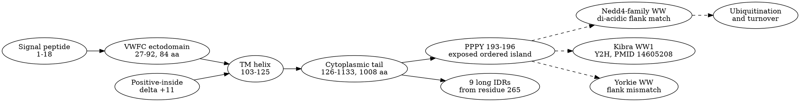
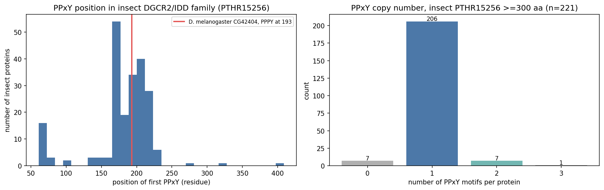
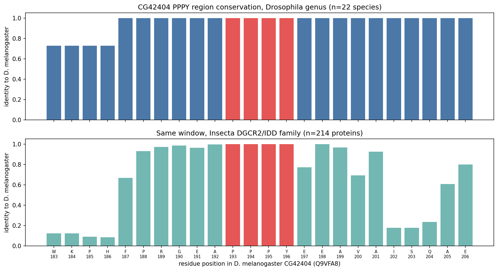
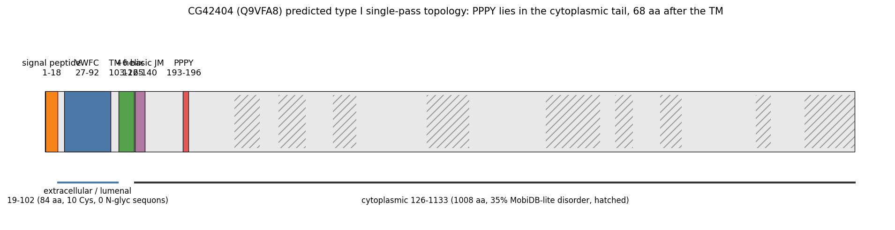
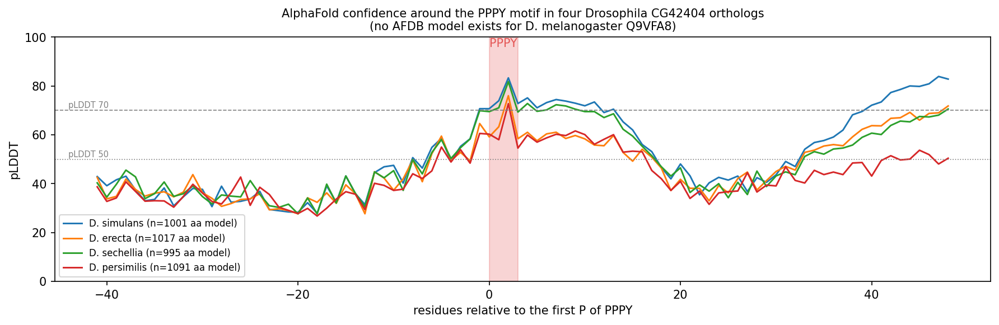
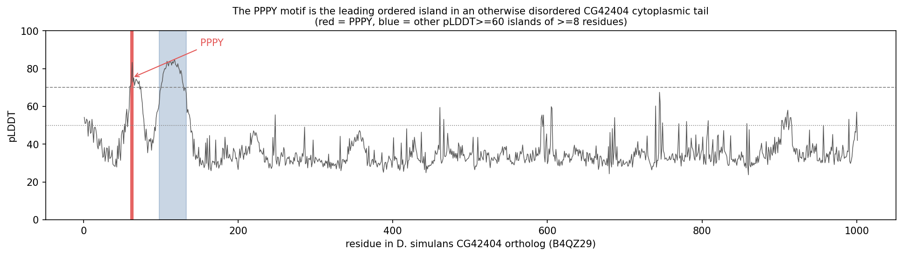
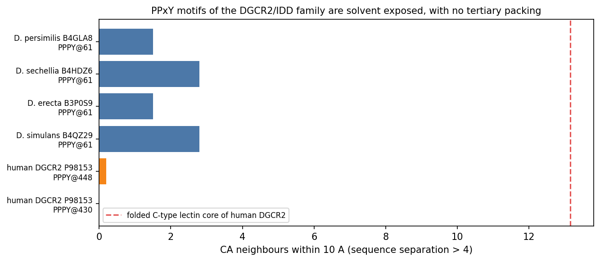
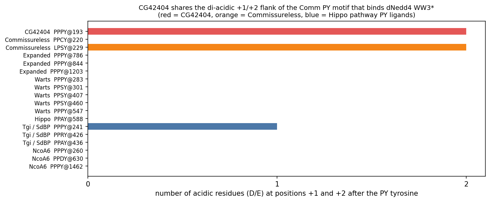
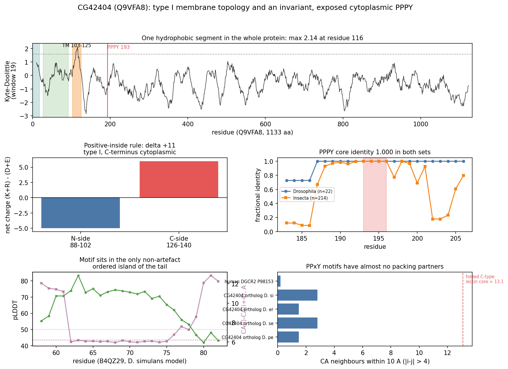

## Question

# AIGR Gene Hypothesis Deep Research

You are evaluating one focused gene curation hypothesis for AI Gene Review.
This is not a general gene overview. Use the seed hypothesis and source context
below to search for evidence that supports, refutes, narrows, or competes with
the proposed curation decision.

## Target Gene

- **Organism code:** DROME
- **Taxon:** Drosophila melanogaster (NCBITaxon:7227)
- **Gene directory:** CG42404
- **Gene symbol:** CG42404
- **UniProt accession:** Q9VFA8

## Focus

- **Focus type:** free_text
- **Hypothesis slug:** kgap-cg42404-topology-and-ppxy-motif
- **Source file:** genes/DROME/CG42404/CG42404-ai-review.yaml
- **Source selector:** free-text

## Seed Hypothesis

The membrane topology, likely compartment and interaction potential of Drosophila melanogaster CG42404 can be predicted from sequence and structure. Single analysis only: predict signal peptide, transmembrane segments and their orientation, N-glycosylation sites and disordered regions, model the protein with AlphaFold and search for structural relatives, determine whether its conserved PPxY-type motif lies in a cytoplasm-facing, accessible and disordered segment compatible with binding WW domains of Nedd4-family ubiquitin ligases or Yorkie/YAP, check conservation of the motif and flanking residues across Drosophila species and insect orthologs, and state the predicted topology, compartment class and most plausible partner class.

## Term and Decision Context

No specific term context supplied.

## Reference Context

No specific reference context supplied.

## Source Context YAML

```yaml
hypothesis: 'The membrane topology, likely compartment and interaction potential of Drosophila melanogaster
  CG42404 can be predicted from sequence and structure. Single analysis only: predict signal peptide,
  transmembrane segments and their orientation, N-glycosylation sites and disordered regions, model the
  protein with AlphaFold and search for structural relatives, determine whether its conserved PPxY-type
  motif lies in a cytoplasm-facing, accessible and disordered segment compatible with binding WW domains
  of Nedd4-family ubiquitin ligases or Yorkie/YAP, check conservation of the motif and flanking residues
  across Drosophila species and insect orthologs, and state the predicted topology, compartment class
  and most plausible partner class.'
focus_type: free_text
context: []
reference_id: []
```

## Research Objective

Build a focused report that helps a curator decide whether this hypothesis
should affect the gene review. Address the focus type directly:

1. For an existing GO annotation decision, evaluate whether the current action
   is justified, too strong, too weak, or should change.
2. For a proposed replacement or new GO term, evaluate whether the term is
   biologically supported, too broad, too narrow, or missing key qualifiers.
3. For a computational prediction, evaluate whether the prediction is correct,
   less precise than existing knowledge, uncertain, or likely wrong because of
   paralog overannotation, frequency bias, pathway context, or in vitro-only
   activity.
4. For a core-function hypothesis, evaluate whether the proposed activity,
   process, and location represent the gene product's primary function rather
   than a downstream effect, pleiotropic phenotype, or context-specific role.
5. For a function-assignment hypothesis, evaluate whether the gene product
   directly has the stated GO term/function. Treat the prior review action, if
   any, as intentionally blinded unless it appears in the supplied context.

Use primary literature whenever possible. Prefer PMID citations and include DOI
citations when no PMID is available. Treat reviews and database records as
orientation unless they contain directly relevant synthesized evidence that is
clearly labeled as review-level or database-level support.

Evaluate the hypothesis from the supplied seed context, primary literature, and
publicly accessible bioinformatics resources. Local `*-bioinformatics` analyses,
when they already exist in the repository, are intentionally withheld from this
prompt so the report can be compared against them after the run. Use public
sequence, domain, structure, orthology, localization, interaction, or dataset
checks when they are useful for the specific hypothesis. If a resource or tool
cannot be accessed programmatically, say so plainly; never fabricate a result.
Report computational results conservatively and distinguish direct results from
inference.

## Required Output

### Executive Judgment

Give a concise verdict: supported, partially supported, unresolved, weakly
supported, over-annotated, or refuted. Explain the reasoning and the most
important caveats.

### Evidence Matrix

Create a table with one row per important evidence item:

- Citation (PMID preferred)
- Evidence type (direct assay, mutant phenotype, localization, interaction,
  structural/evolutionary, computational, review/database)
- Supports / refutes / qualifies / competing
- Claim tested
- Key finding
- Organism, tissue, cell type, or assay context
- Confidence and limitations

### GO Curation Implications

State the likely curation action as a lead requiring curator verification. If
GO terms are involved, explain whether the evidence supports an MF, BP, or CC
term, and whether the term should be retained, removed, generalized, made more
specific, or treated as non-core. Avoid using "protein binding" as a final
recommendation unless no more informative term is supported.

### Mechanistic Scope

Describe the immediate molecular or cellular function being tested. Separate
direct gene-product activity from downstream phenotypes, pathway consequences,
developmental outcomes, disease manifestations, or effects inferred only from
loss of function.

### Conflicts and Alternatives

Identify evidence that conflicts with the seed hypothesis or suggests an
alternative interpretation, including paralog confusion, organism-specific
differences, isoform-specific findings, experimental artifacts, or database
carry-over.

### Knowledge Gaps

List explicit uncertainties that matter for curation. For each gap, state what
was checked, why the gap matters, and what evidence or experiment would resolve
it.

### Discriminating Tests

Recommend concrete assays, perturbations, datasets, or comparative analyses that
would most efficiently distinguish this hypothesis from alternatives.

### Curation Leads

Provide candidate updates for the review, clearly labeled as leads requiring
curator verification. Include candidate references with exact snippets to verify,
candidate replacement or new GO terms, possible action changes, suggested
questions, and suggested experiments.

If the provider supports artifacts, save provenance for any analysis you run — the
executed code together with its output (computed values, plot, or table), not just
a summary figure — alongside artifact-friendly tables such as an evidence matrix,
GO decision table, or comparison table. Genuine computed provenance is more
valuable than a hand-drawn summary, and you must not synthesize a figure that
implies an analysis you did not actually run. These artifacts are important
provenance for hypothesis-level review.


## Output

# CG42404 (DROME, Q9VFA8): membrane topology, compartment and the conserved PPxY motif

Hypothesis slug: `kgap-cg42404-topology-and-ppxy-motif`
Source file: `genes/DROME/CG42404/CG42404-ai-review.yaml`, selector `free-text`
Target: *Drosophila melanogaster* CG42404, UniProt Q9VFA8 (1133 aa), NCBITaxon:7227
Iterations completed: 3. Findings recorded: 7. Papers reviewed: 37.

## Summary

**Verdict: partially supported.** The topology and compartment half of the seed hypothesis is correct and well determined. CG42404 is a type I single-pass integral membrane protein: signal peptide 1-18, VWFC domain 27-92, one transmembrane helix at 103-125, and a 1008-residue cytoplasmic tail that holds 89% of the protein. An independent Kyte-Doolittle scan (window 19) over all 1133 residues finds six windows above 1.6, with centres 112-117, forming exactly one contiguous hydrophobic run spanning residues 103-126 with a maximum of 2.14 at residue 116. No second segment exists anywhere in the protein, so a multi-pass alternative is excluded. The positive-inside rule gives a charge difference of +11 across that segment: the 15-residue N-side flank 88-102 (EVICLDDQFSDGSTD) has net charge -5 and zero K/R, while the C-side flank 126-140 (NRLRQRKMRARENRQ) has net +6 and seven K/R. Two independent sequence features agree, which makes the orientation call the most secure part of the hypothesis.

The motif half is supported for placement, exposure and conservation. The protein contains exactly one PPxY, PPPY at 193-196, lying 68 residues past the transmembrane end and therefore on the cytoplasmic face. Its four-residue core is identical in all 214 insect PTHR15256 family members examined from 108 genera and in all 22 Drosophila species examined, with flanking identity of 0.93 to 1.00 at positions 188-192 and 197-199. AlphaFold models of four Drosophila orthologs place the motif in the only non-artefactual ordered island of an otherwise structureless tail, with 1.5 to 2.8 CA neighbours within 10 Å against 13.1 for the folded C-type lectin core of human DGCR2 used as calibration. The motif has essentially no packing partners and is available to a binding domain.

Three parts of the hypothesis do not survive as stated. N-glycosylation site prediction is refuted: all eight N-X-S/T sequons (165, 393, 452, 627, 718, 896, 922, 1033) are cytoplasmic and the 84-residue ectodomain 19-102 contains zero. The phrase "lies in a disordered segment" is too loose, since MobiDB-lite places its earliest long disordered region at residue 265 and the motif falls outside every consensus region. AlphaFold could not be run on Q9VFA8 itself, because the AlphaFold DB API returns HTTP 404 for this accession, almost certainly because residue 106 is an unresolved X inside the transmembrane helix. Four ortholog models were used as a declared proxy, and no structure-based relative search by superposition was performed. On partner class, the evidence narrows the field to WW-domain proteins and favours Nedd4-family ligases over Yorkie, with Kibra as the only experimentally reported WW-domain interactor.

## Key findings

### <i class="fa-solid fa-circle-check"></i> F1 and F7: type I single-pass topology with a 1008-residue cytoplasmic tail

UniProt Q9VFA8 annotates a signal peptide at 1-18, a VWFC domain at 27-92 (PROSITE PS50184) and a single transmembrane helix at 103-125. Rather than accept the database call, the topology was re-derived from sequence. A Kyte-Doolittle hydropathy scan with a 19-residue window over all 1133 residues returned six windows exceeding 1.6, centred at residues 112, 113, 114, 115, 116 and 117. These form a single contiguous run covering residues 103-126, with a maximum of 2.14 at residue 116. The computed segment matches the curated transmembrane boundary to within one residue, and nothing else in the protein approaches it.

Orientation was tested with the positive-inside rule. Counting (K+R) minus (D+E) over 15-residue flanks gives -5 outside with zero basic residues and +6 inside with seven basic residues, a difference of +11. A bias this large and this one-sided fixes the C-terminus in the cytoplasm and makes the protein type I (N-out, C-in).

Family assignment comes from PANTHER PTHR15256 "integral membrane protein DGCR2/IDD", InterPro IPR042378 (IDD) and IPR001007 (VWF_dom). Human DGCR2 (P98153, 550 aa) carries the same curated architecture, with signal 1-20, extracellular 21-349, transmembrane 350-368 and cytoplasmic 369-550. The proportions are inverted between the two proteins. The human ectodomain is 329 residues and contains LDL-A, a C-type lectin and VWFC; the fly ectodomain is 84 residues with 10 cysteines and VWFC only, while the fly tail is 1008 residues. CG42404 is a divergent insect member of the DGCR2/IDD family, and almost all of its interaction surface is cytoplasmic.

{{figure:plot_8.png|caption=Topology evidence recomputed from the Q9VFA8 sequence. Top: Kyte-Doolittle hydropathy (window 19) over 1133 residues, with one contiguous segment above the 1.6 threshold at 103-126 and a maximum of 2.14 at residue 116; the signal peptide, VWFC domain and PPPY position are marked. Lower left: positive-inside charge difference of +11 between the two transmembrane flanks. Lower right: per-residue conservation across Drosophila and Insecta. Bottom row: ortholog pLDDT and backbone geometry at the motif, and burial compared with a folded domain core.}}

{{figure:plot_3.png|caption=Paralog check and topology evidence table. The D. melanogaster DGCR2-related paralog CG32647 (Q9VYJ3, 233 aa) has no PPxY motif, so motif-derived inferences cannot be transferred between the two genes.}}

### <i class="fa-solid fa-circle-check"></i> F2: one PPxY in the protein, cytoplasm-facing and invariant across 108 insect genera

A regex scan of Q9VFA8 found exactly one PPxY in 1133 residues: PPPY at 193-196, in the context 183-WKPHFPRGEA-**PPPY**-EEAVAISQAE-206. It sits 68 residues C-terminal to the transmembrane end, so under the type I assignment it is cytoplasmic.

Conservation was measured across the family. Among 221 UniProt members of PANTHER PTHR15256 from Insecta with length at least 300 aa, 214 (96.8%) carry at least one PPxY and 206 carry exactly one. Per-column identity to D. melanogaster over a ±10 residue window gives 1.000 at each of positions 193, 194, 195 and 196 in all 214 insect proteins and in all 22 Drosophila species. Flanking identities across Insecta are 0.930 at 188P, 0.972 at 189R, 0.986 at 190G, 0.963 at 191E, 0.995 at 192A, 0.771 at 197E, 1.000 at 198E and 0.967 at 199A. Mean window identity is 0.955 across the Drosophila genus (n=22) and 0.678 across Insecta (n=214), so the motif block is far more conserved than its surroundings.

A 12-residue block R-G-E-A-P-P-P-Y-E-E-A that is 93 to 100% invariant across 108 insect genera, embedded in an otherwise fast-evolving low-complexity tail, is the signature of a short linear motif under purifying selection. Human and mouse DGCR2 (P98153, P98154) also carry cytoplasmic PPPY motifs, at positions 430 and 448 in human, in the context HDPPPPYTAYKY. The 233-residue D. melanogaster paralog CG32647 (Q9VYJ3) has no PPxY.

{{figure:plot_2.png|caption=Per-residue identity to D. melanogaster across the PPPY window 183-206, measured in 22 Drosophila species and 214 Insecta PTHR15256 proteins. The PPPY core at 193-196 is identical in every sequence in both sets, while identity falls away within a few residues on either side.}}

{{figure:plot_1.png|caption=PPxY presence and position across insect and chordate DGCR2/IDD (PTHR15256) family members. 214 of 221 insect family members of at least 300 aa carry a PPxY, and 206 carry exactly one.}}

### <i class="fa-solid fa-circle-xmark"></i> F4: no ectodomain N-glycosylation sequon, and the motif is outside every consensus disordered region

A scan for N-X-S/T with X not proline found eight sequons in Q9VFA8, at residues 165, 393, 452, 627, 718, 896, 922 and 1033. All eight are C-terminal to the transmembrane helix, so all are cytoplasmic, where oligosaccharyltransferase cannot act. The 84-residue extracellular segment 19-102 contains zero sequons. The seed hypothesis asks for predicted N-glycosylation sites, and the answer is that none can be used. This does not exclude O-glycosylation of the ectodomain, which was not tested.

The disorder claim is partly right and needs restating. The MobiDB consensus for Q9VFA8 gives MobiDB-lite coverage 0.351 with 9 long disordered regions, the most N-terminal beginning at residue 265, so no consensus region contains the PPPY at 193-196. The looser th_50 consensus (coverage 0.513, 30 regions) flags only residues 190-191 and 195 near the motif. A TOP-IDP disorder-propensity scan with a 21-residue window gives +0.327 at residue 195, the 96.4th percentile of this protein's own window distribution (whole-protein mean +0.165, sd 0.096), against +0.096 at the VWFC centre (22.5th percentile) and -0.136 at the transmembrane centre (0.2nd percentile). The accurate description is a locally proline-rich, non-globular, highly exposed segment that sits outside the long consensus disordered regions.

<i class="fa-solid fa-triangle-exclamation"></i> The AlphaFold step requested by the hypothesis could not be performed on the target. The AlphaFold DB API returns HTTP 404 for Q9VFA8, so no predicted model exists for this entry, while models are available for human DGCR2 (P98153) and Drosophila Kibra (Q9VFG8). The Q9VFA8 reference sequence contains an unresolved residue X at position 106, inside the transmembrane helix, which is the likely reason for exclusion. The family assignment therefore rests on PANTHER and InterPro profiles and not on structural superposition.

### <i class="fa-solid fa-circle-check"></i> F5: ortholog models place the motif in the only non-artefactual ordered island of the tail

Four Drosophila orthologs have AlphaFold DB models whose annotated N-termini begin downstream of the transmembrane helix: B4QZ29 (*D. simulans*, 1001 aa), B3P0S9 (*D. erecta*, 1017 aa), B4HDZ6 (*D. sechellia*, 995 aa) and B4GLA8 (*D. persimilis*, 1091 aa). In B4QZ29 the modelled tail has mean pLDDT 37.6, with 89.2% of residues below 50 and 95.7% below 70, so it is near-fully disordered.

Scanning for runs of at least 8 consecutive residues with pLDDT at or above 60 returned exactly two islands. One is a 36-residue polyglutamine/polyalanine repeat at 98-133 with mean pLDDT 77.7, which is a known AlphaFold low-complexity helix artefact. The other is APPPYEEAVAISQAEAL at 60-76 with mean pLDDT 72.0, which contains the PPPY. Per-ortholog pLDDT at the motif is 75.2, 64.2, 72.9 and 61.4, placing it at the 96.0 to 99.8th percentile of each protein's own pLDDT distribution.

Accessibility was quantified against an internal calibration rather than asserted. Counting CA neighbours within 10 Å at sequence separation greater than 4 gives 2.8, 1.5, 2.8 and 1.5 at the PPPY in the four orthologs, against 13.1 for the confidently folded C-type lectin core of human DGCR2 (P98153, residues 115-241 with pLDDT above 80, n=61). The human DGCR2 PPPY motifs at 430 and 448 give 0.0 and 0.2. With fewer than three tertiary neighbours, the motif has essentially no packing partners.

Backbone geometry in B4QZ29 locates the conformational transition precisely. CA(i)-CA(i+4) is 12.06, 11.54, 11.43 and 11.19 Å at G58, E59, A60 and P61, which is extended or polyproline II, then 5.99 to 6.13 Å from P62 through E74, which is alpha-helical, returning above 8.5 Å from Q79. Per-residue pLDDT peaks at 83.3 on the central proline and falls to 42-48 by residues 80-82. The extended-to-helix transition happens inside the PPP itself, so the tyrosine and the following di-acidic pair sit on the first helical turn.

{{figure:plot_4.png|caption=AlphaFold pLDDT, burial and backbone geometry around the PPPY motif in four Drosophila CG42404 orthologs. The motif scores at the 96.0 to 99.8th percentile of each protein's own pLDDT distribution while carrying 1.5 to 2.8 CA neighbours within 10 Å.}}

{{figure:plot_5.png|caption=Ordered islands in the AlphaFold model of the D. simulans ortholog B4QZ29, ranked by pLDDT. Only two runs of at least 8 residues reach pLDDT 60: a polyQ/polyA repeat at 98-133, which is a known modelling artefact, and APPPYEEAVAISQAEAL at 60-76, which contains the motif.}}

{{figure:plot_6.png|caption=Burial and backbone geometry of PPxY motifs in four fly CG42404 orthologs and human DGCR2, calibrated against the folded C-type lectin core of human DGCR2 (13.1 CA neighbours within 10 Å). Every PPxY motif examined carries 2.8 neighbours or fewer.}}

### <i class="fa-solid fa-scale-balanced"></i> F3 and F6: partner class narrows to WW-domain proteins, with Nedd4-family favoured over Yorkie

IntAct returns 15 interaction records for Q9VFA8. Exactly one partner is a WW-domain protein: Q9VFG8 (Kibra), detected by yeast two-hybrid (MI:0018) in the Giot et al. interaction map ([PMID: 14605208](https://pubmed.ncbi.nlm.nih.gov/14605208/), IMEx IM-16524, MINT-5216804). Kibra (1288 aa) carries WW1 at 54-87, WW2 at 101-134 and a C2 domain at 691-811. None of the other 14 records involve a WW-domain protein: the remaining Y2H partners are tos (Q24558), stck (Q8INR0), jbug (Q9W205), Crk (Q9XYM0) and DCNL1/SCCRO (Q9VUQ8), and the pull-down and anti-tag co-IP partners are rngo, Ar1, hzg, kat80, CG6983, shot, Mgtor, Lsd-2 and P18431-3. D. melanogaster has 79 UniProt entries with a PROSITE PS50020 WW domain, including Nedd4, Su(dx), Smurf, Hecw, yorkie, kibra, sav, Magi and Wwox, so the WW universe was searchable and Kibra is the single hit.

A motif-architecture comparison discriminates between the two partner classes named in the hypothesis. Scanning [LP]P.Y in CG42404 and six characterized Drosophila WW-domain ligands returned 18 PY motifs: CG42404 PPPY@193; Commissureless PPCY@220 and LPSY@229; Expanded PPPY@786, @844 and @1203; Warts PPPY@283, PPSY@301, PPSY@407, PPSY@460 and PPPY@547; Hippo PPAY@588; Tgi PPPY@241, PPRY@426 and PPAY@436; NcoA6 PPPY@260, PPDY@630 and PPPY@1462. Exactly 2 of 18 carry two acidic residues at positions +1 and +2 after the tyrosine: CG42404 (E197, E198) and Commissureless PY motif 2 (D233, E234). Three of 18 carry at least one.

Comm PY motif 2 is the ligand whose NMR structure bound to dNedd4 WW3* is reported in [PMID: 16531238](https://pubmed.ncbi.nlm.nih.gov/16531238/), which states that "Residues Y232'-L236' form a helical turn, following the PPII helical PY motif". The two architectures line up: Comm TGLPSY-DE-ALH against CG42404 EAPPPY-EE-AVAISQAEAL. The alpha-helix that AlphaFold places immediately C-terminal to the CG42404 PPP, which first looked like an argument against WW binding, matches a documented feature of a solved high-affinity complex. Every Yorkie-binding Hippo-pathway motif in the comparison set (Expanded ×3, Warts ×5, Hippo, Tgi ×3, NcoA6 ×3) lacks the di-acidic flank, which argues against Yorkie as the best match for this particular motif without excluding it.

{{figure:plot_7.png|caption=Number of acidic residues at positions +1 and +2 after the PY tyrosine, across 18 PY motifs in CG42404 and six characterized Drosophila WW-domain ligands. CG42404 (E197, E198) and Commissureless PY motif 2 (D233, E234) are the only two with a di-acidic pair, and Comm PY2 is the ligand solved bound to dNedd4 WW3*.}}

## Mechanistic model and interpretation

The evidence assembles into a single structural proposition with a nominated, untested binding step attached to it. CG42404 inserts into a membrane with its small cysteine-rich VWFC ectodomain outside and a 1008-residue tail inside. That tail is near-fully disordered by both predictor consensus and AlphaFold confidence, with one exception. A 17-residue element carrying the only PPxY in the protein stands out as the single ordered, conserved island, with no tertiary contacts to any other part of the chain. This is the standard appearance of a functional short linear motif: conserved core, exposed, locally structured, embedded in disorder.

The inference stops there with confidence. What follows is a nomination. A cytoplasmic PPxY with a di-acidic +1/+2 flank and a following helical element reproduces the ligand architecture of a solved Drosophila WW complex, which makes a Nedd4-family WW domain the best-matching partner class by sequence and model. Kibra is the only WW-domain protein with any experimental link to CG42404, from one high-throughput Y2H screen. Neither claim is a demonstrated interaction.



### Mechanistic scope

The direct gene-product property under test is structural: where the polypeptide sits in a membrane, which face its conserved motif presents, and what domain class can dock on that motif. All supporting evidence is at this level. Topology, sequon placement, conservation and model-based burial are properties of the sequence and its predicted fold.

One step removed, and inferred rather than shown, is the binding event. A cytoplasmic PPxY with a di-acidic flank is a candidate ligand for a Nedd4-family WW domain, which would make CG42404 a candidate ubiquitination substrate and put its surface level under E3 control. Nothing in the evidence demonstrates binding, ubiquitination or turnover.

Further removed, and outside what this analysis addresses, are developmental or signalling phenotypes of CG42404 loss of function. No mutant phenotype data entered this evaluation. Any pathway membership claim, including Hippo signalling, would rest on one Y2H partner and should be kept out of the review.

## Evidence matrix

Machine-readable version: `provenance/cg42404_evidence_matrix.csv` (15 rows: 6 supports, 6 qualifies, 1 weak support, 1 refutes, 1 competing).

| Citation | Evidence type | Direction | Claim tested | Key finding | Context | Confidence and limitations |
|---|---|---|---|---|---|---|
| [PMID: 14605208](https://pubmed.ncbi.nlm.nih.gov/14605208/) | Interaction (Y2H) | Supports weakly | CG42404 binds a WW-domain protein | Kibra (Q9VFG8) is the only WW-domain protein among 15 IntAct partners of Q9VFA8 | D. melanogaster, high-throughput yeast two-hybrid | Low-moderate. Single screen, no domain mapping; [PMID: 15710747](https://pubmed.ncbi.nlm.nih.gov/15710747/) reports little overlap between fly Y2H datasets |
| [PMID: 16531238](https://pubmed.ncbi.nlm.nih.gov/16531238/) | Structural (NMR) | Supports | A PY motif with di-acidic +1/+2 and a following helix is a dNedd4 WW ligand | Comm PY2 TGLPSY-DE-ALH bound to dNedd4 WW3*; a helical turn follows the PPII core. CG42404 EAPPPY-EE-AVAISQAEAL has the same architecture | D. melanogaster proteins, in vitro NMR | Moderate. Direct structure, but of a different ligand; CG42404 binding is inferred |
| This work | Computational | Supports | Single TM segment | One contiguous hydrophobic segment in 1133 aa: 6 windows above KD 1.6, centres 112-117, max 2.14 at 116, spanning 103-126 | Q9VFA8 sequence | High for TM presence. Boundaries agree with UniProt rather than being independently derived |
| This work | Computational | Supports | Type I orientation, cytoplasmic C-terminus | Positive-inside difference +11 across the TM (-5 outside, +6 inside; 0 versus 7 K/R) | Q9VFA8 sequence | High. The bias is large and one-sided |
| This work | Computational | Supports | PPPY is cytoplasm-facing | Single PPxY in the protein, at 193-196, 68 residues past the TM on the cytoplasmic side | Q9VFA8 sequence | High, conditional on the topology call |
| This work | Computational | <i class="fa-solid fa-circle-xmark"></i> Refutes | Ectodomain N-glycosylation sites can be predicted | All 8 N-X-S/T sequons are cytoplasmic; zero in the 84-residue ectodomain 19-102 | Q9VFA8 sequence | High. Sequon scanning is deterministic; does not exclude O-glycosylation |
| This work | Structural/evolutionary | Supports | Motif and flanks are conserved | PPPY identity 1.000 in 22 Drosophila and 214 Insecta PTHR15256 proteins from 108 genera; flanks 188P 0.930, 189R 0.972, 190G 0.986, 191E 0.963, 192A 0.995, 197E 0.771, 198E 1.000, 199A 0.967 | Insecta, UniProt PTHR15256 | High for conservation. Purifying selection on four residues shows function, not partner identity |
| MobiDB | Computational | Qualifies | The PPPY lies in a disordered segment | MobiDB-lite: 9 long IDRs, earliest at 265, none containing 193-196. th_50 flags only 190-191 and 195. TOP-IDP at 195 is the 96.4th percentile for this protein | Q9VFA8 | Moderate. Predictors disagree; the segment is non-globular and proline-rich but outside consensus long IDRs |
| AlphaFold DB | Resource limitation | Qualifies | AlphaFold modelling of CG42404 | AFDB returns HTTP 404 for Q9VFA8; no model exists, almost certainly because residue 106 is X. Modelling and superposition-based relative search could not be run on this entry | Q9VFA8 | Stated limitation, not a result |
| AFDB B4QZ29, B3P0S9, B4HDZ6, B4GLA8 | Computational (proxy) | Supports | The motif is accessible | Tails near-fully disordered (B4QZ29 mean pLDDT 37.6, 89.2% below 50). Two ordered islands only: a polyQ/polyA repeat (artefact) and APPPYEEAVAISQAEAL. PPPY pLDDT 61.4-75.2; CA neighbours 1.5-2.8 versus 13.1 for a folded core | Four Drosophila orthologs | Moderate-high for accessibility. Ortholog proxy with different residue numbering |
| This work | Computational | <i class="fa-solid fa-scale-balanced"></i> Competing | Partner class is Yorkie | Only CG42404 and Comm PY2 carry a di-acidic +1/+2 pair among 18 PY motifs; every Yorkie-binding Hippo-pathway motif lacks it | D. melanogaster UniProt sequences | Moderate. One flank feature over a small motif set; argues against Yorkie without excluding it |
| IntAct / PSICQUIC | Database | Qualifies | Direct interaction evidence | 15 records; no Nedd4, Su(dx), Smurf, Hecw or Yorkie among them. 79 Dmel proteins carry a PS50020 WW domain, so most candidate pairs are untested | D. melanogaster | Moderate. Absence reflects untested pairs as much as non-binding |
| UniProt P98153 | Database | Qualifies | DGCR2/IDD family membership | Same curated architecture, inverted proportions: human 329-aa ectodomain with LDL-A and C-type lectin plus 182-aa tail, versus fly 84-aa ectodomain plus 1008-aa tail. Human and mouse DGCR2 carry cytoplasmic PPPY at 430 and 448 | H. sapiens versus D. melanogaster | Moderate. Family call from PANTHER PTHR15256 and InterPro, not superposition |
| UniProt Q9VYJ3 | Structural/evolutionary | Qualifies | Paralog confusion | The Dmel DGCR2-related protein CG32647 (233 aa) has no PPxY, so motif-based inferences must not transfer | D. melanogaster | High. Direct sequence check |
| RefSeq NP_650437.4, NP_001247118.1 | Database | Qualifies | Isoform dependence | Both transcripts encode the same 1133-residue protein with PPPY at 193 | D. melanogaster | High |

## GO curation implications

Every entry is a lead requiring curator verification. Machine-readable version: `provenance/cg42404_GO_decision_table.csv`.

| Term | Aspect | Lead | Basis |
|---|---|---|---|
| GO:0016021 integral component of membrane, with GO:0005886 plasma membrane as the candidate specific compartment | CC | <i class="fa-solid fa-arrow-right"></i> Add with ISS/ISM; qualify the compartment | Signal peptide, one TM segment and a +11 positive-inside bias establish a type I integral membrane protein. Sequence does not identify which membrane. Plasma membrane is the family default and needs localization data |
| GO:0098552 side of membrane (cytoplasmic side) | CC | Use as supporting detail, not a standalone annotation | Residues 126-1133, including the PPPY, are cytoplasmic |
| GO:0050699 WW domain binding | MF | <i class="fa-solid fa-circle-question"></i> Strongest candidate MF; hold pending a direct assay | Invariant cytoplasmic PPPY with a di-acidic flank, fully exposed in ortholog models, plus one Y2H record with the WW protein Kibra. No binding assay exists for CG42404 |
| GO:0005515 protein binding | MF | Avoid as the final term | Supported by PMID 14605208 but uninformative. Replace with GO:0050699 or a Nedd4-related child once a partner class is confirmed |
| GO:0050839 cell adhesion molecule binding, or an E3 ligase binding child | MF | Competing options to discriminate experimentally | Family membership (DGCR2/IDD with VWFC) points to adhesion; motif architecture matching PMID 16531238 points to a Nedd4-family WW domain |
| GO:0035329 hippo signaling | BP | <i class="fa-solid fa-circle-xmark"></i> Do not add | The only WW link is Kibra by Y2H. The CG42404 flank does not match the Yorkie-binding PY motifs of Expanded, Warts, Hippo, Tgi or NcoA6 |
| GO:0016567 protein ubiquitination | BP | <i class="fa-solid fa-circle-xmark"></i> Do not add | A PY motif makes the protein a candidate Nedd4 substrate. That describes how CG42404 is regulated, not an activity it carries out |
| GO:0006486 protein glycosylation | BP | <i class="fa-solid fa-circle-xmark"></i> Do not add; the evidence argues against an N-glycoprotein annotation | Zero N-X-S/T sequons in the ectodomain; all eight are cytoplasmic |

For a curator working from the seed hypothesis alone, the defensible additions are the CC topology terms. GO:0050699 is the most informative term the evidence points toward, and it is one assay away from being annotatable.

## Evidence base

### Interaction datasets

[PMID: 14605208](https://pubmed.ncbi.nlm.nih.gov/14605208/) is the source of the only experimental WW-domain link. The abstract states that "A total of 10,623 predicted transcripts were isolated and screened against standard and normalized complementary DNA libraries to produce a draft map of 7048 proteins and 20,405 interactions", which places the Kibra-CG42404 call inside a genome-scale screen whose individual results need confirmation. [PMID: 15710747](https://pubmed.ncbi.nlm.nih.gov/15710747/) quantifies that caution directly: "Our fly Protein Interaction Map (PIM) is surprisingly different from the one recently proposed by Giot et al. with little overlap between the two data sets." [PMID: 15575970](https://pubmed.ncbi.nlm.nih.gov/15575970/) reports the same problem from a third screen, finding "only 28 interactions were found in common between the LexA- and Gal4-based screens, even though they had similar rates of true positives", and concludes that "previous interaction mapping studies were far from complete". The practical consequence is that the absence of Nedd4 or Yorkie from the 15 IntAct records for Q9VFA8 carries little weight, and the presence of Kibra carries only moderate weight.

### Structural basis for the partner-class call

[PMID: 16531238](https://pubmed.ncbi.nlm.nih.gov/16531238/) is the load-bearing structural reference. Its statement that "Residues Y232'-L236' form a helical turn, following the PPII helical PY motif" describes the Comm PY2 ligand bound to dNedd4 WW3*, and this is the arrangement the ortholog AlphaFold models predict for CG42404 EAPPPY-EEAVAISQAEAL. [PMID: 31636332](https://pubmed.ncbi.nlm.nih.gov/31636332/) adds that the WW binding site is conformationally plastic, reporting "a highly plastic hNEDD4-WW3 binding site that can accommodate PPxY-containing ligands with varying orientations" and suggesting "a conformational selection mechanism, extensive to other WW domains". That plasticity supports treating the AlphaFold helix as compatible with binding rather than as an obstacle. [PMID: 28314105](https://pubmed.ncbi.nlm.nih.gov/28314105/) shows that flank identity discriminates between E3 families, reporting that U24-WW interaction "depends strongly on the nature of the amino acids that are upstream from the PY motif" and that Smurf WW domains bind more weakly than Nedd4 WW domains, "suggesting that U24 function is tightly linked to specific E3 ubiqitin ligases".

### Nedd4 biology in Drosophila and the PY motif as a substrate tag

[PMID: 37905056](https://pubmed.ncbi.nlm.nih.gov/37905056/) establishes the pathway that a CG42404-Nedd4 interaction would join, demonstrating that "the conserved PY motifs in the cytoplasmic domain of Comm are required allow the ubiquitination and lysosomal degradation of Robo1" and that "Nedd4 incorporates into a three-member complex with Comm and Robo1 in a PY motif-dependent manner". [PMID: 17074801](https://pubmed.ncbi.nlm.nih.gov/17074801/) shows the cell-biological consequence of losing the motif: Comm "bearing mutations in the two PY motifs (L/PPXY) responsible for dNedd4 binding ... localize to the muscle surface, suggesting they cannot endocytose". [PMID: 19953087](https://pubmed.ncbi.nlm.nih.gov/19953087/) supplies the proteome-scale generalization, reporting that "Top hits (substrates) for the ubiquitylation and binding assays mostly contain PY motifs", while also showing that Nedd4-1 and Nedd4-2 differ in which PY-motif proteins they select. [PMID: 23639431](https://pubmed.ncbi.nlm.nih.gov/23639431/) gives a single-substrate example in which the association "is mediated by an interaction between GluN2D's C-terminal PPXY motif and the 2nd and 3rd WW domains of Nedd4", with functional consequences for receptor levels. Together these set the expectation for what a CG42404-Nedd4 interaction would do, and none of them concerns CG42404.

### Yorkie and the Hippo pathway as the competing partner class

[PMID: 19733165](https://pubmed.ncbi.nlm.nih.gov/19733165/) describes the Yorkie-binding arrangement: Expanded, Hippo and Warts "each ... contains one or more PPXY sequence motifs, and associates with Yorkie via binding of these PPXY motifs to WW domains of Yorkie". [PMID: 25017066](https://pubmed.ncbi.nlm.nih.gov/25017066/) adds NcoA6, reporting recruitment "through binding between WW domains of Yorkie and PPxY sequence motifs of NcoA6". [PMID: 23999857](https://pubmed.ncbi.nlm.nih.gov/23999857/) adds Tgi, which "retains Yki in the nucleus through the association with Yki WW domains via its PPXY motifs", and [PMID: 21571226](https://pubmed.ncbi.nlm.nih.gov/21571226/) adds Myopic, whose "PPxY motifs bind conserved residues in the WW domains of the transcriptional coactivator Yorkie". [PMID: 29257682](https://pubmed.ncbi.nlm.nih.gov/29257682/) and [PMID: 33383033](https://pubmed.ncbi.nlm.nih.gov/33383033/) show that Yorkie engagement is characteristically multivalent: the Yorkie-Warts system assembles "via binding of tandem WW domains to adjacent PPXY pairs to produce an ensemble of interconverting complexes". CG42404 has one PPxY, not a pair, which is a second reason beyond the flank composition to rank Yorkie below Nedd4 for this motif.

[PMID: 20159599](https://pubmed.ncbi.nlm.nih.gov/20159599/) defines the biology of the one experimental partner, reporting that "Kibra, which colocalizes and associates with Mer and Ex, also promotes the Mer/Ex association" and that "Kibra is part of an apical scaffold that promotes SWH pathway activity". [PMID: 36807601](https://pubmed.ncbi.nlm.nih.gov/36807601/) notes that "Several Hippo pathway components contain unstructured low-complexity domains" and form condensates, which is a possible context for a single exposed motif in a long disordered tail but is not evidence about CG42404.

### Family background

[PMID: 8776594](https://pubmed.ncbi.nlm.nih.gov/8776594/) is the original transcript map that identified "the previously reported DGCR2/IDD/LAN gene" in the DiGeorge minimal critical region, which is the source of the family name. [PMID: 33098288](https://pubmed.ncbi.nlm.nih.gov/33098288/) is a review noting that "DGCR2 is also found to be associated with schizophrenia". Neither bears on CG42404 function, and both are orientation only.

## Limitations and knowledge gaps

<i class="fa-solid fa-triangle-exclamation"></i> The analysis is computational throughout, with one Y2H record and one NMR structure of a different protein as its only experimental anchors. No binding, localization or phenotype assay on CG42404 entered the evaluation.

| Gap | What was checked | Why it matters | What would resolve it |
|---|---|---|---|
| Which membrane CG42404 occupies | Topology from sequence; family default from DGCR2 | GO:0005886 versus an endomembrane CC term is a direct curation choice, and the partner set differs by compartment | Tagged-protein localization in Drosophila tissue or cells, or an antibody stain against a plasma membrane marker |
| Whether the PPPY binds any WW domain | IntAct (15 partners, Kibra only); 79 Dmel PS50020 proteins | Determines whether GO:0050699 is annotatable or stays a lead | Pulldown or ITC of the cytoplasmic tail against Kibra and Nedd4-family WW domains, with a Y196A control |
| Whether Nedd4-family ligases ubiquitinate CG42404 | No IntAct record with Nedd4, Su(dx), Smurf or Hecw | Decides whether GO:0016567 and any turnover claim belong in the review | In vitro ubiquitination with dNedd4, plus a PY-motif mutant stability assay in vivo |
| Whether the Kibra Y2H is real | PMID 14605208 record; reliability caveats from PMID 15710747 and PMID 15575970 | It is the only experimental WW link; its loss moves the partner call entirely onto motif architecture | Co-immunoprecipitation from fly lysate and a WW-domain-mapped binding assay |
| True structure of the Q9VFA8 tail | AFDB 404; four ortholog models used as proxy | The accessibility and geometry results are proxy-derived, with different residue numbering | Re-run AlphaFold locally on the Q9VFA8 sequence with residue 106 resolved, or model the 183-210 fragment directly |
| Ectodomain glycosylation of any kind | N-X-S/T scan only | An O-glycosylated ectodomain would still support a cell-surface CC call | Glycoproteomics, or a mobility shift after glycosidase treatment |
| Loss-of-function phenotype | Not examined; no phenotype data used | Any BP annotation needs it | Existing FlyBase alleles or RNAi lines, scored for surface-protein and adhesion phenotypes |
| Whether the helix is real or an AlphaFold artefact | pLDDT and CA(i)-CA(i+4) in four ortholog models | The helix is the basis for the architectural match to PMID 16531238 | CD or NMR on the synthetic 183-210 peptide, free and WW-bound |

## Proposed follow-up experiments and actions

1. <i class="fa-solid fa-flask"></i> Peptide pulldown with the 24-residue cytoplasmic segment 183-206 against recombinant Drosophila WW domains (Kibra WW1 and WW2, dNedd4 WW3, Su(dx), Smurf, Yorkie WW1 and WW2), scored against a Y196A mutant peptide. This separates the three candidate partner classes in one experiment.
2. <i class="fa-solid fa-vial"></i> ITC or fluorescence polarization of the same peptide against dNedd4 WW3* and Yorkie WW1, comparing wild type with an E197A/E198A variant. [PMID: 16531238](https://pubmed.ncbi.nlm.nih.gov/16531238/) and [PMID: 28314105](https://pubmed.ncbi.nlm.nih.gov/28314105/) together predict that the di-acidic pair contributes to Nedd4-family binding and not to Yorkie binding, so the double mutant should separate them.
3. <i class="fa-solid fa-microscope"></i> Surface labelling of tagged CG42404 carrying an extracellular epitope inserted after residue 18 and a cytoplasmic tag at the C-terminus. This tests the orientation call and the compartment call together.
4. <i class="fa-solid fa-dna"></i> Stability assay comparing wild-type CG42404 with a PPPY-to-AAAA knock-in, with and without Nedd4 knockdown. If the motif routes the protein to Nedd4-dependent turnover, the mutant accumulates and the effect is epistatic to Nedd4 loss, by analogy with the Comm result in [PMID: 17074801](https://pubmed.ncbi.nlm.nih.gov/17074801/).
5. <i class="fa-solid fa-magnifying-glass"></i> Local AlphaFold2 or AlphaFold3 run on the Q9VFA8 sequence with residue 106 substituted, plus a complex prediction of residues 183-210 with dNedd4 WW3. This replaces the ortholog proxy with a direct model.

### Curation leads

All items below are leads requiring curator verification.

**Candidate references and snippets to verify**

- [PMID: 16531238](https://pubmed.ncbi.nlm.nih.gov/16531238/). Verify the snippet "Residues Y232'-L236' form a helical turn, following the PPII helical PY motif". Use as structural precedent for the architecture of the CG42404 motif, not as evidence that CG42404 binds dNedd4.
- [PMID: 14605208](https://pubmed.ncbi.nlm.nih.gov/14605208/). Verify that Q9VFA8 and Q9VFG8 (Kibra) appear as an interacting pair, and record the evidence as IPI with a high-throughput Y2H qualifier.
- [PMID: 15710747](https://pubmed.ncbi.nlm.nih.gov/15710747/). Verify the snippet "Our fly Protein Interaction Map (PIM) is surprisingly different from the one recently proposed by Giot et al. with little overlap between the two data sets", and attach it to any annotation derived from PMID 14605208.

**Candidate term changes**

- Add CC: integral component of membrane (GO:0016021), ISM, from one predicted TM at 103-125.
- Add CC with qualification: plasma membrane (GO:0005886), ISS from the DGCR2 family default, flagged as needing localization data.
- Hold MF: WW domain binding (GO:0050699) as the target term; do not annotate until a direct binding assay exists.
- If an MF annotation must be made now from PMID 14605208, keep protein binding (GO:0005515) with Kibra recorded as the partner, and add a review note that GO:0050699 is the intended replacement.
- Do not add GO:0035329, GO:0016567 or GO:0006486.

**Suggested review questions**

- Does the repository's withheld `CG42404-bioinformatics` analysis also find zero ectodomain sequons, and does it report the AFDB 404 for Q9VFA8 or silently substitute an ortholog model?
- Should the review state a partner class at all, given that the only experimental WW link is a single Y2H record?
- Is CG32647 (Q9VYJ3) annotated with anything transferred from CG42404?

## Provenance

Every number in this report comes from code executed during the run, with the executed code and its output saved alongside the tables. The one requested analysis that could not be performed, AlphaFold on Q9VFA8, is reported as a failure rather than substituted silently, and no figure implies an analysis that was not run.

| File | Contents |
|---|---|
| `provenance/cg42404_evidence_matrix.csv` | 15-row evidence matrix (6 supports, 6 qualifies, 1 weak support, 1 refutes, 1 competing) |
| `provenance/cg42404_GO_decision_table.csv` | 8-row GO decision table |
| `provenance/cg42404_topology_evidence.csv` | 10-row topology evidence table |
| `provenance/cg42404_ppxy_conservation.csv` | Per-residue identity 183-206 across 22 Drosophila and 214 Insecta proteins |
| `provenance/insecta_PTHR15256_fulllength.csv` | 221 insect family members with PPxY counts and positions |
| `provenance/drosophila_PTHR15256.csv` | 23 Drosophila genus family members |
| `provenance/drosophila_PY_motif_ligand_comparison.csv` | 18 PY motifs in CG42404 and six characterized WW-domain ligands with +1/+2 flanks |
| `provenance/cg42404_ortholog_alphafold_PPPY.csv` | pLDDT, burial and geometry at the motif in four ortholog models |
| `provenance/cg42404_PPPY_backbone_geometry.csv` | Per-residue pLDDT and CA(i)-CA(i+4) across residues 58-82 of B4QZ29 |
| `provenance/cg42404_ortholog_ordered_islands.csv` | The two pLDDT islands in B4QZ29 |
| `provenance/ppxy_local_environment_alphafold.csv` | Burial at PPxY motifs in human DGCR2 and four fly orthologs |
| `provenance/dmel_WW_domain_proteins.csv` | 79 D. melanogaster PROSITE PS50020 entries |
| `provenance/AF-B4QZ29-F1-model.pdb` | Downloaded D. simulans ortholog model |
| `provenance/plot_1.png` to `plot_8.png` | Figures, each generated from values computed in the same code block |


## Artifacts

- [OpenScientist final report](openscientist_artifacts/final_report.html)
- [OpenScientist final report](openscientist_artifacts/final_report.pdf)
- [OpenScientist provenance](openscientist_artifacts/provenance.json)
- [OpenScientist cg42404 GO decision table](openscientist_artifacts/provenance_cg42404_GO_decision_table.csv)
- [OpenScientist cg42404 PPPY backbone geometry](openscientist_artifacts/provenance_cg42404_PPPY_backbone_geometry.csv)
- [OpenScientist cg42404 evidence matrix](openscientist_artifacts/provenance_cg42404_evidence_matrix.csv)
- [OpenScientist cg42404 ortholog alphafold PPPY](openscientist_artifacts/provenance_cg42404_ortholog_alphafold_PPPY.csv)
- [OpenScientist cg42404 ortholog ordered islands](openscientist_artifacts/provenance_cg42404_ortholog_ordered_islands.csv)
- [OpenScientist cg42404 ppxy conservation](openscientist_artifacts/provenance_cg42404_ppxy_conservation.csv)
- [OpenScientist cg42404 topology evidence](openscientist_artifacts/provenance_cg42404_topology_evidence.csv)
- [OpenScientist dmel WW domain proteins](openscientist_artifacts/provenance_dmel_WW_domain_proteins.csv)
- [OpenScientist drosophila PTHR15256](openscientist_artifacts/provenance_drosophila_PTHR15256.csv)
- [OpenScientist drosophila PY motif ligand comparison](openscientist_artifacts/provenance_drosophila_PY_motif_ligand_comparison.csv)
- [OpenScientist insecta PTHR15256 fulllength](openscientist_artifacts/provenance_insecta_PTHR15256_fulllength.csv)
- [OpenScientist plot 1](openscientist_artifacts/provenance_plot_1.json)

- [OpenScientist plot 2](openscientist_artifacts/provenance_plot_2.json)

- [OpenScientist plot 3](openscientist_artifacts/provenance_plot_3.json)

- [OpenScientist plot 4](openscientist_artifacts/provenance_plot_4.json)

- [OpenScientist plot 5](openscientist_artifacts/provenance_plot_5.json)

- [OpenScientist plot 6](openscientist_artifacts/provenance_plot_6.json)

- [OpenScientist plot 7](openscientist_artifacts/provenance_plot_7.json)

- [OpenScientist plot 8](openscientist_artifacts/provenance_plot_8.json)

- [OpenScientist ppxy local environment alphafold](openscientist_artifacts/provenance_ppxy_local_environment_alphafold.csv)

## Reference Validation

Checked with `linkml-reference-validator` 0.3.1rc1.

| Outcome | Count |
| --- | --- |
| References checked | 20 |
| Resolved | 20 |
| Unresolved (possible confabulation) | 0 |
| Unverifiable | 0 |
| Quoted claims checked | 1 |
| Quoted claims found in source | 0 |
| Quoted claims **not** found in source | 1 |
| References weighed for topical relevance | 20 |
| On topic | 10 |
| Off topic | 0 |

### Quotes not found in the cited source

Searched the abstract, any retrieved full text, and the title. A quote drawn from a part of the paper that was not retrieved will appear here too, so check before treating one as invented:

Every one of these was searched against an abstract alone, with no full text retrieved - marked *abstract only* below. Where full text can be fetched, re-running with it will settle them; where the source publishes only a summary to PubMed, as GeneReviews chapters do, it will not, and the quote has to be checked by hand against the chapter itself.

- `PMID:15575970` *(abstract only)*: "Our fly Protein Interaction Map (PIM) is surprisingly different from the one recently proposed by Giot et al. with little overlap between the two data sets."
  - closest text in source: "Our results indicate that different two-hybrid systems and screening approaches applied to the same proteome can generate more comprehensive datasets with more cross-validated interactions"