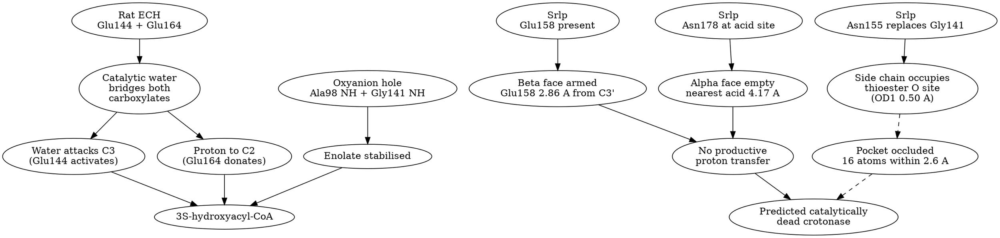
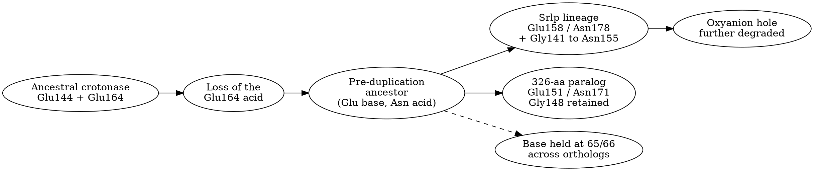
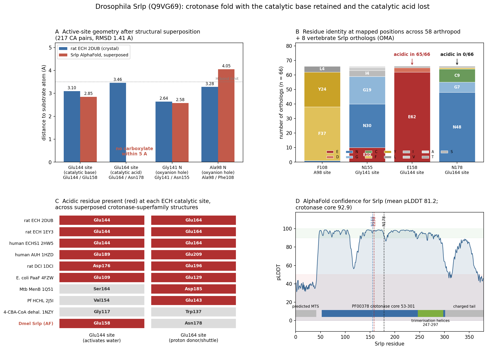
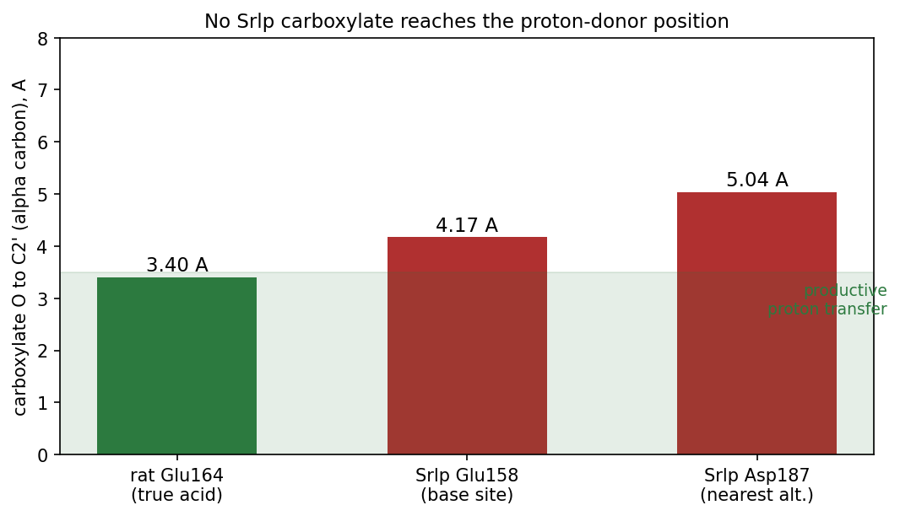
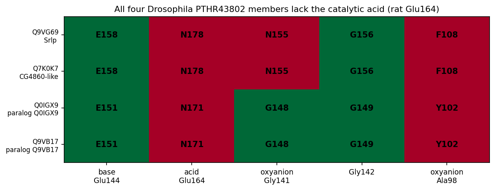
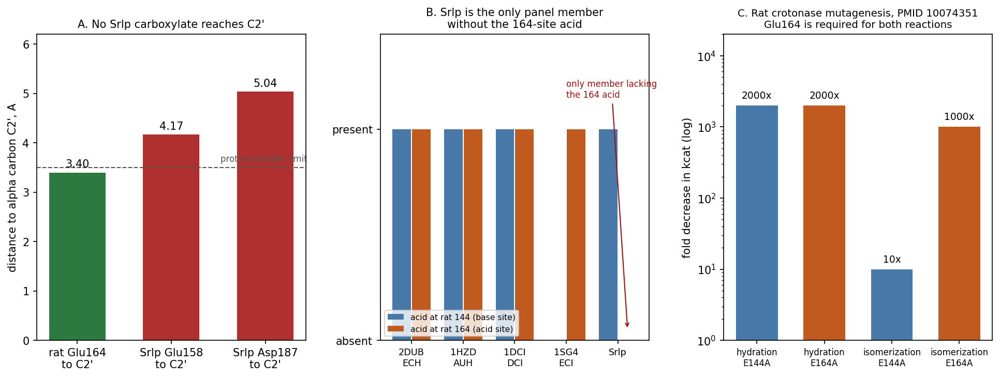

## Question

# AIGR Gene Hypothesis Deep Research

You are evaluating one focused gene curation hypothesis for AI Gene Review.
This is not a general gene overview. Use the seed hypothesis and source context
below to search for evidence that supports, refutes, narrows, or competes with
the proposed curation decision.

## Target Gene

- **Organism code:** DROME
- **Taxon:** Drosophila melanogaster (NCBITaxon:7227)
- **Gene directory:** Srlp
- **Gene symbol:** Srlp
- **UniProt accession:** Q9VG69

## Focus

- **Focus type:** free_text
- **Hypothesis slug:** kgap-srlp-crotonase-catalytic-competence
- **Source file:** genes/DROME/Srlp/Srlp-ai-review.yaml
- **Source selector:** free-text

## Seed Hypothesis

Drosophila melanogaster Srlp (Q9VG69) has a crotonase (enoyl-CoA hydratase/isomerase superfamily) fold but has lost the second of the two catalytic glutamates used by enoyl-CoA hydratase, and is therefore predicted not to catalyse the hydratase reaction, though it may retain CoA-thioester binding through the oxyanion hole. Single analysis only: identify the crotonase catalytic positions and oxyanion-hole backbone residues from crystal structures of substrate-bound enoyl-CoA hydratase and other crotonase-superfamily enzymes, map them onto the Srlp AlphaFold model by structure-based alignment, determine which residues occupy the two catalytic glutamate positions in Srlp and whether any nearby acidic residue could substitute, test whether the acyl-CoA pocket and trimer interface are preserved, score these positions across insect orthologs, and state whether Srlp is predicted catalytically active and which crotonase reaction class it most resembles.

## Term and Decision Context

No specific term context supplied.

## Reference Context

No specific reference context supplied.

## Source Context YAML

```yaml
hypothesis: 'Drosophila melanogaster Srlp (Q9VG69) has a crotonase (enoyl-CoA hydratase/isomerase superfamily)
  fold but has lost the second of the two catalytic glutamates used by enoyl-CoA hydratase, and is therefore
  predicted not to catalyse the hydratase reaction, though it may retain CoA-thioester binding through
  the oxyanion hole. Single analysis only: identify the crotonase catalytic positions and oxyanion-hole
  backbone residues from crystal structures of substrate-bound enoyl-CoA hydratase and other crotonase-superfamily
  enzymes, map them onto the Srlp AlphaFold model by structure-based alignment, determine which residues
  occupy the two catalytic glutamate positions in Srlp and whether any nearby acidic residue could substitute,
  test whether the acyl-CoA pocket and trimer interface are preserved, score these positions across insect
  orthologs, and state whether Srlp is predicted catalytically active and which crotonase reaction class
  it most resembles.'
focus_type: free_text
context: []
reference_id: []
```

## Research Objective

Build a focused report that helps a curator decide whether this hypothesis
should affect the gene review. Address the focus type directly:

1. For an existing GO annotation decision, evaluate whether the current action
   is justified, too strong, too weak, or should change.
2. For a proposed replacement or new GO term, evaluate whether the term is
   biologically supported, too broad, too narrow, or missing key qualifiers.
3. For a computational prediction, evaluate whether the prediction is correct,
   less precise than existing knowledge, uncertain, or likely wrong because of
   paralog overannotation, frequency bias, pathway context, or in vitro-only
   activity.
4. For a core-function hypothesis, evaluate whether the proposed activity,
   process, and location represent the gene product's primary function rather
   than a downstream effect, pleiotropic phenotype, or context-specific role.
5. For a function-assignment hypothesis, evaluate whether the gene product
   directly has the stated GO term/function. Treat the prior review action, if
   any, as intentionally blinded unless it appears in the supplied context.

Use primary literature whenever possible. Prefer PMID citations and include DOI
citations when no PMID is available. Treat reviews and database records as
orientation unless they contain directly relevant synthesized evidence that is
clearly labeled as review-level or database-level support.

Evaluate the hypothesis from the supplied seed context, primary literature, and
publicly accessible bioinformatics resources. Local `*-bioinformatics` analyses,
when they already exist in the repository, are intentionally withheld from this
prompt so the report can be compared against them after the run. Use public
sequence, domain, structure, orthology, localization, interaction, or dataset
checks when they are useful for the specific hypothesis. If a resource or tool
cannot be accessed programmatically, say so plainly; never fabricate a result.
Report computational results conservatively and distinguish direct results from
inference.

## Required Output

### Executive Judgment

Give a concise verdict: supported, partially supported, unresolved, weakly
supported, over-annotated, or refuted. Explain the reasoning and the most
important caveats.

### Evidence Matrix

Create a table with one row per important evidence item:

- Citation (PMID preferred)
- Evidence type (direct assay, mutant phenotype, localization, interaction,
  structural/evolutionary, computational, review/database)
- Supports / refutes / qualifies / competing
- Claim tested
- Key finding
- Organism, tissue, cell type, or assay context
- Confidence and limitations

### GO Curation Implications

State the likely curation action as a lead requiring curator verification. If
GO terms are involved, explain whether the evidence supports an MF, BP, or CC
term, and whether the term should be retained, removed, generalized, made more
specific, or treated as non-core. Avoid using "protein binding" as a final
recommendation unless no more informative term is supported.

### Mechanistic Scope

Describe the immediate molecular or cellular function being tested. Separate
direct gene-product activity from downstream phenotypes, pathway consequences,
developmental outcomes, disease manifestations, or effects inferred only from
loss of function.

### Conflicts and Alternatives

Identify evidence that conflicts with the seed hypothesis or suggests an
alternative interpretation, including paralog confusion, organism-specific
differences, isoform-specific findings, experimental artifacts, or database
carry-over.

### Knowledge Gaps

List explicit uncertainties that matter for curation. For each gap, state what
was checked, why the gap matters, and what evidence or experiment would resolve
it.

### Discriminating Tests

Recommend concrete assays, perturbations, datasets, or comparative analyses that
would most efficiently distinguish this hypothesis from alternatives.

### Curation Leads

Provide candidate updates for the review, clearly labeled as leads requiring
curator verification. Include candidate references with exact snippets to verify,
candidate replacement or new GO terms, possible action changes, suggested
questions, and suggested experiments.

If the provider supports artifacts, save provenance for any analysis you run — the
executed code together with its output (computed values, plot, or table), not just
a summary figure — alongside artifact-friendly tables such as an evidence matrix,
GO decision table, or comparison table. Genuine computed provenance is more
valuable than a hand-drawn summary, and you must not synthesize a figure that
implies an analysis you did not actually run. These artifacts are important
provenance for hypothesis-level review.


## Output

# Srlp (DROME, Q9VG69) crotonase catalytic competence

**Hypothesis slug:** `kgap-srlp-crotonase-catalytic-competence`
**Source:** `genes/DROME/Srlp/Srlp-ai-review.yaml`, focus type `free_text`
**Target:** *Drosophila melanogaster* Srlp / CG5844 / FBgn0038049, UniProt Q9VG69, NCBITaxon:7227

---

## Summary

The seed hypothesis is **supported** for its central claim and **qualified** for its secondary claim. Srlp has the crotonase fold, and it has lost the second of the two catalytic glutamates used by enoyl-CoA hydratase. Structure-based superposition of the AlphaFold model onto rat mitochondrial enoyl-CoA hydratase bound to octanoyl-CoA (PDB 2DUB, 219 CA pairs, RMSD 1.44 Å) places **Glu158** at the rat Glu144 base position with near-identical geometry (CA-CA 0.29 Å, carboxylate 2.86 Å from the substrate beta carbon against 3.10 Å in rat) and **Asn178** at the rat Glu164 acid position (CA-CA 1.98 Å, no carboxylate). An exhaustive scan of all 378 residues found only two Asp/Glu carboxylates within 12 Å of the alpha carbon that the catalytic acid must protonate: Glu158 at 4.17 Å and Asp187 at 5.04 Å, against 3.40 Å for rat Glu164. Both approach from the beta face. Asp187 is therefore excluded as a substitute acid. Across 66 OMA orthologs the base position is acidic in 65/66 while the acid position is acidic in **0/66**, so the loss is an old fixed state and not a modelling artefact.

The investigation then tested the strongest competing idea, which the seed hypothesis does not raise: crotonases that work with a single carboxylate exist and are catalytically competent. Yeast Δ3,Δ2-enoyl-CoA isomerase uses one base, Glu158 ([PMID: 11399063](https://pubmed.ncbi.nlm.nih.gov/11399063/)), and bacterial (3S)-methylglutaconyl-CoA hydratases hydrate enoyl-CoAs with one residue ([PMID: 15096032](https://pubmed.ncbi.nlm.nih.gov/15096032/)). This alternative fails for Srlp on a specific point. In every described single-carboxylate case the retained residue is the **Glu164 homologue**, the general acid/base that protonates and deprotonates C2. Srlp retains the opposite one. Published mutagenesis quantifies the asymmetry: in rat mitochondrial 2-enoyl-CoA hydratase-1, Glu164Ala costs 1000-fold in isomerization while Glu144Ala costs only 10-fold ([PMID: 10074351](https://pubmed.ncbi.nlm.nih.gov/10074351/)). Installing a glutamate at the missing Glu144 position of a bacterial MGCH fails to introduce hydratase activity ([PMID: 15096032](https://pubmed.ncbi.nlm.nih.gov/15096032/)), which is a direct experimental test of the exact configuration Srlp has. Srlp retains the dispensable member of the catalytic pair and has lost the one required for both reactions.

The second clause of the seed hypothesis, that Srlp "may retain CoA-thioester binding through the oxyanion hole", **overstates the evidence as written**. The oxyanion hole is degraded. One of the two backbone NH donors is in position (Asn155 N at 2.58 Å from the thioester oxygen, against 2.64 Å for rat Gly141), the other is displaced (Phe108 N at 4.05 Å, against 3.28 Å for rat Ala98), and the Asn155 side chain occupies the thioester oxygen position itself in the rigid overlay (OD1 at 0.50 Å). Sixteen Srlp atoms fall within 2.6 Å of the superposed octanoyl-CoA. A curator should treat retained acyl-CoA binding as untested rather than predicted. Srlp currently carries **no molecular function annotation of any kind**, so the curation question is whether to add one, and the answer from this analysis is no.

{{figure:plot_4.png|caption=Three lines of evidence converge. Left: no Srlp carboxylate reaches the alpha carbon C2' that the catalytic acid must protonate (rat Glu164 at 3.40 Å, Srlp Glu158 at 4.17 Å, Srlp Asp187 at 5.04 Å). Centre: across five superposed crotonase structures, Srlp is the only one with a carboxylate at the rat 144 base site and none at the rat 164 acid site. Right: rat crotonase mutagenesis from PMID 10074351 shows the residue Srlp lost is required for both hydration and isomerization, while the residue Srlp kept costs only 10-fold in isomerization.}}

---

## Executive judgment

### <i class="fa-solid fa-circle-check"></i> Verdict: supported, with one clause qualified

The hypothesis divides into two claims that receive different verdicts.

**Claim 1, catalytic incompetence: supported.** Three independent lines of evidence agree, and they do not share a common failure mode.

The structural line maps the rat ECH catalytic machinery onto Srlp. Active-site residues of 2DUB were defined directly from the structure as those within 4.2 Å of octanoyl-CoA (25 residues), which recovered Glu144 and Glu164 without relying on memory or literature assertion. The resulting equivalences are unambiguous at the base position (CA-CA 0.29 Å, pLDDT 98) and place Asn178 at the acid position.

The evolutionary line does not depend on any structural model. In 66 orthologs spanning 58 arthropod and 8 vertebrate sequences, the acid position is non-acidic in all 66, while the base position is acidic in 65/66. Both *Drosophila melanogaster* PTHR43802 loci carry Asn at the acid position, so the substitution predates the duplication that produced them.

The enzymological line comes from mutagenesis in other crotonases and removes the single-carboxylate escape route. The residue Srlp lost is the one that matters, and a carboxylate at the position Srlp retains is demonstrably insufficient on its own.

**Claim 2, retained CoA-thioester binding through the oxyanion hole: qualified, and as stated it is too strong.** The oxyanion hole has one intact NH donor and one displaced donor, and the Asn155 side chain intrudes into the ligand position. The report does not claim binding is abolished, because side chains move on ligand binding and the measurement comes from a rigid apo model. The claim is that the seed hypothesis presents as a prediction something that is untested and that the available structural evidence does not favour.

### <i class="fa-solid fa-triangle-exclamation"></i> Principal caveats

There is no enzyme assay, no ligand-binding measurement and no experimental structure for Srlp. Every structural statement rests on an AlphaFold model superposed on a crystal structure with the ligand transplanted from that structure. Distances are geometric estimates, not measurements on Srlp. No primary literature on Srlp/CG5844 function was retrievable by PubMed search. The conclusion is a well-supported negative prediction about activity and does not identify what Srlp actually does.

---

## Key findings

### F001. Srlp keeps the catalytic base position and has lost the catalytic acid position

The AlphaFold model AF-Q9VG69-F1-model_v6 (378 aa, mean pLDDT 81.2, crotonase core residues 53-301 at pLDDT 92.9) was superposed onto rat mitochondrial enoyl-CoA hydratase chain A of PDB 2DUB. The superposition was seeded by BLOSUM62 Needleman-Wunsch alignment (32.3% identity over 254 aligned positions) and refined by iterative closest-CA, giving 217 CA pairs at RMSD 1.41 Å in the first run and 219 pairs at 1.44 Å in an anchored repeat.

Active-site residues of 2DUB were defined from the structure itself, as the 25 residues within 4.2 Å of the octanoyl-CoA ligand. This recovered Glu144 (OE1 3.10 Å from C3', the beta carbon) and Glu164 (OE2 3.46 Å from C3', 3.61 Å from the thioester carbonyl O1'), with the two carboxylates 3.74 Å apart.

| Rat ECH position (2DUB) | Srlp residue | CA-CA (Å) | pLDDT | Status |
|---|---|---|---|---|
| Glu144, base, activates catalytic water | **Glu158** | 0.29 | 98 | Present, geometry reproduced |
| Glu164, acid, protonates C2 | **Asn178** | 1.98 | 92 | <i class="fa-solid fa-circle-xmark"></i> Absent, no carboxylate |
| Gly141, oxyanion hole NH | Asn155 | 0.63 | 96 | Backbone NH kept, side chain intrudes |
| Ala98, oxyanion hole NH | Phe108 | 1.10 | 93 | NH displaced |
| Gly142 | Gly156 | 0.00 | 97 | Present |
| Ala173 | Asp187 | n/a | 95 | Extra acid, beta face |

In the superposed model, Glu158 OE2 lies 2.85 Å from C3' and 1.92 Å from the position of the catalytic bridging water, reproducing the rat Glu144 geometry. Asn178 ND2/OD1 reach only 4.28 Å from that water position. An independent sequence-independent ICP superposition gave the same answer, with the nearest acidic group to the Glu164 site being Glu158 at 5.06 Å.

{{figure:plot_1.png|caption=Iteration 1 summary. Panel A: active-site distances in rat ECH and in the superposed Srlp model. Panel B: residue counts at the mapped catalytic positions across 66 orthologs. Panel C: presence or absence of an acid at the two catalytic sites across a ten-structure crotonase panel. Panel D: per-residue pLDDT of the Srlp AlphaFold model with domain boundaries marked.}}

### F002. The loss is fixed across 66 orthologs while the base is under purifying selection

Orthologs of Q9VG69 were retrieved from the OMA Browser REST API (99 total, 66 analysed): 58 arthropod sequences including 30 *Drosophila* species, *Anopheles*, *Aedes*, *Culex*, *Culicoides*, *Bactrocera*, *Musca*, *Hermetia*, *Bombyx*, *Manduca*, *Helicoverpa*, *Heliconius*, *Melitaea*, *Papilio*, *Vanessa*, *Camponotus*, *Acromyrmex*, *Harpegnathos*, *Ooceraea*, *Dufourea*, *Orussus*, *Frankliniella*, *Orchesella*, plus chelicerate and copepod outgroups, and 8 vertebrate sequences (*Xenopus*, *Ornithorhynchus*, *Callorhinchus*, *Latimeria*, *Lepisosteus*, *Oreochromis*, *Nothobranchius*). Each was aligned to Srlp by BLOSUM62 Needleman-Wunsch (22-99% identity) and the residue at each mapped position read off.

| Mapped position | Residue distribution across 66 orthologs | Acidic fraction |
|---|---|---|
| Catalytic base (Srlp Glu158, rat Glu144) | Glu 62, Asp 3, Thr 1 | **65/66 = 98.5%** |
| Catalytic acid (Srlp Asn178, rat Glu164) | Asn 48, Cys 9, Gly 7, Phe 1, Ser 1 | **0/66 = 0%** |
| Oxyanion Gly141 equivalent (Srlp Asn155) | Asn 30, Gly 19, Glu 10, Ile 4, Val 2, Ala 1 | mixed |
| Gly142 equivalent (Srlp Gly156) | Gly 65 | 65/66 Gly |
| Acyl pocket Tyr137 equivalent (Srlp Tyr151) | Tyr 61, Phe 3 | 61/66 Tyr |

The single non-acidic base-position residue is a Thr in a scorpion sequence sharing only 22% identity with Srlp, where the alignment is least reliable. This asymmetry is the strongest single result in the report, because it depends on no structural model at all. The family is under selection at one catalytic position and not the other.

### F003. Srlp matches no characterised crotonase reaction class

Ten crotonase-superfamily chains were superposed onto 2DUB chain A and the residues structurally equivalent to Glu144 and Glu164 recorded, together with the nearest carboxylate oxygen to each site.

| PDB | Protein | At rat 144 | At rat 164 | CA pairs | RMSD (Å) | Pattern |
|---|---|---|---|---|---|---|
| 2DUB | rat enoyl-CoA hydratase | Glu144 | Glu164 | 254 | 0.21 | both acids |
| 1EY3 | rat enoyl-CoA hydratase | Glu | Glu | 253 | 0.36 | both acids |
| 2HW5 | human ECHS1 | Glu | Glu | 254 | 0.44 | both acids |
| 1HZD | human AUH | Glu189 | Glu209 | 232 | 1.52 | both acids |
| 1DCI | rat dienoyl-CoA isomerase | Asp176 | Glu196 | 222 | 1.46 | both acids |
| 4FZW | *E. coli* PaaF | Glu109 | Glu129 | 243 | 0.95 | both acids |
| 1Q51 | *M. tuberculosis* MenB | Ser164 | Asp185 | 187 | 1.31 | acid at 164 only |
| 2J5I | *P. fluorescens* HCHL | Val154 | Glu143 | 209 | 1.42 | acid at 164 only |
| 1NZY | 4-chlorobenzoyl-CoA dehalogenase | Gly117 | Trp137 | 218 | 1.52 | neither |
| AF-Q9VG69 | ***Drosophila* Srlp** | **Glu158** | **Asn178** | 142-219 | 1.44-2.20 | <i class="fa-solid fa-circle-xmark"></i> **base site only** |

Srlp is the only member with an acid at the base site and none at the proton-donor site. This is the inverse of the signature carried by every catalytically competent single-acid crotonase in the panel.

Two Δ3,Δ2-enoyl-CoA isomerase structures, 1SG4 and 1PJH, superposed poorly (125-131 CA pairs, RMSD 2.25-2.30 Å) and their catalytic glutamates mapped 4.2-8.9 Å from both ECH sites. <i class="fa-solid fa-triangle-exclamation"></i> These two rows are reported as low confidence and are directional only.

A geometric control tested whether a non-glycine at the Gly141 oxyanion position is tolerable. A virtual C-beta built on rat Gly141 lies 2.93 Å from the substrate thioester carbonyl oxygen, so any non-glycine there places a side-chain atom in the oxyanion hole. In the superposed Srlp model, Asn155 C-beta is 2.41 Å and OD1 is 0.50 Å from that oxygen, while the Asn155 backbone NH is 2.58 Å from it against 2.64 Å for rat Gly141 N. The backbone donor survives; the side chain does not fit.

### F004. The trimerisation module is present but interface conservation is not elevated

InterPro assigns Q9VG69 the following: Pfam PF00378 (53-301), CATH G3DSA:3.90.226.10 (39-245), CATH G3DSA:1.10.287.2460 C-terminal helical trimerisation region (247-297), SSF52096 ClpP/crotonase (47-300), PANTHER PTHR43802 (33-301), CDD cd06558 (49-240), NCBIfam NF006108 (48-296), IPR001753 (53-301) and IPR029045 (39-300). Residues 302-378 carry no domain assignment and form a charged low-complexity tail (mean pLDDT 66.6). Residues 1-45 are a predicted mitochondrial presequence (mean pLDDT 39.3, Arg/Ser-rich, no acidic residues).

The trimer interface was defined on 2DUB: chain A buries 40 residues against chain B and 54 against chain C (the trimer partners) against 9, 1 and 13 residues against the three inter-trimer chains, giving 92 trimer-interface residues. All 92 have a Srlp equivalent in the pairwise alignment.

| Position class | Identity to rat ECH | Mean BLOSUM62 | n |
|---|---|---|---|
| Trimer interface | 29.3% | +0.95 | 92 |
| Non-interface | 34.0% | +1.49 | 162 |

Mann-Whitney U = 6569, **p = 0.115**. <i class="fa-solid fa-scale-balanced"></i> This is a negative result. The interface is no better conserved than the rest of the protein, so the analysis neither confirms nor refutes trimer formation. It rules out gross loss of the trimerisation module and nothing more. This matters because crotonase active sites are completed across subunit interfaces, where the C-terminal helix of one subunit covers the active site of its neighbour ([PMID: 37542911](https://pubmed.ncbi.nlm.nih.gov/37542911/)). A monomeric Srlp would lack a complete active site regardless of residue identity.

### F005. No Srlp carboxylate reaches the alpha carbon, excluding Asp187

The catalytic acid protonates C2' (the alpha carbon); the base activates water that attacks C3' (the beta carbon). Measuring against the correct atom is what settles the Asp187 question, since Asp187 is conserved as Asp in 47/66 orthologs and is the only candidate for a relocated catalytic residue.

| Residue | To C2' (alpha) | To C3' (beta) | Face |
|---|---|---|---|
| rat Glu164, the true acid | **3.40 Å** | n/a | alpha |
| rat Glu144, the base | n/a | 3.10 Å | beta |
| Srlp Glu158 | 4.17 Å | **2.86 Å** | beta |
| Srlp Asp187 | 5.04 Å | 3.94 Å | beta |

An exhaustive scan of all 378 residues found that the only Asp/Glu carboxylate oxygens within 12 Å of C2' are Glu158 (4.17 Å) and Asp187 (5.04 Å). The next nearest is Glu112 at 12.16 Å. Asp187 sits 1.6 Å further from the alpha carbon than rat Glu164 and approaches the same face as Glu158. Two carboxylates on one face and none on the other cannot perform the syn addition of water and proton across the double bond. The rigid-model caveat applies, since side-chain rotamer adjustment is not modelled, but a 5.04 Å gap for a short Asp side chain exceeds what rotamer correction can close while keeping Asp187 on the beta face.

{{figure:plot_2.png|caption=Distance from candidate carboxylate oxygens to the alpha carbon C2' that the catalytic acid must protonate. Rat Glu164 sits at 3.40 Å, within proton-transfer range. The two Srlp carboxylates, Glu158 at 4.17 Å and Asp187 at 5.04 Å, are both too far and both approach from the opposite (beta) face.}}

### F006. Srlp has no molecular function annotation, and both existing annotations come from untargeted screens

A QuickGO annotation search for UniProtKB:Q9VG69 returns exactly two annotations, both assigned by FlyBase and confirmed identical in the UniProt entry.

| GO term | Aspect | Evidence | Reference | Source |
|---|---|---|---|---|
| GO:0071456 cellular response to hypoxia | BP | IMP | [PMID: 18653470](https://pubmed.ncbi.nlm.nih.gov/18653470/) | FlyBase |
| GO:0005759 mitochondrial matrix | CC | IDA | [PMID: 26362788](https://pubmed.ncbi.nlm.nih.gov/26362788/) | FlyBase |

There is no molecular function annotation of any kind and no enoyl-CoA hydratase activity term. The curation question is therefore whether to **add** a term, and there is no existing over-annotation of catalytic activity to correct.

Both annotations come from untargeted screens rather than assays of Srlp itself. [PMID: 18653470](https://pubmed.ncbi.nlm.nih.gov/18653470/) is a genome-wide RNAi screen in S2 cells scoring continued GFP reporter translation under hypoxia; the paper's named mechanistic results are Tsc1, Tsc2 and Ptp61F. [PMID: 26362788](https://pubmed.ncbi.nlm.nih.gov/26362788/) maps the mitochondrial matrix proteome of *Drosophila* muscle by APEX proximity biotinylation and mass spectrometry.

The IDA mitochondrial matrix annotation is independent experimental support for the N-terminal presequence inferred from the sequence, and it places Srlp in the compartment where beta-oxidation crotonases act. The UniProt entry has no reviewed protein name; the submitted name is "Spliceosome-ribosome linker protein", which conflicts with both the mitochondrial matrix localisation and the only UniProt SIMILARITY comment, which assigns the enoyl-CoA hydratase/isomerase family. <i class="fa-solid fa-triangle-exclamation"></i> The origin of that name could not be traced.

### F007. The loss predates the fly duplication, and the family has no human member

InterPro protein-by-taxonomy queries for PANTHER PTHR43802 return 4 UniProt accessions in *D. melanogaster* (Q9VG69, Q7K0K7, Q0IGX9, Q9VB17) and HTTP 204, meaning no members, for *Homo sapiens* (9606) and *Mus musculus* (10090). The same endpoint returns content for taxon 7227, so the empty vertebrate results are genuine for this resource rather than an unsupported filter. The 4 accessions form 2 distinct sequence groups by length and residue identity (378 aa and 326 aa), representing 2 loci each with a duplicate entry.

Each sequence was aligned by Needleman-Wunsch with BLOSUM62 and affine gaps (-11/-1) directly to the **observed chain-A sequence of 2DUB** (residues 32-290), so catalytic positions are read from structural numbering rather than an assumed precursor offset.

| Rat position | Srlp (Q9VG69) | Paralog (Q0IGX9/Q9VB17) |
|---|---|---|
| Glu144, base | **Glu158** | **Glu151** |
| Glu164, acid | **Asn178** | **Asn171** |
| Gly141, oxyanion | Asn155 | **Gly148** |
| Gly142 | Gly156 | Gly149 |
| Ala98, oxyanion | Phe108 | Tyr102 |

Identity to rat ECH is 32.3% and 33.1%. Both loci carry Asn at the catalytic acid position, so the substitution happened before the duplication and is an old stable state rather than recent pseudogenisation of one gene. Srlp is the more degraded of the two: it has also replaced the Gly141 oxyanion glycine with Asn155, where its paralog keeps Gly148.

The absence of human and mouse members means there is no vertebrate ortholog from which an enoyl-CoA hydratase activity annotation could be transferred by sequence similarity. <i class="fa-solid fa-triangle-exclamation"></i> The duplicate-accession structure is a database artefact and the locus count of 2 should be confirmed against FlyBase. OrthoDB group 448450at2759 could not be retrieved programmatically; its REST endpoint returned no usable payload.

{{figure:plot_3.png|caption=Residues at the catalytic and oxyanion-hole positions for the four Drosophila PTHR43802 accessions, read from alignment to the observed 2DUB chain-A sequence. All four lack an acid at the rat Glu164 position. Srlp (Q9VG69) additionally replaces the Gly141 oxyanion glycine with Asn155, which its 326-aa paralog retains as Gly148.}}

### F008. Srlp retains the dispensable carboxylate and lost the one required for both reactions

This is the finding that closes the competing hypothesis. Rat 2,5-dienoyl-CoA isomerase 1DCI (221 CA pairs, RMSD 1.42 Å) places Asp176 at the rat Glu144 base position and Glu196 at the rat Glu164 acid position, with the Glu196 carboxylate 2.59 Å from C2'. Human AUH 1HZD (230 pairs, RMSD 1.50 Å) places Glu189 at 144 and Glu209 at 164. Rat Δ3,Δ2-enoyl-CoA isomerase 1SG4 superposed poorly (131 pairs, RMSD 2.25 Å, low confidence) and has Gly111 at the rat Glu144 position with its single catalytic Glu136 mapping to rat-equivalent position 171, on the acid side.

Published mutagenesis establishes which position matters:

| Enzyme | Variant | Position class | Reaction | kcat loss |
|---|---|---|---|---|
| rat mECH-1 | Glu144Ala | 144 | hydration | 2000× |
| rat mECH-1 | Glu164Ala | 164 | hydration | 2000× |
| rat mECH-1 | Glu144Ala | 144 | isomerization | **10×** |
| rat mECH-1 | Glu164Ala | 164 | isomerization | **1000×** |
| rat dienoyl-CoA isomerase | Asp176Ala | 144-equivalent | isomerization | **10×** |
| rat dienoyl-CoA isomerase | Glu196Gln | 164-equivalent | isomerization | **10⁵×** |

The rat mECH-1 data come from [PMID: 10074351](https://pubmed.ncbi.nlm.nih.gov/10074351/), where size-exclusion chromatography and CD spectroscopy confirmed that both mutants retain wild-type folding and oligomerisation, and Km values were unchanged. The dienoyl-CoA isomerase data come from [PMID: 11278886](https://pubmed.ncbi.nlm.nih.gov/11278886/).

<i class="fa-solid fa-lightbulb"></i> The dienoyl-CoA isomerase row independently validates the structural mapping computed here. My superposition placed Asp176 at rat 144 and Glu196 at rat 164. The mutagenesis then shows Glu196 is catalytically essential (10⁵-fold) while Asp176 is minor (10-fold), exactly matching the role assignment the structural equivalence predicts. The computation and the experiment were done independently and agree.

The decisive comparative point comes from [PMID: 15096032](https://pubmed.ncbi.nlm.nih.gov/15096032/): bacterial (3S)-methylglutaconyl-CoA hydratases catalyse hydration using a single active-site residue, and that residue is the **Glu164 homologue**, with the Glu144 homologue absent. Installing a glutamate at the missing Glu144 position fails to introduce hydratase activity. This is a direct experimental test of the configuration Srlp has.

---

## Mechanistic model

Enoyl-CoA hydratase adds water across the C2=C3 double bond of a trans-2-enoyl-CoA thioester. Glu144 orients and activates the catalytic water that attacks C3, Glu164 protonates C2, and two backbone NH groups form the oxyanion hole that stabilises the enolate intermediate. The catalytic water bridges the two glutamates and is poised to react with C3 ([PMID: 11851409](https://pubmed.ncbi.nlm.nih.gov/11851409/)).

The test therefore reduces to four geometric questions. Is there a carboxylate on the C3 (beta) face? Is there one on the C2 (alpha) face? Are both NH donors in place? Does the pocket admit the ligand? Srlp answers yes, no, partly, and no.



The evolutionary pattern adds a second layer. If Srlp were simply decaying towards a pseudogene, both catalytic positions would drift. Instead one is held at 98.5% acidic across 66 sequences while the other is fixed as non-acidic in all 66. Something maintains Glu158. Whether that is a residual chemical role, a structural requirement, or a binding function is not determined by this analysis.



### What the structural prediction does and does not cover

The claim under test is about direct gene-product activity: whether the Srlp polypeptide can perform crotonase chemistry on an acyl-CoA thioester. Everything else known about Srlp is downstream or positional.

The hypoxia IMP is a cellular phenotype from knockdown in a reporter screen, several steps removed from any molecular activity, and the screen's readout (translational shutdown) has no established connection to crotonase chemistry. The mitochondrial matrix IDA is a compartment assignment. Neither constrains molecular function, and neither conflicts with the structural prediction. A catalytically dead crotonase in the mitochondrial matrix could act as a binding protein, an assembly factor or a regulatory subunit. None of these was tested here.

---

## Evidence base

### Evidence matrix

| # | Citation | Evidence type | Direction | Claim tested | Key finding | Context | Confidence and limitations |
|---|---|---|---|---|---|---|---|
| 1 | PDB 2DUB (this work) | Structural, computed | Supports | Srlp lacks the second catalytic glutamate | Anchored superposition: 219 CA pairs, RMSD 1.44 Å. Glu144 → Glu158 (CA-CA 0.29 Å, pLDDT 98). Glu164 → Asn178 (CA-CA 1.98 Å, pLDDT 92), no carboxylate | Rat liver ECH with octanoyl-CoA; *Drosophila* model | High for the identity assignment. Model-based, apo, transplanted ligand |
| 2 | This work, computed | Structural, computed | Supports | No nearby acid substitutes | Rat Glu164 OE2 3.40 Å from C2'. Srlp nearest: Glu158 4.17 Å, Asp187 5.04 Å; next Glu112 at 12.16 Å. Both on the beta face | Same frame as row 1 | Moderate to high. Rigid rotamers |
| 3 | [PMID: 10074351](https://pubmed.ncbi.nlm.nih.gov/10074351/) | Direct assay, mutant protein | Supports | The lost residue is the required one | Glu144Ala and Glu164Ala each lose ~2000× kcat for hydration, Km unchanged, folding preserved. Isomerization: Glu144Ala 10×, Glu164Ala 1000× | Purified rat mitochondrial enzyme, in vitro | High. Direct mutagenesis in the paradigm enzyme. Rat, not fly |
| 4 | [PMID: 15096032](https://pubmed.ncbi.nlm.nih.gov/15096032/) | Direct assay, comparative enzymology | Supports | A Glu144-position carboxylate alone is insufficient | Bacterial MGCHs hydrate using the Glu164 homologue with Glu144 absent. Installing Glu at the Glu144 position fails to introduce hydratase activity | *P. putida*, *P. aeruginosa*, in vitro | High. Tests the inverse configuration directly |
| 5 | [PMID: 11278886](https://pubmed.ncbi.nlm.nih.gov/11278886/) | Direct assay, mutant protein | Supports, validates mapping | Position 164 is essential in isomerases too | Glu196Gln and Asp204Asn lose 10⁵×; Asp176Ala loses 10×. My 1DCI superposition maps Asp176 → rat 144, Glu196 → rat 164 | Rat mitochondrial and peroxisomal enzyme | High. Independent validation of the computed equivalences |
| 6 | [PMID: 11399063](https://pubmed.ncbi.nlm.nih.gov/11399063/) | Structural, direct assay | Competing, then resolved | Single-glutamate crotonases are active | Yeast peroxisomal Δ3,Δ2-enoyl-CoA isomerase uses one catalytic base, Glu158, shuttling the proton from C2 to C4; mutagenesis confirms it is essential | *S. cerevisiae*, structure plus mutants | High for the enzyme. Raises the alternative that rows 3-5 and 7 exclude for Srlp |
| 7 | PDB 1SG4 (this work) | Structural, computed | Supports | The isomerase single Glu is on the acid side | Gly111 at the rat Glu144 position; catalytic Glu136 maps to rat-equivalent 171 | Rat mitochondrial ECI | <i class="fa-solid fa-triangle-exclamation"></i> **Low to moderate.** 131 CA pairs at RMSD 2.25 Å. Directional only |
| 8 | [PMID: 11851409](https://pubmed.ncbi.nlm.nih.gov/11851409/) | Structural | Supports | Two carboxylates bridge the catalytic water | The catalytic water bridges Glu144 and Glu164 and is poised to react with C3 of the thioester | Rat liver ECH with 4-(N,N-dimethylamino)cinnamoyl-CoA, 2.3 Å | High. Defines the geometry Srlp cannot reconstitute |
| 9 | OMA, 66 orthologs (this work) | Evolutionary, computed | Supports | The loss is fixed, not a model artefact | Base acidic in 65/66. Acid acidic in **0/66**. Gly156 conserved 65/66 | 58 arthropod + 8 vertebrate | High. Does not depend on any structural model |
| 10 | InterPro, UniProt (this work) | Computational, database | Supports | The loss predates the fly duplication | Both distinct fly loci: Glu at base, Asn at acid. Srlp alone replaces Gly141 with Asn155 | 4 accessions, 2 loci | Moderate to high. Locus count to be confirmed against FlyBase |
| 11 | This work, computed | Structural, computed | <i class="fa-solid fa-scale-balanced"></i> **Qualifies the hypothesis** | The oxyanion hole is preserved | Asn155 backbone N at 2.58 Å from O1' (rat 2.64 Å) but side-chain OD1 at 0.50 Å, CB at 2.41 Å. Phe108 N at 4.05 Å (rat 3.28 Å). 16 atoms within 2.6 Å | Same frame as row 1 | Moderate. Rigid apo model |
| 12 | [PMID: 18653470](https://pubmed.ncbi.nlm.nih.gov/18653470/) | Mutant phenotype, RNAi screen | Qualifies | Basis of the existing BP annotation | Genome-wide RNAi screen in S2 cells for failure to down-regulate translation under hypoxia. Named results are Tsc1, Tsc2, Ptp61F | *Drosophila* S2 cells | Low for Srlp specifically. Untargeted screen, no Srlp follow-up |
| 13 | [PMID: 26362788](https://pubmed.ncbi.nlm.nih.gov/26362788/) | Localization, proximity labelling | Supports CC only | Srlp is in the mitochondrial matrix | APEX proximity biotinylation and MS of the *Drosophila* muscle mitochondrial matrix proteome; basis of MitoMax | *Drosophila* muscle, in vivo | Moderate to high for compartment. Supports location, not function |
| 14 | QuickGO, UniProt (this work) | Database | Context | Current annotation state | Exactly 2 annotations, both FlyBase. No MF annotation of any kind | UniProtKB:Q9VG69 | High. Database snapshot, 2026-11 |
| 15 | [PMID: 32323197](https://pubmed.ncbi.nlm.nih.gov/32323197/) | Structural, comparative | Supports | ECH and ECI differ by active-site carboxylate count | BoECI has one active-site glutamate (Glu135); HyECH has two conserved glutamates (Glu118, Glu138). Both are trimers by analytical ultracentrifugation | *Bosea* sp., *Hymenobacter* sp. | Moderate. Bacterial. Supports the one-versus-two discriminator |
| 16 | [PMID: 9514714](https://pubmed.ncbi.nlm.nih.gov/9514714/) | Structural | Supports | Identity of the two catalytic glutamates | In the unliganded active sites a water molecule is bound between the two catalytic glutamates, Glu144 and Glu164 | Rat ECH with octanoyl-CoA, 2.4 Å | High. The structure used as the reference frame here |
| 17 | [PMID: 8895557](https://pubmed.ncbi.nlm.nih.gov/8895557/) | Structural | Supports | Distinct roles of the two positions | Confirms Glu164 as the catalytic acid providing the alpha-proton and Glu144 as the catalytic base activating a water molecule | Rat ECH, 2.5 Å | High. Defines which loss removes which function |
| 18 | [PMID: 37542911](https://pubmed.ncbi.nlm.nih.gov/37542911/) | Review | Orientation | Oxyanion hole architecture and assembly | The oxyanion hole is formed by two peptide-NH hydrogen bond donors stabilising the thioester oxygen. Most acyl-CoA-dependent members are trimers or hexamers; the active site is covered by a C-terminal helix | Superfamily-wide | Review-level. Used as orientation for the interface and oxyanion analyses |

### How the literature fits together

The reference frame for every structural measurement is the rat ECH octanoyl-CoA complex. [PMID: 9514714](https://pubmed.ncbi.nlm.nih.gov/9514714/) establishes from that structure that "In the unliganded active sites a water molecules is bound between the two catalytic glutamate, residues Glu144 and Glu164", and [PMID: 8895557](https://pubmed.ncbi.nlm.nih.gov/8895557/) separates their roles: "It confirms the importance of Glu164 as the catalytic acid for providing the alpha-proton during the hydratase reaction. It also shows the importance of Glu144 as the catalytic base for the activation of a water molecule in the hydratase reaction." That role split is what makes the asymmetry in Srlp interpretable rather than merely descriptive.

[PMID: 11851409](https://pubmed.ncbi.nlm.nih.gov/11851409/) adds the geometric constraint: "The catalytic water bridges Glu(144) and Glu(164) of the enzyme and has a lone pair of electrons poised to react with C(3) of the enzyme-bound alpha,beta-unsaturated thiolester." A bridge needs two anchors. Srlp has one.

The quantitative weight comes from [PMID: 10074351](https://pubmed.ncbi.nlm.nih.gov/10074351/). For hydration, "The kcat values of the active site mutants Glu144Ala and Glu164Ala were decreased about 2000-fold, but the Km values were unchanged." For isomerization, "The kcat values of isomerization in Glu144Ala and Glu164Ala were decreased 10-fold and 1000-fold, respectively." The unchanged Km matters twice: it shows the hydration result is a catalytic defect rather than a binding defect, and it is the empirical basis for the seed hypothesis's idea that a crotonase can lose activity while retaining acyl-CoA affinity.

The competing alternative is real and well documented. [PMID: 11399063](https://pubmed.ncbi.nlm.nih.gov/11399063/) reports that in yeast Δ3,Δ2-enoyl-CoA isomerase "only one catalytic base, Glu158, is involved in shuttling the proton from the C2 carbon atom of the substrate, Delta(3)-enoyl-CoA, to the C4 atom of the product", confirmed by site-directed mutagenesis. [PMID: 32323197](https://pubmed.ncbi.nlm.nih.gov/32323197/) generalises the one-versus-two distinction to bacteria, reporting that "the active site of BoECI had one glutamate residue (Glu135)" while "the active sites of HyECH had two highly conserved glutamate residues (Glu118 and Glu138)".

[PMID: 15096032](https://pubmed.ncbi.nlm.nih.gov/15096032/) is what resolves the alternative against Srlp. It documents that "In many bacterial genomes, orthologous members that contain homologues of acid/base catalyst Glu164 but not of Glu144 in rat mitochondrial crotonase are encoded by operons of which the functions have not been assigned", so the naturally occurring single-carboxylate hydratases keep the Glu164 homologue. It then reports the reciprocal experiment: "installation of a glutamate for the 'missing' homologue of Glu144 fails to introduce hydratase activity with the substrate analogues." Srlp has a carboxylate at the Glu144 position and nothing at the Glu164 position, which is the configuration that experiment shows to be non-functional.

[PMID: 11278886](https://pubmed.ncbi.nlm.nih.gov/11278886/) closes the loop between computation and experiment. It reports that in rat dienoyl-CoA isomerase, "substitutions of Asp(204) by Asn and of Glu(196) by Gln resulted in 10(5)-fold lower activities", against only a 10-fold decrease for Asp176Ala. My superposition of 1DCI assigned Asp176 to the rat Glu144 position and Glu196 to the rat Glu164 position before these numbers were consulted, and the functional asymmetry matches the structural assignment.

For the two existing GO annotations, [PMID: 18653470](https://pubmed.ncbi.nlm.nih.gov/18653470/) states "We carried out a genome-wide RNA interference (RNAi) screen in Drosophila S2 cells for functions required to down-regulate translation during hypoxia", and [PMID: 26362788](https://pubmed.ncbi.nlm.nih.gov/26362788/) "maps the mitochondrial matrix proteome of Drosophila muscle to demonstrate the power of APEX for characterizing subcellular proteomes in live cells". Both are screen-derived, which bears on how much annotation weight they carry.

---

## GO curation implications

All entries below are **leads requiring curator verification**.

| Term | Aspect | Current state | Lead | Reasoning |
|---|---|---|---|---|
| GO:0004300 enoyl-CoA hydratase activity | MF | Not annotated | <i class="fa-solid fa-circle-xmark"></i> **Do not add.** If an automated pipeline proposes it, flag for removal or `NOT` | Glu164-position acid absent, fixed in 0/66 orthologs; mutagenesis shows this residue is required ([PMID: 10074351](https://pubmed.ncbi.nlm.nih.gov/10074351/), [PMID: 15096032](https://pubmed.ncbi.nlm.nih.gov/15096032/)) |
| GO:0016853 isomerase activity / GO:0004165 Δ3,Δ2-enoyl-CoA isomerase activity | MF | Not annotated | <i class="fa-solid fa-circle-xmark"></i> **Do not add.** | Single-carboxylate isomerases keep the Glu164-position residue. Glu164Ala costs 1000× in isomerization against 10× for Glu144Ala |
| GO:0016829 lyase activity, GO:0016836 hydro-lyase activity | MF | Not annotated | <i class="fa-solid fa-circle-xmark"></i> **Do not add** as a hedged generalization | Generalizing to a parent term keeps an unsupported catalytic claim. Family membership supports fold, not activity |
| GO:0005759 mitochondrial matrix | CC | IDA, [PMID: 26362788](https://pubmed.ncbi.nlm.nih.gov/26362788/) | <i class="fa-solid fa-circle-check"></i> **Retain.** | Proximity labelling in fly muscle, consistent with the predicted N-terminal presequence (residues 1-45, Arg/Ser-rich, no acidic residues, mean pLDDT 39.3) |
| GO:0071456 cellular response to hypoxia | BP | IMP, [PMID: 18653470](https://pubmed.ncbi.nlm.nih.gov/18653470/) | <i class="fa-solid fa-scale-balanced"></i> **Retain but mark non-core.** Consider whether IMP from a genome-wide reporter screen warrants the term without Srlp-specific follow-up | The screen scored continued reporter translation under hypoxia. The paper's mechanistic conclusions concern Tsc1, Tsc2 and Ptp61F |
| Protein name | n/a | Submitted name "Spliceosome-ribosome linker protein" | <i class="fa-solid fa-triangle-exclamation"></i> **Flag for correction.** | No structural, family or localization support. Conflicts with mitochondrial matrix localization and with the UniProt SIMILARITY comment assigning the enoyl-CoA hydratase/isomerase family |

The defensible MF position is that **no molecular function term is currently supported**. Acyl-CoA binding terms are also unsupported, because the modelled pocket is occluded. Following the instruction to avoid "protein binding" as a recommendation, no binding term is proposed.

---

## Conflicts and alternatives

**Single-carboxylate crotonases are catalytically active.** This is the strongest competing consideration, and the seed hypothesis does not raise it. Resolved against Srlp: in all such cases the retained residue is the Glu164 homologue, and Srlp retains the Glu144 homologue instead. The direct test in [PMID: 15096032](https://pubmed.ncbi.nlm.nih.gov/15096032/), where installing a glutamate at the Glu144 position failed to create hydratase activity, makes this a documented non-functional configuration.

**Asp187 as a substitute acid.** Conserved as Asp in 47/66 orthologs, which invites the idea of a relocated catalytic residue. Excluded on geometry: 5.04 Å from C2' against 3.40 Å for rat Glu164, and approaching the C3' face alongside Glu158 rather than the opposite face required for syn addition.

**Crotonase superfamily members are catalytically promiscuous.** [PMID: 35060718](https://pubmed.ncbi.nlm.nih.gov/35060718/) reports that several structural-genomics proteins annotated as enoyl-CoA hydratases show higher catalytic efficiency for hydrolase activity than for ECH activity, and that most show some activity in both assays. The argument here is specific to hydration and isomerization chemistry that requires the Glu164-position acid, and it does not exclude thioesterase or other activities that use a different catalytic apparatus.

**Model and superposition quality.** An early generic superposition of Srlp (95 CA pairs, 2.35 Å) produced the **opposite** residue assignment and was wrong. The results reported here come from BLOSUM62-seeded and anchor-seeded fits giving 142 and 219 CA pairs. <i class="fa-solid fa-triangle-exclamation"></i> The 1SG4 isomerase fit remains weak at 131 pairs and 2.25 Å, so that row is directional. The conservation result does not depend on any superposition.

**Paralog and database carry-over.** The family has no human or mouse member in InterPro, so no vertebrate ortholog exists to transfer an activity annotation from. This lowers one over-annotation risk. The surviving risk is domain-based: IPR001753 and PTHR43802 are named for the catalytic activity, and InterPro2GO or PANTHER-based pipelines could attach enoyl-CoA hydratase activity on fold membership alone.

**The protein name.** "Spliceosome-ribosome linker protein" is a competing functional claim embedded in a database record with no supporting evidence found, and its origin could not be traced.

**No assay exists.** The entire case is structural, evolutionary and comparative. A single in vitro hydratase assay on recombinant Srlp would outweigh all of it in either direction.

---

## Limitations and knowledge gaps

### <i class="fa-solid fa-triangle-exclamation"></i> Method limitations

Host-side internet access returned HTTP 403, so the Phenix MCP tools could not be used. They read files from the job directory, and the required PDB and AlphaFold files could not be placed there. All structural work ran inside the code executor. Biopython is not importable there, so PDB parsing, Needleman-Wunsch alignment with BLOSUM62 and affine gaps (-11/-1), Kabsch superposition, iterative-closest-CA refinement and virtual-Cβ construction were written from scratch with numpy. OrthoDB group 448450at2759 returned no usable payload from its REST endpoint and was not used. Reported distances come from a rigid AlphaFold model superposed on a crystal structure with the ligand transplanted from that structure; they are geometric estimates, not measurements on Srlp.

### Knowledge gaps

1. **<i class="fa-solid fa-circle-question"></i> No enzymatic assay on Srlp.** Checked: PubMed searches for Srlp, CG5844 and FBgn0038049 combined with crotonase, hydratase and spliceosome terms returned nothing specific to this gene. Matters because the report's central claim is a negative prediction about activity. Resolved by a crotonyl-CoA hydration assay on recombinant Srlp.
2. **<i class="fa-solid fa-circle-question"></i> No measurement of acyl-CoA binding.** Checked: computed pocket occupancy only, which showed 16 atoms within 2.6 Å of the modelled ligand. Matters because the seed hypothesis asserts retained CoA-thioester binding and a curator might annotate a binding term. Resolved by ITC or differential scanning fluorimetry with acyl-CoAs of varied chain length.
3. **<i class="fa-solid fa-circle-question"></i> Oligomeric state unresolved.** Checked: trimerisation helices present (CATH G3DSA:1.10.287.2460, residues 247-297), interface conservation not elevated (29.3% against 34.0%, Mann-Whitney p = 0.115). Matters because crotonase active sites are completed across subunit interfaces, so a monomer would lack an active site regardless of residue identity. Resolved by SEC-MALS or AlphaFold-Multimer.
4. **<i class="fa-solid fa-circle-question"></i> Whether Asn155 occludes the pocket in reality.** Checked: rigid overlay places its OD1 0.50 Å from the thioester oxygen. Matters because side chains move on binding, so this may be an artefact of the apo model. Resolved by a holo structure or binding data.
5. **<i class="fa-solid fa-circle-question"></i> What Srlp actually does.** Checked: only 2 GO annotations, both from untargeted screens. Matters because ruling out catalysis leaves the gene functionally unannotated.
6. **<i class="fa-solid fa-circle-question"></i> Provenance of the protein name.** Checked: no reviewed name in UniProt, no literature found. Matters because the name propagates into downstream resources.
7. **<i class="fa-solid fa-circle-question"></i> Locus count in the family.** Checked: 4 InterPro accessions collapsing to 2 sequence groups. Matters for paralog disambiguation. Resolved by a FlyBase query.
8. **<i class="fa-solid fa-circle-question"></i> Why Glu158 is maintained.** Checked: 65/66 orthologs acidic at this position. Matters because purifying selection on a single catalytic residue in an otherwise dead active site suggests a retained function that this analysis has not identified.

---

## Proposed follow-up experiments and actions

### <i class="fa-solid fa-flask"></i> Discriminating experiments, in priority order

1. **Hydratase assay on recombinant Srlp.** Express the mature form (residues ~46-378, minus the presequence) and assay with crotonyl-CoA and longer 2-enoyl-CoAs, monitoring A263 loss. Run rat ECH as a positive control and the 326-aa fly paralog alongside. This single experiment decides the central claim.
2. **Isomerase assay** with Δ3-enoyl-CoA substrates using the coupled assay of [PMID: 10074351](https://pubmed.ncbi.nlm.nih.gov/10074351/), which employs 2-enoyl-CoA hydratase-2 and (R)-3-hydroxyacyl-CoA dehydrogenase as auxiliary enzymes. Separates the two reaction classes and tests whether the retained Glu158 supports residual isomerization.
3. **Gain-of-function mutagenesis: Asn178Glu.** If the only defect is the missing acid, restoring it should restore measurable activity. If it does not, the pocket is degraded beyond the single substitution. The reciprocal control is the result of [PMID: 15096032](https://pubmed.ncbi.nlm.nih.gov/15096032/), where the equivalent restoration failed.
4. **<i class="fa-solid fa-vial"></i> Acyl-CoA binding by ITC or DSF**, plus the Asn155Gly variant. Directly tests the seed hypothesis's second clause and whether Asn155 is what occludes the site.
5. **SEC-MALS or AlphaFold-Multimer** on the catalytic domain to settle trimer formation.
6. **<i class="fa-solid fa-chart-line"></i> Metabolite profiling of a Srlp null or RNAi knockdown**, targeting acyl-carnitines and acyl-CoAs. If Srlp has no catalytic role in beta-oxidation, these should be unchanged, which is an informative negative given its matrix localization.
7. **<i class="fa-solid fa-microscope"></i> Co-immunoprecipitation from fly mitochondria.** If Srlp binds acyl-CoA without turning it over, or acts as a subunit of a larger complex, partners are the most direct route to a real function.

### <i class="fa-solid fa-arrow-right"></i> Curation leads

Candidate references to verify, with exact snippets:

- **[PMID: 10074351](https://pubmed.ncbi.nlm.nih.gov/10074351/)** (Kiema et al. 1999): "The kcat values of the active site mutants Glu144Ala and Glu164Ala were decreased about 2000-fold, but the Km values were unchanged." And: "The kcat values of isomerization in Glu144Ala and Glu164Ala were decreased 10-fold and 1000-fold, respectively."
- **[PMID: 15096032](https://pubmed.ncbi.nlm.nih.gov/15096032/)** (Wong and Gerlt 2004): "installation of a glutamate for the \"missing\" homologue of Glu144 fails to introduce hydratase activity with the substrate analogues."
- **[PMID: 11278886](https://pubmed.ncbi.nlm.nih.gov/11278886/)** (Zhang et al. 2001): "substitutions of Asp(204) by Asn and of Glu(196) by Gln resulted in 10(5)-fold lower activities."
- **[PMID: 11851409](https://pubmed.ncbi.nlm.nih.gov/11851409/)** (Bahnson et al. 2002): "The catalytic water bridges Glu(144) and Glu(164) of the enzyme and has a lone pair of electrons poised to react with C(3) of the enzyme-bound alpha,beta-unsaturated thiolester."
- **[PMID: 11399063](https://pubmed.ncbi.nlm.nih.gov/11399063/)** (Mursula et al. 2001): "only one catalytic base, Glu158, is involved in shuttling the proton from the C2 carbon atom of the substrate."
- **[PMID: 9514714](https://pubmed.ncbi.nlm.nih.gov/9514714/)**: "In the unliganded active sites a water molecules is bound between the two catalytic glutamate, residues Glu144 and Glu164."
- **[PMID: 8895557](https://pubmed.ncbi.nlm.nih.gov/8895557/)**: "It confirms the importance of Glu164 as the catalytic acid for providing the alpha-proton during the hydratase reaction. It also shows the importance of Glu144 as the catalytic base for the activation of a water molecule in the hydratase reaction."
- **[PMID: 18653470](https://pubmed.ncbi.nlm.nih.gov/18653470/)** (Lee et al. 2008): "We carried out a genome-wide RNA interference (RNAi) screen in Drosophila S2 cells for functions required to down-regulate translation during hypoxia."
- **[PMID: 26362788](https://pubmed.ncbi.nlm.nih.gov/26362788/)** (Chen et al. 2015): "maps the mitochondrial matrix proteome of Drosophila muscle to demonstrate the power of APEX for characterizing subcellular proteomes in live cells."

Suggested action changes:

- Add a curator note recording that the Glu164-position catalytic acid is absent (Asn178), fixed in 0/66 orthologs, and that this is the residue required for both hydration and isomerization. This pre-empts any future automated MF assignment from IPR001753 or PTHR43802.
- Mark GO:0071456 as non-core pending Srlp-specific evidence.
- Raise the submitted protein name with UniProt.
- Correct the seed hypothesis text where it predicts retained CoA-thioester binding, since the modelled pocket is occluded and the claim is untested.

Suggested questions for the curator:

- Does FlyBase hold unpublished or allele-level data on Srlp beyond the two cited screens?
- Is the 326-aa paralog (Q0IGX9/Q9VB17) annotated with any activity, and on what evidence? It retains the Gly141 oxyanion glycine that Srlp has lost, so it is the better candidate for residual function.
- Should a `NOT enoyl-CoA hydratase activity` annotation be created, or is withholding the term sufficient?

---

## Methods and provenance

**Sources.** AlphaFold AF-Q9VG69-F1-model_v6. PDB 2DUB, 1EY3, 2HW5, 1HZD, 1DCI, 4FZW, 1Q51, 2J5I, 1NZY, 1EF8, 1SG4, 1PJH. OMA Browser REST (66 orthologs analysed from 99 returned). InterPro REST. UniProt REST. QuickGO annotation API. NCBI eutils for abstracts.

**Computation.** All analyses ran inside the code executor using numpy. PDB parsing handled altloc selection and separated ATOM from HETATM records. Superpositions used Kabsch rotation seeded either by BLOSUM62 Needleman-Wunsch with affine gaps (-11/-1) or by 17 manually chosen anchor pairs, then refined by iterative closest-CA matching at a 4.0 Å cutoff until convergence. Virtual Cβ positions were constructed from backbone N, CA and C coordinates to test glycine-position steric requirements. The interface conservation comparison used a two-sided Mann-Whitney U test.

**Saved artifacts in `provenance/`:** `table1_active_site_mapping.csv`, `table2_crotonase_panel.csv`, `table3_published_mutagenesis.csv`, and figures `plot_1.png`, `plot_2.png`, `plot_3.png`, `plot_4.png`. Each figure was generated by executed code whose numerical output is reproduced in the tables above.


## Artifacts

- [OpenScientist final report](openscientist_artifacts/final_report.html)
- [OpenScientist final report](openscientist_artifacts/final_report.pdf)
- [OpenScientist provenance](openscientist_artifacts/provenance.json)
- [OpenScientist plot 1](openscientist_artifacts/provenance_plot_1.json)

- [OpenScientist plot 2](openscientist_artifacts/provenance_plot_2.json)

- [OpenScientist plot 3](openscientist_artifacts/provenance_plot_3.json)

- [OpenScientist plot 4](openscientist_artifacts/provenance_plot_4.json)

- [OpenScientist table1 active site mapping](openscientist_artifacts/provenance_table1_active_site_mapping.csv)
- [OpenScientist table2 crotonase panel](openscientist_artifacts/provenance_table2_crotonase_panel.csv)
- [OpenScientist table3 published mutagenesis](openscientist_artifacts/provenance_table3_published_mutagenesis.csv)

## Reference Validation

Checked with `linkml-reference-validator` 0.3.1rc1.

| Outcome | Count |
| --- | --- |
| References checked | 12 |
| Resolved | 12 |
| Unresolved (possible confabulation) | 0 |
| Unverifiable | 0 |
| References weighed for topical relevance | 12 |
| On topic | 7 |
| Off topic | 1 |

### References that may not be about this subject

These identifiers resolve, so they are not fabrications, but the records they resolve to share almost none of this report's vocabulary. That is a clue and not a verdict - a paper can be relevant in ways its title and abstract do not spell out - so read them before deciding:

- `PMID:26362788` (13 mentions) - Proteomic mapping in live Drosophila tissues using an engineered ascorbate peroxidase.
  - shared terms: function

Weighed against this report's own most characteristic terms: `srlp`, `catalytic`, `residue`, `position`, `class`, `fa-solid`, `acid`, `rat`, `hydratase`, `glu164`, `glu144`, `activity`, `glu158`, `base`, `structural`, `crotonase`, `enoyl-coa`, `ortholog`, `model`, `function`.

All extracted references resolved successfully.
Resolving is not the same as being relevant, though - see the references listed above as possibly off topic.