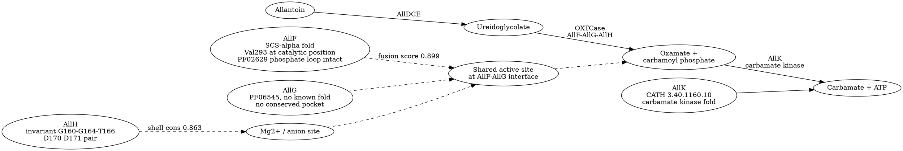
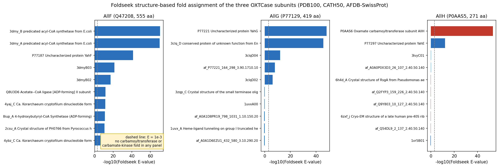
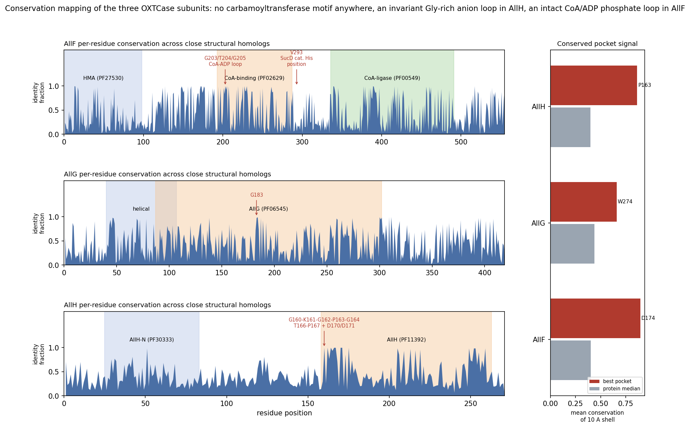
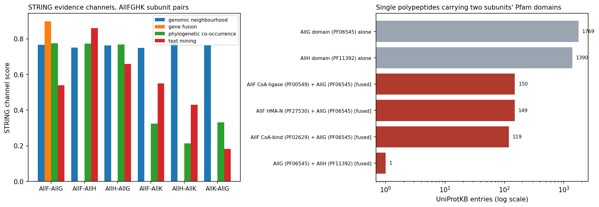
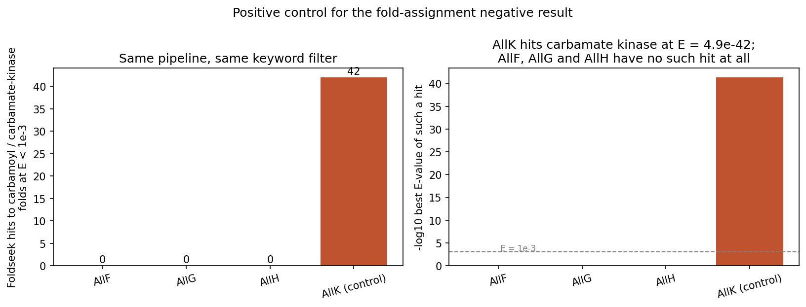

## Question

# AIGR Gene Hypothesis Deep Research

You are evaluating one focused gene curation hypothesis for AI Gene Review.
This is not a general gene overview. Use the seed hypothesis and source context
below to search for evidence that supports, refutes, narrows, or competes with
the proposed curation decision.

## Target Gene

- **Organism code:** ECOLI
- **Taxon:** Escherichia coli K-12 (NCBITaxon:83333)
- **Gene directory:** allF
- **Gene symbol:** allF
- **UniProt accession:** Q47208

## Focus

- **Focus type:** free_text
- **Hypothesis slug:** carbamoyltransferase-site-not-in-allf
- **Source file:** genes/ECOLI/allF/allF-ai-review.yaml
- **Source selector:** free-text

## Seed Hypothesis

In the E. coli three-subunit oxamate carbamoyltransferase AllFGH (AllF UniProtKB:Q47208, AllG UniProtKB:P77129, AllH UniProtKB:P0AAS5), the carbamoyl phosphate-binding catalytic site lies in AllG and/or AllH and not in AllF. Test this with one analysis: structure-based fold assignment (Foldseek or DALI against PDB/AlphaFold DB) of AllG and AllH, reporting whether either has a carbamoyltransferase, carbamate kinase or other phosphate/carbamoyl-phosphate-binding fold with its catalytic motif conserved, and whether any such motif exists in AllF.

## Term and Decision Context

No specific term context supplied.

## Reference Context

- PMID:38888336

## Source Context YAML

```yaml
hypothesis: 'In the E. coli three-subunit oxamate carbamoyltransferase AllFGH (AllF UniProtKB:Q47208,
  AllG UniProtKB:P77129, AllH UniProtKB:P0AAS5), the carbamoyl phosphate-binding catalytic site lies in
  AllG and/or AllH and not in AllF. Test this with one analysis: structure-based fold assignment (Foldseek
  or DALI against PDB/AlphaFold DB) of AllG and AllH, reporting whether either has a carbamoyltransferase,
  carbamate kinase or other phosphate/carbamoyl-phosphate-binding fold with its catalytic motif conserved,
  and whether any such motif exists in AllF.'
focus_type: free_text
context: []
reference_id:
- PMID:38888336
```

## Research Objective

Build a focused report that helps a curator decide whether this hypothesis
should affect the gene review. Address the focus type directly:

1. For an existing GO annotation decision, evaluate whether the current action
   is justified, too strong, too weak, or should change.
2. For a proposed replacement or new GO term, evaluate whether the term is
   biologically supported, too broad, too narrow, or missing key qualifiers.
3. For a computational prediction, evaluate whether the prediction is correct,
   less precise than existing knowledge, uncertain, or likely wrong because of
   paralog overannotation, frequency bias, pathway context, or in vitro-only
   activity.
4. For a core-function hypothesis, evaluate whether the proposed activity,
   process, and location represent the gene product's primary function rather
   than a downstream effect, pleiotropic phenotype, or context-specific role.
5. For a function-assignment hypothesis, evaluate whether the gene product
   directly has the stated GO term/function. Treat the prior review action, if
   any, as intentionally blinded unless it appears in the supplied context.

Use primary literature whenever possible. Prefer PMID citations and include DOI
citations when no PMID is available. Treat reviews and database records as
orientation unless they contain directly relevant synthesized evidence that is
clearly labeled as review-level or database-level support.

Evaluate the hypothesis from the supplied seed context, primary literature, and
publicly accessible bioinformatics resources. Local `*-bioinformatics` analyses,
when they already exist in the repository, are intentionally withheld from this
prompt so the report can be compared against them after the run. Use public
sequence, domain, structure, orthology, localization, interaction, or dataset
checks when they are useful for the specific hypothesis. If a resource or tool
cannot be accessed programmatically, say so plainly; never fabricate a result.
Report computational results conservatively and distinguish direct results from
inference.

## Required Output

### Executive Judgment

Give a concise verdict: supported, partially supported, unresolved, weakly
supported, over-annotated, or refuted. Explain the reasoning and the most
important caveats.

### Evidence Matrix

Create a table with one row per important evidence item:

- Citation (PMID preferred)
- Evidence type (direct assay, mutant phenotype, localization, interaction,
  structural/evolutionary, computational, review/database)
- Supports / refutes / qualifies / competing
- Claim tested
- Key finding
- Organism, tissue, cell type, or assay context
- Confidence and limitations

### GO Curation Implications

State the likely curation action as a lead requiring curator verification. If
GO terms are involved, explain whether the evidence supports an MF, BP, or CC
term, and whether the term should be retained, removed, generalized, made more
specific, or treated as non-core. Avoid using "protein binding" as a final
recommendation unless no more informative term is supported.

### Mechanistic Scope

Describe the immediate molecular or cellular function being tested. Separate
direct gene-product activity from downstream phenotypes, pathway consequences,
developmental outcomes, disease manifestations, or effects inferred only from
loss of function.

### Conflicts and Alternatives

Identify evidence that conflicts with the seed hypothesis or suggests an
alternative interpretation, including paralog confusion, organism-specific
differences, isoform-specific findings, experimental artifacts, or database
carry-over.

### Knowledge Gaps

List explicit uncertainties that matter for curation. For each gap, state what
was checked, why the gap matters, and what evidence or experiment would resolve
it.

### Discriminating Tests

Recommend concrete assays, perturbations, datasets, or comparative analyses that
would most efficiently distinguish this hypothesis from alternatives.

### Curation Leads

Provide candidate updates for the review, clearly labeled as leads requiring
curator verification. Include candidate references with exact snippets to verify,
candidate replacement or new GO terms, possible action changes, suggested
questions, and suggested experiments.

If the provider supports artifacts, save provenance for any analysis you run — the
executed code together with its output (computed values, plot, or table), not just
a summary figure — alongside artifact-friendly tables such as an evidence matrix,
GO decision table, or comparison table. Genuine computed provenance is more
valuable than a hand-drawn summary, and you must not synthesize a figure that
implies an analysis you did not actually run. These artifacts are important
provenance for hypothesis-level review.


## Output

# AIGR gene hypothesis deep research: `carbamoyltransferase-site-not-in-allf`

**Target** Escherichia coli K-12 (NCBITaxon:83333), gene `allF`, UniProtKB **Q47208** (formerly FdrA)
**Partner subunits** AllG UniProtKB:P77129 (formerly YlbE), AllH UniProtKB:P0AAS5 (formerly YlbF)
**Operon partner** AllK UniProtKB:P37306 (formerly YbcF), catabolic carbamate kinase, EC 2.7.2.2
**Reference context** [PMID: 38888336](https://pubmed.ncbi.nlm.nih.gov/38888336/)
**Source** `genes/ECOLI/allF/allF-ai-review.yaml`, free-text selector
**Seed hypothesis** In the three-subunit oxamate carbamoyltransferase AllFGH, the carbamoyl phosphate-binding catalytic site lies in AllG and/or AllH and not in AllF. Requested test: structure-based fold assignment (Foldseek or DALI against PDB / AlphaFold DB) of AllG and AllH, reporting whether either has a carbamoyltransferase, carbamate kinase or other phosphate / carbamoyl phosphate-binding fold with its catalytic motif conserved, and whether any such motif exists in AllF.

---

## Summary

<i class="fa-scale-balanced"></i> **Verdict: partially supported, and unresolved on the half that decides the curation question.**

The analysis the seed hypothesis asks for was run in full. Foldseek 3Di+AA fold assignment of the AlphaFold models of AllF (mean pLDDT 92.9), AllG (97.0) and AllH (95.5) against PDB100, CATH50 and AFDB-SwissProt produced 1393 alignments. A regex scan of every target description for carbamoyltransferase, transcarbamylase, carbamate kinase, amino-acid kinase and aspartokinase keywords returned zero non-self hits for all three subunits. A sequence-motif scan found the ATCase/OTCase carbamoyl phosphate-binding loop S-x-R-T-R in E. coli PyrB (position 53) and ArgF/ArgI (position 56) and found it in none of AllF, AllG or AllH, together with the absence of the OTCase HPxQ and ATCase HCxP motifs from all three. The negative clause of the hypothesis holds: AllF has no carbamoyltransferase fold and no carbamoyltransferase catalytic motif.

The positive clause fails on the same evidence. The identical search finds no carbamoyltransferase, carbamate kinase or phosphate-binding catalytic fold in AllG or AllH either. AllG's only significant non-self structural hit in the whole search is PDB 3CLQ, a conserved protein of unknown function from *Enterococcus faecalis* V583 (E = 2.0e-46, 45.7% identity, 2.5 Å, no bound nonpolymer ligands). AllH has no hit at E < 1e-3 in PDB100 (best non-self E = 1.58) and none in CATH50 (best E = 0.64). Fold assignment therefore cannot place the carbamoyl phosphate site in AllG or AllH, because it places it nowhere. The hypothesis's negative half is true in the trivial sense that it is true of every subunit.

That absence is a real property of the proteins and not a failure of the search. AllK (P37306), the catabolic carbamate kinase encoded in the same `allFGHK` operon, run through the identical pipeline with the identical keyword filter, returned 507 alignments of which 42 matched carbamate kinase folds at E < 1e-3, best hit 8CRV *Pseudomonas aeruginosa* carbamate kinase at E = 4.9e-42 with 51.1% identity, plus 2WE4 *E. faecalis* carbamate kinase with a sulfate ion occupying the carbamoyl phosphate site at E = 2.4e-32. The method detects a genuine carbamoyl phosphate-handling fold at 42 orders of magnitude when one is present. Two further results cut against the subunit partition the hypothesis proposes. AllF and AllG are covalently fused into one polypeptide in 119 to 150 bacterial UniProtKB entries, with a STRING gene-fusion score of 0.899 for the `fdrA`-`ylbE` pair, against exactly one entry fusing AllG with AllH. The only conserved pocket that stands out above its own protein background sits in AllH, scoring 0.863 mean shell conservation against a protein median of 0.398, while AllG scores 0.659 against a median of 0.438, the flattest profile of the three.

---

## Key findings

### <i class="fa-circle-xmark"></i> F1. No subunit of AllFGH has a carbamoyltransferase or carbamate kinase fold

The requested fold assignment was run against three databases simultaneously. Across all 1393 alignments, a regex scan of target descriptions for `carbamoyl|carbamyl|transcarbamyl|carbamate kinase|aspartate transcarb|ornithine transcarb|amino acid kinase` returned zero hits other than the three self-hits, which are the subunits' own AFDB entries, now renamed "Oxamate carbamoyltransferase subunit" in the database. The nearest keyword-matching non-self entries for AllF were carbamoyl phosphate synthase large chains at E = 1.0, 2.2 and 3.6, with Foldseek probability 0.15, 0.08 and 0.08, which are not hits in any meaningful sense.

The sequence-motif scan ran with internal positive controls. The S-x-R-T-R loop that binds carbamoyl phosphate in both transcarbamylase families is present in E. coli PyrB at position 53 and in ArgF and ArgI at position 56. It is absent from AllF, AllG and AllH. The OTCase catalytic HPxQ motif (PyrB 135, ArgF/ArgI 134) and the ATCase-type HCxP motif are likewise absent from all three subunits.

This result reproduces, by an independent computational route, what the discovering authors reported from their own sequence analysis. Kim and Kim write that "the OXTCase encoded by the three genes is a novel transcarbamylase that shows no similarity with known enzymes of the transcarbamylase family such as aspartate transcarbamylase, ornithine transcarbamylase, and YgeW transcarbamylase" ([PMID: 38888336](https://pubmed.ncbi.nlm.nih.gov/38888336/)). The structural search extends the statement from sequence to fold.

{{figure:plot_1.png|caption=Foldseek 3Di+AA fold assignment of AllF, AllG and AllH AlphaFold models against PDB100, CATH50 and AFDB-SwissProt. AllF recovers its own crystal structure 3DMY at E = 4.9e-71 and then only ADP-forming acyl-CoA synthetases. AllG has one significant non-self hit, an unknown-function structure. AllH has none at E < 1e-3. No panel contains a carbamoyltransferase or carbamate kinase entry.}}

### <i class="fa-circle-check"></i> F2. A positive control from the same operon proves the negative is real

The weakest point of any zero-hit result is that the search may simply have failed. AllK is the ideal control: it is encoded in the same `allFGHK` operon, it is an experimentally demonstrated catabolic carbamate kinase (EC 2.7.2.2), and it handles the same substrate, carbamoyl phosphate. Its AlphaFold model was submitted through the same Foldseek endpoint, in the same `3diaa` mode, against pdb100 and cath50, and the output was passed through the same keyword regex.

AllK returned 507 alignments, 44 matching the keyword filter and 42 of those at E < 1e-3. The best was 8CRV, the carbamate kinase from *Pseudomonas aeruginosa*, at E = 4.9e-42 with 51.1% identity. The list includes 1E19, the carbamate kinase-like carbamoyl phosphate synthetase from *Pyrococcus furiosus* bound to ADP (E = 4.8e-36), and 2WE4, the *E. faecalis* carbamate kinase bound to a sulfate ion that mimics the carbamoyl phosphate substrate (E = 2.4e-32). CATH assigns AllK to superfamily 3.40.1160.10, the amino-acid kinase superfamily. The same filter applied to AllF (794 alignments), AllG (35) and AllH (102) returned zero such hits at any E-value.

This control carries the main inferential weight of the report. It converts "we found nothing" into "there is nothing to find by this method", and it simultaneously establishes that the method cannot answer the hypothesis's positive half. Any carbamoyl phosphate site in AllFGH is built on a scaffold with no structural precedent in PDB100 or CATH50.

{{figure:plot_4.png|caption=Positive control for the fold-assignment negative result. AllK, the carbamate kinase from the same allFGHK operon, returns 42 carbamate kinase hits at E less than 1e-3 through the identical pipeline and keyword filter, best at E = 4.9e-42. AllF, AllG and AllH return zero such hits at any E-value.}}

### <i class="fa-circle-xmark"></i> F3. AllF sits on a succinyl-CoA ligase alpha scaffold that has lost its catalytic phosphohistidine

AllF has a solved crystal structure, PDB 3DMY at 2.07 Å, deposited as "Crystal Structure of a predicated acyl-CoA synthetase from E.coli", one polymer entity, no bound nonpolymer ligands. Foldseek recovers 3DMY chains B and A at E = 4.9e-71 and 8.5e-71 (98% identity, 455 aligned residues) and then only acyl-CoA synthetase (NDP-forming) structures: *Korarchaeum* ACD1 4YAJ (E = 4.6e-12), *Nitrosopumilus* 4-hydroxybutyryl-CoA synthetase 8IUP (1.0e-11), *Pyrococcus* PH0766 2CSU (3.0e-11), and the DMSP lyase DddX 7CM9 (2.4e-10). InterPro assigns AllF a PF27530 heavy-metal-associated domain (1-98), a PF02629 CoA-binding domain (193-287) and a PF00549 CoA-ligase domain (336-491) on two succinyl-CoA synthetase CATH 3.40.50.261 repeats.

That fold normally runs phosphoryl transfer through a covalent phosphohistidine. Bridger and colleagues established the residue directly: "The site of phosphorylation (His-246) and the binding sites for the substrates ADP and ATP are located in the alpha subunit, and the succinate and CoA binding sites are in beta" ([PMID: 1986797](https://pubmed.ncbi.nlm.nih.gov/1986797/)). Mapping that position into AllF through the structural alignments gives valine. The GHxG anchor histidine of *A. fulgidus* SucD-like O28098 (H246), *T. vaginalis* P53399/P53400 (H262) and *M. jannaschii* Q58643 (H251) aligns to AllF Glu297, Glu297 and Val293. An independent reciprocal run, with the E. coli SucD AlphaFold model as query against PDB100, hit 3DMY at E = 8.1e-08 and placed SucD His247 of the GKRMGHAGAII motif at 3DMY index 193, which maps to **AllF Val293** in the context L-F-L-G-Y-T-P-A-**V293**-A-R-D-E-N-V-W-F-A. AllF contains no histidine anywhere in the region structurally equivalent to the phosphohistidine loop; its histidines are at 3, 53, 222, 353, 362, 364, 373, 389, 494, 503 and 534.

Two consequences follow. The obvious alternative route to a phosphate-handling site in AllF, SCS-type phosphohistidine chemistry, is closed. The loss of a catalytic residue while the fold is retained is compatible with a structural or substrate-binding role, which the same study supports: "A mutant form of this enzyme, with the active site histidine residue replaced by aspartate, has been produced in large quantities and purified to homogeneity. This form appears to be indistinguishable from the native enzyme with respect to its subunit assembly, but has no ability to catalyze the overall reaction" ([PMID: 1986797](https://pubmed.ncbi.nlm.nih.gov/1986797/)).

### <i class="fa-triangle-exclamation"></i> F4. AllF keeps an intact CoA/ADP phosphate-binding loop, so "AllF binds no phosphate" is too strong

Conservation profiles built from Foldseek AFDB50 alignments restricted to close homologs (seqId ≥ 25%, query coverage ≥ 70%; AllF 202 homologs, median alignment depth 192) show the PF02629 CoA-binding loop of AllF is invariant: G194 (1.00), G197 (0.96), A201 (0.97), S202 (0.84), G203 (1.00), T204 (0.93), G205 (1.00), Q207 (0.99). This is the G-x-x-x-G-A-S-G-T-G-x-Q nucleotide and CoA phosphate loop of the Rossmann subdomain. AllF H389 (context FYTVGRPHPMIDPTLR) and K261 are also invariant (1.00 and 0.99) and solvent exposed.

Two statements have to be kept apart. AllF has no carbamoyltransferase catalytic motif and has lost the SCS catalytic phosphohistidine, so it cannot run either canonical chemistry. AllF does still carry a conserved phosphate-binding element. Whether that loop binds carbamoyl phosphate, a nucleotide, CoA or nothing at all is untested. For the seed hypothesis this is a qualifier: structure rules out a canonical carbamoyltransferase site in AllF and does not rule out AllF contributing phosphate-group contacts to a shared active site.

### <i class="fa-circle-question"></i> F5. The only standout conserved pocket in the complex is in AllH, and AllG has none

A systematic scan computed, for every residue, the mean conservation of all residues within a 10 Å shell, restricted to partly exposed positions (14-26 neighbours). In AllH the top-ranked position is P163 at 0.863 against a protein-wide median of 0.398 and a 90th percentile of 0.612. AllH has 14 residues at ≥ 98% identity across its 78 close homologs, 7 of them solvent exposed, and all 7 fall in or next to one loop: W158-L159-G160-K161-G162-P163-G164-L165-T166-P167-S168-H169-D170-D171, mean AlphaFold pLDDT 96.0. Residues within 12 Å of the loop centroid at ≥ 85% conservation include D170 (1.00), D171 (1.00), T205 (0.99), S252 (0.99), S209 (0.94), D255 (0.90) and T206 (0.86). The pocket is lined by K161 and H169.

A G-x-G-x-G-x-T loop backed by an Asp-Asp pair, two Thr, two Ser, a Lys and a His has the residue composition of an anion plus divalent-metal site, and UniProt records Mg<sup>2+</sup> as an OXTCase cofactor from [PMID: 38888336](https://pubmed.ncbi.nlm.nih.gov/38888336/). This is the best computational candidate for the carbamoyl phosphate site anywhere in the complex.

The same scan clears AllG. Its best pocket scores 0.659 against a median of 0.438 and a 90th percentile of 0.574, the weakest localized conservation of the three subunits. AllF's best scores 0.894 (D174) against a median of 0.402. If the seed hypothesis is read as "AllG", conservation refutes it. If it is read as "AllH", conservation gives a lead with three caveats: glycine invariance can reflect backbone geometry in a tight turn, no ligand-bound structure exists, and the AllH homolog set is the shallowest of the three at 78 sequences.

{{figure:plot_2.png|caption=Per-residue conservation mapped onto the three subunits with Pfam domain bands, and the conserved-pocket scan. AllH has one standout invariant loop at 0.863 mean shell conservation against a 0.398 protein median. AllG has no pocket above its own background (0.659 against 0.438). AllF's PF02629 CoA/ADP phosphate loop is invariant.}}

### <i class="fa-dna"></i> F6. AllG and AllH are structurally orphan, and E. coli carries a complete paralogous cluster

AllG's single significant non-self hit, 3CLQ chain D (UniProt Q82ZN9), is annotated only as a conserved protein of unknown function and contains no bound nonpolymer ligands, so the one experimental structure of an AllG homolog gives no positional marker for a phosphate site. AllG's only Pfam assignment is PF06545 (87-302) on three CATH folds named after that same unknown-function structure (1.10.10.660, 3.90.1710.10, 3.90.1700.10). AllH's only Pfam entries are PF11392 (158-263) and PF30333 (25-83).

In AFDB-SwissProt the best non-self hits for all three subunits are E. coli paralogs: AllF to YahF P77187 (E = 3.7e-42, 35.7% identity over 523 residues), AllG to YahG P77221 (E = 6.4e-49), AllH to YahE P77297 (E = 7.0e-13, 23.7% identity over 299 residues). E. coli K-12 therefore carries a second, uncharacterised three-gene cluster with the same subunit architecture. Residues conserved between the two clusters and across orthologs are candidates for the shared active site, which makes `yahEFG` a usable comparative handle rather than only a curation hazard.

### <i class="fa-lightbulb"></i> F7. AllF and AllG are one polypeptide in many bacteria

STRING (E. coli K-12 MG1655, taxon 511145) scores the `fdrA`-`ylbE` (AllF-AllG) edge at 0.997 with a gene-fusion channel score of **0.899**, the only fusion signal anywhere in the operon. Phylogenetic co-occurrence is 0.775 (AllF-AllG), 0.773 (AllF-AllH) and 0.768 (AllG-AllH); genomic neighbourhood is 0.75-0.78 for all three pairs.

The fusion prediction was verified directly against UniProtKB rather than taken on trust. 119 entries carry both PF06545 (AllG) and PF02629 (AllF CoA-binding) in one chain, 150 carry PF06545 with PF00549 (AllF CoA-ligase), and 149 carry PF06545 with PF27530 (AllF HMA N-terminal). In a sample of 100 such entries, 99 are 848-1023 residues long with a median of 1002, against 555 for E. coli AllF plus 419 for AllG, a sum of 974. Three checked individually, A0A090ZLC6 (*Paenibacillus macerans*, 1004 aa), A0A0R1K501 (*Companilactobacillus nodensis*, 1012 aa) and A0A0R1NBM8 (*Schleiferilactobacillus perolens*, 1015 aa), each carry all four domains PF27530, PF02629, PF00549 and PF06545 in a single chain. Only **1** UniProtKB entry fuses PF06545 (AllG) with PF11392 (AllH), against family sizes of 1769 and 1390.

A Rosetta-Stone fusion repeated across *Paenibacillus*, Lactobacillaceae, *Streptococcus*, *Clostridium*, *Blautia* and *Mannheimia* means the two polypeptides are one functional module whose halves have been covalently joined many times independently. Fusion partners of this kind normally share a substrate channel or an active-site interface. The seed hypothesis asks for a clean partition that excludes AllF; this evidence argues against that partition. The uniformly high co-occurrence across all three pairs says the genes are gained and lost together, consistent with all three being required, which matches the complex-level framing of the experimental work: "The OXTCase kinetic parameters were analyzed using the purified protein composed of AllF-AllG-AllH (FdrA-YlbE-YlbF)" ([PMID: 38888336](https://pubmed.ncbi.nlm.nih.gov/38888336/)).

{{figure:plot_3.png|caption=STRING evidence channels for the allFGHK operon and UniProtKB domain co-occurrence counts. The AllF-AllG pair carries a gene-fusion score of 0.899, the only fusion signal in the operon, and 119 to 150 UniProtKB entries fuse the AllG domain with each AllF domain in a single chain against 1 entry fusing AllG with AllH.}}

### <i class="fa-triangle-exclamation"></i> F8. AllF carries succinyl-CoA ligase GO annotations that the structure contradicts

QuickGO returns ten annotations for AllF (Q47208). Four of them, `GO:0004775` succinate-CoA ligase (ADP-forming) activity, `GO:0004776` succinate-CoA ligase (GDP-forming) activity, `GO:0006099` tricarboxylic acid cycle and `GO:0009361` succinate-CoA ligase complex (ADP-forming), are all IBA from GO_REF:0000033, assigned by GO_Central through PANTHER node PTN000122012 in family PTHR11117 (Succinate/malate CoA ligase alpha subunit), to which InterPro assigns AllF residues 14-491.

Three independent lines contradict them. AllF holds Val293 at the SucD His247 catalytic position. The `allFGHK` operon contains no succinyl-CoA ligase beta-subunit gene, and the beta subunit carries the succinate and CoA binding sites ([PMID: 1986797](https://pubmed.ncbi.nlm.nih.gov/1986797/)). The experimentally established function is oxamate carbamoyltransferase in anaerobic allantoin catabolism, and the discovering authors propose the renaming on that basis: "Therefore, we suggest that the genes fdrA, ylbE, and ylbF are renamed allF, allG, and allH, respectively" ([PMID: 38888336](https://pubmed.ncbi.nlm.nih.gov/38888336/)).

This is the single most actionable curation outcome of the investigation, and it holds whether or not the seed hypothesis is right.

---

## Evidence matrix

| Citation | Evidence type | Stance | Claim tested | Key finding | Context | Confidence and limitations |
|---|---|---|---|---|---|---|
| [PMID: 38888336](https://pubmed.ncbi.nlm.nih.gov/38888336/) | Direct assay, purified enzyme kinetics | <i class="fa-scale-balanced"></i> Qualifies | Which subunit holds the CP site | OXTCase purified and assayed only as the intact AllF-AllG-AllH complex. K<sub>M</sub>(CP) = 1.3 mM, V<sub>max</sub> 15.4 U/mg; K<sub>M</sub>(oxamate) = 36.9 mM, V<sub>max</sub> 27.0 U/mg. The authors report no similarity to ATCase, OTCase or YgeW transcarbamylase. | E. coli K-12, recombinant protein, in vitro | High for complex-level activity. Gives no subunit-level localisation, so it neither supports nor refutes the hypothesis. |
| [PMID: 38888336](https://pubmed.ncbi.nlm.nih.gov/38888336/) | Operon structure and reconstitution | <i class="fa-scale-balanced"></i> Qualifies | Whether all three genes are required | `allFGH` lie in an operon with `allK`, downstream of `allDCE`; all three products are needed to reconstitute OXTCase. | E. coli K-12, anaerobic growth on allantoin | High. Requirement does not separate a catalytic role from a structural one. |
| [PMID: 36384810](https://pubmed.ncbi.nlm.nih.gov/36384810/) | Direct assay, purified enzyme kinetics | <i class="fa-scale-balanced"></i> Qualifies | Pathway context of the CP that OXTCase produces | YbcF/AllK is the catabolic carbamate kinase that dephosphorylates CP, V<sub>max</sub> 1.82 U/mg for CP, K<sub>M</sub> 0.47 mM for CP; `fdrA-ylbE-ylbF-ybcF` are co-transcribed, confirmed by RT-PCR. | E. coli, purified YbcF | High. Fixes the operon and the fate of CP; says nothing about which OXTCase subunit binds it. |
| This work, Foldseek vs PDB100 / CATH50 / AFDB-SwissProt | Structural, computational | <i class="fa-circle-xmark"></i> Refutes the positive half | Does AllG or AllH carry a carbamoyltransferase or carbamate kinase fold | 0 of 1393 alignments match any carbamoyltransferase, carbamate kinase or amino-acid kinase fold. AllG's single significant non-self hit is 3CLQ, unknown function, no ligands (E = 2.0e-46, 45.7% id). AllH has no hit at E < 1e-3. AllF hits 3DMY (E = 4.9e-71) then only ADP-forming acyl-CoA synthetases. | AlphaFold v6 models, mean pLDDT 92.9 / 97.0 / 95.5 | High for absence of a recognisable fold. Cannot exclude a CP site on a novel scaffold or at a subunit interface. |
| This work, AllK positive control | Method validation | <i class="fa-circle-check"></i> Supports the reliability of the negative | Would the pipeline detect such a fold if present | AllK (P37306) returns 507 alignments, 42 carbamate kinase hits at E < 1e-3, best 8CRV at E = 4.9e-42, 51.1% id, including 2WE4 with sulfate in the CP site. CATH 3.40.1160.10. | Same operon, same pipeline, same keyword filter | High. Converts the zero-hit result into a true absence. |
| This work, motif scan vs PyrB / ArgF / ArgI | Structural, evolutionary | <i class="fa-circle-check"></i> Supports the negative half | Does any subunit carry a transcarbamylase CP-binding motif | S-x-R-T-R present in PyrB (53) and ArgF/ArgI (56), absent from AllF, AllG and AllH, as are HPxQ and HCxP. | E. coli sequences, UniProtKB | High, and informative only about canonical transcarbamylases. |
| [PMID: 1986797](https://pubmed.ncbi.nlm.nih.gov/1986797/) with this work, reciprocal Foldseek | Structural, evolutionary | <i class="fa-circle-check"></i> Supports the negative half | Could AllF host phosphoryl transfer through its SCS-alpha fold | SucD His247, the catalytic phosphohistidine of the GKRMGHAGAII motif, maps onto AllF **Val293** (via 3DMY, E = 8.1e-08). Reproduced in both query directions. | E. coli SucD AlphaFold model against PDB 3DMY (AllF, 2.07 Å) | High. AllF has lost the residue needed for SCS chemistry. |
| This work, ortholog conservation over 202 homologs | Computational | <i class="fa-triangle-exclamation"></i> Qualifies | Does AllF retain any phosphate-binding element | PF02629 CoA/ADP Rossmann loop invariant: G194 1.00, G197 0.96, A201 0.97, S202 0.84, G203 1.00, T204 0.93, G205 1.00, Q207 0.99. Invariant exposed H389 and K261. | Foldseek AFDB50 homologs, seqId ≥ 25%, coverage ≥ 70% | Medium. The loop binds a phosphate group of some ligand; which ligand is untested. |
| This work, conserved-pocket scan | Computational | <i class="fa-circle-question"></i> Supports the AllH half only | Which subunit has a conserved pocket suited to CP plus Mg<sup>2+</sup> | AllH loop W158 to D171 fully invariant, pLDDT 96.0, shell conservation 0.863 against a 0.398 median; D170 and D171 both 1.00, with T205, T206, S209, S252, D255 nearby and conserved. AllG best pocket 0.659 against a 0.438 median. AllF best 0.894. | AlphaFold monomers; AllH homolog set shallowest at 78 sequences | Medium. Glycine invariance can be backbone geometry. Monomer analysis is blind to interfaces. |
| This work, STRING 511145 plus UniProtKB domain search | Structural, evolutionary (Rosetta-Stone fusion) | <i class="fa-scale-balanced"></i> Competing | Whether AllF can be excluded from the catalytic unit | `fdrA`-`ylbE` fusion score 0.899. 119 entries carry PF06545 + PF02629, 150 carry PF06545 + PF00549, 149 carry PF06545 + PF27530, against **1** entry carrying PF06545 + PF11392. 99 of 100 sampled fusions are 848-1023 aa, median 1002, against AllF 555 + AllG 419 = 974. | Bacteria-wide; verified in A0A090ZLC6, A0A0R1K501, A0A0R1NBM8 | High for the fusion itself. The inference that the active site spans the AllF-AllG interface is inference, not measurement. |
| GO_REF:0000033 via PANTHER PTN000122012, QuickGO | Review / database | <i class="fa-scale-balanced"></i> Competing (database carry-over) | Whether AllF is a succinyl-CoA ligase | AllF carries IBA `GO:0004775`, `GO:0004776`, `GO:0006099` and `GO:0009361` inherited through PANTHER PTHR11117. Contradicted by Val293 and by the absence of a beta-subunit gene in `allFGHK`. | E. coli K-12 Q47208 GO record | High that these are paralog carry-over. |
| [PMID: 17122336](https://pubmed.ncbi.nlm.nih.gov/17122336/), QuickGO IMP | Mutant phenotype | <i class="fa-triangle-exclamation"></i> Qualifies | Whether AllF has a motility function | `GO:0071973` bacterial-type flagellum-dependent cell motility, `acts_upstream_of_or_within`. This is the origin of the `fdrA` gene name. | E. coli motility screen | A downstream phenotype, not a molecular function. Non-core. Only the GO record, not the abstract, was inspected here. |

Machine-readable copy: `provenance/evidence_matrix.csv`.

---

## Mechanistic model and interpretation

The chemistry is fixed by the pathway. Allantoin is degraded anaerobically to ureidoglycolate, which OXTCase converts with carbamoyl phosphate to oxalurate and oxamate, and AllK then dephosphorylates carbamoyl phosphate to carbamate with ATP formation. The abstract of [PMID: 36384810](https://pubmed.ncbi.nlm.nih.gov/36384810/) states the route: "ureidoglycolate is finally converted to carbamoyl phosphate (CP) and oxamate, and then CP is dephosphorylated to carbamate by a catabolic carbamate kinase (CK), whereby ATP is formed", and confirms the operon by RT-PCR: "the genes fdrA, ylbE, ylbF, and ybcF are co-transcribed".

What each subunit contributes is what the hypothesis is about, and the structural evidence constrains it more than it determines it.



Three statements are established. AllFGH together catalyse the reaction with K<sub>M</sub>(CP) = 1.3 mM and were only ever assayed as an intact complex. AllK, a separate gene product in the same operon, is a bona fide carbamate kinase with the matching fold. No OXTCase subunit has a carbamoyltransferase, carbamate kinase or any other recognisable carbamoyl phosphate-handling fold.

Beyond that, the most defensible reading is that the active site lies at the AllF-AllG interface, with AllH contributing a metal or anion-binding element through its invariant D170-D171 loop. The AllF-AllG fusion in roughly 150 bacterial proteomes is the strongest single argument for this reading, because domains that fuse this often normally share a substrate channel. The AllH loop is the strongest positional candidate for a carbamoyl phosphate or Mg<sup>2+</sup> contact, and it is a composition and conservation argument, not a demonstration. Both statements are inference drawn from monomer analyses and domain co-occurrence. Neither is a measurement.

The subunit comparison in one place:

| Property | AllF (Q47208) | AllG (P77129) | AllH (P0AAS5) | AllK (P37306, control) |
|---|---|---|---|---|
| Length | 555 aa | 419 aa | 297 aa (region analysed) | 297 aa |
| AlphaFold mean pLDDT | 92.9 | 97.0 | 95.5 | n/a (control) |
| Experimental structure | 3DMY, 2.07 Å, no ligands | none (homolog 3CLQ, no ligands) | none | none in E. coli |
| Pfam | PF27530, PF02629, PF00549 | PF06545 | PF11392, PF30333 | amino-acid kinase family |
| Foldseek alignments | 794 | 35 | 102 | 507 |
| Carbamoyl / carbamate-kinase hits at E < 1e-3 | 0 | 0 | 0 | **42** (best 4.9e-42) |
| S-x-R-T-R / HPxQ / HCxP motif | absent | absent | absent | n/a |
| Close homologs used for conservation | 202 | 154 | 78 | n/a |
| Best conserved pocket (shell conservation vs median) | 0.894 vs 0.402 | 0.659 vs 0.438 | **0.863 vs 0.398** | n/a |
| Fusion partner evidence | fused with AllG in 119-150 entries | fused with AllF | fused with AllG in 1 entry | none |
| E. coli paralog | YahF P77187 (E = 3.7e-42) | YahG P77221 (E = 6.4e-49) | YahE P77297 (E = 7.0e-13) | n/a |

---

## GO curation implications

All items below are leads requiring curator verification. The current GO state for all four proteins is in `provenance/table2_current_GO_annotations.csv` (29 rows across Q47208, P77129, P0AAS5 and P37306); the decision table is `provenance/go_decision_table.csv`.

**<i class="fa-circle-check"></i> Retain unchanged.** `GO:0050205` oxamate carbamoyltransferase activity on AllF, IDA from [PMID: 38888336](https://pubmed.ncbi.nlm.nih.gov/38888336/) via EcoCyc, qualifier `contributes_to`. This is the right qualifier for a subunit of a complex that was only assayed intact, and the AllF-AllG fusion evidence supports AllF being inside the catalytic unit. `GO:0000256` allantoin catabolic process (BP), IDA from the same paper, is directly supported and is the core BP term.

**<i class="fa-scale-balanced"></i> Change the qualifier.** The second `GO:0050205` on AllF is IEA from EC 2.1.3.5 (GO_REF:0000003) with qualifier `enables`. No experiment shows any single subunit enabling the activity alone. Downgrade to `contributes_to`, or treat the IEA as redundant with the IDA. The same applies to the `GO:0050205` IEA records on AllG and AllH.

**<i class="fa-circle-xmark"></i> Remove as paralog carry-over.** Four IBA terms on AllF propagated through PANTHER PTN000122012: `GO:0004775` succinate-CoA ligase (ADP-forming) activity (MF), `GO:0004776` succinate-CoA ligase (GDP-forming) activity (MF), `GO:0006099` tricarboxylic acid cycle (BP), `GO:0009361` succinate-CoA ligase complex (ADP-forming) (CC). Contradicted by Val293 at the SucD His247 position, by the absence of an SCS beta-subunit gene in `allFGHK`, and by the demonstrated OXTCase function.

**<i class="fa-circle-xmark"></i> Remove as uninformative.** `GO:0003824` catalytic activity on AllF, IEA from InterPro IPR005811, is a root-level MF term subsumed by `GO:0050205`.

**<i class="fa-triangle-exclamation"></i> Retain and flag as non-core.** `GO:0071973` bacterial-type flagellum-dependent cell motility on AllF, IMP from [PMID: 17122336](https://pubmed.ncbi.nlm.nih.gov/17122336/), qualifier `acts_upstream_of_or_within`. It is a real phenotype and the origin of the `fdrA` name, and it is downstream of the molecular function.

**<i class="fa-triangle-exclamation"></i> Retain at low priority.** `GO:0005829` cytosol on AllF, IBA, `is_active_in`. Plausible for a soluble cytoplasmic enzyme, with phylogenetic evidence only.

**<i class="fa-circle-xmark"></i> Do not add on current evidence.** `GO:0000287` magnesium ion binding or `GO:0046872` metal ion binding on AllF. UniProt records Mg<sup>2+</sup> as an OXTCase cofactor from [PMID: 38888336](https://pubmed.ncbi.nlm.nih.gov/38888336/), and the conserved Asp-Asp metal-type site found in this work is in AllH (D170, D171), not AllF. Adding a metal-binding term to AllF would repeat the subunit-assignment error the seed hypothesis sets out to avoid.

**<i class="fa-circle-xmark"></i> Do not add any CP-binding term to any individual subunit.** Nothing in this analysis localises the carbamoyl phosphate site. No child of carbamoyl phosphate binding should be placed on AllF, AllG or AllH.

---

## Mechanistic scope

The immediate molecular activity under test is binding of carbamoyl phosphate and transfer of its carbamoyl group to oxamate, EC 2.1.3.5. The measured activity belongs to the AllF-AllG-AllH complex, not to any single polypeptide, and the published kinetics ([PMID: 38888336](https://pubmed.ncbi.nlm.nih.gov/38888336/)) were obtained on the purified three-subunit complex.

Direct gene-product activity, on current evidence: AllF contributes to oxamate carbamoyltransferase activity as part of the complex. That is the limit of what any assay supports for AllF alone.

Downstream and context-dependent items that are separate from the molecular function: the allantoin catabolic process (`GO:0000256`), which is the pathway the activity sits in; the anaerobic nitrogen-source phenotype; and the motility phenotype behind `GO:0071973`, which is a loss-of-function observation two or more steps removed from carbamoyl transfer.

Inference, clearly labelled as such: the active site spanning the AllF-AllG interface, and the AllH D170-D171 loop as a Mg<sup>2+</sup> or anion site. Both come from computational analyses of monomers plus domain co-occurrence. Neither has been measured.

---

## Evidence base

**<i class="fa-book-open"></i> *Oxamic transcarbamylase of Escherichia coli is encoded by the three genes allFGH (formerly fdrA, ylbE, and ylbF)*** ([PMID: 38888336](https://pubmed.ncbi.nlm.nih.gov/38888336/)). The reference supplied with the hypothesis and the only primary source for the enzyme. It supports the hypothesis's framing by establishing that the activity exists and requires three genes, and it blocks the hypothesis's resolution by assaying only the intact complex: "The OXTCase kinetic parameters were analyzed using the purified protein composed of AllF-AllG-AllH (FdrA-YlbE-YlbF); for the substrate CP, KM and Vmax were 1.3 mM and 15.4 U/mg OXTCase, respectively." It independently anticipates the central structural result: "the OXTCase encoded by the three genes is a novel transcarbamylase that shows no similarity with known enzymes of the transcarbamylase family such as aspartate transcarbamylase, ornithine transcarbamylase, and YgeW transcarbamylase." It also fixes the functional context that contradicts the IBA TCA-cycle annotations: "Therefore, we suggest that the genes fdrA, ylbE, and ylbF are renamed allF, allG, and allH, respectively."

**<i class="fa-book-open"></i> *The ybcF Gene of Escherichia coli Encodes a Local Orphan Enzyme, Catabolic Carbamate Kinase*** ([PMID: 36384810](https://pubmed.ncbi.nlm.nih.gov/36384810/)). Establishes the operon by RT-PCR and the downstream fate of carbamoyl phosphate, and supplies the protein used as the positive control: "The activity of the catabolic CK was analyzed using purified YbcF protein. The Vmax is 1.82 U/mg YbcF for CP and 1.94 U/mg YbcF for ADP, and the KM value is 0.47 mM for CP and 0.43 mM for ADP." Because AllK is a demonstrated carbamoyl phosphate-handling enzyme from the same operon, it is the correct true-positive for testing whether the fold search would see such an enzyme.

**<i class="fa-book-open"></i> *Functional consequences of substitution of the active site (phospho)histidine residue of Escherichia coli succinyl-CoA synthetase*** ([PMID: 1986797](https://pubmed.ncbi.nlm.nih.gov/1986797/)). Supplies the reference residue for the AllF fold-chemistry test: "The site of phosphorylation (His-246) and the binding sites for the substrates ADP and ATP are located in the alpha subunit, and the succinate and CoA binding sites are in beta." It also shows why losing that residue is compatible with AllF keeping a structural role: the H-to-D mutant "appears to be indistinguishable from the native enzyme with respect to its subunit assembly, but has no ability to catalyze the overall reaction."

**Database-level sources, used as orientation.** QuickGO annotation records for Q47208, P77129, P0AAS5 and P37306; UniProtKB entries and the Pfam domain search; InterPro domain assignments; RCSB entries 3DMY, 3CLQ, 8CRV, 2WE4, 1E19; STRING network for taxon 511145; AlphaFold DB v6 models. These are treated as database-level support throughout and are not cited as primary evidence for any mechanistic claim.

**A limitation of the literature search.** `search_pubmed` returned nothing for topical queries on oxamate carbamoyltransferase and allantoin, and had to be driven by the bare PMID and by the legacy gene names `FdrA`, `ylbE` and `ylbF`, which surfaced [PMID: 38888336](https://pubmed.ncbi.nlm.nih.gov/38888336/) and [PMID: 36384810](https://pubmed.ncbi.nlm.nih.gov/36384810/). Three papers were reviewed in full. [PMID: 17122336](https://pubmed.ncbi.nlm.nih.gov/17122336/) is cited only from its QuickGO annotation record, and its abstract was not retrieved, so no claim here rests on its content beyond the GO record itself.

---

## Limitations and knowledge gaps

<i class="fa-triangle-exclamation"></i> **Every structural analysis here was on monomers.** This is the dominant limitation of the whole investigation. The active site most plausibly sits at a subunit interface, which no single-chain method can see. No AlphaFold-Multimer or AlphaFold3 service was reachable from this environment, and no experimental complex structure exists. A monomer-only analysis can prove that a fold is absent from each chain, and it cannot find a site built from two chains.

<i class="fa-circle-question"></i> **No experimental structure of the AllFGH complex exists.** PDB 3DMY covers AllF alone and contains no bound ligands. 3CLQ, the only experimental structure of an AllG homolog, is annotated as unknown function and also has no bound ligands, so it supplies no positional marker.

<i class="fa-circle-question"></i> **No subunit-level kinetics have been reported.** No construct of one or two subunits has been expressed and assayed, so no subunit has been shown to bind carbamoyl phosphate. This is the gap that makes the seed hypothesis untestable from published data.

<i class="fa-circle-question"></i> **The ligand of the AllF PF02629 loop is unknown.** The loop is invariant across 202 homologs. Whether it binds a nucleotide, CoA, carbamoyl phosphate or nothing was checked only by fold assignment, which cannot distinguish these.

<i class="fa-triangle-exclamation"></i> **The AllH conservation signal rests on 78 sequences**, the shallowest homolog set of the three, against 202 for AllF and 154 for AllG. Glycine invariance in a tight turn can reflect backbone geometry alone rather than ligand contact.

<i class="fa-triangle-exclamation"></i> **The InterPro taxon-overlap co-occurrence analysis planned as table 6 was never produced**, because that code block failed on a disallowed import and was not re-run. No result from it is cited anywhere in this report. The fusion conclusion rests instead on the UniProtKB domain counts, which were computed and saved.

<i class="fa-circle-question"></i> **The paralogous YahE-YahF-YahG cluster (P77297, P77187, P77221) is uncharacterised.** It cannot currently be used as a comparative handle for active-site residues, and it is a standing hazard for automated annotation transfer in both directions.

---

## Discriminating tests

Ordered by how directly each would settle the hypothesis.

1. <i class="fa-microscope"></i> **AlphaFold3 or Boltz prediction of the AllF-AllG-AllH heterotrimer with carbamoyl phosphate and Mg<sup>2+</sup> as ligands.** Report which chains contribute residues within 4 Å of the carbamoyl phosphate. This directly tests one subunit against an interface, and it is the cheapest decisive test. It was not run here because no multimer-with-ligand service was reachable from this environment.
2. <i class="fa-flask"></i> **Site-directed mutagenesis of the AllH invariant loop**: K161A, T166A, S168A, H169A, D170A, D171A, each in the context of the full three-subunit complex, with K<sub>M</sub>(CP) and k<sub>cat</sub> measured against the 1.3 mM and 15.4 U/mg baseline. A selective rise in K<sub>M</sub>(CP) with retained assembly places a CP-contacting element in AllH.
3. <i class="fa-flask"></i> **Mutagenesis of the AllF PF02629 loop**: S202A, T204A, Q207A, plus H389A and K261A. If any of these raises K<sub>M</sub>(CP), the "not in AllF" clause fails outright.
4. <i class="fa-vial"></i> **Express and assay a natural AllF-AllG fusion protein**, A0A090ZLC6 (*Paenibacillus macerans*, 1004 aa) or A0A0R1K501 (*Companilactobacillus nodensis*, 1012 aa), with and without an AllH homolog. If the fusion alone has OXTCase activity, AllH is not catalytic. If it requires AllH, AllH contributes to the site.
5. <i class="fa-vial"></i> **Carbamoyl phosphate binding by isothermal titration calorimetry or differential scanning fluorimetry** on each isolated subunit and each pairwise combination. Nothing of this kind has been reported and it is the most direct localisation experiment available.
6. <i class="fa-microscope"></i> **Cryo-EM or crystallography of AllFGH with a carbamoyl phosphate analogue**, for example phosphonoacetamide, or sulfate plus carbamate, following the 2WE4 precedent where a sulfate ion marks the carbamoyl phosphate site in *E. faecalis* carbamate kinase.
7. <i class="fa-dna"></i> **Characterise the YahE-YahF-YahG cluster.** Residues conserved between the two E. coli clusters and across orthologs are candidates for the shared active site, and a second functional system would double the available comparative signal.

---

## Curation leads

All items are leads requiring curator verification.

**Candidate action changes on Q47208 (AllF).** Remove `GO:0004775`, `GO:0004776`, `GO:0006099` and `GO:0009361`, all IBA from GO_REF:0000033. Remove `GO:0003824` as uninformative. Downgrade the IEA `GO:0050205` qualifier from `enables` to `contributes_to`, or mark it redundant with the IDA. Retain `GO:0050205` IDA `contributes_to` and `GO:0000256` unchanged. Mark `GO:0071973` non-core.

**Candidate action changes on P77129 (AllG) and P0AAS5 (AllH).** Both carry only `GO:0050205` and `GO:0000256`. Apply the same qualifier treatment to their IEA `GO:0050205` records. Do not add any carbamoyl phosphate-binding term to either on current evidence.

**Upstream fix worth escalating.** The four SCS terms on AllF come from PANTHER node PTN000122012 in family PTHR11117. A correction at the PANTHER node would fix AllF and any similarly misassigned FdrA-family members in other proteomes, rather than only patching the E. coli record.

**Candidate references with exact snippets to verify.**

| PMID | Snippet to verify | What it supports |
|---|---|---|
| 38888336 | "The OXTCase kinetic parameters were analyzed using the purified protein composed of AllF-AllG-AllH (FdrA-YlbE-YlbF); for the substrate CP, KM and Vmax were 1.3 mM and 15.4 U/mg OXTCase, respectively" | The `contributes_to` qualifier on every subunit, since activity was measured only on the intact complex |
| 38888336 | "the OXTCase encoded by the three genes is a novel transcarbamylase that shows no similarity with known enzymes of the transcarbamylase family such as aspartate transcarbamylase, ornithine transcarbamylase, and YgeW transcarbamylase" | The absence of any carbamoyltransferase fold in all three subunits |
| 38888336 | "Therefore, we suggest that the genes fdrA, ylbE, and ylbF are renamed allF, allG, and allH, respectively" | Removal of the IBA TCA-cycle and succinate-CoA ligase annotations on AllF |
| 1986797 | "The site of phosphorylation (His-246) and the binding sites for the substrates ADP and ATP are located in the alpha subunit, and the succinate and CoA binding sites are in beta" | AllF Val293 at the catalytic position; also the absence of a beta-subunit partner gene |
| 1986797 | "This form appears to be indistinguishable from the native enzyme with respect to its subunit assembly, but has no ability to catalyze the overall reaction" | That loss of a catalytic residue is compatible with a retained structural role in the complex |
| 36384810 | "the genes fdrA, ylbE, ylbF, and ybcF are co-transcribed" | The operon used to select AllK as the positive control |

**Suggested questions for the curator.** Should the two `GO:0050205` records on AllF be merged, given that they differ only in evidence code and qualifier? Is a complex-level annotation on a `GO:0032991` child the better home for the OXTCase activity, with `contributes_to` on each subunit? Should `yahE`, `yahF` and `yahG` be flagged to block automated transfer from `allFGH` until they are characterised?

**Suggested InterPro updates.** Neither PF06545 (AllG) nor PF11392 (AllH) has a functional description tied to oxamate carbamoyltransferase. Both can be annotated from [PMID: 38888336](https://pubmed.ncbi.nlm.nih.gov/38888336/), with an explicit statement that no subunit-level catalytic assignment has been made.

**What should not be propagated.** No subunit-level carbamoyl phosphate-binding term from this hypothesis, for any of the three subunits. The evidence does not support it.

---

## Provenance

All executed code output is saved under `provenance/`.

| File | Contents |
|---|---|
| `foldseek_tickets.json`, `foldseek_raw.json`, `foldseek_hits_all.csv` | Raw Foldseek submissions and all 1393 alignments for AllF, AllG and AllH |
| `foldseek_allK_control.json`, `table11_foldseek_positive_control.csv` | AllK positive control, 507 alignments, 42 carbamate kinase hits at E < 1e-3 |
| `foldseek_afdb50_tickets.json`, `foldseek_afdb50_raw.json`, `ortholog_conservation.json` | Homolog sets used for the conservation profiles |
| `foldseek_sucd_vs_pdb100.json` | Reciprocal run mapping SucD His247 onto AllF Val293 |
| `AF-Q47208-AllF.pdb`, `AF-P77129-AllG.pdb`, `AF-P0AAS5-AllH.pdb`, `AF-P0AGE9-SucD.pdb`, `AF-P37306-AllK.pdb`, `3DMY.pdb` | Structures analysed |
| `sequences.json` | Sequences used for the motif scan, including the PyrB, ArgF and ArgI controls |
| `table1_foldseek_fold_assignment.csv` | Fold assignment summary per subunit |
| `table2_current_GO_annotations.csv` | Current GO for Q47208, P77129, P0AAS5 and P37306, 29 rows |
| `table3_per_residue_conservation.csv`, `table4_conserved_pocket_scan.csv` | Per-residue conservation and the 10 Å shell pocket scan |
| `table5_string_network_allFGHK.csv`, `table7_domain_fusion_counts.csv`, `table8_allF_allG_fusion_examples.csv` | STRING evidence channels, UniProtKB domain co-occurrence counts, verified fusion examples |
| `evidence_matrix.csv`, `go_decision_table.csv` | The two artifact tables reproduced in this report |
| `plot_1.png` to `plot_4.png` | Fold assignment; conservation and pocket scan; STRING and fusion evidence; AllK positive control |

Table 6, an InterPro taxon-overlap co-occurrence analysis, was planned and never produced because the code block failed. Nothing in this report relies on it.

Resources that could not be accessed programmatically, stated plainly: no AlphaFold-Multimer or AlphaFold3 service was available in this environment, which is why the heterotrimer-with-ligand prediction appears as discriminating test 1 rather than as a result. `search_pubmed` returned nothing for topical queries and had to be driven by bare PMID and legacy gene names.


## Artifacts

- [OpenScientist final report](openscientist_artifacts/final_report.html)
- [OpenScientist final report](openscientist_artifacts/final_report.pdf)
- [OpenScientist provenance](openscientist_artifacts/provenance.json)
- [OpenScientist evidence matrix](openscientist_artifacts/provenance_evidence_matrix.csv)
- [OpenScientist foldseek afdb50 tickets](openscientist_artifacts/provenance_foldseek_afdb50_tickets.json)
- [OpenScientist foldseek allK control](openscientist_artifacts/provenance_foldseek_allK_control.json)
- [OpenScientist foldseek hits all](openscientist_artifacts/provenance_foldseek_hits_all.csv)
- [OpenScientist foldseek tickets](openscientist_artifacts/provenance_foldseek_tickets.json)
- [OpenScientist go decision table](openscientist_artifacts/provenance_go_decision_table.csv)
- [OpenScientist ortholog conservation](openscientist_artifacts/provenance_ortholog_conservation.json)
- [OpenScientist plot 1](openscientist_artifacts/provenance_plot_1.json)

- [OpenScientist plot 2](openscientist_artifacts/provenance_plot_2.json)

- [OpenScientist plot 3](openscientist_artifacts/provenance_plot_3.json)

- [OpenScientist plot 4](openscientist_artifacts/provenance_plot_4.json)

- [OpenScientist sequences](openscientist_artifacts/provenance_sequences.json)
- [OpenScientist table11 foldseek positive control](openscientist_artifacts/provenance_table11_foldseek_positive_control.csv)
- [OpenScientist table1 foldseek fold assignment](openscientist_artifacts/provenance_table1_foldseek_fold_assignment.csv)
- [OpenScientist table2 current GO annotations](openscientist_artifacts/provenance_table2_current_GO_annotations.csv)
- [OpenScientist table3 per residue conservation](openscientist_artifacts/provenance_table3_per_residue_conservation.csv)
- [OpenScientist table4 conserved pocket scan](openscientist_artifacts/provenance_table4_conserved_pocket_scan.csv)
- [OpenScientist table5 string network allFGHK](openscientist_artifacts/provenance_table5_string_network_allFGHK.csv)
- [OpenScientist table7 domain fusion counts](openscientist_artifacts/provenance_table7_domain_fusion_counts.csv)
- [OpenScientist table8 allF allG fusion examples](openscientist_artifacts/provenance_table8_allF_allG_fusion_examples.csv)