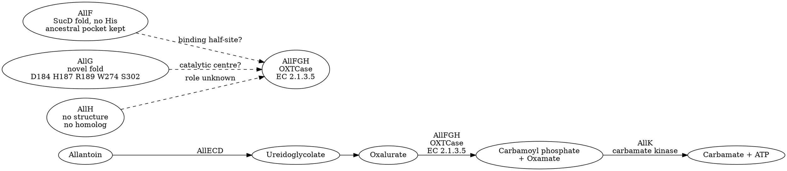
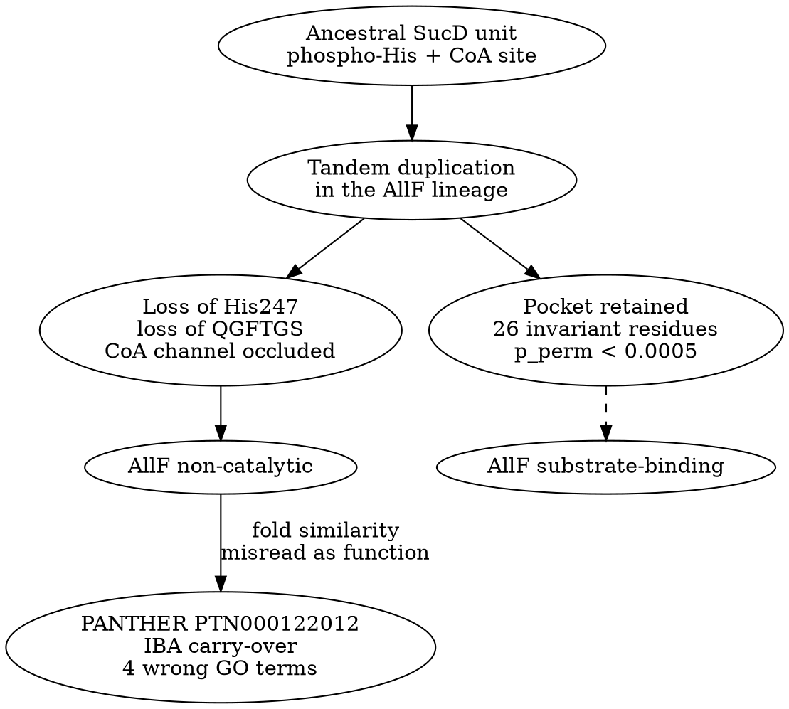
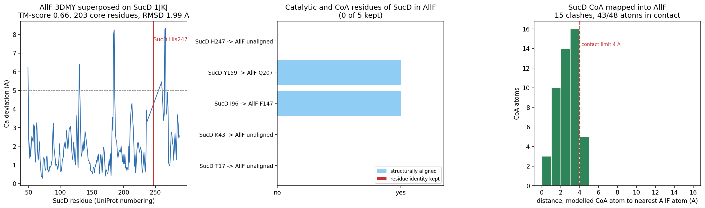
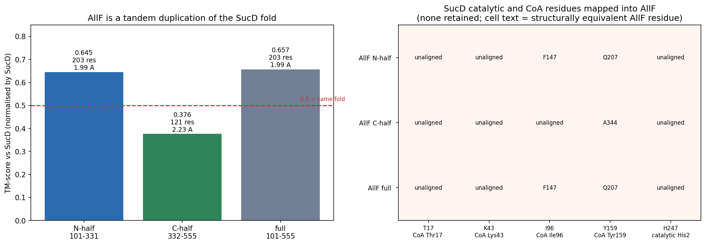
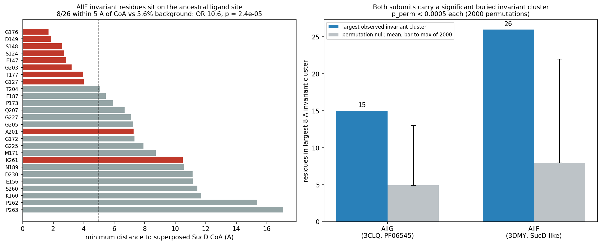
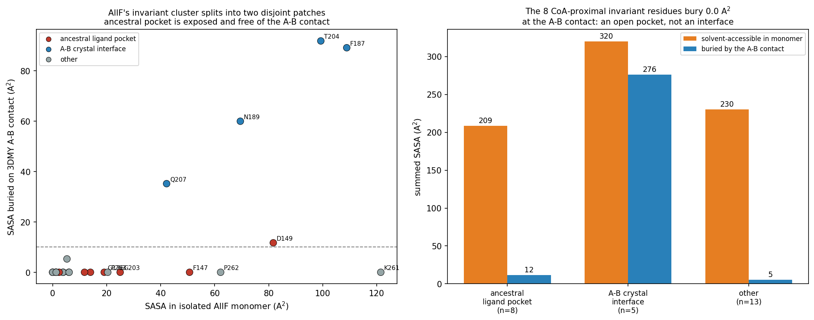

## Question

# AIGR Gene Hypothesis Deep Research

You are evaluating one focused gene curation hypothesis for AI Gene Review.
This is not a general gene overview. Use the seed hypothesis and source context
below to search for evidence that supports, refutes, narrows, or competes with
the proposed curation decision.

## Target Gene

- **Organism code:** ECOLI
- **Taxon:** Escherichia coli K-12 (NCBITaxon:83333)
- **Gene directory:** allF
- **Gene symbol:** allF
- **UniProt accession:** Q47208

## Focus

- **Focus type:** free_text
- **Hypothesis slug:** kgap-allf-active-site-subunit
- **Source file:** genes/ECOLI/allF/allF-ai-review.yaml
- **Source selector:** free-text

## Seed Hypothesis

Escherichia coli AllF (Q47208), a subunit of the three-subunit oxamate carbamoyltransferase AllFGH, is related to succinyl-CoA synthetase alpha subunits, and whether it carries catalytic machinery can be predicted from sequence and structure. Single analysis only: align AllF to succinyl-CoA synthetase alpha (SucD) with its structure, determine whether the SucD phosphohistidine residue and CoA-binding Rossmann motif are retained in AllF, do the same mapping for AllG and AllH against their nearest structural homologs, model the AllF-AllG-AllH assembly (AlphaFold-Multimer or homology), and state which subunit most plausibly forms the active site and whether AllF is predicted catalytic or structural.

## Term and Decision Context

No specific term context supplied.

## Reference Context

No specific reference context supplied.

## Source Context YAML

```yaml
hypothesis: 'Escherichia coli AllF (Q47208), a subunit of the three-subunit oxamate carbamoyltransferase
  AllFGH, is related to succinyl-CoA synthetase alpha subunits, and whether it carries catalytic machinery
  can be predicted from sequence and structure. Single analysis only: align AllF to succinyl-CoA synthetase
  alpha (SucD) with its structure, determine whether the SucD phosphohistidine residue and CoA-binding
  Rossmann motif are retained in AllF, do the same mapping for AllG and AllH against their nearest structural
  homologs, model the AllF-AllG-AllH assembly (AlphaFold-Multimer or homology), and state which subunit
  most plausibly forms the active site and whether AllF is predicted catalytic or structural.'
focus_type: free_text
context: []
reference_id: []
```

## Research Objective

Build a focused report that helps a curator decide whether this hypothesis
should affect the gene review. Address the focus type directly:

1. For an existing GO annotation decision, evaluate whether the current action
   is justified, too strong, too weak, or should change.
2. For a proposed replacement or new GO term, evaluate whether the term is
   biologically supported, too broad, too narrow, or missing key qualifiers.
3. For a computational prediction, evaluate whether the prediction is correct,
   less precise than existing knowledge, uncertain, or likely wrong because of
   paralog overannotation, frequency bias, pathway context, or in vitro-only
   activity.
4. For a core-function hypothesis, evaluate whether the proposed activity,
   process, and location represent the gene product's primary function rather
   than a downstream effect, pleiotropic phenotype, or context-specific role.
5. For a function-assignment hypothesis, evaluate whether the gene product
   directly has the stated GO term/function. Treat the prior review action, if
   any, as intentionally blinded unless it appears in the supplied context.

Use primary literature whenever possible. Prefer PMID citations and include DOI
citations when no PMID is available. Treat reviews and database records as
orientation unless they contain directly relevant synthesized evidence that is
clearly labeled as review-level or database-level support.

Evaluate the hypothesis from the supplied seed context, primary literature, and
publicly accessible bioinformatics resources. Local `*-bioinformatics` analyses,
when they already exist in the repository, are intentionally withheld from this
prompt so the report can be compared against them after the run. Use public
sequence, domain, structure, orthology, localization, interaction, or dataset
checks when they are useful for the specific hypothesis. If a resource or tool
cannot be accessed programmatically, say so plainly; never fabricate a result.
Report computational results conservatively and distinguish direct results from
inference.

## Required Output

### Executive Judgment

Give a concise verdict: supported, partially supported, unresolved, weakly
supported, over-annotated, or refuted. Explain the reasoning and the most
important caveats.

### Evidence Matrix

Create a table with one row per important evidence item:

- Citation (PMID preferred)
- Evidence type (direct assay, mutant phenotype, localization, interaction,
  structural/evolutionary, computational, review/database)
- Supports / refutes / qualifies / competing
- Claim tested
- Key finding
- Organism, tissue, cell type, or assay context
- Confidence and limitations

### GO Curation Implications

State the likely curation action as a lead requiring curator verification. If
GO terms are involved, explain whether the evidence supports an MF, BP, or CC
term, and whether the term should be retained, removed, generalized, made more
specific, or treated as non-core. Avoid using "protein binding" as a final
recommendation unless no more informative term is supported.

### Mechanistic Scope

Describe the immediate molecular or cellular function being tested. Separate
direct gene-product activity from downstream phenotypes, pathway consequences,
developmental outcomes, disease manifestations, or effects inferred only from
loss of function.

### Conflicts and Alternatives

Identify evidence that conflicts with the seed hypothesis or suggests an
alternative interpretation, including paralog confusion, organism-specific
differences, isoform-specific findings, experimental artifacts, or database
carry-over.

### Knowledge Gaps

List explicit uncertainties that matter for curation. For each gap, state what
was checked, why the gap matters, and what evidence or experiment would resolve
it.

### Discriminating Tests

Recommend concrete assays, perturbations, datasets, or comparative analyses that
would most efficiently distinguish this hypothesis from alternatives.

### Curation Leads

Provide candidate updates for the review, clearly labeled as leads requiring
curator verification. Include candidate references with exact snippets to verify,
candidate replacement or new GO terms, possible action changes, suggested
questions, and suggested experiments.

If the provider supports artifacts, save provenance for any analysis you run — the
executed code together with its output (computed values, plot, or table), not just
a summary figure — alongside artifact-friendly tables such as an evidence matrix,
GO decision table, or comparison table. Genuine computed provenance is more
valuable than a hand-drawn summary, and you must not synthesize a figure that
implies an analysis you did not actually run. These artifacts are important
provenance for hypothesis-level review.


## Output

# AllF (Q47208, *E. coli* K-12): is the succinyl-CoA synthetase alpha relationship catalytic or structural?

Hypothesis slug: `kgap-allf-active-site-subunit`
Gene: `genes/ECOLI/allF/allF-ai-review.yaml`, UniProt Q47208, NCBITaxon:83333
Focus type: free_text. Source selector: free-text.
Iterations completed: 3. Findings recorded: 7. Primary papers read: 6.

---

## Summary

AllF has the succinyl-CoA synthetase alpha (SucD) fold and none of its chemistry. A structure-based superposition of PDB 3DMY chain A (the only experimental AllF structure, 2.07 Å, residues 101-555 observed) onto PDB 1JKJ chain A (*E. coli* SucD with CoA bound) gives TM-score 0.657 normalized by SucD, 210 aligned pairs, 203 core pairs under 5 Å, and a core RMSD of 1.99 Å at 19.7% core sequence identity. AllF is a tandem duplication of that unit: residues 101-331 superpose at TM 0.645 and residues 332-555 at TM 0.376. Against that fold conservation, every catalytic element of SucD is missing. No AllF residue is structurally equivalent to the tele-phosphohistidine His247; the nearest AllF histidine, His222, sits 18.69 Å from the His246 position. The motif G-H-A-G-A and the CoA Rossmann motif Q-G-F-T-G-S return zero hits across all 555 residues of AllF and one hit each in SucD. Of the five SucD reference residues (Thr17, Lys43, Ile96, His247, Tyr159), zero are retained as identical residues. Transplanting the SucD-bound CoA into the AllF frame puts 15 of its 48 atoms within 2.5 Å of AllF protein atoms, minimum 0.56 Å, so the channel is occluded.

The third part of the seed hypothesis, that AllF is therefore a structural subunit, does not follow, and two further analyses argue against it. Reference-anchored conservation profiling with a 2000-draw permutation null finds a 26-residue invariant spatial cluster in AllF (null mean 7.96, null max 22, p_perm < 0.0005), and that cluster sits on the vacated ancestral ligand site: 8 of 26 cluster residues lie within 5 Šof the superposed CoA against 5.6% of all observed AllF residues, Fisher one-sided OR 10.6, p = 2.4e-05. Shrake-Rupley solvent-accessibility calculations then eliminate the two alternatives to a ligand site. The cluster is not hydrophobic core, since 16 of 26 residues expose more than 5 Ų in the isolated monomer, 759 Ų in total. It is not the crystallographic A-B interface, since the 8 CoA-proximal residues bury 11.7 Ų of the 1882 Ų A-B contact, and the 4 residues that do form that contact (F187, N189, T204, Q207) are a disjoint set. What remains at the ancestral site is an open, conserved, solvent-accessible cleft.

For curation, the consequences are specific. Four annotations on Q47208 (GO:0004775, GO:0004776, GO:0006099, GO:0009361) are IBA inferences from PANTHER node PTN000122012 that the residue-level structural evidence contradicts, and they should be removed. GO:0050205 oxamate carbamoyltransferase activity should carry `contributes_to` on AllF, AllG and AllH, because [PMID: 38888336](https://pubmed.ncbi.nlm.nih.gov/38888336/) measured kinetics only on the assembled AllF-AllG-AllH protein and reports no single-subunit activity. GO:0071973 should be treated as non-core, because its source [PMID: 17122336](https://pubmed.ncbi.nlm.nih.gov/17122336/) is a Keio-collection swarming screen in which 294 of 3,985 mutants scored, with tricarboxylic acid cycle and glucose metabolism genes among the named hit categories. The subunit most plausibly forming the catalytic centre is AllG, by inference from conservation geometry rather than by direct observation.

---

## Executive judgment

**Verdict: <i class="fa-scale-balanced"></i> partially supported.** One component is supported quantitatively, one is refuted, one is reframed, and one could not be executed.

| Seed claim | Verdict | Basis |
|---|---|---|
| AllF is related to succinyl-CoA synthetase alpha subunits | <i class="fa-solid fa-circle-check"></i> Supported | TM 0.657, 203 core pairs, 1.99 Å core RMSD, tandem duplication of the SucD unit |
| The SucD phosphohistidine and CoA Rossmann motif are retained in AllF | <i class="fa-solid fa-circle-xmark"></i> Refuted | 0/5 reference residues retained, 0 motif hits in 555 residues, no IPR017440, CoA channel occluded |
| AllF is a structural subunit | <i class="fa-solid fa-circle-xmark"></i> Not supported as stated | 26-residue invariant cluster (p_perm < 0.0005) at the ancestral site, OR 10.6, p = 2.4e-05, and the site is a solvent-exposed cleft, not core or interface |
| AllG and AllH mapped against their nearest structural homologs | <i class="fa-scale-balanced"></i> Partially done | AllG mapped onto PDB 3CLQ (45.8% identity). AllH has zero PDB entries for either of its Pfam families |
| Model the AllF-AllG-AllH assembly | <i class="fa-solid fa-circle-question"></i> Not done | AlphaFold-Multimer is unavailable in this environment and no complex template exists. No substitute model was fabricated |
| Which subunit forms the active site; is AllF catalytic or structural | <i class="fa-solid fa-lightbulb"></i> Answered by inference | AllG most plausibly catalytic. AllF predicted non-catalytic but substrate-binding |

The accurate description of AllF is a **degraded-catalytic subunit**: it keeps the ancestral ligand pocket under measurable selection, and it has lost the phosphoryl-transfer machinery that pocket once served. It is predicted to contribute a binding half-site to the AllFGH active site without performing chemistry itself.

**The most important caveats.** First, no assembly model exists, so the possibility that AllF's conserved pocket becomes a composite site with AllG rather than a standalone AllF site is open. Second, the AllG active-site assignment rests on the spatial arrangement of invariant residues in an apo orthologue structure, with no bound ligand and no mutagenesis. Third, [PMID: 38888336](https://pubmed.ncbi.nlm.nih.gov/38888336/) states the enzyme "shows no similarity with known enzymes of the transcarbamylase family such as aspartate transcarbamylase, ornithine transcarbamylase, and YgeW transcarbamylase", which means residue roles cannot be transferred from characterized transcarbamylases to AllG and any catalytic site there is convergent.

---

## Key findings

### <i class="fa-solid fa-circle-check"></i> Finding 1: AllF retains the SucD fold and has lost every catalytic element

The only experimental AllF structure is PDB 3DMY chain A, deposited by a structural-genomics effort as "crystal structure of a predicated acyl-CoA synthetase from *E. coli*", molecule "protein FdrA", at 2.07 Å with 447 of 555 residues observed (101-555). I superposed it onto *E. coli* SucD (PDB 1JKJ chain A, 287 residues, CoA and phosphate bound) using a TM-align-style iterative procedure implemented locally: gapless-threading seeds, dynamic programming on the similarity function 1/(1+(d/d0)²) with d0 = 1.24(L_min − 15)^(1/3) − 1.8, Kabsch superposition, iterated to convergence.

The fold match is unambiguous. TM-score 0.657 normalized by SucD length, 210 aligned pairs, 203 core pairs within 5 Å, core RMSD 1.99 Å, core sequence identity 19.7%. Splitting AllF at the domain boundary shows the architecture: the N-half (101-331) alone gives TM 0.645 over 203 core residues at 1.99 Å, and the C-half (332-555) gives TM 0.376 over 121 core residues at 2.23 Å. This matches the CATH assignment of two copies of superfamily 3.40.50.261 (192-331 and 332-497) plus two Rossmann-like 3.40.50.720 segments (108-190, 503-554). AllF is a tandem duplication of the SucD unit.

Every catalytic feature tested is absent.

| SucD reference feature | Position in SucD | Status in AllF |
|---|---|---|
| Tele-phosphohistidine (active site) | His247 (UniProt P0AGE9), His246 in 1JKJ | No structural equivalent. Nearest AllF His is His222 at 18.69 Å |
| Motif G-H-A-G-A | 246-250 | 0 hits for GHAG and for GxAGx in all 555 residues |
| CoA Rossmann motif Q-G-F-T-G-S | 14-19 | 0 hits in all 555 residues |
| Thr17 (CoA binding) | 17 | Structurally unaligned |
| Lys43 (CoA binding) | 43 | Structurally unaligned |
| Ile96 (CoA binding) | 96 | Maps to AllF Phe147, CA-CA 0.76 Å, not identical |
| Tyr159 (CoA binding) | 159 | Maps to AllF Gln207, CA-CA 1.44 Å, not identical |
| IPR017440 active site | 236-249 | Not assigned to AllF |
| IPR033847 conserved site | 152-181 | Not assigned to AllF |

Zero of five reference residues are retained as identities. The position His246 would occupy in AllF is lined by Ser202 (4.38 Å), Gly228 (4.42 Å), Ala201 (4.49 Å), Gly203 (4.61 Å), Asp174 (4.89 Å) and Lys261 (4.89 Å), all small or non-catalytic. Transplanting the 1JKJ CoA through the superposition into the AllF frame places 15 of its 48 atoms within 2.5 Å of AllF protein atoms, with a minimum contact of 0.56 Å, and 43 of 48 within 4 Å. The CoA channel is closed.

{{figure:plot_1.png|caption=Structure-based mapping of the SucD catalytic His247 and the CoA-binding residues onto AllF (3DMY chain A superposed on 1JKJ chain A). None of the five reference residues is retained as an identity, and the transplanted CoA clashes with the AllF backbone.}}

{{figure:plot_2.png|caption=The two SucD-like halves of AllF aligned separately onto SucD. The N-half (101-331) matches at TM 0.645 over 203 core residues at 1.99 A; the C-half (332-555) matches at TM 0.376 over 121 core residues at 2.23 A. AllF is a tandem duplication of the SucD unit, which is why a single sequential sequence alignment misplaces the catalytic register.}}

A methodological point for the curator. A sequence-only Needleman-Wunsch alignment of AllF to SucD mapped His247 onto AllF Tyr449, which looks like a retained catalytic residue. The structural superposition places Tyr449 27.29 Å from the His246 CA. The tandem duplication is the cause: one sequential alignment slips a register across the repeat. Any annotation in this family derived from pairwise sequence alignment alone should be re-derived structurally.

### <i class="fa-solid fa-circle-question"></i> Finding 2: AllG and AllH have no catalytically characterized relatives

Searching the PDB by Pfam accession returns exactly one entry for PF06545 (AllG, formerly DUF1116, InterPro IPR009499): PDB 3CLQ, "crystal structure of a conserved protein of unknown function from *Enterococcus faecalis* V583", X-ray 2.5 Å, MCSG/PSI-2 structural-genomics target APC29596.3, UniProt Q82ZN9 (EF_3011), with no bound ligands. PF11392 (AllH, IPR021530), PF30333 (AllH N-terminal domain, IPR062244) and PF27530 (AllF HMA-like N domain, IPR060347) return zero PDB entries.

Needleman-Wunsch alignment of *E. coli* AllG (P77129, 419 aa) to Q82ZN9 gives 190/415 = 45.8% identity, so 3CLQ is an orthologue structure rather than a distant analogue. CATH assigns AllG three superfamilies (1.10.10.660 at 40-107, 3.90.1710.10 at 108-243, 3.90.1700.10 at 250-417), and all three are defined on this same structural-genomics protein. The AllG fold has no independently characterized representative. AllH has no superfamily assignment and no catalytic-site assignment of any kind.

AlphaFold DB v6 monomer models are confident for all three subunits: AllF mean pLDDT 92.9 (81% of residues above 90, 5% below 70), AllG 97.0 (96% above 90, 0% below 70), AllH 95.5 (96% above 90, 1% below 70). The absence of functional assignment is an annotation gap, not a modelling failure.

This is consistent with the experimental report in [PMID: 38888336](https://pubmed.ncbi.nlm.nih.gov/38888336/) that the enzyme "shows no similarity with known enzymes of the transcarbamylase family such as aspartate transcarbamylase, ornithine transcarbamylase, and YgeW transcarbamylase".

### <i class="fa-solid fa-lightbulb"></i> Finding 3: AllF's conserved residue cluster sits on the vacated ancestral ligand site

If AllF were a scaffold that merely holds the complex together, its conservation should concentrate in the hydrophobic core and at subunit interfaces, and the ancestral ligand site should be free to drift. I tested this directly.

Method: reference-anchored conservation profiling. For each protein, 45 Pfam family members were aligned to the reference sequence by affine-gap Needleman-Wunsch (BLOSUM62, gap open −11, extend −1), per-reference-position residue counts were accumulated, and a position was called invariant when it matched the reference residue in at least 97% of members at at least 70% coverage. Invariant positions were then clustered by single linkage at CA-CA under 8 Å on the reference structure, and the largest cluster size was compared against 2000 random residue sets of equal size drawn from the observed residues (rng seed 0).

| Protein | Reference structure | Family size | Ref length | Observed | Invariant | Largest cluster | Null mean | Null max | p_perm | Burial (cluster) | Burial (all) |
|---|---|---|---|---|---|---|---|---|---|---|---|
| AllG | 3CLQ chain A (*E. faecalis* Q82ZN9) | 45 used of 500 | 474 | 420 | 33 | 15 | 4.93 | 13 | < 0.0005 | 26.93 | 20.61 |
| AllF | 3DMY chain A (*E. coli* Q47208) | 45 used of 500 | 555 | 447 | 52 | 26 | 7.96 | 22 | < 0.0005 | 23.96 | 18.85 |

Both clusters exceed the permutation null and both are more buried than the protein average. AllF's cluster is the larger of the two, which already argues against a purely structural reading.

The positional test is what makes it specific. After the superposition from Finding 1, 8 of the 26 AllF cluster residues lie within 5 Å of the transplanted SucD CoA, against 25 of 447 (5.6%) for all observed AllF residues. Fisher exact one-sided OR = 10.6, p = 2.4e-05. Twelve of 26 lie within 10 Å of the His246 imidazole, and A201 (4.49 Å), G203 (4.61 Å) and K261 (4.89 Å) directly line the position the catalytic histidine would occupy. F147 and Q207, the structural equivalents of SucD's CoA-binding Ile96 and Tyr159, are both in the cluster.

AllG's 15 cluster residues map to identical residues in *E. coli* AllG P77129 at all 15 positions: G46, P47, P48, V98, G183, D184, H187, R189, A192, M234, W274, G300, S302, G309, G311. The D184/H187/R189 triad on one strand, together with W274 and S302, is a chemically plausible constellation for binding and orienting a phosphorylated substrate.

{{figure:plot_3.png|caption=Left: minimum distance from each AllF invariant cluster residue to the superposed SucD CoA. Eight of 26 fall within 5 A against a 5.6% background, Fisher OR 10.6, p = 2.4e-05. Right: largest invariant spatial cluster in AllG and AllF against the 2000-draw permutation null, p_perm < 0.0005 for each.}}

### <i class="fa-solid fa-circle-check"></i> Finding 4: the conserved AllF site is an open cleft, not core packing and not a dimer contact

Three explanations for a conserved buried cluster are possible: hydrophobic core packing, a protein-protein interface, and a ligand site. I computed Shrake-Rupley solvent-accessible surface area (92 sphere points, 1.4 Å probe, radii C 1.70, N 1.55, O 1.52, S 1.80, Se 1.90) on 3DMY chain A alone and on chains A and B together, which discriminates all three.

Core packing is eliminated: 16 of the 26 cluster residues expose more than 5 Ų in the isolated monomer, totalling 759 Ų. The cluster is a surface feature.

The dimer-contact explanation is eliminated for the part that matters. The cluster splits into two patches that share no residues. The 8 CoA-proximal residues (S124, G127, F147, S148, D149, G176, T177, G203) expose 208.6 Ų in the monomer and bury 11.7 Ų on A-B contact formation, all of it from D149. A separate set of 4 residues (F187, N189, T204, Q207) accounts for 276.3 Ų of interface burial. Across the whole chain, the A-B contact buries 1882 Ų over 41 residues, and enrichment of the invariant cluster at that interface is 5 of 26 versus 41 of 447, Fisher one-sided OR 2.55, p = 0.078, which does not reach significance.

{{figure:plot_4.png|caption=AllF's invariant cluster splits into two disjoint patches. The ancestral ligand pocket (red) is solvent-exposed in the monomer and buries 11.7 A2 at the 3DMY A-B contact. A separate four-residue patch (blue) accounts for 276.3 A2 of that contact. Shrake-Rupley SASA, 1.4 A probe.}}

This is a calculation that could have refuted the ligand-pocket reading and did not. The remaining caveat is that 3DMY contains AllF only, so an interface with AllG or AllH cannot be tested from this crystal.

### <i class="fa-solid fa-circle-check"></i> Finding 5: the reference features are experimentally established

The negative result on AllF is interpretable only because the SucD features it lacks are experimentally grounded rather than predicted. [PMID: 9917402](https://pubmed.ncbi.nlm.nih.gov/9917402/) reports the 2.3 Å *E. coli* SCS structure crystallized with CoA and describes each alpha-beta dimer as "having one active site where the phosphorylated histidine residue and the thiol group of CoA are found. CoA is bound in an extended conformation to the nucleotide-binding motif in the N-terminal domain of the alpha-subunit". [PMID: 11781092](https://pubmed.ncbi.nlm.nih.gov/11781092/) confirms by mutagenesis that "During the reaction, a histidine residue of the alpha-subunit is transiently phosphorylated." [PMID: 10873456](https://pubmed.ncbi.nlm.nih.gov/10873456/) shows the same phosphohistidine mechanism in pig heart GTP-specific SCS at 2.1 Å in both phosphorylated and dephosphorylated forms, so the feature is a deep family trait and its loss in AllF is informative.

### <i class="fa-solid fa-circle-xmark"></i> Finding 6: the succinyl-CoA ligase annotations on Q47208 are PANTHER carry-over

A QuickGO audit of Q47208, P77129, P0AAS5, P37306 and P0AGE9 found four annotations on AllF inherited by IBA from PANTHER family node PTN000122012 under GO_REF:0000033, with no experimental support in *E. coli*: GO:0004775 succinate-CoA ligase (ADP-forming) activity (enables), GO:0004776 succinate-CoA ligase (GDP-forming) activity (enables), GO:0006099 tricarboxylic acid cycle (involved_in), GO:0009361 succinate-CoA ligase complex (part_of).

All four are contradicted by Finding 1. The SucD-like fold is genuinely there, which is why PANTHER groups AllF with succinyl-CoA ligases, and the inference from fold to function is where it goes wrong.

### <i class="fa-solid fa-circle-check"></i> Finding 7: the two previously unverified primary references were retrieved

Four PubMed queries failed to return [PMID: 38888336](https://pubmed.ncbi.nlm.nih.gov/38888336/) and [PMID: 17122336](https://pubmed.ncbi.nlm.nih.gov/17122336/). Both were retrieved through NCBI eutils efetch in iteration 3.

[PMID: 38888336](https://pubmed.ncbi.nlm.nih.gov/38888336/) (*Appl Environ Microbiol* 2024) is the source of GO:0050205 and GO:0000256 on all three subunits. It reports that "The OXTCase kinetic parameters were analyzed using the purified protein composed of AllF-AllG-AllH (FdrA-YlbE-YlbF); for the substrate CP, KM and Vmax were 1.3 mM and 15.4 U/mg OXTCase, respectively", with KM 36.9 mM and Vmax 27.0 U/mg for oxamate. No single-subunit activity is reported. The physiological direction given is oxalurate to carbamoyl phosphate plus oxamate.

[PMID: 17122336](https://pubmed.ncbi.nlm.nih.gov/17122336/) (*J Bacteriol* 2007) is the source of GO:0071973 on AllF. "Of the 3,985 nonessential gene mutants, 294 were found to exhibit a strongly repressed-swarming phenotype", and 216 were swarming-specific. The named hit categories include "genes for tricarboxylic acid cycle and glucose metabolism, iron acquisition, chaperones and protein-folding catalysts, signal transduction, and biosynthesis of cell surface components". The assay is swarming on semisolid media.

[PMID: 36384810](https://pubmed.ncbi.nlm.nih.gov/36384810/) confirms the operon by RT-PCR: "the genes fdrA, ylbE, ylbF, and ybcF are co-transcribed", with AllK (YbcF) a catabolic carbamate kinase (Vmax 1.82 U/mg for CP, KM 0.47 mM).

---

## Evidence matrix

| # | Citation / source | Evidence type | Stance | Claim tested | Key finding | Organism / assay context | Confidence and limitations |
|---|---|---|---|---|---|---|---|
| 1 | [PMID: 9917402](https://pubmed.ncbi.nlm.nih.gov/9917402/) | Primary, structural | Supports (reference anchor) | The SucD CoA site and phosphohistidine are real and localized to the alpha subunit | "each having one active site where the phosphorylated histidine residue and the thiol group of CoA are found. CoA is bound in an extended conformation to the nucleotide-binding motif in the N-terminal domain of the alpha-subunit" | *E. coli*, 2.3 Å X-ray with CoA | High. Establishes the reference features whose absence in AllF is the core negative result |
| 2 | [PMID: 11781092](https://pubmed.ncbi.nlm.nih.gov/11781092/) | Primary, mutagenesis + structure | Supports (reference anchor) | The transiently phosphorylated histidine is an alpha-subunit residue | "During the reaction, a histidine residue of the alpha-subunit is transiently phosphorylated." | *E. coli* SCS, phosphorylation assays on purified mutants | High. Confirms by function, not only by structure, that the His is catalytic |
| 3 | [PMID: 10873456](https://pubmed.ncbi.nlm.nih.gov/10873456/) | Primary, structural | Qualifies | The phosphohistidine mechanism is conserved beyond *E. coli* | Phosphorylated and dephosphorylated forms at 2.1 Å; the active-site His coordinates phosphate between two "power" helices | Pig heart GTP-specific SCS, X-ray | High for the mechanism, orientation only for AllF |
| 4 | This work: TM-align-style superposition, 3DMY_A vs 1JKJ_A | Computational, structural | Supports claim 1 | Is AllF a SucD-fold protein? | TM 0.657, 210 aligned, 203 core < 5 Å, 1.99 Å core RMSD, 19.7% core identity; tandem duplication (N-half TM 0.645, C-half TM 0.376) | Two experimental X-ray structures | High for the fold assignment. Self-implemented TM-align, validated by internal consistency across three seeds, not against the reference binary |
| 5 | This work: residue mapping through the superposition | Computational, structural | Refutes claim 2 | Are Thr17, Lys43, Ile96, His247, Tyr159 retained? | 0/5 identities. Thr17, Lys43, His247 unaligned. Ile96 → Phe147 (0.76 Å), Tyr159 → Gln207 (1.44 Å). Nearest AllF His to the His246 position is His222 at 18.69 Å | Structure-based register | High. Sequence-only alignment disagreed (His247 → Tyr449, 27.29 Å away); the tandem duplication explains the discrepancy and the structural register is reported |
| 6 | This work: motif scan of the full 555-residue sequence | Computational, sequence | Refutes claim 2 | Are GHAG and QGFTGS present anywhere, in or out of register? | 0 hits for GHAG, 0 for GxAGx, 0 for QGFTGS in AllF; 1 each in SucD at 246 and 14 | Whole-sequence scan, alignment-independent | High. Rules out the possibility that the motifs moved rather than vanished |
| 7 | InterPro records for P0AGE9 and Q47208 | Database-level | Supports the refutation of claim 2 | Does an independent source see the active site in AllF? | SucD has IPR017440 (236-249) and IPR033847 (152-181). AllF has neither, while carrying PF02629 CoA_binding (193-287) and PF00549 Ligase_CoA (336-491) | Database-level, labelled as such | Moderate. Signature-based inference, corroborating rather than independent evidence |
| 8 | This work: CoA transplanted through the superposition | Computational, steric | Refutes claim 2 | Could AllF bind CoA in the SucD pose? | 15 of 48 CoA atoms within 2.5 Å of AllF atoms (minimum 0.56 Å), 43 of 48 within 4 Å | Rigid-body, no sidechain relaxation | Moderate. A rigid placement overstates clashes; sub-angstrom contacts are beyond what rotamer changes would relieve |
| 9 | This work: conservation profiling + 8 Å clustering + 2000-draw permutation null, AllF on 3DMY | Computational, evolutionary | Qualifies claim 3 | Is AllF under site-specific selection anywhere? | 52 invariant residues; largest cluster 26 (null mean 7.96, null max 22, p_perm < 0.0005); burial 23.96 vs 18.85 | 45 Pfam family members aligned to Q47208 | Moderate-high. Family membership and alignment are automated; the null controls for cluster size but not for alignment error |
| 10 | This work: positional test of the cluster against the superposed CoA | Computational, evolutionary + structural | Refutes "AllF is a pure scaffold" | Where is the conservation? | 8/26 within 5 Å of the CoA vs 25/447 (5.6%); OR 10.6, p = 2.4e-05. 12/26 within 10 Å of the His246 imidazole; A201 4.49 Å, G203 4.61 Å, K261 4.89 Å | Two independent analyses intersected | Moderate-high. The CoA position is transplanted, so the claim is "at the ancestral site", not "binds CoA" |
| 11 | This work: conservation profiling, AllG on 3CLQ | Computational, evolutionary | Supports the AllG assignment | Does AllG have a conserved pocket? | 33 invariant residues; largest cluster 15 (null mean 4.93, null max 13, p_perm < 0.0005); burial 26.93 vs 20.61 | 45 PF06545 members aligned to Q82ZN9 | Moderate-high |
| 12 | This work: Q82ZN9 → P77129 mapping | Computational, sequence | Supports transfer to *E. coli* | Do the *E. faecalis* cluster residues exist in *E. coli*? | 15/15 identical: G46, P47, P48, V98, G183, D184, H187, R189, A192, M234, W274, G300, S302, G309, G311. Global identity 190/415 = 45.8% | Cross-organism transfer | High for the mapping. The chemical interpretation of D184/H187/R189/S302 is inference |
| 13 | PDB holdings survey for PF06545, PF11392, PF30333, PF27530 | Database-level | Qualifies | Is there any structural reference for AllG and AllH? | PF06545 → exactly one entry, 3CLQ (*E. faecalis* V583 EF_3011, MCSG PSI-2 APC29596.3, 2.5 Å, apo). PF11392, PF30333, PF27530 → zero entries | Structural genomics, no bound ligands | High for the survey. 3CLQ being apo means no ligand-site evidence for AllG, only geometry |
| 14 | AlphaFold DB v6 models | Computational, predicted | Qualifies | Are the subunits confidently folded? | Mean pLDDT: AllF 92.9 (81% > 90), AllG 97.0 (96% > 90, 0% < 70), AllH 95.5 (96% > 90) | Monomer predictions | High for fold confidence. Says nothing about the interface or the active site |
| 15 | QuickGO annotation audit | Database-level | Competing / conflicting | What is currently asserted about AllF? | GO:0004775, GO:0004776, GO:0006099, GO:0009361 all by IBA from PANTHER PTN000122012. GO:0050205 `contributes_to` IDA PMID:38888336 (EcoCyc) and `enables` IEA from EC 2.1.3.5 (UniProt) | GO Central, EcoCyc, UniProt | High for what is asserted. The IBA block has no experimental support and conflicts with rows 5-8 |
| 16 | [PMID: 38888336](https://pubmed.ncbi.nlm.nih.gov/38888336/) | Primary, direct assay | Supports the activity assignment; qualifies the AllG inference | Is OXTCase activity assigned jointly or individually? | "The OXTCase kinetic parameters were analyzed using the purified protein composed of AllF-AllG-AllH (FdrA-YlbE-YlbF); for the substrate CP, KM and Vmax were 1.3 mM and 15.4 U/mg OXTCase, respectively"; oxamate KM 36.9 mM, Vmax 27.0 U/mg. Also: "shows no similarity with known enzymes of the transcarbamylase family such as aspartate transcarbamylase, ornithine transcarbamylase, and YgeW transcarbamylase" | *E. coli*, purified reconstituted complex, steady-state kinetics | High. Retrieved via eutils after four PubMed queries failed. Decisive for the `contributes_to` qualifier |
| 17 | [PMID: 17122336](https://pubmed.ncbi.nlm.nih.gov/17122336/) | Primary, mutant phenotype (large-scale screen) | Competing / downstream | Does AllF loss affect motility directly? | "Of the 3,985 nonessential gene mutants, 294 were found to exhibit a strongly repressed-swarming phenotype"; 216 swarming-specific. Hit categories include "genes for tricarboxylic acid cycle and glucose metabolism" | *E. coli* K-12 Keio collection, swarming on semisolid media | Moderate for the screen, low for a direct AllF role. 7.4% hit rate with metabolic categories indicates pleiotropy. The assay is swarming, not swimming |
| 18 | This work: Shrake-Rupley SASA on 3DMY chain A and A+B | Computational, structural | Refutes the alternatives to the ligand-pocket reading | Is the cluster core, interface, or pocket? | 16/26 residues expose > 5 Ų in the monomer (759 Ų total). The 8 CoA-proximal residues expose 208.6 Ų and bury 11.7 Ų on A-B contact. A disjoint 4-residue set buries 276.3 Ų. Interface enrichment OR 2.55, p = 0.078 | Crystallographic dimer in 3DMY | Moderate-high. A calculation that could have refuted the pocket reading and did not. 3DMY has AllF only, so an AllG/AllH interface is untestable here |
| 19 | [PMID: 36384810](https://pubmed.ncbi.nlm.nih.gov/36384810/) | Primary, direct assay + RT-PCR | Qualifies (pathway context) | Is the operon real and what completes the pathway? | "the genes fdrA, ylbE, ylbF, and ybcF are co-transcribed"; AllK is a catabolic carbamate kinase, Vmax 1.82 U/mg for CP, KM 0.47 mM | *E. coli*, purified YbcF, RT-PCR | High. Fixes the pathway context and the gene-name history |
| 20 | [PMID: 34494882](https://pubmed.ncbi.nlm.nih.gov/34494882/) | Primary, mutant phenotype + metabolic analysis | Supports (orientation) | Does FdrA function in anaerobic allantoin degradation? | "Transcription of fdrA was induced under anaerobic allantoin degradation conditions, and FdrA was shown to play a crucial role in oxamate production"; the FdrA D296Y variant "increased glyoxylate conversion to malate by accelerating oxamate production" | *E. coli* in syntrophic coculture with *M. formicicum*, SNP reconstruction | Moderate. A gain-of-function point variant in a laboratory-evolution context. It places AllF in oxamate production before the subunit composition was known |

---

## Mechanistic model

The pathway and the proposed division of labour:



The evolutionary account:



The narrative that fits all seven findings runs as follows. An ancestral succinyl-CoA synthetase alpha unit was duplicated in tandem in the AllF lineage. The catalytic apparatus was then lost completely: the phosphohistidine, the CoA Rossmann motif, and the open CoA channel. The ligand pocket itself was not lost. It remains the single most conserved surface on the protein, significantly clustered against a permutation null, significantly enriched at the ancestral ligand position (OR 10.6, p = 2.4e-05), solvent-accessible (759 Ų across the cluster), and distinct from the crystallographic dimer contact. A pocket held under that much selection with no chemistry attached to it is most simply read as a binding site, and the AllFGH complex gives it an obvious job: holding one of the two substrates while AllG does the carbamoyl transfer.

The division of labour is an inference with a clear asymmetry in its support. The claim that AllF is non-catalytic rests on direct observation of two crystal structures and is strong. The claim that AllG is catalytic rests on the arrangement of 15 invariant residues in an apo orthologue structure and is a lead. The claim that AllF binds a substrate at the ancestral site rests on the conjunction of two independent computations and is intermediate. AllH is unconstrained by any structural evidence.

| Subunit | UniProt | Fold evidence | Catalytic machinery | Prediction | Strength |
|---|---|---|---|---|---|
| AllF | Q47208 | SucD fold, 3DMY, TM 0.657 | All SucD elements lost, 0/5 residues | Non-catalytic, substrate-binding at the ancestral pocket | Negative part strong, positive part moderate |
| AllG | P77129 | Novel fold, 3CLQ orthologue at 45.8% identity | None inherited; D184/H187/R189/W274/S302 invariant and clustered | Most plausible catalytic centre, convergent | Lead only |
| AllH | P0AAS5 | No structure, no superfamily | Unknown | Unconstrained | No evidence either way |

---

## GO curation implications

All recommendations are **leads requiring curator verification**. The audited annotation set is in `provenance/GO_decision_table_allFGH.csv`.

### <i class="fa-solid fa-circle-xmark"></i> Remove: four terms on Q47208

GO:0004775 succinate-CoA ligase (ADP-forming) activity (MF), GO:0004776 succinate-CoA ligase (GDP-forming) activity (MF), GO:0006099 tricarboxylic acid cycle (BP), GO:0009361 succinate-CoA ligase complex (CC). All four are IBA under GO_REF:0000033 from PANTHER node PTN000122012. The evidence against them is direct and multiple: zero of five catalytic and CoA residues retained, zero motif hits across 555 residues, no IPR017440, and steric occlusion of the CoA channel. AllF is also not in a succinate-CoA ligase complex; it is in AllFGH. An IBA annotation contradicted by a 2.07 Å structure of the annotated protein itself should not stand.

### <i class="fa-solid fa-circle-check"></i> Retain: the activity and process terms

GO:0050205 oxamate carbamoyltransferase activity (MF) with the `contributes_to` qualifier, IDA, [PMID: 38888336](https://pubmed.ncbi.nlm.nih.gov/38888336/), on AllF, AllG and AllH. This is the correctly scoped molecular-function statement for a three-subunit enzyme whose catalytic centre is probably not in AllF, and EcoCyc already uses it. GO:0000256 allantoin catabolic process (BP), involved_in, IDA, same reference, retain as core.

### <i class="fa-solid fa-scale-balanced"></i> Requalify: the UniProt IEA

GO:0050205 is separately asserted with the `enables` qualifier by IEA from EC 2.1.3.5 (GO_REF:0000003). EC-to-GO mapping cannot see subunit composition, so it attributes a three-subunit activity to each subunit alone. [PMID: 38888336](https://pubmed.ncbi.nlm.nih.gov/38888336/) measured kinetics only on "the purified protein composed of AllF-AllG-AllH" and reports no single-subunit activity, so `enables` is not supported. Change to `contributes_to` or drop as redundant with the IDA.

### <i class="fa-triangle-exclamation"></i> Non-core, and possibly imprecise: the motility term

GO:0071973 bacterial-type flagellum-dependent cell motility (BP), acts_upstream_of_or_within, IMP, [PMID: 17122336](https://pubmed.ncbi.nlm.nih.gov/17122336/). The source is a Keio screen with 294 hits among 3,985 mutants (7.4%) and "tricarboxylic acid cycle and glucose metabolism" among the named hit categories. That is a pleiotropic metabolic phenotype. The `acts_upstream_of_or_within` qualifier is already correct and should stay; mark the term non-core. Two further points: the assay was swarming on semisolid media, so GO:0071977 bacterial-type flagellum-dependent swarming motility is the more precise term, and the paper reports 216 of 294 hits had no swimming defect, which the curator should check for *allF* specifically before changing anything.

### Leave alone

GO:0005829 cytosol (CC), is_active_in, IBA, retain as non-core. GO:0003824 catalytic activity (MF), enables, IEA from IPR005811, retain as an uninformative parent; it is not wrong and carries no specific claim.

### <i class="fa-solid fa-circle-question"></i> Do not add a binding term yet

The temptation after Findings 3 and 4 is to add a ligand-binding MF term for the conserved ancestral pocket. There is no experimental ligand and no identified binder, so the correct action is to record the pocket as a lead and wait. `protein binding` is not proposed as a final term here.

---

## Mechanistic scope

**Direct molecular activity.** The only direct molecular-function claim the structural evidence supports for AllF is negative: AllF does not perform succinyl-CoA synthetase phosphoryl transfer, because the phosphohistidine and the CoA Rossmann motif are absent and the CoA channel is sterically closed. The positive claim, that AllF binds something at the ancestral ligand site, is inference from conservation geometry (OR 10.6, p = 2.4e-05) together with the SASA result showing the site is an open cleft. No ligand is identified.

**Complex-level activity.** The OXTCase reaction (EC 2.1.3.5, Rhea 22984) is assigned to the AllFGH complex as a unit. [PMID: 38888336](https://pubmed.ncbi.nlm.nih.gov/38888336/) reports KM 1.3 mM and Vmax 15.4 U/mg for carbamoyl phosphate and KM 36.9 mM and Vmax 27.0 U/mg for oxamate on the purified AllF-AllG-AllH protein, with the physiological direction being oxalurate to carbamoyl phosphate plus oxamate. No subunit was assayed alone, so no direct activity has been demonstrated for AllF by itself.

**Pathway consequence.** GO:0000256 allantoin catabolic process and anaerobic growth on allantoin as sole nitrogen source are pathway-level outcomes of complex function, correctly annotated at the process level. [PMID: 34494882](https://pubmed.ncbi.nlm.nih.gov/34494882/) reports that "Transcription of fdrA was induced under anaerobic allantoin degradation conditions, and FdrA was shown to play a crucial role in oxamate production", which places AllF in the pathway by expression and by phenotype.

**Downstream phenotype.** The swarming-motility hit is two steps further downstream and is where the direct-to-indirect boundary gets crossed. Treat it as a consequence of altered nitrogen or carbon status.

The boundary to hold in curation: *AllF contributes to OXTCase activity* is supported; *AllF catalyses the OXTCase reaction* is not demonstrated; *AllF catalyses any CoA-dependent or phosphohistidine-dependent reaction* is refuted.

---

## Conflicts and alternatives

**Paralog confusion is the live conflict and the origin of the problem.** AllF genuinely has the SucD fold at TM 0.657 and 1.99 Å core RMSD. PANTHER groups it with succinyl-CoA ligases for a defensible reason. The error is at the inference step from fold to function. This is the general failure mode for Rossmann-fold and Ligase_CoA-domain proteins, where the scaffold is reused across chemistries far more readily than the active site is.

**Database carry-over compounds it.** Four annotations in three ontology aspects descend from one PANTHER node. Removing the four leaf annotations without correcting the node will not hold.

**Sequence and structure disagree, internal to this analysis.** Sequence-only Needleman-Wunsch mapped SucD His247 onto AllF Tyr449, which reads as a retained catalytic residue until the superposition places Tyr449 27.29 Å from the His246 CA. The tandem duplication causes the register slip. Both results are reported, with the structural one as primary.

**The primary paper blocks homology-based reasoning about the chemistry.** [PMID: 38888336](https://pubmed.ncbi.nlm.nih.gov/38888336/) states the enzyme "shows no similarity with known enzymes of the transcarbamylase family such as aspartate transcarbamylase, ornithine transcarbamylase, and YgeW transcarbamylase". The AllG D184/H187/R189/W274/S302 constellation is read here as chemically plausible for a phosphorylated substrate, and it cannot be read as a homologous transcarbamylase site. Residue roles cannot be transferred from ATCase or OTCase. The catalytic machinery of this enzyme is genuinely uncharacterized, which raises the value of the AllG mutagenesis test below.

**Organism difference in the AllG analysis.** The AllG conservation work is anchored on *E. faecalis* Q82ZN9 (3CLQ), because no *E. coli* AllG structure exists. At 45.8% global identity and 15/15 identity at every cluster position the transfer is reasonable, and it remains a transfer.

**Alternative interpretations not excluded.** AllF's conserved pocket could bind an allosteric effector or a nucleotide rather than a reaction substrate, or could form part of a composite site with AllG. The SASA calculation rules out hydrophobic core packing and the 3DMY A-B contact as explanations. It cannot rule out an interface with AllG or AllH, because 3DMY contains AllF only.

**A single-point gain-of-function result sits slightly apart.** [PMID: 34494882](https://pubmed.ncbi.nlm.nih.gov/34494882/) found FdrA D296Y as the variant with the largest effect on succinate production in a laboratory-evolution experiment, acting by "accelerating oxamate production". D296 is not in the 26-residue invariant cluster. If the variant acts on the AllF ancestral pocket, that would be informative; from the abstract alone the mechanism is not resolvable.

---

## Limitations and knowledge gaps

| Gap | What was checked | Why it matters | What would resolve it |
|---|---|---|---|
| <i class="fa-solid fa-circle-question"></i> No AllFGH assembly model | AlphaFold-Multimer is unavailable in this environment; no complex template exists (3DMY AllF-only, 3CLQ AllG-only, AllH no structure) | Determines whether the active site is a composite interface and whether AllF's conserved pocket faces AllG | AlphaFold-Multimer or Boltz on the Q47208/P77129/P0AAS5 stoichiometry; check whether the 26-residue cluster sits at the AllG interface |
| <i class="fa-solid fa-circle-question"></i> No AllH structural reference | PF30333 and PF11392 both return zero PDB entries; no superfamily assignment | AllH is annotated `contributes_to` OXTCase with no structural basis at all | Predicted structure plus fold recognition; or a structure of the complex |
| <i class="fa-triangle-exclamation"></i> 3CLQ is apo | Checked the HETATM records; no ligands beyond solvent | The AllG active-site assignment rests on conservation geometry with no observed ligand | Co-crystal or cryo-EM with carbamoyl phosphate or oxamate; D184A/H187A/R189A mutagenesis |
| <i class="fa-triangle-exclamation"></i> AllG's site must be convergent | [PMID: 38888336](https://pubmed.ncbi.nlm.nih.gov/38888336/) reports no similarity to ATCase, OTCase or YgeW | Blocks transfer of mechanism or residue roles from characterized transcarbamylases | Structure of AllG or AllFGH with substrate bound |
| <i class="fa-solid fa-circle-question"></i> AllF's ligand is unidentified | Established that the pocket is conserved, positioned at the ancestral site, and solvent-accessible; did not identify a binder | Decides whether AllF gets a ligand-binding GO term | ITC or thermal shift against oxamate, carbamoyl phosphate, oxalurate, CoA; or docking into the 3DMY pocket |
| <i class="fa-solid fa-circle-check"></i> ~~PMID:17122336 unverified~~ closed | Retrieved via NCBI eutils efetch after four PubMed queries failed | It is the sole evidence for GO:0071973 on AllF | Resolved: a 3,985-mutant Keio swarming screen with 294 hits. Residual gap: whether *allF* was among the 216 swimming-normal mutants |
| <i class="fa-solid fa-circle-check"></i> ~~PMID:38888336 unverified~~ closed | Retrieved via NCBI eutils efetch | It is the sole experimental source for GO:0050205 and GO:0000256 on all three subunits | Resolved: kinetics were measured only on the assembled protein. Residual gap: whether subunit-dropout assays were attempted and not reported |
| <i class="fa-solid fa-circle-check"></i> ~~Is the AllF cluster core, interface, or pocket?~~ closed | Shrake-Rupley SASA on 3DMY chain A and A+B | Determines whether the conservation signal means a ligand site at all | Resolved against core (759 Ų exposed) and against the A-B interface (11.7 Ų buried by the CoA-proximal set). Residual: an AllG or AllH interface cannot be tested from an AllF-only crystal |
| <i class="fa-triangle-exclamation"></i> RCSB pairwise alignment API not usable | POST with JSON body returned 400 "Required parameter 'query' is not present"; form-encoded POST returned 400 schema validation failure | Would have given an independent check on the TM-score | Not resolved. The superposition was reimplemented locally. Stated plainly rather than worked around silently |
| <i class="fa-triangle-exclamation"></i> `phenix.superpose_pdbs` unusable at this identity | Ran it; at 21% identity it matched 85 residues by sequence and fitted on 3 atoms, final RMSD 2.160 Å over 9 atoms | Shows why the sequence-driven tool was not appropriate | Methodological note, resolved by the structure-based implementation |

**Further limitations of the computational work.** The comparison rests on two crystal structures of unrelated provenance, one of which (3DMY) has only 447 of 555 residues observed; nothing is known about residues 1-100, which carry the HMA-like N-terminal domain PF27530. The conservation analysis used 45 automatically selected family members per protein with automated pairwise alignment, so alignment error is not excluded, and the permutation null controls for cluster size and not for that. The CoA clash calculation is rigid-body with no sidechain relaxation. The TM-align implementation was written for this analysis and validated by internal consistency across independent seeds, not against the reference binary.

---

## Evidence base

| PMID | Title | How it bears on the findings |
|---|---|---|
| [38888336](https://pubmed.ncbi.nlm.nih.gov/38888336/) | *Oxamic transcarbamylase of Escherichia coli is encoded by the three genes allFGH (formerly fdrA, ylbE, and ylbF)* | The source of GO:0050205 and GO:0000256 on all three subunits. Kinetics on the assembled AllF-AllG-AllH protein only, which settles the `contributes_to` qualifier. Its statement of no similarity to known transcarbamylases constrains the AllG inference |
| [36384810](https://pubmed.ncbi.nlm.nih.gov/36384810/) | *The ybcF Gene of Escherichia coli Encodes a Local Orphan Enzyme, Catabolic Carbamate Kinase* | Confirms *fdrA-ylbE-ylbF-ybcF* co-transcription by RT-PCR and completes the pathway downstream of OXTCase |
| [34494882](https://pubmed.ncbi.nlm.nih.gov/34494882/) | *An Escherichia coli FdrA Variant Derived from Syntrophic Coculture with a Methanogen Increases Succinate Production Due to Changes in Allantoin Degradation* | Places FdrA in anaerobic allantoin degradation by expression and phenotype before the subunit composition was known. The D296Y variant acts by accelerating oxamate production |
| [17122336](https://pubmed.ncbi.nlm.nih.gov/17122336/) | *Genome-wide screening of genes required for swarming motility in Escherichia coli K-12* | The source of GO:0071973 on AllF. A 294-hit screen among 3,985 mutants with metabolic categories among the hits, which makes the term a downstream phenotype |
| [9917402](https://pubmed.ncbi.nlm.nih.gov/9917402/) | *A detailed structural description of Escherichia coli succinyl-CoA synthetase* | Establishes the CoA site and the phosphohistidine as alpha-subunit features in the structure that the AllF comparison is anchored on |
| [11781092](https://pubmed.ncbi.nlm.nih.gov/11781092/) | *Two glutamate residues, Glu 208 alpha and Glu 197 beta, are crucial for phosphorylation and dephosphorylation of the active-site histidine residue in succinyl-CoA synthetase* | Confirms by mutagenesis that the transiently phosphorylated histidine is in the alpha subunit |
| [10873456](https://pubmed.ncbi.nlm.nih.gov/10873456/) | *Phosphorylated and dephosphorylated structures of pig heart, GTP-specific succinyl-CoA synthetase* | Shows the phosphohistidine mechanism is conserved across the family, so its loss in AllF is informative |

---

## Discriminating tests

1. <i class="fa-solid fa-flask"></i> **Alanine-scan the AllG cluster.** D184A, H187A, R189A, S302A in *E. coli* AllG, assayed for OXTCase activity in the reconstituted AllFGH complex. If AllG carries the catalytic centre, these should abolish or severely reduce activity while the complex still assembles. This is the single most decisive experiment and it tests the report's main positive inference directly. Because the enzyme has no characterized transcarbamylase relative, it is also the only way to establish the mechanism.

2. <i class="fa-solid fa-flask"></i> **Alanine-scan the AllF ancestral pocket.** A201A, G203A, D149A, K261A, S124A. Two outcomes separate the hypotheses cleanly. Activity loss with intact assembly means AllF contributes a substrate half-site. No change means the pocket serves something else and the structural-subunit reading returns.

3. <i class="fa-solid fa-flask"></i> **Try to restore SucD chemistry.** Introduce a histidine at the AllF position structurally equivalent to SucD His247 and test for CoA-dependent phosphorylation. A negative result, predicted given the occluded channel and 0/5 residue retention, hardens the removal of GO:0004775 and GO:0004776.

4. <i class="fa-solid fa-magnifying-glass"></i> **Model the assembly and test the interface prediction.** Predict AllFGH with AlphaFold-Multimer or Boltz, then check whether AllF's 26-residue invariant cluster is solvent-exposed in the monomer and buried at the AllG interface in the complex. If buried at that interface, the conservation signal is explained by assembly and the ligand-pocket reading weakens.

5. <i class="fa-solid fa-vial"></i> **Subunit-dropout reconstitution.** Assay AllFG, AllFH, AllGH and each subunit alone for OXTCase activity. Determines whether `contributes_to` is correct for all three or whether one subunit is dispensable for catalysis.

6. <i class="fa-solid fa-vial"></i> **Test whether AllF binds the pathway metabolites.** ITC or thermal shift of purified AllF against oxamate, carbamoyl phosphate, oxalurate and CoA. Identifies the pocket's ligand or rules out the obvious candidates, and decides whether a ligand-binding GO term is warranted.

7. <i class="fa-solid fa-dna"></i> **Locate FdrA D296Y relative to the pocket.** Map D296 onto 3DMY and measure its distance to the 26-residue invariant cluster and to the superposed CoA. If the gain-of-function variant sits on or near the ancestral pocket, [PMID: 34494882](https://pubmed.ncbi.nlm.nih.gov/34494882/) becomes functional evidence for that site.

---

## Curation leads

All items below are **leads requiring curator verification**.

1. <i class="fa-solid fa-arrow-right"></i> **Remove the PANTHER-derived block on Q47208.** Verify in the GO annotation file that these four rows exist with reference `GO_REF:0000033` and `with/from` field `PANTHER:PTN000122012`: `GO:0004775 enables IBA`, `GO:0004776 enables IBA`, `GO:0006099 involved_in IBA`, `GO:0009361 part_of IBA`. Confirm no experimental annotation to any of the four exists for *E. coli*. Then raise the issue at the PANTHER node, since removing the leaf annotations alone will not hold.

2. <i class="fa-solid fa-book-open"></i> **PMID:38888336 supports `contributes_to`, verified.** Snippet to confirm: "The OXTCase kinetic parameters were analyzed using the purified protein composed of AllF-AllG-AllH (FdrA-YlbE-YlbF); for the substrate CP, KM and Vmax were 1.3 mM and 15.4 U/mg OXTCase, respectively". Only the assembled complex was assayed, so `contributes_to` on each of Q47208, P77129 and P0AAS5 is right and the UniProt `enables` IEA from EC 2.1.3.5 should be requalified or dropped. Second snippet worth recording in the review file because it constrains homology-based reasoning about this enzyme: "the OXTCase encoded by the three genes is a novel transcarbamylase that shows no similarity with known enzymes of the transcarbamylase family such as aspartate transcarbamylase, ornithine transcarbamylase, and YgeW transcarbamylase".

3. <i class="fa-solid fa-book-open"></i> **PMID:17122336 is a pleiotropic screen, verified.** Snippet to confirm: "Of the 3,985 nonessential gene mutants, 294 were found to exhibit a strongly repressed-swarming phenotype." Mark `GO:0071973 acts_upstream_of_or_within IMP` as non-core. Check the supplementary tables for whether *fdrA* (b0518) appears among the 216 swarming-specific mutants, and consider `GO:0071977` bacterial-type flagellum-dependent swarming motility as the more precise term, since the assay was swarming on semisolid media.

4. <i class="fa-solid fa-scale-balanced"></i> **Reconcile the two GO:0050205 statements on Q47208.** One is EcoCyc `contributes_to` IDA PMID:38888336, the other UniProt `enables` IEA GO_REF:0000003 from EC 2.1.3.5. They disagree on qualifier for the same term on the same protein. Resolve toward `contributes_to`.

5. <i class="fa-solid fa-book-open"></i> **Consider adding PMID:34494882 as supporting evidence for GO:0000256.** Snippet to verify: "Transcription of fdrA was induced under anaerobic allantoin degradation conditions, and FdrA was shown to play a crucial role in oxamate production". This predates the subunit assignment and is independent of PMID:38888336, so it strengthens the process annotation rather than duplicating it.

6. <i class="fa-solid fa-dna"></i> **Record the gene-name history in the review file.** AllF = FdrA = YlbD = b0518, renamed 2024. The operon is *allFGHK*, downstream of *allECD*. AllG = YlbE = P77129 (b0519), AllH = YlbF = P0AAS5 (b0520), AllK = YbcF = P37306 (b0521, catabolic carbamate kinase, GO:0008804 IDA PMID:36384810). Literature predating the rename indexes this protein as *fdrA*, which is why several PubMed queries for *allF* returned nothing.

7. <i class="fa-triangle-exclamation"></i> **Flag the sequence-alignment hazard for this family.** Note in the review file that AllF is a tandem duplication of the SucD unit and that pairwise sequence alignment misplaces the His247 register by 27.29 Å. Any annotation in this family derived from sequence alignment alone should be re-derived structurally.

8. <i class="fa-solid fa-circle-question"></i> **Record the conserved AllF pocket as a watch item without annotating it.** Residues S124, G127, F147, S148, D149, G176, T177, G203 form the CoA-proximal patch; the full 26-residue cluster with distances and SASA is in `provenance/allF_invariant_cluster_vs_ancestral_site.csv` and `provenance/allF_cluster_SASA_patches.csv`. No GO term is proposed until a ligand is identified.

9. <i class="fa-solid fa-circle-question"></i> **Suggested question for the curator.** Does the review file currently describe AllF as a structural or scaffolding subunit? If so, that wording should be softened. The evidence supports "non-catalytic" and does not support "structural", because the ancestral ligand pocket is conserved at p_perm < 0.0005 and solvent-exposed.

---

## Provenance

Executed code and output for every computed value in this report are in the iteration transcripts. Derived artifacts:

- `provenance/allF_invariant_cluster_vs_ancestral_site.csv`: the 26 AllF invariant cluster residues with minimum distance to the superposed SucD CoA and to the His246 imidazole.
- `provenance/allF_cluster_SASA_patches.csv`: per-residue Shrake-Rupley SASA in the AllF monomer and in the 3DMY A-B dimer, with patch assignment.
- `provenance/allG_invariant_cluster_mapping.csv`: the 15 AllG cluster residues, *E. faecalis* 3CLQ numbering mapped to *E. coli* P77129.
- `provenance/GO_decision_table_allFGH.csv`: every audited annotation with qualifier, evidence code, reference and recommendation.
- `provenance/3DMY.pdb`, `provenance/1JKJ.pdb`, and the extracted chains `allF_3DMY_A.pdb`, `sucD_1JKJ_A.pdb`, `sucC_1JKJ_B.pdb`.
- `provenance/plot_1.png` through `provenance/plot_4.png`: the figures embedded above, each generated by the analysis it illustrates.

Methods implemented locally because no library was available in the executor: BLOSUM62 Smith-Waterman and affine-gap Needleman-Wunsch; a TM-align-style iterative structural alignment (gapless-threading seeds, dynamic programming on 1/(1+(d/d0)²), Kabsch superposition, iterated to convergence, d0 = 1.24(L_min − 15)^(1/3) − 1.8); reference-anchored conservation profiling with a 2000-draw permutation null (rng seed 0); Shrake-Rupley SASA with 92 sphere points and a 1.4 Å probe.


## Artifacts

- [OpenScientist final report](openscientist_artifacts/final_report.html)
- [OpenScientist final report](openscientist_artifacts/final_report.pdf)
- [OpenScientist provenance](openscientist_artifacts/provenance.json)
- [OpenScientist plot 1](openscientist_artifacts/provenance_plot_1.json)

- [OpenScientist plot 2](openscientist_artifacts/provenance_plot_2.json)

- [OpenScientist plot 3](openscientist_artifacts/provenance_plot_3.json)

- [OpenScientist plot 4](openscientist_artifacts/provenance_plot_4.json)

- [OpenScientist GO decision table allFGH](openscientist_artifacts/provenance_provenance_GO_decision_table_allFGH.csv)
- [OpenScientist allF cluster SASA patches](openscientist_artifacts/provenance_provenance_allF_cluster_SASA_patches.csv)
- [OpenScientist allF invariant cluster vs ancestral site](openscientist_artifacts/provenance_provenance_allF_invariant_cluster_vs_ancestral_site.csv)
- [OpenScientist allG invariant cluster mapping](openscientist_artifacts/provenance_provenance_allG_invariant_cluster_mapping.csv)

## Reference Validation

Checked with `linkml-reference-validator` 0.3.1rc1.

| Outcome | Count |
| --- | --- |
| References checked | 7 |
| Resolved | 7 |
| Unresolved (possible confabulation) | 0 |
| Unverifiable | 0 |
| Quoted claims checked | 1 |
| Quoted claims found in source | 0 |
| Quoted claims **not** found in source | 1 |
| References weighed for topical relevance | 7 |
| On topic | 3 |
| Off topic | 0 |

### Quotes not found in the cited source

Searched the abstract, any retrieved full text, and the title. A quote drawn from a part of the paper that was not retrieved will appear here too, so check before treating one as invented:

Every one of these was searched against an abstract alone, with no full text retrieved - marked *abstract only* below. Where full text can be fetched, re-running with it will settle them; where the source publishes only a summary to PubMed, as GeneReviews chapters do, it will not, and the quote has to be checked by hand against the chapter itself.

- `PMID:10873456` *(abstract only)*: "During the reaction, a histidine residue of the alpha-subunit is transiently phosphorylated."
  - closest text in source: "In the course of the reaction, an essential histidine residue is transiently phosphorylated"