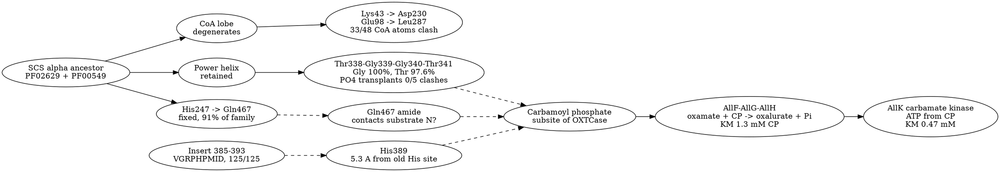
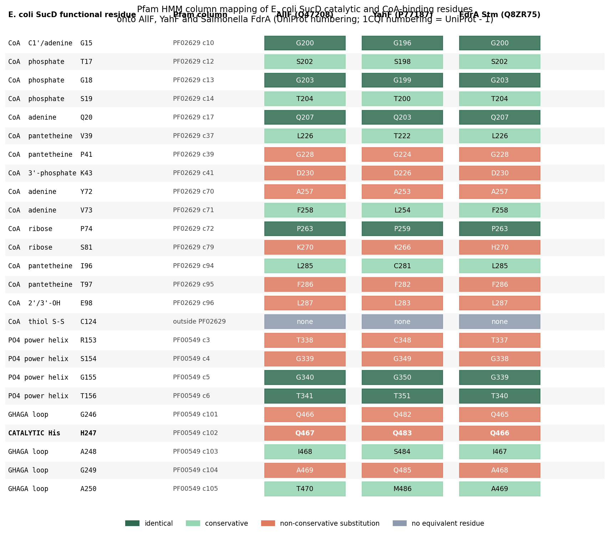
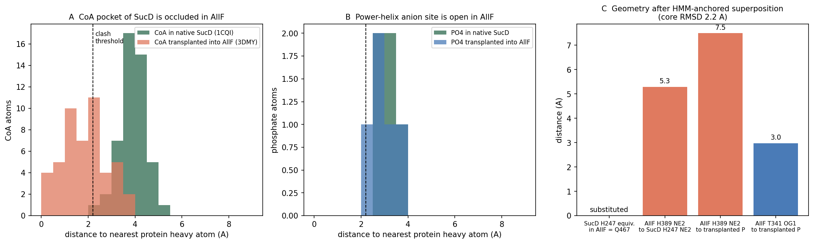
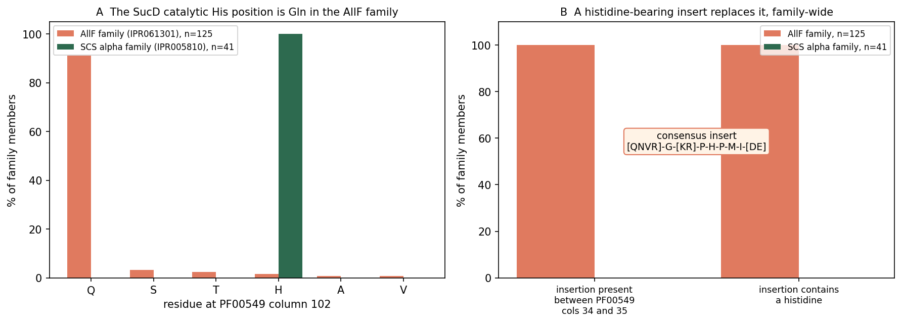
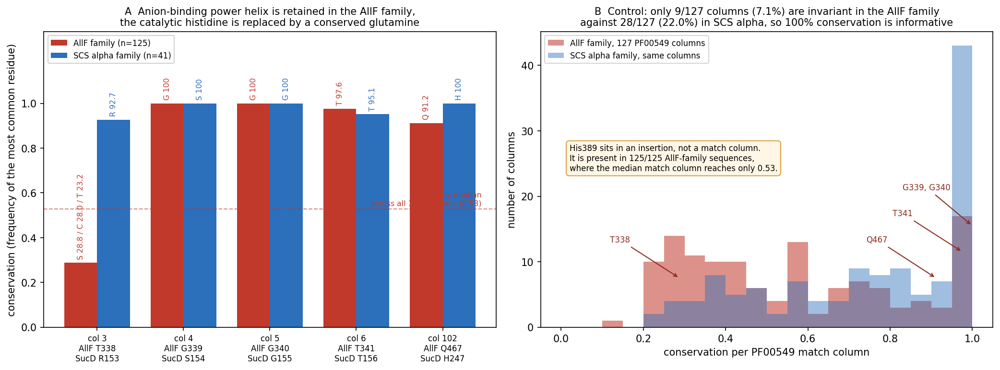

## Question

# AIGR Gene Hypothesis Deep Research

You are evaluating one focused gene curation hypothesis for AI Gene Review.
This is not a general gene overview. Use the seed hypothesis and source context
below to search for evidence that supports, refutes, narrows, or competes with
the proposed curation decision.

## Target Gene

- **Organism code:** ECOLI
- **Taxon:** Escherichia coli K-12 (NCBITaxon:83333)
- **Gene directory:** allF
- **Gene symbol:** allF
- **UniProt accession:** Q47208

## Focus

- **Focus type:** free_text
- **Hypothesis slug:** sca-alpha-phosphohistidine-retained
- **Source file:** genes/ECOLI/allF/allF-ai-review.yaml
- **Source selector:** free-text

## Seed Hypothesis

E. coli AllF (UniProtKB:Q47208), a succinyl-CoA synthetase alpha-family protein that is a subunit of oxamate carbamoyltransferase, retains the catalytic phosphohistidine and the CoA-binding site of succinyl-CoA synthetase alpha subunits (E. coli SucD His246 in the GHAGA loop). Test this by structure-based alignment of the AllF model (AlphaFold, and PDB 3DMY for the AllF fragment) against E. coli SucD structures, and report which SucD catalytic and CoA-contacting residues are conserved, substituted or missing in AllF, YahF (P77187) and Salmonella FdrA (Q8ZR75).

## Term and Decision Context

No specific term context supplied.

## Reference Context

- PMID:38888336

## Source Context YAML

```yaml
hypothesis: E. coli AllF (UniProtKB:Q47208), a succinyl-CoA synthetase alpha-family protein that is a
  subunit of oxamate carbamoyltransferase, retains the catalytic phosphohistidine and the CoA-binding
  site of succinyl-CoA synthetase alpha subunits (E. coli SucD His246 in the GHAGA loop). Test this by
  structure-based alignment of the AllF model (AlphaFold, and PDB 3DMY for the AllF fragment) against
  E. coli SucD structures, and report which SucD catalytic and CoA-contacting residues are conserved,
  substituted or missing in AllF, YahF (P77187) and Salmonella FdrA (Q8ZR75).
focus_type: free_text
context: []
reference_id:
- PMID:38888336
```

## Research Objective

Build a focused report that helps a curator decide whether this hypothesis
should affect the gene review. Address the focus type directly:

1. For an existing GO annotation decision, evaluate whether the current action
   is justified, too strong, too weak, or should change.
2. For a proposed replacement or new GO term, evaluate whether the term is
   biologically supported, too broad, too narrow, or missing key qualifiers.
3. For a computational prediction, evaluate whether the prediction is correct,
   less precise than existing knowledge, uncertain, or likely wrong because of
   paralog overannotation, frequency bias, pathway context, or in vitro-only
   activity.
4. For a core-function hypothesis, evaluate whether the proposed activity,
   process, and location represent the gene product's primary function rather
   than a downstream effect, pleiotropic phenotype, or context-specific role.
5. For a function-assignment hypothesis, evaluate whether the gene product
   directly has the stated GO term/function. Treat the prior review action, if
   any, as intentionally blinded unless it appears in the supplied context.

Use primary literature whenever possible. Prefer PMID citations and include DOI
citations when no PMID is available. Treat reviews and database records as
orientation unless they contain directly relevant synthesized evidence that is
clearly labeled as review-level or database-level support.

Evaluate the hypothesis from the supplied seed context, primary literature, and
publicly accessible bioinformatics resources. Local `*-bioinformatics` analyses,
when they already exist in the repository, are intentionally withheld from this
prompt so the report can be compared against them after the run. Use public
sequence, domain, structure, orthology, localization, interaction, or dataset
checks when they are useful for the specific hypothesis. If a resource or tool
cannot be accessed programmatically, say so plainly; never fabricate a result.
Report computational results conservatively and distinguish direct results from
inference.

## Required Output

### Executive Judgment

Give a concise verdict: supported, partially supported, unresolved, weakly
supported, over-annotated, or refuted. Explain the reasoning and the most
important caveats.

### Evidence Matrix

Create a table with one row per important evidence item:

- Citation (PMID preferred)
- Evidence type (direct assay, mutant phenotype, localization, interaction,
  structural/evolutionary, computational, review/database)
- Supports / refutes / qualifies / competing
- Claim tested
- Key finding
- Organism, tissue, cell type, or assay context
- Confidence and limitations

### GO Curation Implications

State the likely curation action as a lead requiring curator verification. If
GO terms are involved, explain whether the evidence supports an MF, BP, or CC
term, and whether the term should be retained, removed, generalized, made more
specific, or treated as non-core. Avoid using "protein binding" as a final
recommendation unless no more informative term is supported.

### Mechanistic Scope

Describe the immediate molecular or cellular function being tested. Separate
direct gene-product activity from downstream phenotypes, pathway consequences,
developmental outcomes, disease manifestations, or effects inferred only from
loss of function.

### Conflicts and Alternatives

Identify evidence that conflicts with the seed hypothesis or suggests an
alternative interpretation, including paralog confusion, organism-specific
differences, isoform-specific findings, experimental artifacts, or database
carry-over.

### Knowledge Gaps

List explicit uncertainties that matter for curation. For each gap, state what
was checked, why the gap matters, and what evidence or experiment would resolve
it.

### Discriminating Tests

Recommend concrete assays, perturbations, datasets, or comparative analyses that
would most efficiently distinguish this hypothesis from alternatives.

### Curation Leads

Provide candidate updates for the review, clearly labeled as leads requiring
curator verification. Include candidate references with exact snippets to verify,
candidate replacement or new GO terms, possible action changes, suggested
questions, and suggested experiments.

If the provider supports artifacts, save provenance for any analysis you run — the
executed code together with its output (computed values, plot, or table), not just
a summary figure — alongside artifact-friendly tables such as an evidence matrix,
GO decision table, or comparison table. Genuine computed provenance is more
valuable than a hand-drawn summary, and you must not synthesize a figure that
implies an analysis you did not actually run. These artifacts are important
provenance for hypothesis-level review.


## Output

# AllF (UniProtKB:Q47208) and the succinyl-CoA synthetase catalytic phosphohistidine

**Gene:** *allF* (formerly *fdrA*), *Escherichia coli* K-12 (NCBITaxon:83333)
**Protein:** Q47208, 555 aa, subunit of oxamate carbamoyltransferase (OXTCase, EC 2.1.3.5)
**Hypothesis slug:** `sca-alpha-phosphohistidine-retained`
**Source review file:** `genes/ECOLI/allF/allF-ai-review.yaml`
**Reference context:** [PMID: 38888336](https://pubmed.ncbi.nlm.nih.gov/38888336/)

---

## Summary

<i class="fa-solid fa-circle-xmark"></i> **The seed hypothesis is refuted on both of its claims.** E. coli AllF does not retain the catalytic phosphohistidine of succinyl-CoA synthetase alpha subunits, and it does not retain a functional CoA-binding site. E. coli SucD His247 (UniProt P0AGE9 numbering; His246 in the mature-protein numbering used in the structural literature) occupies match column 102 of Pfam PF00549. At that column AllF has **Gln467**, E. coli YahF (P77187) has **Gln483** and *Salmonella* FdrA (Q8ZR75) has **Gln466**. The SucD GHAGA loop reads QQIAT in AllF, QQSQM in YahF and QQIAA in FdrA. All three sequences align across 127/127 PF00549 match columns at 130-148 bits, so this is a confident column assignment and not an artefact of a weak alignment. InterPro IPR017440, the ATP-citrate lyase / succinyl-CoA ligase active-site signature that matches SucD at 236-249, matches none of the three.

The CoA site fails a direct steric test. Transplanting coenzyme A from PDB 1CQI into the AllF crystal structure 3DMY on PF02629 column anchors puts 33 of 48 ligand heavy atoms inside a 2.2 Å clash threshold, against 1 of 48 in the native-structure control. Three curated SucD CoA contacts are substituted in ways that remove the chemistry: Lys43 becomes Asp230, a charge reversal facing the CoA 3'-phosphate; Glu98, which contacts CoA at 2.8 Å in 1CQI, becomes Leu287; and SucD Cys124 has no AllF equivalent. The substitution pattern is family-wide, not a quirk of one protein: PF00549 column 102 is His in 41/41 reviewed succinyl-CoA ligase alpha sequences and Gln in 114/125 AllF-family sequences (91.2%). The reaction AllF actually serves needs none of this machinery, since the purified AllF-AllG-AllH complex converts oxamate plus carbamoyl phosphate to N-carbamoyl-2-oxoglycine plus phosphate with no thioester and no nucleotide ([PMID: 38888336](https://pubmed.ncbi.nlm.nih.gov/38888336/)).

<i class="fa-solid fa-lightbulb"></i> **A competing hypothesis emerged from the same analysis and is recorded here as a lead, not a conclusion.** AllF retains the succinyl-CoA synthetase anion-binding power helix, and a family-specific insertion places a different histidine beside it. A transplanted phosphate sits in the AllF pocket with 0/5 clashes, lined by Thr338-Gly339-Gly340-Thr341 with Thr341 OG1 at 2.4 Å. The canonical histidine position is filled by Met391 SE at 3.7 Å, and the nearest histidine is **His389**, 5.3 Å from where SucD His247 NE2 superposes. The insert is present in 125/125 AllF-family sequences and carries a histidine in 125/125, while 41/41 SCS alpha sequences have no insert there. A background control shows this is informative: only 9 of 127 PF00549 columns are invariant in the AllF family, whose median column conservation is 0.528. The family looks like it rebuilt a phosphate-handling site around new residues while discarding the ancestral catalytic one. That model is a structural and evolutionary inference with no binding or activity measurement behind it.

---

## Executive judgment

**Verdict: refuted.**

The hypothesis asked whether AllF retains two specific features of SucD. Neither is retained, and the evidence against each is independent of the other.

The catalytic residue fails at three levels. At the level of a single protein, PF00549 column 102 is Gln467 in AllF. At the level of the family, the same column is Gln in 91.2% of AllF-family sequences and His in 100% of SCS alpha sequences. At the level of annotation, IPR017440 is absent from AllF, YahF and FdrA while present on SucD. The residue in question is also the one residue of SucD whose loss is known to be fatal: Buck and Guest reported that "No activity was detected after the histidine residue at the phosphorylation site of the alpha-subunit was replaced by aspartate (His-246 alpha----Asp)" ([PMID: 2548486](https://pubmed.ncbi.nlm.nih.gov/2548486/)). A protein that has swapped that residue for glutamine across its whole family is not running SCS chemistry at the canonical site.

The CoA site fails on steric grounds with a control. The transplantation test is only as good as its control, so the same measurement was made on the donor structure itself; 1 of 48 atoms clashes there, and that single contact is the Cys123 SG to CoA S1P disulfide at 2.04 Å, which is real chemistry rather than a clash. Against that baseline, 33 of 48 clashing atoms in AllF (median nearest-atom distance 1.85 Å against 3.95 Å native) is a filled pocket.

<i class="fa-solid fa-triangle-exclamation"></i> The main caveats. All structural statements rest on static models: one partial crystal structure of AllF alone (3DMY, ordered residues 101-555, no bound ligand), one AlphaFold model, and one SCS crystal structure. The core superposition RMSD of about 2.2 Å puts roughly ±2 Å of uncertainty on every distance quoted from it, including the 5.3 Å displacement of His389. A clash test on an apo model cannot formally exclude an induced-fit CoA site, although nothing in the pathway would call for one. 3DMY contains AllF without AllG or AllH, so the environment of His389 in the assembled complex is unknown. No per-subunit mutagenesis of OXTCase exists, so even the positive part of the picture, that AllF contributes to carbamoyl transfer, is inferred from complex-level kinetics.

---

## Key findings

### <i class="fa-solid fa-circle-xmark"></i> F1. The catalytic phosphohistidine is replaced by glutamine in AllF, YahF and FdrA

The reference site was fixed first. UniProt P0AGE9 carries ACT_SITE 247 annotated "Tele-phosphohistidine intermediate", and the structural literature places the same residue at 246 in mature numbering, where Wolodko and colleagues reported that "One molecule of coenzyme A is bound to each alpha-subunit at a typical nucleotide-binding motif, and His-246 of each alpha-subunit is phosphorylated" ([PMID: 8144675](https://pubmed.ncbi.nlm.nih.gov/8144675/)).

Mapping that residue onto AllF required a correspondence method that works at about 20% identity. Smith-Waterman alignment with a Gotoh affine-gap implementation gave 20.3-28.7% identity with alignments that terminated before SucD residue 246, and a TM-align-style iterative superposition gave a whole-chain TM-score of 0.439 with the power helix mis-placed by 19-21 Å. Both were rejected. The method used instead is a pure-Python Plan7 profile-HMM Viterbi aligner (glocal in the model, local in the sequence) that maps each protein onto the Pfam PF00549 and PF02629 models and uses shared HMM columns as the residue correspondence.

PF00549 match column 102 holds SucD His247. At that column AllF has Gln467, YahF Gln483 and FdrA Gln466. The whole loop changes: SucD 246-250 GHAGA becomes AllF 466-470 QQIAT, YahF 482-486 QQSQM and FdrA 465-469 QQIAA. The alignment is strong in every case, with 127/127 columns matched at 148.4 bits (AllF), 130.1 bits (YahF) and 141.9 bits (FdrA), against 122/127 at 118.1 bits for SucD itself. The PF00549 model is not His-constrained at that column (match emission Q = 0.168 against H = 0.111), which is consistent with the catalytic histidine being a feature of the SucD and ATP-citrate lyase subfamily rather than of PF00549 as a whole. InterPro agrees: IPR017440 is annotated on SucD 236-249 and is absent from all three query proteins, which nonetheless carry both PF00549 and PF02629.

{{figure:plot_1.png|caption=Pfam HMM column mapping of E. coli SucD functional residues onto AllF (Q47208), YahF (P77187) and Salmonella FdrA (Q8ZR75), coloured by substitution class. The catalytic phosphohistidine at PF00549 column 102 is glutamine in all three.}}

### <i class="fa-solid fa-circle-xmark"></i> F2. The CoA pocket is occluded, and curated CoA contacts are substituted non-conservatively

PDB 3DMY is a 2.07 Å crystal structure of E. coli AllF, chains A and B, ordered residues 101-555, with no bound ligand. Superposing 1CQI chain A (E. coli SCS alpha with CoA, ADP, Mg and phosphate) onto 3DMY chain A using PF02629 column anchors (92 anchor pairs, trimmed core RMSD 2.49 Å over 32 CA) and transplanting the CoA coordinates places 33 of 48 CoA heavy atoms within 2.2 Å of an AllF heavy atom, with a median nearest-atom distance of 1.85 Å. The native control gives 1 of 48 and a median of 3.95 Å.

Mapping the three UniProt-curated CoA binding regions of P0AGE9 shows why. Region 17-20 (TGSQ) becomes S202/G203/T204 plus a two-residue insertion before Gln207. Lys43 becomes Asp230, reversing the charge at the CoA 3'-phosphate contact. Region 96-98 (ITE) becomes L285/F286/L287, losing the Glu98 carboxylate that sits 2.8 Å from CoA in 1CQI. YahF and *Salmonella* FdrA show the same two substitutions (Lys43 to Asp226 and Asp230; Glu98 to Leu283 and Leu287). Only the Rossmann glycine-rich phosphate loop survives in part, with SucD Gly15 and Gly18 corresponding to AllF Gly200 and Gly203. The CoA site of SCS is where the thiol reaches the catalytic histidine, as the pig GTP-specific enzyme structure shows with "CoA bound to the amino-terminal domain of the α-subunit, with the free thiol extending from the adenine portion into the site where the catalytic histidine residue resides" ([PMID: 26249701](https://pubmed.ncbi.nlm.nih.gov/26249701/)). In AllF both ends of that arrangement are gone.

{{figure:plot_2.png|caption=Ligand transplantation with native-structure controls. Panel A, CoA transplanted from 1CQI into 3DMY clashes at 33 of 48 heavy atoms (median 1.85 Angstrom) against 1 of 48 in the native control (median 3.95 Angstrom). Panel B, the active-site phosphate transplants with 0 of 5 clashes (median 2.98 Angstrom, native 3.41 Angstrom). Panel C, superposition geometry.}}

### <i class="fa-solid fa-circle-question"></i> F3. The anion-binding power helix stays open, with a conserved His-Pro-Met insert beside it

The same superposition machinery run on PF00549 anchors (122 pairs, trimmed core RMSD 2.18 Å over 64 CA) gives the opposite result for the phosphate. All 5 transplanted phosphate atoms clear the 2.2 Å threshold (median nearest-atom distance 2.98 Å, against 3.41 Å in the native control). The AllF residues lining the transplanted phosphate are Thr338, Gly339, Gly340, Thr341 and Leu342, the structural equivalents of the SucD power-helix N-terminus Arg153-Ser154-Gly155-Thr156 at PF00549 columns 3-6, with Thr341 OG1 2.4 Å from a phosphate oxygen. This is the site that in SCS stabilises the phosphoryl group through two helix dipoles, described as a phosphohistidine "stabilized by two helix dipoles (the "power" helices), one from each of the two subunit types" ([PMID: 8144675](https://pubmed.ncbi.nlm.nih.gov/8144675/)), and seen directly in the pig enzyme, where "the enzyme is stabilized via coordination of a phosphate ion by the active-site histidine residue and the two "power" helices" ([PMID: 10873456](https://pubmed.ncbi.nlm.nih.gov/10873456/)).

The canonical histidine position in AllF is occupied by Met391 SE, 3.7 Å from where SucD His247 NE2 superposes. The nearest histidine is His389, 5.3 Å from that position and 7.5 Å from the transplanted phosphorus. His389 sits in an insertion absent from SucD, and the motif is shared: AllF 383-392 YTVGRPHPMI, *Salmonella* FdrA 382-391 YTVGRPHPMI, E. coli YahF 398-407 FTNGKPHPMI.

### <i class="fa-solid fa-circle-xmark"></i> F4. The substitution is family-wide, and the insert histidine is universal

A PF00549 Viterbi survey across 125 AllF-family sequences (InterPro IPR061301, length 400-700, evenly subsampled from 500 hits) and 41 reviewed succinyl-CoA ligase alpha sequences (IPR005810, length 250-330) settles whether E. coli AllF is representative. At column 102 the SCS alpha family is His in 41/41 (100%). The AllF family is Gln in 114/125 (91.2%), with 4 Ser, 3 Thr, 2 His (1.6%), 1 Ala and 1 Val. The two histidine-bearing sequences are best read as noise or as mis-assigned family members.

The reciprocal pattern is stronger. Between PF00549 columns 34 and 35 the AllF family carries an insertion in 125/125 sequences, median length 9 residues, containing a histidine in 125/125 (100%). The consensus is [QNVR]-G-[KR]-P-**H**-P-M-I-[DE], with the most frequent variants QGKPHPMID (n=24), NGKPHPMID (n=17) and VGRPHPMID (n=16); the last is E. coli AllF 385-393. The SCS alpha family has a zero-length insert at that point in 41/41 sequences. The insert is a real structural feature rather than a disordered loop: in 3DMY residues 384-394 are all modelled with B-factors of 38.3-48.4 Ų against a chain mean of 37.5 Ų, AlphaFold pLDDT over 385-393 is 93.4-95.8 against a chain mean of 92.9, and the His389 side chain is relatively solvent-exposed (8 Šheavy-atom neighbour density 65.8, the 32nd percentile of the chain).

{{figure:plot_3.png|caption=Family conservation and structural quality of the AllF insert. Residue distribution at PF00549 column 102 in the AllF family against the succinyl-CoA ligase alpha family, and presence and histidine content of the insertion between columns 34 and 35.}}

### <i class="fa-solid fa-circle-question"></i> F5. The anion site is under selection family-wide, and the replacement glutamine is itself conserved

The conservation of the insert histidine only means something against the family's own background, so the survey was extended to every PF00549 column. In the AllF family only 9 of 127 columns are invariant (7.1%) with a median column conservation of 0.528; the SCS alpha family has 28 of 127 invariant (22.0%) with a median of 0.805. Against that baseline, 100% conservation in an AllF-family position is informative, and a histidine held at 125/125 inside an insertion, normally the least constrained part of an alignment, is more so.

The power helix itself is conserved across the AllF family: Gly339 125/125 (100%), Gly340 125/125 (100%), Thr341 122/125 (97.6%, the remaining 3 being Ser), matching the SCS alpha family at 100%, 100% and 95.1%. These positions sit at the 87th to 93rd percentile of AllF-family column conservation. The retention is selective. The SucD Arg153 equivalent at column 3 is Arg in 38/41 SCS alpha sequences (92.7%) but a Ser/Cys/Thr mixture in the AllF family (top residue Ser at 28.8%, the 16th percentile). The backbone anion nest stayed; the arginine that serves the SCS ligand did not.

<i class="fa-solid fa-lightbulb"></i> One result the hypothesis did not anticipate: Gln467 is itself conserved at 91.2%, the 84th percentile of the family. His to Gln was a fixed substitution that is maintained, which reads as a residue with a job of its own, plausibly an amide hydrogen bond to a carbamoyl or oxamate nitrogen, rather than the decay product of a dead site. Nothing here tests that.

{{figure:plot_4.png|caption=Power-helix conservation in the AllF family with a background-invariance control. Panel A, conservation at PF00549 columns 3-6 and the catalytic column 102 in both families. Panel B, only 9 of 127 columns are invariant in the AllF family (median 0.528) against 28 of 127 in SCS alpha (median 0.805).}}

### <i class="fa-solid fa-circle-question"></i> F6. No subunit of OXTCase carries an annotated active site

AllG (P77129, 302 aa) carries PF06545 at 87-302 ("Oxamate carbamoyltransferase subunit AllG"), IPR009499 and IPR024033, with CATH-Gene3D 1.10.10.660, 3.90.1700.10 and 3.90.1710.10, and it has zero ACT_SITE and zero BINDING features. AllH (P0AAS5) carries PF30333 at 25-83 and PF11392 at 158-263 with IPR021530 and IPR062244, also with zero ACT_SITE and zero BINDING features. AllF has none either. None of the three carries an aspartate or ornithine transcarbamoylase domain (PF00185, PF02729, IPR006132), the fold that performs carbamoyl transfer in every structurally characterised transcarbamoylase. That matches the primary report, which states that "the OXTCase encoded by the three genes is a novel transcarbamylase that shows no similarity with known enzymes of the transcarbamylase family such as aspartate transcarbamylase, ornithine transcarbamylase, and YgeW transcarbamylase" ([PMID: 38888336](https://pubmed.ncbi.nlm.nih.gov/38888336/)). The pathway neighbour AllK (P37306) is by contrast cleanly assigned, carrying PF00696 at 2-270 and IPR003964 carbamate kinase.

So the catalytic centre of OXTCase cannot be placed on any subunit by homology. This is the main reason His389 remains a lead.

---

## Evidence matrix

Machine-readable version with 18 evidence rows: `provenance/evidence_matrix.tsv`.

| ID | Citation | Evidence type | Stance | Claim tested | Key finding | Context | Confidence and limitations |
|---|---|---|---|---|---|---|---|
| E1 | [PMID: 2548486](https://pubmed.ncbi.nlm.nih.gov/2548486/) | Mutant phenotype, site-directed mutagenesis | Defines the reference site | SucD His246 is catalytically essential | "No activity was detected after the histidine residue at the phosphorylation site of the alpha-subunit was replaced by aspartate (His-246 alpha----Asp)" | E. coli SucCD overexpression, specific-activity assay | High. The mutation also impaired subunit accumulation, so activity loss is partly confounded by folding |
| E2 | [PMID: 8144675](https://pubmed.ncbi.nlm.nih.gov/8144675/) | Structural, X-ray 2.5 Å | Reference geometry | Position of the phospho-His, CoA site and power helices | "His-246 of each alpha-subunit is phosphorylated"; the phosphohistidine is "stabilized by two helix dipoles (the "power" helices)" | E. coli SCS α2β2 crystal | High. Resting state; the phospho-His loop is mobile between sites I and II |
| E3 | [PMID: 9917402](https://pubmed.ncbi.nlm.nih.gov/9917402/) | Structural | Reference geometry | Where CoA binds in SucD | "CoA is bound in an extended conformation to the nucleotide-binding motif in the N-terminal domain of the alpha-subunit" | E. coli SCS | High. Defines the site used for the transplantation test |
| E4 | [PMID: 26249701](https://pubmed.ncbi.nlm.nih.gov/26249701/) | Structural, X-ray 2.1 Å | Reference geometry | Relationship of the CoA thiol to the catalytic His | CoA binds the alpha N-terminal domain "with the free thiol extending from the adenine portion into the site where the catalytic histidine residue resides" | Pig GTP-specific SCS, αβ heterodimer | High. Different organism and nucleotide specificity, used only for site architecture |
| E5 | [PMID: 10873456](https://pubmed.ncbi.nlm.nih.gov/10873456/) | Structural, X-ray 2.1 Å | Reference geometry | The anion site in both phospho and dephospho states | "the enzyme is stabilized via coordination of a phosphate ion by the active-site histidine residue and the two "power" helices" | Pig heart GTP-specific SCS | High. Establishes that the power helix binds free phosphate as well as the phosphoryl group |
| E6 | UniProt P0AGE9 ACT_SITE 247; InterPro IPR017440 | Database (orientation) | Supports the reference site | The SCS active site is a detectable signature | IPR017440 matches SucD 236-249 and matches neither Q47208, P77187 nor Q8ZR75 | Sequence annotation | High. Inference, not assay; signature absence is weak alone |
| E7 | This work, `hmm_viterbi_map.py`, `plot_1.png` | Computational, profile-HMM mapping | <i class="fa-solid fa-circle-xmark"></i> Refutes | AllF retains the phosphohistidine | Column 102 is Gln467 (AllF), Gln483 (YahF), Gln466 (FdrA); GHAGA becomes QQIAT, QQSQM, QQIAA; 127/127 columns at 130-148 bits | In silico, four proteins | High. Column correspondence is a model alignment; the bit scores make misalignment unlikely |
| E8 | This work, `family_conservation.py`, `plot_3.png` | Computational, family survey | <i class="fa-solid fa-circle-xmark"></i> Refutes | The substitution is E. coli-specific | Column 102: His 41/41 SCS alpha (100%); Gln 114/125 AllF family (91.2%), His 2/125 (1.6%) | IPR005810 against IPR061301 | High. 125 of 500 AllF-family hits analysed, evenly subsampled for runtime |
| E9 | This work, `plot_2.png` panel A | Computational, ligand transplant with native control | <i class="fa-solid fa-circle-xmark"></i> Refutes | AllF retains the CoA site | 33/48 CoA heavy atoms clash (median 1.85 Å) against 1/48 native (median 3.95 Å); 92 anchors, trimmed core RMSD 2.49 Å over 32 CA | 3DMY against 1CQI | Moderate. A clash test on a static apo model cannot exclude induced fit; 3DMY is partial |
| E10 | This work, `residue_mapping_table.tsv` | Computational, curated-site mapping | <i class="fa-solid fa-circle-xmark"></i> Refutes | SucD CoA contacts are conserved | Lys43 to Asp230 (charge reversal at the 3'-phosphate); Ile96-Thr97-Glu98 to Leu285/Phe286/Leu287 (loses the Glu98 carboxylate, 2.8 Å from CoA); Cys124 has no equivalent | In silico | Moderate-high. Some contacts are backbone-mediated and substitution-tolerant |
| E11 | This work, `plot_2.png` panels B-C | Computational, ligand transplant with native control | <i class="fa-solid fa-scale-balanced"></i> Qualifies, competing | The anion site is retained | Transplanted phosphate: 0/5 clashes (median 2.98 Å against 3.41 Å native); pocket lined by Thr338-Gly339-Gly340-Thr341-Leu342, Thr341 OG1 at 2.4 Å; the canonical His position is filled by Met391 SE at 3.7 Å | 122 anchors, trimmed core RMSD 2.18 Å over 64 CA | Moderate. A correctly shaped empty pocket is suggestive, not proof of binding |
| E12 | This work, `family_conservation.json` | Computational, family survey | <i class="fa-solid fa-lightbulb"></i> Competing | An alternative catalytic His exists | Insert between columns 34 and 35 in 125/125 AllF-family sequences, His-containing in 125/125; consensus [QNVR]-G-[KR]-P-H-P-M-I-[DE]; E. coli 385-393 VGRPHPMID. SCS alpha: zero-length insert in 41/41 | In silico | Moderate-high. Total conservation of a His does not prove catalysis; the insert could be an AllG or AllH interface |
| E13 | This work, `power_helix_conservation.py`, `plot_4.png` | Computational, family survey with background control | <i class="fa-solid fa-lightbulb"></i> Competing, qualifies | Is the retained anion site informative? | Gly339 100%, Gly340 100%, Thr341 97.6% in the AllF family, matching SCS alpha at 100%, 100%, 95.1%; the SucD Arg153 equivalent is lost (top residue 28.8%, 16th percentile); Gln467 conserved at 91.2% (84th percentile). Control: 9/127 invariant AllF columns (7.1%, median 0.528) against 28/127 in SCS alpha (22.0%, median 0.805) | In silico, same 125 and 41 sequences | Moderate-high. An evolutionary argument with no binding or activity measurement on AllF |
| E14 | This work, 3DMY B-factors, AF-Q47208 pLDDT | Computational, structure QC | Qualifies | The insert is ordered, not a floppy loop | 3DMY 384-394 all modelled, B 38.3-48.4 Ų (chain mean 37.5); pLDDT 93.4-95.8 over 385-393 (chain mean 92.9); His389 side chain relatively exposed (neighbour density 65.8, 32nd percentile) | 3DMY, AF-Q47208-F1 | High. Order does not imply catalysis; 3DMY lacks AllG and AllH |
| E15 | This work, UniProt and InterPro for P77129, P0AAS5 | Database (orientation) | Qualifies | The catalytic subunit can be assigned by homology | AllG (PF06545) and AllH (PF30333, PF11392) both have zero ACT_SITE and zero BINDING features; no subunit carries a transcarbamoylase fold | Sequence annotation | High. Absent annotation partly reflects absent study |
| E16 | [PMID: 38888336](https://pubmed.ncbi.nlm.nih.gov/38888336/) | Direct assay, purification and kinetics | <i class="fa-solid fa-circle-check"></i> Supports function, refutes SCS function | AllF works in OXTCase | "for the substrate CP, KM and Vmax were 1.3 mM and 15.4 U/mg OXTCase, respectively, and for the substrate oxamate, they were 36.9 mM and 27.0 U/mg OXTCase"; the enzyme "shows no similarity with known enzymes of the transcarbamylase family" | E. coli, purified AllF-AllG-AllH | High. Kinetics are for the trimeric complex; no per-subunit mutagenesis |
| E17 | [PMID: 36384810](https://pubmed.ncbi.nlm.nih.gov/36384810/) | Mutant phenotype, RT-PCR, enzyme assay | Supports pathway context | *allF* belongs to the oxamate branch | "the genes fdrA, ylbE, ylbF, and ybcF are co-transcribed"; purified AllK is a catabolic carbamate kinase, "Vmax is 1.82 U/mg YbcF for CP", "KM value is 0.47 mM for CP" | E. coli, anaerobic allantoin | High. Constrains physiology, not AllF molecular function |
| E18 | [PMID: 41016821](https://pubmed.ncbi.nlm.nih.gov/41016821/) | Reporter fusion and EMSA | Supports pathway context | Expression matches the oxamate branch | "High expression of the allF operon under anaerobiosis with allantoin requires the local regulator AllS and the global regulator ArcA"; both bind the *allF* promoter directly | E. coli, anaerobic allantoin | High. Regulation is indirect evidence about molecular function |
| E19 | [PMID: 34494882](https://pubmed.ncbi.nlm.nih.gov/34494882/) | Mutant phenotype, experimental evolution | Supports function | *fdrA* affects oxamate production | "Transcription of fdrA was induced under anaerobic allantoin degradation conditions, and FdrA was shown to play a crucial role in oxamate production"; FdrA D296Y was "the most significant variant leading to increased succinate production" | E. coli in syntrophic coculture with *Methanobacterium formicicum* | Moderate-high. A gain-of-function point mutant in a 44-week evolution experiment; assigns pathway role, not a catalytic residue |
| E20 | UniProt Q47208 GO annotations | Database (orientation) | <i class="fa-solid fa-circle-xmark"></i> Refutes, over-annotation | The SCS-related GO terms rest on evidence | GO:0004775, GO:0004776, GO:0009361 and GO:0006099 are all IBA:GO_Central, propagated from a tree containing SucD; the identical set sits on YahF. Q47208 has no ACT_SITE or BINDING feature | Annotation provenance | High. IBA propagation is legitimate practice; the residue evidence contradicts the propagated terms |
| E21 | RCSB pairwise alignment API; EBI HMMER hmmscan | <i class="fa-solid fa-triangle-exclamation"></i> Tool access failure | Not applicable | Independent external alignment check | RCSB `/api/v1/structures`, `/api/v1-beta/structures`, `/api/v2/structures` and `/v3/api/structures` all returned 404; EBI `Tools/hmmer/search/hmmscan` returned 405 Not Allowed. No result was obtained from either service and none is reported | Not applicable | Replaced by a pure-Python Plan7 Viterbi; third-party confirmation of the alignment is missing |
| E22 | This work | <i class="fa-solid fa-triangle-exclamation"></i> Methodological negative result | Not applicable | Can correspondence come from structure or sequence alignment alone? | Smith-Waterman identity 20.3-28.7% with alignments terminating before SucD 246; TM-align-style superposition gave TM 0.439 whole-chain and 0.389-0.419 domain-wise, mis-placing the power helix by 19-21 Å. These methods were rejected and used for no residue call | In silico | Pfam-column anchoring was used instead and inherits any error in the Pfam models |

---

## GO curation implications

These are **leads requiring curator verification**, not automated edits. Machine-readable version: `provenance/go_decision_table.tsv`.

| GO ID | Term | Aspect | Current on Q47208 | Suggested action | Basis |
|---|---|---|---|---|---|
| GO:0004775 | succinate-CoA ligase (ADP-forming) activity | MF | IBA:GO_Central | <i class="fa-solid fa-circle-xmark"></i> Do not accept, propose removal | Catalytic His is Gln467 (E7), family-wide (E8); CoA site not supported (E9, E10); IPR017440 absent (E6); the characterised activity is OXTCase (E16) |
| GO:0004776 | succinate-CoA ligase (GDP-forming) activity | MF | IBA:GO_Central | <i class="fa-solid fa-circle-xmark"></i> Do not accept, propose removal | As above. E. coli has no GDP-forming SCS, so the term is doubly inappropriate |
| GO:0009361 | succinate-CoA ligase complex (ADP-forming) | CC | IBA:GO_Central | <i class="fa-solid fa-circle-xmark"></i> Do not accept, propose removal | AllF is a subunit of AllF-AllG-AllH (E16), not of SucCD; no reported SucCD interaction |
| GO:0006099 | tricarboxylic acid cycle | BP | IBA:GO_Central | <i class="fa-solid fa-circle-xmark"></i> Do not accept, propose removal | *allF* is induced anaerobically on allantoin through AllS and ArcA (E18) and is co-transcribed with the oxamate-branch genes (E17) |
| GO:0050205 | oxamate carbamoyltransferase activity | MF | IEA:UniProtKB-EC | <i class="fa-solid fa-circle-check"></i> Retain; upgrade to IDA with PMID:38888336, qualified `contributes_to` | Direct kinetics exist for the complex (E16), but no per-subunit assay assigns catalysis to AllF, and neither partner carries an annotated active site (E15). `contributes_to` is the honest qualifier until a single-subunit experiment exists |
| GO:0000256 | allantoin catabolic process | BP | IDA:EcoCyc | <i class="fa-solid fa-circle-check"></i> Retain | Supported by E16, E17, E18, E19 |
| (new) | a child term for the OXTCase complex | CC | Absent | <i class="fa-solid fa-arrow-right"></i> Add as a lead | The complex is purified and active (E16). A specific child term may need to be requested; a curator should pick the right one rather than a generic parent |
| GO:0071973 | bacterial-type flagellum-dependent cell motility | BP | IMP:EcoCyc | <i class="fa-solid fa-triangle-exclamation"></i> Flag as non-core, likely indirect | A deletion phenotype in an operon that feeds anaerobic nitrogen catabolism is plausibly metabolic in origin. PubMed searches for *fdrA* and motility returned no primary paper |

Two notes for curators. The identical IBA block sits on **YahF (P77187)**, whose column-102 residue is also glutamine (Gln483), so this is a tree-level problem and the GO_Central PAINT family should be revisited rather than only the Q47208 entry. And **"protein binding" is not an appropriate endpoint here**: the informative statement is subunit membership in a named enzyme complex with a named activity, which the `contributes_to` route on GO:0050205 captures.

---

## Mechanistic scope

The molecular function under test is phosphoryl transfer through a covalent phosphohistidine intermediate, with CoA thioester chemistry alongside it. That is the SucD mechanism. The question is whether AllF still has the parts.

AllF retains the **fold** of an SCS alpha subunit, with PF02629 CoA_binding and PF00549 Ligase_CoA matching 127/127 columns at 148 bits, while having lost the **catalytic group**. The two halves of the scaffold diverged differently. The C-terminal anion-binding power helix survives in recognisable form: SucD Arg153-Ser154-Gly155-Thr156 corresponds to AllF Thr338-Gly339-Gly340-Thr341, a transplanted phosphate sits in that pocket without clashing, and Thr341 OG1 is 2.4 Å from a phosphate oxygen. The N-terminal nucleotide-binding lobe lost the specific CoA chemistry: the lysine gripping the 3'-phosphate became an aspartate, the glutamate contacting the pantetheine arm became a leucine, and SucD Cys124 has no counterpart.

The retention of the anion nest is a family property rather than a feature of one structure. Across 125 AllF-family sequences the power-helix positions are conserved at 100%, 100% and 97.6%, the 87th to 93rd percentile in a family whose median column reaches only 0.528. The retention is selective: the SucD Arg153 equivalent is a Ser/Cys/Thr mixture (top residue 28.8%, 16th percentile). Gln467 is itself conserved at 91.2%, above background, so the His to Gln change was fixed and is maintained.

That pattern is what one expects when a nucleotide and thioester enzyme is repurposed into a carbamoyl-phosphate-handling enzyme. Carbamoyl phosphate is a small anionic phosphate ester and the power helix is an anion-binding device. The AllF family then adds, in 100% of its members, a nine-residue insert carrying a histidine on a Pro-His-Pro-Met motif, 5.3 Å from the superposed ancestral catalytic position and 7.5 Å from the transplanted phosphorus, with a solvent-accessible side chain. A plausible model is that AllF contributes the carbamoyl-phosphate subsite of OXTCase, with His389 acting as a general base or a transient carbamoyl or phosphoryl acceptor, Thr341 and the two invariant glycines holding the phosphate, and Gln467 hydrogen-bonding a substrate nitrogen.



Dashed arrows mark the untested parts of the model. The solid chain from the complex to AllK is established by direct assay ([PMID: 38888336](https://pubmed.ncbi.nlm.nih.gov/38888336/), [PMID: 36384810](https://pubmed.ncbi.nlm.nih.gov/36384810/)).

Downstream effects should be kept separate from the molecular function. The *fdrA* D296Y variant increases succinate production in syntrophic coculture by accelerating oxamate production ([PMID: 34494882](https://pubmed.ncbi.nlm.nih.gov/34494882/)), which is a metabolic-flux consequence two steps removed from any catalytic residue. Residue 296 falls in the degenerate PF02629 CoA-binding domain, nine residues after the mapped contact triad at 285-287, which makes it a position a curator might want to look at, but no analysis here tests its effect. The GO:0071973 motility annotation is a loss-of-function phenotype with no established molecular route.

---

## Conflicts and alternatives

**Annotation against residues.** Q47208 and P77187 both carry IBA succinyl-CoA ligase activity and TCA-cycle terms that contradict both the residue evidence and the published enzymology. The explanation is timing: the IBA calls were propagated through a Pfam-level tree before OXTCase was identified in 2024, and fold-level family membership does not transfer an active site. The residue and kinetic evidence should win.

**Which subunit is catalytic.** The seed hypothesis implicitly places catalysis on AllF. The kinetics are for the three-subunit complex, and AllG and AllH have no annotated active site either. Three readings remain open: AllF carries the carbamoyl-phosphate site through His389 and the power helix; AllG carries catalysis and AllF is a structural or oxamate-binding subunit; the site lies at an AllF-AllG or AllF-AllH interface.

**The insert could be an interface.** A histidine conserved at 125/125 is equally consistent with a conserved protein-protein contact. The insert's relative solvent exposure in an AllF-only crystal does not separate the two readings, since an interface residue is exposed in the unbound subunit.

**Two outliers in the family.** Two of 125 AllF-family sequences retain His at column 102. They may be mis-assigned, partial, or genuine intermediates. They do not change the family-level conclusion, but a curator working on a specific ortholog should map the residue rather than assume.

**Method risk.** The residue correspondence comes from Pfam HMM columns, not from an experimental superposition, because sequence alignment and structure alignment both failed at this identity (E22) and the external services that would have given an independent check were unreachable (E21). The Pfam-column route inherits any error in PF00549 and PF02629 themselves.

---

## Limitations and knowledge gaps

<i class="fa-solid fa-triangle-exclamation"></i> Everything structural here rests on static models with no ligand, and every distance quoted from a superposition carries roughly ±2 Å of uncertainty given core RMSDs of 2.18 and 2.49 Å.

| Gap | What was checked | Why it matters | What would resolve it |
|---|---|---|---|
| No per-subunit mutagenesis of OXTCase | UniProt and InterPro features for all three subunits; PubMed for OXTCase | Decides whether GO:0050205 on AllF should be plain or `contributes_to` | Alanine scanning of candidate residues in each subunit within the reconstituted complex |
| No structure of AllF-AllG-AllH | PDB entries for Q47208; 3DMY is AllF alone, residues 101-555, no ligand | The His389 environment in the complex is unknown, and the interface reading cannot be excluded | Cryo-EM or crystallography of the complex, ideally with a carbamoyl phosphate analogue |
| No ligand-binding measurement on AllF | Transplantation tests only | A correctly shaped empty pocket is not a demonstrated binding site | ITC or thermal shift of isolated AllF against carbamoyl phosphate, phosphate, oxamate and CoA |
| No test for a covalent intermediate | Literature on SCS mechanism; nothing on AllF | Distinguishes a ping-pong phospho or carbamoyl enzyme from direct transfer | ³²P labelling with carbamoyl [³²P]phosphate, then acid and base stability testing of the label |
| Basis of GO:0071973 unexplained | PubMed searches for *fdrA* and motility returned no papers | A non-core BP term sitting on the entry with IMP evidence | Trace the EcoCyc IMP source and test whether the phenotype survives a metabolic explanation |
| YahF has no assigned partner | Domain content and the shared IBA block | Decides whether the Gln substitution marks one functional family or two | Does *yahF* deletion affect any allantoin or oxamate phenotype, and does YahF have an AllG-like partner? |
| No independent confirmation of the alignment | RCSB and EBI HMMER both failed (E21) | The residue calls rest on one in-house implementation | Re-run hmmscan or an equivalent third-party alignment when the services are reachable |
| Family survey covers 125 of 500 hits | Evenly subsampled for runtime | Sampling could in principle skew the percentages | Re-run over all 500 IPR061301 sequences |

---

## Discriminating tests

Ordered by how directly each one separates the competing models.

1. <i class="fa-solid fa-flask"></i> **Alanine scan of AllF His389**, with Pro388 and Pro390 as the family-conserved flanks, in the purified AllF-AllG-AllH complex, assayed as in [PMID: 38888336](https://pubmed.ncbi.nlm.nih.gov/38888336/). Loss of activity with complex assembly intact, checked by gel filtration, supports the relocated-histidine model. Unchanged activity with disrupted assembly supports the interface model. Include Gln467Ala and Gln467His as controls: if Gln467His restores nothing, the ancestral position is dead, and if Gln467Ala costs activity, the glutamine has a role of its own.
2. <i class="fa-solid fa-flask"></i> **Thr341Ala plus substitutions at the invariant Gly339 and Gly340**, to ask whether the retained power helix is functional. Thr341 is the only side chain predicted to contact the carbamoyl phosphate directly (OG1 at 2.4 Å) and is conserved in 97.6% of the family. Thr338 is a lower-priority control, since that position is not conserved (top residue 28.8%).
3. <i class="fa-solid fa-microscope"></i> **Cryo-EM or crystallography of the AllF-AllG-AllH complex** with carbamoyl phosphate or a phosphonate analogue. This settles subunit assignment, the His389 environment and the interface question together.
4. <i class="fa-solid fa-vial"></i> **³²P labelling of each purified subunit** with carbamoyl [³²P]phosphate, then acid and base stability testing. An alkali-stable, acid-labile phosphoamide signals a phosphohistidine intermediate; no labelling argues for direct carbamoyl transfer with no covalent phosphoenzyme.
5. <i class="fa-solid fa-vial"></i> **Isolated-subunit binding assays** of AllF against carbamoyl phosphate, phosphate, oxamate and CoA by ITC or thermal shift. A negative CoA result would confirm E9 and E10 in solution rather than in silico.
6. <i class="fa-solid fa-dna"></i> **Reciprocal test in YahF (P77187)**: does *yahF* deletion affect any allantoin or oxamate phenotype? This asks whether the glutamine substitution marks a single functional family or two.
7. <i class="fa-solid fa-chart-column"></i> **Characterise FdrA D296Y** ([PMID: 34494882](https://pubmed.ncbi.nlm.nih.gov/34494882/)) kinetically in the reconstituted complex. A gain-of-function point mutant in the degenerate CoA lobe would say something about which part of the scaffold still matters.

---

## Curation leads

All items below are leads requiring curator verification.

### Candidate references with exact snippets to verify

| PMID | Snippet (verbatim from the abstract) | Use |
|---|---|---|
| [38888336](https://pubmed.ncbi.nlm.nih.gov/38888336/) | "This study discovered that allFGH (fdrA, ylbE, and ylbF) are the genes that encode the global orphan enzyme OXTCase." | Primary evidence for GO:0050205 on Q47208 with `contributes_to`, and for a complex CC term |
| [38888336](https://pubmed.ncbi.nlm.nih.gov/38888336/) | "for the substrate CP, KM and Vmax were 1.3 mM and 15.4 U/mg OXTCase, respectively, and for the substrate oxamate, they were 36.9 mM and 27.0 U/mg OXTCase" | Direct kinetics on the purified complex; the reaction uses no CoA and no nucleotide |
| [38888336](https://pubmed.ncbi.nlm.nih.gov/38888336/) | "the OXTCase encoded by the three genes is a novel transcarbamylase that shows no similarity with known enzymes of the transcarbamylase family such as aspartate transcarbamylase, ornithine transcarbamylase, and YgeW transcarbamylase" | Explains why the catalytic residues cannot be inferred by homology from ATCase or OTCase |
| [2548486](https://pubmed.ncbi.nlm.nih.gov/2548486/) | "No activity was detected after the histidine residue at the phosphorylation site of the alpha-subunit was replaced by aspartate (His-246 alpha----Asp)" | Establishes that the residue AllF lacks is catalytically essential in SucD; supports removing the SCS terms |
| [8144675](https://pubmed.ncbi.nlm.nih.gov/8144675/) | "One molecule of coenzyme A is bound to each alpha-subunit at a typical nucleotide-binding motif, and His-246 of each alpha-subunit is phosphorylated." | Defines the reference site used for the residue mapping |
| [36384810](https://pubmed.ncbi.nlm.nih.gov/36384810/) | "Reverse transcription PCR of total mRNA confirmed that the genes fdrA, ylbE, ylbF, and ybcF are co-transcribed." | Operon evidence placing *allF* in the oxamate branch; supports GO:0000256 and argues against GO:0006099 |
| [41016821](https://pubmed.ncbi.nlm.nih.gov/41016821/) | "High expression of the allF operon under anaerobiosis with allantoin requires the local regulator AllS and the global regulator ArcA." | Expression context; supports the allantoin assignment and argues against a TCA-cycle role |
| [34494882](https://pubmed.ncbi.nlm.nih.gov/34494882/) | "Transcription of fdrA was induced under anaerobic allantoin degradation conditions, and FdrA was shown to play a crucial role in oxamate production." | Mutant-phenotype support for the oxamate-branch role, predating the OXTCase assignment |

### Candidate GO terms

As set out in the GO curation implications table: remove four IBA SCS and TCA terms, upgrade GO:0050205 to IDA with `contributes_to`, retain GO:0000256, add an OXTCase complex CC term as a lead, and flag GO:0071973 as non-core.

### Proposed action changes on `genes/ECOLI/allF/allF-ai-review.yaml`

- Mark the hypothesis `sca-alpha-phosphohistidine-retained` as <i class="fa-solid fa-circle-xmark"></i> **refuted**, with the residue evidence recorded.
- Record the substitution explicitly: SucD His247, PF00549 column 102, becomes AllF Gln467, YahF Gln483 and *Salmonella* FdrA Gln466.
- Record the CoA result: 33 of 48 transplanted heavy atoms clash against 1 of 48 native, with Lys43 to Asp230 and Glu98 to Leu287 as the substitutions that remove the chemistry.
- Add the competing hypothesis as a new entry, suggested slug `allf-relocated-his389-active-site`, status "untested lead", with the His389 insert conservation and the power-helix conservation as its evidence.
- Note that the same IBA block sits on P77187 and needs the same treatment, so the fix belongs at the PAINT family level.

### Questions for the curator

1. Should GO:0050205 on AllF carry `contributes_to`, given that only the three-subunit complex has been assayed? This report recommends yes.
2. Is there an existing CC child term for the OXTCase complex, or does one need to be requested?
3. What is the primary source behind the EcoCyc IMP for GO:0071973, and does the phenotype survive a metabolic explanation?
4. Do the two AllF-family sequences that retain His at column 102 belong in IPR061301?

### Experiments to request

The seven tests above, with items 1 and 3 carrying the most value: an alanine scan of His389 in the purified complex, and a structure of AllF-AllG-AllH with a carbamoyl phosphate analogue.

---

## Methods and provenance

All code and outputs are in `provenance/`. No result in this report comes from a service that failed; the two failures are recorded as E21 and the rejected methods as E22.

| Artifact | Contents |
|---|---|
| `hmm_viterbi_map.py` | Pure-Python Plan7 profile-HMM parser and Viterbi aligner (glocal in model, local in sequence), mapping SucD functional residues onto AllF, YahF and FdrA through PF00549 and PF02629 columns. Written because the EBI HMMER service and the RCSB alignment API were both unreachable |
| `family_conservation.py` | Column-102 and insert survey over 125 AllF-family and 41 SCS alpha sequences |
| `power_helix_conservation.py` | Power-helix survey at PF00549 columns 3-6 plus the background-invariance control over all 127 match columns |
| `hmm_column_maps.json`, `hmm_column_maps_full.json`, `residue_mapping.json`, `family_conservation.json`, `power_helix_conservation.json` | Raw numeric outputs of the three scripts |
| `residue_mapping_table.tsv` | Site-by-site table: catalytic His, GHAGA loop, power helix, the 15 CoA contacts, Cys124, and the His389 candidate |
| `evidence_matrix.tsv` | The evidence matrix behind this report |
| `go_decision_table.tsv` | The GO action table |
| `plot_1.png`, `plot_2.png`, `plot_3.png`, `plot_4.png` with companion `.json` files | The four figures embedded above, each written by the executor from computed values |
| `1cqi.pdb`, `3dmy.pdb`, `AF-P0AGE9.pdb`, `AF-Q47208.pdb`, `AF-P77187.pdb`, `AF-Q8ZR75.pdb` | Structures used, from RCSB and the AlphaFold database |
| `P0AGE9.fasta`, `Q47208.fasta`, `P77187.fasta`, `Q8ZR75.fasta`, `allF_family.fasta`, `allF_family_sub.fasta`, `sucD_family.fasta`, `PF00549.hmm`, `PF02629.hmm` | Sequence and model inputs |

Superposition used Kabsch fitting on HMM-column-paired CA atoms with iterative outlier trimming. Ligand transplantation applied the resulting transform to the donor ligand and measured closest heavy-atom contacts to the acceptor protein, with the donor's own protein as a native control and 2.2 Å as the clash threshold. Two superpositions were run: PF02629 anchors for the CoA test (92 pairs, trimmed core RMSD 2.49 Å over 32 CA) and PF00549 anchors for the phosphate test (122 pairs, trimmed core RMSD 2.18 Å over 64 CA).

The refutation of the seed hypothesis is strong because it rests on a residue identity that holds across an entire family, is corroborated by an InterPro signature, and fits published enzymology for a reaction that needs neither CoA nor a phosphohistidine. The competing His389 model is weaker by construction: it is a prediction awaiting the mutagenesis in the discriminating tests.


## Artifacts

- [OpenScientist final report](openscientist_artifacts/final_report.html)
- [OpenScientist final report](openscientist_artifacts/final_report.pdf)
- [OpenScientist provenance](openscientist_artifacts/provenance.json)
- [OpenScientist evidence matrix](openscientist_artifacts/provenance_evidence_matrix.tsv)
- [OpenScientist family conservation](openscientist_artifacts/provenance_family_conservation.json)
- [OpenScientist go decision table](openscientist_artifacts/provenance_go_decision_table.tsv)
- [OpenScientist hmm column maps](openscientist_artifacts/provenance_hmm_column_maps.json)
- [OpenScientist hmm column maps full](openscientist_artifacts/provenance_hmm_column_maps_full.json)
- [OpenScientist plot 1](openscientist_artifacts/provenance_plot_1.json)

- [OpenScientist plot 2](openscientist_artifacts/provenance_plot_2.json)

- [OpenScientist plot 3](openscientist_artifacts/provenance_plot_3.json)

- [OpenScientist plot 4](openscientist_artifacts/provenance_plot_4.json)

- [OpenScientist power helix conservation](openscientist_artifacts/provenance_power_helix_conservation.json)
- [OpenScientist residue mapping](openscientist_artifacts/provenance_residue_mapping.json)
- [OpenScientist residue mapping table](openscientist_artifacts/provenance_residue_mapping_table.tsv)