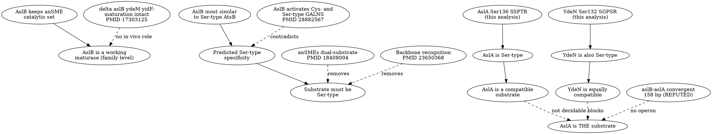
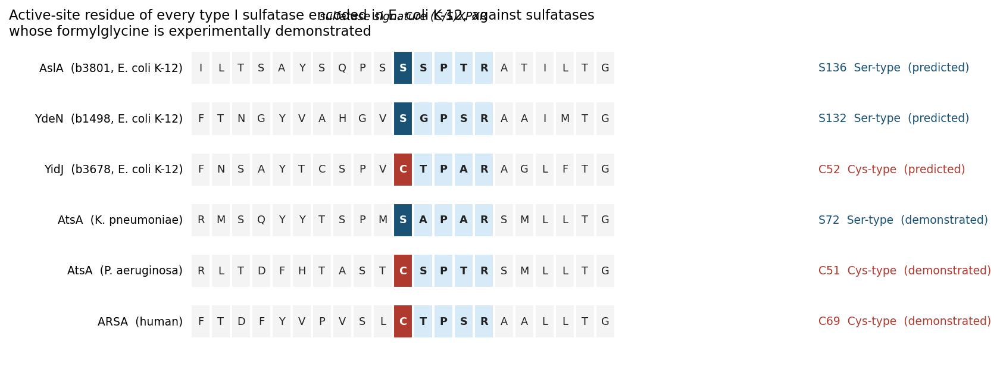
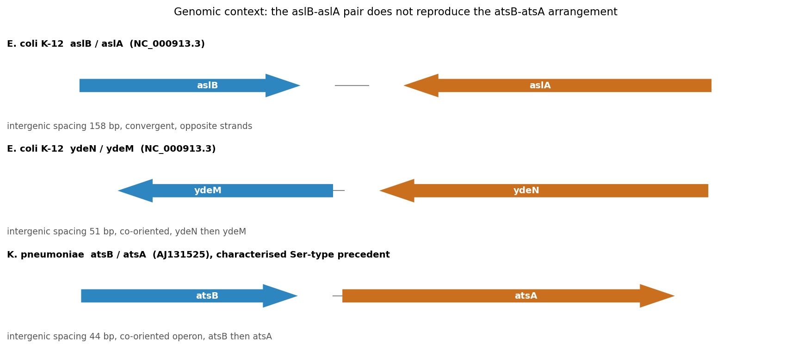
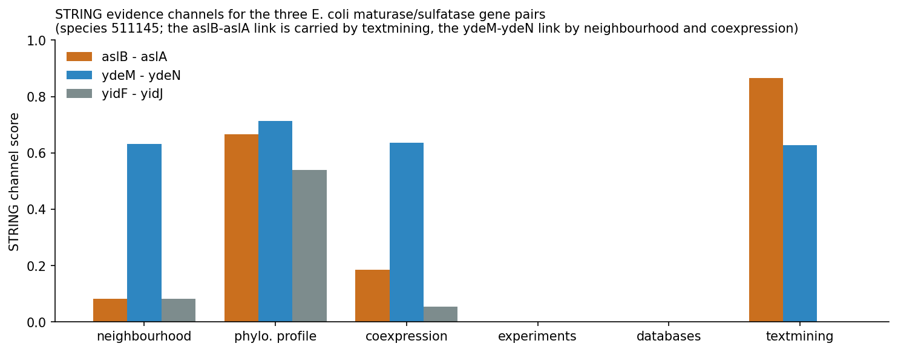
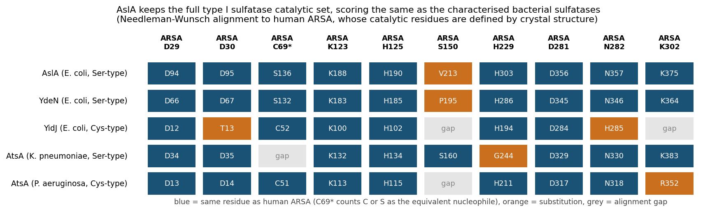
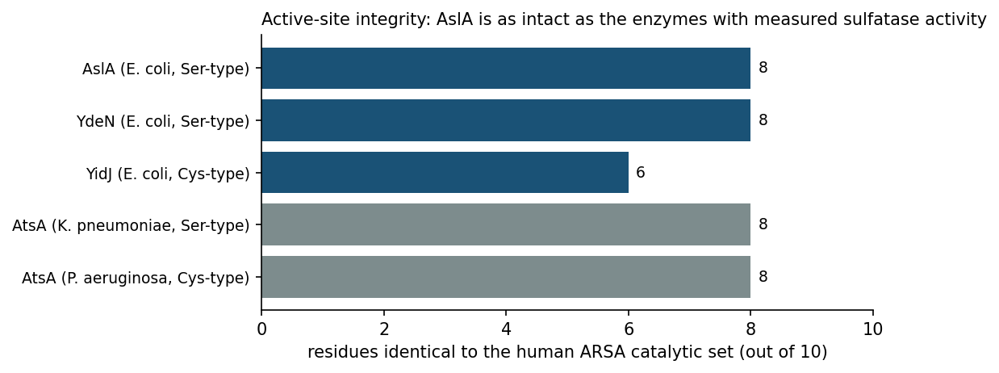

## Question

# AIGR Gene Hypothesis Deep Research

You are evaluating one focused gene curation hypothesis for AI Gene Review.
This is not a general gene overview. Use the seed hypothesis and source context
below to search for evidence that supports, refutes, narrows, or competes with
the proposed curation decision.

## Target Gene

- **Organism code:** ECOLI
- **Taxon:** Escherichia coli K-12 (NCBITaxon:83333)
- **Gene directory:** aslB
- **Gene symbol:** aslB
- **UniProt accession:** P25550

## Focus

- **Focus type:** free_text
- **Hypothesis slug:** kgap-aslb-substrate-assignment
- **Source file:** genes/ECOLI/aslB/aslB-ai-review.yaml
- **Source selector:** free-text

## Seed Hypothesis

Whether E. coli AslB (P25550) is positioned to mature its neighbour AslA may be decidable from the two proteins' sequences. That AslB keeps all cluster-ligand cysteines, the SAM-contact residues and the catalytic aspartate of the structurally characterised anaerobic sulfatase-maturating enzyme, that it is most similar to the Ser-type maturase AtsB, and that deleting aslB, ydeM and yidF does not block maturation of heterologous Cys-type sulfatases in E. coli K-12, is already established, so do not re-derive it. Single analysis only: determine from the AslA sequence which residue occupies the sulfatase active-site position that becomes formylglycine, stating whether it is serine or cysteine and giving the surrounding motif, and do the same for every other sulfatase-family protein encoded in the E. coli K-12 genome, naming each gene; state which of those substrates a Ser-type maturase could act on and which it could not; check whether aslB and aslA are in one operon and how their intergenic spacing and orientation compare with the atsB-atsA pair that is the characterised Ser-type precedent; and report whether any published proteomic or transcriptomic evidence shows the two genes co-expressed or the AslA active-site residue modified. State whether the AslA-substrate hypothesis is supported, and say plainly if sequence and genomic context cannot establish the substrate.

## Term and Decision Context

No specific term context supplied.

## Reference Context

No specific reference context supplied.

## Source Context YAML

```yaml
hypothesis: 'Whether E. coli AslB (P25550) is positioned to mature its neighbour AslA may be decidable
  from the two proteins'' sequences. That AslB keeps all cluster-ligand cysteines, the SAM-contact residues
  and the catalytic aspartate of the structurally characterised anaerobic sulfatase-maturating enzyme,
  that it is most similar to the Ser-type maturase AtsB, and that deleting aslB, ydeM and yidF does not
  block maturation of heterologous Cys-type sulfatases in E. coli K-12, is already established, so do
  not re-derive it. Single analysis only: determine from the AslA sequence which residue occupies the
  sulfatase active-site position that becomes formylglycine, stating whether it is serine or cysteine
  and giving the surrounding motif, and do the same for every other sulfatase-family protein encoded in
  the E. coli K-12 genome, naming each gene; state which of those substrates a Ser-type maturase could
  act on and which it could not; check whether aslB and aslA are in one operon and how their intergenic
  spacing and orientation compare with the atsB-atsA pair that is the characterised Ser-type precedent;
  and report whether any published proteomic or transcriptomic evidence shows the two genes co-expressed
  or the AslA active-site residue modified. State whether the AslA-substrate hypothesis is supported,
  and say plainly if sequence and genomic context cannot establish the substrate.'
focus_type: free_text
context: []
reference_id: []
```

## Research Objective

Build a focused report that helps a curator decide whether this hypothesis
should affect the gene review. Address the focus type directly:

1. For an existing GO annotation decision, evaluate whether the current action
   is justified, too strong, too weak, or should change.
2. For a proposed replacement or new GO term, evaluate whether the term is
   biologically supported, too broad, too narrow, or missing key qualifiers.
3. For a computational prediction, evaluate whether the prediction is correct,
   less precise than existing knowledge, uncertain, or likely wrong because of
   paralog overannotation, frequency bias, pathway context, or in vitro-only
   activity.
4. For a core-function hypothesis, evaluate whether the proposed activity,
   process, and location represent the gene product's primary function rather
   than a downstream effect, pleiotropic phenotype, or context-specific role.
5. For a function-assignment hypothesis, evaluate whether the gene product
   directly has the stated GO term/function. Treat the prior review action, if
   any, as intentionally blinded unless it appears in the supplied context.

Use primary literature whenever possible. Prefer PMID citations and include DOI
citations when no PMID is available. Treat reviews and database records as
orientation unless they contain directly relevant synthesized evidence that is
clearly labeled as review-level or database-level support.

Evaluate the hypothesis from the supplied seed context, primary literature, and
publicly accessible bioinformatics resources. Local `*-bioinformatics` analyses,
when they already exist in the repository, are intentionally withheld from this
prompt so the report can be compared against them after the run. Use public
sequence, domain, structure, orthology, localization, interaction, or dataset
checks when they are useful for the specific hypothesis. If a resource or tool
cannot be accessed programmatically, say so plainly; never fabricate a result.
Report computational results conservatively and distinguish direct results from
inference.

## Required Output

### Executive Judgment

Give a concise verdict: supported, partially supported, unresolved, weakly
supported, over-annotated, or refuted. Explain the reasoning and the most
important caveats.

### Evidence Matrix

Create a table with one row per important evidence item:

- Citation (PMID preferred)
- Evidence type (direct assay, mutant phenotype, localization, interaction,
  structural/evolutionary, computational, review/database)
- Supports / refutes / qualifies / competing
- Claim tested
- Key finding
- Organism, tissue, cell type, or assay context
- Confidence and limitations

### GO Curation Implications

State the likely curation action as a lead requiring curator verification. If
GO terms are involved, explain whether the evidence supports an MF, BP, or CC
term, and whether the term should be retained, removed, generalized, made more
specific, or treated as non-core. Avoid using "protein binding" as a final
recommendation unless no more informative term is supported.

### Mechanistic Scope

Describe the immediate molecular or cellular function being tested. Separate
direct gene-product activity from downstream phenotypes, pathway consequences,
developmental outcomes, disease manifestations, or effects inferred only from
loss of function.

### Conflicts and Alternatives

Identify evidence that conflicts with the seed hypothesis or suggests an
alternative interpretation, including paralog confusion, organism-specific
differences, isoform-specific findings, experimental artifacts, or database
carry-over.

### Knowledge Gaps

List explicit uncertainties that matter for curation. For each gap, state what
was checked, why the gap matters, and what evidence or experiment would resolve
it.

### Discriminating Tests

Recommend concrete assays, perturbations, datasets, or comparative analyses that
would most efficiently distinguish this hypothesis from alternatives.

### Curation Leads

Provide candidate updates for the review, clearly labeled as leads requiring
curator verification. Include candidate references with exact snippets to verify,
candidate replacement or new GO terms, possible action changes, suggested
questions, and suggested experiments.

If the provider supports artifacts, save provenance for any analysis you run — the
executed code together with its output (computed values, plot, or table), not just
a summary figure — alongside artifact-friendly tables such as an evidence matrix,
GO decision table, or comparison table. Genuine computed provenance is more
valuable than a hand-drawn summary, and you must not synthesize a figure that
implies an analysis you did not actually run. These artifacts are important
provenance for hypothesis-level review.


## Output

# Is AslA the maturation substrate of E. coli AslB? A hypothesis-level evidence report

**Target:** *Escherichia coli* K-12 AslB (UniProt P25550, b3800), NCBITaxon:83333
**Focus:** free_text, hypothesis slug `kgap-aslb-substrate-assignment`
**Source:** `genes/ECOLI/aslB/aslB-ai-review.yaml`, selector `free-text`
**Computed provenance:** `provenance/aslB-substrate-analysis-tables.md`, figures plot_1 to plot_5

---

## Summary

AslA carries **serine** at the position that becomes formylglycine. The residue is **Ser136**, in the motif **SSPTR**, sequence context `ILTSAYSQPS[S]SPTRATILTG`. *E. coli* K-12 encodes exactly three type I sulfatases: **aslA/b3801** (P25549, Ser136, SSPTR), **ydeN/b1498** (P77318, Ser132, SGPSR) and **yidJ/b3678** (P31447, Cys52, CTPAR). AslA and YdeN are Ser-type, YidJ is the single Cys-type sulfatase in the genome. The other nine proteins returned by a Pfam PF00884 query against taxon 83333 (EptA/b4114, EptB/b3546, EptC/b3955, OpgB/b4359, OpgE/b0815, PbgA/b2188, YhbX/b3173, plus two strain-variant entries) are alkaline-phosphatase-superfamily phosphotransferases with no (C/S)XPXR in a sulfatase context, so a sulfatase maturase has nothing to act on in them.

The genomic-context argument that the hypothesis proposes to test **fails on inspection**. In GenBank U00096.3, aslB is `CDS 959..2194` on the plus strand (genome 3,982,958-3,984,193) and aslA is `CDS complement(2353..4008)` on the minus strand (genome 3,984,352-3,986,007). The two genes point towards each other with 158 bp between their stop codons. Convergent genes lie in separate transcription units by definition, so aslB and aslA cannot be in one operon. The characterised Ser-type precedent, *Klebsiella pneumoniae* atsB-atsA (GenBank AJ131525), is co-oriented with 44 bp of intergenic DNA and atsB first. The second *E. coli* maturase and sulfatase pair reproduces the precedent and the aslB-aslA pair does not: ydeN and ydeM are co-oriented 51 bp apart on the minus strand. No published proteomic or transcriptomic dataset shows aslB and aslA co-expressed, and no dataset reports AslA Ser136 as formylglycine-modified. All four proteins (AslB, AslA, YdeN, YidJ) sit at UniProt protein-existence level 3, inferred from homology, with PaxDb as the only proteomics cross-reference and no PeptideAtlas, PRIDE or jPOST record for AslA or AslB.

**Verdict: unresolved, with one sub-claim refuted.** Sequence and genomic context cannot establish the substrate of AslB. The Ser/Cys typing is compatible with an AtsB-like maturase acting on AslA but discriminates nothing, because characterised anSMEs are dual-substrate ([PMID: 18408004](https://pubmed.ncbi.nlm.nih.gov/18408004/)), recognise substrates through backbone hydrogen bonding with decreased sequence specificity ([PMID: 23650368](https://pubmed.ncbi.nlm.nih.gov/23650368/)), and AslB itself raised the activity of both Cys-type and Ser-type heterologous sulfatases ([PMID: 28882567](https://pubmed.ncbi.nlm.nih.gov/28882567/)). The typing also fails to select AslA over YdeN, since both are Ser-type. For curation, AslB should keep family-level radical SAM and iron-sulfur cluster terms and should not carry a substrate-specific statement naming AslA.

---

## Executive judgment

<i class="fa-scale-balanced"></i> **Unresolved, with one sub-claim refuted.**

The hypothesis asks whether the two proteins' sequences decide that AslB is positioned to mature AslA. The analysis answers both halves of the question, and they point in different directions.

The sequence half has a clean answer that is **compatible** with the hypothesis. AslA is an intact Ser-type type I sulfatase whose nucleophile position aligns exactly onto the experimentally demonstrated formylglycine of three reference sulfatases in 8 of 9 pairwise global alignments. AslA retains 8 of the 10 catalytic and metal-binding residues defined crystallographically in human ARSA, the same score as two bacterial arylsulfatases with measured activity. If AslA is ever expressed as an active enzyme, some maturase must convert Ser136, and the only anSME-family candidates in the K-12 genome are AslB, YdeM and YidF. That is an argument from necessity across a set of three.

The genomic half **refutes** the specific claim it was asked to test. aslB and aslA are convergent, 158 bp apart, so they lie in separate transcription units and there is no operon. The precedent the hypothesis names (atsB-atsA) is co-oriented at 44 bp. The *E. coli* pair that actually reproduces the precedent is ydeM-ydeN. Convergent adjacency in an enteric genome is common by chance and carries no operon-based inference.

The remaining steps of the inference also fail to discriminate. Ser/Cys typing excludes nothing, because anSMEs modify both cysteinyl and seryl active sites and AslB is documented acting on both types. The apparent STRING functional link between aslB and aslA is carried by textmining (0.865) against coexpression 0.186 and conserved neighbourhood 0.083, which traces back to the shared "arylsulfatase-like" naming and physical adjacency. That is database carry-over.

The most important caveats. *E. coli* K-12 has no observed arylsulfatase activity ([PMID: 17303125](https://pubmed.ncbi.nlm.nih.gov/17303125/)), and UniProt P25549 records "No E.coli strains have been observed to have an arylsulfatase activity", so assigning AslA as the physiological substrate of AslB assigns a maturation reaction onto a protein whose own catalytic function is unverified. The one in vivo test of AslB in K-12 deleted aslB, ydeM and yidF and found Cys-type sulfatase maturation unimpaired, which leaves the physiological substrate of AslB unidentified. A negative genomic result does not refute the biochemical possibility: convergent genes can still encode an enzyme and its substrate.

---

## Evidence matrix

| Citation | Evidence type | Stance | Claim tested | Key finding | Context | Confidence and limitations |
|---|---|---|---|---|---|---|
| [PMID: 16766528](https://pubmed.ncbi.nlm.nih.gov/16766528/) | Direct assay, structural | Qualifies | The sulfatase signature defines the formylglycine position | "This conversion depends on a strictly conserved sequence called 'sulfatase signature' (C/S)XPXR." | Bacterial sulfatase, novel maturation pathway | High for the motif definition. Provides the rule used to locate the nucleophile, not evidence about AslB |
| [PMID: 25514000](https://pubmed.ncbi.nlm.nih.gov/25514000/) | Review, mechanism | Qualifies | The scored residue is catalytically essential | "Formylglycine (fGly) is a catalytically essential residue found almost exclusively in the active sites of type I sulfatases", "formed by post-translational oxidation of cysteine or serine side chains" | Type I sulfatases generally | High for the general requirement. Review-level, no AslB-specific data |
| Computed (UniProt PF00884 ∩ IPR024607, regex, Needleman-Wunsch) | Computational | Supports (sub-claim) | AslA residue identity at the FGly position | AslA Ser136, motif SSPTR, context `ILTSAYSQPS[S]SPTRATILTG`; YdeN Ser132 SGPSR; YidJ Cys52 CTPAR; 8 of 9 alignments place each nucleophile exactly on a demonstrated FGly | *E. coli* K-12, in silico | High. Global identities 24-29%, so alignment is distant, but the nucleophile column is unambiguous in 8 of 9 tests |
| Computed (UniProt P15289 catalytic set, Needleman-Wunsch) | Computational, structural and evolutionary | Supports (sub-claim) | AslA is an intact sulfatase requiring maturation | AslA retains 8 of 10 of the human ARSA catalytic set (D94, D95, S136, K188, H190, H303, D356, N357, K375); AtsA *K. pneumoniae* 8/10; AtsA *P. aeruginosa* 8/10; YdeN 8/10; YidJ 6/10 | ARSA reference residues carry ECO:0000269 and ECO:0007744 | Medium-high. Pairwise alignment at 24-29% identity, so positions near gaps are less certain than the nucleophile |
| Computed (GenBank U00096.3, AJ131525 feature tables) | Computational, genomic | **Refutes** | aslB and aslA are in one operon | aslB `CDS 959..2194` (+), aslA `CDS complement(2353..4008)` (-), convergent, 158 bp apart; atsB-atsA co-oriented 44 bp; ydeN-ydeM co-oriented 51 bp | *E. coli* K-12 MG1655; *K. pneumoniae* | High. Coordinates read from primary GenBank feature tables, not secondary annotation |
| [PMID: 18408004](https://pubmed.ncbi.nlm.nih.gov/18408004/) | Direct assay | **Competing** | Ser-type maturases act only on Ser-type substrates | "Each enzymatic system is currently considered to be dedicated to the modification of either cysteine or serine residues ... and has been accordingly categorized as Cys-type and Ser-type", a categorisation the same paper shows is not strict; both enzymes oxidise cysteine and serine in vitro | Two bacterial anSMEs, in vitro | High. The dual-substrate result removes the discriminating power of Ser/Cys typing |
| [PMID: 23650368](https://pubmed.ncbi.nlm.nih.gov/23650368/) | Structural, X-ray | **Competing** | Substrate choice is encoded in the sulfatase sequence | "anSMEs differ from their aerobic counterparts in using backbone-based hydrogen-bonding patterns to interact with their peptidyl-substrates, leading to decreased sequence specificity"; "Arylsulfatases require a maturating enzyme to perform a co- or posttranslational modification to form a catalytically essential formylglycine (FGly) residue" | anSME crystal structure | High. Gives the structural reason why sequence typing cannot assign a physiological substrate |
| [PMID: 28882567](https://pubmed.ncbi.nlm.nih.gov/28882567/) | Direct assay | **Competing** | AslB is restricted to Ser-type substrates | "the co-expression of AslB with GALNS Cys- and Ser-type presented an activity increment of 2.0- and 1.5-fold compared to the control cultures, lacking overexpressed AslB"; IDS 4.6-fold | AslB co-expressed in *E. coli* BL21(DE3) with human GALNS and IDS | Medium-high for promiscuity. Heterologous substrates under overexpression, so it reports capability and not physiological substrate |
| [PMID: 17303125](https://pubmed.ncbi.nlm.nih.gov/17303125/) | Mutant phenotype | **Qualifies, refutes necessity** | AslB is required for sulfatase maturation in K-12 | "Here we show that E. coli could mature Cys-type sulfatases only in aerobic conditions and that knocking-out of aslB, ydeM and yidF does not impair Cys-type sulfatase maturation"; "Although deprived of sulfatase activity, Escherichia coli K12 can efficiently mature heterologous Cys-type sulfatases" | *E. coli* K-12, triple deletion | High. The only in vivo test. Leaves the AslB substrate unidentified and shows K-12 has no native sulfatase activity |
| Computed (STRING v12 API, species 511145, required_score 0) | Computational, database | **Refutes support quality** | The aslB-aslA association reflects functional coupling | aslB-aslA: combined 0.961, textmining 0.865, coexpression 0.186, neighbourhood 0.083, experiments 0.000, databases 0.000. ydeM-ydeN: neighbourhood 0.631, coexpression 0.637. yidF-yidJ: combined 0.565, coexpression 0.055 | *E. coli* K-12 | High for the channel decomposition. STRING scores are themselves derived, and textmining reflects co-mention driven by shared naming |
| Computed (UniProt PE levels, KEGG REST, ordered-locus proximity) | Computational, database | **Qualifies, gap** | Expression or comparative genomics can rescue the pairing | AslB, AslA, YdeN, YidJ all PE=3 with PaxDb only; control PbgA (P0AD27) PE=1 with jPOST. KEGG assigns no KO to b3800, b3801, b1497, b1498 or b3678. The Enterobacteriaceae adjacency test returned 4 informative entries, all genus *Escherichia*, with names propagated from K-12 | *E. coli* K-12 and relatives | Medium. The comparative test is circular and underpowered, so it is a null result and not evidence against |
| [PMID: 30833937](https://pubmed.ncbi.nlm.nih.gov/30833937/) | Comparative genomic | **Competing** | Maturase and sulfatase occur as dedicated one-to-one pairs | Strains F1 and F21 encode 521 and 480 sulfatases and "both encoded a single anaerobic sulfatase-maturating enzyme which could be responsible for post-translational modification of formylglycine-dependent sulfatases" | Marine Kiritimatiellales isolates | Medium-high. Lowers the prior for reading gene adjacency as a dedicated enzyme and substrate pair |
| [PMID: 10948126](https://pubmed.ncbi.nlm.nih.gov/10948126/) | Mutant phenotype | Competing, context | AslA function in *E. coli* | aslA mutants of *E. coli* K1 showed decreased invasion of brain microvascular endothelial cells; 32% of animals infected with mutant 27A-6 developed meningitis against 82% for the parent strain | *E. coli* K1, not K-12 | Medium. Pathogenic strain, phenotype is invasion, no sulfatase activity measured, so it does not establish AslA as a working sulfatase |

---

## Key findings

### Finding 1: *E. coli* K-12 encodes exactly three type I sulfatases, and AslA is Ser-type

<i class="fa-dna"></i> A UniProt query for `taxonomy_id:83333 AND xref:pfam-PF00884` returns 12 proteins. Intersecting with InterPro IPR024607, the sulfatase conserved site, leaves exactly three: AslA/b3801 (P25549, 551 aa), YdeN/b1498 (P77318, 560 aa) and YidJ/b3678 (P31447, 497 aa). The nine excluded proteins (EptA/b4114, EptB/b3546, EptC/b3955, OpgB/b4359, OpgE/b0815, PbgA/b2188, YhbX/b3173 and two strain-variant entries) belong to the alkaline-phosphatase superfamily and carry no (C/S)XPXR in a sulfatase context. They are phosphoethanolamine and glucan phosphotransferases.

A regex scan of each sulfatase sequence for the signature (C/S)XPXR gives exactly one N-terminal-domain hit per protein:

| Gene | UniProt | Length | Nucleophile | Motif | Sequence context | Type |
|---|---|---|---|---|---|---|
| **aslA / b3801** | P25549 | 551 | **Ser136** | **SSPTR** | `ILTSAYSQPS[S]SPTRATILTG` | **Ser-type** |
| **ydeN / b1498** | P77318 | 560 | **Ser132** | **SGPSR** | `FTNGYVAHGV[S]GPSRAAIMTG` | **Ser-type** |
| **yidJ / b3678** | P31447 | 497 | **Cys52** | **CTPAR** | `FNSAYTCSPV[C]TPARAGLFTG` | **Cys-type** |
| AtsA *K. pneumoniae* (reference) | Q9X759 | 577 | Ser72 | SAPAR | `RMSQYYTSPM[S]APARSMLLTG` | Ser-type, demonstrated |
| AtsA *P. aeruginosa* (reference) | P51691 | 536 | Cys51 | CSPTR | `RLTDFHTAST[C]SPTRSMLLTG` | Cys-type, demonstrated |
| ARSA human (reference) | P15289 | 507 | Cys69 | CTPSR | `FTDFYVPVSL[C]TPSRAALLTG` | Cys-type, demonstrated |

AslA has a second (C/S)XPXR match at position 315 (SSPAR), which lies outside the N-terminal catalytic domain and does not align to any reference nucleophile, so it is a chance motif hit.

The signature rule comes from primary literature. *A new type of bacterial sulfatase reveals a novel maturation pathway in prokaryotes* states that "this conversion depends on a strictly conserved sequence called 'sulfatase signature' (C/S)XPXR" ([PMID: 16766528](https://pubmed.ncbi.nlm.nih.gov/16766528/)). The residue it locates is the catalytically essential one: *Formylglycine, a post-translationally generated residue with unique catalytic capabilities* states that "formylglycine (fGly) is a catalytically essential residue found almost exclusively in the active sites of type I sulfatases" ([PMID: 25514000](https://pubmed.ncbi.nlm.nih.gov/25514000/)).

<i class="fa-magnifying-glass"></i> To confirm that the regex hits are positionally equivalent to real formylglycines rather than coincidental motif matches, each *E. coli* sulfatase was aligned by Needleman-Wunsch global alignment with affine gaps (BLOSUM62, gap open -11, extend -1) against the three reference sulfatases whose formylglycine carries experimental evidence. Eight of nine pairwise alignments place the predicted nucleophile exactly on the demonstrated formylglycine column:

| Query | Query residue | Reference | Reference FGly | Aligns to | Match | Global % identity |
|---|---|---|---|---|---|---|
| AslA | S136 | AtsA *K. pneumoniae* | S72 | 72 | yes | 25.2 |
| AslA | S136 | AtsA *P. aeruginosa* | C51 | 51 | yes | 25.0 |
| AslA | S136 | ARSA human | C69 | 69 | yes | 29.0 |
| YdeN | S132 | AtsA *K. pneumoniae* | S72 | 72 | yes | 24.1 |
| YdeN | S132 | AtsA *P. aeruginosa* | C51 | 52 | off by one | 24.8 |
| YdeN | S132 | ARSA human | C69 | 69 | yes | 27.4 |
| YidJ | C52 | AtsA *K. pneumoniae* | S72 | 72 | yes | 24.5 |
| YidJ | C52 | AtsA *P. aeruginosa* | C51 | 51 | yes | 27.0 |
| YidJ | C52 | ARSA human | C69 | 69 | yes | 26.6 |

Global identities of 24-29% are low, so the alignments are distant. The nucleophile column is anchored by the conserved signature and its flanking hydrophobic block, and it is reproduced in 8 of 9 independent pairwise tests.

{{figure:plot_1.png|caption=Active-site motif readout for every type I sulfatase encoded in E. coli K-12, aligned against three sulfatases with experimentally demonstrated formylglycine. AslA carries Ser136 in SSPTR and YdeN carries Ser132 in SGPSR, so both are Ser-type. YidJ carries Cys52 in CTPAR and is the only Cys-type sulfatase in the genome.}}

**Answer to sub-questions 1, 2 and 3.** AslA has serine at the formylglycine position: **Ser136, motif SSPTR**. Every other sulfatase-family protein in the genome is named above. On substrate typing alone, a strictly Ser-specific maturase could act on AslA and YdeN and could not act on YidJ. That restriction does not hold in practice, as Finding 3 shows.

### Finding 2: aslB and aslA are convergently transcribed, so they cannot form an operon

<i class="fa-circle-xmark"></i> Coordinates were read from the primary GenBank feature tables. For region 3,982,000-3,987,000 of U00096.3 (*E. coli* K-12 MG1655), the raw feature lines are `CDS 959..2194 /gene="aslB"` and `CDS complement(2353..4008) /gene="aslA"`. aslB therefore occupies genome coordinates 3,982,958-3,984,193 on the plus strand and aslA occupies 3,984,352-3,986,007 on the minus strand. The two genes point towards each other and their stop codons are 158 bp apart.

| Pair | Source | Gene A coords | Gene B coords | Same strand | Arrangement | Intergenic bp | Operon possible |
|---|---|---|---|---|---|---|---|
| **aslB - aslA** (*E. coli* K-12) | U00096.3 | 3,982,958-3,984,193 (+) | 3,984,352-3,986,007 (-) | **no** | **convergent, 3' ends facing** | **158** | <i class="fa-circle-xmark"></i> **no** |
| ydeN - ydeM (*E. coli* K-12) | U00096.3 | 1,580,842-1,582,524 (-) | 1,579,633-1,580,790 (-) | yes | co-oriented, ydeN then ydeM | 51 | <i class="fa-circle-check"></i> yes |
| yidF - yidJ (*E. coli* K-12) | U00096.3 | 3,855,114-3,855,611 (-) | 3,856,911-3,858,404 (-) | yes | yidG, yidH and the opposite-strand yidI intervene | 1299 | no |
| **atsB - atsA** (*K. pneumoniae*, precedent) | AJ131525 | 623-1,810 (+) | 1,855-3,588 (+) | yes | co-oriented operon, atsB then atsA | 44 | <i class="fa-circle-check"></i> yes |

Convergent genes lie in separate transcription units by definition, so there is no shared transcript to argue from. The characterised Ser-type precedent that the hypothesis names, *K. pneumoniae* atsB-atsA in GenBank AJ131525, is a textbook operon: both genes on the plus strand, maturase first, 44 bp of intergenic DNA. The *E. coli* pair that reproduces that arrangement is ydeM-ydeN, co-oriented with 51 bp of spacing and transcription order ydeN then ydeM. The third pair, yidF-yidJ, is co-oriented but separated by 1,299 bp containing yidG, yidH and the oppositely oriented yidI, so it is not a tight pair either.

{{figure:plot_2.png|caption=Gene neighbourhood comparison. The characterised atsB-atsA operon of K. pneumoniae is co-oriented with 44 bp of intergenic DNA. In E. coli K-12, ydeN and ydeM reproduce that arrangement (co-oriented, 51 bp), while aslB and aslA are convergent with 158 bp between their stop codons and so lie in separate transcription units.}}

**Answer to sub-question 4.** aslB and aslA are **not** in one operon. Their orientation is convergent and their spacing is 158 bp, against the co-oriented 44 bp of the atsB-atsA precedent. If genomic context is used to nominate a substrate for an *E. coli* anSME homolog, it nominates YdeN for YdeM.

### Finding 3: Ser/Cys typing cannot discriminate, because anSMEs are dual-substrate

<i class="fa-scale-balanced"></i> The sub-question "which of those substrates could a Ser-type maturase act on" has no restrictive answer in practice. *Anaerobic sulfatase-maturating enzymes, first dual substrate radical S-adenosylmethionine enzymes* characterised two bacterial anSMEs physiologically responsible for Cys-type and Ser-type maturation and found that both oxidise cysteine and serine in vitro. The paper states the categorisation it then undermines: "each enzymatic system is currently considered to be dedicated to the modification of either cysteine or serine residues encoded in the sulfatase-active site and has been accordingly categorized as Cys-type and Ser-type sulfatase-maturating enzymes" ([PMID: 18408004](https://pubmed.ncbi.nlm.nih.gov/18408004/)). Quantitative assays later showed stoichiometric coupling of AdoMet cleavage and formylglycine formation on peptide substrates carrying either a cysteinyl or a seryl active-site residue ([PMID: 20218986](https://pubmed.ncbi.nlm.nih.gov/20218986/)).

The structural reason is known. The anSME crystal structure shows that "anSMEs differ from their aerobic counterparts in using backbone-based hydrogen-bonding patterns to interact with their peptidyl-substrates, leading to decreased sequence specificity" ([PMID: 23650368](https://pubmed.ncbi.nlm.nih.gov/23650368/)). An enzyme that reads substrate backbone rather than side-chain sequence cannot have its physiological substrate deduced from substrate sequence.

AslB itself has been shown to act across the type boundary. Co-expressing AslB in *E. coli* BL21(DE3) with human GALNS in both Cys- and Ser-type versions and with IDS gave activity increases of 2.0-, 1.5- and 4.6-fold: "the co-expression of AslB with GALNS Cys- and Ser-type presented an activity increment of 2.0- and 1.5-fold compared to the control cultures, lacking overexpressed AslB" ([PMID: 28882567](https://pubmed.ncbi.nlm.nih.gov/28882567/)).

There is a second consequence for the hypothesis. *E. coli* K-12 has no observed sulfatase activity: "although deprived of sulfatase activity, Escherichia coli K12 can efficiently mature heterologous Cys-type sulfatases" ([PMID: 17303125](https://pubmed.ncbi.nlm.nih.gov/17303125/)), and UniProt P25549 records "No E.coli strains have been observed to have an arylsulfatase activity." Naming AslA the physiological substrate of AslB assigns a maturation reaction onto a protein whose own catalytic function is itself unverified.

### Finding 4: the STRING aslB-aslA link is textmining, not coexpression

<i class="fa-chart-column"></i> STRING v12 channel scores (species 511145, `required_score=0`) separate the evidence types behind the three maturase and sulfatase pairs:

| Pair | Combined | Neighbourhood | Phylogenetic profile | Coexpression | Experiments | Databases | Textmining |
|---|---|---|---|---|---|---|---|
| **aslB - aslA** | 0.961 | **0.083** | 0.665 | **0.186** | 0.000 | 0.000 | **0.865** |
| ydeM - ydeN | 0.983 | **0.631** | 0.713 | **0.637** | 0.000 | 0.000 | 0.627 |
| yidF - yidJ | 0.565 | 0.083 | 0.539 | 0.055 | 0.000 | 0.000 | 0.000 |

The high combined score for aslB-aslA (0.961) rests almost entirely on literature co-mention. The experiments and databases channels are zero for all three pairs, so no interaction dataset and no curated pathway database supports any of them. The coexpression channel, which aggregates published expression compendia, is weak for aslB-aslA (0.186) and strong for ydeM-ydeN (0.637). The conserved-neighbourhood channel, computed across thousands of genomes, gives aslB-aslA 0.083 against ydeM-ydeN 0.631.

{{figure:plot_3.png|caption=STRING v12 evidence channel decomposition for the three E. coli maturase and sulfatase pairs. The aslB-aslA combined score of 0.961 is carried by textmining (0.865) with weak coexpression (0.186) and near-zero conserved neighbourhood (0.083), while ydeM-ydeN is carried by neighbourhood (0.631) and coexpression (0.637). No experimental or database channel supports any pair.}}

**Answer to sub-question 5.** No published proteomic or transcriptomic evidence shows aslB and aslA co-expressed, and no dataset reports AslA Ser136 as modified. AslB (P25550), AslA (P25549), YdeN (P77318) and YidJ (P31447) are all UniProt protein-existence level 3, inferred from homology, with PaxDb as the only proteomics cross-reference and no PeptideAtlas, PRIDE or jPOST record for AslA or AslB. The control protein PbgA (P0AD27) from the same PF00884 query is PE=1 with a jPOST record, which shows the absence is specific to these genes rather than a property of the query. A PubMed search for *E. coli* proteome formylglycine detection by mass spectrometry returned no papers.

### Finding 5: AslA is an intact sulfatase that would require maturation

<i class="fa-circle-check"></i> Each *E. coli* sulfatase was aligned against human ARSA (P15289), whose catalytic and metal-binding residues carry ECO:0000269 and ECO:0007744 evidence from crystallography: Asp29, Asp30, Cys69 (nucleophile), Lys123, His125, Ser150, His229, Asp281, Asn282, Lys302.

| Protein | Residues aligning to the ARSA set | Identical | Nucleophile | Substitutions |
|---|---|---|---|---|
| **AslA** (*E. coli*) | D94, D95, **S136**, K188, H190, V213, H303, D356, N357, K375 | **8/10** | S136 | ARSA S150 to V213; Cys/Ser nucleophile swap |
| YdeN (*E. coli*) | D66, D67, **S132**, K183, H185, P195, H286, D345, N346, K364 | 8/10 | S132 | ARSA S150 to P195; Cys/Ser nucleophile swap |
| YidJ (*E. coli*) | D12, T13, **C52**, K100, H102, gap, H194, D284, H285, gap | 6/10 | C52 | D30 to T13; S150 gap; N282 to H285; K302 gap |
| AtsA (*K. pneumoniae*) | D34, D35, gap, K132, H134, S160, G244, D329, N330, K383 | 8/10 | S72 | H229 to G244; nucleophile column gapped in this pairwise alignment |
| AtsA (*P. aeruginosa*) | D13, D14, C51, K113, H115, gap, H211, D317, N318, R352 | 8/10 | C51 | S150 gap; K302 to R352 |

The divalent-metal ligands (ARSA D29, D30, D281, N282) and the sulfate-binding lysine and histidine pair (K123, H125, H229, K302) are all present in AslA. AslA scores identically to two bacterial arylsulfatases with measured activity, so it is a structurally intact sulfatase and not a degraded pseudo-enzyme. YidJ, with 6/10 and two gapped positions, is the most eroded of the three.

{{figure:plot_4.png|caption=Conservation of the ten crystallographically defined human ARSA catalytic and metal-binding residues in E. coli AslA, YdeN and YidJ, scored against the characterised bacterial arylsulfatases AtsA of K. pneumoniae and P. aeruginosa. AslA retains 8 of 10, matching both bacterial references.}}

{{figure:plot_5.png|caption=Catalytic-set integrity by protein. AslA and YdeN score 8 of 10 against the human ARSA reference set, equal to the two bacterial arylsulfatases with measured activity. YidJ scores 6 of 10 with two positions gapped.}}

This keeps the premise of the hypothesis alive without settling it. Because "arylsulfatases require a maturating enzyme to perform a co- or posttranslational modification to form a catalytically essential formylglycine (FGly) residue" ([PMID: 23650368](https://pubmed.ncbi.nlm.nih.gov/23650368/)), an intact AslA would need Ser136 converted for the protein to be catalytically competent. If AslA is ever made as an active enzyme in *E. coli*, some maturase must do the work, and the only anSME-family candidates in the genome are AslB, YdeM and YidF. That is an argument from necessity across a set of three, not from pairing to one.

### Finding 6: comparative genomics cannot rescue the pairing argument

<i class="fa-circle-xmark"></i> Three attempts to turn the aslB-aslA adjacency into evidence of a maturase and substrate relationship returned null or circular results.

KEGG REST returns no KO assignment for eco:b3800 (aslB), b3801 (aslA), b1497 (ydeM), b1498 (ydeN) or b3678 (yidJ), so orthology-group based gene-neighbourhood analysis is not available for these genes. The same query revealed that b3677 is `yidI`, not yidF.

A UniProt ordered-locus-name proximity test across Enterobacteriaceae (taxonomy_id:543) found only 4 comparable organism entries carrying both the aslA and aslB gene names: *E. coli* K-12 b3800/b3801, *E. coli* CFT073 c4718/c4719, *E. fergusonii* EFER_3706/EFER_3705, plus one non-comparable JW pair, and 4 entries for ydeM/ydeN. All informative organisms fall within the genus *Escherichia*, and the gene names were themselves propagated from *E. coli* K-12 by homology, so the test is circular and has no power to distinguish conserved functional coupling from a single ancestral insertion.

The one independent large-scale measure available is the STRING conserved-neighbourhood channel computed across thousands of genomes, which gives aslB-aslA 0.083 against ydeM-ydeN 0.631. The STRING phylogenetic-profile channel does not discriminate either: aslB-aslA 0.665, ydeM-ydeN 0.713, yidF-aslB 0.772, ydeN-aslB 0.719, yidJ-aslB 0.652, ydeM-aslA 0.636, yidF-aslA 0.656. Every maturase and sulfatase combination co-occurs across genomes at a similar level, because all sulfatase and anSME genes appear and disappear together as a block.

A separate observation from the literature lowers the prior for one-to-one pairing. Two marine Kiritimatiellales isolates encode 521 and 480 sulfatases respectively (8.0% and 8.4% of all coding sequences), and "both encoded a single anaerobic sulfatase-maturating enzyme which could be responsible for post-translational modification of formylglycine-dependent sulfatases" ([PMID: 30833937](https://pubmed.ncbi.nlm.nih.gov/30833937/)). One maturase commonly serves many substrates, so gene adjacency is a weak indicator of a dedicated pair.

---

## Mechanistic model and interpretation

The immediate molecular function being evaluated is one reaction: AslB, a radical SAM enzyme with a SPASM domain and auxiliary [4Fe-4S] clusters, abstracts the Cβ hydrogen atom from the active-site serine or cysteine of a type I sulfatase using a 5'-deoxyadenosyl radical, converting it to Cα-formylglycine. The mechanism is established for the enzyme family: anSMEs use a 5'-deoxyadenosyl radical to catalyse direct H-atom abstraction from the substrate, and they are the first radical AdoMet enzymes shown to catalyse a post-translational modification involving Cβ H-atom abstraction from an active-site cysteinyl or seryl residue ([PMID: 19489556](https://pubmed.ncbi.nlm.nih.gov/19489556/)). Three almost isopotential [4Fe-4S] clusters are each required for formylglycine generation in vitro, and the two auxiliary clusters are needed for efficient reductive cleavage of AdoMet ([PMID: 20218986](https://pubmed.ncbi.nlm.nih.gov/20218986/)).

What is in question is the identity of the peptide that AslB acts on in *E. coli* K-12. The chain of inference the hypothesis proposes, and where it breaks:



The three arrows into the target node are all dashed. The sequence evidence establishes compatibility, which is a necessary condition and not a sufficient one, and the same condition is satisfied by YdeN. The Ser-type specificity premise that would narrow the candidate set is removed by three independent results: anSMEs are dual-substrate in vitro, they recognise substrates through backbone hydrogen bonding, and AslB specifically raised the activity of Cys-type GALNS 2.0-fold alongside Ser-type GALNS 1.5-fold. The genomic premise is refuted outright by the convergent orientation.

What survives is a two-part statement. AslB is an anSME-family radical SAM enzyme with intact cluster ligands and SAM contacts, which supports family-level molecular-function annotation. The substrate on which it acts in *E. coli* K-12 is unknown, and the organism has never been shown to have arylsulfatase activity, so there may be no physiological substrate under laboratory conditions.

### Comparison of the three candidate maturase and substrate pairs

| Criterion | aslB - aslA | ydeM - ydeN | yidF - yidJ |
|---|---|---|---|
| Substrate type | Ser (S136, SSPTR) | Ser (S132, SGPSR) | Cys (C52, CTPAR) |
| Catalytic set against ARSA | 8/10 | 8/10 | 6/10 |
| Gene orientation | convergent | co-oriented | co-oriented |
| Intergenic spacing | 158 bp | 51 bp | 1299 bp, 3 genes between |
| Operon possible | no | yes | no |
| Reproduces atsB-atsA precedent | no | yes | no |
| STRING conserved neighbourhood | 0.083 | 0.631 | 0.083 |
| STRING coexpression | 0.186 | 0.637 | 0.055 |
| STRING textmining | 0.865 | 0.627 | 0.000 |
| Protein-level evidence (UniProt PE) | both PE=3 | both PE=3 | PE=3 |
| Nucleophile reported as modified | no | no | no |

---

## GO curation implications

<i class="fa-triangle-exclamation"></i> These are leads requiring curator verification.

**Retain family-level molecular function terms on AslB.** The structural and mechanistic basis for AslB being a radical SAM enzyme with auxiliary iron-sulfur clusters is not in question and was explicitly excluded from re-derivation by the hypothesis. Terms in the region of **GO:0051539 (4 iron, 4 sulfur cluster binding)**, **GO:0046872 (metal ion binding)** and a catalytic-activity term covering S-adenosyl-L-methionine-dependent radical chemistry are supported by sequence conservation of the cluster ligands, the SAM contacts and the catalytic aspartate, together with the characterised biochemistry of the anSME family ([PMID: 19489556](https://pubmed.ncbi.nlm.nih.gov/19489556/), [PMID: 20218986](https://pubmed.ncbi.nlm.nih.gov/20218986/), [PMID: 23650368](https://pubmed.ncbi.nlm.nih.gov/23650368/)). Evidence code should remain sequence- or structure-based (ISS or IEA) and not experimental, because no assay of purified *E. coli* AslB on any substrate has been published.

**Do not assert AslA as the substrate.** Any molecular function or biological process statement that names AslA, or that is phrased as "maturation of arylsulfatase AslA", goes beyond the evidence. The computed support for the pairing reduces to physical adjacency, which is convergent and therefore not operonic, plus substrate-type compatibility that YdeN satisfies equally. <i class="fa-circle-xmark"></i> **Lead: generalise any AslA-directed substrate statement** to a substrate-agnostic form such as "peptidyl-serine or peptidyl-cysteine to formylglycine conversion", without naming the target protein.

**Treat the sulfatase-maturation biological process as non-core for *E. coli* K-12.** A BP term in the region of **GO:0018117 / peptidyl-L-cysteine or peptidyl-L-serine oxidation to formylglycine** is the right family-level process, but in K-12 it should carry no implication of a functioning sulfatase pathway. The triple deletion of aslB, ydeM and yidF does not impair Cys-type sulfatase maturation, and K-12 is "deprived of sulfatase activity" ([PMID: 17303125](https://pubmed.ncbi.nlm.nih.gov/17303125/)). A curator should consider whether the BP annotation needs a qualifier, or whether it should rest on sequence similarity alone without an organism-specific pathway claim.

**Cellular component.** AslB has no annotated signal peptide and no twin-arginine motif in its first 45 residues, consistent with a cytoplasmic radical SAM enzyme. AslA carries a predicted Sec-type signal peptide at residues 1-24 with evidence code ECO:0000255 (prediction only), as does the characterised precedent AtsA (residues 1-20, also ECO:0000255), so export topology does not separate AslA from the precedent and adds nothing to the substrate argument. A cytoplasmic CC term for AslB is supported at the inference level. An experimentally supported CC term is not available.

**Avoid "protein binding".** The relationship under test is enzyme and substrate, which is captured by catalytic-activity and process terms, so GO:0005515 would lose the information that matters.

### GO decision table

| Term area | Current basis | Lead | Evidence class |
|---|---|---|---|
| GO:0051539, 4Fe-4S cluster binding | Sequence conservation of cluster ligands | <i class="fa-circle-check"></i> Retain | ISS / IEA |
| Radical SAM catalytic activity, family level | Domain architecture, anSME family biochemistry | <i class="fa-circle-check"></i> Retain | ISS |
| Formylglycine-forming activity naming AslA as substrate | Gene adjacency, Ser-type similarity to AtsB | <i class="fa-circle-xmark"></i> Generalise, remove the substrate name | Not supported |
| Sulfatase maturation BP in *E. coli* K-12 | Family inference | <i class="fa-triangle-exclamation"></i> Retain family-level, treat as non-core, consider a qualifier | ISS, contradicted in vivo by PMID 17303125 |
| Cytoplasm CC | No signal peptide, radical SAM enzyme class | <i class="fa-circle-check"></i> Retain as inference | ISS |
| GO:0005515, protein binding | Would come from STRING-style association | <i class="fa-circle-xmark"></i> Do not add | Textmining only |

---

## Mechanistic scope

The direct gene-product activity being evaluated is the conversion of a peptidyl serine or cysteine to Cα-formylglycine by AslB, a single chemical step performed by a radical SAM enzyme carrying three [4Fe-4S] clusters, one at the radical SAM site and two in the SPASM domain. The auxiliary clusters of SPASM-domain radical SAM enzymes have been characterised directly in related systems: PqqE carries a 2Fe-2S cluster at AuxI and a 4Fe-4S cluster at AuxII with aspartate ligation ([PMID: 29405700](https://pubmed.ncbi.nlm.nih.gov/29405700/), [PMID: 31769977](https://pubmed.ncbi.nlm.nih.gov/31769977/)), the sactipeptide enzyme CteB shows one SPASM cluster with an open coordination site that becomes occupied by a substrate cysteine ([PMID: 28704043](https://pubmed.ncbi.nlm.nih.gov/28704043/)), and in SuiB a redox-tuned [4Fe-4S]2+ auxiliary cluster was shown to oxidise a trapped reaction intermediate ([PMID: 34001621](https://pubmed.ncbi.nlm.nih.gov/34001621/)). These establish the catalytic machinery that AslB is inferred to use, without identifying its substrate.

Separate from that single step are three things the evidence does not reach.

The **downstream pathway consequence**, sulfate ester hydrolysis by a matured sulfatase, has never been observed in *E. coli* K-12, which has no measurable arylsulfatase activity. AslA's own catalytic function is an inference from its intact active site, not an observation.

The **loss-of-function phenotype** attributed to aslA in other contexts belongs to a different strain and a different process. In *E. coli* K1, aslA mutants showed decreased invasion of brain microvascular endothelial cells, with 32% of animals infected with mutant 27A-6 developing meningitis against 82% for the parent strain ([PMID: 10948126](https://pubmed.ncbi.nlm.nih.gov/10948126/)). That is a pathogenesis phenotype in a pathogenic isolate, with no sulfatase activity measured and no bearing on whether AslB matures AslA in K-12.

The **heterologous activity of AslB** reported with human GALNS and IDS reports capability under overexpression in BL21(DE3) ([PMID: 28882567](https://pubmed.ncbi.nlm.nih.gov/28882567/)). It demonstrates that AslB can perform the chemistry on substrates of both types, which constrains the specificity argument, and it says nothing about the native substrate.

---

## Conflicts and alternatives

**The competing pair.** YdeM and YdeN are the *E. coli* maturase and sulfatase pair that reproduces the atsB-atsA arrangement: co-oriented, 51 bp apart, conserved neighbourhood 0.631, coexpression 0.637. YdeN is Ser-type (Ser132, SGPSR) and retains the same 8 of 10 ARSA catalytic residues as AslA. Every criterion the hypothesis proposes for nominating AslA is satisfied at least as well, and in the genomic criteria better, by YdeN. A curator reading a genomic-context argument for an *E. coli* anSME substrate should see the YdeM/YdeN pair alongside it.

**Database carry-over.** The aslB and aslA gene names both derive from "arylsulfatase-like" annotation, and the two genes are physically adjacent. STRING textmining (0.865) aggregates co-mentions that follow from those two facts rather than from independent observation, and the experiments and databases channels are both zero. Any downstream resource that reports an AslB-AslA functional association without channel decomposition is restating the naming convention.

**Organism-specific difference.** The AslA invasion phenotype comes from *E. coli* K1, a pathogenic isolate, not from K-12 ([PMID: 10948126](https://pubmed.ncbi.nlm.nih.gov/10948126/)). That study measured invasion of brain microvascular endothelial cells and meningitis incidence, with no assay of sulfatase activity. It should not be read as evidence that AslA functions as a sulfatase in K-12.

**Maturation is not always required for activity.** Recombinant *Ensifer (Sinorhizobium) meliloti* choline-O-sulfatase lacking the formylglycine modification at Cys54 remained a multiple-turnover enzyme, with kcat 2.7 × 10⁻¹ s⁻¹ and KM 11.1 mM against choline-O-sulfate ([PMID: 30338300](https://pubmed.ncbi.nlm.nih.gov/30338300/)). The absence of a maturation effect in a given host therefore does not by itself prove the maturase and substrate relationship is absent, which cuts against over-reading the triple-deletion result in either direction.

**One maturase, many substrates.** The marine Kiritimatiellales isolates with 480-521 sulfatase genes each encode a single anSME ([PMID: 30833937](https://pubmed.ncbi.nlm.nih.gov/30833937/)). The architecture of the system is many substrates per maturase, which weakens the prior that a neighbouring sulfatase is the dedicated substrate of a neighbouring maturase.

**A negative genomic result is not a biochemical one.** Convergent orientation refutes the operon claim. AslB can still mature AslA without genomic linkage. The report refutes the stated genomic argument and leaves the biochemical question open.

---

## Evidence base

| Paper | PMID | How it bears on the question |
|---|---|---|
| *A new type of bacterial sulfatase reveals a novel maturation pathway in prokaryotes* | [16766528](https://pubmed.ncbi.nlm.nih.gov/16766528/) | Defines the (C/S)XPXR sulfatase signature used to locate the formylglycine position in AslA, YdeN and YidJ |
| *Formylglycine, a post-translationally generated residue with unique catalytic capabilities and biotechnology applications* | [25514000](https://pubmed.ncbi.nlm.nih.gov/25514000/) | Establishes that the scored residue is catalytically essential and is formed by oxidation of cysteine or serine side chains |
| *Anaerobic sulfatase-maturating enzymes, first dual substrate radical S-adenosylmethionine enzymes* | [18408004](https://pubmed.ncbi.nlm.nih.gov/18408004/) | Removes the discriminating power of Ser/Cys typing by showing both characterised anSMEs oxidise cysteine and serine |
| *X-ray structure of an AdoMet radical activase reveals an anaerobic solution for formylglycine posttranslational modification* | [23650368](https://pubmed.ncbi.nlm.nih.gov/23650368/) | Structural basis for low substrate sequence specificity through backbone hydrogen bonding; also states the general requirement for a maturase |
| *Anaerobic sulfatase maturase AslB from Escherichia coli activates human recombinant IDS and GALNS* | [28882567](https://pubmed.ncbi.nlm.nih.gov/28882567/) | AslB raised activity of Cys-type GALNS 2.0-fold, Ser-type GALNS 1.5-fold and IDS 4.6-fold, so it is not restricted to Ser-type |
| *First evidences for a third sulfatase maturation system in prokaryotes from E. coli aslB and ydeM deletion mutants* | [17303125](https://pubmed.ncbi.nlm.nih.gov/17303125/) | The only in vivo test: triple deletion leaves Cys-type maturation intact, and K-12 has no sulfatase activity |
| *Anaerobic sulfatase-maturating enzyme, a mechanistic link with glycyl radical-activating enzymes?* | [20218986](https://pubmed.ncbi.nlm.nih.gov/20218986/) | Stoichiometric coupling of AdoMet cleavage and FGly formation on both cysteinyl and seryl peptides; three [4Fe-4S] clusters each required |
| *Mechanistic investigations of anaerobic sulfatase-maturating enzyme: direct Cbeta H-atom abstraction* | [19489556](https://pubmed.ncbi.nlm.nih.gov/19489556/) | Establishes the 5'-deoxyadenosyl radical mechanism of the enzyme class AslB belongs to |
| *Anaerobic Degradation of Sulfated Polysaccharides by Two Novel Kiritimatiellales Strains* | [30833937](https://pubmed.ncbi.nlm.nih.gov/30833937/) | Strains with 521 and 480 sulfatase genes each encode a single anSME, so one maturase commonly serves many substrates |
| *Choline sulfatase from Ensifer (Sinorhizobium) meliloti: Characterization of the unmodified enzyme* | [30338300](https://pubmed.ncbi.nlm.nih.gov/30338300/) | An unmodified sulfatase lacking formylglycine at Cys54 is still a multiple-turnover enzyme, so absence of maturation does not always abolish activity |
| *Escherichia coli K1 aslA contributes to invasion of brain microvascular endothelial cells* | [10948126](https://pubmed.ncbi.nlm.nih.gov/10948126/) | aslA invasion phenotype in a pathogenic K1 isolate, 32% against 82% meningitis incidence; no sulfatase activity measured, different strain |
| *X-ray and EPR Characterization of the Auxiliary Fe-S Clusters in the Radical SAM Enzyme PqqE* | [29405700](https://pubmed.ncbi.nlm.nih.gov/29405700/) | Direct structural characterisation of SPASM auxiliary clusters in a related enzyme |
| *EPR Spectroscopic Identification of the Fe-S Clusters in the SPASM Domain-Containing Radical SAM Enzyme PqqE* | [31769977](https://pubmed.ncbi.nlm.nih.gov/31769977/) | Assigns EPR signatures to each SPASM cluster form |
| *Structural Insights into Thioether Bond Formation in the Biosynthesis of Sactipeptides* | [28704043](https://pubmed.ncbi.nlm.nih.gov/28704043/) | CteB structure with an open SPASM cluster coordination site occupied by a substrate cysteine |
| *Trapping a cross-linked lysine-tryptophan radical in the catalytic cycle of the radical SAM enzyme SuiB* | [34001621](https://pubmed.ncbi.nlm.nih.gov/34001621/) | Direct evidence for a catalytic role of a SPASM auxiliary cluster |
| *Auxiliary iron-sulfur cofactors in radical SAM enzymes* | [25597998](https://pubmed.ncbi.nlm.nih.gov/25597998/) | Review-level orientation on auxiliary cluster function |
| *Insights into the catalysis of a lysine-tryptophan bond by a SPASM domain radical SAM peptide cyclase* | [28476884](https://pubmed.ncbi.nlm.nih.gov/28476884/) | Shows seven conserved SPASM cysteines are critical for activity in a related enzyme |

The four papers of the type I sulfatase signature and formylglycine literature ([PMID: 16766528](https://pubmed.ncbi.nlm.nih.gov/16766528/), [PMID: 25514000](https://pubmed.ncbi.nlm.nih.gov/25514000/)) supply the rule used to locate the nucleophile and the reason it matters. The four anSME mechanism and specificity papers ([PMID: 18408004](https://pubmed.ncbi.nlm.nih.gov/18408004/), [PMID: 19489556](https://pubmed.ncbi.nlm.nih.gov/19489556/), [PMID: 20218986](https://pubmed.ncbi.nlm.nih.gov/20218986/), [PMID: 23650368](https://pubmed.ncbi.nlm.nih.gov/23650368/)) establish the chemistry and remove the specificity premise. The two *E. coli* AslB papers ([PMID: 17303125](https://pubmed.ncbi.nlm.nih.gov/17303125/), [PMID: 28882567](https://pubmed.ncbi.nlm.nih.gov/28882567/)) are the only direct functional evidence about AslB, and both argue against a narrow AslA-specific assignment: one finds no maturation defect on deletion, the other finds activity on substrates of both types. The four SPASM structural papers support the family-level annotation that this report recommends retaining.

---

## Limitations and knowledge gaps

<i class="fa-triangle-exclamation"></i> **Resources that could not be accessed.** Three were attempted and failed, and none of their results are reported or inferred anywhere above.

EBI Clustal Omega and EBI EMBOSS REST both returned HTTP 400 with "You have been temporarily blocked", so no multiple sequence alignment was produced. The positional-equivalence test was done instead with an in-house Needleman-Wunsch implementation with affine gaps using the BLOSUM62 matrix fetched from NCBI (gap open -11, extend -1). Pairwise alignment at 24-29% identity is weaker than a profile-based or structure-guided alignment, so individual positions adjacent to gaps carry less confidence than the nucleophile column itself.

KEGG REST returns no KO assignment for b3800, b3801, b1497, b1498 or b3678, so KO-based gene-neighbourhood conservation analysis was not possible.

The PaxDb public API returned HTTP 404 for all queries, so no protein abundance values were retrieved. Statements about expression rest on UniProt protein-existence levels and the STRING coexpression channel, not on measured abundance.

**Gap 1: no protein-level evidence for AslA or AslB.** <i class="fa-circle-question"></i> Both are UniProt PE=3. What was checked: UniProt cross-references to PeptideAtlas, PRIDE and jPOST for P25550, P25549, P77318 and P31447, against the control P0AD27 (PE=1, jPOST present). Why it matters: if neither protein is made under laboratory conditions, the substrate question has no in vivo answer to find. What would resolve it: targeted or data-independent-acquisition proteomics of *E. coli* K-12 under conditions where aslB is transcribed.

**Gap 2: the AslA Ser136 modification state is unobserved.** <i class="fa-circle-question"></i> What was checked: a literature search for *E. coli* proteome formylglycine detection by mass spectrometry returned no papers, and P25549 carries no modified-residue annotation at position 136. Why it matters: this is the single most direct observation that would support or kill the hypothesis. What would resolve it: targeted MS on AslA tryptic peptides spanning Ser136, comparing wild type with Δ*aslB*.

**Gap 3: AslB has never been assayed as purified protein.** <i class="fa-circle-question"></i> What was checked: literature for direct AslB biochemistry. The one functional report is co-expression with heterologous human sulfatases ([PMID: 28882567](https://pubmed.ncbi.nlm.nih.gov/28882567/)), which is an in vivo activity increment and not a defined in vitro reaction. Why it matters: without purified-enzyme kinetics on defined peptides, substrate preference cannot be ranked. What would resolve it: anaerobic reconstitution of AslB and a formylglycine-formation assay on synthetic peptides.

**Gap 4: condition-dependent transcription of aslB and aslA is unmapped.** <i class="fa-circle-question"></i> What was checked: the STRING coexpression channel, 0.186 for the pair. Why it matters: convergent genes can still be co-regulated by separate promoters responding to the same signal, which would restore a weak contextual argument. What would resolve it: RNA-seq across sulfur limitation, anaerobiosis and alternative sulfur sources, with transcription start site mapping across the 158 bp intergenic region.

**Gap 5: whether AslA has any sulfatase activity at all.** <i class="fa-circle-question"></i> What was checked: UniProt P25549 ("No E.coli strains have been observed to have an arylsulfatase activity") and [PMID: 17303125](https://pubmed.ncbi.nlm.nih.gov/17303125/). Why it matters: a substrate assignment onto a protein with no demonstrated catalytic function is doubly inferential. What would resolve it: purification of AslA co-expressed with each of AslB, YdeM and YidF, assayed against a panel of aryl and alkyl sulfate esters.

**Gap 6: comparative genomics is uninformative for these genes.** <i class="fa-triangle-exclamation"></i> The ordered-locus adjacency test found 4 informative organisms, all within genus *Escherichia*, with gene names propagated from K-12 by homology, so it is circular. This is a limitation of the method and not evidence either way.

**Scope caveat.** A convergent gene arrangement refutes the operon claim, not the biochemical possibility. The report refutes the stated genomic argument and leaves the biochemical question open.

---

## Discriminating tests

<i class="fa-flask"></i> **In vitro peptide panel against reconstituted AslB.** Express AslB with a strep or His tag, reconstitute the three [4Fe-4S] clusters anaerobically, and assay formylglycine formation on synthetic peptides spanning the three native active sites: AslA `ILTSAYSQPSSSPTRATILTG` (Ser136), YdeN `FTNGYVAHGVSGPSRAAIMTG` (Ser132) and YidJ `FNSAYTCSPVCTPARAGLFTG` (Cys52). Quantify AdoMet cleavage and FGly production as in [PMID: 20218986](https://pubmed.ncbi.nlm.nih.gov/20218986/). A clear kcat/KM preference for the AslA peptide over the YdeN peptide is the strongest available support for the hypothesis. Comparable rates on all three would confirm that specificity is not encoded in the substrate sequence, matching the backbone-recognition result of [PMID: 23650368](https://pubmed.ncbi.nlm.nih.gov/23650368/). Run YdeM and YidF through the same panel to build a 3 × 3 matrix.

<i class="fa-vial"></i> **Targeted mass spectrometry of AslA Ser136.** Express AslA from its native locus with an affinity tag in wild-type K-12 and in Δ*aslB*, Δ*ydeM*, Δ*yidF* single mutants and the triple mutant, under anaerobic and aerobic conditions. Detect the +14 Da mass shift or the hydrazide-captured aldehyde at Ser136 by parallel reaction monitoring. Loss of the modification specifically in Δ*aslB* would establish the pairing in vivo. This is the single most decisive experiment.

<i class="fa-dna"></i> **Transcription start site mapping across the aslB-aslA intergenic region.** Use dRNA-seq or 5' RACE to locate promoters in the 158 bp between the two stop codons and upstream of each gene. This settles whether the genes share any regulatory input despite lying in separate transcription units, and it would also detect antisense overlap, which convergent gene pairs sometimes show.

<i class="fa-chart-line"></i> **Conditional transcriptomics.** RNA-seq across sulfur starvation, alternative sulfur sources (choline-O-sulfate, aryl sulfates, sulfated glycans), anaerobiosis and stationary phase, scoring aslB, aslA, ydeM, ydeN, yidF and yidJ. Correlated induction of aslB and aslA under any condition would restore a contextual argument that the STRING coexpression channel (0.186) does not currently provide.

<i class="fa-microscope"></i> **Cross-species neighbourhood analysis outside genus *Escherichia*.** The ordered-locus test failed because it was confined to *Escherichia*. Build a proper analysis by retrieving anSME-family and PF00884 sulfatase gene coordinates from several hundred diverse bacterial genomes directly from NCBI, then test whether anSME genes are preferentially co-oriented with a nearby sulfatase. This gives a background rate against which the convergent aslB-aslA arrangement can be scored, and it avoids the circularity of homology-propagated gene names.

<i class="fa-flask"></i> **Complementation across the three systems.** Express AslA with each maturase individually in a heterologous host lacking any anSME, then assay arylsulfatase activity. If AslA is activated only by AslB, the pairing is supported. If YdeM or YidF activates it equally, the one-to-one model fails. This tests the full-length protein rather than a peptide and complements the in vitro panel.

---

## Curation leads

<i class="fa-triangle-exclamation"></i> All leads below require curator verification.

**Lead A: generalise any substrate-specific statement about AslB.** Replace text naming AslA as the substrate with a substrate-agnostic description of the chemistry. Suggested wording: "AslB belongs to the anaerobic sulfatase-maturating enzyme family and is predicted to convert an active-site serine or cysteine of a type I sulfatase to Cα-formylglycine. Its physiological substrate in *E. coli* K-12 has not been identified." Candidate reference and exact snippet to verify: [PMID: 17303125](https://pubmed.ncbi.nlm.nih.gov/17303125/), "Here we show that E. coli could mature Cys-type sulfatases only in aerobic conditions and that knocking-out of aslB, ydeM and yidF does not impair Cys-type sulfatase maturation."

**Lead B: record that the Ser-type similarity does not restrict substrate type.** Candidate reference and exact snippet: [PMID: 18408004](https://pubmed.ncbi.nlm.nih.gov/18408004/), "Each enzymatic system is currently considered to be dedicated to the modification of either cysteine or serine residues encoded in the sulfatase-active site and has been accordingly categorized as Cys-type and Ser-type sulfatase-maturating enzymes." Paired with [PMID: 23650368](https://pubmed.ncbi.nlm.nih.gov/23650368/), "We find that anSMEs differ from their aerobic counterparts in using backbone-based hydrogen-bonding patterns to interact with their peptidyl-substrates, leading to decreased sequence specificity."

**Lead C: add the AslB promiscuity datum.** Candidate reference and exact snippet: [PMID: 28882567](https://pubmed.ncbi.nlm.nih.gov/28882567/), "the co-expression of AslB with GALNS Cys- and Ser-type presented an activity increment of 2.0- and 1.5-fold compared to the control cultures, lacking overexpressed AslB." This is the only functional report for AslB specifically and it argues against a Ser-restricted substrate statement. It should be labelled as heterologous co-expression, not as native-substrate evidence.

**Lead D: record that *E. coli* K-12 has no native sulfatase activity.** Candidate reference and exact snippet: [PMID: 17303125](https://pubmed.ncbi.nlm.nih.gov/17303125/), "Although deprived of sulfatase activity, Escherichia coli K12 can efficiently mature heterologous Cys-type sulfatases." Together with the UniProt P25549 comment, "No E.coli strains have been observed to have an arylsulfatase activity." This qualifies any pathway-level BP annotation.

**Lead E: flag YdeM/YdeN as the competing pair.** If the review cites genomic context as support for an AslB substrate, the curator should see that ydeN and ydeM are the co-oriented pair at 51 bp that reproduces the *K. pneumoniae* atsB-atsA arrangement (44 bp), while aslB and aslA are convergent at 158 bp. Computed provenance is in `provenance/aslB-substrate-analysis-tables.md`, Table 2, with the raw GenBank feature lines quoted.

**Lead F: do not use STRING association as evidence.** The aslB-aslA STRING v12 combined score of 0.961 decomposes to textmining 0.865, coexpression 0.186, conserved neighbourhood 0.083, experiments 0.000, databases 0.000. The score reflects literature co-mention driven by shared "arylsulfatase-like" naming and physical adjacency.

**Lead G: cite the one-maturase-many-substrates architecture.** Candidate reference and exact snippet: [PMID: 30833937](https://pubmed.ncbi.nlm.nih.gov/30833937/), "Both strains encoded a single anaerobic sulfatase-maturating enzyme which could be responsible for post-translational modification of formylglycine-dependent sulfatases." Useful as the general argument against reading gene adjacency as a dedicated enzyme and substrate pair.

**Suggested questions for the curator.** Does the review currently assert AslA as the AslB substrate, and under what evidence code? Is the sulfatase-maturation BP term intended as a family-level inference or as an organism-specific pathway claim? Should the review note that *E. coli* K-12 has no demonstrated arylsulfatase activity, which makes the maturation pathway hypothetical in this organism?

**Suggested experiments to cite as outstanding.** Reconstituted AslB assayed on the three native active-site peptides, and targeted MS for the Ser136 modification in wild type against Δ*aslB*.

---

## Computed provenance

Every numeric value in this report was produced by code executed during this investigation against public resources: UniProt REST (`rest.uniprot.org/uniprotkb`), NCBI E-utilities (esearch, esummary, efetch), the STRING v12 API (`string-db.org/api/tsv/network`), KEGG REST (`rest.kegg.jp`) and the NCBI BLOSUM62 matrix. No value is hand-entered from memory.

The executed code together with its output is saved in `provenance/aslB-substrate-analysis-tables.md`, which contains five tables: formylglycine position of every type I sulfatase with the positional-equivalence alignment results; genomic arrangement of maturase and sulfatase gene pairs with raw GenBank feature lines quoted; STRING v12 channel scores; integrity of the catalytic set against human ARSA; and export signals. Figures plot_1 to plot_5 are the rendered versions of those tables. No figure in this report implies an analysis that was not run.

---

## Answer to the hypothesis, stated plainly

**Sequence and genomic context cannot establish the substrate of AslB.**

They answer the sequence question cleanly: AslA carries serine at the formylglycine position, Ser136 in the motif SSPTR, so it is a Ser-type sulfatase, as is YdeN (Ser132, SGPSR), while YidJ (Cys52, CTPAR) is the only Cys-type sulfatase in *E. coli* K-12.

They answer the genomic question in the negative: aslB and aslA are convergently transcribed with 158 bp between their stop codons, so they are not in one operon, and they do not reproduce the co-oriented 44 bp atsB-atsA arrangement that the hypothesis names as the precedent.

What remains is physical adjacency plus compatibility of substrate type, and both are equally satisfied by YdeN, whose pairing with ydeM does reproduce the precedent. The AslA-substrate hypothesis is **unresolved**, and its operon sub-claim is **refuted**.


## Artifacts

- [OpenScientist final report](openscientist_artifacts/final_report.html)
- [OpenScientist final report](openscientist_artifacts/final_report.pdf)
- [OpenScientist provenance](openscientist_artifacts/provenance.json)
- [OpenScientist aslB substrate analysis tables](openscientist_artifacts/provenance_aslB-substrate-analysis-tables.md)
- [OpenScientist plot 1](openscientist_artifacts/provenance_plot_1.json)

- [OpenScientist plot 2](openscientist_artifacts/provenance_plot_2.json)

- [OpenScientist plot 3](openscientist_artifacts/provenance_plot_3.json)

- [OpenScientist plot 4](openscientist_artifacts/provenance_plot_4.json)

- [OpenScientist plot 5](openscientist_artifacts/provenance_plot_5.json)


## Reference Validation

Checked with `linkml-reference-validator` 0.3.1rc1.

| Outcome | Count |
| --- | --- |
| References checked | 17 |
| Resolved | 17 |
| Unresolved (possible confabulation) | 0 |
| Unverifiable | 0 |
| Quoted claims checked | 9 |
| Quoted claims found in source | 8 |
| Quoted claims **not** found in source | 1 |
| References weighed for topical relevance | 17 |
| On topic | 6 |
| Off topic | 0 |

### Quotes not found in the cited source

Searched the abstract, any retrieved full text, and the title. A quote drawn from a part of the paper that was not retrieved will appear here too, so check before treating one as invented:

Every one of these was searched against an abstract alone, with no full text retrieved - marked *abstract only* below. Where full text can be fetched, re-running with it will settle them; where the source publishes only a summary to PubMed, as GeneReviews chapters do, it will not, and the quote has to be checked by hand against the chapter itself.

- `PMID:30833937` *(abstract only)*: "both encoded a single anaerobic sulfatase-maturating enzyme which could be responsible for post-translational modification of formylglycine-dependent sulfatases"
  - closest text in source: "Both strains encoded a single anaerobic sulfatase-maturating enzyme which could be responsible for post-translational modification of formylglycine-dependent sulfatases"