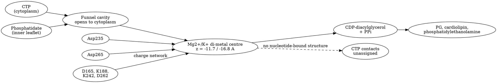
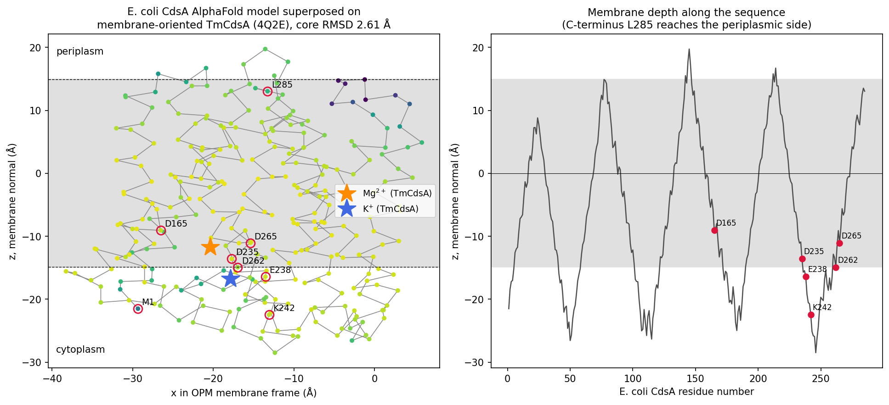
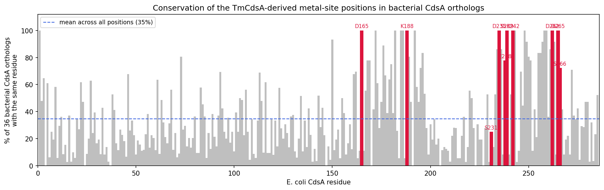
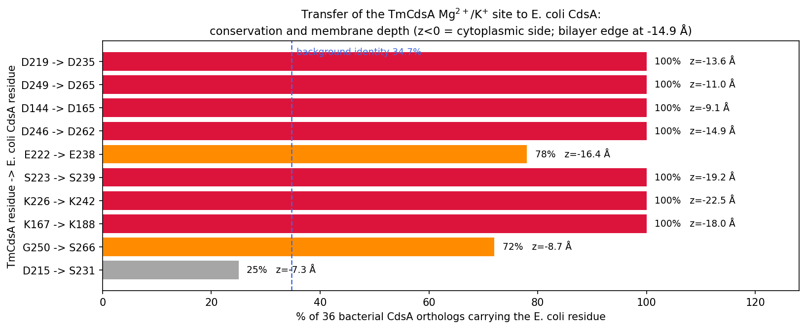
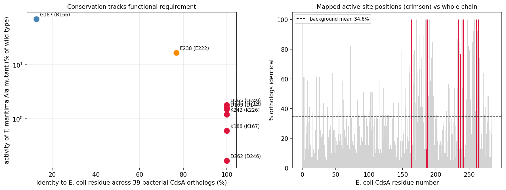
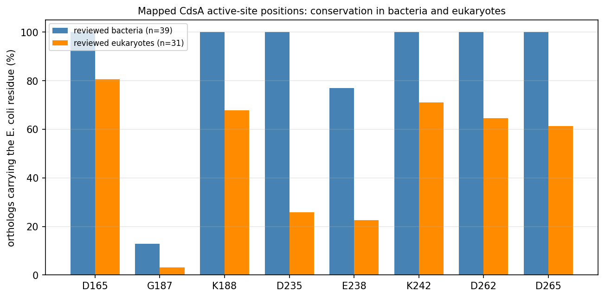

## Question

# AIGR Gene Hypothesis Deep Research

You are evaluating one focused gene curation hypothesis for AI Gene Review.
This is not a general gene overview. Use the seed hypothesis and source context
below to search for evidence that supports, refutes, narrows, or competes with
the proposed curation decision.

## Target Gene

- **Organism code:** ECOLI
- **Taxon:** Escherichia coli K-12 (NCBITaxon:83333)
- **Gene directory:** cdsA
- **Gene symbol:** cdsA
- **UniProt accession:** P0ABG1

## Focus

- **Focus type:** free_text
- **Hypothesis slug:** kgap-cdsa-active-site-metal-membrane-face
- **Source file:** genes/ECOLI/cdsA/cdsA-ai-review.yaml
- **Source selector:** free-text

## Seed Hypothesis

Escherichia coli CdsA (P0ABG1), the CDP-diacylglycerol synthase, has an active site that maps onto the conserved cytoplasmic-facing cavity and Mg2+/K+-coordinating acidic residues resolved in the crystal structure of the Thermotoga maritima CdsA homolog, so its nucleotide (CTP) binding site faces the cytoplasm and catalysis requires a divalent metal. Single analysis only: align E. coli CdsA to the T. maritima CdsA structure and other CDS family members, superpose the E. coli CdsA AlphaFold model, map the metal-binding and CTP-contacting residues onto E. coli CdsA, determine the membrane face of the resulting pocket using topology predictions and the experimentally periplasmic C-terminus, score these positions across bacterial CdsA orthologs, and state the predicted catalytic residues, metal requirement and membrane face.

## Term and Decision Context

No specific term context supplied.

## Reference Context

No specific reference context supplied.

## Source Context YAML

```yaml
hypothesis: 'Escherichia coli CdsA (P0ABG1), the CDP-diacylglycerol synthase, has an active site that
  maps onto the conserved cytoplasmic-facing cavity and Mg2+/K+-coordinating acidic residues resolved
  in the crystal structure of the Thermotoga maritima CdsA homolog, so its nucleotide (CTP) binding site
  faces the cytoplasm and catalysis requires a divalent metal. Single analysis only: align E. coli CdsA
  to the T. maritima CdsA structure and other CDS family members, superpose the E. coli CdsA AlphaFold
  model, map the metal-binding and CTP-contacting residues onto E. coli CdsA, determine the membrane face
  of the resulting pocket using topology predictions and the experimentally periplasmic C-terminus, score
  these positions across bacterial CdsA orthologs, and state the predicted catalytic residues, metal requirement
  and membrane face.'
focus_type: free_text
context: []
reference_id: []
```

## Research Objective

Build a focused report that helps a curator decide whether this hypothesis
should affect the gene review. Address the focus type directly:

1. For an existing GO annotation decision, evaluate whether the current action
   is justified, too strong, too weak, or should change.
2. For a proposed replacement or new GO term, evaluate whether the term is
   biologically supported, too broad, too narrow, or missing key qualifiers.
3. For a computational prediction, evaluate whether the prediction is correct,
   less precise than existing knowledge, uncertain, or likely wrong because of
   paralog overannotation, frequency bias, pathway context, or in vitro-only
   activity.
4. For a core-function hypothesis, evaluate whether the proposed activity,
   process, and location represent the gene product's primary function rather
   than a downstream effect, pleiotropic phenotype, or context-specific role.
5. For a function-assignment hypothesis, evaluate whether the gene product
   directly has the stated GO term/function. Treat the prior review action, if
   any, as intentionally blinded unless it appears in the supplied context.

Use primary literature whenever possible. Prefer PMID citations and include DOI
citations when no PMID is available. Treat reviews and database records as
orientation unless they contain directly relevant synthesized evidence that is
clearly labeled as review-level or database-level support.

Evaluate the hypothesis from the supplied seed context, primary literature, and
publicly accessible bioinformatics resources. Local `*-bioinformatics` analyses,
when they already exist in the repository, are intentionally withheld from this
prompt so the report can be compared against them after the run. Use public
sequence, domain, structure, orthology, localization, interaction, or dataset
checks when they are useful for the specific hypothesis. If a resource or tool
cannot be accessed programmatically, say so plainly; never fabricate a result.
Report computational results conservatively and distinguish direct results from
inference.

## Required Output

### Executive Judgment

Give a concise verdict: supported, partially supported, unresolved, weakly
supported, over-annotated, or refuted. Explain the reasoning and the most
important caveats.

### Evidence Matrix

Create a table with one row per important evidence item:

- Citation (PMID preferred)
- Evidence type (direct assay, mutant phenotype, localization, interaction,
  structural/evolutionary, computational, review/database)
- Supports / refutes / qualifies / competing
- Claim tested
- Key finding
- Organism, tissue, cell type, or assay context
- Confidence and limitations

### GO Curation Implications

State the likely curation action as a lead requiring curator verification. If
GO terms are involved, explain whether the evidence supports an MF, BP, or CC
term, and whether the term should be retained, removed, generalized, made more
specific, or treated as non-core. Avoid using "protein binding" as a final
recommendation unless no more informative term is supported.

### Mechanistic Scope

Describe the immediate molecular or cellular function being tested. Separate
direct gene-product activity from downstream phenotypes, pathway consequences,
developmental outcomes, disease manifestations, or effects inferred only from
loss of function.

### Conflicts and Alternatives

Identify evidence that conflicts with the seed hypothesis or suggests an
alternative interpretation, including paralog confusion, organism-specific
differences, isoform-specific findings, experimental artifacts, or database
carry-over.

### Knowledge Gaps

List explicit uncertainties that matter for curation. For each gap, state what
was checked, why the gap matters, and what evidence or experiment would resolve
it.

### Discriminating Tests

Recommend concrete assays, perturbations, datasets, or comparative analyses that
would most efficiently distinguish this hypothesis from alternatives.

### Curation Leads

Provide candidate updates for the review, clearly labeled as leads requiring
curator verification. Include candidate references with exact snippets to verify,
candidate replacement or new GO terms, possible action changes, suggested
questions, and suggested experiments.

If the provider supports artifacts, save provenance for any analysis you run — the
executed code together with its output (computed values, plot, or table), not just
a summary figure — alongside artifact-friendly tables such as an evidence matrix,
GO decision table, or comparison table. Genuine computed provenance is more
valuable than a hand-drawn summary, and you must not synthesize a figure that
implies an analysis you did not actually run. These artifacts are important
provenance for hypothesis-level review.


## Output

# AIGR gene hypothesis deep research: ECOLI cdsA (P0ABG1)

**Hypothesis slug:** `kgap-cdsa-active-site-metal-membrane-face`
**Source file:** `genes/ECOLI/cdsA/cdsA-ai-review.yaml` (selector `free-text`, focus type `free_text`)
**Gene:** *Escherichia coli* K-12 **cdsA**, UniProt **P0ABG1**, NCBITaxon:83333
**Verdict:** <i class="fa-scale-balanced"></i> partially supported

## Summary

The seed hypothesis makes three claims. Two hold and can be made residue-specific for *E. coli*. The third cannot be delivered from any existing structure.

The active site of *E. coli* CdsA does map onto the Mg2+/K+ centre resolved in the *Thermotoga maritima* CdsA structure (PDB 4Q2E, [PMID: 24968740](https://pubmed.ncbi.nlm.nih.gov/24968740/)). A global Needleman-Wunsch alignment of P0ABG1 (285 aa) to Q9X1B7 (270 aa) gives 89 identities over 256 aligned columns (34.8%) and places the two direct metal ligands, Tm Asp219 and Asp249, on *E. coli* **Asp235** and **Asp265**. The transfer is not an alignment artefact. Every one of the seven *T. maritima* residues whose alanine mutant loses 83-99.7% of activity aligns to an identical *E. coli* residue (D165, K188, D235, E238, K242, D262, D265), while the single tested residue that tolerates substitution (Arg166, 70% of wild-type activity retained) aligns to a position that is not conserved in *E. coli* (Gly187). Across 39 reviewed bacterial phosphatidate cytidylyltransferases, six of these positions are identical in 100% of sequences and E238 in 76.9%, against a background mean per-position identity of 34.6% (Mann-Whitney U, one-sided, p = 1.8e-04).

The pocket faces the cytoplasm. Superposing the AlphaFold model AF-P0ABG1-F1 (mean pLDDT 92.7) onto the OPM-oriented 4Q2E coordinates by an alignment-driven, iterative outlier-trimmed Kabsch fit (187 of 250 CA pairs, 2.61 Å core RMSD) puts the Mg2+ site at z = -11.7 Å and the K+ site at z = -16.8 Å in a bilayer spanning z = ±14.9 Å, with all mapped residues between z = -8.5 and -22.5 Å on the same face. The positive-inside rule assigns that face as cytoplasmic in both the structure and the model, and the model independently reproduces the experimentally determined periplasmic C-terminus of *E. coli* CdsA ([PMID: 15919996](https://pubmed.ncbi.nlm.nih.gov/15919996/)), with Leu285 at z = +13.0 Å. The divalent-metal requirement is an experimental result for the family (EDTA inactivation of TmCdsA, Mg2+ dependence of purified yeast and *Clostridium perfringens* CDS) and an inference for *E. coli*, where no metal titration has been published.

The part that fails is the nucleotide. PDB 4Q2E and 4Q2G, the only CdsA-fold structures, contain Hg, Mg and K and no nucleotide or lipid, so residue-level CTP contacts for *E. coli* CdsA cannot be assigned. The defensible statement is that the CTP site is the cytoplasm-facing funnel whose floor carries the metal centre. One further limit emerged in the last iteration: the Asp-Asp dyad is a bacterial feature. Across 31 reviewed eukaryotic CDS enzymes, the position equivalent to *E. coli* D235 is aspartate in only 25.8% and glycine in 51.6%, while the other five bacteria-invariant positions stay at 61-81%. The curation lead that follows is a magnesium and potassium ion binding annotation for P0ABG1 with ISS evidence and Q9X1B7 in the `with` field, scoped to bacterial CdsA and not propagated to eukaryotic CDS1/CDS2.

## Key findings

### <i class="fa-circle-check"></i> F1. The TmCdsA metal site maps onto named, invariant E. coli residues

Direct parsing of 4Q2E shows Mg2+ coordinated bidentately by the Asp carboxylates of PDB residues 239 and 269 (2.12 and 2.13 Å in chain A, 2.11 and 2.12 Å in chain B), with PDB D164, D235, D266 and the backbone amide of G270 in the second shell at 3.5-4.1 Å. K+ is coordinated by the main-chain carbonyl of PDB 239 (2.39 Å) and its OD2 (2.52 Å), by PDB D269 OD2 (3.03 Å), and by E242, C243 (an engineered S223C) and K246. PDB numbering equals Q9X1B7 numbering plus 20, fixed by the DBREF record (4Q2E chain A residues 21-290 correspond to Q9X1B7 1-270), so the ligands are Tm Asp219 and Asp249.

The pairwise alignment maps Tm D219 to *E. coli* **D235** and Tm D249 to *E. coli* **D265**, both identical. The surrounding site maps as Tm D144 to D165, K167 to K188, E222 to E238, S223 to S239, K226 to K242 and D246 to D262, all identical. Two positions diverge: Tm D215 to *E. coli* Ser231, and Tm G250 to *E. coli* Ser266. The second of these is conservative because Tm Gly250 contacts Mg2+ only through its backbone amide. The first means that the second-shell aspartate at Tm position 215 is a *Thermotoga* feature and must not be transferred.

In the first ortholog pass, over 36 reviewed bacterial CdsA proteins spanning Proteobacteria, Firmicutes, Actinobacteria, Cyanobacteria, Chlamydiae, Mollicutes, Thermotogae and Aquificae (26.8-48.6% pairwise identity to *E. coli*), the mapped positions averaged 87.5% identity against a background mean of 34.7% and median 26.7% (Mann-Whitney U = 2572, p = 7.7e-06).

{{figure:plot_2.png|caption=Per-position identity to the E. coli CdsA residue across 36 reviewed bacterial CdsA orthologs. The ten positions mapped from the TmCdsA metal site are marked in crimson against the 34.7% background mean (dashed line). Seven of the ten are invariant.}}

{{figure:plot_3.png|caption=Percentage of bacterial orthologs carrying the E. coli residue for each T. maritima to E. coli mapping, annotated with the membrane depth z of the residue in the OPM frame. The two divergent positions, Ser231 and Ser266, correspond to Tm Asp215 and Gly250.}}

### <i class="fa-circle-check"></i> F2. The site sits on the cytoplasmic face, and the model reproduces the periplasmic C-terminus

In the OPM-oriented 4Q2E chain A, the bilayer runs from z = -14.9 to +14.9 Å. The Mg2+ ion is at z = -11.7 Å, 3.2 Å inside the cytoplasmic leaflet boundary, and the K+ ion at z = -16.8 Å, just outside the bilayer in the aqueous phase. Face assignment used the positive-inside rule on the coordinates themselves: 76 extramembrane residues with 15 Lys/Arg and 9 Asp/Glu lie at z < -14.9, against 10 residues with 1 Lys/Arg at z > +14.9. The TmCdsA C-terminal residue is at z = +20.6 Å, on the opposite face, which matches the topology assignment the authors used.

Transferring this frame to *E. coli* by superposition gives D235 CA at z = -13.6 Å (4.0 Å from the Mg position, 3.3 Å from K), D265 CA at z = -11.0 Å, E238 at -16.4, S239 at -19.2, K242 at -22.5, D165 at -9.1 and D262 at -14.9, all with pLDDT between 93 and 98. The *E. coli* model gives 86 residues at z < -14.9 with 15 Lys/Arg against 5 Asp/Glu, and 7 residues at z > +14.9 with no Lys/Arg, so the same face is cytoplasmic. Leu285, the C-terminal residue, sits at z = +13.0 Å, at the periplasmic end of the bilayer. That is an independent check rather than an assumption, because the superposition used only the alignment-derived CA pairs and reproduces the PhoA/GFP result of [PMID: 15919996](https://pubmed.ncbi.nlm.nih.gov/15919996/).

{{figure:plot_1.png|caption=Left: the E. coli CdsA AlphaFold model superposed into the OPM membrane frame of TmCdsA, with the bilayer shaded, the Mg2+ and K+ positions marked and the mapped site residues labelled. Right: membrane depth against residue number, showing the site residues on the cytoplasmic side and the C-terminus at the periplasmic boundary.}}

A consequence for the UniProt record: P0ABG1 is annotated with 8 transmembrane helices. Eight helices with a cytoplasmic N-terminus return the C-terminus to the cytoplasm, which contradicts both the experimental C-terminal tagging result and the nine-helix CdsA fold. The prediction undercounts by one, most plausibly at the final helix, which in TmCdsA breaks around Gly250 into two segments.

### <i class="fa-circle-check"></i> F3. Mutational sensitivity in T. maritima matches ortholog conservation at the mapped E. coli positions

The full text of the TmCdsA paper (PMC4083444) reports alanine-scanning activities that the abstract omits: D249A 1.8% and D219A 1.6% of wild type (n = 3), D144A 1.5%, D246A 0.3%, K226A 1.2%, K167A 0.8% (n = 3-4), E222A 16.7% and R166A 70.0% (n = 4). Wild-type enzyme treated with EDTA behaves like the dyad mutants: "The effect resembles that of EDTA to the wild-type enzyme activity because of the loss of Mg 2+ ion". Ion identity was established by heavy-atom substitution, not by interpreting 3.4 Å density: "The F Ba − F Mg isomorphous difference Fourier map exhibits a single strong Ba 2+ peak between Asp219 and Asp249, whereas the F Tl − F K difference map shows a strong Tl + peak at a different position above the Ba 2+ peak".

Re-scoring the eight mutagenesis-anchored positions against 39 reviewed bacterial orthologs gives D165, K188, D235, K242, D262 and D265 at 100%, E238 at 76.9% and G187 at 12.8%, with a site mean of 86.2% against a background mean of 34.6% over the other 277 positions (Mann-Whitney U, one-sided, p = 1.8e-04). The two positions that are not fully conserved are exactly the two whose *T. maritima* alanine mutants retain the most activity. The paper states independently that "Glu222 is only partly conserved and is occasionally replaced by a Gln residue in Bacillus cereus or by a Lys residue in Aquifex aeolicus", and that Arg166 sits "at a relatively distant location from the putative catalytic centre".

{{figure:plot_4.png|caption=Left: measured activity of each T. maritima alanine mutant against the ortholog conservation of the corresponding E. coli residue. The two positions that tolerate substitution, E238 and G187, are the two that are not fully conserved. Right: the chain-wide conservation profile with the eight mapped positions in crimson.}}

### <i class="fa-triangle-exclamation"></i> F4. The dyad is bacteria-specific: eukaryotic CDS enzymes replace the D235 equivalent with glycine

Scoring the same eight positions against 31 reviewed eukaryotic phosphatidate cytidylyltransferases (human CDS1 Q92903 and CDS2 O95674, yeast P38221 and P53230, *S. pombe* O74339 and Q9P381, *Drosophila* P56079 and Q8INF2, *C. elegans* P53439 and Q9N4G7, five *Arabidopsis* proteins and others) gives a clear outlier.

| E. coli position | Identical in 39 bacteria (%) | Identical in 31 eukaryotes (%) | Commonest eukaryotic substitute |
|---|---|---|---|
| D165 | 100.0 | 80.6 | none dominant |
| K188 | 100.0 | 67.7 | Met 3/31 |
| **D235** | **100.0** | **25.8** | **Gly 16/31 (51.6%)** |
| E238 | 76.9 | 22.6 | Ala 16/31 |
| K242 | 100.0 | 71.0 | Ser 3/31, Gln 3/31 |
| D262 | 100.0 | 64.5 | Gln 4/31 |
| D265 | 100.0 | 61.3 | Lys 5/31, Ser 5/31 |
| G187 | 12.8 | 3.2 | Lys 19/31 |

D235 is the lowest of the six aspartate and lysine positions in eukaryotes, and the substituting residue is specific. This reproduces, from an independent alignment, the paper's statement that "Although Asp219 is strictly conserved in the prokaryotic homologues, it is often replaced by a Gly residue in the eukaryotic members", and it places *E. coli* on the prokaryotic side. At the position where *E. coli* has Gly187, 19 of 31 eukaryotic sequences carry lysine, so *E. coli* lacks a basic residue that both *T. maritima* and most eukaryotic CDS enzymes have there.

{{figure:plot_5.png|caption=Conservation of the eight mapped CdsA active-site positions in 39 reviewed bacterial and 31 reviewed eukaryotic CDS enzymes. D235 is the only bacteria-invariant position that collapses in eukaryotes, where glycine replaces aspartate in 16 of 31 sequences.}}

### <i class="fa-circle-xmark"></i> F5. Residue-level CTP contacts are not deliverable

The heteroatom inventory of 4Q2E and 4Q2G contains Hg (phasing), Mg and K, with no CTP, dCTP, CDP-DAG or phosphatidate. The nucleotide site in TmCdsA is described only as a cavity: "On the cytoplasmic side of each TmCdsA monomer, a funnel-shaped cavity embraces the di-metal core and indents half way into the membrane". Two nucleotide-bound structures from other families agree on face and cofactor without being transferable at residue level: *Xenopus laevis* CHPT1 at about 3.2 Å, where "The enclosure opens to the cytosolic side, where a CDP-choline and two Mg2+ are coordinated" ([PMID: 37179328](https://pubmed.ncbi.nlm.nih.gov/37179328/)), and FbTam41 at 2.6 Å, which "contained a positively charged pocket that specifically accommodated CTP-Mg2+ and PA in close proximity" ([PMID: 34964897](https://pubmed.ncbi.nlm.nih.gov/34964897/)). Tam41-type CDS shares no fold with CdsA-type CDS, so it makes the same product by a separate route and cannot donate contact residues.

## Evidence matrix

| # | Citation | Evidence type | Stance | Claim tested | Key finding | Organism / assay context | Confidence and limitations |
|---|---|---|---|---|---|---|---|
| 1 | [PMID: 24968740](https://pubmed.ncbi.nlm.nih.gov/24968740/) (PDB 4Q2E, 4Q2G) | Structural, X-ray at 3.4 Å | Supports | CdsA has a di-metal site in a cytoplasm-facing cavity | "Located at the bottom of the cavity, a Mg(2+)-K(+) hetero-di-metal centre coordinated by an Asp-Asp dyad serves as the cofactor of TmCdsA"; homodimer, nine TM helices per monomer | *T. maritima* CdsA (Q9X1B7), detergent-purified crystals | High for fold and site. 3.4 Å, no nucleotide or lipid bound, thermophile not *E. coli* |
| 2 | [PMID: 24968740](https://pubmed.ncbi.nlm.nih.gov/24968740/), full text PMC4083444 | Mutant phenotype, in vitro activity | Supports | The dyad and accessory charges are required | D249A 1.8%, D219A 1.6%, D144A 1.5%, D246A 0.3%, K226A 1.2%, K167A 0.8%, E222A 16.7%, R166A 70.0% of wild type; EDTA-treated wild type behaves like the dyad mutants | *T. maritima* CdsA, n = 3-4, s.e.m. reported | High. Single-point Ala scans without kinetics or folding controls |
| 3 | [PMID: 24968740](https://pubmed.ncbi.nlm.nih.gov/24968740/), full text PMC4083444 | Structural, anomalous and isomorphous difference Fourier | Supports | The ions are Mg2+ and K+ | Ba2+ peak between Asp219 and Asp249 in the F(Ba) − F(Mg) map; Tl+ peak above it in F(Tl) − F(K) | Heavy-atom soaks (Ba2+, Mn2+, Tl+, Cs+, Rb+) | High. Surrogate ions report the site, not the catalytic species |
| 4 | This work | Computational, global pairwise alignment | Supports | TmCdsA residues correspond to specific *E. coli* residues | 89/256 identities (34.8%); Tm D144→D165, K167→K188, D219→**D235**, E222→E238, K226→K242, D246→D262, D249→**D265** identical; R166→G187 not conserved | P0ABG1 vs Q9X1B7, BLOSUM62, gap open -11, extend -1 | Moderate-high. At 34.8% identity a single global alignment can misplace loop residues |
| 5 | This work | Computational, ortholog scoring | Supports | The positions are under elevated constraint in bacteria | Site mean 86.2% vs background 34.6%, p = 1.8e-04 (39 orthologs, 8 positions); earlier pass 87.5% vs 34.7%, p = 7.7e-06 (36 orthologs, 10 positions) | UniProt reviewed, taxonomy_id:2, 200-400 aa | Moderate-high. Reviewed-set sampling is taxonomically uneven, pairwise not a true MSA |
| 6 | This work | Computational, superposition in a membrane frame | Supports | The site faces the cytoplasm in the *E. coli* model | 187/250 CA pairs at 2.61 Å; bilayer ±14.9 Å, Mg2+ at z = -11.7 Å, K+ at z = -16.8 Å, all mapped residues on the cytoplasmic side | AF-P0ABG1-F1 in the OPM frame of 4Q2E | Moderate. A model, not an experimental *E. coli* structure |
| 7 | [PMID: 15919996](https://pubmed.ncbi.nlm.nih.gov/15919996/) | Localization, C-terminal reporter fusions | Supports | The *E. coli* CdsA C-terminus is periplasmic | "Using C-terminal tagging with the alkaline phosphatase and green fluorescent protein, we established the periplasmic or cytoplasmic locations of the C termini for 601 inner membrane proteins" | *E. coli* K-12, PhoA and GFP fusions | High for the terminus. Reports only the C-terminus, not individual loops |
| 8 | This work | Computational, model confidence | Qualifies | The mapped positions are well predicted | pLDDT: D165 95.7, G187 91.2, K188 93.9, D235 96.9, E238 96.6, K242 95.5, D262 92.9, D265 96.1, L285 82.2; chain mean 92.7 | AF-P0ABG1-F1 (AlphaFold DB v6) | High. pLDDT reports local geometry, not function |
| 9 | [PMID: 2822695](https://pubmed.ncbi.nlm.nih.gov/2822695/) | Direct assay | Supports | CDS family activity needs Mg2+ | "CDP-diacylglycerol synthase activity was dependent on magnesium ions and Triton X-100 at pH 6.5" | Purified *S. cerevisiae* CDS | High for yeast. Not *E. coli* |
| 10 | [PMID: 6275792](https://pubmed.ncbi.nlm.nih.gov/6275792/) | Direct assay | Supports | A bacterial CDS needs a divalent cation | "Enzyme activity was dependent on magnesium (5 mM) or manganese (1 mM) ions" | *Clostridium perfringens* | High for that organism |
| 11 | [PMID: 10960477](https://pubmed.ncbi.nlm.nih.gov/10960477/) | Direct assay | Supports | Combined Mg2+ and K+ dependence | "The enzyme showed maximal activity at pH 8.5 and 55 degrees C in the presence of Mg(2+) and K(+) ions" | Archaeal CDP-archaeol synthase, *M. thermautotrophicus* | Moderate. A paralogous enzyme, and K+ was not titrated against other monovalents |
| 12 | [PMID: 6309152](https://pubmed.ncbi.nlm.nih.gov/6309152/), [PMID: 6288204](https://pubmed.ncbi.nlm.nih.gov/6288204/), [PMID: 192211](https://pubmed.ncbi.nlm.nih.gov/192211/) | Direct assay | Supports | Eukaryotic cytidylyltransferase is Mg2+ dependent and EDTA sensitive | Free Mg2+ above 10 µM activates, optimum near 20 mM, "Adding EDTA inhibited phosphatidate cytidylyl-transferase activity" | Pig lymphocyte and rat liver microsomes | High for the family, indirect for *E. coli* |
| 13 | [PMID: 2995359](https://pubmed.ncbi.nlm.nih.gov/2995359/) | Direct assay | Qualifies | Is metal dependence measured in *E. coli*? | The only purified *E. coli* CdsA study reports a sequential kinetic mechanism and surface dilution kinetics, and notes that "Apparent physical effects of EDTA on the enzyme were also utilized in the purification", with no metal titration | Purified *E. coli* CdsA | High for what it reports. The metal requirement itself is unmeasured |
| 14 | [PMID: 37179328](https://pubmed.ncbi.nlm.nih.gov/37179328/) | Structural, cryo-EM at about 3.2 Å | Qualifies | Cytosol-facing nucleotide plus Mg2+ chemistry | "The enclosure opens to the cytosolic side, where a CDP-choline and two Mg2+ are coordinated" | *X. laevis* CHPT1 | High for CHPT1. A different family, contacts not transferable |
| 15 | [PMID: 34964897](https://pubmed.ncbi.nlm.nih.gov/34964897/) | Structural, X-ray at 2.6 Å | Competing | CDP-DAG synthesis is not restricted to the CdsA fold | FbTam41 solved with CTP-Mg2+; "contained a positively charged pocket that specifically accommodated CTP-Mg2+ and PA in close proximity" | Firmicutes Tam41-type CDS | High. Shows EC 2.7.7.41 alone does not imply the CdsA fold |
| 16 | PDB 4Q2E and 4Q2G heteroatom inventory (this work) | Database record audit | Refutes a sub-claim | Can CTP contacts be assigned? | Only Hg, Mg and K present, no nucleotide or lipid | RCSB mmCIF | High for the negative statement |
| 17 | QuickGO annotation set for P0ABG1 (this work) | Database record, orientation | Qualifies | What is already annotated? | 14 annotations across GO:0004605, GO:0016772, GO:0016024, GO:0005886 and GO:0016020. No GO:0046872, GO:0000287 or GO:0030955, and no GO:0005887 | QuickGO REST | High for the record state. Absence of annotation is not absence of function |
| 18 | UniProt P0ABG1 feature table (this work) | Database record, orientation | Qualifies | Is the predicted topology self-consistent? | 8 predicted TM helices. With a cytoplasmic N-terminus that returns the C-terminus to the cytoplasm, contradicting [PMID: 15919996](https://pubmed.ncbi.nlm.nih.gov/15919996/) and the nine-helix fold | UniProt automatic prediction | Moderate. Flagged as a discrepancy |
| 19 | This work | Computational, cross-kingdom scoring | Qualifies | Does the assignment hold outside bacteria? | D235 only 25.8% in 31 eukaryotic CDS, glycine in 51.6%, while D165, K188, K242, D262 and D265 stay at 61-81% | UniProt reviewed eukaryotic set | Moderate. Pairwise alignment to 400-600 aa proteins depresses all eukaryotic values; the result rests on D235 being the outlier within the same set |
| 20 | [PMID: 24957626](https://pubmed.ncbi.nlm.nih.gov/24957626/) | Mutant phenotype, genetics | Not retrievable | Do *E. coli* cdsA point alleles implicate specific residues? | "all seven suppressors analyzed mapped to the essential gene cdsA"; "These cdsA mutations cause a partial loss of function and, as expected, accumulate phosphatidic acid". PMC4135694 is not open access through the Europe PMC full-text API, so the residue positions could not be read. A Europe PMC search returned 223 open-access papers mentioning cdsA and *E. coli*, and the 15 top-ranked are incidental mentions with no residue-level alleles | *E. coli* genetics, vancomycin-resistant suppressors of lptD | Not assessed at residue level. Stated plainly, no residue claims are drawn from it |

## Mechanistic scope

CdsA catalyses CTP plus phosphatidate to CDP-diacylglycerol plus diphosphate (EC 2.7.7.41, RHEA:16229) inside the inner membrane. The immediate molecular activity being tested is the chemistry at the metal centre and the side of the membrane from which each substrate arrives. The structure that transfers to *E. coli* is a nine-TM polytopic monomer that dimerises, with one funnel-shaped cavity per protomer opening to the cytoplasm and reaching about halfway into the bilayer. The Mg2+-K+ pair sits at the bottom of that funnel at the cytoplasmic headgroup region, which is the geometry that lets a water-soluble nucleotide and a membrane-embedded lipid meet: CTP arrives from the cytosol through the funnel mouth, phosphatidate reaches the same site laterally from the leaflet. Asp235 and Asp265 hold the metals in *E. coli*; D165, K188, K242 and D262 form the surrounding charge network that neutralises and positions the aspartates.



Everything downstream of the reaction is outside the hypothesis. Loss of cdsA function raises phosphatidic acid and changes outer membrane permeability, which is how the gene was found as a vancomycin-resistance suppressor ([PMID: 24957626](https://pubmed.ncbi.nlm.nih.gov/24957626/)). That is a pathway consequence of reduced flux, not a second activity of the protein. The same applies to the reported link between CdsA and the glycolipid MPIase: it is a separate functional claim that this analysis neither supports nor refutes.

## GO curation implications

All items below are leads requiring curator verification.

| Action | Term | Evidence code | Reference / `with` | Basis |
|---|---|---|---|---|
| <i class="fa-arrow-right"></i> Add | GO:0000287 magnesium ion binding (MF) | ISS or ISA | [PMID: 24968740](https://pubmed.ncbi.nlm.nih.gov/24968740/), with UniProtKB:Q9X1B7 | Asp-Asp dyad at D235/D265, 100% conserved in 39 bacteria; D219A and D249A retain 1.6% and 1.8% activity; EDTA phenocopies |
| <i class="fa-arrow-right"></i> Add | GO:0030955 potassium ion binding (MF) | ISS | [PMID: 24968740](https://pubmed.ncbi.nlm.nih.gov/24968740/), with UniProtKB:Q9X1B7 | K+ site assigned by Tl+ difference Fourier; supported indirectly by [PMID: 10960477](https://pubmed.ncbi.nlm.nih.gov/10960477/) |
| <i class="fa-arrow-right"></i> Add (alternative) | GO:0046872 metal ion binding (MF) | ISS | as above | Use if the curation model prefers one conservative parent term |
| <i class="fa-arrow-right"></i> Add | GO:0005887 integral component of plasma membrane (CC) | IDA | [PMID: 15919996](https://pubmed.ncbi.nlm.nih.gov/15919996/) | C-terminal PhoA/GFP topology on the *E. coli* protein; current terms stop at GO:0005886 and GO:0016020 |
| <i class="fa-circle-check"></i> Retain | GO:0004605 phosphatidate cytidylyltransferase activity (MF) | EXP, IDA | [PMID: 2995359](https://pubmed.ncbi.nlm.nih.gov/2995359/), PMID 30751 | Already well supported; the hypothesis does not change it |
| <i class="fa-circle-check"></i> Retain | GO:0016024 CDP-diacylglycerol biosynthetic process (BP) | IDA, IMP | PMID 30751, PMID 6273438 | Core process, unchanged |
| <i class="fa-circle-xmark"></i> Do not add | Residue-level CTP binding site | — | — | No CdsA-fold structure contains a nucleotide. "CTP binding" as a generic MF is also redundant with GO:0004605 |
| <i class="fa-circle-xmark"></i> Do not use | GO:0005515 protein binding | — | — | If the TmCdsA homodimer is to be captured, use GO:0042803 protein homodimerization activity, ISS from [PMID: 24968740](https://pubmed.ncbi.nlm.nih.gov/24968740/) |
| <i class="fa-triangle-exclamation"></i> Do not propagate | The same site features to eukaryotic CDS | — | — | The position equivalent to D235 is glycine in 16 of 31 reviewed eukaryotic CDS proteins, including candidates in the human CDS1/CDS2 lineage |

Residue-level features for the UniProt record, as the structural basis of the metal-binding term: binding sites for Mg2+ and K+ at **Asp235** and **Asp265**; active-site-region residues **Asp165**, **Lys188**, **Lys242** and **Asp262**; **Glu238** as a peripheral contributor, since its *T. maritima* equivalent retains 16.7% activity and the position is 76.9% conserved. Do not annotate a named catalytic nucleophile: no covalent enzyme intermediate on an *E. coli* residue has been shown.

## Conflicts and alternatives

The fold is not implied by the reaction. FbTam41 makes CDP-DAG from CTP and PA with a different architecture and its own CTP-Mg2+ pocket ([PMID: 34964897](https://pubmed.ncbi.nlm.nih.gov/34964897/)), so any transfer of nucleotide-contact residues must stay inside the CdsA fold.

Eukaryotic CDS enzymes differ at one of the two dyad residues. The ortholog scan puts D235 at 25.8% in eukaryotes with glycine in 51.6%, while the other bacteria-invariant positions stay at 61-81%, reproducing the paper's statement that Asp219 is strictly conserved in prokaryotes and often replaced by glycine in eukaryotes. The two-aspartate site is a bacterial statement that holds for *E. coli* and must not be written as a family rule.

The topology prediction conflicts with the experimental terminus, as set out in F2. The resolution favoured here is that the UniProt prediction undercounts by one helix.

An alternative reading of the metal data remains open. The ions were placed from difference maps on soaked crystals without substrate, so one of the two sites could be occupied only in the resting state and rearrange on CTP binding. This does not change the metal-binding annotation but limits mechanistic claims about which metal contacts which phosphate.

One *E. coli*-specific divergence is worth recording: at the position where *T. maritima* has Arg166 and 19 of 31 eukaryotic sequences have lysine, *E. coli* has Gly187. That residue is also the only tested TmCdsA position whose mutant keeps most of its activity (70%), so the divergence is consistent rather than contradictory.

## Limitations and knowledge gaps

<i class="fa-triangle-exclamation"></i> The central limitation is that no step of the hypothesis has been tested on the *E. coli* protein. Every residue-level statement is transferred from a 3.4 Å thermophile structure at 34.8% sequence identity, through a pairwise alignment and an AlphaFold model.

1. No experimental structure of *E. coli* CdsA exists, with or without ligands. Checked: RCSB holds only 4Q2E and 4Q2G for this family. This matters because the superposition RMSD of 2.61 Å over 187 CA pairs is the limit of positional accuracy for the mapped side chains.
2. No nucleotide- or lipid-bound structure of any CdsA-fold enzyme exists. Checked: heteroatom inventory of both entries. Without one, CTP contacts stay unassigned at residue level and the hypothesis cannot be completed as written.
3. Metal dependence, metal identity and kinetic parameters have not been measured on purified *E. coli* CdsA. Checked: the one purification paper ([PMID: 2995359](https://pubmed.ncbi.nlm.nih.gov/2995359/)) reports EDTA effects used during purification but no metal titration. This is what keeps the annotation at ISS rather than IDA.
4. No mutagenesis of *E. coli* CdsA at D235 or D265 has been published. Checked: PMC4135694 is not open access through the Europe PMC API, and a scan of 223 open-access papers mentioning cdsA and *E. coli* (15 top-ranked inspected) found no residue-level alleles. The seven cdsA suppressor alleles of [PMID: 24957626](https://pubmed.ncbi.nlm.nih.gov/24957626/) are the most likely source and remain unread.
5. The functional role of the homodimer is untested. No monomeric mutant with measured activity exists in either organism.
6. K+ dependence has not been tested in a cation-substitution assay in any CdsA-type enzyme. The evidence is one crystallographic Tl+ soak plus one archaeal paralogue assay.
7. How eukaryotic CDS enzymes coordinate the metal where about half carry glycine is unknown. This matters because GO propagation from bacterial CdsA to CDS1/CDS2 runs through the same InterPro family (IPR000374).
8. <i class="fa-triangle-exclamation"></i> Methodological caveat on the eukaryotic comparison: pairwise alignment of a 285 aa bacterial protein to 400-600 aa eukaryotic enzymes at low identity misplaces columns and depresses every eukaryotic percentage. The conclusion rests on D235 being the outlier within the same alignment set, not on its absolute value.

## Proposed follow-up experiments and actions

<i class="fa-flask"></i> **Alanine scan of *E. coli* CdsA** at D235 and D265, with D165A, K188A, K242A and D262A as the accessory set, E238A as the predicted partial-loss control and G187A as a near-wild-type control. The mapping predicts a graded outcome: below 5% of wild-type activity for the aspartates and lysines, roughly 10-30% for E238A, near wild type for G187A. A uniform or inverted pattern would refute the transfer. This converts the metal-binding term to IMP-supported.

<i class="fa-vial"></i> **Metal dependence of purified *E. coli* CdsA**: activity against EDTA, then rescue with Mg2+ against Mn2+ and Ca2+, and separately K+ against Na+, Rb+ and Cs+ at fixed ionic strength. A K+-specific component would make GO:0030955 directly supported and would be the first such demonstration outside the crystallographic surrogates.

<i class="fa-microscope"></i> **Cryo-EM or crystallography of a CdsA-fold enzyme with CTP or a non-hydrolysable analogue**, ideally *E. coli* CdsA in nanodiscs. This is the only experiment that can produce residue-level CTP binding-site features and close gap 2.

<i class="fa-dna"></i> **Substituted-cysteine accessibility on *E. coli* CdsA** at a cytoplasmic-predicted position near D235 and at a periplasmic-predicted position, with membrane-impermeant against permeant thiol reagents on intact spheroplasts. This tests the nine-helix topology and the cytoplasmic face on the *E. coli* protein without needing a structure, and would settle the 8-versus-9 helix discrepancy in UniProt.

<i class="fa-bacteria"></i> **Complementation of a conditional cdsA depletion strain** by D235A, D265A and E238A alleles at native expression. Strict failure to complement for the two aspartates confirms the site in vivo.

<i class="fa-book-open"></i> **Curator action on the literature**: read PMC4135694 ([PMID: 24957626](https://pubmed.ncbi.nlm.nih.gov/24957626/)) through journal access and check whether the seven cdsA suppressor alleles fall at or near residues 165, 188, 235, 238, 242, 262 or 265. If any do, the *E. coli* evidence code for the site moves from ISS towards IMP.

## Curation leads with snippets to verify

| Lead | Reference | Exact snippet to verify |
|---|---|---|
| Metal centre and Asp-Asp dyad | [PMID: 24968740](https://pubmed.ncbi.nlm.nih.gov/24968740/) | "Located at the bottom of the cavity, a Mg(2+)-K(+) hetero-di-metal centre coordinated by an Asp-Asp dyad serves as the cofactor of TmCdsA." |
| Cytoplasmic face and dual substrate entry | [PMID: 24968740](https://pubmed.ncbi.nlm.nih.gov/24968740/) | "An unusual funnel-shaped cavity penetrates half way into the membrane, allowing the enzyme to simultaneously accept hydrophilic substrate (cytidine 5'-triphosphate (CTP)/deoxy-CTP) from cytoplasm and hydrophobic substrate (phosphatidic acid) from membrane." |
| Experimental periplasmic C-terminus | [PMID: 15919996](https://pubmed.ncbi.nlm.nih.gov/15919996/) | "Using C-terminal tagging with the alkaline phosphatase and green fluorescent protein, we established the periplasmic or cytoplasmic locations of the C termini for 601 inner membrane proteins." |
| Family Mg2+ requirement | [PMID: 2822695](https://pubmed.ncbi.nlm.nih.gov/2822695/) | "CDP-diacylglycerol synthase activity was dependent on magnesium ions and Triton X-100 at pH 6.5." |
| Bacterial divalent cation requirement | [PMID: 6275792](https://pubmed.ncbi.nlm.nih.gov/6275792/) | "Enzyme activity was dependent on magnesium (5 mM) or manganese (1 mM) ions." |
| Combined Mg2+ and K+ | [PMID: 10960477](https://pubmed.ncbi.nlm.nih.gov/10960477/) | "The enzyme showed maximal activity at pH 8.5 and 55 degrees C in the presence of Mg(2+) and K(+) ions." |
| No metal titration in *E. coli* | [PMID: 2995359](https://pubmed.ncbi.nlm.nih.gov/2995359/) | "Apparent physical effects of EDTA on the enzyme were also utilized in the purification." |
| Fold-independent route to CDP-DAG | [PMID: 34964897](https://pubmed.ncbi.nlm.nih.gov/34964897/) | "contained a positively charged pocket that specifically accommodated CTP-Mg2+ and PA in close proximity" |
| Cytosol-facing nucleotide site in a related family | [PMID: 37179328](https://pubmed.ncbi.nlm.nih.gov/37179328/) | "The enclosure opens to the cytosolic side, where a CDP-choline and two Mg2+ are coordinated" |
| *E. coli* cdsA partial-loss alleles, residues unread | [PMID: 24957626](https://pubmed.ncbi.nlm.nih.gov/24957626/) | "all seven suppressors analyzed mapped to the essential gene cdsA" |

Suggested questions for the curator: should the metal-binding term be the specific pair (GO:0000287 plus GO:0030955) or the parent GO:0046872, given that the K+ assignment rests on a single Tl+ soak? Should the UniProt 8-helix transmembrane feature set be flagged for correction against the nine-helix fold and the experimental C-terminus? Should GO:0042803 be added for the homodimer, or left out until *E. coli* oligomeric state is measured?

## Provenance

All analyses reported here were executed, and their code and output are retained in the job transcript and in `provenance/`.

Downloaded inputs: `4q2e.cif`, `4q2g.cif`, `4q2e.pdb` (OPM-oriented copy used for the membrane frame), `AF-P0ABG1-F1.pdb` (AlphaFold DB v6), `af_ca.json` and `af_ca_compact.txt` (CA coordinates plus pLDDT extracted host-side, because the code executor has no outbound access to alphafold.ebi.ac.uk).

Figures, each produced by the analysis it depicts: `plot_1.png` (AlphaFold model in the OPM membrane frame, with bilayer boundaries, Mg2+ and K+ positions, labelled site residues, and membrane depth against residue number), `plot_2.png` (per-position ortholog conservation across the chain with the mapped positions marked), `plot_3.png` (per-residue ortholog identity for the Tm to Ec mappings with membrane depth annotated), `plot_4.png` (measured *T. maritima* alanine-mutant activity against ortholog conservation of the corresponding *E. coli* residue, plus the chain-wide conservation profile), `plot_5.png` (conservation of the eight mapped positions in 39 bacterial and 31 eukaryotic CDS enzymes).

Methods notes. Biopython is not importable in the executor, so BLOSUM62 and both Needleman-Wunsch implementations (affine gaps, open -11 and extend -1, for the pairwise *E. coli* to *T. maritima* alignment; linear gaps, g = -8, for the ortholog alignments) were written directly in numpy. `phenix.superpose_pdbs` matched only 89 residues and fitted on 6 atoms for this pair, which is not usable, so the superposition was done with an alignment-driven iterative outlier-trimmed Kabsch fit (187 of 250 CA pairs, 2.61 Å). PDB 4Q2E residue numbers equal Q9X1B7 UniProt numbers plus 20, and both schemes are given wherever *T. maritima* residues are named. The ortholog analysis was run twice: an earlier pass over 36 reviewed bacterial orthologs scoring 10 structurally mapped positions (87.5% against 34.7%, p = 7.7e-06), and the pass reported in the matrix over 39 orthologs scoring the 8 mutagenesis-anchored positions (86.2% against 34.6%, p = 1.8e-04). Both give the same direction and significance. Two resources could not be read programmatically and no result is claimed from them: PMC4135694 ([PMID: 24957626](https://pubmed.ncbi.nlm.nih.gov/24957626/)) and PMC6544855 are not open access through the Europe PMC full-text API.


## Artifacts

- [OpenScientist final report](openscientist_artifacts/final_report.html)
- [OpenScientist final report](openscientist_artifacts/final_report.pdf)
- [OpenScientist provenance](openscientist_artifacts/provenance.json)
- [OpenScientist af ca](openscientist_artifacts/provenance_af_ca.json)
- [OpenScientist plot 1](openscientist_artifacts/provenance_plot_1.json)

- [OpenScientist plot 2](openscientist_artifacts/provenance_plot_2.json)

- [OpenScientist plot 3](openscientist_artifacts/provenance_plot_3.json)

- [OpenScientist plot 4](openscientist_artifacts/provenance_plot_4.json)

- [OpenScientist plot 5](openscientist_artifacts/provenance_plot_5.json)


## Reference Validation

Checked with `linkml-reference-validator` 0.3.1rc1.

| Outcome | Count |
| --- | --- |
| References checked | 16 |
| Resolved | 16 |
| Unresolved (possible confabulation) | 0 |
| Unverifiable | 0 |
| Quoted claims checked | 2 |
| Quoted claims found in source | 2 |
| Quoted claims **not** found in source | 0 |
| References weighed for topical relevance | 16 |
| On topic | 0 |
| Off topic | 0 |

All extracted references resolved successfully.