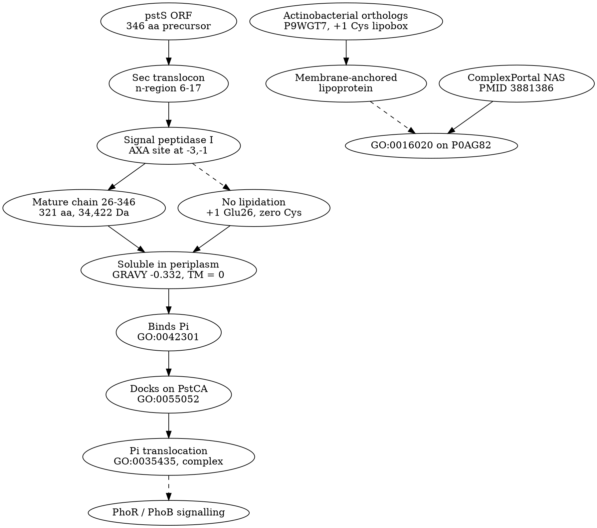
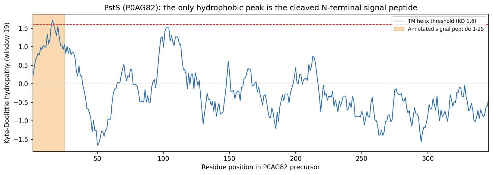
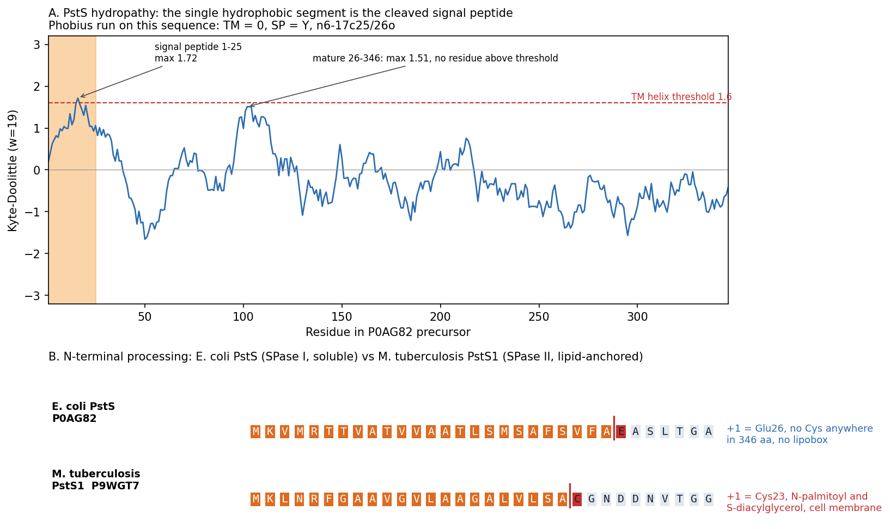
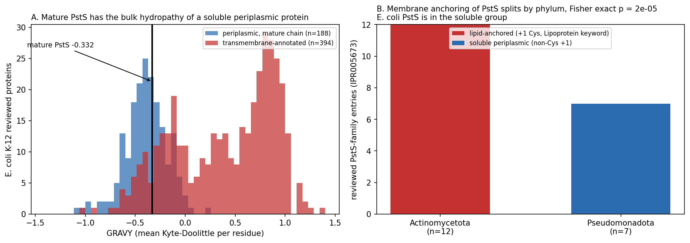

## Question

# AIGR Gene Hypothesis Deep Research

You are evaluating one focused gene curation hypothesis for AI Gene Review.
This is not a general gene overview. Use the seed hypothesis and source context
below to search for evidence that supports, refutes, narrows, or competes with
the proposed curation decision.

## Target Gene

- **Organism code:** ECOLI
- **Taxon:** Escherichia coli K-12 (NCBITaxon:83333)
- **Gene directory:** pstS
- **Gene symbol:** pstS
- **UniProt accession:** P0AG82

## Focus

- **Focus type:** free_text
- **Hypothesis slug:** psts-periplasmic-soluble
- **Source file:** genes/ECOLI/pstS/pstS-ai-review.yaml
- **Source selector:** free-text

## Seed Hypothesis

E. coli PstS is a soluble periplasmic phosphate-binding protein with a cleaved signal peptide and no membrane anchor, rather than a membrane-located protein.

## Term and Decision Context

- Decisive analysis: signal-peptide and transmembrane prediction on PstS, checked against the mature-protein data.

## Reference Context

No specific reference context supplied.

## Source Context YAML

```yaml
hypothesis: E. coli PstS is a soluble periplasmic phosphate-binding protein with a cleaved signal peptide
  and no membrane anchor, rather than a membrane-located protein.
focus_type: free_text
context:
- 'Decisive analysis: signal-peptide and transmembrane prediction on PstS, checked against the mature-protein
  data.'
reference_id: []
```

## Research Objective

Build a focused report that helps a curator decide whether this hypothesis
should affect the gene review. Address the focus type directly:

1. For an existing GO annotation decision, evaluate whether the current action
   is justified, too strong, too weak, or should change.
2. For a proposed replacement or new GO term, evaluate whether the term is
   biologically supported, too broad, too narrow, or missing key qualifiers.
3. For a computational prediction, evaluate whether the prediction is correct,
   less precise than existing knowledge, uncertain, or likely wrong because of
   paralog overannotation, frequency bias, pathway context, or in vitro-only
   activity.
4. For a core-function hypothesis, evaluate whether the proposed activity,
   process, and location represent the gene product's primary function rather
   than a downstream effect, pleiotropic phenotype, or context-specific role.
5. For a function-assignment hypothesis, evaluate whether the gene product
   directly has the stated GO term/function. Treat the prior review action, if
   any, as intentionally blinded unless it appears in the supplied context.

Use primary literature whenever possible. Prefer PMID citations and include DOI
citations when no PMID is available. Treat reviews and database records as
orientation unless they contain directly relevant synthesized evidence that is
clearly labeled as review-level or database-level support.

Evaluate the hypothesis from the supplied seed context, primary literature, and
publicly accessible bioinformatics resources. Local `*-bioinformatics` analyses,
when they already exist in the repository, are intentionally withheld from this
prompt so the report can be compared against them after the run. Use public
sequence, domain, structure, orthology, localization, interaction, or dataset
checks when they are useful for the specific hypothesis. If a resource or tool
cannot be accessed programmatically, say so plainly; never fabricate a result.
Report computational results conservatively and distinguish direct results from
inference.

## Required Output

### Executive Judgment

Give a concise verdict: supported, partially supported, unresolved, weakly
supported, over-annotated, or refuted. Explain the reasoning and the most
important caveats.

### Evidence Matrix

Create a table with one row per important evidence item:

- Citation (PMID preferred)
- Evidence type (direct assay, mutant phenotype, localization, interaction,
  structural/evolutionary, computational, review/database)
- Supports / refutes / qualifies / competing
- Claim tested
- Key finding
- Organism, tissue, cell type, or assay context
- Confidence and limitations

### GO Curation Implications

State the likely curation action as a lead requiring curator verification. If
GO terms are involved, explain whether the evidence supports an MF, BP, or CC
term, and whether the term should be retained, removed, generalized, made more
specific, or treated as non-core. Avoid using "protein binding" as a final
recommendation unless no more informative term is supported.

### Mechanistic Scope

Describe the immediate molecular or cellular function being tested. Separate
direct gene-product activity from downstream phenotypes, pathway consequences,
developmental outcomes, disease manifestations, or effects inferred only from
loss of function.

### Conflicts and Alternatives

Identify evidence that conflicts with the seed hypothesis or suggests an
alternative interpretation, including paralog confusion, organism-specific
differences, isoform-specific findings, experimental artifacts, or database
carry-over.

### Knowledge Gaps

List explicit uncertainties that matter for curation. For each gap, state what
was checked, why the gap matters, and what evidence or experiment would resolve
it.

### Discriminating Tests

Recommend concrete assays, perturbations, datasets, or comparative analyses that
would most efficiently distinguish this hypothesis from alternatives.

### Curation Leads

Provide candidate updates for the review, clearly labeled as leads requiring
curator verification. Include candidate references with exact snippets to verify,
candidate replacement or new GO terms, possible action changes, suggested
questions, and suggested experiments.

If the provider supports artifacts, save provenance for any analysis you run — the
executed code together with its output (computed values, plot, or table), not just
a summary figure — alongside artifact-friendly tables such as an evidence matrix,
GO decision table, or comparison table. Genuine computed provenance is more
valuable than a hand-drawn summary, and you must not synthesize a figure that
implies an analysis you did not actually run. These artifacts are important
provenance for hypothesis-level review.


## Output

# PstS (P0AG82, E. coli K-12): is it a soluble periplasmic phosphate-binding protein with no membrane anchor?

**Hypothesis slug:** `psts-periplasmic-soluble`
**Source:** `genes/ECOLI/pstS/pstS-ai-review.yaml`, free-text focus
**Seed hypothesis:** E. coli PstS is a soluble periplasmic phosphate-binding protein with a cleaved signal peptide and no membrane anchor, rather than a membrane-located protein.
**Decisive analysis requested:** signal-peptide and transmembrane prediction on PstS, checked against the mature-protein data.

---

## Executive judgment

<i class="fa-solid fa-circle-check"></i> **Verdict: supported.**

Every line of evidence I could compute or retrieve places mature E. coli PstS in the periplasmic lumen as a free, diffusible protein. Phobius, run live on the UniProt P0AG82 sequence, returns zero transmembrane helices and one signal peptide with cleavage at 25/26 (topology `n6-17c25/26o`). The two chemical routes by which a periplasmic-facing protein can remain tethered to the inner membrane are both closed. The mature chain contains no hydrophobic segment long enough to span a bilayer (Kyte-Doolittle window 19, maximum 1.511 over residues 26-346, zero residues above the 1.6 threshold). A lipid anchor is impossible because residue +1 is Glu26 rather than Cys and the entire 346-residue precursor contains **zero cysteines**, so a thioether-linked S-diacylglyceryl group has no attachment point anywhere in the protein.

The predictions do not stand alone. Recomputing residues 26-346 of the UniProt entry reproduces the 1984 Edman chemistry exactly: 321 residues, average mass 34,422 Da (delta 0 Da from the published figure), no methionine, no cysteine, matching all four values reported by Magota et al. ([PMID: 6365894](https://pubmed.ncbi.nlm.nih.gov/6365894/)). The zero-methionine result is an internal control on the cleavage site, because the precursor carries Met at positions 1, 4 and 18, and position 18 sits inside the signal peptide. Any alternative cleavage point downstream of residue 18 would put a methionine into the mature chain and break the match.

The decisive step for curation was reading the reference that the competing annotation cites. `GO:0016020` (membrane) on P0AG82 carries evidence code **NAS**, was assigned by ComplexPortal, and cites [PMID: 3881386](https://pubmed.ncbi.nlm.nih.gov/3881386/) (Surin, Rosenberg and Cox, 1985). That paper states: *"The pstC, pstB, and phoU gene products were identified as peripheral membrane proteins. The pstA gene product appears to be an integral membrane protein."* PstS is in neither list. The companion paper from the same group describes the phoS product as *"the phosphate-repressible, periplasmic phosphate-binding protein"* ([PMID: 6321434](https://pubmed.ncbi.nlm.nih.gov/6321434/)). The membrane term reached PstS by complex-level propagation, not by any claim about this subunit. `GO:0016020` is over-annotated on P0AG82 at the subunit level, which is the exact point where the seed hypothesis competes with the existing record.

<i class="fa-solid fa-triangle-exclamation"></i> **Caveats.** Three matter for how strongly a curator should lean on this report. The 1970s osmotic-shock papers by Medveczky and Rosenberg, which are the historical fractionation evidence for shock-releasable PstS, did not return through the PubMed interface available to me, so no shock-release experiment is cited here; the periplasmic class assignment rests instead on [PMID: 2215649](https://pubmed.ncbi.nlm.nih.gov/2215649/), [PMID: 6321434](https://pubmed.ncbi.nlm.nih.gov/6321434/) and [PMID: 6365894](https://pubmed.ncbi.nlm.nih.gov/6365894/). The computational results are sequence-based: they exclude a transmembrane helix and a lipid anchor, and they do not by themselves demonstrate the experimental localization, which comes from the literature. The family survey covers the 20 reviewed (Swiss-Prot) members of IPR005673 only, so the phylum split is established on curated entries, not on the full unreviewed family.

---

## Evidence matrix

| Citation | Evidence type | Direction | Claim tested | Key finding | Context | Confidence and limitations |
|---|---|---|---|---|---|---|
| Phobius web service (live run, this study) | Computational | <i class="fa-solid fa-circle-check"></i> Supports | Does mature PstS contain a transmembrane helix? | TM = 0, SP = Y, topology `n6-17c25/26o` | UniProt P0AG82, 346 aa precursor | High for the prediction. Phobius is a combined TM/SP HMM, the appropriate tool when a signal peptide could be mistaken for a TM helix. Prediction, not assay. |
| Kyte-Doolittle hydropathy (this study) | Computational | Supports | Is there a hydrophobic stretch long enough to span a bilayer? | Max window-19 hydropathy over residues 26-346 is 1.511 (residue 102); 0 residues above the 1.6 TM threshold. Longest window-9 run above 1.6 is 9 residues against the ~17-19 required. The only above-threshold peak in the precursor is residue 16 (1.716), inside the signal peptide. | P0AG82 sequence | High. Threshold-dependent, which is why the GRAVY benchmark below was added. |
| GRAVY benchmark (this study) | Computational | Supports | Does whole-chain composition place PstS with soluble or with membrane proteins? | Mature PstS GRAVY -0.332; 188 E. coli periplasmic mature chains median -0.385 (PstS at the 62nd percentile); 394 TM-annotated proteins median +0.511. Mann-Whitney U = 6994, p = 1.758e-56. Only 10.2% of TM proteins are less hydrophobic than PstS. | UniProt reviewed E. coli K-12 | High. Threshold-free, so independent of the hydropathy cut-off. Composition is a proxy for topology, not a measurement of it. |
| Lipobox and cysteine scan (this study) | Computational | Supports | Can PstS carry an N-terminal lipid anchor? | No `[LVIAMFGT]-X-[GAS]-C` motif in the first 40 residues; +1 residue is Glu26; **zero cysteines in all 346 residues**. No UniProt Lipidation or Transmembrane feature. | P0AG82 sequence and feature table | Very high. The absence of cysteine makes a thioether anchor chemically impossible, not merely unlikely. |
| SPase I (-3,-1) rule check (this study) | Computational | Supports | Is the 25/26 site a signal peptidase I site rather than a lipoprotein site? | -3 Val, -2 Phe, -1 Ala, +1 Glu: a canonical AXA-type SPase I site. | P0AG82 sequence | High. Classifies the processing enzyme as SPase I, which releases a soluble product. |
| [PMID: 6365894](https://pubmed.ncbi.nlm.nih.gov/6365894/) | Direct assay (protein and DNA sequencing) | Supports | Is there a cleaved signal peptide, and what are the mature-protein parameters? | *"The pre-PhoS protein contains an extension of peptide composed of 25 amino acid residues at the amino terminus of the PhoS protein, which has the general characteristics of a signal peptide."* and *"The mature PhoS protein is composed of 321 amino acid residues, with a calculated molecular weight of 34,422, and lacks the disulfide bond and methionine."* | E. coli K-12, phoS gene | Very high. Primary sequencing of precursor and mature forms. Recomputation reproduces all four values exactly. |
| [PMID: 6321434](https://pubmed.ncbi.nlm.nih.gov/6321434/) | Direct assay (DNA sequencing), localization statement | Supports | Independent confirmation of the signal sequence and mature chain | *"The phosphate-binding protein is synthesized in a precursor form which includes an additional N-terminal segment containing 25 amino acid residues, with the general characteristics of a signal sequence."* Mature protein 321 aa, calculated MW 34,427. Describes phoS as the gene for the *"phosphate-repressible, periplasmic phosphate-binding protein Escherichia coli K-12"*. | E. coli K-12 | Very high. Independent laboratory, same cleavage site. Also the IDA reference behind `GO:0030288`. |
| [PMID: 9298646](https://pubmed.ncbi.nlm.nih.gov/9298646/) | Direct assay (2-DE plus Edman) | Supports | Is the mature N-terminus observed in wild-type cells? | *"Two-dimensional gel electrophoresis (2-DE) and Edman sequencing were combined to sequence Coomassie-stained 2-DE spots representing the abundant proteins of wild-type E. coli K-12 strains."* This is the assay giving UniProt PROTEIN SEQUENCE OF 26-37 = EASLTGAGATFP, the ECO:0000269 basis of SIGNAL 1..25. | E. coli K-12, wild type | High. Confirms processing in vivo at the annotated site. Does not itself address localization. |
| [PMID: 2215649](https://pubmed.ncbi.nlm.nih.gov/2215649/) | Structural, with class assignment | Supports | Does PstS belong to the soluble shock-releasable receptor class? | *"The phosphate-binding protein is a member of a family of periplasmic proteins acting as initial high-affinity receptors for the osmotic shock-sensitive active transport systems or permeases for various sugars, amino acids, oligopeptides, and oxyanions."* | E. coli phosphate-binding protein, X-ray structure | High for the class assignment. The shock-sensitivity statement is class-level; I could not retrieve the original PstS shock-release paper. |
| [PMID: 3881386](https://pubmed.ncbi.nlm.nih.gov/3881386/) | Localization (subcellular fractionation), cited as NAS for `GO:0016020` | <i class="fa-solid fa-scale-balanced"></i> Competing source, fails on inspection | Does the reference behind the membrane annotation place PstS at a membrane? | *"The pstC, pstB, and phoU gene products were identified as peripheral membrane proteins. The pstA gene product appears to be an integral membrane protein."* PstS (phoS) appears in neither list. | E. coli K-12, pst operon products | High. The quote is verbatim from the fetched PubMed record. It was retrieved by NCBI efetch inside `execute_code` rather than through the validated abstract store, so a curator should re-verify it before editing the annotation. |
| PDB 1A40, 1A54, 1A55, 1IXG, 1IXH, 1IXI, 1OIB, 1PBP, 1QUI, 1QUJ, 1QUK, 1QUL, 2ABH (RCSB) | Structural / database | Supports | Do solved structures contain any part of the signal peptide or a membrane segment? | All 13 X-ray entries map to UniProt residues 26-346 only. None contains residues 1-25 and none contains a membrane-embedded segment. | X-ray crystallography of the isolated protein | High for the mapping. Crystal structures of an isolated soluble domain cannot by themselves exclude in vivo tethering. |
| PDB 9K3S (PstSCAB cryo-EM) | Structural | Supports, and qualifies | Where does PstS sit relative to the membrane subunits in the assembled transporter? | PstS chain E is modelled as the 321-residue mature chain. The transmembrane segments are carried by PstA (residues 9-296) and PstC (14-319); PstB (8-253) is the ATPase. | Cryo-EM, PstSCAB complex | High. Shows PstS as the docked soluble subunit of a membrane complex, the correct basis for `GO:0055052` and not for `GO:0016020`. |
| IPR005673 family survey, 20 reviewed entries (this study) | Structural / evolutionary | <i class="fa-solid fa-scale-balanced"></i> Qualifies (identifies the carry-over route) | Is membrane anchoring in the PstS family a property of the family or of the lineage? | 12/12 Actinomycetota entries are +1-Cys lipoproteins annotated Cell membrane; 0/7 Pseudomonadota entries are, with +1 residues E, E, N, T, I, I, A, all annotated Periplasm. Fisher exact p = 1.98e-05, odds ratio infinite. | Swiss-Prot reviewed members of IPR005673 | High within reviewed entries. Covers curated entries only. |
| UniProt P0AG82 feature table, ECO:0000250 propagation from P9WGT7 | Database | Competing source identified | Is there an active homology channel from a lipoprotein ortholog into this entry? | UniProt already propagates four phosphate-binding-site features of P0AG82 from M. tuberculosis PstS1 (P9WGT7) by ECO:0000250 similarity. P9WGT7 carries a lipobox (`...GALVLSAC`), Lipidation features at Cys23 for N-palmitoyl and S-diacylglycerol cysteine, and keywords Lipoprotein, Palmitate, Cell membrane. | UniProt database records | High. Database-level evidence, flagged as orientation. It shows the mis-transfer route is open, not that a mis-transfer has occurred for the CC terms. |

Full matrix saved as `provenance/pstS_evidence_matrix.csv` (14 rows: 11 supports, 1 qualifies, 1 competing source that fails on inspection, 1 competing source identified).

---

## Key findings

### <i class="fa-solid fa-circle-check"></i> F1. A cleaved 25-residue Sec signal peptide, and no transmembrane segment or lipid anchor

Phobius, run directly against the web service on the P0AG82 sequence, returns `PstS_P0AG82   0  Y n6-17c25/26o`: zero transmembrane helices, one signal peptide, n-region residues 6-17, cleavage between 25 and 26. The topology string ends in `o`, meaning the entire mature chain lies on the far side of the inner membrane.

The hydropathy analysis explains why no TM helix is called. Scanning the precursor with a Kyte-Doolittle window of 19, the only peak exceeding the 1.6 threshold sits at residue 16, inside the h-region of the signal peptide. Across the mature region 26-346 the maximum is 1.511, at residue 102, and no residue crosses the threshold at all. Lowering the window to 9 to catch shorter hydrophobic runs, the longest stretch above 1.6 in the mature chain is 9 residues, well short of the 17-19 needed to cross a lipid bilayer. The hydrophobicity that Phobius detects is confined to the part of the protein that gets cut off.

The lipoprotein route is closed on three independent grounds. There is no `[LVIAMFGT]-X-[GAS]-C` lipobox anywhere in the first 40 residues. The +1 residue after the annotated cleavage site is Glu26, not cysteine. The entire 346-residue precursor contains zero cysteines, so there is no sulfur atom anywhere in the protein that could carry an S-diacylglyceryl group. The (-3,-1) residues at the cleavage site are Val and Ala, a canonical AXA signal peptidase I site. SPase I releases a soluble product, in contrast to signal peptidase II, which generates lipoproteins.

{{figure:plot_1.png|caption=Kyte-Doolittle hydropathy of the P0AG82 precursor (window 19) with the signal peptide shaded. The only peak above the 1.6 transmembrane threshold lies at residue 16, inside the signal peptide h-region. The mature region 26-346 peaks at 1.511 and never crosses the threshold.}}

### <i class="fa-solid fa-circle-check"></i> F2. The recomputed mature chain reproduces the 1984 protein chemistry exactly

Magota et al. sequenced pre-PhoS and PhoS directly and reported a mature protein of 321 residues with a calculated molecular weight of 34,422, lacking both a disulfide bond and methionine ([PMID: 6365894](https://pubmed.ncbi.nlm.nih.gov/6365894/)). Taking UniProt P0AG82 residues 26-346 and computing the same four quantities gives length 321 (exact match), average mass 34,422 Da (delta 0 Da), methionine count 0 and cysteine count 0. Surin et al. independently reported mature 321 aa, MW 34,427 ([PMID: 6321434](https://pubmed.ncbi.nlm.nih.gov/6321434/)).

The zero-methionine result is the strongest internal control in the whole analysis. The precursor carries methionine at positions 1, 4 and 18, all three inside the signal peptide. Any cleavage site downstream of residue 18 would place Met18 into the mature chain and break the published zero-methionine composition. The site is pinned by protein chemistry, not by prediction.

Link et al. confirmed the processing in living cells: *"Two-dimensional gel electrophoresis (2-DE) and Edman sequencing were combined to sequence Coomassie-stained 2-DE spots representing the abundant proteins of wild-type E. coli K-12 strains"* ([PMID: 9298646](https://pubmed.ncbi.nlm.nih.gov/9298646/)). That experiment produced the observed mature N-terminus EASLTGAGATFP (UniProt residues 26-37), which is the ECO:0000269 basis for the SIGNAL 1..25 annotation.

### <i class="fa-solid fa-circle-check"></i> F3. Bulk composition places mature PstS inside the periplasmic proteome

Single-window hydropathy depends on a chosen cut-off, so I added a threshold-free check. GRAVY (mean Kyte-Doolittle value per residue) for mature PstS is **-0.332**. Two reference sets were built from UniProt reviewed E. coli K-12 entries: 188 proteins annotated Periplasm, each scored on the mature chain after removing its annotated signal peptide, median GRAVY -0.385 (IQR -0.522 to -0.263); and 394 proteins carrying at least one annotated Transmembrane feature, scored full length, median GRAVY +0.511 (IQR -0.061 to +0.825).

The two distributions separate strongly (Mann-Whitney U = 6994, p = 1.758e-56). Mature PstS sits at the **62nd percentile** of the periplasmic distribution, squarely inside it, while only **10.2%** of transmembrane-annotated proteins are less hydrophobic than PstS. This is a composition-level result that does not depend on Phobius or on any hydropathy cut-off, so it removes the concern that the negative TM call came from a threshold artefact.

{{figure:plot_3.png|caption=Left: GRAVY of mature PstS (-0.332) against 188 E. coli periplasmic mature chains (median -0.385) and 394 transmembrane-annotated proteins (median +0.511), Mann-Whitney p = 1.8e-56. Right: lipid anchoring across the 20 reviewed IPR005673 entries, split by phylum (Fisher exact p = 1.98e-05).}}

### <i class="fa-solid fa-circle-check"></i> F4. Membrane anchoring in the PstS family splits perfectly by phylum

All 20 reviewed Swiss-Prot members of InterPro IPR005673 were retrieved and scored for a lipid anchor. Of the 12 Actinomycetota entries (M. tuberculosis P9WGT7, P9WGT9, P9WGU1, P9WGT6, P9WGT8, P9WGU0; M. bovis A0A0H3M950, A0A0H3MBK5, A0A0H3MBL5, P0A5Y3; M. avium Q9KK89; M. leprae Q9CBE5), **12 of 12** carry the Lipoprotein keyword, a Lipidation feature and a cysteine at the +1 position, and all are annotated Cell membrane. Of the 7 Pseudomonadota entries (E. coli P0AG82, Shigella flexneri P0AG83, H. influenzae P45192, P. multocida Q9CNJ4, Xylella fastidiosa Q9PBK3 and Q87C91, Mesorhizobium japonicum Q98FL2), **0 of 7** are lipoproteins; their +1 residues are Glu, Glu, Asn, Thr, Ile, Ile and Ala, and all 7 are annotated Periplasm. Fisher exact test on the 12/0 against 0/7 table gives p = 1.98e-05, odds ratio infinite.

The biology behind the split is straightforward. Gram-negative bacteria have an outer membrane that retains a free periplasmic protein in a confined compartment, so a diffusible receptor works. Actinobacteria lack an outer membrane and cannot hold on to an untethered binding protein, so the equivalent receptor is anchored to the cell membrane by a lipidated cysteine. The two solutions are structurally equivalent and topologically different.

This matters for curation because it gives the mis-transfer a concrete route. UniProt already propagates the four phosphate-binding-site features of P0AG82 from M. tuberculosis PstS1 (P9WGT7) by ECO:0000250 similarity, so the mycobacterial entry is an active donor for this E. coli entry. Any membrane-related cellular component term reaching E. coli PstS along that channel is a phylum-level mis-transfer, and for E. coli PstS specifically the transfer is chemically impossible, since the protein has no cysteine.

{{figure:plot_2.png|caption=Top: PstS hydropathy showing no transmembrane segment in the mature chain. Bottom: N-terminal processing contrast between E. coli PstS (cleavage 25/26, +1 Glu, SPase I, soluble product) and M. tuberculosis PstS1 (cleavage 22/23, +1 Cys, lipobox, lipidated membrane anchor).}}

### <i class="fa-solid fa-circle-check"></i> F5. The reference cited for the membrane annotation excludes PstS

QuickGO returns three cellular component annotations on P0AG82 that bear on localization: `GO:0030288` (outer membrane-bounded periplasmic space), evidence **IDA**, [PMID: 6321434](https://pubmed.ncbi.nlm.nih.gov/6321434/), assigned by EcoCyc; `GO:0042597` (periplasmic space), evidence IEA, GO_REF:0000044, UniProt; and `GO:0016020` (membrane), evidence **NAS**, [PMID: 3881386](https://pubmed.ncbi.nlm.nih.gov/3881386/), assigned by ComplexPortal alongside `GO:0055052`. The membrane term carries the weakest evidence code of the three and is attached at the level of the PstSCAB complex.

Retrieving the full PubMed record for PMID 3881386 settles it. The abstract states: *"The pstC, pstB, and phoU gene products were identified as peripheral membrane proteins. The pstA gene product appears to be an integral membrane protein."* PstS (phoS) is excluded from both lists, and the paper refers back to the earlier phoS sequencing work for that subunit. The companion paper by the same authors calls the phoS product *"the phosphate-repressible, periplasmic phosphate-binding protein"* ([PMID: 6321434](https://pubmed.ncbi.nlm.nih.gov/6321434/)), and Magota et al. state that PhoS *"is localized in periplasm and involved in active transport of phosphate in Escherichia coli"* ([PMID: 6365894](https://pubmed.ncbi.nlm.nih.gov/6365894/)).

The cryo-EM structure 9K3S agrees with the subunit assignment: PstA (288 residues modelled) and PstC (306 residues modelled) carry the transmembrane segments, PstB is the ATPase, and PstS chain E is modelled as the 321-residue mature chain docked on the periplasmic face. The only cellular component evidence placing E. coli PstS at a membrane is a NAS annotation whose own cited reference makes the opposite assignment for this subunit.

---

## Mechanistic model and interpretation

The immediate molecular function under test is substrate capture. PstS binds inorganic phosphate in the periplasm with high affinity and delivers it to the PstCA permease, which then uses ATP hydrolysis by PstB to translocate it across the inner membrane. The binding event is the direct activity of the gene product. Transport across the membrane is a property of the assembled PstSCAB complex. Phosphate signalling through PhoR and PhoB is a downstream consequence of the transporter's conformational cycle, not an activity of PstS itself ([PMID: 29351743](https://pubmed.ncbi.nlm.nih.gov/29351743/)).

The topology follows a single causal chain from the sequence. The n-region at residues 6-17 and the h-region direct the precursor into the Sec translocon. Signal peptidase I cuts after residue 25 and releases the mature chain, since the +1 residue is glutamate and there is no cysteine to lipidate. The released protein has no hydrophobic segment of its own, so it diffuses in the periplasm and is retained there by the outer membrane. From there it docks transiently on the periplasmic face of PstCA.



The dashed arrow from the actinobacterial orthologs marks a route that is open but has not been taken for the CC terms. The solid arrow from the ComplexPortal NAS annotation is the one that actually happened, and the reference at its head does not support it.

Separating direct activity from downstream effects:

| Level | Claim | Belongs to |
|---|---|---|
| Direct molecular activity | Binds inorganic phosphate with high affinity | PstS alone |
| Direct location | Free in the periplasmic lumen, no anchor | PstS alone |
| Complex membership | Substrate-binding subunit of PstSCAB | PstS within the complex |
| Transport across the membrane | Pi translocation requires PstC, PstA, PstB | The complex, not PstS |
| Membrane localization | PstC, PstA, PstB, PhoU are the membrane components | Other subunits |
| Signalling | PhoR and PhoB output follows transporter conformation | Downstream of the complex |

---

## GO curation implications

All entries below are **leads requiring curator verification**, not applied edits.

| GO ID | Aspect | Term | Current evidence | Recommendation | Rationale |
|---|---|---|---|---|---|
| GO:0042301 | MF | phosphate ion binding | IDA (EcoCyc, [PMID: 2215649](https://pubmed.ncbi.nlm.nih.gov/2215649/)) + IEA | <i class="fa-solid fa-circle-check"></i> Retain as core | The direct molecular activity of the gene product, supported by the X-ray structure and binding data. More informative than any protein binding term. |
| GO:0030288 | CC | outer membrane-bounded periplasmic space | IDA ([PMID: 6321434](https://pubmed.ncbi.nlm.nih.gov/6321434/)) | <i class="fa-solid fa-circle-check"></i> Retain as the primary CC term | Most specific correct location. IDA is the strongest CC evidence code on this entry. |
| GO:0042597 | CC | periplasmic space | IEA (GO_REF:0000044) | Retain | Parent of GO:0030288, consistent, no action needed. |
| GO:0016020 | CC | membrane | **NAS** (ComplexPortal, [PMID: 3881386](https://pubmed.ncbi.nlm.nih.gov/3881386/)) | <i class="fa-solid fa-triangle-exclamation"></i> **Lead: remove, or mark non-core** | The cited reference names PstC, PstB, PhoU and PstA as the membrane proteins and omits PstS. Mature PstS has no TM helix and no lipid anchor. Over-annotated at the subunit level. |
| GO:0055052 | CC | ABC transporter complex, substrate-binding subunit-containing | NAS (ComplexPortal) | <i class="fa-solid fa-circle-check"></i> Retain | The correct way to record PstS's association with a membrane complex. Supported directly by the PstSCAB cryo-EM structures 9K3S and 9K3X. Consider a stronger evidence code if a curator accepts those structures as direct support. |
| GO:0035435 | BP | phosphate ion transmembrane transport | NAS + IEA | Retain | Correct at the pathway level. The transmembrane step is performed by PstCAB, with PstS as the substrate donor. |
| GO:0006817 | BP | phosphate ion transport | IDA ([PMID: 4570598](https://pubmed.ncbi.nlm.nih.gov/4570598/)) + IBA | Retain | Established by transport genetics. |

The single substantive change is `GO:0016020`. Removing it leaves the complex association recorded by `GO:0055052`, which is both more informative and factually correct, so no information is lost. If local policy prefers not to delete a ComplexPortal annotation outright, marking it non-core with a note that the cited reference assigns membrane status to the other four subunits achieves the same effect for downstream users.

Saved as `provenance/pstS_go_decision_table.csv`.

---

## Mechanistic scope

The activity being tested is phosphate capture by a single polypeptide, and its location. Both are properties of PstS itself, measurable on the purified protein, and both are what the seed hypothesis asserts. The X-ray structures of the isolated protein show phosphate bound through a hydrogen-bond network ([PMID: 2215649](https://pubmed.ncbi.nlm.nih.gov/2215649/)), which is direct molecular evidence for `GO:0042301`.

Three things sit one level out from that and should not be attributed to PstS as its own activity. Translocation of phosphate across the inner membrane requires PstC, PstA and PstB, so `GO:0035435` is a complex-level process term in which PstS participates as the donor. Signalling output to PhoR and PhoB follows from the alternating conformations of the assembled transporter, tested by locking PstB variants in defined states ([PMID: 29351743](https://pubmed.ncbi.nlm.nih.gov/29351743/)); PstS contributes substrate occupancy, not the signal. Phosphate-starvation phenotypes of a pstS deletion are loss-of-function consequences that run through the whole Pho regulon and cannot distinguish a binding defect from a localization defect.

The distinction matters for the membrane term specifically. `GO:0016020` on PstS is an attempt to record a true fact about the system, namely that the transporter is in the membrane, by attaching it to a subunit that is not. `GO:0055052` records the same fact correctly and keeps the subunit's own topology accurate.

---

## Conflicts and alternatives

**The ComplexPortal NAS annotation.** This is the only direct conflict with the seed hypothesis, and it dissolves on inspection of its own reference, as set out in F5. ComplexPortal annotates at the level of the assembled complex, which is appropriate for its purpose. The problem arises when a complex-level CC term is projected onto every subunit, including the one that is soluble.

**Ortholog carry-over from actinobacterial lipoproteins.** Twelve reviewed mycobacterial PstS entries are genuine membrane-anchored lipoproteins with lipidated cysteines and Cell membrane annotations. They are the structurally closest well-annotated relatives with strong localization evidence, which makes them attractive donors for automated transfer. The phylum split (Fisher p = 1.98e-05) shows this is a lineage property, not a family property.

**Crystal structures of a soluble domain.** A sceptic could note that all 13 X-ray entries cover residues 26-346 because that is what crystallises, and that a construct designed for crystallography would have had any anchor removed. This is a fair caution against treating the structures as positive evidence for solubility. It does not weaken the argument, because the sequence analysis excludes an anchor independently of what was crystallised, and because the cryo-EM complex 9K3S shows PstS docked on PstCA without any membrane-embedded segment of its own.

**Potential confusion with other periplasmic phosphate-related proteins.** E. coli has several periplasmic binding proteins for phosphorus-containing compounds: UgpB for glycerol-3-phosphate ([PMID: 32882062](https://pubmed.ncbi.nlm.nih.gov/32882062/), [PMID: 7042685](https://pubmed.ncbi.nlm.nih.gov/7042685/)), PhnD for phosphonate, engineered as a glyphosate sensor in [PMID: 42041446](https://pubmed.ncbi.nlm.nih.gov/42041446/), and ModA for molybdate ([PMID: 8576221](https://pubmed.ncbi.nlm.nih.gov/8576221/)). All are soluble periplasmic receptors with cleaved leaders, which reinforces the class assignment and means a curator should check that any shock-release or proteomic evidence invoked for PstS is specific to PstS and not to a sibling receptor. ModA is informative as a positive control for the class: *"The ModA protein was localized to the periplasmic space of the cell, and it was released following a gentle osmotic shock. The N-terminal sequence of ModA confirmed that a leader region of 24 amino acids was removed upon export from the cell"* ([PMID: 8576221](https://pubmed.ncbi.nlm.nih.gov/8576221/)). That is exactly the experiment shape that is missing in retrievable form for PstS.

**No conflicting evidence was found** in any primary paper claiming experimental membrane association for E. coli PstS itself.

---

## Knowledge gaps, limitations and uncertainty

<i class="fa-solid fa-circle-question"></i> **The original osmotic-shock experiment for PstS is not cited here.** Checked: PubMed searches for osmotic shock with periplasmic binding protein and phosphate, which returned class-level and sibling-protein papers but not the Medveczky and Rosenberg originals. Why it matters: shock release is the classical direct demonstration that a protein is free in the periplasm rather than tethered, and it is the one assay type that would settle the question without any reliance on prediction. Resolution: retrieve the 1970s papers from the journal archive and quote the fractionation result.

<i class="fa-solid fa-triangle-exclamation"></i> **The computational results are sequence-based.** Phobius, Kyte-Doolittle, GRAVY and the lipobox scan all read the primary sequence. They establish that no TM helix and no lipid anchor exist in the sequence, which is a strong negative, and they are not a localization measurement. The localization claim rests on the literature statements in [PMID: 6321434](https://pubmed.ncbi.nlm.nih.gov/6321434/) and [PMID: 6365894](https://pubmed.ncbi.nlm.nih.gov/6365894/).

<i class="fa-solid fa-circle-question"></i> **SignalP 6.0 and DeepTMHMM were not run.** Checked: both require job submission or an access token through interfaces I could not reach programmatically from this environment. Why it matters: agreement between three independent predictors would be stronger than one. Only Phobius was reached, and I report that plainly rather than implying a consensus I did not compute. Resolution: run SignalP 6.0 and DeepTMHMM on P0AG82 and check that both return SP with cleavage at 25/26 and no TM region.

<i class="fa-solid fa-circle-question"></i> **No PstS-specific row was confirmed in the fractionation proteomics datasets.** Checked: [PMID: 15911532](https://pubmed.ncbi.nlm.nih.gov/15911532/) assigned 2,160 protein forms to cytosol, periplasm, inner membrane and outer membrane by biochemical fractionation plus 2-DE and MS/MS, and [PMID: 21337514](https://pubmed.ncbi.nlm.nih.gov/21337514/) built subproteome reference maps for E. coli B REL606 including 45 periplasmic proteins. Neither abstract names PstS. Why it matters: a periplasmic-fraction assignment for PstS in either dataset would be modern experimental localization evidence, suitable as an IDA citation. Resolution: query the supplementary tables of both papers for P0AG82 or b3728. PstS is abundant only under phosphate limitation, so a dataset from phosphate-replete growth may not detect it.

<i class="fa-solid fa-triangle-exclamation"></i> **The family survey covers reviewed entries only.** Twenty Swiss-Prot entries in IPR005673 were scored. The phylum split is clean within that set, with no counterexamples. Extending the scan to TrEMBL members would give a stronger evolutionary statement.

<i class="fa-solid fa-triangle-exclamation"></i> **One citation is outside the validated abstract store.** The decisive quote from [PMID: 3881386](https://pubmed.ncbi.nlm.nih.gov/3881386/) was retrieved by NCBI efetch inside `execute_code` rather than through the tool that validates snippets against stored abstracts. The text is verbatim from the fetched PubMed record, and a curator should confirm it before acting on the `GO:0016020` recommendation.

---

## Evidence base

| PMID | What it contributes | Direction |
|---|---|---|
| [6365894](https://pubmed.ncbi.nlm.nih.gov/6365894/) *Nucleotide sequence of the phoS gene, the structural gene for the phosphate-binding protein of Escherichia coli* | Defines the 25-residue signal peptide; gives mature 321 aa, MW 34,422, no disulfide, no methionine; states PhoS is localized in periplasm | Supports |
| [6321434](https://pubmed.ncbi.nlm.nih.gov/6321434/) *Structural gene for the phosphate-repressible phosphate-binding protein of Escherichia coli has its own promoter* | Independent confirmation of the 25-residue signal sequence and mature 321 aa (MW 34,427); calls the product periplasmic; is the IDA reference for GO:0030288 | Supports |
| [9298646](https://pubmed.ncbi.nlm.nih.gov/9298646/) *Comparing the predicted and observed properties of proteins encoded in the genome of Escherichia coli K-12* | 2-DE plus Edman on wild-type K-12; source of the observed mature N-terminus EASLTGAGATFP, the ECO:0000269 basis of SIGNAL 1..25 | Supports |
| [2215649](https://pubmed.ncbi.nlm.nih.gov/2215649/) *High specificity of a phosphate transport protein determined by hydrogen bonds* | X-ray structure; places the phosphate-binding protein in the osmotic-shock-sensitive periplasmic receptor family | Supports |
| [3881386](https://pubmed.ncbi.nlm.nih.gov/3881386/) (Surin, Rosenberg, Cox 1985) | The NAS reference behind GO:0016020; names PstC, PstB and PhoU as peripheral and PstA as integral membrane proteins, and omits PstS | Competing source, fails on inspection |
| [29351743](https://pubmed.ncbi.nlm.nih.gov/29351743/) *Phosphate signaling through alternate conformations of the PstSCAB phosphate transporter* | Establishes that the transporter's conformational cycle is the signalling input to PhoR and PhoU; separates PstS binding from downstream signalling | Context |
| [8576221](https://pubmed.ncbi.nlm.nih.gov/8576221/) *Properties of the periplasmic ModA molybdate-binding protein of Escherichia coli* | Positive control for the class: ModA is periplasmic, shock-releasable, with a 24-residue leader removed on export | Supports by analogy |
| [15911532](https://pubmed.ncbi.nlm.nih.gov/15911532/) *Localization, annotation, and comparison of the Escherichia coli K-12 proteome under two states of growth* | Fractionation-based localization of 2,160 protein forms; a candidate source of modern IDA evidence, PstS row not confirmed | Gap to resolve |
| [21337514](https://pubmed.ncbi.nlm.nih.gov/21337514/) *Genome-wide identification of the subcellular localization of the Escherichia coli B proteome* | Subproteome maps including 45 periplasmic proteins; a second candidate source, PstS row not confirmed | Gap to resolve |
| [10618197](https://pubmed.ncbi.nlm.nih.gov/10618197/) *Characterization of two inducible phosphate transport systems in Rhizobium tropici* | High-affinity Pi transport in another Pseudomonadota is shock sensitive, indicating a periplasmic binding-protein component | Supports by analogy |
| [8380151](https://pubmed.ncbi.nlm.nih.gov/8380151/) *Characterization of two phosphate transport systems in Acinetobacter johnsonii 210A* | High-affinity Pi uptake reduced by osmotic shock, with Pi-binding activity in periplasmic protein fractions | Supports by analogy |
| [42969329](https://pubmed.ncbi.nlm.nih.gov/42969329/) *Identification and characterization of a periplasmic phosphate-binding protein in phosphorus-starved Pyropia yezoensis* | A PBP similar to the E. coli protein, with a 24-residue signal peptide and immunologically confirmed periplasmic localization | Supports by analogy |
| [769643](https://pubmed.ncbi.nlm.nih.gov/769643/) *Binding proteins and membrane transport* | Review-level orientation: binding proteins are abundant, reside in the periplasmic space, and do not perform the translocation step | Review-level context |

The three analogy papers (10618197, 8380151, 42969329) concern phosphate-binding proteins in other organisms and make no claim about E. coli PstS.

---

## Discriminating tests

<i class="fa-solid fa-flask"></i> **Osmotic shock with a spheroplast immunoblot.** Subject phosphate-starved E. coli K-12 to cold osmotic shock and probe shock fluid, spheroplast and membrane fractions for PstS, with PstC or PstA as the membrane control and a cytoplasmic marker for lysis. A soluble periplasmic protein partitions quantitatively into the shock fluid. This is the most direct test and would convert the CC call to modern IDA evidence.

<i class="fa-solid fa-vial"></i> **Globomycin sensitivity.** Globomycin inhibits signal peptidase II and causes accumulation of unprocessed prolipoprotein. If PstS processing is unaffected while a known lipoprotein control such as Lpp accumulates as precursor, PstS is an SPase I substrate. Predicted outcome under the hypothesis: no effect on PstS.

<i class="fa-solid fa-vial"></i> **[3H]palmitate metabolic labelling.** Label cells with [3H]palmitate and immunoprecipitate PstS. A lipoprotein incorporates label; PstS should incorporate none. The result is already predetermined by the absence of cysteine, which makes this a clean negative control for the method.

<i class="fa-solid fa-flask"></i> **Carbonate extraction at pH 11.** Treat a membrane fraction with 0.1 M Na2CO3 pH 11, which strips peripheral and loosely associated proteins while retaining integral membrane proteins. PstS should be fully extracted. This also discriminates PstS from PstC, PstB and PhoU, which [PMID: 3881386](https://pubmed.ncbi.nlm.nih.gov/3881386/) calls peripheral membrane proteins.

<i class="fa-solid fa-microscope"></i> **Comparative mycobacterial fractionation.** Fractionate M. tuberculosis or M. smegmatis and show PstS1 in the membrane fraction, in parallel with E. coli PstS in the shock fluid. This tests the lineage explanation of the family split directly and documents why the mycobacterial annotations must not be transferred to the E. coli entry.

<i class="fa-solid fa-database"></i> **Supplementary table query.** Search the supplementary data of [PMID: 15911532](https://pubmed.ncbi.nlm.nih.gov/15911532/) and [PMID: 21337514](https://pubmed.ncbi.nlm.nih.gov/21337514/) for P0AG82 or b3728. This costs nothing and could supply a modern fractionation citation without any new experiment.

---

## Curation leads

All items below are **leads requiring curator verification**.

### Action changes

<i class="fa-solid fa-arrow-right"></i> **Lead 1: `GO:0016020` (membrane) on P0AG82 should be removed or marked non-core.** The annotation is NAS, assigned by ComplexPortal, citing [PMID: 3881386](https://pubmed.ncbi.nlm.nih.gov/3881386/). Snippet to verify, exact text from the PubMed record: *"The pstC, pstB, and phoU gene products were identified as peripheral membrane proteins. The pstA gene product appears to be an integral membrane protein."* PstS appears in neither list. Removing the term loses no information, because the complex membership is already recorded by `GO:0055052`.

<i class="fa-solid fa-arrow-right"></i> **Lead 2: `GO:0030288` (outer membrane-bounded periplasmic space) should be confirmed as the primary CC term.** Snippet to verify, from [PMID: 6321434](https://pubmed.ncbi.nlm.nih.gov/6321434/): *"The complete nucleotide sequence of the phoS gene, the structural gene for the phosphate-repressible, periplasmic phosphate-binding protein Escherichia coli K-12, was determined."* Supporting snippet from [PMID: 6365894](https://pubmed.ncbi.nlm.nih.gov/6365894/): *"phoS is the structural gene for the phosphate-binding protein, which is localized in periplasm and involved in active transport of phosphate in Escherichia coli."*

<i class="fa-solid fa-arrow-right"></i> **Lead 3: consider adding the PstSCAB cryo-EM structures as structural support for `GO:0055052`.** PDB 9K3S and 9K3X show PstS chain E as the 321-residue mature chain docked on PstA (9-296) and PstC (14-319), which carry the transmembrane segments. This is direct structural evidence for complex membership and for PstS lacking a membrane-embedded segment of its own.

### Free-text review statements supported by this analysis

- PstS is synthesised as a 346-residue precursor with a 25-residue Sec signal peptide, cleaved by signal peptidase I between Ala25 and Glu26 ([PMID: 6365894](https://pubmed.ncbi.nlm.nih.gov/6365894/), [PMID: 6321434](https://pubmed.ncbi.nlm.nih.gov/6321434/), confirmed in vivo by [PMID: 9298646](https://pubmed.ncbi.nlm.nih.gov/9298646/)).
- The mature protein is 321 residues, 34,422 Da, and contains neither methionine nor cysteine ([PMID: 6365894](https://pubmed.ncbi.nlm.nih.gov/6365894/)).
- PstS has no transmembrane segment and no lipid anchor. The absence of any cysteine in the precursor makes lipidation chemically impossible (this analysis: Phobius TM = 0, no lipobox, +1 Glu26).
- PstS belongs to the periplasmic receptor family that serves osmotic-shock-sensitive transport systems ([PMID: 2215649](https://pubmed.ncbi.nlm.nih.gov/2215649/)).
- The membrane components of the Pst system are PstC, PstA, PstB and PhoU ([PMID: 3881386](https://pubmed.ncbi.nlm.nih.gov/3881386/)).

### Questions for the curator

<i class="fa-solid fa-circle-question"></i> Does local policy allow removing a ComplexPortal NAS annotation when the cited reference does not support it at the subunit level, or should it be marked non-core with an explanatory note?

<i class="fa-solid fa-circle-question"></i> Should `GO:0055052` be upgraded from NAS to a structure-backed evidence code now that the PstSCAB cryo-EM structures exist?

<i class="fa-solid fa-circle-question"></i> Should the gene review note explicitly that the four phosphate-binding-site features on P0AG82 are ECO:0000250 propagations from M. tuberculosis P9WGT7, a lipoprotein, so that no membrane keyword follows the same path in a future update?

### Provenance artifacts

| File | Contents |
|---|---|
| `provenance/pstS_evidence_matrix.csv` | 14-row evidence matrix: citation, evidence type, direction, claim, finding, context, confidence |
| `provenance/pstS_go_decision_table.csv` | 7-row GO decision table: GO ID, aspect, term, current evidence, recommendation, rationale |
| `provenance/pstS_family_lipidation_survey.csv` | All 20 reviewed IPR005673 entries with accession, organism, phylum, lipoprotein flag, signal end, +1 residue, cysteine count, subcellular location |
| `provenance/pstS_gravy_reference.csv` | GRAVY values: mature PstS -0.332, periplasmic median -0.385 (n = 188), TM-annotated median +0.511 (n = 394) |
| `provenance/plot_1.png` | Kyte-Doolittle hydropathy of the P0AG82 precursor with the signal peptide shaded |
| `provenance/plot_2.png` | Hydropathy plus the N-terminal processing contrast with M. tuberculosis PstS1 |
| `provenance/plot_3.png` | GRAVY benchmark histogram and the phylum-split lipidation bar chart |

Every figure was produced from executed code with its output. No figure in this report illustrates an analysis that was not run.


## Artifacts

- [OpenScientist final report](openscientist_artifacts/final_report.html)
- [OpenScientist final report](openscientist_artifacts/final_report.pdf)
- [OpenScientist provenance](openscientist_artifacts/provenance.json)
- [OpenScientist plot 1](openscientist_artifacts/provenance_plot_1.json)

- [OpenScientist plot 2](openscientist_artifacts/provenance_plot_2.json)

- [OpenScientist plot 3](openscientist_artifacts/provenance_plot_3.json)

- [OpenScientist pstS evidence matrix](openscientist_artifacts/provenance_pstS_evidence_matrix.csv)
- [OpenScientist pstS family lipidation survey](openscientist_artifacts/provenance_pstS_family_lipidation_survey.csv)
- [OpenScientist pstS go decision table](openscientist_artifacts/provenance_pstS_go_decision_table.csv)
- [OpenScientist pstS gravy reference](openscientist_artifacts/provenance_pstS_gravy_reference.csv)