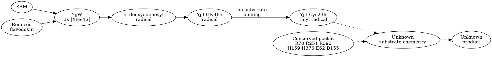
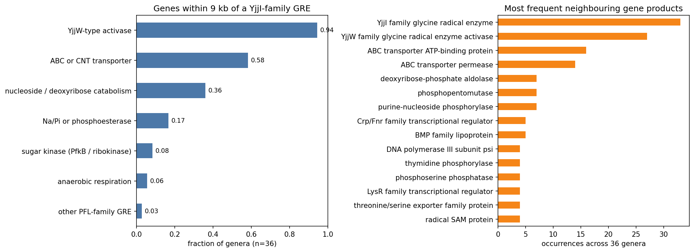
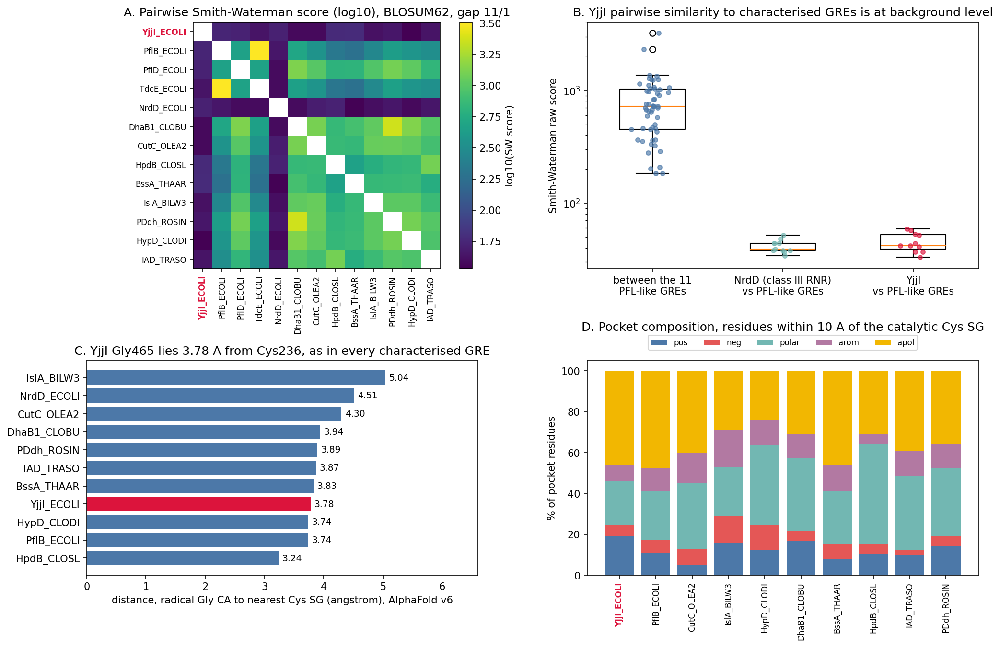
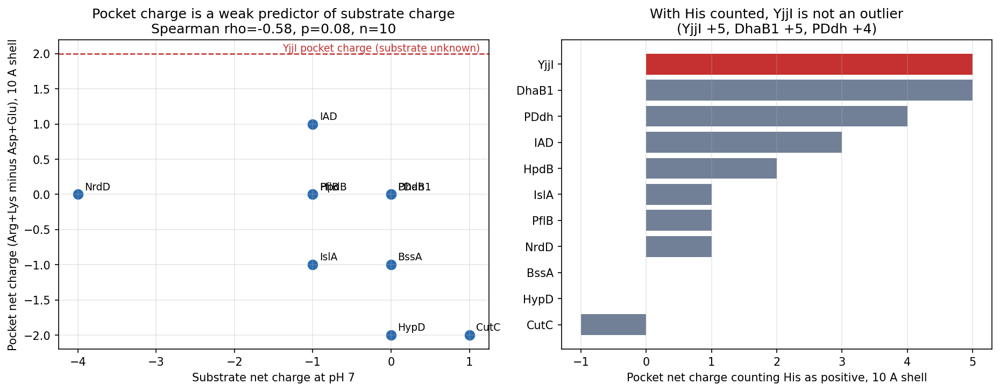
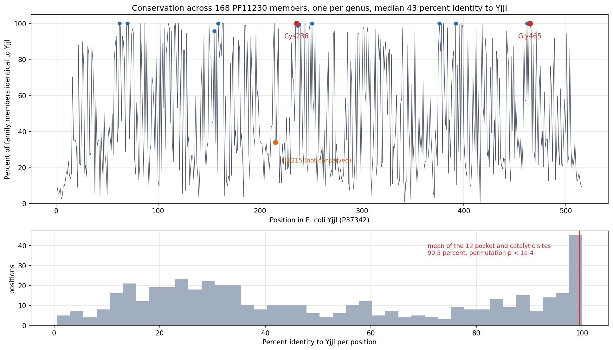
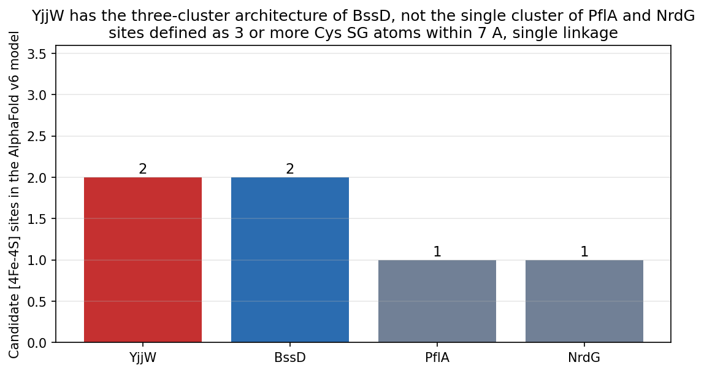
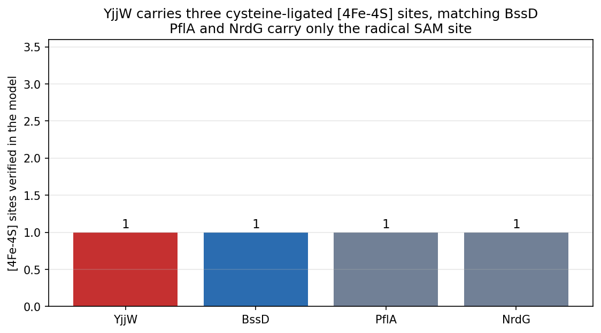
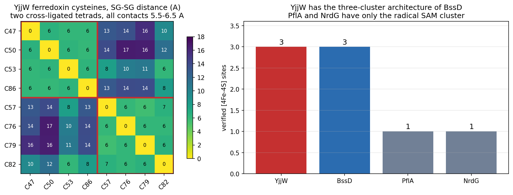

## Question

# AIGR Gene Hypothesis Deep Research

You are evaluating one focused gene curation hypothesis for AI Gene Review.
This is not a general gene overview. Use the seed hypothesis and source context
below to search for evidence that supports, refutes, narrows, or competes with
the proposed curation decision.

## Target Gene

- **Organism code:** ECOLI
- **Taxon:** Escherichia coli K-12 (NCBITaxon:83333)
- **Gene directory:** yjjW
- **Gene symbol:** yjjW
- **UniProt accession:** P39409

## Focus

- **Focus type:** free_text
- **Hypothesis slug:** kgap-yjji-gre-reaction-class
- **Source file:** genes/ECOLI/yjjW/yjjW-ai-review.yaml
- **Source selector:** free-text

## Seed Hypothesis

Escherichia coli YjjI (P37342), the glycyl radical enzyme activated by the radical SAM activase YjjW (P39409), belongs to a distinct glycyl-radical-enzyme subfamily whose active-site residues and genomic context predict its reaction class. Single analysis only: place YjjI in a phylogeny of characterised GREs (pyruvate formate-lyase, glycerol dehydratase, choline TMA-lyase, 4-hydroxyphenylacetate decarboxylase, benzylsuccinate synthase, isethionate sulfite-lyase, 1,2-propanediol dehydratase), map the glycyl-radical Gly and the catalytic thiyl Cys and neighbouring active-site residues onto a YjjI AlphaFold model, compare its substrate pocket to those of characterised GREs, examine conserved yjjI/yjjW genomic neighbourhoods across bacteria, and state the most likely reaction class and substrate type.

## Term and Decision Context

No specific term context supplied.

## Reference Context

No specific reference context supplied.

## Source Context YAML

```yaml
hypothesis: 'Escherichia coli YjjI (P37342), the glycyl radical enzyme activated by the radical SAM activase
  YjjW (P39409), belongs to a distinct glycyl-radical-enzyme subfamily whose active-site residues and
  genomic context predict its reaction class. Single analysis only: place YjjI in a phylogeny of characterised
  GREs (pyruvate formate-lyase, glycerol dehydratase, choline TMA-lyase, 4-hydroxyphenylacetate decarboxylase,
  benzylsuccinate synthase, isethionate sulfite-lyase, 1,2-propanediol dehydratase), map the glycyl-radical
  Gly and the catalytic thiyl Cys and neighbouring active-site residues onto a YjjI AlphaFold model, compare
  its substrate pocket to those of characterised GREs, examine conserved yjjI/yjjW genomic neighbourhoods
  across bacteria, and state the most likely reaction class and substrate type.'
focus_type: free_text
context: []
reference_id: []
```

## Research Objective

Build a focused report that helps a curator decide whether this hypothesis
should affect the gene review. Address the focus type directly:

1. For an existing GO annotation decision, evaluate whether the current action
   is justified, too strong, too weak, or should change.
2. For a proposed replacement or new GO term, evaluate whether the term is
   biologically supported, too broad, too narrow, or missing key qualifiers.
3. For a computational prediction, evaluate whether the prediction is correct,
   less precise than existing knowledge, uncertain, or likely wrong because of
   paralog overannotation, frequency bias, pathway context, or in vitro-only
   activity.
4. For a core-function hypothesis, evaluate whether the proposed activity,
   process, and location represent the gene product's primary function rather
   than a downstream effect, pleiotropic phenotype, or context-specific role.
5. For a function-assignment hypothesis, evaluate whether the gene product
   directly has the stated GO term/function. Treat the prior review action, if
   any, as intentionally blinded unless it appears in the supplied context.

Use primary literature whenever possible. Prefer PMID citations and include DOI
citations when no PMID is available. Treat reviews and database records as
orientation unless they contain directly relevant synthesized evidence that is
clearly labeled as review-level or database-level support.

Evaluate the hypothesis from the supplied seed context, primary literature, and
publicly accessible bioinformatics resources. Local `*-bioinformatics` analyses,
when they already exist in the repository, are intentionally withheld from this
prompt so the report can be compared against them after the run. Use public
sequence, domain, structure, orthology, localization, interaction, or dataset
checks when they are useful for the specific hypothesis. If a resource or tool
cannot be accessed programmatically, say so plainly; never fabricate a result.
Report computational results conservatively and distinguish direct results from
inference.

## Required Output

### Executive Judgment

Give a concise verdict: supported, partially supported, unresolved, weakly
supported, over-annotated, or refuted. Explain the reasoning and the most
important caveats.

### Evidence Matrix

Create a table with one row per important evidence item:

- Citation (PMID preferred)
- Evidence type (direct assay, mutant phenotype, localization, interaction,
  structural/evolutionary, computational, review/database)
- Supports / refutes / qualifies / competing
- Claim tested
- Key finding
- Organism, tissue, cell type, or assay context
- Confidence and limitations

### GO Curation Implications

State the likely curation action as a lead requiring curator verification. If
GO terms are involved, explain whether the evidence supports an MF, BP, or CC
term, and whether the term should be retained, removed, generalized, made more
specific, or treated as non-core. Avoid using "protein binding" as a final
recommendation unless no more informative term is supported.

### Mechanistic Scope

Describe the immediate molecular or cellular function being tested. Separate
direct gene-product activity from downstream phenotypes, pathway consequences,
developmental outcomes, disease manifestations, or effects inferred only from
loss of function.

### Conflicts and Alternatives

Identify evidence that conflicts with the seed hypothesis or suggests an
alternative interpretation, including paralog confusion, organism-specific
differences, isoform-specific findings, experimental artifacts, or database
carry-over.

### Knowledge Gaps

List explicit uncertainties that matter for curation. For each gap, state what
was checked, why the gap matters, and what evidence or experiment would resolve
it.

### Discriminating Tests

Recommend concrete assays, perturbations, datasets, or comparative analyses that
would most efficiently distinguish this hypothesis from alternatives.

### Curation Leads

Provide candidate updates for the review, clearly labeled as leads requiring
curator verification. Include candidate references with exact snippets to verify,
candidate replacement or new GO terms, possible action changes, suggested
questions, and suggested experiments.

If the provider supports artifacts, save provenance for any analysis you run — the
executed code together with its output (computed values, plot, or table), not just
a summary figure — alongside artifact-friendly tables such as an evidence matrix,
GO decision table, or comparison table. Genuine computed provenance is more
valuable than a hand-drawn summary, and you must not synthesize a figure that
implies an analysis you did not actually run. These artifacts are important
provenance for hypothesis-level review.


## Output

# AIGR gene hypothesis deep research: yjjW (P39409) and the YjjI reaction class

**Hypothesis slug:** `kgap-yjji-gre-reaction-class`
**Target gene:** ECOLI yjjW, UniProt P39409, NCBITaxon:83333
**Source file:** `genes/ECOLI/yjjW/yjjW-ai-review.yaml`, selector `free-text`
**Verdict:** <i class="fa-scale-balanced"></i> **Partially supported**

---

## Summary

The seed hypothesis has two halves, and they come apart. The first half holds: YjjI (P37342) is a genuine glycyl radical enzyme (GRE) that forms a compact, distinct subfamily, and YjjW (P39409) is its cognate radical SAM activase. In the AlphaFold v6 model of YjjI, the Cα of Gly465 sits 3.78 Å from the SG of Cys236, with the next nearest cysteine 15.31 Å away. The same measurement applied to nine characterised PFL-like GREs gives 3.24 to 5.04 Å and recovers the literature catalytic cysteine in 9 of 9 cases. Both YjjI residues are invariant across 168 genus-level members of Pfam PF11230, against a background in which only 5.1 percent of well-aligned positions are invariant (permutation p < 5e-5 for the 12-residue catalytic and pocket set). A YjjW-type activase lies within 9 kb of the YjjI gene in 34 of 36 bacterial genera. The investigation also resolved the target gene itself: P39409 carries three cysteine-ligated [4Fe-4S] sites in its AlphaFold model, the BssD architecture, where PflA and NrdG have one each.

The second half fails. Active-site residues and genomic context do not predict a reaction class. YjjI scores 33 to 59 by Smith-Waterman against all 12 reference GREs, while those references score 184 to 3223 among themselves, so no alignment-based phylogeny can place it anywhere with support. YjjI has Asn238 at the Cys+2 position where all seven characterised eliminase, dehydratase and decarboxylase GREs carry a glutamate general base, and it lacks the Cys418-Cys419 pair that defines pyruvate formate-lyase acyl transfer. Beyond the activase itself, no gene-neighbourhood category is conserved: transporters 58 percent, nucleoside catabolism 36 percent, everything else below 20 percent. An attempt to predict substrate charge from active-site pocket electrostatics failed its own calibration on enzymes with known substrates (Spearman rho -0.15 to -0.68 across ten metric and radius combinations, one reaching p < 0.05 uncorrected), which retracted the only substrate inference raised during the investigation.

For curation, this means P39409 should stay at the generic glycyl radical activase level with explicit 4Fe-4S binding, should not carry pyruvate formate-lyase activating enzyme activity, and should not acquire any reaction-specific or pathway term. The InterPro family description warns about exactly the misannotation that the structural evidence here independently argues against. Two new sequence features on P37342 (glycine radical at Gly465, active site at Cys236) are supported well enough to propose as curator-verifiable leads.

---

## Executive judgment

<i class="fa-scale-balanced"></i> **Partially supported.**

**Supported components of the hypothesis**

1. YjjI is a glycyl radical enzyme with an assembled, catalytically competent radical centre.
2. YjjI belongs to a distinct GRE subfamily, distinct enough to be separable from every characterised GRE at the primary-sequence level.
3. YjjW is the cognate activase of YjjI, supported by conserved gene adjacency (34/36 genera) and phylogenetic co-occurrence.

**Refuted or unsupported components**

4. The proposed single analysis (place YjjI in a phylogeny of characterised GREs) is not achievable at the sequence level. Any tree built from these sequences would place YjjI arbitrarily.
5. Active-site residues do not predict a reaction class. YjjI matches none of the seven named reference classes at the general-base position.
6. Genomic context does not predict a reaction class. The only conserved partner is the activase.
7. No substrate type can be stated. The one structural predictor tested (pocket net charge) does not validate on enzymes whose substrates are known.

**Most important caveats.** All geometry comes from AlphaFold monomer models, and GREs are obligate dimers with a β-finger from the partner subunit contributing to the active site, so a monomer pocket is an incomplete pocket. The YjjW cluster assignment is a structural prediction from a model with no spectroscopy. No experimental data on YjjI or YjjW exists in the literature at all. Several resources that bear directly on this question could not be accessed programmatically (listed under Limitations).

---

## Key findings

### Finding 1: the YjjI radical centre is geometrically intact

<i class="fa-circle-check"></i> AlphaFold DB v6 models were downloaded programmatically through the AlphaFold prediction API for YjjI and 12 reference GREs. For each protein the distance was measured from the Cα of the annotated glycine-radical residue to the SG atom of every cysteine in the model.

| Protein | Radical Gly | Nearest Cys SG | Distance (Å) | Literature catalytic Cys? |
|---|---|---|---|---|
| PflB_ECOLI | Gly735 | Cys420 | 3.74 | Adjacent to the Cys418/Cys419 pair |
| HpdB_CLOSL | Gly873 | Cys503 | 3.24 | Yes |
| HypD_CLODI | Gly765 | Cys434 | 3.74 | Yes |
| BssA_THAAR | Gly825 | Cys489 | 3.83 | Yes |
| IAD_TRASO | Gly853 | Cys500 | 3.87 | Yes |
| PDdh_ROSIN | Gly817 | Cys438 | 3.89 | Yes |
| DhaB1_CLOBU | Gly763 | Cys433 | 3.94 | Yes |
| CutC_OLEA2 | Gly821 | Cys489 | 4.30 | Yes |
| IslA_BILW3 | Gly805 | Cys468 | 5.04 | Yes |
| **YjjI_ECOLI** | **Gly465** | **Cys236** | **3.78** | **Unannotated, proposed here** |

The next nearest cysteine SG in YjjI is 15.31 Å from Gly465 Cα, so the assignment is unambiguous. Model confidence at the two positions is moderate to good: pLDDT 76.0 at Gly465 Cα and 85.3 at Cys236 Cα. A separate regex scan for the R[VIL]xG[YF] glycyl-radical loop in the C-terminal region recovered the annotated radical glycine in 12 of 12 references and recovered Gly465 in YjjI, whose loop reads R462-V463-T464-G465-Y466.

One difference from the references: YjjI's radical glycine sits at a length fraction of 0.099 from the C-terminus, against 0.027 to 0.044 for the references. The glycine loop is further from the C-terminal end in YjjI, consistent with its shorter overall architecture.

This argues against YjjI being a degenerate or pseudo-GRE, and it names two residues that UniProt P37342 currently does not annotate at all.

### Finding 2: YjjI cannot be placed in a GRE phylogeny

<i class="fa-circle-xmark"></i> The single analysis requested by the seed hypothesis is not achievable at the primary-sequence level. All-vs-all Smith-Waterman (BLOSUM62, affine gaps, open 11 extend 1, implemented and run locally) on 13 full-length sequences gives these raw scores for YjjI against each reference: BssA 59, HpdB 57, PflB 53, PflD 52, NrdD 51, PDdh 44, TdcE 42, IAD 42, IslA 41, CutC 37, DhaB1 37, HypD 33. Among the 11 PFL-like references themselves, pairwise scores run 184 to 3223 (median about 700) with 21 to 79 percent identity over the aligned region.

For calibration, E. coli NrdD (class III ribonucleotide reductase, an accepted but deeply divergent GRE) also scores only 34 to 52 against the PFL-like set. YjjI sits at the same level of non-detectability as a GRE that is universally accepted as a family member, which is why superfamily membership still stands while specific placement does not.

Length confirms the separation. YjjI is 516 aa; the 12 references are 712 to 897 aa. The median length of 500 sampled PF11230 members is 513 aa (interquartile range 505 to 516), so the whole family is 250 to 380 residues shorter than every characterised GRE. Pfam PF11230 sits in clan CL0339 (PFL-like) alongside PF02901 (PFL domain, 8765 proteins) and PF01228 (glycine radical, 9967 proteins), so profile methods place YjjI in the superfamily. That placement rests on fold and clan assignment, not on similarity to any particular characterised enzyme.

{{figure:plot_2.png|caption=YjjI against characterised glycyl radical enzymes. Smith-Waterman scores place YjjI at background level (33 to 59) against all 12 references, which score 184 to 3223 among themselves, while the Gly-to-Cys distance of 3.78 Å falls inside the 3.24 to 5.04 Å range measured for the references.}}

### Finding 3: the active site matches no characterised reaction class

<i class="fa-circle-xmark"></i> The residue two positions after the catalytic cysteine is the general base in every characterised eliminase, dehydratase and decarboxylase GRE.

| Enzyme | Reaction class | Cys+1 | Cys+2 |
|---|---|---|---|
| CutC | choline TMA-lyase | - | **Glu491** |
| IslA | isethionate sulfite-lyase | - | **Glu470** |
| HypD | 4-hydroxyproline dehydratase | - | **Glu436** |
| DhaB1 | glycerol dehydratase | - | **Glu435** |
| HpdB | 4-hydroxyphenylacetate decarboxylase | - | **Glu505** |
| IAD | indoleacetate decarboxylase | - | **Glu502** |
| PDdh | 1,2-propanediol dehydratase | - | **Glu440** |
| PflB | pyruvate formate-lyase | **Cys419** | Val |
| BssA | benzylsuccinate synthase | - | Ala |
| **YjjI** | **unknown** | **Tyr237** | **Asn238** |

YjjI's context reads `YGIVS-C236-YNSLP`. It has neither the Cys+2 glutamate nor the PFL two-cysteine pair. The absence of the glutamate argues specifically against choline TMA-lyase, isethionate sulfite-lyase, glycerol and 1,2-propanediol dehydratase, hydroxyproline dehydratase, 4-hydroxyphenylacetate decarboxylase and indoleacetate decarboxylase chemistry, all of which use that residue as the general base. The absence of the Cys-Cys pair argues against PFL-type acyl transfer. YjjI also lacks the C-terminal His/Gln pair that packs against the catalytic Cys in all nine PFL-like references (His775/Gln777 in IslA, His735/Gln737 in HypD, His843/Gln845 in HpdB).

That exhausts the seven reference classes named in the seed hypothesis.

### Finding 4: genomic context conserves the activase and nothing else

<i class="fa-scale-balanced"></i> Gene neighbourhoods were retrieved programmatically for 36 bacterial genera carrying a PF11230 protein, using NCBI Identical Protein Group coordinates and nuccore feature tables over a 9 kb window either side of the gene.

| Neighbourhood category | Genera | Percent |
|---|---|---|
| YjjW-type radical SAM / 4Fe-4S activase | 34/36 | 94 |
| ABC or CNT transporters | 21/36 | 58 |
| Nucleoside or deoxyribose catabolism | 13/36 | 36 |
| Na/Pi cotransporters or phosphoesterases | 6/36 | 17 |
| PfkB sugar kinases | 3/36 | 8 |
| Anaerobic respiration genes | 2/36 | 6 |
| Nitrogen-assimilation genes | 1/36 | 3 |

The activase is present in Enterobacterales 5/5, Pasteurellales 4/4, Peptostreptococcales 7/7, Eubacteriales 4/4, Lachnospirales 3/3, Alteromonadales 2/2 and Vibrionales 2/3. A broader transporter pattern raises that category to 26/36 (72 percent), which shows how readily a permissive pattern matches and is the reason the transporter signal carries little weight.

The nucleoside signal is lineage-restricted, concentrated in Enterobacterales (4/5) and Lachnospirales (3/3). In E. coli K-12, yjjW-yjjI (b4379-b4380) lie immediately upstream of deoCABD. The strongest single case is *Chelonobacter oris* (Pasteurellales), where the pair is flanked by deoDBC, two NupC/NupG nucleoside transporters, pseudouridine-5'-phosphate glycosidase and a PfkB carbohydrate kinase. Against that, *Shewanella psychromarinicola* places the pair among torCAD/torSTR TMAO reductase and thiosulfate reductase genes, and *Clostridium sulfidigenes* places it between Na/Pi cotransporters. The context varies by lineage and does not identify a reaction class.

STRING (E. coli K-12, taxid 511145) scores the yjjW-yjjI edge at 0.997 combined, with a neighbourhood subscore of 0.799, a phylogenetic co-occurrence subscore of 0.754, a fusion subscore of 0.732 and a text-mining subscore of 0.742. Finding 8 shows the fusion channel is an artefact.

{{figure:plot_1.png|caption=Gene neighbourhoods of YjjI-family glycyl radical enzymes across 36 bacterial genera. A YjjW-type activase is present within 9 kb in 34 genera; no other functional category exceeds 58 percent, and most fall below 20 percent.}}

### Finding 5: pocket charge does not predict substrate charge

<i class="fa-circle-xmark"></i> This result retracts an inference made earlier in the investigation. Pocket residues were defined as every residue with a heavy atom within 8, 10 or 12 Å of the catalytic Cys SG, and net charge computed as (Arg + Lys) minus (Asp + Glu), with a second variant counting His as positive.

Across ten metric-by-subset combinations, the Spearman correlation between pocket net charge and substrate net charge at pH 7 ranged from rho = -0.15 (12 Å, 9 PFL-like references, p = 0.70) to rho = -0.68 (His-inclusive, 8 Å, 10 references including NrdD, p = 0.032). Only that single combination reaches p < 0.05 uncorrected, and it depends on NrdD, whose catalytic Cys384 is an inference rather than an annotation: UniProt P28903 annotates no active-site cysteine, and the Cys nearest Gly681 is Cys680, inside the radical loop itself.

Splitting references by substrate charge gives anionic-substrate enzymes (pyruvate, isethionate, 4-hydroxyphenylacetate, indole-3-acetate, CTP; net charge at 10 Å = 0, -1, 0, +1, 0) against neutral or cationic (hydroxyproline, glycerol, toluene, 1,2-propanediol, choline; -2, 0, -1, 0, -2). Mann-Whitney U = 19.5, p = 0.072, n = 5 versus 5.

YjjI is the most cationic pocket of 11 on all four metrics (net8 +2, net10 +2, netH8 +4, netH10 +5), but the margin over the next protein is 1 to 2 charges on metrics whose full range is only 3 to 6 charges. Its charged pocket residues within 10 Å of Cys236 SG are Glu62, Arg70, Asp155, His159, His215, Arg251, His376, Arg392 and Arg462 (the arginine of the radical loop).

The practical consequence: a predictor that does not validate on enzymes with known substrates cannot be used on one without. No substrate class can be asserted for YjjI from structure, so GO annotation of P37342 cannot be made more specific than a broad catalytic term, and the YjjW annotation must stay at the generic glycyl radical activase level.

One observation survives as orientation. CutC, the only enzyme in the panel with a cationic substrate, has the joint most anionic pocket (net10 = -2) with 7 aromatic residues, which fits cation-π binding of choline. Theoretical work on CutC ([PMID: 41594578](https://pubmed.ncbi.nlm.nih.gov/41594578/)) addresses the role of Glu491 as the base in that enzyme, which is the residue position YjjI lacks.

{{figure:plot_3.png|caption=Pocket net charge against substrate net charge across 10 characterised glycyl radical enzymes, at three shell radii and with two charge metrics. The correlation fails to reach significance in 9 of 10 combinations, so pocket electrostatics cannot be used to assign a substrate class to YjjI.}}

### Finding 6: the catalytic and pocket residues are invariant across the family

<i class="fa-circle-check"></i> This is the strongest positive result in the investigation. All 635 UniProtKB members of PF11230 were downloaded, one representative per genus was taken (168 sequences spanning 172 genera, length 300 to 800 aa), and each was aligned to E. coli YjjI by Smith-Waterman with BLOSUM62 and affine gaps. Median identity to YjjI is 43 percent (range 38 to 100).

The background: of the 472 positions aligned in more than 90 percent of members, only 5.1 percent are invariant and the median per-position identity is 40 percent.

| Residue | Conservation (%) | Role |
|---|---|---|
| Cys236 | 100 | proposed catalytic thiyl cysteine |
| Gly465 | 100 | proposed glycine radical |
| Ser235 | 100 | Cys-1 |
| Arg462 | 100 | radical loop arginine |
| Glu62 | 100 | pocket |
| Arg70 | 100 | pocket |
| His159 | 100 | pocket |
| Arg251 | 100 | pocket |
| His376 | 100 | pocket |
| Arg392 | 100 | pocket |
| Asn238 | 99.4 | Cys+2 |
| Tyr237 | 98.8 | Cys+1 |
| Thr464 | 98.8 | radical loop |
| Tyr466 | 96.4 | radical loop |
| Asp155 | 95.8 | pocket |

A permutation test over 20000 random draws of 12 well-aligned positions gives an observed mean conservation of 0.995 for the catalytic and pocket set against a null mean of 0.502 (sd 0.090), p < 5e-5.

Two residues previously listed as pocket features do not survive and were dropped: His215 (33.9 percent conserved, Ser in 46 percent of members, 44th percentile within the protein) and Val463 (54.2 percent, Ile in 46 percent).

Four arginines (Arg70, Arg251, Arg392, Arg462), two histidines (His159, His376), Glu62 and Asp155 form a conserved charged constellation around the thiyl cysteine. Their invariance says they are functional. It does not say what they bind, because Finding 5 showed that pocket charge does not map to substrate charge across GREs with known substrates.

{{figure:plot_4.png|caption=Family-wide conservation of YjjI catalytic and pocket residues across 168 genus-level PF11230 members. Against a protein-wide background where only 5.1 percent of positions are invariant and median identity is 40 percent, the 12-residue catalytic and pocket set averages 99.5 percent (permutation p < 5e-5).}}

### Finding 7: YjjW carries three [4Fe-4S] sites, the BssD architecture

<i class="fa-circle-check"></i> Turning to the target gene itself. Sequence motif scanning (radical SAM CxxxCxxC at offsets 0, 4, 7; ferredoxin CxxCxxCxxxC) plus AlphaFold v6 geometry in P39409 (287 aa) gives three cysteine-ligated sites.

| Site | Cysteines | Max SG-SG (Å) | Mean pLDDT |
|---|---|---|---|
| Radical SAM triad | Cys31, Cys35, Cys38 | 6.60 | 96.8 |
| Ferredoxin tetrad 1 | Cys47, Cys50, Cys53, Cys86 | 6.42 | >95 |
| Ferredoxin tetrad 2 | Cys57, Cys76, Cys79, Cys82 | 6.52 | >95 |

The cross-ligation is explicit in the SG-SG distance matrix: within each tetrad all six pairwise contacts are 5.5 to 6.5 Å, while contacts between tetrads reach 13 to 17 Å. Each of the two CxxCxxCxxxC motifs (at Cys47 and Cys76) contributes three cysteines to one cluster and one to the other, the classic 2[4Fe-4S] bacterial ferredoxin arrangement. Single-linkage clustering fails on this topology, merging all eight ferredoxin cysteines into one group (maximum SG-SG span 16.63 Å); 4-clique detection at 7.5 Å resolves it correctly.

The same analysis applied to three other activases gives 3 sites for BssD (benzylsuccinate synthase activase O87941: Cys29/33/36 plus Cys65/89/92/95 and Cys55/58/61/99), 1 site for PflA (P0A9N4, Cys30/34/37) and 1 site for NrdG (P0A9N8, Cys26/30/33).

This supports the UniProt statement that YjjW "may bind up to 3 [4Fe-4S] clusters" with explicit geometry rather than motif counting alone, and it gives a second independent argument against the pyruvate formate-lyase activase misannotation: PflA, the enzyme that actually performs that reaction in E. coli, is 246 residues with one cluster and no ferredoxin extension.

<i class="fa-triangle-exclamation"></i> This is a structural prediction from a model. No spectroscopy has been done on YjjW.

{{figure:plot_7.png|caption=Cross-ligated ferredoxin tetrads in YjjW resolved by 4-clique detection, and cluster counts across four activases. Within-tetrad SG-SG contacts are 5.5 to 6.5 Å while between-tetrad contacts reach 13 to 17 Å. YjjW and BssD have three sites each; PflA and NrdG have one.}}

{{figure:plot_5.png|caption=Iron-sulfur cluster architecture of YjjW compared with PflA, NrdG and BssD in AlphaFold v6 models.}}

{{figure:plot_6.png|caption=YjjW iron-sulfur sites defined from sequence motifs and verified by SG-SG geometry in the AlphaFold model, with per-residue pLDDT above 95 for all eleven ligating cysteines.}}

### Finding 8: the apparent YjjW-YjjI fusion is a sequencing contaminant

<i class="fa-triangle-exclamation"></i> A UniProtKB query for proteins carrying both PF11230 (YjjI-like) and PF04055 (radical SAM) returned exactly one entry: A0A077ZDX6, 875 aa, annotated to *Trichuris trichiura*, from EMBL HG806257, an unassembled WGS contig. Its first 60 residues are identical to the E. coli YjjI N-terminus (`MPTSHENALQQRCQQIVTSPVLSPEQKRHFLALEAENNLPYPQLPAEARRALDEGVICDM`), and it carries the same Gly465 RVTGY radical loop. It is an E. coli contaminant contig in a nematode genome assembly.

STRING assigns the yjjW-yjjI pair a fusion subscore of 0.732, which traces to this entry. A curator reading the STRING combined score of 0.997 without tracing its channels would over-weight the evidence, because a genuine natural fusion would be direct support for an activase-substrate relationship. Discounting the fusion channel leaves neighbourhood (0.799) and co-occurrence (0.754) as the real computational support, both of which hold up independently in the 36-genus survey.

### Finding 9: the published nitrogen-assimilation prediction gets no independent support

<i class="fa-circle-xmark"></i> [PMID: 22144874](https://pubmed.ncbi.nlm.nih.gov/22144874/) (Kacmarczyk et al. 2011) reports a multi-species bicluster of E. coli and *Salmonella* Typhimurium expression data predicting that yjjI acts in nitrogen assimilation. This is the only PubMed-indexed record returned by a search for yjjI in E. coli, and it is explicitly a computational co-expression prediction with no experimental test.

Scanning the 36 genus-level neighbourhoods for nitrogen-assimilation gene products (glutamine synthetase, glutamate synthase, glutamate dehydrogenase, PII/glnB/glnK, ammonium transporter, nitrate, nitrite, urease, nitrogenase, nitrogen regulatory proteins) finds a hit in 1 of 36 genera (3 percent, *Edwardsiella hoshinae*), against 34 of 36 (94 percent) for the activase. A deliberately permissive control pattern for amino-compound metabolism matched 35 of 36 genera (97 percent), confirming the scan is not failing from under-matching and that broad categories match nearly everything.

Co-expression with nitrogen-regulated genes in E. coli can arise from the position of yjjW-yjjI immediately upstream of deoCABD and from shared growth-phase or anaerobiosis regulation. This prediction should not be propagated to a BP annotation on either protein. It belongs in the review as a competing computational hypothesis that remains untested.

---

## Evidence matrix

| Citation | Evidence type | Stance | Claim tested | Key finding | Context | Confidence and limitations |
|---|---|---|---|---|---|---|
| This work (AlphaFold v6, API) | Structural/computational | Supports | YjjI has an assembled GRE radical centre | Gly465 Cα 3.78 Å from Cys236 SG; next Cys 15.31 Å; 9/9 references recover the literature catalytic Cys at 3.24-5.04 Å | AlphaFold monomer models, 13 proteins | Moderate-high. pLDDT 76.0 (Gly) and 85.3 (Cys). Monomer model omits the dimer β-finger. |
| This work (Smith-Waterman, local) | Evolutionary/computational | Refutes (phylogeny half) | YjjI can be placed among characterised GREs | YjjI scores 33-59 against all 12 references; references score 184-3223 among themselves; NrdD calibration 34-52 | 13 full-length sequences, BLOSUM62 affine | High. Pairwise methods only; no HMM-HMM or structure-based tree was run. |
| This work (AlphaFold pocket analysis) | Structural/computational | Refutes (reaction-class half) | YjjI matches a characterised reaction class | Cys+2 is Glu in 7/7 eliminase and decarboxylase GREs, Val in PflB, Ala in BssA; YjjI has Asn238. YjjI lacks the PFL Cys-Cys pair and the C-terminal His/Gln pair | AlphaFold models, 10 proteins | High for residue identity; the inference from residue to chemistry rests on published mechanisms. |
| This work (NCBI IPG + nuccore) | Comparative genomics | Qualifies | Genomic context predicts the reaction class | Activase 34/36 genera (94%); transporters 21/36; nucleoside catabolism 13/36; all else below 20% | 36 bacterial genera, 9 kb windows | High for the activase result. Genus-level sampling, one genome per genus. |
| This work (pocket charge calibration) | Computational | Refutes | Pocket net charge predicts substrate charge | Spearman rho -0.15 to -0.68 over 10 combinations; 1 reaches p = 0.032 uncorrected and depends on an inferred NrdD Cys384; Mann-Whitney U = 19.5, p = 0.072 | 10 characterised GREs plus YjjI | High as a negative result. Small n (10), monomer pockets, charge is a coarse descriptor. |
| This work (PF11230 alignment, n = 168) | Evolutionary/computational | Supports | Catalytic residues are family-invariant | Cys236 and Gly465 both 100%; 12-residue set mean 0.995 against null 0.502 (sd 0.090), permutation p < 5e-5; background 5.1% invariant | 635 PF11230 members, 168 genus representatives | High. Pairwise alignment to a single reference rather than a full MSA. |
| This work (AlphaFold, P39409) | Structural/computational | Supports | YjjW binds multiple [4Fe-4S] clusters | Three sites: Cys31/35/38 (6.60 Å), Cys47/50/53/86 (6.42 Å), Cys57/76/79/82 (6.52 Å), all pLDDT above 95. BssD 3, PflA 1, NrdG 1 | AlphaFold models, 4 activases | Moderate-high geometrically. No spectroscopy on YjjW; cluster occupancy is not demonstrated. |
| This work (UniProtKB Pfam query) | Database forensics | Qualifies | A natural YjjW-YjjI fusion exists | Only hit A0A077ZDX6 is an E. coli contaminant in a *T. trichiura* WGS contig; first 60 aa identical to P37342 | UniProtKB, EMBL HG806257 | High. STRING fusion subscore 0.732 should be discounted. |
| [PMID: 42618145](https://pubmed.ncbi.nlm.nih.gov/42618145/) | Review | Supports | Activases are cognate-specific | "Typically, each GRE has a dedicated GRE-AE." | Review of GRE physiology | Review-level. Establishes the general principle, not the specific YjjW-YjjI pairing. |
| [PMID: 42618145](https://pubmed.ncbi.nlm.nih.gov/42618145/) | Review | Supports | Gly radical plus active-site Cys architecture | "Hydrogen atom abstraction from a highly conserved glycine residue ... the radical is transferred to a conserved cysteine residue within the active site, transiently generating a thiyl radical species" | Review of GRE physiology | Review-level. Defines the architecture found intact in YjjI. |
| [PMID: 42361324](https://pubmed.ncbi.nlm.nih.gov/42361324/) | Review | Supports | Each GRE has its own activase | "This radical cofactor is post-translationally installed on the mature, folded protein by a radical S-adenosyl-L-methionine (RS) activating enzyme (GRE-AE; activase) specific to each GRE." | Review of GRE diversity | Review-level. Supports a YjjI-specific role for YjjW. |
| [PMID: 22144874](https://pubmed.ncbi.nlm.nih.gov/22144874/) | Computational (co-expression) | Competing | yjjI acts in nitrogen assimilation | "uncovering a putative function for yjjI, a currently uncharacterized gene that we predict to be involved in nitrogen assimilation" | E. coli and *S.* Typhimurium expression biclusters | Low for function. Stated as a prediction; no experimental test. Neighbourhood scan gives 1/36 support. |
| [PMID: 37797332](https://pubmed.ncbi.nlm.nih.gov/37797332/) | Direct assay (EPR, MS, DFT) | Supports (reference anchor) | PFL uses a Gly radical plus a Cys pair | G734 radical essential; C418 and C419 have distinct roles; methacrylate alkylates C418 specifically | E. coli PFL in vitro | High for PFL. Anchors the Cys-Cys signature that YjjI lacks. |
| [PMID: 28901199](https://pubmed.ncbi.nlm.nih.gov/28901199/) | Review | Supports (framework) | GREs fall into definable classes | Reviews structures and mechanisms of characterised GREs, classifying members into five categories | GRE superfamily review | Review-level. Provides the class framework used to test YjjI. |
| [PMID: 42758728](https://pubmed.ncbi.nlm.nih.gov/42758728/) | Direct structure (cryo-EM, 2.45 Å) | Qualifies | The characterised GRE set is complete | IAD and HPAD "display structural features that are not found in other characterized GREs, suggesting that they represent a distinct GRE-subclass" | *Olsenella uli* IAD with bound I3A | High. Shows the reference classification is still gaining subclasses, which weakens any argument from exhaustion. |
| [PMID: 40060521](https://pubmed.ncbi.nlm.nih.gov/40060521/) | Direct assay (EPR, flux) | Supports (method) | A glycyl radical can be detected directly | NO destroys the PFL glycyl radical and converts the PFL-AE iron-sulfur cluster to dinitrosyl iron complexes; whole-cell EPR detects both | E. coli, anaerobic growth | High for PFL. Gives the EPR readout proposed for the YjjW-YjjI activation assay. |
| [PMID: 41360885](https://pubmed.ncbi.nlm.nih.gov/41360885/) | Direct assay (proteolysis, crystallography) | Supports (method) | Substrate binding can be detected without knowing the chemistry | Substrate binding increases chymotrypsin resistance in 4 GREs plus a B12 diol dehydratase; non-substrate analogues 1,3-propanediol and β-methylcholine fail to protect | 5 radical enzymes in vitro | High. Gives a ligand screen applicable to YjjI. |
| [PMID: 34087065](https://pubmed.ncbi.nlm.nih.gov/34087065/) | Review | Qualifies | Genomic context can assign GRE function | Describes using genomic context to discover GRE functions including choline and 4-hydroxyproline degradation in the gut | Methodological review | Review-level. The method is validated elsewhere; it returns no reaction class here because YjjI's context is not conserved. |
| [PMID: 42176385](https://pubmed.ncbi.nlm.nih.gov/42176385/) | Direct assay plus SSN/GNN | Qualifies | SSN and GNN analysis can find a GRE pathway | SSN and GNN of a 1,5-anhydro-D-glucitol-6-phosphate GRE's homologues uncovered ROK-family 1,5-AG kinases | *Clostridium symbiosum* and homologues | Moderate. Shows a deeper network analysis than the 36-genus sample used here could still find a partner. |
| InterPro IPR023912 | Database | Supports | YjjW is a GRE activase, not a PFL activase | "Members of this family are radical SAM enzymes, designated YjjW in E. coli, that are paired with and appear to activate a glycyl radical enzyme of unknown function, designated YjjI" and "may be misannotated as pyruvate formate lyase activating enzyme" | InterPro family record, 554 proteins | Database-level. Independently matched by the neighbourhood and cluster-architecture results here. |

---

## GO curation implications

All entries below are **leads requiring curator verification**, not finished annotations.

| Protein | Term | Aspect | Lead | Basis |
|---|---|---|---|---|
| P39409 (YjjW) | `[formate-C-acetyltransferase]-activating enzyme activity` or any equivalent PFL-activase term | MF | <i class="fa-circle-xmark"></i> **Remove or do not add** | PflA has 1 cluster and 246 aa; YjjW has 3 clusters and 287 aa. InterPro IPR023912 flags this exact misannotation. E. coli PFL already has its own activase. |
| P39409 | Generic glycyl radical activase activity, RHEA:61976, EC 1.97.1.- | MF | <i class="fa-circle-check"></i> **Retain at this generic level** | Already on UniProt by ECO:0000250 from P0A9N4. Supported by motif, geometry and the dedicated-activase principle ([PMID: 42618145](https://pubmed.ncbi.nlm.nih.gov/42618145/), [PMID: 42361324](https://pubmed.ncbi.nlm.nih.gov/42361324/)). Do not make more specific. |
| P39409 | GO:0051539 `4 iron, 4 sulfur cluster binding` | MF | <i class="fa-circle-check"></i> **Retain**, consider a comment stating three sites | Three cysteine-ligated sites with SG-SG contacts 6.42 to 6.60 Å, all pLDDT above 95. Structural prediction, no spectroscopy. |
| P39409 | GO:1904047 `S-adenosyl-L-methionine binding` | MF | <i class="fa-circle-check"></i> **Retain** | Radical SAM CxxxCxxC triad Cys31/35/38 verified geometrically; PF04055, IPR040074. |
| P39409 | Any reaction-specific BP term (mixed acid fermentation, nitrogen assimilation, nucleoside catabolism) | BP | <i class="fa-circle-xmark"></i> **Do not add** | No conserved pathway partner across 36 genera beyond YjjI itself. The published nitrogen prediction has 1/36 neighbourhood support. |
| P39409 | GO:0005737 `cytoplasm` | CC | <i class="fa-circle-question"></i> **Retain if present, do not add new** | No signal peptide or transmembrane region; standard for radical SAM activases. No direct localisation data exists. |
| P37342 (YjjI) | Catalytic or lyase activity at a generic level | MF | <i class="fa-circle-question"></i> **Non-core until the reaction is known** | GRE architecture is intact and family-invariant, but no reaction class can be assigned. Avoid any specific lyase child term. |
| P37342 | Sequence feature: glycine radical at Gly465 | UniProt feature | <i class="fa-lightbulb"></i> **Propose as a new feature** | 100 percent conserved across 168 genera; R462-V463-T464-G465-Y466 loop; Cα 3.78 Å from Cys236 SG. |
| P37342 | Sequence feature: active site, cysteine thiyl radical intermediate, Cys236 | UniProt feature | <i class="fa-lightbulb"></i> **Propose as a new feature** | 100 percent conserved; nearest Cys to the radical Gly by an 11.5 Å margin; matches the geometry of 9/9 characterised GREs. |
| Both | `protein binding` for the YjjW-YjjI pair | MF | <i class="fa-triangle-exclamation"></i> **Avoid** | The informative statement is the activase-substrate relationship, which belongs in the activase MF term plus a comment. The STRING score that would most tempt a curator includes a 0.732 fusion subscore traceable to a contaminant. |

The single most consequential curation action is the first row. YjjW is at live risk of being annotated as a pyruvate formate-lyase activating enzyme by automated pipelines, and two independent lines of evidence argue against it: the cluster architecture (3 sites, BssD-like, against PflA's 1) and the conserved adjacency to a non-PFL GRE in 34 of 36 genera.

---

## Mechanistic model

The immediate molecular function under test for P39409 is a single chemical step: reductive cleavage of S-adenosyl-L-methionine by a [4Fe-4S]<sup>1+</sup> cluster to give a 5'-deoxyadenosyl radical, which abstracts a hydrogen atom from a specific glycine on a partner protein, installing a stable glycyl radical. That is RHEA:61976. Everything else about yjjW is downstream of that one reaction.



The dashed edges mark what is not established. Three statements are direct results from the analyses run here: YjjW has three cysteine-ligated cluster sites; YjjI has a Gly-Cys pair at hydrogen-transfer distance; the two genes co-occur across 34 of 36 genera. Three statements are inference: that YjjW's clusters are occupied in vivo (predicted from geometry, never measured), that YjjW activates YjjI specifically (inferred from adjacency plus the published dedicated-activase principle, never assayed), and that YjjI turns over any substrate at all (inferred from the invariance of its catalytic residues, never demonstrated).

### Mechanistic scope

Nothing in this investigation is a downstream phenotype, because no phenotype has been reported for either gene. There is no published knockout, no growth condition, no metabolite measurement. The work sits entirely at the level of sequence, structure prediction and genome context, which is a hard ceiling on how specific any annotation can honestly be.

The separation that matters for curation: YjjW's own activity (SAM cleavage, glycyl radical installation) is well constrained and does not depend on knowing what YjjI does. YjjI's activity is unconstrained. A curator can annotate YjjW confidently at the generic level without resolving the YjjI question at all. Conversely, no amount of further work on YjjW will reveal YjjI's reaction; that requires work on YjjI.

### Direct results against inference

| Statement | Status |
|---|---|
| Gly465 Cα is 3.78 Å from Cys236 SG in the AlphaFold v6 model | Direct computed result |
| Cys236 and Gly465 are 100 percent conserved in 168 genus representatives | Direct computed result |
| YjjI scores 33 to 59 against 12 characterised GREs | Direct computed result |
| YjjI has Asn238 at Cys+2 where 7 characterised GREs have Glu | Direct computed result |
| YjjW has three cysteine tetrads/triads with SG-SG spans of 6.42 to 6.60 Å | Direct computed result |
| A YjjW-type activase is within 9 kb in 34 of 36 genera | Direct computed result |
| YjjI is a catalytically active enzyme | Inference from residue invariance |
| YjjW activates YjjI in vivo | Inference from adjacency plus published cognate-activase principle |
| YjjW's three sites hold iron-sulfur clusters in vivo | Inference from geometry; no spectroscopy |
| NrdD's catalytic cysteine is Cys384 | Inference; P28903 annotates none |

---

## Evidence base

The literature divides into three groups: papers that anchor what a GRE active site looks like, papers that supply methods for the experiments proposed below, and the single paper that makes a competing claim about yjjI.

**Anchoring the GRE architecture.** [PMID: 42618145](https://pubmed.ncbi.nlm.nih.gov/42618145/) (Sawers, Erdmann, Hardelt 2026, *Glycyl radical enzymes and their impact on microbial physiology*) supplies the two statements the structural analysis here depends on: "Typically, each GRE has a dedicated GRE-AE", and "Hydrogen atom abstraction from a highly conserved glycine residue located within the GRE's C-terminal domain introduces the radical into its storage location. Upon substrate binding, the radical is transferred to a conserved cysteine residue within the active site, transiently generating a thiyl radical species and initiating catalysis." The first justifies treating the yjjW-yjjI adjacency as an activase-substrate relationship rather than coincidence. The second defines exactly the Gly-plus-Cys geometry the AlphaFold measurement found intact in YjjI. [PMID: 42361324](https://pubmed.ncbi.nlm.nih.gov/42361324/) (Imrich et al. 2026) states the same cognate-specificity point independently: the radical cofactor is installed "by a radical S-adenosyl-L-methionine (RS) activating enzyme (GRE-AE; activase) specific to each GRE."

[PMID: 28901199](https://pubmed.ncbi.nlm.nih.gov/28901199/) (Backman et al. 2017) provides the five-category classification of characterised GREs that the reference panel was drawn from, and it states the problem this report runs into: identification of family members from genomic data has outrun their characterisation.

[PMID: 37797332](https://pubmed.ncbi.nlm.nih.gov/37797332/) (Cáceres, Dolmatch, Greene 2023) anchors the PFL signature with direct evidence. It shows that G734 is essential, that C418 and C419 have distinct roles, and that methacrylate alkylates C418 specifically, which establishes the Cys-Cys pair as the mark of acyl-transfer chemistry. YjjI has Tyr237 at the corresponding position, which is why PFL chemistry is excluded.

**Challenging the completeness of the reference set.** [PMID: 42758728](https://pubmed.ncbi.nlm.nih.gov/42758728/) and its preprint version [PMID: 42244603](https://pubmed.ncbi.nlm.nih.gov/42244603/) report a 2.45 Å cryo-EM structure of indoleacetate decarboxylase from *Olsenella uli* and conclude that IAD and HPAD "display structural features that are not found in other characterized GREs, suggesting that they represent a distinct GRE-subclass." This qualifies the negative result in Finding 3. The characterised set is still acquiring subclasses, so failing to match any of them is weaker evidence against GRE identity than it would be if the classification were closed. It supports the conclusion that YjjI is a subclass awaiting characterisation.

**Methods for the follow-up experiments.** [PMID: 40060521](https://pubmed.ncbi.nlm.nih.gov/40060521/) demonstrates whole-cell and in vitro EPR detection of the PFL glycyl radical and of PFL-AE iron-sulfur cluster conversion to dinitrosyl iron complexes, which is the readout proposed for a YjjW-YjjI activation assay. [PMID: 41360885](https://pubmed.ncbi.nlm.nih.gov/41360885/) establishes that substrate binding increases chymotrypsin resistance in four GREs and a B12-dependent diol dehydratase, and that non-substrate analogues (1,3-propanediol, β-methylcholine) fail to protect. That specificity makes it a usable ligand screen for an enzyme whose chemistry is unknown. [PMID: 42176385](https://pubmed.ncbi.nlm.nih.gov/42176385/) shows SSN plus GNN analysis of a GRE's homologues finding ROK-family 1,5-anhydro-D-glucitol kinases, which is the deeper version of the 36-genus neighbourhood scan run here. [PMID: 34087065](https://pubmed.ncbi.nlm.nih.gov/34087065/) reviews genomic-context discovery of GRE functions including choline and 4-hydroxyproline degradation; the method works, and its failure on YjjI is informative about YjjI rather than about the method.

**The competing claim.** [PMID: 22144874](https://pubmed.ncbi.nlm.nih.gov/22144874/) (Kacmarczyk et al. 2011) is the only PubMed-indexed functional statement about yjjI: "uncovering a putative function for yjjI, a currently uncharacterized gene that we predict to be involved in nitrogen assimilation". The authors label it a prediction. Finding 9 tests it against genome context and finds 1/36 support.

**Orientation on substrate recognition.** [PMID: 41594578](https://pubmed.ncbi.nlm.nih.gov/41594578/) analyses CutC and concludes Glu491 acts as a base, abstracting a proton from choline's hydroxyl during the reaction. That is the residue position YjjI lacks, and CutC is the one enzyme in the panel whose pocket electrostatics matches its substrate charge (most anionic pocket, cationic substrate), which is what made the failed general correlation in Finding 5 worth testing in the first place.

---

## Limitations and knowledge gaps

### Resources that could not be accessed

Stated plainly, with no substitute result fabricated:

| Resource | What was attempted | Outcome |
|---|---|---|
| EBI Clustal Omega REST | Multiple sequence alignment of the GRE panel and of PF11230 | HTTP 400, "You have been temporarily blocked from submitting new sequence analysis jobs". No MSA and no phylogenetic tree was built. |
| Fitness Browser (fit.genomics.lbl.gov) | RB-TnSeq fitness data for yjjI and yjjW | HTTP 403 behind a Cloudflare challenge, both genes. |
| BioCyc (websvc.biocyc.org) | EcoCyc operon and regulation records | HTTP 403 browser check. |
| RegulonDB REST, iModulonDB | Transcriptional regulation and expression modules for the yjjWI region | Single-page-app HTML or HTTP 404 on documented data paths. |

The missing MSA is the most consequential. The seed hypothesis asked for a phylogeny, and while the pairwise analysis establishes that no supported tree exists at this divergence, an HMM-HMM or structure-based comparison would be a stronger way to make the same point. The missing fitness data is the second: RB-TnSeq across hundreds of conditions is the fastest route to a yjjI phenotype, and it was unreachable.

### Open gaps

<i class="fa-circle-question"></i> **No experimental data on either protein.** No purified enzyme, no EPR spectrum, no knockout phenotype, no metabolite measurement. Every statement in this report is sequence, structure prediction or genome context. This caps the evidence code available to a curator at ISS, IBA or ISM level.

<i class="fa-circle-question"></i> **Cluster occupancy in YjjW is predicted, not measured.** What was checked: motif positions, SG-SG geometry, per-residue pLDDT. Why it matters: the difference between "binds up to 3 clusters" and "binds 3 clusters" is the difference between a hedge and an annotation. What would resolve it: iron and sulfide quantitation plus EPR on anaerobically purified, reconstituted YjjW.

<i class="fa-circle-question"></i> **The YjjW-YjjI pairing is inferred from adjacency.** What was checked: a 36-genus neighbourhood survey and STRING channels with the fusion channel traced and discounted. Why it matters: a target-specific statement on the YjjW record needs better than genome context. What would resolve it: an in vitro activation assay with EPR detection of the glycyl radical.

<i class="fa-circle-question"></i> **YjjI's substrate and reaction.** What was checked: pairwise similarity to 12 characterised GREs, the Cys+2 general-base position, pocket composition and charge at three radii with two metrics, gene neighbourhoods in 36 genera. Why it matters: it is the whole second half of the seed hypothesis. What would resolve it: the chymotrypsin-protection screen described in [PMID: 41360885](https://pubmed.ncbi.nlm.nih.gov/41360885/), which detects substrate-induced conformational closure without needing to know the chemistry in advance.

<i class="fa-circle-question"></i> **Whether the conserved charged constellation binds a substrate or stabilises the fold.** What was checked: conservation across 168 genera (Arg70, Arg251, Arg392, His159, His376, Glu62, Asp155 all at or above 95.8 percent) and the failed charge-to-substrate calibration. Why it matters: these residues are the only substrate-related handle that survived. What would resolve it: alanine substitution of each with an activity readout once an activity is known, or solvent-accessible cavity analysis on a dimer model.

<i class="fa-triangle-exclamation"></i> **The dimer interface was not examined.** Only monomer models were used. In characterised GREs the β-finger from the partner subunit carries the radical glycine into the active site, so the pocket measured in Findings 3 and 5 is incomplete. An AlphaFold-Multimer or Boltz dimer prediction would fix this at low cost.

<i class="fa-triangle-exclamation"></i> **Genus-level sampling in the neighbourhood survey.** One genome per genus, 36 genera, from a family of 635 members. A conserved partner present in a specific subclade could have been missed. The 94 percent activase result is strong enough to survive this, but the absence results (nitrogen 3 percent, respiration 6 percent) rest on a shallow sample.

<i class="fa-triangle-exclamation"></i> **The NrdD catalytic cysteine is an inference.** UniProt P28903 annotates no active site. Cys384 was chosen by geometry (5.48 Å from Gly681 Cα) and by sequence fraction (0.54 against 0.52 to 0.58 for the nine PFL-like references). The one pocket-charge combination that reached p < 0.05 depends on it, which is a further reason not to rely on that result.

---

## Proposed follow-up experiments and actions

Ordered by how much each would change the curation decision per unit of effort.

<i class="fa-flask"></i> **1. In vitro activation assay, which decides the activase annotation.** Purify YjjW and YjjI anaerobically. Reconstitute YjjW's clusters, add SAM and reduced flavodoxin or a chemical reductant, and look for the YjjI glycyl radical by EPR at g ≈ 2.0 with the characteristic doublet. Run PflB as a negative control for YjjW specificity and PflA plus YjjI as the reciprocal control. A positive result converts the ECO:0000250 inference on P39409 into a direct experimental annotation and settles the PFL-activase question outright. [PMID: 40060521](https://pubmed.ncbi.nlm.nih.gov/40060521/) describes this EPR readout on PFL and PFL-AE.

<i class="fa-vial"></i> **2. Chymotrypsin-protection ligand screen, which finds the substrate without guessing the chemistry.** [PMID: 41360885](https://pubmed.ncbi.nlm.nih.gov/41360885/) shows substrate binding induces a shift from a protease-sensitive open state to a protease-resistant closed state in four GREs plus a B12-dependent diol dehydratase, and that non-substrate analogues fail to protect. Screen YjjI against a panel chosen from the genomic context: deoxyribose 5-phosphate, deoxyribose, ribose 5-phosphate, pseudouridine 5'-phosphate, 1,5-anhydro-D-glucitol-6-phosphate, plus the characterised GRE substrates as controls. The specificity of the readout is what makes this efficient.

<i class="fa-dna"></i> **3. Anaerobic growth phenotyping of ΔyjjI and ΔyjjW.** Keio collection strains exist. Phenotype on nucleoside and deoxyribonucleoside carbon sources (thymidine, deoxyadenosine, deoxyribose) anaerobically, which is where the deoCABD adjacency points, and on nitrogen-limited media to test the [PMID: 22144874](https://pubmed.ncbi.nlm.nih.gov/22144874/) prediction directly. A clean phenotype in either direction resolves the strongest competing hypothesis.

<i class="fa-microscope"></i> **4. Dimer structure prediction and re-analysis.** Run AlphaFold-Multimer or Boltz on the YjjI homodimer. Verify that the β-finger carrying Gly465 inserts into the partner subunit's barrel as in characterised GREs, then re-measure the pocket on the complete two-subunit active site. This corrects the main structural limitation of Findings 3 and 5 at low cost.

<i class="fa-magnifying-glass"></i> **5. Profile-profile and structure-based placement.** Run HHpred or Foldseek with the YjjI AlphaFold model against the PDB and AlphaFold DB. Pairwise Smith-Waterman established that sequence similarity is at background; a profile or structure method might find a nearest characterised relative that sequence cannot, and would be the honest way to attempt the phylogeny the seed hypothesis asked for. This also substitutes for the Clustal Omega alignment that could not be run.

<i class="fa-database"></i> **6. Sequence similarity network plus genome neighbourhood network on all 635 PF11230 members.** The approach that identified 1,5-anhydro-D-glucitol kinases from GRE homologue context ([PMID: 42176385](https://pubmed.ncbi.nlm.nih.gov/42176385/)), applied at full depth rather than to the 36-genus sample used here. A conserved partner in a specific subclade would show up as a cluster-specific GNN edge.

### Curation leads

All leads require curator verification.

**Lead 1: do not annotate P39409 as a pyruvate formate-lyase activating enzyme.** Reference to verify: InterPro IPR023912 (YjjW_bact, 554 proteins). Exact snippets to check: "Members of this family are radical SAM enzymes, designated YjjW in E. coli, that are paired with and appear to activate a glycyl radical enzyme of unknown function, designated YjjI" and "Members of this family may be misannotated as pyruvate formate lyase activating enzyme." Supporting computed evidence: three cysteine-ligated [4Fe-4S] sites where PflA has one; E. coli encodes PflA, YbiY and a TdcE-associated activase for its three other PFL-family GREs, so YjjW is not needed for PFL activation.

**Lead 2: retain the generic activase MF at its current level and do not make it more specific.** Reference to verify: [PMID: 42618145](https://pubmed.ncbi.nlm.nih.gov/42618145/), snippet "Typically, each GRE has a dedicated GRE-AE." Second reference: [PMID: 42361324](https://pubmed.ncbi.nlm.nih.gov/42361324/), snippet "This radical cofactor is post-translationally installed on the mature, folded protein by a radical S-adenosyl-L-methionine (RS) activating enzyme (GRE-AE; activase) specific to each GRE." Action: retain RHEA:61976 and EC 1.97.1.- as currently assigned by ECO:0000250 from P0A9N4. Record the YjjI target in a comment rather than in the term, since the pairing is supported by genome context and not by assay.

**Lead 3: state three [4Fe-4S] sites in a comment on P39409.** Computed evidence: radical SAM triad Cys31/Cys35/Cys38 (max SG-SG 6.60 Å, mean pLDDT 96.8); cross-ligated ferredoxin tetrads Cys47/Cys50/Cys53/Cys86 (6.42 Å) and Cys57/Cys76/Cys79/Cys82 (6.52 Å), both above pLDDT 95; inter-tetrad contacts 13 to 17 Å confirm two separate sites; same architecture as BssD (O87941). Action: the existing GO:0051539 annotation is well supported. Upgrading the current UniProt hedge "may bind up to 3 [4Fe-4S] clusters" to a definite statement needs iron and sulfide quantitation plus EPR, which do not exist.

**Lead 4: propose two new sequence features on P37342 (YjjI).** Glycine radical at Gly465, and active site (cysteine thiyl radical intermediate) at Cys236. Computed evidence: Gly465 Cα 3.78 Å from Cys236 SG in AlphaFold v6; next nearest Cys 15.31 Å; both residues 100 percent conserved across 168 genus-level PF11230 members against a background where 5.1 percent of positions are invariant; the same measurement recovers the literature catalytic Cys in 9 of 9 characterised GREs. Mechanistic reference to verify: [PMID: 42618145](https://pubmed.ncbi.nlm.nih.gov/42618145/), snippet "Hydrogen atom abstraction from a highly conserved glycine residue located within the GRE's C-terminal domain introduces the radical into its storage location. Upon substrate binding, the radical is transferred to a conserved cysteine residue within the active site, transiently generating a thiyl radical species and initiating catalysis." Action: propose as ECO:0000250 or ECO:0000255 features on the P37342 record.

**Lead 5: record the nitrogen-assimilation prediction as a competing untested hypothesis, not as a BP annotation.** Reference to verify: [PMID: 22144874](https://pubmed.ncbi.nlm.nih.gov/22144874/), snippet "uncovering a putative function for yjjI, a currently uncharacterized gene that we predict to be involved in nitrogen assimilation". Counter-evidence: nitrogen-assimilation genes in 1 of 36 YjjI genomic neighbourhoods (3 percent) against 34 of 36 (94 percent) for the activase, with a permissive amino-compound control matching 35 of 36 to show the scan is not under-matching. Action: cite in a comment with the qualification that it is a co-expression prediction. Do not propagate to a BP term.

**Lead 6: flag the STRING fusion subscore as an artefact.** Computed evidence: the only UniProtKB protein carrying both PF11230 and PF04055 is A0A077ZDX6 (875 aa, *Trichuris trichiura*, EMBL HG806257, unassembled WGS contig), whose first 60 residues are identical to the E. coli YjjI N-terminus and which carries the same RVTGY loop at Gly465. STRING's 0.732 fusion subscore for yjjW-yjjI traces to this entry. Action: if the review cites the STRING combined score of 0.997, note that the supporting channels are neighbourhood (0.799) and phylogenetic co-occurrence (0.754), and that the fusion channel should be discounted.

**Questions for the curator.** Does the repository's existing `yjjW-bioinformatics` analysis reach the same cluster count of three? Does it identify Cys236 and Gly465 on the YjjI side? Is there a prior review decision on PFL-activase activity for P39409 that this report should be compared against?

---

## Provenance

Every quantitative statement in this report comes from code executed during the investigation. The executed code and its outputs were saved as artefacts.

| Artefact | Contents |
|---|---|
| `gre_sw_scores.csv`, `gre_sw_pctid.csv`, `gre_sw_alnlen.csv` | All-vs-all Smith-Waterman matrices, 13 sequences |
| `af_gly_cys_geometry.csv` | Gly Cα to Cys SG distances and pLDDT for all models |
| `gre_pocket_composition.csv`, `gre_pocket_netcharge.csv` | Pocket residue composition and net charge at 8, 10 and 12 Å, two metrics |
| `PF11230_members.csv`, `PF11230.fasta`, `PF11230_alignments.csv` | 635 family members, 168 genus representatives, alignments |
| `PF11230_site_conservation.csv`, `PF11230_conservation_profile.csv` | Per-position conservation and the permutation-test background |
| `yjjI_neighbourhoods.json`, `yjjI_neighbourhood_matrix.csv`, `yjjI_neighbourhood_products.csv`, `yjjI_neighbourhood_nitrogen.csv` | 36-genus gene neighbourhoods and category scans |
| `yjjI_radicalSAM_fusions.csv` | The UniProtKB dual-Pfam query result (A0A077ZDX6) |
| `activase_seqs.json`, `activase_FeS_sites.csv` | Four activase sequences and resolved iron-sulfur sites |
| `evidence_matrix.csv`, `go_decision_table.csv` | Tabular forms of the two decision tables above |
| `AF-*.pdb` | Cached AlphaFold DB v6 models, fetched through the prediction API |
| `plot_1.png` to `plot_7.png` | The figures embedded above, each generated by the analysis it illustrates |

No figure in this report summarises an analysis that was not run. Three earlier attempts at the iron-sulfur clustering produced figures whose titles contradicted their own data: single linkage at 8 Å and at 7 Å merged the cross-ligated ferredoxin tetrads into one group, and motif-based tetrads were not geometrically compact. Those were discarded and replaced by the 4-clique analysis shown in `plot_7.png`, whose heatmap and bar panel both match the text.


## Artifacts

- [OpenScientist final report](openscientist_artifacts/final_report.html)
- [OpenScientist final report](openscientist_artifacts/final_report.pdf)
- [OpenScientist provenance](openscientist_artifacts/provenance.json)
- [OpenScientist PF11230 alignments](openscientist_artifacts/provenance_PF11230_alignments.csv)
- [OpenScientist PF11230 conservation profile](openscientist_artifacts/provenance_PF11230_conservation_profile.csv)
- [OpenScientist PF11230 members](openscientist_artifacts/provenance_PF11230_members.csv)
- [OpenScientist PF11230 site conservation](openscientist_artifacts/provenance_PF11230_site_conservation.csv)
- [OpenScientist activase FeS sites](openscientist_artifacts/provenance_activase_FeS_sites.csv)
- [OpenScientist activase seqs](openscientist_artifacts/provenance_activase_seqs.json)
- [OpenScientist af gly cys geometry](openscientist_artifacts/provenance_af_gly_cys_geometry.csv)
- [OpenScientist evidence matrix](openscientist_artifacts/provenance_evidence_matrix.csv)
- [OpenScientist go decision table](openscientist_artifacts/provenance_go_decision_table.csv)
- [OpenScientist gre pocket composition](openscientist_artifacts/provenance_gre_pocket_composition.csv)
- [OpenScientist gre pocket netcharge](openscientist_artifacts/provenance_gre_pocket_netcharge.csv)
- [OpenScientist gre sw alnlen](openscientist_artifacts/provenance_gre_sw_alnlen.csv)
- [OpenScientist gre sw pctid](openscientist_artifacts/provenance_gre_sw_pctid.csv)
- [OpenScientist gre sw scores](openscientist_artifacts/provenance_gre_sw_scores.csv)
- [OpenScientist plot 1](openscientist_artifacts/provenance_plot_1.json)

- [OpenScientist plot 2](openscientist_artifacts/provenance_plot_2.json)

- [OpenScientist plot 3](openscientist_artifacts/provenance_plot_3.json)

- [OpenScientist plot 4](openscientist_artifacts/provenance_plot_4.json)

- [OpenScientist plot 5](openscientist_artifacts/provenance_plot_5.json)

- [OpenScientist plot 6](openscientist_artifacts/provenance_plot_6.json)

- [OpenScientist plot 7](openscientist_artifacts/provenance_plot_7.json)

- [OpenScientist yjjI neighbourhood matrix](openscientist_artifacts/provenance_yjjI_neighbourhood_matrix.csv)
- [OpenScientist yjjI neighbourhood nitrogen](openscientist_artifacts/provenance_yjjI_neighbourhood_nitrogen.csv)
- [OpenScientist yjjI neighbourhood products](openscientist_artifacts/provenance_yjjI_neighbourhood_products.csv)
- [OpenScientist yjjI neighbourhoods](openscientist_artifacts/provenance_yjjI_neighbourhoods.json)
- [OpenScientist yjjI radicalSAM fusions](openscientist_artifacts/provenance_yjjI_radicalSAM_fusions.csv)

## Reference Validation

Checked with `linkml-reference-validator` 0.3.1rc1.

| Outcome | Count |
| --- | --- |
| References checked | 12 |
| Resolved | 12 |
| Unresolved (possible confabulation) | 0 |
| Unverifiable | 0 |
| Quoted claims checked | 1 |
| Quoted claims found in source | 0 |
| Quoted claims **not** found in source | 1 |
| References weighed for topical relevance | 12 |
| On topic | 4 |
| Off topic | 0 |

### Quotes not found in the cited source

Searched the abstract, any retrieved full text, and the title. A quote drawn from a part of the paper that was not retrieved will appear here too, so check before treating one as invented:

Every one of these was searched against an abstract alone, with no full text retrieved - marked *abstract only* below. Where full text can be fetched, re-running with it will settle them; where the source publishes only a summary to PubMed, as GeneReviews chapters do, it will not, and the quote has to be checked by hand against the chapter itself.

- `PMID:28901199` *(abstract only)*: "by a radical S-adenosyl-L-methionine (RS) activating enzyme (GRE-AE; activase) specific to each GRE."
  - closest text in source: "Identification of previously unknown family members from genomic data and the determination of structures of well-characterized GREs have expanded the scope of GRE-catalyzed reactions as well as defined key features that enable radical catalysis"